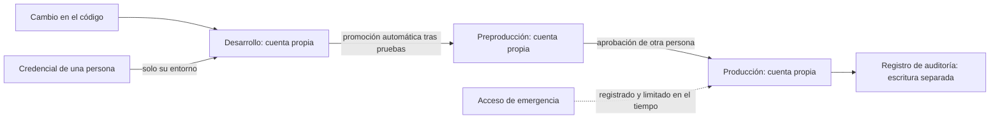
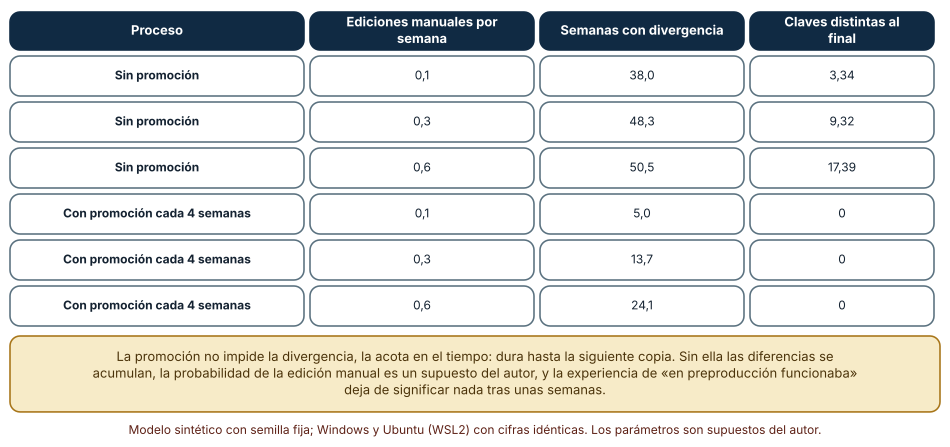
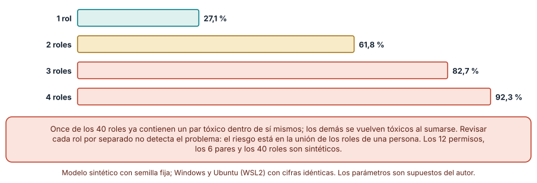

# SE-355 — Entornos, cuentas y separación de responsabilidades

[← SE-354 — Infraestructura como código y estado](../../classes/part-29-cloud-plataforma-e-infraestructura/se-354-infraestructura-como-codigo-y-estado/README.md) · [↑ Parte 29](../../classes/part-29-cloud-plataforma-e-infraestructura/README.md) · [📚 Índice completo](../../classes/README.md) · [🌐 Portal](../../site/classes/SE-355.html) · [SE-356 — Escalado, capacidad y costos →](../../classes/part-29-cloud-plataforma-e-infraestructura/se-356-escalado-capacidad-y-costos/README.md)

## Punto profesional y fundamento pedagógico

**Punto profesional.** La clase existe para que puedas decidir dónde viven los entornos de la plataforma, quién puede cambiar cada uno y cómo se mueve un cambio de desarrollo a producción sin que un error ni una persona puedan hacerlo todo. La cuenta o el proyecto de nube es la frontera más barata de crear y la que más limita el daño de un error, y la separación de funciones convierte «confiamos en esta persona» en una propiedad que se puede comprobar.

**Por qué aparece aquí.** Sigue a **Infraestructura como código y estado**: allí había un estado y un plan que alguien aplicaba; ahora hay que decidir sobre qué cuenta, con qué credencial y tras qué revisión. El caso conductor de la parte es la plataforma de entregas llevada a una infraestructura gestionada, y esta clase decide cómo se separan sus tres entornos y quién puede aprobar un cambio en producción.

**Error conceptual que debe corregir.** Creer que separar entornos es poner nombres distintos a los recursos. Una etiqueta no limita nada: lo que acota el daño es una frontera de credenciales y permisos que el error no pueda cruzar, y lo que mantiene los entornos parecidos es un proceso, no la buena voluntad de quien edita.

**Secuencia de aprendizaje.** Antes de leer los resultados, predices qué probabilidad hay de que un error cometido en desarrollo toque producción con una sola cuenta, cuántas claves de configuración divergen tras un año con y sin promoción, y qué porcentaje de personas acumula una combinación de permisos incompatible al asignarles varios roles; después lo calculas con tres simulaciones. La secuencia usa predicción, explicación propia, contraste y recuperación. [ICAP](https://icap.education.asu.edu/research) distingue participación de construcción de conocimiento; [How People Learn II](https://nap.nationalacademies.org/catalog/24783/how-people-learn-ii-learners-contexts-and-cultures) exige conectar conocimiento previo, contexto y transferencia; la [práctica de recuperación](https://pubmed.ncbi.nlm.nih.gov/16507066/) respalda producir de nuevo la explicación tras una demora; y [Education for Life and Work](https://nap.nationalacademies.org/resource/13398/dbasse_084153.pdf) exige devolución que explique la causa del error.

**Evidencia de aprendizaje.** `entornos-y-cuentas.md` con la predicción, las tres figuras reproducidas, el mapa de cuentas y entornos de la plataforma con quién puede qué en cada uno, la lista de pares de permisos incompatibles y el procedimiento de acceso de emergencia.

**Límite de la conclusión.** Los 24 recursos, la frecuencia de acciones comodín, la probabilidad de edición manual, los 12 permisos y los 6 pares prohibidos son supuestos del autor y los datos son sintéticos. No se evaluó ninguna organización, estructura de cuentas ni política de un proveedor, y no se midió un incidente real.

### Trazabilidad fuente → afirmación

| Fuente primaria u oficial | Afirmación que respalda | Lo que no prueba |
|---|---|---|
| [AWS: Organizing Your AWS Environment Using Multiple Accounts](https://docs.aws.amazon.com/whitepapers/latest/organizing-your-aws-environment/organizing-your-aws-environment.html) | Plantea separar cargas en varias cuentas para aislar el efecto de errores y simplificar permisos y facturación. | No indica cuántas cuentas conviene tener ni cuesta cada una. |
| [Google Cloud: jerarquía de recursos](https://cloud.google.com/resource-manager/docs/cloud-platform-resource-hierarchy) | Describe organización, carpetas y proyectos como niveles donde se heredan políticas. | No dice qué política conviene en cada nivel. |
| [The Twelve-Factor App: paridad entre desarrollo y producción](https://12factor.net/dev-prod-parity) | Argumenta que mantener los entornos lo más parecidos posible reduce las brechas de tiempo, de personal y de herramientas. | No mide cuánto reduce los incidentes. |
| [NIST SP 800-53 Rev. 5](https://csrc.nist.gov/pubs/sp/800/53/r5/upd1/final) | Incluye entre sus controles la separación de funciones para impedir que una persona complete por sí sola una actividad crítica. | No dice qué pares de funciones son incompatibles en una plataforma concreta. |

## Antes de empezar

Recupera lo aprendido en `SE-354`: un plan se revisa antes de aplicarse. La pregunta activa es: **¿qué credencial aplica, sobre qué cuenta y quién más tiene que decir que sí?**

## Prerrequisitos

- Haber completado `SE-354` o poder explicar qué es un plan y por qué se revisa.
- Python 3.11 o posterior; los experimentos usan solo la biblioteca estándar (`random`, `statistics`) y no necesitan cuenta en un proveedor.
- Saber qué es un entorno de desarrollo, de preproducción y de producción, y qué es un rol de acceso.

## Problema auténtico

La plataforma de entregas usaba una sola cuenta de nube para desarrollo, preproducción y producción, separadas por prefijos en los nombres. Un script de limpieza escrito para desarrollo, con un comodín mal acotado, borró los depósitos de entregas de producción un viernes. En paralelo, la configuración de preproducción llevaba meses sin parecerse a la de producción: «en preproducción funcionaba» dejó de ser una garantía. Y la misma persona que escribía los cambios de producción los aprobaba y podía modificar el registro de auditoría. Tres problemas distintos con una causa común: nada limitaba lo que un error o una persona podía alcanzar.

## Objetivos observables

Al terminar podrás:

1. comparar estructuras de cuentas por el alcance del daño de un error y no por su costo de administración;
2. medir cuánto divergen dos entornos con y sin un proceso de promoción;
3. identificar combinaciones de permisos incompatibles y calcular cuántas personas las acumulan al sumar roles;
4. diseñar un acceso de emergencia que no deshaga la separación de funciones;
5. escribir el mapa de cuentas y entornos de la plataforma con quién puede qué en cada uno.

## Mapa conceptual



El mapa separa los tres entornos en cuentas distintas, mueve los cambios por una **promoción** que exige pruebas y aprobación de otra persona, y deja el acceso de emergencia como una excepción punteada con registro. El registro de auditoría vive aparte para que quien cambia no pueda editar la evidencia.

## Temas y por qué importan

| Tema | Por qué cambia una decisión profesional | Evidencia mínima |
|---|---|---|
| Cuentas como frontera | Una credencial solo alcanza lo de su cuenta; el error no cruza. | Porcentaje de errores que tocan producción por estructura |
| Paridad de entornos | Un entorno que no se parece a producción no predice su comportamiento. | Divergencia de configuración con y sin promoción |
| Promoción de cambios | Los cambios viajan por un proceso y no por una edición directa. | Semanas con divergencia según el proceso |
| Separación de funciones | Quien escribe, aprueba y audita no debe ser la misma persona. | Pares de permisos incompatibles y su incidencia |
| Acceso de emergencia | La excepción debe ser rápida, acotada y visible. | Procedimiento con registro y caducidad |

## Conceptos y decisiones

### 1. Cuentas como frontera

Las guías de AWS y de Google Cloud coinciden en que las cuentas o proyectos son una unidad de aislamiento: una credencial concedida en una no abre las demás, los límites de cuota y de costos son propios, y las políticas se heredan desde la organización. Separar por entorno y por carga reduce el **radio de explosión**: el máximo daño posible de una credencial robada o de un comando mal escrito. El costo es administrativo: más cuentas que crear, enlazar y vigilar, lo que se resuelve con automatización y no con menos cuentas. Una sola cuenta con prefijos es barata hasta el primer error que cruza el prefijo.

### 2. Paridad de entornos

La metodología de las doce factores sostiene que los entornos deben parecerse en lo posible para evitar las brechas de tiempo (código que tarda semanas en llegar a producción), de personal (quien escribe no despliega) y de herramientas (una base distinta en desarrollo). Un entorno de preproducción que ya no se parece a producción da una falsa seguridad: pasa pruebas que producción no pasaría. La paridad no es identidad: el tamaño, los datos y los secretos son distintos y deben serlo; lo que debe coincidir es la forma, las versiones y la configuración que afecta al comportamiento.

### 3. Promoción de cambios

La forma de mantener la paridad es que los cambios no se editen en cada entorno sino que se **promuevan**: un artefacto o una configuración que pasó pruebas en uno se copia al siguiente con las diferencias declaradas. La promoción convierte la divergencia en una excepción registrada, y las ediciones manuales en un fallo que el siguiente ciclo corrige. No evita que alguien edite a mano; evita que la edición dure. Su límite es el ritmo: si se promueve cada cuatro semanas, una divergencia puede durar cuatro semanas.

### 4. Separación de funciones

El control de separación de funciones de NIST busca que una actividad crítica no la complete una sola persona: quien propone un cambio no es quien lo aprueba, quien despliega no puede alterar el registro de auditoría, quien crea usuarios no puede asignarles administración. Cada par prohibido se escribe como una regla comprobable sobre los permisos efectivos. La dificultad es la combinación: un rol puede ser inocuo y la suma de dos, no. Por eso se revisa la unión de los roles de cada persona y no cada rol por separado.

### 5. Acceso de emergencia

Cuando algo falla en producción hay que poder actuar rápido, y los permisos mínimos del día a día no bastan. El acceso de emergencia es una excepción deliberada: concede más permisos por un tiempo limitado, exige una justificación y deja un registro que otra persona revisa después. Lo que no debe hacer es convertirse en el camino normal, ni deshacer la separación de funciones: quien usa el acceso de emergencia no debería poder borrar su registro. Un acceso de emergencia sin registro es un administrador permanente con otro nombre.

### El radio de un error

Se modelan 24 recursos (3 entornos, 4 servicios, 2 clases) y 20 000 acciones cuya intención es desarrollo o preproducción, con servicio al azar. El 5 % son comodines que afectan a todo lo que la credencial alcanza; el resto afecta a un solo recurso. Se comparan tres estructuras: una cuenta, una por entorno y una por entorno y servicio.

```python
topo = {"una cuenta": lambda e, s: "x", "por entorno": lambda e, s: e, "por entorno y servicio": lambda e, s: (e, s)}
hit = [x for x in res if f(x[0], x[1]) == f(e, s)] if wild else [x for x in res if x[:2] == (e, s)][:1]
```

| Estructura de cuentas | Errores que tocan producción | Recursos afectados por error |
|---|---:|---:|
| Una sola cuenta | 5,54 % | 2,28 |
| Una cuenta por entorno | 0 % | 1,39 |
| Una cuenta por entorno y servicio | 0 % | 1,06 |

Con una sola cuenta, uno de cada dieciocho errores hechos en desarrollo o preproducción alcanza producción; con una cuenta por entorno, ninguno. Separar por servicio no añade protección frente a producción en este modelo y reduce el alcance dentro de cada entorno de 1,39 a 1,06 recursos por error. La frontera no evita el error, acota su alcance: el comodín sigue destruyendo, pero ya no cruza.


**Cómo leer la figura.** Cada punto es una estructura de cuentas: el eje horizontal es el promedio de recursos afectados por error y el vertical, el porcentaje de errores que llegan a producción. Mira que los dos puntos de las cuentas separadas caen en 0 % de cruce y a la izquierda: la frontera acota el daño y también el cruce. **Dónde deja de valer:** el modelo supone que la credencial solo alcanza su cuenta; una confianza entre cuentas, un rol que se puede asumir desde otra o un recurso compartido reabren el cruce. El 5 % de comodines y la intención uniforme son supuestos del autor.

### Cuánto divergen los entornos

Se simulan 52 semanas con 80 claves de configuración por entorno, 8 de las cuales difieren a propósito entre preproducción y producción. Cada semana, con probabilidad `p`, alguien edita a mano una clave de un entorno elegido al azar (producción con doble peso). Con promoción, cada cuatro semanas se copian las 72 claves compartidas desde desarrollo a preproducción y de ahí a producción. Se cuentan las semanas con alguna clave distinta entre preproducción y producción y las claves distintas al final, en 300 años simulados.

```python
if w % 4 == 3 and promote:
    for k in range(8, 80):
        cfg["stage"][k] = cfg["dev"][k]; cfg["prod"][k] = cfg["stage"][k]
bad = sum(1 for k in range(8, 80) if cfg["stage"][k] != cfg["prod"][k])
```

| Proceso | Ediciones manuales por semana | Semanas con divergencia | Claves distintas al final |
|---|---:|---:|---:|
| Sin promoción | 0,1 | 38,0 | 3,34 |
| Sin promoción | 0,3 | 48,3 | 9,32 |
| Sin promoción | 0,6 | 50,5 | 17,39 |
| Con promoción cada 4 semanas | 0,1 | 5,0 | 0 |
| Con promoción cada 4 semanas | 0,3 | 13,7 | 0 |
| Con promoción cada 4 semanas | 0,6 | 24,1 | 0 |

Sin promoción, con una edición cada diez semanas, hay divergencia durante 38 de 52 semanas, y las diferencias se acumulan. Con promoción, el final siempre coincide y la divergencia dura mientras llega la siguiente copia. La promoción no impide la edición manual: acorta su vida, y por eso conviene que sea más frecuente que el ciclo de despliegue.



**Cómo leer la figura.** El eje horizontal es la frecuencia de ediciones manuales y el vertical, las semanas del año con alguna clave distinta entre preproducción y producción; la línea punteada marca las 52 semanas. Mira la separación entre las dos líneas: la promoción baja la divergencia en cada frecuencia. Las claves distintas al final del año (3,34 a 17,39 sin promoción, 0 con ella) están en la tabla. **Dónde deja de valer:** la frecuencia de edición es un supuesto y las ediciones se modelan como cambios de un valor independiente; una edición manual real puede ser un arreglo necesario que conviene incorporar al código, no copiar encima.

### Combinaciones tóxicas

Se definen 12 permisos y seis pares incompatibles (por ejemplo, desplegar en producción y aprobar en producción, o escribir en producción y escribir en el registro de auditoría). Se generan 40 roles con entre dos y cuatro permisos al azar, y se calcula, con 2 000 personas por valor, qué porcentaje reúne un par tóxico al asignarles entre uno y cuatro roles.

```python
eff = set()
for ro in r.sample(roles, k):
    eff |= ro
bad += any(a in eff and b in eff for a, b in toxic)
```

| Roles asignados | Personas con una combinación tóxica |
|---|---:|
| 1 | 27,1 % |
| 2 | 61,8 % |
| 3 | 82,7 % |
| 4 | 92,3 % |

Once de los 40 roles ya contienen un par tóxico dentro de sí mismos, y los demás se vuelven tóxicos al sumarse. Revisar cada rol por separado no detecta el problema: el riesgo está en la unión de los roles de una persona. En una organización real los roles no se asignan al azar y los pares incompatibles son pocos y conocidos, pero la tendencia, que la probabilidad crece con cada rol añadido, es robusta.



**Cómo leer la figura.** Cada barra es el porcentaje de personas con un par de permisos incompatibles al asignarles ese número de roles. **Dónde deja de valer:** los 40 roles, los 12 permisos y los 6 pares son sintéticos y los roles se asignan al azar; en la práctica unos pares son más graves que otros y una persona con un par tóxico puede estar cubierta por un control compensatorio, como la aprobación de otra.

## Definiciones de trabajo

- **radio de explosión:** conjunto de recursos que un error o una credencial comprometida puede afectar.
- **paridad de entornos:** grado en que los entornos coinciden en forma, versiones y configuración que afecta al comportamiento.
- **promoción:** movimiento de un cambio ya probado de un entorno al siguiente por un proceso definido.
- **separación de funciones:** principio de que ninguna persona complete sola una actividad crítica.
- **acceso de emergencia:** concesión excepcional, limitada en el tiempo y registrada, de permisos mayores a los habituales.

Las definiciones son operativas para la plataforma de entregas. Cada proveedor y cada norma usa estos términos con matices y debe contrastarse con la documentación primaria enlazada al final.

## Ejemplo mínimo

El fragmento revisa si una persona con dos roles acumula un par incompatible. Antes de ejecutarlo, predice el resultado.

```python
roles = {"desarrollo": {"escribir_codigo", "desplegar_prod"}, "revision": {"aprobar_prod", "ver_costos"}}
toxicos = [("desplegar_prod", "aprobar_prod")]
efectivos = set().union(*(roles[r] for r in ("desarrollo", "revision")))
print(any(a in efectivos and b in efectivos for a, b in toxicos))
```

La salida es `True`: cada rol es razonable y su suma no lo es. Registra versión de Python, comando y salida; después quita uno de los roles y observa el resultado.

## Ejemplo profesional

El equipo de la plataforma crea tres cuentas, una por entorno, administradas desde una organización que fija políticas comunes: ningún usuario puede desactivar el registro, y los depósitos de producción deniegan el borrado masivo. Los cambios llegan a preproducción por promoción automática tras las pruebas y a producción solo con la aprobación de una persona que no escribió el cambio. Un proceso compara cada semana las 72 claves compartidas entre preproducción y producción y abre una incidencia con cada diferencia. Las 8 diferencias declaradas (tamaño de las instancias, nombres, volumen de datos) están en un archivo revisable. Para los permisos, escribe los seis pares incompatibles como pruebas sobre los permisos efectivos de cada persona y las ejecuta al asignar un rol. El acceso de emergencia se concede por una hora con una justificación y envía su registro a una cuenta de auditoría que ninguna de las personas que lo usan puede escribir. Compara con el estado inicial: el script de limpieza de desarrollo ya no puede ver los depósitos de producción.

## Práctica guiada

1. Predice qué porcentaje de errores de desarrollo tocan producción con una sola cuenta.
2. Genera los 24 recursos y las 20 000 acciones con semilla fija y reproduce la tabla de tres estructuras.
3. Simula 52 semanas con y sin promoción para tres frecuencias de edición y reproduce la tabla.
4. Cambia la promoción a cada semana y mide el efecto sobre las semanas con divergencia.
5. Genera 40 roles y calcula las combinaciones tóxicas por número de roles.
6. Escribe los pares incompatibles de la plataforma y la prueba que los comprueba sobre los permisos efectivos.
7. Entrega `entornos-y-cuentas.md` y pide a otra persona que encuentre un camino que cruce la frontera de cuentas.

## Ejercicios

1. **Frontera:** explica por qué una cuenta por servicio no reduce los errores que tocan producción en el modelo y qué sí reduce.
2. **Promoción:** con edición manual de 0,3 por semana, ¿cuánto bajan las semanas con divergencia si se promueve cada semana en lugar de cada cuatro? Razona sin simular.
3. **Roles:** diseña dos roles que no sumen un par tóxico y explica qué compromiso supone.
4. **Emergencia:** describe el procedimiento de acceso de emergencia y qué evidencia deja.

## Reto verificable

Entrega `entornos-y-cuentas.md` con la predicción, las tres tablas reproducidas con las mismas semillas, el mapa de cuentas y entornos de la plataforma, los pares incompatibles con su prueba y el procedimiento de emergencia. Se aprueba si otra persona ejecuta el código desde un checkout limpio, obtiene las mismas cifras y puede decir quién aprueba un cambio en producción y qué ve si la aprobación falta. No se aprueba por afirmar que los entornos están separados por prefijos ni por escribir una política sin una prueba que la compruebe.

## Caso conductor

La plataforma de entregas es el caso conductor de la Parte 29. Esta clase deja el séptimo artefacto: el mapa de cuentas, la promoción y las separaciones de funciones. `SE-356` pregunta cuánta capacidad hay en cada entorno y cuánto cuesta. Cambia una estructura, por ejemplo fusionar preproducción y producción, y mira cuánto crece el porcentaje de errores que cruzan.

## Preguntas frecuentes

### ¿No es demasiado administrar tantas cuentas?

Es un costo real y se paga con automatización: la creación y la política de cada cuenta salen del código. La alternativa es una cuenta única, cuyo costo se paga en el primer error que cruza la frontera. La clase mide el segundo; el primero depende de tu organización.

### ¿Por qué copiar la configuración en vez de dejar que cada equipo la ajuste?

Porque lo que se ajusta a mano diverge y deja de predecir. Las diferencias legítimas se declaran; las demás se promueven. Es la misma idea que el estado compartido de la clase anterior.

### ¿Quién audita al que audita?

Nadie del todo: se reduce con registros que no pueda escribir quien actúa y con revisiones de otra persona. La separación de funciones es una cadena de controles que acota el abuso y no lo elimina.

### ¿La separación de funciones frena la entrega?

Añade un paso, y el paso se acorta con automatización: pruebas, plantillas y revisiones pequeñas. Para cambios de bajo riesgo, un control compensatorio, como la aprobación automática tras pruebas y un registro, puede reemplazar a la persona.

## Fallo controlado y diagnóstico

Reproduce el fallo clásico de la clase: **un error de desarrollo borra recursos de producción por compartir cuenta**. Aplica un comodín sobre el modelo de una sola cuenta.

Registra síntoma, entrada mínima, hipótesis, observación que descarta cada hipótesis, causa, corrección y prueba de regresión. **Síntoma:** se borran recursos de producción tras ejecutar un script de desarrollo. **Hipótesis rivales:** (a) el script apuntaba a producción por una variable mal puesta; (b) un permiso excesivo lo permitió; (c) la frontera entre entornos era un prefijo y no una cuenta. **Prueba:** lista los recursos afectados y su cuenta y comprueba qué credencial se usó y a qué cuentas alcanza. **Conclusión:** la credencial de desarrollo alcanzaba producción porque estaban en la misma cuenta. **Regresión:** crea una cuenta por entorno y añade una prueba que intente, con la credencial de desarrollo, listar producción y falle. No arregles a la vez la frontera y el script.

## Errores comunes y cómo corregirlos

| Síntoma | Causa probable | Corrección |
|---|---|---|
| Un script de desarrollo afecta producción | Misma cuenta y prefijos como frontera | Una cuenta por entorno con políticas heredadas |
| Preproducción pasa y producción falla | Configuraciones que divergieron | Promoción periódica y comparación semanal |
| Una persona aprueba sus propios cambios | Roles que suman un par incompatible | Pruebas sobre permisos efectivos al asignar un rol |
| El acceso de emergencia no deja rastro | Registro escribible por quien lo usa | Registro en una cuenta de auditoría separada |
| Se acumulan cuentas sin dueño | Creación manual sin automatización | Crear cuentas desde código con dueño y vencimiento |

## Entorno y archivos clave

```text
work/SE-355/
├── README.md
├── entornos/
│   ├── radio.py
│   ├── divergencia.py
│   └── toxicas.py
├── tests/test_entornos.py
└── evidence/entornos-y-cuentas.md
```

El `README` declara versión de Python, semillas y comandos. Los experimentos usan solo la biblioteca estándar y se ejecutaron con CPython 3.12.9 en Windows 11 y 3.12.3 en Ubuntu bajo WSL2 con salidas idénticas. No se usó ninguna cuenta de proveedor; si usas una, declara región, costo y limpieza.

## Seguridad, ética y accesibilidad

- el modelo no usa credenciales ni datos reales; no pegues claves de acceso en los ejemplos ni en el repositorio;
- los pares incompatibles protegen a las personas afectadas por un cambio malicioso o erróneo: documenta por qué cada uno existe y quién decide una excepción;
- un acceso de emergencia sin límite de tiempo es un administrador permanente: fija caducidad y revisión posterior;
- documenta el mapa de cuentas en texto además del diagrama, para que un lector de pantalla pueda seguirlo;
- respeta las condiciones de los proveedores al crear cuentas y no crees cuentas con datos personales de terceros.

## Puente hacia el trabajo con agentes

Un agente al que se le pide «prepara los entornos de desarrollo y producción» producirá recursos con prefijos distintos en la misma cuenta y con una sola credencial de despliegue con permisos amplios, porque eso evita errores de permisos. Pídele en cambio que declare una cuenta por entorno, que genere la promoción como un proceso con pruebas y aprobación y que incluya una prueba que intente cruzar la frontera con la credencial de desarrollo y falle. Revisa especialmente qué credenciales usa y con qué alcance, y si puede aprobar sus propios cambios: son los dos lugares donde la separación se rompe sin que nadie lo decida.

## Transferencia

Traslada el análisis a otro dominio (por ejemplo, una tienda con pagos y un panel de administración): cambia los recursos y conserva el procedimiento de medir el alcance de un error por estructura de cuentas, medir la divergencia con y sin promoción, escribir los pares incompatibles y calcular su incidencia. La transferencia está lograda cuando puedes decir qué frontera pondrías primero y por qué, no cuando los mapas se parecen.

## Evaluación y evidencia

| Criterio | Evidencia para aprobar |
|---|---|
| comprensión | explicación de cuenta como frontera, promoción y separación de funciones |
| corrección | simulaciones reproducibles con las mismas semillas |
| decisión | mapa de cuentas, pares incompatibles y procedimiento de emergencia |
| diagnóstico | reproducción del fallo «error que cruza a producción» con regresión |
| incertidumbre | declaración de que los parámetros son supuestos y no se midió una organización |
| reproducibilidad | versiones, comandos, salida y límites declarados |

## Fuentes

- [AWS: Organizing Your AWS Environment Using Multiple Accounts](https://docs.aws.amazon.com/whitepapers/latest/organizing-your-aws-environment/organizing-your-aws-environment.html) — separación en varias cuentas; autoridad: documentación del proveedor.
- [Google Cloud: jerarquía de recursos](https://cloud.google.com/resource-manager/docs/cloud-platform-resource-hierarchy) — organización, carpetas y proyectos; autoridad: documentación del proveedor.
- [The Twelve-Factor App: dev/prod parity](https://12factor.net/dev-prod-parity) — paridad entre entornos; autoridad: metodología publicada por sus autores.
- [NIST SP 800-53 Rev. 5](https://csrc.nist.gov/pubs/sp/800/53/r5/upd1/final) — catálogo de controles, incluida la separación de funciones; autoridad: NIST.
- [Python: random](https://docs.python.org/3/library/random.html) — generador usado en los experimentos; autoridad: documentación de Python.

Cada fuente respalda el mecanismo indicado; ninguna demuestra que el 5,54 %, las 38 semanas ni el 27,1 % se observen en una organización real. Esa afirmación depende de la estructura de cuentas, del proceso de cambios y de los roles de cada organización.

## Límites y siguiente paso

Se ejecutaron tres experimentos sintéticos en Windows y Ubuntu (WSL2) con resultados idénticos. No se evaluó ninguna organización ni estructura real: los 24 recursos, el 5 % de acciones comodín, la frecuencia de edición manual, los 12 permisos y los 6 pares son supuestos del autor. La siguiente clase mira cuánta capacidad necesita cada entorno y cuánto cuesta: escalado, capacidad y costos.

## Glosario

- **radio de explosión:** conjunto de recursos que un error o una credencial comprometida puede afectar.
- **paridad de entornos:** grado en que los entornos coinciden en forma, versiones y configuración que afecta al comportamiento.
- **promoción:** movimiento de un cambio ya probado de un entorno al siguiente por un proceso definido.
- **separación de funciones:** principio de que ninguna persona complete sola una actividad crítica.
- **acceso de emergencia:** concesión excepcional, limitada en el tiempo y registrada, de permisos mayores a los habituales.

---

[← SE-354 — Infraestructura como código y estado](../../classes/part-29-cloud-plataforma-e-infraestructura/se-354-infraestructura-como-codigo-y-estado/README.md) · [↑ Parte 29](../../classes/part-29-cloud-plataforma-e-infraestructura/README.md) · [📚 Índice completo](../../classes/README.md) · [🌐 Portal](../../site/classes/SE-355.html) · [SE-356 — Escalado, capacidad y costos →](../../classes/part-29-cloud-plataforma-e-infraestructura/se-356-escalado-capacidad-y-costos/README.md)
