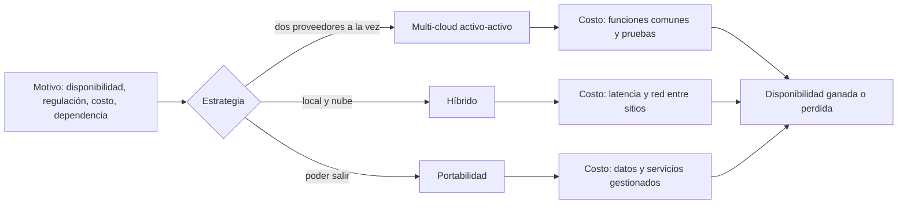
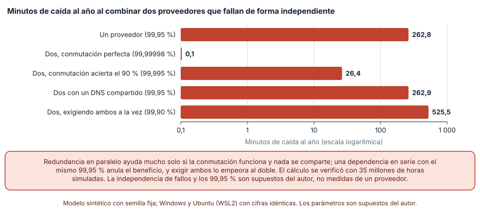
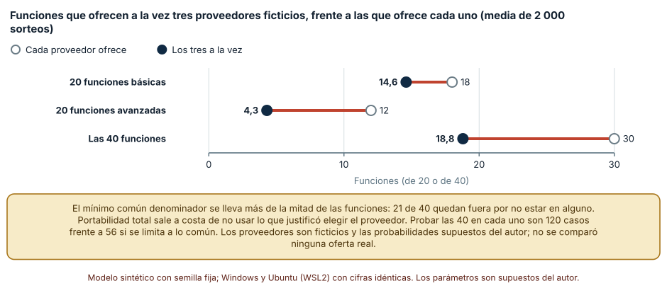
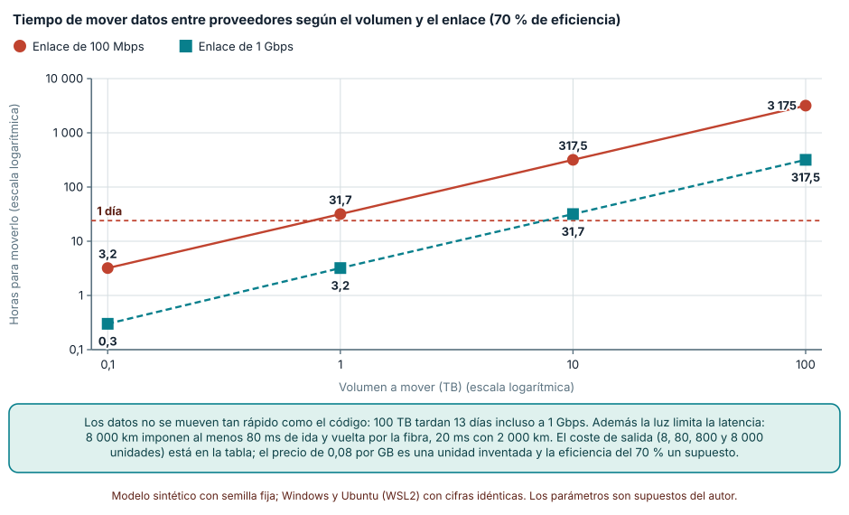

# SE-357 — Multi-cloud, híbrido y portabilidad real

[← SE-356 — Escalado, capacidad y costos](../../classes/part-29-cloud-plataforma-e-infraestructura/se-356-escalado-capacidad-y-costos/README.md) · [↑ Parte 29](../../classes/part-29-cloud-plataforma-e-infraestructura/README.md) · [📚 Índice completo](../../classes/README.md) · [🌐 Portal](../../site/classes/SE-357.html) · [SE-358 — Plataformas internas y golden paths →](../../classes/part-29-cloud-plataforma-e-infraestructura/se-358-plataformas-internas-y-golden-paths/README.md)

## Punto profesional y fundamento pedagógico

**Punto profesional.** La clase existe para que, cuando alguien proponga «usar dos nubes por si una cae» o «no depender de un proveedor», puedas calcular qué se gana, qué se paga y bajo qué condiciones el argumento deja de sostenerse. Tres cálculos bastan para la mayoría de las discusiones: cómo se compone la disponibilidad, cuánto de lo que usas existe en todos los proveedores y cuánto cuesta y tarda mover los datos.

**Por qué aparece aquí.** Sigue a **Escalado, capacidad y costos**: ya sabes cuánta capacidad necesitas y a qué precio; ahora preguntas si toda tiene que estar en un solo lugar. El caso conductor de la parte es la plataforma de entregas llevada a una infraestructura gestionada, y esta clase decide si alguna de sus piezas debe poder correr en otro proveedor o en una instalación propia.

**Error conceptual que debe corregir.** Creer que dos proveedores son siempre más disponibles que uno y que la portabilidad es una propiedad que se tiene o no se tiene. Una dependencia en serie, un servicio compartido o una conmutación que falla anulan la ventaja, y la portabilidad tiene un precio medible en funciones que dejas de usar y en datos que no se mueven.

**Secuencia de aprendizaje.** Antes de leer los resultados, predices cuántos minutos al año caería un servicio con dos proveedores de 99,95 % cada uno, cuántas de cuarenta funciones ofrecen a la vez tres proveedores y cuánto tarda mover cien terabytes por un enlace de un gigabit; después calculas la disponibilidad con cinco composiciones, comparas las funciones con un sorteo de tres proveedores ficticios y calculas el tiempo y el costo de mover datos. La secuencia usa predicción, explicación propia, contraste y recuperación. [ICAP](https://icap.education.asu.edu/research) distingue participación de construcción de conocimiento; [How People Learn II](https://nap.nationalacademies.org/catalog/24783/how-people-learn-ii-learners-contexts-and-cultures) exige conectar conocimiento previo, contexto y transferencia; la [práctica de recuperación](https://pubmed.ncbi.nlm.nih.gov/16507066/) respalda producir de nuevo la explicación tras una demora; y [Education for Life and Work](https://nap.nationalacademies.org/resource/13398/dbasse_084153.pdf) exige devolución que explique la causa del error.

**Evidencia de aprendizaje.** `portabilidad.md` con la predicción, las tres figuras reproducidas, la clasificación de las piezas de la plataforma en «portable», «portable con adaptación» y «ligada al proveedor» y la estimación de tiempo y costo de mover sus datos.

**Límite de la conclusión.** Los tres proveedores son ficticios, la disponibilidad de 99,95 %, la independencia de los fallos, las probabilidades de oferta de funciones y el precio de salida son supuestos del autor, y los resultados no comparan ninguna oferta real. No se desplegó nada en más de un entorno y no se midió ninguna latencia de red real.

### Trazabilidad fuente → afirmación

| Fuente primaria u oficial | Afirmación que respalda | Lo que no prueba |
|---|---|---|
| [Google Cloud: patrones de arquitectura híbrida y multi-cloud](https://cloud.google.com/architecture/hybrid-multicloud-patterns-and-practices) | Cataloga los motivos y los patrones para distribuir cargas entre entornos y discute sus compromisos. | Es una guía de un proveedor; no mide si el patrón compensa en cada caso. |
| [OCI Image Specification](https://github.com/opencontainers/image-spec) | Define un formato de imagen de contenedor común, lo que permite mover el mismo artefacto entre entornos compatibles. | No hace portable lo que la aplicación consume fuera de la imagen, como servicios gestionados. |
| [Kubernetes: documentación](https://kubernetes.io/docs/concepts/architecture/controller/) | Ofrece un modelo de orquestación declarativo que se implementa en distintos entornos. | No garantiza que todas las extensiones y servicios asociados existan en cada entorno. |
| [AWS Well-Architected Framework](https://docs.aws.amazon.com/wellarchitected/latest/framework/welcome.html) | Trata la fiabilidad como la composición de dependencias y recomienda diseñar para el fallo de componentes. | No da cifras de disponibilidad de proveedores. |

## Antes de empezar

Recupera lo aprendido en `SE-356`: la capacidad y el costo dependen del patrón de demanda. La pregunta activa es: **¿qué disponibilidad gano con un segundo proveedor, qué funciones pierdo y cuánto cuesta y tarda volver atrás?**

## Prerrequisitos

- Haber completado `SE-356` o poder explicar por qué conviene comprometer la mediana de la demanda.
- Python 3.11 o posterior; los experimentos usan solo la biblioteca estándar (`random`, `statistics`) y no necesitan cuenta en ningún proveedor.
- Saber qué es la disponibilidad como porcentaje y qué es una dependencia en serie y en paralelo.

## Problema auténtico

La plataforma de entregas cayó cuatro horas por una falla regional de su proveedor y la dirección pidió «replicar en un segundo proveedor». El equipo estimó el esfuerzo y descubrió tres cosas: el servicio de colas y el de autenticación gestionados que usaba no existían en el otro proveedor con el mismo comportamiento; mover los 40 terabytes de entregas históricas llevaría semanas y tendría un costo de salida considerable; y el DNS que decidía a qué proveedor enviar el tráfico era un solo servicio, de modo que seguía siendo un punto único. La pregunta no era si tener dos proveedores, sino qué fallo se quería cubrir y a qué precio.

## Objetivos observables

Al terminar podrás:

1. distinguir multi-cloud, híbrido y portabilidad por el problema que cada uno pretende resolver;
2. calcular la disponibilidad de composiciones en paralelo, en serie y con un servicio compartido, y detectar cuándo un segundo proveedor no ayuda;
3. estimar cuántas funciones comunes ofrecen varios proveedores y qué se pierde al limitarse a ellas;
4. calcular el tiempo y el costo de mover un volumen de datos y el mínimo físico de latencia entre dos sitios;
5. clasificar las piezas de la plataforma por el grado en que pueden moverse y decidir cuáles justifican el esfuerzo.

## Mapa conceptual



El mapa parte del **motivo**, no de la tecnología, porque cada motivo pide una estrategia distinta y cada una tiene su costo propio. Las tres desembocan en la misma pregunta: cuánta disponibilidad se gana de verdad una vez descontados los puntos únicos y las funciones que se renuncian.

## Temas y por qué importan

| Tema | Por qué cambia una decisión profesional | Evidencia mínima |
|---|---|---|
| Motivos y estrategias | Se resuelve distinto la disponibilidad, la regulación y la dependencia. | Motivo escrito antes de elegir estrategia |
| Disponibilidad compuesta | En paralelo mejora, en serie empeora y lo compartido la anula. | Minutos de caída al año por composición |
| Portabilidad y mínimo común | Lo portable es lo que existe en todos; el resto liga al proveedor. | Funciones comunes frente a funciones totales |
| Gravedad de los datos | Los datos tardan y cuestan al moverse. | Tiempo y costo de mover un volumen |
| Latencia física | La distancia impone un mínimo que ninguna optimización baja. | Ida y vuelta mínima por distancia |

## Conceptos y decisiones

### 1. Motivos y estrategias

Multi-cloud significa usar más de un proveedor de nube; híbrido, combinar una instalación propia con la nube; portabilidad, poder cambiar de entorno sin reescribir. Son cosas distintas y se confunden porque comparten el discurso de «no depender de uno». La guía de Google sobre patrones híbridos y multi-cloud organiza los motivos: aprovechar funciones distintas, cumplir una regulación de ubicación de datos, reducir una dependencia, repartir riesgo, aprovechar inversiones existentes. Cada motivo se evalúa con su propio cálculo, y confundirlos produce arquitecturas caras que no resuelven ninguno.

### 2. Disponibilidad compuesta

Si dos componentes fallan de forma independiente y cualquiera basta para servir, la indisponibilidad es el producto de las indisponibilidades: dos proveedores de 99,95 % dan 1 − 0,0005² = 99,99997 % si la conmutación es perfecta. Si el servicio necesita a ambos a la vez, como una réplica síncrona, la disponibilidad es el producto de las disponibilidades: baja a 99,90 %. Y un componente compartido en serie con el par, como el DNS que decide el destino, impone su propio techo: 99,95 % × 99,99997 % ≈ 99,95 %. La lección es que la ganancia de un segundo proveedor existe solo si la conmutación funciona, si los fallos son independientes y si nada común queda en el camino.

### 3. Portabilidad y mínimo común

Una imagen de contenedor es portable: el formato lo define OCI y cualquier entorno compatible la ejecuta. Lo que no es portable es lo que la aplicación consume fuera de la imagen: el servicio de colas, la base de datos gestionada, el sistema de identidad. Cuanto más usa la aplicación esos servicios, más ligada queda. Una aplicación diseñada para ejecutarse en cualquier proveedor se limita a las funciones que todos ofrecen, el mínimo común denominador, y renuncia justo a las funciones que podían justificar la elección. Una capa de abstracción propia no elimina la diferencia: la mueve al equipo, que debe mantenerla y probarla en cada proveedor.

### 4. Gravedad de los datos

Mover código es barato; mover datos no. Tardan según el tamaño y el ancho de banda, cuestan según la tarifa de salida y siguen atrayendo a las aplicaciones que los usan, porque ejecutar lejos de ellos añade latencia y más tráfico de salida. A esto se llama gravedad de los datos: cuanto más pesan, más condicionan dónde vive todo lo demás. Por eso la portabilidad de los datos se decide al diseñar, con formatos abiertos y exportaciones periódicas, y no el día que se quiere salir.

### 5. Latencia física

La luz viaja por una fibra óptica a unos dos tercios de su velocidad en el vacío, alrededor de 200 kilómetros por milisegundo. La ida y vuelta mínima entre dos sitios separados 8 000 km es, por tanto, de unos 80 milisegundos, y ninguna optimización la reduce. Para una aplicación que hace diez consultas en serie a una base de datos remota, eso son 800 ms solo de distancia. Por eso el híbrido con la base de datos en un sitio y la aplicación en otro suele fallar por latencia antes que por ancho de banda.

### Cómo se compone la disponibilidad

Se calcula, para un proveedor de 99,95 % (262,8 minutos de caída al año), la disponibilidad de cinco composiciones y se verifica la de tres con un Montecarlo de 35 millones de horas simuladas (4 000 años), en que cada proveedor falla de forma independiente.

```python
a = 0.9995
paralelo = 1 - (1 - a) ** 2                      # cualquiera basta, conmutación perfecta
con_fallo = a + (1 - a) * 0.9 * a                # la conmutación acierta el 90 %
con_dns = 0.9995 * (1 - (1 - a) ** 2)            # DNS compartido en serie
ambos = a * a                                    # necesita los dos a la vez
```

| Composición | Disponibilidad | Minutos de caída al año |
|---|---:|---:|
| Un proveedor (99,95 %) | 99,95 % | 262,8 |
| Dos, conmutación perfecta e instantánea | 99,99998 % | 0,1 |
| Dos, la conmutación acierta el 90 % | 99,995 % | 26,4 |
| Dos, con un DNS compartido de 99,95 % | 99,95 % | 262,9 |
| Dos, exigiendo ambos a la vez | 99,90 % | 525,5 |

La conmutación perfecta es una cota teórica; con un 90 % de aciertos la caída sube a 26,4 minutos, más de doscientas veces mayor, y con un DNS compartido el segundo proveedor no aporta nada medible. Exigir ambos a la vez duplica la caída. El Montecarlo coincidió con el cálculo: 0,05001 % de indisponibilidad para uno, 0,00001 % para dos con conmutación perfecta y 0,09989 % para ambos a la vez.



**Cómo leer la figura.** Cada barra es una composición y su longitud, los minutos de caída al año, en escala logarítmica: cada marca vale diez veces la anterior. Compara cada barra con la del proveedor único: la conmutación perfecta la reduce a una fracción mínima, pero un DNS compartido la devuelve al nivel de uno solo y exigir ambos la duplica. La disponibilidad porcentual va en la etiqueta. **Dónde deja de valer:** el modelo supone fallos independientes y proveedores del mismo 99,95 %; en la práctica los fallos se correlacionan (una dependencia común, un error de configuración propio) y el 99,95 % es un supuesto, no la cifra de ningún proveedor.

### Cuánto queda en común

Se sortean tres proveedores ficticios. Cada uno ofrece cada una de 20 funciones básicas con probabilidad 0,9 y cada una de 20 avanzadas con probabilidad 0,6. Se cuenta cuántas funciones ofrecen los tres a la vez, con 2 000 sorteos.

```python
basic = [all(rr.random() < 0.9 for _ in range(3)) for _ in range(20)]
adv   = [all(rr.random() < 0.6 for _ in range(3)) for _ in range(20)]
```

| Conjunto | Funciones que ofrecen los tres |
|---|---:|
| 20 funciones básicas (cada proveedor ofrece 18) | 14,6 |
| 20 funciones avanzadas (cada proveedor ofrece 12) | 4,3 |
| Las 40 funciones | 18,8 |

Cada proveedor ofrece 30 de las 40 funciones, y los tres a la vez, 18,8: más de la mitad de las funciones queda fuera por faltar en alguno. Las avanzadas son las que más se pierden, 4,3 de 20, y son las que suelen diferenciar a un proveedor. Probar las 40 funciones en cada proveedor son 120 casos, frente a 56 si se limita a lo común: portabilidad total sale a costa de no usar lo que justificó elegir el proveedor.



**Cómo leer la figura.** Cada fila es un conjunto de funciones: el punto de la derecha es lo que ofrece cada proveedor por separado y el de la izquierda, lo que ofrecen los tres a la vez; el segmento es lo que se pierde al exigir portabilidad. La caída es mayor en las avanzadas. Los casos de prueba (120 frente a 56) están en la tabla. **Dónde deja de valer:** los proveedores son ficticios y las probabilidades supuestos del autor; funciones con el mismo nombre se comportan de forma distinta en cada proveedor, lo que esta cuenta no refleja y empeora la portabilidad.

### Cuánto tarda y cuesta mover datos

Con una eficiencia del 70 % del enlace y una tarifa de salida inventada de 0,08 unidades monetarias por gigabyte, se calcula el tiempo de mover entre 0,1 y 100 terabytes por enlaces de 100 megabits, 1 gigabit y 10 gigabits por segundo.

```python
horas = tb * 1e12 * 8 / (gbps * 1e9 * 0.7) / 3600
salida = tb * 1000 * 0.08
```

| Volumen | A 100 Mbps | A 1 Gbps | A 10 Gbps | Salida (u.m.) |
|---|---:|---:|---:|---:|
| 0,1 TB | 3,2 h | 0,3 h | 0,03 h | 8 |
| 1 TB | 31,7 h | 3,2 h | 0,3 h | 80 |
| 10 TB | 317,5 h (13 días) | 31,7 h | 3,2 h | 800 |
| 100 TB | 3 175 h (132 días) | 317,5 h (13 días) | 31,7 h | 8 000 |

Cien terabytes tardan casi dos semanas incluso a un gigabit, y el costo de salida crece en proporción al volumen. Los 40 terabytes del caso de la plataforma son más de cinco días a un gigabit. Además de moverlos hay que mantenerlos sincronizados mientras se mueven, lo que alarga el proceso. Y la distancia impone su mínimo: 50 km exigen al menos 0,5 ms de ida y vuelta, 2 000 km, 20 ms, y 15 000 km, 150 ms.



**Cómo leer la figura.** El eje horizontal es el volumen y el vertical, las horas necesarias, ambos en escala logarítmica; cada línea es un ancho de banda y la línea punteada marca un día. Mira que las dos líneas son paralelas (diez veces el volumen son diez veces el tiempo) y que a 100 TB ni siquiera 1 Gbps baja de los 13 días. El costo de salida está en la tabla. **Dónde deja de valer:** el 70 % de eficiencia y la tarifa son supuestos; muchos proveedores reducen o eliminan la salida en una migración, y existen envíos físicos y enlaces dedicados que cambian la cuenta. El mínimo de latencia es físico, pero la latencia real es mayor.

## Definiciones de trabajo

- **multi-cloud:** uso de más de un proveedor de nube para una misma carga o plataforma.
- **nube híbrida:** combinación de una instalación propia con servicios de nube que operan de forma coordinada.
- **portabilidad:** capacidad de mover una carga entre entornos con un esfuerzo acotado y conocido.
- **mínimo común denominador:** conjunto de funciones que ofrecen a la vez todos los entornos considerados.
- **gravedad de los datos:** tendencia de las aplicaciones a ubicarse donde están los datos, por el costo y el tiempo de moverlos.

Las definiciones son operativas para la plataforma de entregas. Cada proveedor y cada guía usan estos términos con matices y deben contrastarse con la documentación primaria enlazada al final.

## Ejemplo mínimo

El fragmento calcula los minutos de caída anual de dos proveedores con y sin un componente compartido. Antes de ejecutarlo, predice cuál de las dos configuraciones cae más.

```python
a, d = 0.9995, 0.9995
minutos = lambda x: round((1 - x) * 525600, 1)
print(minutos(1 - (1 - a) ** 2), minutos(d * (1 - (1 - a) ** 2)))
```

La salida es `0.1 262.9`: con un componente compartido de 99,95 % el par no mejora al único proveedor. Registra versión de Python, comando y salida; después sube el DNS a 99,9999 % y observa cuánto vuelve a ayudar el segundo proveedor.

## Ejemplo profesional

El equipo de la plataforma escribe el motivo antes de la solución: reducir el tiempo sin servicio de la recepción de entregas durante el cierre, no cumplir una regulación ni evitar un proveedor. Calcula que un segundo proveedor con conmutación del 90 % y un DNS compartido de 99,95 % no mejora lo suficiente para justificar su costo, y opta por una región adicional dentro del mismo proveedor, una cola que acepta entregas aunque el procesamiento esté caído y una exportación semanal de los datos en un formato abierto. Clasifica sus piezas: la aplicación web en contenedores es portable; las colas y la autenticación gestionadas están ligadas al proveedor, y registra el esfuerzo estimado de reemplazarlas; los 40 terabytes históricos tienen una ruta de salida calculada de cinco a siete días con enlace dedicado. Revisa la decisión cada año o ante un cambio de precios. Compara con el estado inicial: la dirección tiene un costo y una ganancia calculados en lugar de una consigna.

## Práctica guiada

1. Predice los minutos de caída con dos proveedores de 99,95 % y conmutación perfecta, y con un DNS compartido.
2. Calcula las cinco composiciones y compáralas con el Montecarlo.
3. Sortea 2 000 veces tres proveedores y mide las funciones comunes con las probabilidades dadas.
4. Calcula el tiempo y el costo de mover tu volumen de datos con tres anchos de banda.
5. Calcula la latencia física mínima entre dos sitios que elijas y el efecto sobre diez consultas en serie.
6. Clasifica las piezas de la plataforma por su portabilidad con el esfuerzo estimado de moverlas.
7. Entrega `portabilidad.md` y pide a otra persona que encuentre un punto único en tu composición.

## Ejercicios

1. **Composición:** calcula la disponibilidad de dos proveedores de 99,9 % con conmutación del 95 % y compárala con un solo proveedor de 99,95 %.
2. **Mínimo común:** con probabilidades de 0,95 y 0,5, ¿cuántas funciones comunes esperarías de 40? Calcula sin simular.
3. **Datos:** si el volumen crece un 30 % al año, ¿en cuántos años pasa de 10 a 100 TB y qué cambia en la ruta de salida?
4. **Latencia:** explica por qué una base de datos remota con consultas en serie falla por latencia antes que por ancho de banda.

## Reto verificable

Entrega `portabilidad.md` con la predicción, las tres tablas reproducidas con las mismas semillas, la clasificación de las piezas de la plataforma, el motivo escrito de la estrategia elegida y su costo estimado. Se aprueba si otra persona ejecuta el código desde un checkout limpio, obtiene las mismas cifras y puede decir qué fallo cubre y cuál no tu arquitectura. No se aprueba por afirmar que dos proveedores «son más seguros» sin un cálculo con el punto único, ni por llamar portable a una pieza que usa un servicio gestionado exclusivo.

## Caso conductor

La plataforma de entregas es el caso conductor de la Parte 29. Esta clase deja el noveno artefacto: la estrategia de portabilidad y su costo. `SE-358` pregunta cómo se ofrece todo esto a los equipos sin que cada uno lo reconstruya. Cambia un supuesto, por ejemplo la probabilidad de conmutación, y observa cuánto se mueve la disponibilidad.

## Preguntas frecuentes

### ¿Multi-cloud es una buena idea?

Depende del motivo. Para reducir el riesgo de una falla regional, una segunda región del mismo proveedor suele dar casi la misma ganancia con mucho menos esfuerzo; para evitar una dependencia o cumplir una regulación de ubicación, un segundo proveedor puede ser necesario. La clase da el cálculo, no la respuesta.

### ¿Los contenedores resuelven la portabilidad?

Resuelven la del código empaquetado. No resuelven la de los datos ni la de los servicios gestionados que la aplicación usa, que son lo que más ata en la práctica.

### ¿Por qué no usar solo servicios abiertos?

Se puede, y entonces el equipo opera lo que el proveedor ofrecía gestionado: parches, copias, escalado. Es el compromiso de `SE-349` de nuevo: lo que no delegas lo respondes tú.

### ¿Cuándo tiene sentido un entorno híbrido?

Cuando hay una restricción de ubicación de los datos, una inversión existente o una latencia hacia un sistema local que lo exige. Conviene que la parte que habla mucho con la base de datos esté en el mismo sitio que ella.

## Fallo controlado y diagnóstico

Reproduce el fallo clásico de la clase: **el segundo proveedor no mejora la disponibilidad**. Calcula la composición con un DNS compartido y con una conmutación del 90 %.

Registra síntoma, entrada mínima, hipótesis, observación que descarta cada hipótesis, causa, corrección y prueba de regresión. **Síntoma:** tras desplegar en dos proveedores, los minutos de caída anuales no bajan. **Hipótesis rivales:** (a) el segundo proveedor es menos fiable; (b) la conmutación no funciona; (c) hay un componente compartido en serie. **Prueba:** dibuja las dependencias de una solicitud, marca las que son comunes a ambos caminos y calcula la disponibilidad con ellas. **Conclusión:** el DNS compartido fija el techo en su propia disponibilidad. **Regresión:** añade el componente compartido al cálculo y una prueba que falle si la composición no supera a un solo proveedor en un margen acordado. No arregles a la vez la conmutación y el DNS.

## Errores comunes y cómo corregirlos

| Síntoma | Causa probable | Corrección |
|---|---|---|
| Dos proveedores y la misma caída anual | Un componente compartido en serie | Dibujar las dependencias y eliminar o duplicar el común |
| La conmutación falla cuando se necesita | Nunca se ensayó | Ensayar la conmutación con regularidad y medir su acierto |
| «Portable» pero la migración es imposible | Se usan servicios gestionados exclusivos | Clasificar las piezas y calcular el esfuerzo de reemplazo |
| La aplicación remota con la base de datos es lenta | Latencia física con consultas en serie | Acercar aplicación y datos o reducir viajes |
| La migración de datos tarda semanas | Se calculó con el ancho de banda nominal | Calcular con eficiencia real y planificar la sincronización |

## Entorno y archivos clave

```text
work/SE-357/
├── README.md
├── portabilidad/
│   ├── disponibilidad.py
│   ├── funciones.py
│   └── datos.py
├── tests/test_portabilidad.py
└── evidence/portabilidad.md
```

El `README` declara versión de Python, semillas y comandos. Los experimentos usan solo la biblioteca estándar y se ejecutaron con CPython 3.12.9 en Windows 11 y 3.12.3 en Ubuntu bajo WSL2 con salidas idénticas. No se usó ningún proveedor; si usas cuentas de prueba en más de uno, declara región, costo y limpieza.

## Seguridad, ética y accesibilidad

- mover datos entre proveedores es mover datos de personas: documenta la base legal, el cifrado en tránsito y qué ocurre con las copias que quedan;
- una regulación de ubicación de datos puede impedir un segundo proveedor en otro país: consulta a quien responda de ella antes de diseñar;
- los precios y las probabilidades son supuestos y no una oferta: no tomes una decisión de compra con ellos;
- describe las dependencias en texto además del diagrama, para que un lector de pantalla pueda seguirlas;
- respeta las condiciones de cada proveedor al comparar sus funciones y no reproduzcas sus tablas de precios.

## Puente hacia el trabajo con agentes

Un agente al que se le pide «haz la plataforma multi-cloud» producirá una configuración para dos proveedores con una capa de abstracción que reduce las funciones al mínimo, y probablemente dejará un DNS o una identidad en un solo lado. Pídele en cambio que declare el motivo, que dibuje las dependencias comunes, que calcule la disponibilidad con ellas y que clasifique cada pieza por portabilidad con el esfuerzo de reemplazo. Revisa especialmente qué servicio queda compartido y cómo se ensaya la conmutación: son los dos puntos donde un diseño redundante resulta no serlo.

## Transferencia

Traslada el análisis a otro dominio (por ejemplo, un servicio de mensajería con usuarios en varios países): cambia las piezas y conserva el procedimiento de escribir el motivo, calcular la disponibilidad con sus puntos únicos, medir las funciones comunes y estimar el tiempo y el costo de mover los datos. La transferencia está lograda cuando puedes decir qué fallo cubre tu arquitectura y cuál no, no cuando los diagramas se parecen.

## Evaluación y evidencia

| Criterio | Evidencia para aprobar |
|---|---|
| comprensión | explicación de multi-cloud, híbrido y portabilidad por su motivo |
| corrección | cálculos y simulaciones reproducibles con las mismas semillas |
| decisión | motivo escrito, clasificación de piezas y costo estimado |
| diagnóstico | reproducción del fallo «segundo proveedor sin ganancia» con regresión |
| incertidumbre | declaración de que los proveedores son ficticios y los parámetros supuestos |
| reproducibilidad | versiones, comandos, salida y límites declarados |

## Fuentes

- [Google Cloud: patrones híbridos y multi-cloud](https://cloud.google.com/architecture/hybrid-multicloud-patterns-and-practices) — motivos y patrones; autoridad: documentación del proveedor.
- [OCI Image Specification](https://github.com/opencontainers/image-spec) — formato común de imágenes; autoridad: Open Container Initiative.
- [Kubernetes: controladores](https://kubernetes.io/docs/concepts/architecture/controller/) — orquestación declarativa; autoridad: documentación oficial de Kubernetes.
- [AWS Well-Architected Framework](https://docs.aws.amazon.com/wellarchitected/latest/framework/welcome.html) — diseño para el fallo de componentes; autoridad: documentación del proveedor.
- [Python: random](https://docs.python.org/3/library/random.html) — generador usado en los experimentos; autoridad: documentación de Python.

Cada fuente respalda el mecanismo indicado; ninguna demuestra que los 262,8 minutos, los 18,8 de 40 ni los 13 días se observen con proveedores reales. Esa afirmación depende de las ofertas, de las tarifas y de las dependencias comunes de cada organización.

## Límites y siguiente paso

Se ejecutaron tres cálculos y simulaciones sintéticos en Windows y Ubuntu (WSL2) con resultados idénticos. Los proveedores son ficticios y no se midió ningún enlace ni proveedor real: la disponibilidad, la independencia de fallos, las probabilidades de oferta y el precio de salida son supuestos del autor. La siguiente clase mira cómo se ofrece todo esto a los equipos sin que cada uno lo reconstruya: plataformas internas y caminos dorados.

## Glosario

- **multi-cloud:** uso de más de un proveedor de nube para una misma carga o plataforma.
- **nube híbrida:** combinación de una instalación propia con servicios de nube que operan de forma coordinada.
- **portabilidad:** capacidad de mover una carga entre entornos con un esfuerzo acotado y conocido.
- **mínimo común denominador:** conjunto de funciones que ofrecen a la vez todos los entornos considerados.
- **gravedad de los datos:** tendencia de las aplicaciones a ubicarse donde están los datos, por el costo y el tiempo de moverlos.

---

[← SE-356 — Escalado, capacidad y costos](../../classes/part-29-cloud-plataforma-e-infraestructura/se-356-escalado-capacidad-y-costos/README.md) · [↑ Parte 29](../../classes/part-29-cloud-plataforma-e-infraestructura/README.md) · [📚 Índice completo](../../classes/README.md) · [🌐 Portal](../../site/classes/SE-357.html) · [SE-358 — Plataformas internas y golden paths →](../../classes/part-29-cloud-plataforma-e-infraestructura/se-358-plataformas-internas-y-golden-paths/README.md)
