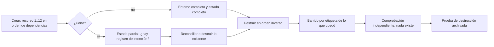
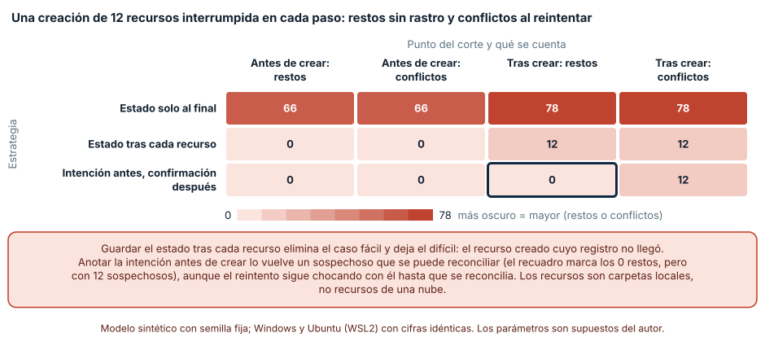
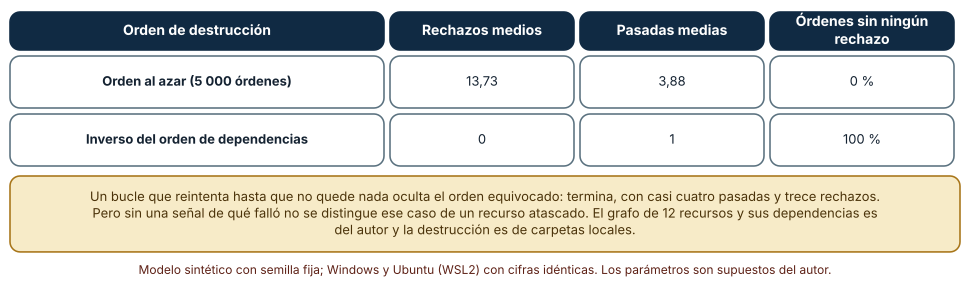
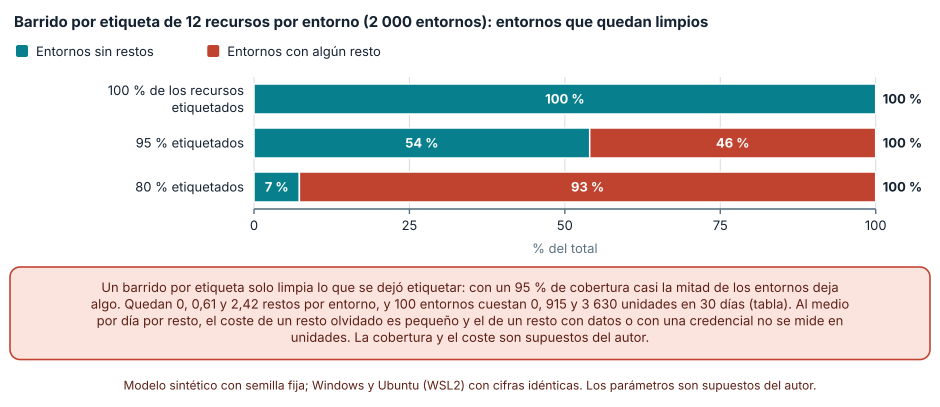

# SE-359 — Taller: desplegar y destruir un entorno seguro

[← SE-358 — Plataformas internas y golden paths](../../classes/part-29-cloud-plataforma-e-infraestructura/se-358-plataformas-internas-y-golden-paths/README.md) · [↑ Parte 29](../../classes/part-29-cloud-plataforma-e-infraestructura/README.md) · [📚 Índice completo](../../classes/README.md) · [🌐 Portal](../../site/classes/SE-359.html) · [SE-360 — Proyecto: plataforma mínima reproducible →](../../classes/part-29-cloud-plataforma-e-infraestructura/se-360-proyecto-plataforma-minima-reproducible/README.md)

## Punto profesional y fundamento pedagógico

**Punto profesional.** El taller existe para que practiques lo que las clases anteriores solo describieron: crear un entorno entero, interrumpirlo, destruirlo y comprobar que no quedó nada. Desplegar bien es la mitad del trabajo; la otra mitad es que el entorno de prueba desaparezca cuando debe, sin dejar recursos que cuesten, que expongan datos o que nadie sepa que existen.

**Por qué aparece aquí.** Sigue a **Plataformas internas y golden paths**: allí el camino dorado ofrecía un servicio listo; ahora lo pones a prueba en su ciclo de vida completo, que incluye los fallos a mitad de camino y el borrado. El caso conductor de la parte es la plataforma de entregas llevada a una infraestructura gestionada, y el taller crea y destruye un entorno de laboratorio de esa plataforma. Es una clase de taller: se hace, se rompe a propósito y se verifica.

**Error conceptual que debe corregir.** Creer que `destruir` es el inverso exacto de `crear`. Crear puede cortarse a mitad y dejar recursos sin registro; destruir puede chocar con dependencias, con recursos fuera del estado o con una credencial que ya caducó. Un entorno solo está destruido cuando una comprobación independiente lo confirma.

**Secuencia de aprendizaje.** Antes de leer los resultados, predices cuántos recursos quedan sin rastro si la creación de doce recursos se corta en cada paso según cuándo se guarda el estado, cuántos rechazos provoca destruir en un orden al azar y cuántos entornos quedan limpios si el 95 % de los recursos lleva su etiqueta; después ejecutas el taller con carpetas locales como recursos y mides lo mismo. La secuencia usa predicción, explicación propia, contraste y recuperación. [ICAP](https://icap.education.asu.edu/research) distingue participación de construcción de conocimiento; [How People Learn II](https://nap.nationalacademies.org/catalog/24783/how-people-learn-ii-learners-contexts-and-cultures) exige conectar conocimiento previo, contexto y transferencia; la [práctica de recuperación](https://pubmed.ncbi.nlm.nih.gov/16507066/) respalda producir de nuevo la explicación tras una demora; y [Education for Life and Work](https://nap.nationalacademies.org/resource/13398/dbasse_084153.pdf) exige devolución que explique la causa del error.

**Evidencia de aprendizaje.** `taller-entorno.md` con la predicción, las tres figuras reproducidas, el registro de los doce cortes y de lo que quedó, el procedimiento de destrucción con su comprobación y una lista de qué haría falta para repetirlo con un proveedor real.

**Límite de la conclusión.** Los «recursos» son carpetas de un directorio temporal local, el entorno tiene doce recursos con dependencias que definí yo y los fallos se inyectan con una excepción: no hay red, proveedor, credencial ni costo real. No se usó Terraform ni otra herramienta, y la cobertura de etiquetas y el costo por resto son supuestos del autor.

### Trazabilidad fuente → afirmación

| Fuente primaria u oficial | Afirmación que respalda | Lo que no prueba |
|---|---|---|
| [Terraform: comando destroy](https://developer.hashicorp.com/terraform/cli/commands/destroy) | Destruir elimina los objetos que el estado registra y respeta el grafo de dependencias en orden inverso. | No dice qué hacer con lo creado fuera del estado ni cómo verificar que no queda nada. |
| [Terraform: estado](https://developer.hashicorp.com/terraform/language/state) | El estado relaciona los recursos con los objetos reales y es la base de los planes y las destrucciones. | No describe cortes a mitad de una creación ni su recuperación. |
| [AWS: Tagging Best Practices](https://docs.aws.amazon.com/whitepapers/latest/tagging-best-practices/tagging-best-practices.html) | Recomienda una estrategia de etiquetas para identificar dueño, entorno y propósito, y para automatizar la gestión y el control de costos. | No garantiza que todos los recursos se etiqueten ni mide la cobertura. |
| [Python: os y tempfile](https://docs.python.org/3/library/tempfile.html) | Documenta directorios temporales que se pueden crear y eliminar de forma segura. | No es un modelo de infraestructura de nube. |

## Antes de empezar

Recupera lo aprendido en `SE-358`: un camino dorado quita pasos y un verificador comprueba el resultado. La pregunta activa es: **¿qué queda si el despliegue se corta, en qué orden se destruye y cómo sé que ya no existe nada?**

## Prerrequisitos

- Haber completado `SE-358` o poder explicar qué comprueba un verificador de políticas.
- Python 3.11 o posterior; el taller usa solo la biblioteca estándar (`os`, `tempfile`, `shutil`, `random`) y carpetas locales; no necesitas cuenta ni herramienta de infraestructura.
- Haber leído `SE-354` (estado y plan) y `SE-355` (separación de entornos).

## Problema auténtico

El equipo de la plataforma de entregas creó un entorno de pruebas de integración con doce recursos: red, subred, grupo de seguridad, almacén de secretos, disco, base de datos, dos máquinas, balanceador, nombre de dominio, alarma y una política. La creación falló en el recurso siete por una cuota; la persona volvió a ejecutarla y recibió errores de «ya existe». Tras borrar a mano lo que recordaba, el entorno «desapareció» del panel, pero dos semanas después la factura mostró un disco y un balanceador que nadie había etiquetado. Al borrar el entorno de otra persona con un script, este falló tres veces porque la red tenía recursos dependientes. Tres problemas del mismo ciclo: crear, destruir y comprobar.

## Objetivos observables

Al terminar podrás:

1. crear un entorno de doce recursos con dependencias, guardando un estado que permita recuperarse de un corte;
2. contar los recursos sin rastro y los conflictos al reintentar tras un corte en cada paso, con tres estrategias de estado;
3. destruir en el orden inverso de las dependencias y medir el costo de un orden equivocado;
4. barrer por etiqueta y calcular qué deja un barrido con cobertura incompleta;
5. escribir una comprobación independiente que demuestre que el entorno ya no existe.

## Mapa conceptual



El mapa muestra que crear y destruir comparten la misma incertidumbre: un corte deja un estado intermedio que el estado guardado puede o no reflejar. El **barrido por etiqueta** y la **comprobación independiente** son las dos redes de seguridad: la primera encuentra lo que el estado no sabe y la segunda demuestra que no queda nada.

## Temas y por qué importan

| Tema | Por qué cambia una decisión profesional | Evidencia mínima |
|---|---|---|
| Creación interrumpida | Un corte deja recursos que ningún estado conoce. | Restos y conflictos por corte y estrategia |
| Intención antes de crear | Permite reconocer lo que se estaba creando. | Recursos sospechosos reconciliables |
| Orden de destrucción | Un orden equivocado provoca rechazos y reintentos ciegos. | Rechazos y pasadas con orden al azar e inverso |
| Etiquetas y barrido | Limpian lo que el estado no sabe, solo lo etiquetado. | Restos según la cobertura de etiquetas |
| Comprobación de destrucción | «No veo errores» no es «no existe nada». | Prueba independiente archivada |

## Conceptos y decisiones

### 1. Crear no es atómico

Crear un entorno son doce llamadas a un proveedor, y cualquiera puede fallar por una cuota, un permiso, un límite de tasa o la red. No hay una transacción que deshaga las anteriores: los recursos creados siguen existiendo. La herramienta de infraestructura debe, por tanto, registrar lo que creó, y debe hacerlo de modo que un corte entre dos recursos o entre la creación y el registro no lo pierda. Lo fácil de hacer es guardar el estado al final; lo robusto, hacerlo tras cada recurso, y lo más seguro, anotar la intención antes de crear.

### 2. Estado tras cada recurso y registro de intención

Si el estado se guarda tras cada recurso, un corte entre recursos deja el estado exacto. Queda un caso: el corte entre crear el recurso y anotarlo, que deja un recurso real que el estado no conoce. Una técnica de escritura previa anota «voy a crear el recurso 7» antes de crearlo y «recurso 7 creado» después; al recuperarse, el recurso con intención y sin confirmación es un sospechoso que se comprueba contra la realidad y se adopta o se elimina. No evita el corte, hace que no sea invisible.

### 3. Destruir en orden inverso

Los recursos dependientes se destruyen antes que aquellos de los que dependen: la máquina antes que la subred, la subred antes que la red. El orden inverso del topológico lo garantiza y la documentación de Terraform lo describe para los objetos que el estado gestiona. Un orden distinto provoca rechazos, y un bucle que reintenta hasta que no quede nada termina, pero oculta que el orden era equivocado y que un recurso atascado se vería igual que uno pendiente. Destruir con las dependencias a la vista, y con una señal de qué falló, hace distinguir ambos casos.

### 4. Etiquetas y barrido

Lo que el estado no conoce no se destruye. Una estrategia de etiquetas, que AWS recomienda para identificar dueño, entorno y propósito, permite un barrido: buscar todos los recursos con la etiqueta del entorno y eliminar los que queden. Su límite es la cobertura: un recurso sin etiqueta no se ve. Por eso la etiqueta se pone por defecto y se comprueba, y un recurso sin etiqueta se considera una violación, no una excepción. Las etiquetas también llevan una caducidad, de modo que un entorno se destruye aunque nadie se acuerde.

### 5. Un entorno seguro y su prueba de destrucción

Un entorno de laboratorio seguro se crea con valores por defecto restrictivos: sin acceso público, con permisos mínimos, con un tope de gasto y con una caducidad. Y se destruye con una prueba: una comprobación independiente del estado que consulta la realidad, lista lo que sigue existiendo con la etiqueta del entorno y falla si no está vacío. La prueba se archiva con fecha. Sin ella, «destruido» significa «no vi errores», que es otra afirmación.

### Cortes en cada paso

Se define un entorno de doce recursos como carpetas de un directorio temporal, con las dependencias de la plataforma. Se interrumpe la creación en cada uno de los doce pasos, en dos momentos: antes de crear el recurso y después de crearlo y antes de anotarlo. Se comparan tres estrategias: estado solo al final, estado tras cada recurso y estado con intención previa. Después de cada corte se cuentan los recursos existentes sin rastro y los conflictos al reintentar la creación.

```python
for i, (nm, _) in enumerate(RES):
    if mode == "wal": intent[i] = nm
    if i == k - 1 and punto == "antes de crear": raise RuntimeError("fallo inyectado")
    os.makedirs(os.path.join(env, f"{i:02d}-{nm}"))
    if i == k - 1: raise RuntimeError("fallo inyectado")        # tras crear, antes de anotar
    if mode in ("cada", "wal"): state[i] = nm
```

| Estrategia de estado | Corte antes de crear: restos | conflictos | Corte tras crear y antes de anotar: restos | conflictos |
|---|---:|---:|---:|---:|
| Estado solo al final | 66 | 66 | 78 | 78 |
| Estado tras cada recurso | 0 | 0 | 12 | 12 |
| Intención antes, confirmación después | 0 | 0 | 0 (12 sospechosos) | 12 |

Guardar el estado al final deja, sumando los doce cortes, 66 y 78 recursos sin rastro y el mismo número de conflictos al reintentar: es el caso del recurso siete. Guardarlo tras cada recurso elimina el primero y deja el difícil, un recurso por corte. La intención previa convierte esos doce en sospechosos reconciliables, aunque el reintento sigue chocando con ellos hasta que se reconcilian: los 12 conflictos de la última celda. El resultado fue idéntico en Windows y en Ubuntu.



**Cómo leer la figura.** Cada fila es una estrategia de estado y cada columna cuenta restos o conflictos según el punto del corte; el tono más oscuro es más daño. Mira cómo el estado tras cada recurso limpia las dos columnas del corte antes de crear y deja 12 en las otras, y cómo la intención previa baja a 0 los restos del corte tras crear (con 12 sospechosos, marcado con un recuadro). **Dónde deja de valer:** los recursos son carpetas y el corte es una excepción, no un fallo de red, una cuota o la muerte del proceso; un proveedor real añade reintentos automáticos, recursos asíncronos que tardan en existir y errores que no dicen si el recurso se creó.

### Destruir en el orden equivocado

Se toman las dependencias de los doce recursos y se destruyen en 5 000 órdenes al azar y en el inverso del orden topológico. Un recurso no puede destruirse mientras existan otros que dependen de él: se rechaza y se reintenta en la pasada siguiente.

```python
def run(order):
    alive, fails, passes, pending = set(range(n)), 0, 0, list(order)
    while pending:
        passes += 1; nxt = []
        for i in pending:
            if any(j in alive for j in dependents[i]): fails += 1; nxt.append(i)
            else: alive.discard(i)
        pending = nxt
```

| Orden de destrucción | Rechazos medios | Pasadas medias | Órdenes sin ningún rechazo |
|---|---:|---:|---:|
| Al azar (5 000 órdenes) | 13,73 | 3,88 | 0 % |
| Inverso del orden de dependencias | 0 | 1 | 100 % |

Un orden al azar nunca sale limpio en 5 000 intentos: provoca 13,7 rechazos y casi cuatro pasadas. El bucle de reintentos termina y deja la impresión de que todo fue bien, pero un registro de rechazos revela que el orden era equivocado. Con el orden inverso no hay rechazos y basta una pasada.



**Cómo leer la figura.** Cada grupo es una medida (rechazos o pasadas) y cada color, un orden de destrucción. Mira que el inverso del orden de dependencias no tiene barra de rechazos y necesita una sola pasada. El porcentaje de órdenes sin rechazo (0 % y 100 %) está en la tabla. **Dónde deja de valer:** el grafo de doce recursos lo definí yo y destruir una carpeta es instantáneo; un proveedor real impone retardos y la destrucción de un recurso con datos o protección puede requerir pasos adicionales.

### Barrido por etiqueta

Para 2 000 entornos de doce recursos, cada recurso lleva la etiqueta con probabilidad igual a la cobertura. Un barrido borra todo lo etiquetado; lo no etiquetado queda. Se estima cuánto queda y cuánto cuesta a 0,5 unidades monetarias por resto y día durante 30 días.

```python
tagged = sum(rr.random() < cov for _ in range(n))
left = n - tagged
costo_100_entornos = 100 * left_medio * 0.5 * 30
```

| Recursos con la etiqueta | Restos por entorno | Entornos sin restos | Costo de 100 entornos en 30 días (u.m.) |
|---|---:|---:|---:|
| 100 % | 0 | 100 % | 0 |
| 95 % | 0,61 | 54,0 % | 915 |
| 80 % | 2,42 | 7,3 % | 3 630 |

Con un 95 % de cobertura casi la mitad de los entornos deja algo, y con un 80 %, el 93 %. El costo de un resto olvidado es pequeño y el de un resto con datos o con una credencial no se mide en unidades. La conclusión práctica es doble: etiquetar por defecto y comprobar la cobertura, y no confiar el barrido como única red de seguridad.



**Cómo leer la figura.** Cada barra es una cobertura de etiquetas y suma el 100 % de los 2 000 entornos; el tramo verde azulado son los entornos sin restos y el coral, los que dejan algo. Mira cómo una cobertura de 95 % ya deja casi la mitad en coral y 80 % deja casi todos. Los restos por entorno y el costo están en la tabla. **Dónde deja de valer:** la independencia de la etiqueta entre recursos, los doce recursos, el medio por día y los treinta días son supuestos del autor; en la práctica los recursos que quedan sin etiqueta suelen ser siempre los mismos tipos, los que una plantilla olvidó.

## Definiciones de trabajo

- **recurso huérfano:** recurso existente que el estado de la herramienta no registra.
- **registro de intención:** anotación previa de que se va a crear un recurso, que permite reconocerlo si el proceso se corta.
- **orden topológico inverso:** orden de destrucción en que cada recurso se elimina antes que aquellos de los que depende.
- **barrido por etiqueta:** búsqueda y eliminación de los recursos que llevan la etiqueta de un entorno.
- **prueba de destrucción:** comprobación independiente, con fecha, de que no queda ningún recurso del entorno.

Las definiciones son operativas para la plataforma de entregas. Cada herramienta y cada proveedor usan estos términos con matices y deben contrastarse con la documentación primaria enlazada al final.

## Ejemplo mínimo

El fragmento crea tres carpetas y corta la creación en la segunda. Antes de ejecutarlo, predice qué carpetas existen y qué registra el estado.

```python
import os, tempfile
raiz = tempfile.mkdtemp(prefix="taller_")
estado = []
try:
    for i, nombre in enumerate(["red", "subred", "disco"]):
        os.makedirs(os.path.join(raiz, f"{i}-{nombre}"))
        if nombre == "subred":
            raise RuntimeError("corte")
        estado.append(nombre)
except RuntimeError:
    pass
print(sorted(os.listdir(raiz)), estado)
```

La salida es `['0-red', '1-subred'] ['red']`: existe una carpeta que el estado no registra. Registra versión de Python, comando y salida; después apunta la intención antes de crear y reconoce el sospechoso.

## Ejemplo profesional

El equipo de la plataforma escribe un entorno de laboratorio con tres secuencias: crear, destruir y verificar. La creación anota la intención de cada recurso antes de crearlo, guarda el estado tras cada uno, pone la etiqueta de entorno y una fecha de caducidad de 24 horas por defecto, usa permisos mínimos y no abre ningún acceso público. La destrucción recorre el orden inverso, registra cada rechazo con su motivo y termina con un barrido por etiqueta y una verificación que consulta la realidad y falla si queda algo. Un proceso diario destruye los entornos caducados y envía la prueba al equipo; un entorno sin etiquetar aparece en un informe semanal como violación. Se ensaya además el corte: cada trimestre se interrumpe a propósito una creación y se mide cuántos sospechosos aparecen y cuánto tarda la reconciliación. Compara con el estado inicial: el disco y el balanceador sin etiquetar habrían salido en el barrido o en la verificación.

## Práctica guiada

1. Predice cuántos recursos quedan sin rastro si la creación de doce recursos se corta en cada paso con el estado solo al final.
2. Crea el entorno de doce carpetas y su estado, y destrúyelo en orden inverso con una verificación.
3. Interrumpe la creación en cada paso, antes y después de crear, con las tres estrategias, y reproduce la tabla.
4. Destruye en 5 000 órdenes al azar y mide los rechazos y las pasadas.
5. Barre por etiqueta con coberturas de 100, 95 y 80 % y mide los restos.
6. Escribe la verificación que falla si queda alguna carpeta con la etiqueta del entorno.
7. Entrega `taller-entorno.md` y pide a otra persona que encuentre un corte que tu recuperación no cubra.

## Ejercicios

1. **Corte:** explica por qué el estado tras cada recurso no elimina el corte entre crear y anotar y qué lo hace manejable.
2. **Orden:** escribe el orden de destrucción de los doce recursos de la plataforma a partir de las dependencias.
3. **Cobertura:** con 98 % de etiquetas y doce recursos, calcula la probabilidad de que un entorno quede limpio.
4. **Caducidad:** diseña la etiqueta de caducidad y el proceso que la usa, y di qué pasa si el proceso falla un día.

## Reto verificable

Entrega `taller-entorno.md` con la predicción, las tres tablas reproducidas con las mismas semillas, el registro de los doce cortes con lo que quedó y cómo se recuperó, el procedimiento de destrucción y la prueba de destrucción archivada. Se aprueba si otra persona ejecuta el código desde un checkout limpio, obtiene las mismas cifras y puede decir cómo sabría que el entorno ya no existe. No se aprueba por destruir sin una verificación independiente ni por afirmar que el barrido por etiqueta lo limpia todo.

## Caso conductor

La plataforma de entregas es el caso conductor de la Parte 29. Este taller deja el undécimo artefacto: el ciclo de vida completo de un entorno de laboratorio, con su prueba de destrucción. `SE-360` integra todo en un proyecto: una plataforma mínima y reproducible. Cambia una decisión, por ejemplo la caducidad de 24 a 72 horas, y observa cuántos restos cuesta por entorno olvidado.

## Preguntas frecuentes

### ¿Por qué usar carpetas locales si el objetivo es la nube?

Porque el ciclo de crear, cortar, destruir y verificar es el mismo y se puede reproducir sin cuenta ni costo. Lo que cambia con un proveedor real es la latencia, los reintentos y los errores ambiguos, que se añaden después de dominar el ciclo.

### ¿Hace falta registrar la intención si ya guardo el estado tras cada recurso?

Lo hace manejable el único caso que el estado tras cada recurso deja abierto: el corte entre crear y anotar. Si el proveedor permite crear con un identificador conocido de antemano, un recurso se puede reconocer sin intención previa.

### ¿Es peligroso un barrido por etiqueta?

Sí, si la etiqueta es demasiado amplia: puede borrar recursos de otro entorno. Por eso el barrido debe filtrar por la etiqueta exacta del entorno, mostrar lo que va a borrar y registrar lo que borró.

### ¿Qué hago con un recurso que no se deja destruir?

Registra el rechazo y su motivo, comprueba si tiene dependientes o protección y trátalo como una incidencia con dueño. No fuerces el borrado sin saber qué contiene.

## Fallo controlado y diagnóstico

Reproduce el fallo clásico de la clase: **un corte deja recursos que ninguna destrucción conoce**. Interrumpe la creación en el recurso siete con el estado solo al final y ejecuta `destruir`.

Registra síntoma, entrada mínima, hipótesis, observación que descarta cada hipótesis, causa, corrección y prueba de regresión. **Síntoma:** `destruir` termina sin errores y la verificación encuentra seis carpetas. **Hipótesis rivales:** (a) la destrucción falló en silencio; (b) alguien creó esas carpetas aparte; (c) el estado no las registraba. **Prueba:** compara el estado con el contenido real del directorio y mira cuáles tienen la etiqueta del entorno. **Conclusión:** el estado solo se guarda al final, y el corte dejó seis recursos que ninguna destrucción basada en él conoce. **Regresión:** guarda el estado tras cada recurso y añade la intención previa, y una prueba que corte en cada paso y compruebe que la verificación queda vacía tras destruir y barrer. No arregles a la vez el estado y el barrido.

## Errores comunes y cómo corregirlos

| Síntoma | Causa probable | Corrección |
|---|---|---|
| Un reintento falla con «ya existe» | La creación se cortó y el estado no registró lo creado | Registrar tras cada recurso y reconciliar los sospechosos |
| La destrucción reintenta varias veces y tarda | Orden equivocado con dependencias vivas | Destruir en orden topológico inverso y registrar los rechazos |
| La factura muestra recursos de un entorno «destruido» | Recursos sin etiqueta o fuera del estado | Etiquetar por defecto y verificar contra la realidad |
| Un barrido borró recursos de otro entorno | Filtro de etiqueta demasiado amplio | Filtrar por la etiqueta exacta y mostrar antes de borrar |
| «Destruido» sin evidencia | No existe una verificación independiente | Archivar una prueba que consulte la realidad |

## Entorno y archivos clave

```text
work/SE-359/
├── README.md
├── taller/
│   ├── crear.py
│   ├── destruir.py
│   └── verificar.py
├── tests/test_taller.py
└── evidence/taller-entorno.md
```

El `README` declara sistema, versión de Python, semillas y comandos. El taller usa solo la biblioteca estándar y se ejecutó con CPython 3.12.9 en Windows 11 y 3.12.3 en Ubuntu bajo WSL2 con salidas idénticas. Los recursos son carpetas bajo un directorio temporal que el propio script crea y elimina; si usas un proveedor real, declara cuenta de prueba, región, tope de gasto y limpieza, y destruye antes de terminar la sesión.

## Seguridad, ética y accesibilidad

- elimina solo directorios que tu propio script creó y comprobó: no apliques `rmtree` a una ruta que venga de una variable sin verificarla;
- con un proveedor real, usa una cuenta de laboratorio con tope de gasto, sin datos reales y con la caducidad activada;
- un recurso olvidado puede exponer datos o credenciales: trátalo como un incidente de seguridad y no solo de costo;
- describe el procedimiento de destrucción en texto además de los comandos, para que cualquier persona pueda seguirlo y un lector de pantalla pueda recorrerlo;
- respeta las condiciones de uso de cada proveedor al crear y destruir recursos de prueba.

## Puente hacia el trabajo con agentes

Un agente al que se le pide «crea y borra un entorno de pruebas» escribirá un script que crea y otro que borra con la lista de lo que recuerda haber creado, normalmente sin registro de intención y sin verificar. Pídele en cambio que registre el estado tras cada recurso, que destruya en orden inverso con un registro de rechazos y que termine con una verificación que falle si queda algo con la etiqueta del entorno. Revisa especialmente qué ruta o filtro usa para borrar y si pide confirmación antes de eliminar: son los dos lugares donde un agente borra más de lo que debía o menos de lo que creyó.

## Transferencia

Traslada el taller a otro dominio (por ejemplo, un entorno de demostración para clientes de una tienda con base de datos y colas): cambia los recursos y conserva el procedimiento de crear con estado tras cada recurso, cortar en cada paso, destruir en orden inverso, barrer por etiqueta y verificar. La transferencia está lograda cuando puedes decir qué recursos quedarían tras un corte en cada paso y cómo lo sabrías, no cuando los scripts se parecen.

## Evaluación y evidencia

| Criterio | Evidencia para aprobar |
|---|---|
| comprensión | explicación de por qué crear no es atómico y destruir no es el inverso exacto |
| corrección | cortes, órdenes y barridos reproducibles con las mismas semillas |
| decisión | estrategia de estado, orden de destrucción y etiquetas con caducidad |
| diagnóstico | reproducción del fallo «corte con recursos sin rastro» con regresión |
| incertidumbre | declaración de que los recursos son carpetas locales y no hay proveedor |
| reproducibilidad | versiones, comandos, salida y límites declarados |

## Fuentes

- [Terraform: destroy](https://developer.hashicorp.com/terraform/cli/commands/destroy) — destrucción de objetos gestionados en orden de dependencias; autoridad: documentación oficial de HashiCorp.
- [Terraform: estado](https://developer.hashicorp.com/terraform/language/state) — relación entre recursos declarados y reales; autoridad: documentación oficial de HashiCorp.
- [AWS: Tagging Best Practices](https://docs.aws.amazon.com/whitepapers/latest/tagging-best-practices/tagging-best-practices.html) — estrategia de etiquetas para dueño, entorno y costos; autoridad: documentación del proveedor.
- [Python: tempfile](https://docs.python.org/3/library/tempfile.html) — directorios temporales de los experimentos; autoridad: documentación de Python.
- [Python: shutil](https://docs.python.org/3/library/shutil.html) — eliminación de árboles de archivos; autoridad: documentación de Python.

Cada fuente respalda el mecanismo indicado; ninguna demuestra que los 66 restos, los 13,73 rechazos ni el 54 % de entornos limpios se observen con un proveedor real. Esa afirmación depende de la herramienta, del proveedor y de la cobertura de etiquetas de cada organización.

## Límites y siguiente paso

Se ejecutaron tres experimentos sintéticos con carpetas locales en Windows y Ubuntu (WSL2) con resultados idénticos. No se usó ningún proveedor, red, credencial ni herramienta de infraestructura: los fallos son excepciones inyectadas, el grafo de doce recursos es del autor y la cobertura de etiquetas y el costo por resto son supuestos. La siguiente clase integra todo en un proyecto: una plataforma mínima y reproducible.

## Glosario

- **recurso huérfano:** recurso existente que el estado de la herramienta no registra.
- **registro de intención:** anotación previa de que se va a crear un recurso, que permite reconocerlo si el proceso se corta.
- **orden topológico inverso:** orden de destrucción en que cada recurso se elimina antes que aquellos de los que depende.
- **barrido por etiqueta:** búsqueda y eliminación de los recursos que llevan la etiqueta de un entorno.
- **prueba de destrucción:** comprobación independiente, con fecha, de que no queda ningún recurso del entorno.

---

[← SE-358 — Plataformas internas y golden paths](../../classes/part-29-cloud-plataforma-e-infraestructura/se-358-plataformas-internas-y-golden-paths/README.md) · [↑ Parte 29](../../classes/part-29-cloud-plataforma-e-infraestructura/README.md) · [📚 Índice completo](../../classes/README.md) · [🌐 Portal](../../site/classes/SE-359.html) · [SE-360 — Proyecto: plataforma mínima reproducible →](../../classes/part-29-cloud-plataforma-e-infraestructura/se-360-proyecto-plataforma-minima-reproducible/README.md)
