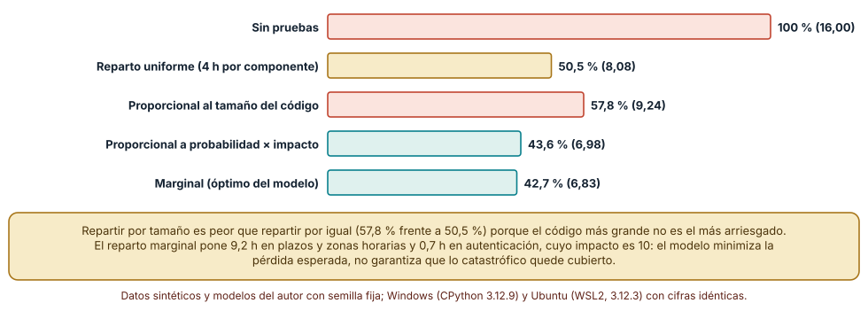
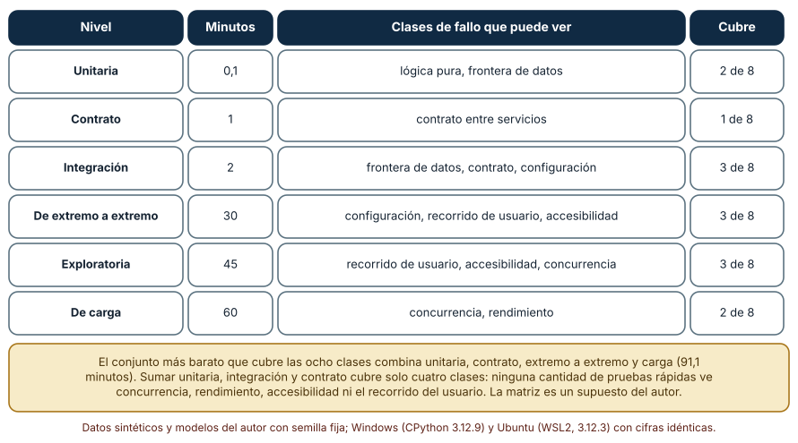

# SE-361 — Calidad por riesgo y propósito de las pruebas

[← SE-360 — Proyecto: plataforma mínima reproducible](../../classes/part-29-cloud-plataforma-e-infraestructura/se-360-proyecto-plataforma-minima-reproducible/README.md) · [↑ Parte 30](../../classes/part-30-estrategia-y-tecnicas-de-prueba/README.md) · [📚 Índice completo](../../classes/README.md) · [🌐 Portal](../../site/classes/SE-361.html) · [SE-362 — Pruebas unitarias y diseño testable →](../../classes/part-30-estrategia-y-tecnicas-de-prueba/se-362-pruebas-unitarias-y-diseno-testable/README.md)

## Punto profesional y fundamento pedagógico

**Punto profesional.** La clase existe para que decidas qué probar, con qué nivel de prueba y cuánto esfuerzo a partir del riesgo que cada componente representa, y para que declares por escrito qué no vas a probar y por qué. Una estrategia de pruebas es un reparto de horas limitadas entre fallos posibles; sin ese reparto explícito, el reparto ocurre igual, pero por costumbre.

**Por qué aparece aquí.** Las Partes 25 y 26 dejaron una arquitectura con fronteras y una capa de datos con invariantes. La Parte 30 abre el bloque de calidad preguntando cómo se sabe que todo eso funciona. Antes de hablar de pruebas unitarias, de contratos o de fuzzing hay que fijar el criterio que ordena todas las demás clases: qué fallo duele más, cuál es más probable y qué técnica puede verlo.

**Error conceptual que debe corregir.** Creer que la calidad de una suite se mide por su tamaño o por su cobertura de líneas y que probar «todo» es un objetivo alcanzable. No lo es: el espacio de entradas y estados no se agota, el presupuesto sí, y repartirlo por igual o por tamaño del código gasta horas donde el fallo cuesta poco.

**Secuencia de aprendizaje.** Antes de leer los resultados, predices cuánta pérdida esperada elimina repartir 40 horas por riesgo frente a repartirlas por igual; después mides cinco repartos, perturbas las estimaciones hasta un factor 2 y comparas qué nivel de prueba puede ver cada clase de fallo. La secuencia usa predicción, explicación propia, contraste y recuperación. [ICAP](https://icap.education.asu.edu/research) distingue participación de construcción de conocimiento; [How People Learn II](https://nap.nationalacademies.org/catalog/24783/how-people-learn-ii-learners-contexts-and-cultures) exige conectar conocimiento previo, contexto y transferencia; la [práctica de recuperación](https://pubmed.ncbi.nlm.nih.gov/16507066/) respalda producir de nuevo la explicación tras una demora; y [Education for Life and Work](https://nap.nationalacademies.org/resource/13398/dbasse_084153.pdf) exige devolución que explique la causa del error.

**Evidencia de aprendizaje.** `estrategia-log.md` con la predicción, la tabla de riesgos con sus supuestos, el reparto de horas con cada método, la medida de sensibilidad ante estimaciones erradas, la matriz de niveles contra clases de fallo y una lista firmada de lo que no se probará con su razón y su fecha de revisión.

**Límite de la conclusión.** La probabilidad, el impacto, la dificultad de detección y los costos de cada nivel son supuestos del autor sobre una plataforma sintética, no mediciones de un equipo. El modelo de detección (una exponencial en las horas) simplifica cómo se encuentran los defectos. Lo que se conserva es el mecanismo: el reparto por riesgo gana al reparto por tamaño o por igual incluso con estimaciones erradas, y ningún nivel de prueba cubre todas las clases de fallo.

### Trazabilidad fuente → afirmación

| Fuente primaria u oficial | Afirmación que respalda | Lo que no prueba |
|---|---|---|
| [ISO/IEC 25010:2023](https://www.iso.org/standard/78176.html) | Define los nueve atributos de calidad del producto con los que se clasifican los fallos posibles. | No dice cuánto probar cada atributo. |
| [NIST SP 800-30 Rev. 1](https://csrc.nist.gov/pubs/sp/800/30/r1/final) | Describe el riesgo como combinación de probabilidad e impacto y cómo documentar los supuestos de la evaluación. | No es una guía de pruebas de software. |
| [Martin Fowler, «TestPyramid»](https://martinfowler.com/bliki/TestPyramid.html) | Propone muchas pruebas rápidas y pocas lentas como heurística de reparto por nivel. | No prueba que la proporción sirva en cualquier sistema. |
| [Google Testing Blog, «Just Say No to More End-to-End Tests»](https://testing.googleblog.com/2015/04/just-say-no-to-more-end-to-end-tests.html) | Argumenta el costo y la inestabilidad de las pruebas de extremo a extremo frente a las pequeñas. | Es la experiencia de una organización, no un experimento controlado. |
| [Inozemtseva y Holmes (ICSE 2014)](https://doi.org/10.1145/2568225.2568271) | Encontró que la cobertura no está fuertemente correlacionada con la eficacia de una suite al controlar su tamaño. | No cubre todos los lenguajes ni proyectos. |
| [Dijkstra, «The Humble Programmer»](https://www.cs.utexas.edu/~EWD/transcriptions/EWD03xx/EWD340.html) | Formula que las pruebas pueden mostrar la presencia de defectos y no su ausencia. | No indica qué técnica elegir. |

## Antes de empezar

La plataforma de entregas de tareas ya tiene fronteras (Parte 25) y una capa de datos recuperable (Parte 26). La pregunta que activa esta clase es: **si solo hay 40 horas para probar este sistema este trimestre, ¿dónde las pones, qué dejas sin probar y qué evidencia te haría cambiar de idea?** Escribe tu respuesta antes de seguir: es la hipótesis que la clase pone a prueba.

## Prerrequisitos

- Haber trabajado `SE-311` (revisión de una arquitectura contra escenarios) o poder explicar qué es un atributo de calidad y un escenario de calidad.
- Python 3.11 o posterior; los experimentos usan solo la biblioteca estándar.
- Saber leer una tabla de probabilidad por impacto y una exponencial decreciente.

## Problema auténtico

El equipo de la plataforma tiene diez componentes y una semana de pruebas. Una persona propone cubrir cada componente con la misma cantidad de pruebas; otra, repartir según el tamaño del código porque «lo grande falla más»; una tercera, concentrarse en lo que más duele aunque se sepa poco sobre su probabilidad. Nadie ha escrito cuánto cuesta un defecto en la calificación frente a uno en las notificaciones, y el panel docente, el componente más grande, rara vez es el que provoca los incidentes graves. El equipo quiere un criterio que se pueda discutir con números, que sobreviva a que esos números estén mal y que deje constancia de lo que quedó sin probar.

## Objetivos observables

Al terminar podrás:

1. descomponer el riesgo de un componente en probabilidad e impacto y documentar cada supuesto;
2. repartir un presupuesto de pruebas con tres criterios y calcular la pérdida esperada residual de cada uno;
3. medir cuánto empeora cada reparto cuando las estimaciones se equivocan y reconocer cuándo el ranking de riesgos ya no es fiable;
4. asignar cada clase de fallo al nivel de prueba que puede verla y detectar clases que ningún nivel barato cubre;
5. escribir una lista de exclusiones con razón y fecha de caducidad en lugar de una omisión silenciosa.

## Mapa conceptual


El mapa parte de los fallos y no de las técnicas: la técnica es una respuesta a una clase de fallo y a su costo. El retorno indica que la estrategia es una hipótesis con fecha: un incidente cambia una probabilidad y obliga a repartir de nuevo.

## Temas y por qué importan

| Tema | Por qué cambia una decisión profesional | Evidencia mínima |
|---|---|---|
| Riesgo como probabilidad por impacto | Convierte «esto me preocupa» en algo discutible y revisable. | Tabla de riesgos con supuestos en `estrategia-log.md` |
| Propósito de una prueba | Una prueba que no sabe para qué existe no sabe cuándo borrarla. | Propósito, defecto que debe detectar y quién decide en `estrategia-log.md` |
| Reparto del presupuesto | El mismo número de horas produce una pérdida residual distinta según el criterio. | Pérdida residual de cada reparto |
| Niveles de prueba y clases de fallo | Un nivel barato no ve concurrencia ni accesibilidad, sin importar cuántas pruebas tenga. | Matriz nivel contra clase de fallo |
| Exclusiones declaradas | Lo que no se prueba existe igual; escribirlo permite revisarlo. | Lista de exclusiones con razón y caducidad |

## Conceptos y decisiones

### 1. Riesgo como probabilidad por impacto

El riesgo de un componente es la pérdida esperada si falla: la probabilidad de que contenga un defecto que llegue a producción multiplicada por el costo que ese defecto causaría. Ninguno de los dos factores se mide con precisión antes del incidente; se estiman con datos previos (historial de defectos, frecuencia de cambios, complejidad) y con juicio documentado. El valor de la fórmula no es el número, sino que obliga a separar «es probable» de «es grave» y a escribir las dos cosas. Un componente de impacto 10 y probabilidad 0,1 (autenticación, en el modelo de la clase) tiene el mismo riesgo esperado que uno de impacto 1 y probabilidad 1: la fórmula los iguala, y por eso hay que añadirle un umbral de impacto máximo que no se negocia.

### 2. Propósito de una prueba

Una prueba puede existir para detectar regresiones de un defecto ya visto, para descubrir defectos nuevos, para documentar un comportamiento, para guiar un diseño o para dar confianza antes de un despliegue. Cada propósito cambia cómo se escribe y cuándo se retira: una prueba de regresión de un incidente se conserva mientras el componente exista; una prueba exploratoria se descarta cuando ya enseñó lo que debía. Mezclar propósitos produce suites en las que nadie sabe qué prueba puede borrarse sin riesgo. La disciplina mínima es una línea por prueba o por grupo con el defecto que busca y el motivo por el que vale su costo de mantenimiento.

### 3. Reparto del presupuesto

Con un presupuesto fijo de horas, la pregunta es dónde produce más reducción de pérdida la siguiente hora. Si la probabilidad de encontrar un defecto crece con las horas con rendimientos decrecientes, la mejor decisión equilibra los beneficios marginales: se añaden horas al componente donde la pérdida esperada restante es mayor, hasta que otro componente rinde más. Repartir por tamaño asume que el código largo falla más; repartir por igual asume que todos importan igual; repartir por riesgo asume que se sabe estimar p e impacto. Ninguno es neutral: cada uno es una hipótesis, y la clase mide cuánto cuesta equivocarse.

### 4. Niveles de prueba y clases de fallo

Una prueba unitaria ve lógica pura y fronteras de datos y ve mal la concurrencia; una prueba de carga ve rendimiento y ve mal la lógica; una prueba de extremo a extremo ve el recorrido del usuario y la configuración, y es lenta e inestable. La pirámide de pruebas es una heurística de costo, no una ley: dice que lo que puede comprobarse barato debe comprobarse barato, pero no dice que lo barato baste. La decisión útil es la inversa: para cada clase de fallo que importa, nombrar el nivel más barato que puede verla, y si no hay ninguno, aceptar que hace falta un nivel caro o que la clase queda sin cobertura.

### 5. Exclusiones declaradas

No probar algo es una decisión legítima si es explícita. Una exclusión declarada dice qué componente o qué clase de fallo queda fuera, por qué (impacto bajo, sustituible, ya cubierto por otro control), quién la acepta y cuándo se revisa. Una omisión sin escribir acumula deuda sin dueño. La fecha de caducidad es lo que la convierte en decisión: al vencer, o se renueva con razones o se prueba.

### Cinco repartos para las mismas 40 horas

Se modelan diez componentes de la plataforma con probabilidad de defecto \(p\), impacto 1–10, tamaño en líneas y una dificultad \(\tau\) (horas para detectar la mayor parte de sus defectos). La pérdida esperada residual con \(h\) horas es \(p \cdot i \cdot e^{-h/\tau}\) y se suma por componente. Se comparan el reparto uniforme, proporcional al tamaño, proporcional a \(p \cdot i\) y el marginal (cada décima de hora al componente con mayor reducción de pérdida).

```python
def perdida(h, comp):
    return sum(p * i * math.exp(-hh / tau) for (n, p, i, l, tau), hh in zip(comp, h))

def optimo(comp, b=40.0, paso=0.1):
    h = [0.0] * len(comp)
    for _ in range(int(b / paso)):
        ganancia = [p * i * math.exp(-hh / tau) * (1 - math.exp(-paso / tau))
                    for (n, p, i, l, tau), hh in zip(comp, h)]
        h[max(range(len(comp)), key=ganancia.__getitem__)] += paso
    return h
```

| Reparto | Pérdida residual | Porcentaje de la inicial (16,00) | Horas en plazos y zonas horarias | Horas en autenticación |
|---|---:|---:|---:|---:|
| Sin pruebas | 16,00 | 100 % | 0 | 0 |
| Uniforme | 8,08 | 50,5 % | 4,0 | 4,0 |
| Proporcional al tamaño | 9,24 | 57,8 % | 1,6 | 3,8 |
| Proporcional a \(p \cdot i\) | 6,98 | 43,6 % | 9,0 | 2,5 |
| Marginal | 6,83 | 42,7 % | 9,2 | 0,7 |

Repartir por tamaño es peor que repartir por igual: el componente de plazos y zonas horarias, el menos extenso (90 líneas) y el de mayor riesgo, recibe 1,6 horas. El reparto por riesgo recupera siete puntos porcentuales de la pérdida inicial. El marginal mejora un poco más (6,83) y deja a la autenticación, de impacto 10, con 0,7 horas: matemáticamente correcto en el modelo y inaceptable como política, porque lo catastrófico necesita un piso aparte.



**Cómo leer la figura.** Cada barra es la pérdida que queda como porcentaje de la pérdida sin pruebas; menos es mejor. **Dónde deja de valer:** la forma exponencial de detección, la dificultad \(\tau\) y los valores de \(p\) e impacto son supuestos del autor. La figura no dice que el reparto por riesgo reduzca 56 % la pérdida de una plataforma real, sino que, bajo estos supuestos, el criterio de reparto cambia la pérdida entre 42,7 % y 57,8 % con las mismas horas.

### Qué pasa cuando las estimaciones están mal

Un reparto por riesgo es tan bueno como sus estimaciones. Se simulan 5 000 «realidades» (semilla fija) en las que cada \(p\) e impacto real es el estimado multiplicado por un factor entre 0,5 y 2 con distribución logarítmica uniforme; cada estrategia planea con las estimaciones y se evalúa contra la realidad. Se divide la pérdida real por la del plan óptimo para esa realidad.

| Estrategia | Mediana | Percentil 90 | Máximo |
|---|---:|---:|---:|
| Uniforme | 1,271 | 1,455 | 1,955 |
| Proporcional al tamaño | 1,441 | 1,735 | 2,382 |
| Proporcional a \(p \cdot i\) | 1,128 | 1,212 | 1,460 |
| Marginal con las estimaciones | 1,101 | 1,178 | 1,396 |

Con estimaciones equivocadas hasta por un factor 2, el reparto por riesgo pierde en mediana 12,8 % más que el óptimo desconocido y el uniforme 27,1 %. El reparto por riesgo supera al uniforme en 97,2 % de las 5 000 realidades. Lo que no se conserva es el ranking: el trío de componentes más arriesgados de la realidad difiere del trío estimado en 74,2 % de los casos. El plan es robusto en lo que reparte y frágil en lo que nombra: no hay que confiar en que «los tres más riesgosos» sean los que se creyó.


**Cómo leer la figura.** Cada fila es una estrategia y cada intervalo va de su mejor caso típico (mediana) a su peor caso observado (máximo), con el percentil 90 en medio; la línea punteada en 1,0 sería un plan perfecto, y cuanto más a la derecha, más veces pierde el plan que el óptimo de la realidad. Mira primero cuán lejos de 1,0 queda el extremo de cada intervalo. **Dónde deja de valer:** el factor 2 y su distribución son supuestos; si las estimaciones del equipo tienen sesgos sistemáticos (se subestiman siempre los fallos de integración, por ejemplo), el error no es simétrico y el resultado empeora. La figura tampoco compara contra una persona que reparte «por instinto».

### Qué nivel de prueba puede ver qué fallo

Se definen ocho clases de fallo (lógica pura, frontera de datos, contrato entre servicios, configuración, recorrido de usuario, concurrencia, rendimiento, accesibilidad) y seis niveles con su costo supuesto por ejecución y las clases que pueden ver. Se busca el subconjunto de menor costo que cubre las ocho.

```python
for r in range(1, len(niveles) + 1):
    for sub in itertools.combinations(niveles, r):
        cubiertas = set().union(*(NIVELES[n][1] for n in sub))
        if len(cubiertas) == len(FALLOS):
            candidatos.append((sum(NIVELES[n][0] for n in sub), sub))
```

El resultado es el conjunto unitaria + contrato + extremo a extremo + carga, con 91,1 minutos por ejecución. Las pruebas unitarias solas cubren dos de ocho clases; sumar integración y contrato eleva la cobertura a cuatro. Lo notable es que las cuatro clases restantes (recorrido de usuario, concurrencia, rendimiento y accesibilidad) solo las ven niveles caros, de modo que una estrategia con miles de pruebas unitarias y ninguna de carga no tiene cobertura de rendimiento aunque sus números parezcan altos.



**Cómo leer la figura.** Cada fila es un nivel con su costo supuesto por ejecución; cada columna es una clase de fallo, y una celda coloreada significa que ese nivel puede, en principio, verla. Mira primero qué columnas quedan con una sola celda (lógica pura, rendimiento) y qué fila ve más clases por minuto. **Dónde deja de valer:** la matriz es una decisión del autor y la visibilidad real depende de la prueba concreta: una prueba de extremo a extremo mal escrita no ve el recorrido que dice cubrir. La figura es un punto de partida para discutir qué nivel asignar, no un veredicto.

## Definiciones de trabajo

- **riesgo:** pérdida esperada de un componente, estimada como probabilidad de defecto por impacto.
- **nivel de prueba:** alcance y costo con los que se comprueba el sistema: unidad, contrato, integración, extremo a extremo, carga, exploración.
- **pérdida residual:** pérdida esperada que queda después de aplicar un reparto de pruebas.
- **exclusión:** decisión explícita de no probar un componente o una clase de fallo, con razón y fecha de revisión.
- **sensibilidad:** cuánto cambia un resultado cuando cambian los supuestos que lo producen.

Las definiciones son operativas para esta clase y no sustituyen el vocabulario de las normas citadas en las fuentes.

## Ejemplo mínimo

El fragmento calcula la pérdida residual de dos repartos con tres componentes. Antes de ejecutarlo, predice cuál es menor.

```python
import math
comp = [("calificar", 0.30, 9, 6.0), ("notificar", 0.40, 3, 4.0), ("buscar", 0.25, 2, 6.0)]
def perdida(h):
    return sum(p * i * math.exp(-x / tau) for (n, p, i, tau), x in zip(comp, h))
igual = [4, 4, 4]
riesgo = [6.4, 2.0, 1.6]          # sesgado hacia p*i, suma 10 h
assert perdida(riesgo) < perdida(igual)
print(round(perdida(igual), 3), round(perdida(riesgo), 3))
```

Registra versión, comando y salida. Después multiplica la probabilidad de `notificar` por cinco y observa si el reparto por riesgo sigue ganando.

## Ejemplo profesional

El equipo de la plataforma abre `estrategia-log.md` con una fila por componente: probabilidad estimada con su fuente (cuántos defectos tuvo el trimestre anterior), impacto con su razón (qué pasa si falla: nota errónea, entrega perdida, aviso tardío), tamaño y dificultad de detección. Calcula tres repartos de 40 horas y elige el marginal con dos reglas añadidas: ningún componente de impacto 9 o 10 baja de 4 horas, y toda clase de fallo con impacto alto debe tener al menos un nivel asignado. Para la búsqueda y la administración, que quedan bajo 2 horas, escribe exclusiones con razón («impacto 2, el navegador ofrece un filtro equivalente») y fecha de caducidad de 90 días. Tras el primer incidente de plazos y zonas horarias, reestima la probabilidad, vuelve a calcular y mueve 3,7 horas. El documento no promete menos defectos: promete que el reparto se puede discutir y revisar.

## Práctica guiada

1. Enumera diez componentes de un sistema que conozcas y escribe, para cada uno, probabilidad, impacto y la razón de cada estimación.
2. Predice qué reparto de 40 horas dejará menos pérdida y anótalo.
3. Calcula la pérdida residual con los repartos uniforme, por tamaño, por riesgo y marginal.
4. Perturba las estimaciones con 1 000 realidades de semilla fija y mide la razón contra el óptimo.
5. Construye la matriz de ocho clases de fallo contra seis niveles y encuentra el conjunto mínimo.
6. Escribe las exclusiones de los componentes bajo 2 horas con razón y fecha de caducidad.
7. Entrega `estrategia-log.md` y pide a otra persona que cambie una estimación y diga si el plan se mantiene.

## Ejercicios

1. **Probabilidad e impacto:** calcula el riesgo de los diez componentes y ordénalos; identifica un par con el mismo riesgo y distinta naturaleza (raro y grave frente a frecuente y leve) y decide qué regla adicional los distingue.
2. **Piso de impacto:** añade al reparto marginal un mínimo de 4 horas para impacto 9 o más; mide cuánto sube la pérdida residual y explica el precio de la regla.
3. **Cobertura de clases:** a la matriz de niveles, añade una clase nueva («datos personales») y decide qué nivel la ve; ¿cambia el conjunto mínimo?
4. **Caducidad:** escribe la consulta o el script que enumera las exclusiones vencidas y lo que haría una revisión mensual.

## Reto verificable

Entrega `estrategia-log.md` con la predicción, los diez componentes con sus supuestos, los cuatro repartos con su pérdida residual, la medida de sensibilidad con 1 000 realidades y la lista de exclusiones. Se aprueba si otra persona puede ejecutar el código, obtener la misma tabla con la misma semilla, cambiar la probabilidad de un componente y decir qué parte del plan cambia. No se aprueba por afirmar que «se probó lo importante» sin mostrar qué se asumió que era importante.

## Caso conductor

La plataforma de entregas de tareas sigue siendo el caso conductor. Esta clase deja el primer artefacto de la Parte 30: la tabla de riesgos con el reparto de horas y la lista de exclusiones. `SE-362` pregunta cómo se escribe una prueba unitaria útil y qué diseño la hace posible. Cambia después una sola estimación (el impacto de las notificaciones de 3 a 8) y observa cuántas horas se mueven.

## Preguntas frecuentes

### ¿De dónde salen la probabilidad y el impacto si no hay datos?

De lo que haya: el historial de incidentes, la frecuencia de cambios del componente, la complejidad del código, las veces que algo se reabrió. Cuando no hay nada, se estiman con una escala gruesa (bajo, medio, alto) y se documenta quién estimó. Lo importante no es que el número sea exacto: es que la estimación sea visible y que pueda corregirse después de un incidente. La simulación de esta clase muestra que equivocarse por un factor 2 no invalida el reparto.

### ¿Probar por riesgo significa probar menos?

No necesariamente: significa repartir lo que se tiene. Con el mismo presupuesto, el reparto por riesgo dejó 43,6 % de la pérdida frente a 50,5 % del uniforme. Si el presupuesto es mayor, se prueba más, pero se sigue necesitando un orden. Lo que sí implica es aceptar y escribir que hay componentes que reciben pocas horas.

### ¿La cobertura de líneas no sirve entonces?

Sirve para encontrar código que ninguna prueba ejecuta, que es información útil. No sirve como medida de que las pruebas detectan defectos: ejecutar una línea no comprueba que su resultado sea el correcto. `SE-362` y `SE-366` mostrarán el mismo código con 100 % de cobertura y 61 % de mutantes muertos.

### ¿Y si el negocio quiere «cobertura total»?

Se traduce la petición en la pregunta que contiene: qué fallo no se tolera. Se muestran las ocho clases de fallo y los niveles que las ven, se calcula cuánto costaría cubrir cada una y se pide decidir. Una cifra de cobertura sin esa conversación genera pruebas que ejecutan código sin comprobarlo.

## Fallo controlado y diagnóstico

Reproduce el fallo clásico de la clase: **repartir por el tamaño del código y concluir que se «cubrió lo importante»**. Calcula el reparto proporcional a las líneas y compara la pérdida residual con el uniforme.

Registra síntoma, entrada mínima, hipótesis, observación que descarta cada hipótesis, causa, corrección y prueba de regresión. **Síntoma:** el reparto por tamaño deja una pérdida residual de 9,24, peor que el uniforme (8,08), y el componente de plazos y zonas horarias recibe 1,6 horas. **Hipótesis rivales:** (a) el modelo de detección favorece el reparto uniforme; (b) los parámetros del componente pequeño están mal estimados; (c) el tamaño no se correlaciona con el riesgo en este sistema. **Prueba:** recalcula con el reparto por riesgo (6,98) y comprueba la correlación entre tamaño y riesgo (el componente más grande tiene riesgo 1,5 y el más pequeño 3,6). Si el reparto por riesgo gana con los mismos parámetros y la correlación es débil, la causa es que el tamaño no es una medida del riesgo. **Conclusión:** repartir por una variable cómoda de medir no es repartir por la que importa. **Regresión:** guarda la tabla de repartos y una prueba que falle si el reparto por tamaño aparece como política sin una justificación escrita de por qué el tamaño predice el riesgo. No cambies a la vez el reparto y los parámetros.

## Errores comunes y cómo corregirlos

| Síntoma | Causa probable | Corrección |
|---|---|---|
| «Probamos todo» y aun así hay incidentes en producción | Se confunde cobertura de líneas con detección de defectos | Medir con mutantes y listar qué clases de fallo no tienen nivel asignado |
| El reparto cambia cada trimestre sin explicación | Las estimaciones viven en la cabeza de alguien | Documentar p, impacto y su fuente; reestimar tras un incidente |
| Un componente crítico recibe pocas horas | Se optimiza la pérdida esperada sin un piso para lo catastrófico | Añadir un mínimo por impacto y revisarlo |
| Lo que no se prueba nadie lo sabe | Omisión silenciosa | Lista de exclusiones con razón, responsable y caducidad |
| Todas las pruebas son del mismo nivel | Se eligió por comodidad la herramienta | Matriz de niveles contra clases de fallo y revisar qué clase queda sin ver |

## Entorno y archivos clave

```text
work/SE-361/
├── README.md
├── riesgo/
│   ├── componentes.json
│   ├── repartos.py
│   └── sensibilidad.py
├── estrategia/exclusiones.md
├── tests/test_repartos.py
└── evidence/estrategia-log.md
```

El `README` declara plataforma, versión de Python, semilla (361) y comandos. Los experimentos usan solo la biblioteca estándar (`math`, `random`, `itertools`) y se ejecutaron con CPython 3.12.9 en Windows 11 y 3.12.3 en Ubuntu bajo WSL2: las salidas fueron idénticas. Si añades una dependencia, fija procedencia y versión.

## Seguridad, ética y accesibilidad

- una estrategia que excluye la autenticación porque «tiene poca probabilidad de fallar» ignora que el impacto la convierte en un riesgo que no se negocia: añade un piso por impacto;
- las estimaciones de probabilidad por persona o por equipo pueden usarse para culpar: estima por componente y no por autor;
- declara qué clases de fallo de accesibilidad y de seguridad quedan sin cobertura, no solo las funcionales;
- una exclusión que afecta a usuarios con menos recursos (conexiones lentas, lectores de pantalla) necesita una razón que los incluya;
- guarda los supuestos y su fecha: una estrategia sin ellos no se puede auditar.

## Puente hacia el trabajo con agentes

Un agente al que se le pide «aumenta la cobertura» generará pruebas que ejecutan líneas sin comprobar resultados y repartirá el esfuerzo según el tamaño del archivo. Pídele en cambio la tabla de riesgos con la fuente de cada estimación, el reparto de horas con la pérdida residual de al menos tres criterios, la sensibilidad ante un factor 2 y la lista de exclusiones con caducidad. Revisa especialmente si propone cubrir lo fácil de medir (módulos pequeños, funciones puras) y deja sin nivel asignado la concurrencia, el rendimiento o la accesibilidad.

## Transferencia

Traslada el análisis a otro dominio (por ejemplo, una aplicación de reservas de una biblioteca): enumera componentes, estima p e impacto con su fuente, calcula los repartos, mide la sensibilidad y escribe las exclusiones. La transferencia está lograda cuando puedes explicar por qué el reparto cambió respecto del de la plataforma, no cuando los números se parecen.

## Evaluación y evidencia

| Criterio | Evidencia para aprobar |
|---|---|
| comprensión | explicación del riesgo como probabilidad por impacto y de los límites de la fórmula |
| corrección | repartos y pérdidas reproducibles con la misma semilla |
| diseño | reparto con piso de impacto, matriz de niveles y exclusiones con caducidad |
| diagnóstico | reproducción del fallo «repartir por tamaño» con regresión |
| incertidumbre | declaración de que probabilidad, impacto y costos son supuestos y medida de sensibilidad |
| reproducibilidad | versiones, semilla, comandos, salida y límites declarados |

## Fuentes

- [ISO/IEC 25010:2023](https://www.iso.org/standard/78176.html) — atributos de calidad del producto; autoridad: ISO/IEC.
- [NIST SP 800-30 Rev. 1](https://csrc.nist.gov/pubs/sp/800/30/r1/final) — evaluación de riesgos; autoridad: NIST.
- [Martin Fowler, «TestPyramid»](https://martinfowler.com/bliki/TestPyramid.html) — reparto por nivel; autoridad: autor del texto.
- [Google Testing Blog: Just Say No to More End-to-End Tests](https://testing.googleblog.com/2015/04/just-say-no-to-more-end-to-end-tests.html) — costo de las pruebas lentas; autoridad: equipo de pruebas de Google.
- [Inozemtseva y Holmes, «Coverage is not strongly correlated with test suite effectiveness»](https://doi.org/10.1145/2568225.2568271) — cobertura y eficacia; autoridad: artículo revisado de ICSE 2014.
- [Dijkstra, «The Humble Programmer»](https://www.cs.utexas.edu/~EWD/transcriptions/EWD03xx/EWD340.html) — límite de las pruebas; autoridad: autor del texto.

Cada fuente respalda el mecanismo indicado; ninguna demuestra que el 43,6 % de pérdida residual o el 97,2 % de victorias del reparto por riesgo se observen en un equipo concreto. Esa afirmación depende de las estimaciones, de los datos y de cómo se detectan los defectos.

## Límites y siguiente paso

Se ejecutaron tres experimentos con modelos del autor y datos sintéticos en Windows y Ubuntu (WSL2) con salidas idénticas. No se midió ningún sistema real, equipo ni defecto: probabilidad, impacto, dificultad, costos por nivel y la forma exponencial de la detección son supuestos. El conjunto mínimo de niveles es una consecuencia de la matriz que escribí, no un resultado empírico. La siguiente clase baja al nivel más barato, la prueba unitaria, y pregunta qué diseño la hace posible y cuánto detecta realmente.

## Glosario

- **riesgo:** pérdida esperada de un componente, estimada como probabilidad de defecto por impacto.
- **nivel de prueba:** alcance y costo con los que se comprueba el sistema: unidad, contrato, integración, extremo a extremo, carga, exploración.
- **pérdida residual:** pérdida esperada que queda después de aplicar un reparto de pruebas.
- **exclusión:** decisión explícita de no probar un componente o una clase de fallo, con razón y fecha de revisión.
- **sensibilidad:** cuánto cambia un resultado cuando cambian los supuestos que lo producen.

---

[← SE-360 — Proyecto: plataforma mínima reproducible](../../classes/part-29-cloud-plataforma-e-infraestructura/se-360-proyecto-plataforma-minima-reproducible/README.md) · [↑ Parte 30](../../classes/part-30-estrategia-y-tecnicas-de-prueba/README.md) · [📚 Índice completo](../../classes/README.md) · [🌐 Portal](../../site/classes/SE-361.html) · [SE-362 — Pruebas unitarias y diseño testable →](../../classes/part-30-estrategia-y-tecnicas-de-prueba/se-362-pruebas-unitarias-y-diseno-testable/README.md)
