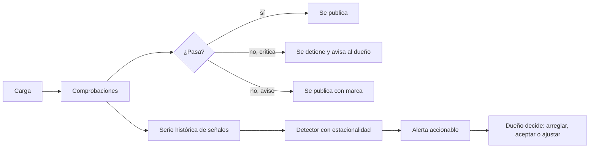
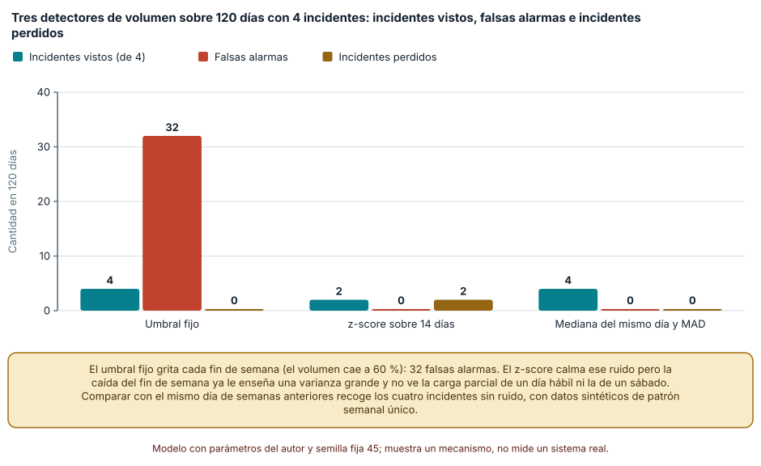

# SE-365 — Calidad y observabilidad de datos

## Punto profesional y fundamento pedagógico

**Punto profesional.** La clase existe para que sepas cuándo un dato es incorrecto antes de que lo descubra quien toma una decisión con él. Un pipeline que corre sin errores no prueba que sus datos sean correctos: puede cargar la mitad de las filas, duplicarlas, perder una clave o cambiar de unidad, y cada una de esas fallas termina en verde. La calidad de datos se vuelve ingeniería cuando se traduce en comprobaciones ejecutables con umbral y dueño (volumen, unicidad, nulos, integridad referencial, frescura, distribución), y la observabilidad de datos cuando esas comprobaciones se convierten en señales a lo largo del tiempo con un detector que no grita cada fin de semana. La clase mide, sobre series y tablas sintéticas, qué detector de volumen funciona, qué defecto ve cada comprobación y cuál se les escapa a todas.

**Por qué aparece aquí.** Sigue a `SE-364` porque un pipeline repetible puede repetir un error con la misma fidelidad. Reutiliza las alertas accionables de [SE-498](../../classes/part-41-observabilidad-sre-e-incidentes/se-498-alertas-accionables-y-fatiga/README.md), los SLO de [SE-497](../../classes/part-41-observabilidad-sre-e-incidentes/se-497-sli-slo-sla-y-presupuestos-de-error/README.md) y las pruebas de contrato de [SE-423](../../classes/part-35-estrategia-y-tecnicas-de-prueba/se-423-integracion-componentes-y-contratos/README.md) aplicadas a datos. Prepara `SE-366`, donde las expectativas se escriben como contrato con el productor.

**Error conceptual que debe corregir.** Creer que una prueba de calidad de datos es una validación de esquema. El esquema ve el tipo y el nombre; las fallas más costosas conservan ambos y cambian la cantidad, la unidad o el significado. La segunda corrección: un umbral fijo parece objetivo y es el origen de la fatiga de alertas, porque los datos tienen estacionalidad y un número único no la conoce.

**Secuencia de aprendizaje.** Antes de ejecutar, predices cuántas falsas alarmas da un umbral fijo sobre 120 días con caída de fin de semana y qué defecto de la tabla se les escapa a cinco de seis comprobaciones. Después comparas tres detectores de volumen contra cuatro incidentes sembrados, pasas seis variantes defectuosas por seis comprobaciones SQL y detectas una deriva del importe medio.

**Evidencia de aprendizaje.** `calidad-de-datos.md` con la tabla de comprobaciones de un conjunto de datos tuyo (qué familia de defectos ve cada una, umbral y dueño), el detector de volumen elegido con su justificación estacional y la lista de defectos que ninguna comprobación ve.

**Límite de la conclusión.** La serie de 120 días tiene un patrón semanal único y cuatro incidentes inventados; la tabla de pedidos tiene 5 000 filas y seis defectos escritos a mano. Los umbrales (10 % de volumen, 1 % de nulos, 24 horas, banda del 10 % del importe) son del autor. No se evaluó ninguna herramienta de calidad de datos ni se midió la tasa de defectos de ninguna organización. No se invocó ningún modelo de lenguaje.

### Trazabilidad fuente → afirmación

| Fuente primaria u oficial | Afirmación que respalda | Lo que no prueba |
|---|---|---|
| [Great Expectations, documentación](https://docs.greatexpectations.io/docs/) | Presenta las expectativas como afirmaciones verificables sobre los datos (nulos, unicidad, rangos, volumen) con resultados de validación. | Es la documentación de una herramienta concreta. |
| [Google SRE, «Monitoring Distributed Systems»](https://sre.google/sre-book/monitoring-distributed-systems/) | Respalda alertar sobre síntomas medibles, vigilar los percentiles y evitar las alertas que nadie atiende. | Trata servicios, no datos. |
| [ISO/IEC 25010:2023](https://www.iso.org/standard/78176.html) | Nombra la calidad del producto, entre ella la corrección funcional y la fiabilidad. | No define calidad de datos de una organización. |
| [Kleppmann, «Designing Data-Intensive Applications»](https://dataintensive.net/) | Explica la tolerancia a fallos y la deriva silenciosa en sistemas de datos derivados. | No prescribe umbrales. |
| [Python: `statistics`](https://docs.python.org/3/library/statistics.html) | Documenta la mediana y las medidas de dispersión que usa el detector. | No valida el detector. |

## Antes de empezar

Recupera lo aprendido en `SE-364`: repetir no cambia el resultado. La pregunta activa es: **¿cómo te enterarías, y en cuánto tiempo, de que anoche la tabla más usada de tu organización recibió solo la mitad de las filas?**

## Prerrequisitos

- Haber completado `SE-364`.
- Conocer el diseño de alertas de [SE-498](../../classes/part-41-observabilidad-sre-e-incidentes/se-498-alertas-accionables-y-fatiga/README.md) y la idea de SLI y SLO de [SE-497](../../classes/part-41-observabilidad-sre-e-incidentes/se-497-sli-slo-sla-y-presupuestos-de-error/README.md).
- Nociones de mediana y desviación.
- Python 3.11 o posterior; el laboratorio usa `sqlite3` y `statistics`.

## Problema auténtico

El panel de entregas de *Avisos* mostró un lunes 5 000 entregas cuando lo normal en día hábil es 10 000. Marketing preguntó si había caído el engagement. Al revisar, la carga del domingo se había completado a medias; ningún error, todas las tareas en verde. En otra ocasión el importe medio por pedido subió un 25 % durante diez días porque un cambio en el origen entregó los importes en otra unidad, y el volumen era normal. En una tercera, las alertas de volumen dispararon todos los fines de semana por una caída que es normal, y el equipo aprendió a ignorarlas, de modo que la carga parcial del lunes se ignoró también.

Los tres casos pertenecen a la misma familia: el dato es incorrecto, el sistema no falla y la señal existe pero nadie la mira o nadie la cree. La ingeniería de calidad consiste en elegir las comprobaciones, decidir dónde se ejecutan y calibrarlas para que su señal merezca atención.

## Objetivos observables

Al terminar podrás:

1. enumerar las seis familias de comprobación (volumen, unicidad, nulos, integridad referencial, frescura, distribución) y el defecto que ve cada una;
2. comparar un umbral fijo, un z-score sin estacionalidad y una mediana por día de la semana contra incidentes sembrados, con falsas alarmas y pérdidas;
3. construir una matriz defecto por comprobación y localizar qué defecto no ve ninguna;
4. detectar una deriva del importe medio con una banda sobre una línea base y explicar por qué el volumen no la ve;
5. decidir dónde ejecutar cada comprobación (al ingerir, tras transformar, al publicar) y qué hacer cuando falla.

## Mapa conceptual



El mapa separa dos usos de la misma medida: la comprobación puntual que decide si se publica y la serie en el tiempo que permite detectar desvíos que ningún umbral fijo describe.

## Temas y por qué importan

| Tema | Por qué cambia una decisión profesional | Evidencia mínima |
|---|---|---|
| Familias de comprobación | Cada una ve una clase de defecto y es ciega al resto. | Matriz defecto por comprobación |
| Volumen | Detecta cargas parciales, duplicados y ausencias. | Filas por día y esperado |
| Estacionalidad | Un umbral fijo grita cada fin de semana. | Falsas alarmas por detector |
| Distribución | Ve los cambios de unidad y de significado. | Media o proporción frente a línea base |
| Integridad referencial | Detecta claves huérfanas tras una unión. | Filas sin dimensión |
| Frescura | Detecta que algo dejó de llegar. | Edad del dato más reciente |
| Qué hacer al fallar | Detener, publicar con marca o avisar. | Política por comprobación |

## Conceptos y decisiones

### 1. Seis familias, seis cegueras

Volumen: ¿llegaron las filas esperadas? Unicidad: ¿hay claves repetidas? Nulos: ¿falta lo que debería estar? Integridad referencial: ¿cada clave extranjera apunta a algo? Frescura: ¿es reciente el dato más nuevo? Distribución: ¿se parecen los valores a lo habitual? En el laboratorio, una tabla de 5 000 pedidos recibió seis variantes defectuosas. La carga parcial falló el volumen; los duplicados fallaron volumen y unicidad; los nulos en el cliente, la comprobación de nulos; los clientes huérfanos, la integridad referencial; los datos atrasados, la frescura; los importes multiplicados por cien (un cambio de unidad) solo fallaron la distribución. La variante limpia no falló ninguna. Ninguna comprobación vio más de dos variantes: su ceguera es tan importante como su vista.

### 2. El volumen es la comprobación más barata y más útil, y es estacional

Contar filas por partición y compararlas con lo esperado atrapa cargas parciales, duplicados y cargas que no corrieron. El problema es definir «lo esperado». En una serie de 120 días con 10 000 filas en días hábiles y 6 000 en fines de semana, con cuatro incidentes sembrados (una carga al 50 % un día hábil, una al 70 % un sábado, duplicados y una carga vacía un sábado), tres detectores dieron resultados muy distintos.

### 3. Umbral fijo, z-score y mediana por día de la semana

El umbral fijo (menos de 8 000 o más de 12 000 filas) vio los cuatro incidentes y dio 32 falsas alarmas: cada fin de semana dispara. El z-score sobre los 14 días anteriores no dio falsas alarmas y vio solo dos de los cuatro incidentes: la caída semanal le enseñó una desviación grande y absorbió la carga parcial del lunes y la del sábado. La mediana del mismo día de la semana en las cuatro semanas anteriores, con una tolerancia de seis veces la desviación absoluta mediana (MAD) o el 15 % de la mediana, vio los cuatro y no dio falsas alarmas. La lección no es que el último detector sea «el mejor» sino que el patrón de la serie debe estar en el detector, y que se compara por incidentes vistos, falsas alarmas y pérdidas, no por intuición.

### 4. La distribución ve lo que el volumen no ve

Un cambio de unidad conserva la cantidad de filas. En el laboratorio, una deriva del +25 % en el importe medio durante diez días (los días 110 a 119) no tocó ningún detector de volumen; una comprobación de banda del 10 % sobre la media de los primeros 100 días la marcó los diez días. Funciona mientras la línea base sea representativa; si el negocio cambia de verdad (una promoción, un cambio de precios), la misma comprobación marca una deriva que es legítima. El registro de cambios del contrato (`SE-366`) existe para distinguir las dos.

### 5. Integridad referencial: el defecto que una unión interna esconde

Una unión interna entre hechos y dimensión elimina en silencio las filas sin pareja. Si el 10 % de los pedidos apunta a un cliente que no existe, el informe muestra menos ventas y nada falla. La comprobación es una consulta: contar las filas de hechos cuya clave no está en la dimensión. Una política profesional es no descartar: conservar la fila con una dimensión «desconocida» y contarlas, de modo que el total concilie y el defecto sea visible.

### 6. Frescura: lo que no llegó

La frescura mide la edad del dato más reciente (`now - max(loaded_at)`) frente a un máximo tolerado. Detecta el pipeline que no corrió, la fuente que dejó de enviar o la carga que quedó atascada. Tiene un punto ciego: una tabla puede estar fresca y vacía de lo importante (se cargó, pero solo con filas de prueba). Por eso se combina con el volumen. En el laboratorio, la variante «datos atrasados» (30 horas de atraso) fue la única que falló la frescura.

### 7. Dónde ejecutar cada comprobación

Hay tres puntos. Al ingerir, para detener lo evidentemente roto antes de gastar cómputo (esquema, volumen mínimo, frescura). Tras transformar, para conciliar entre capas (filas e importes de entrada contra salida, claves huérfanas tras una unión). Al publicar, para proteger al consumidor (unicidad de la clave del producto, distribución). Una comprobación demasiado temprana no ve los defectos que introduce la transformación; una demasiado tardía llega después del daño. Cada una es un contrato con un dueño: quien produce la tabla responde de sus comprobaciones.

### 8. Qué hacer cuando falla: detener, avisar o marcar

Una comprobación crítica (la clave se duplicó) detiene la publicación y avisa al dueño; una comprobación de aviso (la media se movió un 12 %) publica con una marca visible para los consumidores y avisa. Publicar sin decir que falló una comprobación es la peor opción: el consumidor cree que el dato es bueno. Las alertas deben ser accionables ([SE-498](../../classes/part-41-observabilidad-sre-e-incidentes/se-498-alertas-accionables-y-fatiga/README.md)): decir qué comprobación falló, sobre qué tabla y partición, con qué valor y a quién corresponde.

### 9. Lo que ninguna comprobación ve

Un cambio semántico que conserva la distribución (intercambiar dos estados que se reparten por igual), un defecto que afecta a pocas filas (un 0,1 % con importes erróneos) o un error correlacionado con el origen de la fuente pasan por todas las comprobaciones. La defensa es otra capa: una definición de cada campo con ejemplos y una conciliación con una fuente independiente (el sistema de facturación, el banco). La calidad de datos reduce el riesgo; no lo elimina.

## Tres detectores de volumen

La primera medida compara los detectores contra incidentes sembrados.



**Cómo leer la figura.** Cada grupo es un detector con tres barras: incidentes vistos (verde), falsas alarmas (roja) y incidentes perdidos (dorada). Mira primero el umbral fijo, que no pierde nada y habla treinta y dos veces sin motivo, y el z-score, que calla y pierde la mitad. **Dónde deja de valer:** son cuatro incidentes sobre una serie con un solo patrón semanal; con feriados, campañas o tendencias, la mediana por día de la semana también falla. Lo que se traslada es que el detector se evalúa con incidentes sembrados y con falsas alarmas, ambas cosas.

## La serie de volumen

La segunda figura muestra la serie con los incidentes.


**Cómo leer la figura.** El eje horizontal son los días; la línea azul oscura, las filas, y los puntos rojos, los incidentes. Mira primero el sábado 54: con 4 200 filas parece una caída normal de fin de semana (6 000), y por eso un detector sin estacionalidad no lo ve. **Dónde deja de valer:** la serie es sintética, con variación uniforme de ±4 % y sin tendencia; una serie real tiene crecimiento, feriados y campañas que el detector debe conocer.

## Qué comprobación ve cada defecto

La tercera figura es la matriz.


**Cómo leer la figura.** Cada fila es una variante de la tabla y cada columna una comprobación; una celda oscura dice que esa comprobación falla. Mira primero la última fila: solo la distribución la ve. **Dónde deja de valer:** cada defecto afecta a todas las filas o a una fracción grande; un defecto que toca el 0,1 % de las filas no mueve ninguna de estas medidas. Las comprobaciones no prueban que los datos sean correctos, solo que no se parecen a ciertos fallos.

## Definiciones de trabajo

- **Comprobación de calidad:** consulta o regla con umbral que se evalúa sobre un conjunto de datos.
- **Volumen:** número de filas de una carga o partición.
- **Integridad referencial:** cada clave extranjera apunta a una fila existente.
- **Frescura:** edad del dato más reciente.
- **Deriva de distribución:** cambio de la forma de los valores sin que cambie el esquema.
- **MAD:** desviación absoluta mediana, medida de dispersión robusta.
- **Observabilidad de datos:** registro de señales de calidad a lo largo del tiempo para detectar y explicar desvíos.

## Ejemplo mínimo

Una comprobación de volumen con estacionalidad:

```python
import statistics

def volumen_anomalo(filas, dia):
    """Compara con el mismo día de la semana de las 4 semanas anteriores."""
    if dia < 28:
        return False
    historia = [filas[dia - 7 * k] for k in (1, 2, 3, 4)]
    mediana = statistics.median(historia)
    mad = statistics.median([abs(x - mediana) for x in historia]) or 1
    return abs(filas[dia] - mediana) > max(6 * mad, 0.15 * mediana)

filas = [10000 if d % 7 < 5 else 6000 for d in range(40)]
filas[35] = 5000      # un día hábil con la mitad de las filas
print(volumen_anomalo(filas, 35), volumen_anomalo(filas, 34))   # True False
```

El día 34 es un fin de semana con 6 000 filas, normal para ese día, y no alerta; el día 35 es un día hábil con 5 000, anómalo.

## Ejemplo profesional

*Escenario ilustrativo: las cifras y los resultados que aparecen en este ejemplo son supuestos de la narración, no mediciones.*

El equipo de *Avisos* levanta una tabla con sus diez conjuntos de datos más consultados y, para cada uno, anota qué comprobaciones tiene. Encuentra que tres tienen solo validación de esquema. Prioriza por impacto: el hecho de lecturas recibe volumen, unicidad, nulos y frescura; el mart ejecutivo, distribución además de volumen. Define la política: unicidad y volumen detienen la publicación; la distribución publica con una marca. Fija una métrica del propio sistema: el porcentaje de alertas que terminaron en una acción (corregir, ajustar umbral, aceptar con anotación). A los dos meses, la métrica baja del 30 % al 12 % de acciones y el equipo recalibra la mediana por día de la semana en tres conjuntos antes de que alguien silencie el canal.

## Práctica guiada

1. Lista las comprobaciones de un conjunto tuyo y marca qué familia de defecto ve cada una.
2. Ejecuta `python scripts/experiments_part30_b.py 545` y reproduce la tabla de detectores y la matriz.
3. Añade un incidente de volumen en un feriado a la serie y observa qué detector falla.
4. Escribe la consulta de integridad referencial de un hecho tuyo con su dimensión.
5. Decide, para cada comprobación de tu lista, si detiene, avisa o marca, y por qué.

## Ejercicios

1. **Básico.** Explica por qué el z-score sobre 14 días no da falsas alarmas y aun así pierde dos de los cuatro incidentes.
2. **Intermedio.** Añade al experimento una tendencia de crecimiento del 0,2 % diario y mide cómo cambian las falsas alarmas de cada detector.
3. **Avanzado.** Diseña una comprobación para un defecto que afecte al 0,1 % de las filas con importes en otra unidad y explica su costo de ejecución.

## Reto verificable

Entrega `calidad-de-datos.md` con la tabla de comprobaciones de un conjunto tuyo (familia, umbral, dueño y acción al fallar), el detector de volumen con su comparación contra al menos tres incidentes sembrados y la lista de defectos que ninguna comprobación ve. Es válido si otra persona reproduce tu comparación de detectores y señala un defecto que tu batería no ve.

## Caso conductor

*Avisos* publica el hecho de lecturas con cuatro comprobaciones y un detector de volumen estacional, y mide cuántas alertas terminan en una acción. `SE-366` lleva esas expectativas al contrato con el productor y estudia qué cambios de esquema las rompen.

## Preguntas frecuentes

### ¿Cuántas comprobaciones debe tener una tabla?

Las que correspondan a los defectos plausibles y costosos de esa tabla. Un hecho con consumidores ejecutivos pide más que una tabla intermedia. Muchas comprobaciones sin dueño producen ruido; pocas con dueño producen acción.

### ¿Por qué no usar siempre aprendizaje automático para detectar anomalías?

Puede ayudar con series complejas, pero añade opacidad, parámetros y falsas alarmas difíciles de explicar. La mediana por día de la semana es explicable y suele alcanzar. Si un método más complejo no gana en incidentes vistos y falsas alarmas sobre tus datos, no se justifica.

### ¿Detener la publicación no deja a los consumidores sin datos?

Sí, y por eso la política se decide por comprobación: detener cuando un dato malo hace más daño que ninguno (duplicados en facturación), publicar con marca cuando la decisión del consumidor tolera la duda. Esa decisión se acuerda con ellos antes de que ocurra.

### ¿Quién arregla los datos cuando una comprobación falla?

El dueño del conjunto. Si nadie responde a una alerta, la comprobación no tiene dueño y debe retirarse o asignarse.

## Fallo controlado y diagnóstico

**Fallo.** El lunes, el panel muestra la mitad de las entregas y las alertas de volumen no sonaron.

**Diagnóstico paso a paso.** (1) Se revisa el detector: usa un z-score sobre 14 días sin estacionalidad. (2) Se mide el valor del lunes frente a la ventana: la desviación inflada por los fines de semana deja el z-score en 1,9. (3) Se repite el cálculo con la mediana del mismo día de las cuatro semanas anteriores: la diferencia supera la tolerancia. (4) Se comprueba que el z-score, con los incidentes sembrados del experimento, pierde la mitad de los casos.

**Corrección.** Se reemplaza el detector por la mediana por día de la semana, se añade el conteo contra la fuente (filas del origen frente a filas cargadas) como comprobación de conciliación y se prueba con un incidente sembrado cada mes. La lección es que un detector sin pruebas con incidentes sembrados no tiene una tasa de fallos conocida.

## Errores comunes y cómo corregirlos

- **Confiar en que el pipeline en verde significa datos correctos.** Corrige con comprobaciones de salida.
- **Un umbral fijo para una serie estacional.** Corrige con detectores que conozcan el patrón.
- **Validar solo el esquema.** Corrige con distribución y conciliación.
- **Unir con una unión interna y no contar lo que sale.** Corrige con una dimensión «desconocida» y un conteo.
- **Alertas sin dueño.** Corrige asignando un dueño o retirando la alerta.
- **No probar el detector.** Corrige sembrando incidentes y midiendo vistos, falsas alarmas y pérdidas.

## Entorno y archivos clave

- `scripts/experiments_part30_b.py`: función `e545` con la serie, los tres detectores, la deriva del importe y la matriz de variantes; se ejecuta con `python scripts/experiments_part30_b.py 545`.
- `scripts/figures_part30_a.py`: las tres figuras de la clase.
- Solo la biblioteca estándar de Python 3.11 o posterior; semilla 45.

## Seguridad, ética y accesibilidad

Los datos del laboratorio son sintéticos. Una comprobación que lee los datos para medirlos (distribuciones, valores extremos) accede a ellos: ejecútala con los mismos permisos y la misma retención que el dato. Las alertas no deben incluir valores personales en su texto. Ética: una métrica de calidad por equipo debe servir para decidir apoyo y no para señalar personas. Las figuras llevan texto alternativo completo y no dependen solo del color.

## Puente hacia el trabajo con agentes

Un agente que usa un conjunto de datos debe consultar el estado de sus comprobaciones antes de calcular y declararlo: «usé la partición del día 12, con la comprobación de distribución en aviso». Si un agente propone relajar un umbral para que una carga pase, trátalo como un cambio al contrato y exige la razón y la aprobación del dueño. Un agente no debe modificar las comprobaciones que lo evalúan.

## Transferencia

Elige el conjunto de datos del que más dependa tu organización. Escribe sus seis comprobaciones, siembra un defecto de cada familia en una copia y anota cuáles detecta tu batería. El defecto que se escapa es el primero que debes atender.

## Evaluación y evidencia

| Criterio | Evidencia aceptable | Rechazo |
|---|---|---|
| Familias | Matriz defecto por comprobación | «Validamos los datos» |
| Detector | Vistos, falsas alarmas y pérdidas con incidentes sembrados | Umbral por intuición |
| Estacionalidad | El patrón figura en el detector | Un número fijo |
| Política | Detener, marcar o avisar por comprobación | Publicar sin decir |
| Dueño | Persona o equipo nombrado | «El equipo de datos» |

## Fuentes

- Great Expectations. [Documentación](https://docs.greatexpectations.io/docs/).
- Google. [«Monitoring Distributed Systems»](https://sre.google/sre-book/monitoring-distributed-systems/), en el libro Site Reliability Engineering.
- Organización Internacional de Normalización. [ISO/IEC 25010:2023](https://www.iso.org/standard/78176.html).
- Kleppmann, M. [«Designing Data-Intensive Applications»](https://dataintensive.net/).
- Python Software Foundation. [`statistics`](https://docs.python.org/3/library/statistics.html).

## Límites y siguiente paso

La serie, los incidentes, las variantes defectuosas y los umbrales son construcciones del autor; los tres detectores se evaluaron con cuatro incidentes y un patrón semanal único. No se evaluó ninguna herramienta de calidad de datos ni se midió la tasa de defectos de ninguna organización. El siguiente paso, `SE-366`, formaliza las expectativas como contrato con el productor y estudia la evolución de esquemas.

## Glosario

| Término | Definición breve |
|---|---|
| Comprobación | Regla con umbral sobre un conjunto de datos |
| Estacionalidad | Patrón que se repite (semanal, mensual) |
| MAD | Desviación absoluta mediana |
| Integridad referencial | Toda clave apunta a algo |
| Frescura | Edad del dato más reciente |
| Conciliación | Comparar totales entre dos fuentes |
