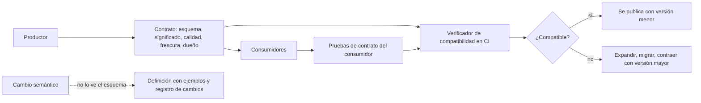

# SE-366 — Contratos de datos y evolución de esquemas

## Punto profesional y fundamento pedagógico

**Punto profesional.** La clase existe para que conviertas la relación entre quien produce un conjunto de datos y quien lo consume en un acuerdo escrito, comprobable y versionado, y para que sepas qué cambios de esquema rompen a los consumidores y cuáles no. Un contrato de datos declara el esquema (nombres, tipos, obligatoriedad), las garantías de calidad y de frescura, el significado de cada campo, el dueño y la política de cambios. Sin él, cada consumidor adivina, y el productor rompe sin saberlo a quienes dependen de él. La clase construye un verificador de compatibilidad entre versiones de esquema, lo aplica a diez cambios típicos, lee mil registros reales con el lector nuevo, ejecuta un renombre de golpe frente a un renombre en tres pasos sobre una tabla de SQLite y muestra la trampa más peligrosa: un cambio de unidad que el verificador aprueba.

**Por qué aparece aquí.** Sigue a `SE-365` porque las expectativas de calidad pasan a ser parte de un acuerdo. Reutiliza la compatibilidad de esquemas de [SE-380](../../classes/part-31-integracion-eventos-y-mensajeria/se-380-compatibilidad-de-esquemas-y-registros/README.md), las migraciones compatibles de [SE-354](../../classes/part-29-datos-persistencia-y-recuperacion/se-354-migraciones-compatibles-y-evolucion-de-esquema/README.md) y las pruebas de contrato de [SE-423](../../classes/part-35-estrategia-y-tecnicas-de-prueba/se-423-integracion-componentes-y-contratos/README.md). Prepara `SE-367`, donde el linaje dice quién consume cada campo.

**Error conceptual que debe corregir.** Creer que compatibilidad de esquema es compatibilidad de significado. Un verificador puede aprobar que `due_hours` siga siendo un entero mientras el productor cambió las horas por minutos; el consumidor sigue leyendo y calcula mal. La segunda corrección: «hacia atrás» y «hacia adelante» no son sinónimos; el sentido de la compatibilidad depende de quién actualiza primero, y confundirlo rompe al consumidor o al productor según el orden de despliegue.

**Secuencia de aprendizaje.** Antes de ejecutar, predices qué cambios (añadir un campo con y sin valor por defecto, quitar uno, renombrar, ampliar o estrechar un tipo, cambiar a texto, cambiar la unidad, reordenar) son compatibles en cada sentido. Después ejecutas el verificador, lees mil registros con el esquema nuevo, renombras una columna de golpe y en tres pasos y registras qué ve cada lector.

**Evidencia de aprendizaje.** `contrato-de-datos.md` con el contrato de un conjunto tuyo (esquema, significado de cada campo con ejemplo, calidad, frescura, dueño y política de versiones), la tabla de cambios con su compatibilidad en cada sentido y el procedimiento de expandir y contraer para un cambio incompatible.

**Límite de la conclusión.** Los esquemas son diccionarios de cuatro campos y las reglas de compatibilidad (promoción de tipos, valor por defecto) son una versión simplificada de las de formatos reales como Avro; los 1 000 registros son sintéticos. No se ejecutó ningún registro de esquemas ni ninguna herramienta de contratos. No se invocó ningún modelo de lenguaje.

### Trazabilidad fuente → afirmación

| Fuente primaria u oficial | Afirmación que respalda | Lo que no prueba |
|---|---|---|
| [Open Data Contract Standard](https://bitol-io.github.io/open-data-contract-standard/latest/) | Propone un formato de contrato de datos con esquema, calidad, propietarios y acuerdos de nivel de servicio. | Es una especificación comunitaria; no mide su adopción. |
| [Apache Avro, «Schema Resolution»](https://avro.apache.org/docs/current/specification/) | Define cómo un lector con un esquema lee datos escritos con otro: campos por nombre, valores por defecto y promoción de tipos. | Solo describe Avro. |
| [Confluent, «Schema Evolution and Compatibility»](https://docs.confluent.io/platform/current/schema-registry/fundamentals/schema-evolution.html) | Distingue los modos de compatibilidad hacia atrás, hacia adelante y completa y el orden de actualización de productores y consumidores. | Documenta un producto concreto. |
| [Fowler, «ParallelChange»](https://martinfowler.com/bliki/ParallelChange.html) | Describe el patrón expandir, migrar y contraer para cambios incompatibles. | No cubre datos en reposo masivos. |
| [SQLite, «ALTER TABLE»](https://www.sqlite.org/lang_altertable.html) | Documenta renombrar y quitar columnas, base del experimento. | No describe otros motores. |

## Antes de empezar

Recupera lo aprendido en `SE-365`: cada comprobación ve una familia de defectos. La pregunta activa es: **si mañana el productor de tu tabla más usada renombra una columna, ¿quién se entera, cuándo y qué se rompe?**

## Prerrequisitos

- Haber completado `SE-365`.
- Conocer la compatibilidad de esquemas de [SE-380](../../classes/part-31-integracion-eventos-y-mensajeria/se-380-compatibilidad-de-esquemas-y-registros/README.md) y las migraciones de [SE-354](../../classes/part-29-datos-persistencia-y-recuperacion/se-354-migraciones-compatibles-y-evolucion-de-esquema/README.md).
- Python 3.11 o posterior; el laboratorio usa `sqlite3`.

## Problema auténtico

El equipo de aplicaciones de *Avisos* renombra `due_hours` a `hours_left` porque «el nombre era confuso». El cambio sale un jueves. El viernes el informe de pendientes muestra cero en todo. El equipo de datos no sabía del cambio; el de aplicaciones no sabía que alguien consumía ese campo. Dos semanas después otro cambio, esta vez de horas a minutos conservando el nombre, pasa sin que ningún proceso falle y produce plazos sesenta veces más largos.

Hay dos defectos de proceso. El primero es que nadie declaró qué se ofrecía ni a quién; el segundo, que aun declarándolo, el verificador de esquema habría aprobado el segundo cambio. El contrato resuelve el primero y exige complementos para el segundo.

## Objetivos observables

Al terminar podrás:

1. escribir un contrato de datos con esquema, significado, calidad, frescura, dueño y política de versiones;
2. distinguir compatibilidad hacia atrás, hacia adelante y completa, y decir en qué orden hay que desplegar cada una;
3. clasificar diez cambios de esquema según el sentido en que son compatibles y medir cuántos registros rompen;
4. ejecutar un cambio incompatible como expandir, migrar y contraer sobre una tabla y mostrar qué ve cada lector en cada paso;
5. explicar por qué un cambio de unidad que conserva el tipo pasa el verificador y qué barrera lo detiene.

## Mapa conceptual



El mapa muestra el contrato en el centro: lo lee el verificador del productor y lo prueba cada consumidor. La línea punteada es el límite: el significado no lo comprueba el esquema.

## Temas y por qué importan

| Tema | Por qué cambia una decisión profesional | Evidencia mínima |
|---|---|---|
| Contrato de datos | Convierte una costumbre en un acuerdo comprobable. | Documento con esquema, significado y dueño |
| Compatibilidad hacia atrás y adelante | Decide el orden de actualización. | Tabla de cambios por sentido |
| Valores por defecto | Permiten añadir campos sin romper. | Campo nuevo con valor por defecto |
| Promoción de tipos | Ampliar es seguro en un sentido y no en el otro. | Lectura de registros viejos y nuevos |
| Expandir y contraer | Reparte un cambio incompatible en pasos seguros. | Lectores por paso |
| Cambios semánticos | Pasan el verificador y rompen resultados. | Definición con ejemplos |
| Versionado | Comunica el alcance del cambio. | Política de versiones |

## Conceptos y decisiones

### 1. Qué contiene un contrato de datos

Un contrato declara cinco cosas. El esquema: campos, tipos y cuáles son obligatorios. La semántica: qué significa cada campo, con un ejemplo y la unidad. La calidad: las comprobaciones que el productor ofrece (unicidad de la clave, tasa máxima de nulos). El nivel de servicio: frescura y disponibilidad. Y la gobernanza: dueño, canal de contacto, política de cambios y retención. Es un archivo versionado junto al código del productor, no una página de una wiki, y su verificación se ejecuta en cada cambio.

### 2. Escritor y lector: el sentido de la compatibilidad

Hay dos esquemas en juego: el que usó el escritor para producir el dato (`W`) y el que usa el lector para interpretarlo (`R`). Compatibilidad hacia atrás significa que un lector con el esquema nuevo lee datos escritos con el viejo: los consumidores se actualizan primero. Hacia adelante, que un lector con el esquema viejo lee datos escritos con el nuevo: el productor se actualiza primero. Completa, ambas. Elegir un sentido es elegir quién debe actualizar antes, y en organizaciones con muchos consumidores independientes se prefiere hacia adelante o completa, porque no se puede coordinar el despliegue de todos.

### 3. Qué dice el verificador de diez cambios

La regla del experimento: un lector con esquema `R` lee datos con esquema `W` si, para cada campo de `R`, o el campo está en `W` con un tipo igual o promovible (int a long a float a double), o `R` le da un valor por defecto. Sobre un esquema de cuatro campos, los resultados fueron: añadir un campo con valor por defecto, quitar un campo con valor por defecto, reordenar y cambiar la unidad son compatibles en las dos direcciones; añadir un campo obligatorio sin valor por defecto rompe hacia atrás (el lector nuevo no encuentra el campo en datos viejos); quitar un campo obligatorio rompe hacia adelante (el lector viejo lo exige); ampliar de int a long es compatible hacia atrás y rompe hacia adelante (un valor largo no cabe en un lector entero); estrechar de long a int es lo contrario; renombrar y cambiar a texto rompen en las dos.

### 4. Lo que pasa con los registros

Con mil registros escritos con el esquema viejo y un lector con el esquema nuevo, añadir un campo obligatorio sin valor por defecto, renombrar un campo y cambiar el tipo a texto dejaron ilegibles los 1 000. Los demás cambios, cero. Los cambios que rompen, rompen todo: ningún caso dejó legible la mitad, porque el defecto está en la regla y no en el dato. Una excepción conviene recordar: estrechar de long a int no rompió porque ningún valor de la muestra excedía el rango; con un identificador grande habría roto, y esa dependencia del dato no se ve en el esquema.

### 5. Cambios que el esquema aprueba y que rompen

Cambiar la unidad de horas a minutos conserva nombre y tipo, y el verificador lo aprueba en las dos direcciones. Lo mismo ocurre con redondear de otra manera, cambiar la zona horaria de una marca de tiempo sin zona, o hacer que `status = 'delivered'` signifique otra cosa. Las defensas son tres: la definición del campo con un ejemplo en el contrato; la comprobación de distribución de `SE-365`, que ve el cambio por su efecto; y un registro de cambios que el productor debe actualizar antes de publicar, de modo que la semántica tenga un cambio de versión aunque el esquema no cambie.

### 6. Expandir, migrar y contraer

Cuando un cambio es incompatible, se divide en pasos que cada lector sobrevive. Expandir: añadir lo nuevo sin quitar lo viejo. Migrar: escribir en las dos formas, rellenar lo antiguo y mover a los lectores uno a uno. Contraer: quitar lo viejo cuando ya nadie lo lee. En el experimento, un lector viejo suma `fee_cents` y uno nuevo `amount_cents`. Un renombre de golpe rompe al viejo al instante (`no such column`). En tres pasos: expandir añade `amount_cents` y el lector viejo sigue leyendo 14 950, pero el nuevo devuelve un nulo sin error (la columna existe y está vacía); al escribir en las dos y rellenar, los dos leen 14 950; al contraer (quitar `fee_cents`) el viejo falla. El paso 1 enseña que «sin error» no es «correcto», y el paso 3 que solo es seguro cuando el lector viejo ya no existe.

### 7. Quién consume qué: la condición del paso de contraer

Contraer exige saber que nadie usa lo viejo. Eso se averigua con inventario de consumidores (el linaje de `SE-367`), con el registro de accesos a la columna y con una fecha de retiro anunciada. Un período de convivencia sin fecha de fin es un cambio que nunca termina; una fecha sin inventario es una apuesta.

### 8. Versionar con significado

Una convención como versionado semántico ([SE-354](../../classes/part-29-datos-persistencia-y-recuperacion/se-354-migraciones-compatibles-y-evolucion-de-esquema/README.md) y la especificación SemVer) da un lenguaje: un cambio compatible sube la versión menor, uno incompatible, la mayor, y un cambio de significado que conserva el esquema también sube la mayor aunque ningún verificador lo exija. Los consumidores fijan el rango de versiones que aceptan, y el productor mantiene la versión anterior durante el tiempo acordado.

### 9. Qué cuesta un contrato y cuándo no vale la pena

Un contrato cuesta escribirlo, versionarlo y mantener sus pruebas. Se justifica cuando hay consumidores que no controlas, cuando un cambio sin aviso tiene costo alto o cuando varios equipos dependen del mismo conjunto. Para una tabla intermedia que usa un solo equipo que además la produce, un contrato completo es exceso: bastan las comprobaciones de `SE-365`.

## Diez cambios, dos sentidos

La primera medida clasifica los cambios por sentido de compatibilidad.


**Cómo leer la figura.** Cada fila es un cambio y cada columna un sentido; una celda clara dice «sí» y una oscura «NO». Mira primero la fila resaltada, el cambio de unidad, que figura compatible en los dos sentidos aunque rompe el significado. **Dónde deja de valer:** las reglas son una simplificación de las de un formato real, y solo cuatro campos. Un esquema real tiene tipos anidados, enumeraciones y uniones, cuyas reglas añaden casos (añadir un valor a una enumeración rompe a un lector que no lo conoce).

## Registros que un lector nuevo no puede leer

La segunda medida lee mil registros con cada esquema nuevo.


**Cómo leer la figura.** Cada barra es un cambio y su longitud los registros de mil que el lector nuevo no puede leer. Mira primero que las barras son 0 o 1 000: no hay término medio. **Dónde deja de valer:** los registros son sintéticos y uniformes; en datos reales algunos registros pueden satisfacer la regla nueva y otros no (un campo opcional que a veces viene vacío), y entonces el fallo es parcial y más difícil de ver.

## Expandir y contraer sobre una tabla

La tercera medida ejecuta el renombre en tres pasos.


**Cómo leer la figura.** Cada fila es un paso y la caja central dice qué ve cada lector. Mira primero la segunda fila: el nulo sin error es el peligro silencioso, y la tercera es la ventana segura. **Dónde deja de valer:** es una tabla de 100 filas en una sola conexión; en producción el paso de relleno es un trabajo largo con su propia idempotencia (`SE-364`) y el de contraer exige comprobar el uso de la columna vieja.

## Definiciones de trabajo

- **Contrato de datos:** acuerdo versionado entre productor y consumidor sobre esquema, semántica, calidad y servicio.
- **Compatibilidad hacia atrás:** un lector nuevo lee datos viejos.
- **Compatibilidad hacia adelante:** un lector viejo lee datos nuevos.
- **Valor por defecto:** valor que el lector usa si el campo falta.
- **Expandir y contraer:** añadir lo nuevo, migrar y quitar lo viejo en pasos.
- **Cambio semántico:** cambia el significado y conserva el esquema.
- **Registro de cambios:** historial anunciado de cambios de significado y de esquema.

## Ejemplo mínimo

Un verificador de compatibilidad de veinte líneas:

```python
PROMO = {("int", "long"), ("int", "float"), ("long", "float"), ("long", "double"), ("float", "double")}

def promocionable(escrito, leido):
    return escrito == leido or (escrito, leido) in PROMO

def puede_leer(escritor, lector):
    """¿Un lector con ese esquema entiende datos escritos con el otro?"""
    for campo, (tipo, defecto) in lector.items():
        if campo in escritor:
            if not promocionable(escritor[campo][0], tipo):
                return False
        elif defecto is None:         # campo obligatorio que el escritor no trae
            return False
    return True

v1 = {"id": ("long", None), "due_hours": ("int", None)}
v2 = {**v1, "canal": ("string", "email")}
print(puede_leer(v1, v2), puede_leer(v2, v1))    # True True: campo nuevo con valor por defecto
v3 = {**v1, "canal": ("string", None)}
print(puede_leer(v1, v3), puede_leer(v3, v1))    # False True: obligatorio sin valor por defecto
```

El campo nuevo con valor por defecto es compatible en los dos sentidos; sin valor por defecto, un lector nuevo no puede leer datos viejos.

## Ejemplo profesional

*Escenario ilustrativo: las cifras y los resultados que aparecen en este ejemplo son supuestos de la narración, no mediciones.*

El equipo de *Avisos* publica el contrato del conjunto «avisos enviados»: seis campos con su significado y unidad, una comprobación de unicidad, frescura de cuatro horas y un dueño. En el repositorio del productor, un verificador compara el esquema de cada propuesta con el de la versión publicada y bloquea los cambios incompatibles sin una versión mayor. Tres equipos consumidores añaden una prueba de contrato propia: leen un ejemplo del contrato y verifican que su código lo interpreta. Cuando el productor quiere pasar `due_hours` a minutos, el verificador no se queja; el registro de cambios sí lo exige, y el equipo decide publicar `due_minutes` como campo nuevo con `due_hours` conviviendo seis semanas y una fecha de retiro. Los tres consumidores migran en esa ventana y el campo viejo se retira sin incidentes.

## Práctica guiada

1. Escribe el contrato de un conjunto tuyo con esquema, significado de cada campo con ejemplo y dueño.
2. Ejecuta `python scripts/experiments_part30_b.py 546` y reproduce la tabla de compatibilidad.
3. Añade al verificador una regla para valores de enumeración y comprueba qué cambios rompe.
4. Ejecuta el renombre en tres pasos y escribe qué comprobarías antes del paso de contraer.
5. Escribe la entrada del registro de cambios para un cambio de unidad.

## Ejercicios

1. **Básico.** Explica por qué quitar un campo obligatorio rompe hacia adelante y no hacia atrás.
2. **Intermedio.** Decide en qué orden desplegarías un campo nuevo con valor por defecto si hay diez consumidores independientes y justifica el sentido de compatibilidad que necesitas.
3. **Avanzado.** Diseña la prueba que detectaría el cambio de horas a minutos sin depender del esquema, y explica qué falsas alarmas tendría.

## Reto verificable

Entrega `contrato-de-datos.md` con el contrato de un conjunto tuyo, la tabla de al menos cinco cambios con su compatibilidad en cada sentido y el plan de expandir y contraer de un cambio incompatible con el lector de cada paso. Es válido si otra persona aplica tu tabla a un cambio nuevo y obtiene la misma clasificación.

## Caso conductor

*Avisos* publica contratos con verificador de compatibilidad, pruebas de consumidor y registro de cambios semánticos. `SE-367` construye el mapa de quién consume qué campo, que es lo que permite saber cuándo contraer.

## Preguntas frecuentes

### ¿Quién escribe el contrato, el productor o el consumidor?

El productor lo publica y responde por él; los consumidores aportan pruebas de lo que necesitan. Un contrato escrito solo por el productor ignora el uso real; uno escrito solo por consumidores no obliga a nadie. El mejor es un acuerdo con pruebas en ambos lados.

### ¿Hacia atrás o hacia adelante?

Depende de quién actualiza primero. Con consumidores que no controlas, prefiere compatibilidad completa y valores por defecto; con un solo consumidor coordinado, basta un sentido. Escríbelo en el contrato.

### ¿Un campo opcional es siempre compatible?

Añadirlo con valor por defecto, sí. Hacerlo opcional cuando antes era obligatorio puede romper a un lector que supone que siempre viene. Y cambiar un campo de «nunca nulo» a «nulo posible» rompe a quien no maneja nulos.

### ¿Qué hago con los datos históricos escritos con el esquema viejo?

Reescribirlos (backfill, `SE-364`) al formato nuevo o conservar la regla de lectura con el esquema viejo. En almacenes con formato autodescrito, cada archivo lleva su esquema y el lector resuelve; en otros, el cambio exige migrar el dato.

## Fallo controlado y diagnóstico

**Fallo.** Tras un despliegue del productor, el informe de pendientes muestra cero y ninguna tarea falla.

**Diagnóstico paso a paso.** (1) Se compara el conteo de filas con el del día anterior: normal. (2) Se compara la suma de `due_hours`: cero. (3) Se revisa el cambio: el campo se renombró a `hours_left`. (4) Se comprueba que la consulta del consumidor usa `COALESCE(due_hours, 0)`: el campo faltante se convierte en cero sin avisar.

**Corrección.** Se restaura `due_hours` en el productor (expandir), se publica `hours_left` como campo nuevo, se cambia la consulta del consumidor para fallar si el campo falta (en lugar de rellenar con cero) y se añade la prueba de contrato del consumidor al flujo del productor. La lección es que rellenar con un valor por defecto en el consumidor convierte un cambio de esquema en un error silencioso; un campo obligatorio ausente debe fallar con ruido.

## Errores comunes y cómo corregirlos

- **Confundir compatibilidad de esquema con compatibilidad de significado.** Corrige con definiciones con ejemplos y registro de cambios.
- **Rellenar con ceros los campos que faltan.** Corrige haciendo fallar la lectura de campos obligatorios.
- **Renombrar de golpe.** Corrige con expandir y contraer.
- **Contraer sin inventario de consumidores.** Corrige con el linaje y una fecha de retiro.
- **Elegir un sentido de compatibilidad sin saber quién actualiza primero.** Corrige escribiéndolo en el contrato.
- **No probar con registros reales.** Corrige leyendo una muestra con el esquema nuevo.

## Entorno y archivos clave

- `scripts/experiments_part30_b.py`: función `e546` con el verificador, la lectura de mil registros y el expandir y contraer; se ejecuta con `python scripts/experiments_part30_b.py 546`.
- `scripts/figures_part30_a.py`: las tres figuras de la clase.
- Solo la biblioteca estándar de Python 3.11 o posterior; semilla 45.

## Seguridad, ética y accesibilidad

Los registros del laboratorio son sintéticos. El contrato debe declarar qué campos contienen datos personales y su base de tratamiento, porque un consumidor que no lo sabe puede copiarlos sin cuidado (`SE-369`). Un cambio de esquema que expone un campo antes oculto es un cambio de privacidad aunque sea compatible. Las figuras llevan texto alternativo completo y no dependen solo del color.

## Puente hacia el trabajo con agentes

Un agente que produce o transforma datos debe leer el contrato del conjunto y declarar qué versión usa. Si propone cambiar un esquema, pídele que ejecute el verificador, liste los consumidores afectados (por el linaje) y proponga el plan de expandir y contraer. Un agente no debe renombrar columnas ni cambiar unidades sin pasar por el registro de cambios.

## Transferencia

Elige un conjunto de datos con consumidores que no controlas. Escribe su contrato en media página, clasifica los cinco cambios más probables en los dos sentidos y decide qué pasos y qué fecha de retiro necesitarías para el más incompatible.

## Evaluación y evidencia

| Criterio | Evidencia aceptable | Rechazo |
|---|---|---|
| Contrato | Esquema, significado con ejemplo, calidad, servicio y dueño | Solo esquema |
| Compatibilidad | Tabla por cambio y sentido | «Es compatible» |
| Registros | Lectura de una muestra con el esquema nuevo | Solo el verificador |
| Cambio incompatible | Pasos con el lector de cada uno | Cambio de golpe |
| Semántica | Registro de cambios con versión | Silencio |

## Fuentes

- Bitol. [Open Data Contract Standard](https://bitol-io.github.io/open-data-contract-standard/latest/).
- Apache Avro. [«Schema Resolution»](https://avro.apache.org/docs/current/specification/).
- Confluent. [«Schema Evolution and Compatibility»](https://docs.confluent.io/platform/current/schema-registry/fundamentals/schema-evolution.html).
- Fowler, M. [«ParallelChange»](https://martinfowler.com/bliki/ParallelChange.html).
- SQLite. [«ALTER TABLE»](https://www.sqlite.org/lang_altertable.html).

## Límites y siguiente paso

Los esquemas, las reglas de promoción y los registros son construcciones del autor; el verificador es una simplificación y no cubre tipos anidados, enumeraciones ni uniones. No se ejecutó ningún registro de esquemas ni se midió el costo de un cambio incompatible en una organización. El siguiente paso, `SE-367`, construye el linaje y el catálogo que dicen quién consume cada campo.

## Glosario

| Término | Definición breve |
|---|---|
| Contrato de datos | Acuerdo versionado sobre esquema, semántica y servicio |
| Compatibilidad hacia atrás | Lector nuevo, datos viejos |
| Compatibilidad hacia adelante | Lector viejo, datos nuevos |
| Valor por defecto | Valor si falta el campo |
| Expandir y contraer | Cambio incompatible en pasos |
| Cambio semántico | Cambia el significado, no el esquema |
