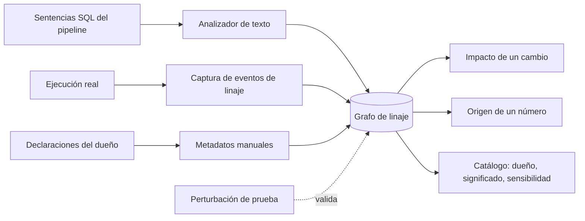

# SE-367 — Linaje, catálogo y metadatos

## Punto profesional y fundamento pedagógico

**Punto profesional.** La clase existe para que puedas responder dos preguntas que una plataforma de datos recibe todos los días y que casi nadie puede contestar con certeza: «¿de dónde sale este número?» y «¿qué se rompe si cambio esta columna?». El linaje es el grafo de qué datos se derivan de cuáles; el catálogo es el inventario de conjuntos de datos con su dueño, su significado y su estado; los metadatos son la información que describe a ambos. La clase construye un analizador de linaje de columnas sobre un pipeline de seis tablas, lo compara con una medición empírica (perturbar una columna de origen y ver qué salidas cambian) y muestra dos hechos incómodos: el linaje de tablas avisa de todo o de nada, y el linaje de columnas que solo mira los valores omite las condiciones que deciden qué filas llegan.

**Por qué aparece aquí.** Sigue a `SE-366` porque contraer un esquema exige saber quién lo consume, y esa es una pregunta de linaje. Reutiliza el grafo de dependencias de `SE-364`, la observabilidad de [SE-493](../../classes/part-41-observabilidad-sre-e-incidentes/se-493-senales-eventos-y-observabilidad-util/README.md) y los inventarios de [SE-466](../../classes/part-38-seguridad-privacidad-y-cumplimiento/se-466-cumplimiento-evidencia-y-limites-legales/README.md). Prepara `SE-369`, donde borrar a una persona exige encontrar todas sus copias.

**Error conceptual que debe corregir.** Creer que el linaje es un dibujo que genera una herramienta. Es una afirmación sobre dependencias, y cada método (análisis del texto SQL, captura en ejecución, declaración manual) ve una parte y es ciego a otra. La segunda corrección: «columna que no se usa» y «columna que no influye» no son lo mismo; una columna que solo aparece en un `WHERE` o en una unión no está en la lista de salida y cambia qué filas llegan.

**Secuencia de aprendizaje.** Antes de ejecutar, predices cuántas de las 17 columnas de salida cambian si perturbas `status` de los pedidos y cuántas predice un linaje que solo sigue los valores. Después analizas seis sentencias SQL con un analizador de texto, perturbas cada una de nueve columnas de origen sobre datos reales de SQLite y comparas lo medido con tres predicciones.

**Evidencia de aprendizaje.** `linaje-y-catalogo.md` con el linaje de columnas de un conjunto tuyo (arista, método que la encontró y qué no cubre), una prueba por perturbación de al menos tres columnas de origen y la ficha de catálogo de un activo (dueño, significado, sensibilidad, frescura, consumidores).

**Límite de la conclusión.** El pipeline son seis sentencias de juguete con un analizador de expresiones regulares que solo entiende ese estilo; 17 columnas de salida y 9 de origen; 3 000 pedidos y 300 clientes sintéticos. No se ejecutó ninguna herramienta de linaje ni de catálogo (OpenLineage, catálogos comerciales) ni se midió la cobertura de ninguna. No se invocó ningún modelo de lenguaje.

### Trazabilidad fuente → afirmación

| Fuente primaria u oficial | Afirmación que respalda | Lo que no prueba |
|---|---|---|
| [OpenLineage, documentación](https://openlineage.io/docs/) | Propone un estándar abierto para capturar el linaje en ejecución: trabajos, ejecuciones y conjuntos de datos de entrada y salida. | Es una especificación; no mide cuánto del linaje real cubre. |
| [DAMA International, DMBOK](https://www.dama.org/cpages/body-of-knowledge) | Sitúa los metadatos y el catálogo dentro de la gestión de datos y describe la responsabilidad sobre los activos. | Es una guía de buenas prácticas. |
| [Open Data Contract Standard](https://bitol-io.github.io/open-data-contract-standard/latest/) | Muestra qué metadatos describe un contrato: propietarios, esquema, calidad, acuerdos. | No es un catálogo. |
| [Kleppmann, «Designing Data-Intensive Applications»](https://dataintensive.net/) | Explica los datos derivados y por qué reconstruir una vista exige conocer sus entradas. | No describe herramientas de linaje. |
| [SQLite, «CREATE TABLE ... AS SELECT»](https://www.sqlite.org/lang_createtable.html) | Documenta la sentencia que construye cada tabla del pipeline. | No valida el analizador. |

## Antes de empezar

Recupera lo aprendido en `SE-366`: contraer un campo exige saber quién lo lee. La pregunta activa es: **si cambias hoy el significado de una columna de tu tabla más usada, ¿cuántos informes y modelos se ven afectados y cómo lo sabes?**

## Prerrequisitos

- Haber completado `SE-364` y `SE-366`.
- Conocer la idea de señales y eventos de [SE-493](../../classes/part-41-observabilidad-sre-e-incidentes/se-493-senales-eventos-y-observabilidad-util/README.md).
- SQL con `JOIN`, `WHERE` y `GROUP BY`.
- Python 3.11 o posterior; el laboratorio usa `sqlite3` y `re`.

## Problema auténtico

Un analista descubre que `amount` de los pedidos incluía los cancelados durante un mes. Corregirlo en la tabla intermedia es una línea de SQL. Lo difícil es saber quién lo usó: ¿qué tablas derivadas lo heredaron, qué informes se calcularon con él y a quién hay que avisar? Nadie tiene la lista. El analista abre once tablas a mano y encuentra siete; las otras cuatro las descubre un director cuando un informe cambia sin explicación.

La segunda situación es la inversa: alguien quiere retirar la columna `status` de la fuente porque «solo se usa en un filtro». El filtro decide qué pedidos entran a todas las ventas; quitarla cambia todos los informes.

## Objetivos observables

Al terminar podrás:

1. distinguir linaje de tablas, de columnas y de condiciones, y decir qué pregunta responde cada uno;
2. extraer aristas de columna desde sentencias SQL con un analizador y declarar qué formas de SQL no resuelve;
3. medir el linaje empírico perturbando una columna de origen y comparando las salidas antes y después;
4. comparar la medición con tres predicciones (datos solos, datos más condiciones, tablas) y contar lo que cada una omite o sobrepredice;
5. diseñar la ficha de catálogo de un activo con dueño, significado, sensibilidad, frescura y consumidores.

## Mapa conceptual



El mapa muestra tres fuentes de aristas con ceguera distinta y una prueba empírica que las contrasta. El catálogo es el grafo con ficha por nodo.

## Temas y por qué importan

| Tema | Por qué cambia una decisión profesional | Evidencia mínima |
|---|---|---|
| Linaje de tablas | Dice qué tablas dependen de cuáles; es grueso. | Grafo de nueve o más tablas |
| Linaje de columnas | Dice qué columna sale de cuáles; es preciso y caro. | Aristas con método |
| Condiciones | Filtros y uniones deciden qué filas llegan. | Salidas que cambian al perturbar un filtro |
| Medición empírica | Valida el linaje sin confiar en el analizador. | Salidas cambiadas por columna |
| Ceguera de cada método | Define lo que el grafo no ve. | Lista de formas no resueltas |
| Catálogo | Pone dueño y significado a cada nodo. | Ficha por activo |
| Metadatos activos | Se verifican contra lo construido. | Regla comprobable |

## Conceptos y decisiones

### 1. Tres niveles de linaje

El linaje de tablas dice «`mart_city` depende de `fact_sales`». El de columnas, «`mart_city.total_clp` se calcula desde `fact_sales.amount_clp`». El de condiciones añade «`fact_sales` solo contiene filas cuyo `status` no es `cancelled`». Cada nivel responde algo distinto: el primero, «qué se recalcula si cambia esta tabla» (`SE-364`); el segundo, «qué columnas ven esta columna»; el tercero, «qué filas llegan». La respuesta a «¿es seguro quitar esta columna?» necesita los tres.

### 2. Un analizador de texto SQL: qué ve

El laboratorio tiene seis sentencias `CREATE TABLE ... AS SELECT` en el estilo del pipeline (alias explícitos, un `FROM`, un `JOIN` como máximo). El analizador separa la lista de selección, resuelve alias de tabla y registra, para cada columna de salida, las columnas de origen que aparecen en su expresión. Es un pequeño analizador de expresiones regulares: sirve para el estilo que reconoce y falla en silencio con otro. Un analizador real usa la gramática completa del dialecto y los metadatos del catálogo para expandir comodines.

### 3. El experimento de perturbación

Para saber qué influye de verdad, se perturba una columna de origen (sumar 7 a un entero, añadir un sufijo a un texto, cancelar una de cada cinco filas en el estado), se reconstruye todo el pipeline y se compara cada columna de salida con la versión original. Las que cambian dependen de la columna perturbada. Es un método de caja negra: no necesita entender el SQL, y sus límites son otros. Solo ve lo que los datos de prueba ejercitan (una condición que nunca se cumple no se detecta) y es costoso si el pipeline es grande.

### 4. Qué midió el laboratorio

Sobre 17 columnas de salida y 9 columnas de origen, perturbar `raw_orders.status` cambió 12 salidas; el linaje que solo sigue los valores predijo 0, porque `status` solo aparece en un `WHERE`; el linaje con condiciones, 15. Perturbar `raw_orders.customer_id` cambió 9 salidas y el linaje de valores predijo 1; con condiciones, 12. `raw_orders.amount` cambió 5 y se predijeron 5 (6 con condiciones). `raw_orders.note` y `raw_customers.segment` no cambiaron ninguna y todos los linajes de columnas coinciden en cero. En total, el linaje de valores omitió 31 cambios medidos; el linaje con condiciones omitió 0 y sobrepredijo algo (por ejemplo, 12 frente a 9), lo cual es la dirección segura: un linaje debe sobrepredecir antes que omitir.

### 5. El linaje de tablas avisa de todo o de nada

Para cualquier columna de `raw_orders`, el linaje de tablas predice que cinco tablas y 15 columnas de salida pueden verse afectadas, y para cualquier columna de `raw_customers`, cinco tablas y 13 columnas. Con `note` y `segment`, que no influyen, la predicción es igual de alarmante. Es útil como cota gruesa («qué tablas hay que mirar») y no como base de decisión sobre una columna. La precisión de una decisión «¿puedo quitar esta columna?» pide linaje de columnas con condiciones.

### 6. Tres métodos y su ceguera

El análisis estático del SQL ve el texto y no ve el SQL armado por concatenación en código, los comodines (`SELECT *`) ni las funciones definidas por el usuario. La captura en ejecución (eventos de entrada y salida de cada trabajo, como propone OpenLineage) ve lo que realmente corrió, incluido el SQL dinámico, pero da linaje a nivel de conjunto de datos salvo que el motor entregue más, y solo para lo que se ejecutó mientras se capturaba. La declaración manual (el dueño anota las entradas) cubre lo que las herramientas no ven y envejece sin verificación. Un catálogo honesto marca de qué método viene cada arista.

### 7. Lo que el analizador no resuelve

Un `SELECT *` no nombra columnas y produce cero aristas de columna; hay que expandirlo con las columnas que el catálogo conoce. El SQL armado en código con `f"SELECT {col} FROM {tabla}"` no está en ningún archivo SQL. Una función definida por el usuario oculta qué columnas lee. Una condición no entra en los valores y debe registrarse como un tipo de arista aparte. Un pipeline con tareas en Python que leen y escriben archivos no pasa por ningún analizador de SQL. Para cada forma, la salida profesional es la misma: declarar que no está cubierta.

### 8. Catálogo: lo que un nodo necesita

Un activo del catálogo es una ficha con: nombre y ubicación, dueño (persona o equipo y canal de contacto), descripción con el significado de cada campo, clasificación de sensibilidad, frescura (cuándo se actualizó y cuánto se espera), estado de calidad (resultado de las comprobaciones de `SE-365`), contrato (`SE-366`) y consumidores (el linaje hacia adelante). La ficha es útil cuando está viva: si el dueño nombrado dejó la organización o la descripción lleva dos años sin cambio, es una promesa vacía.

### 9. Los metadatos que se verifican valen más

Un metadato declarado se verifica contra lo construido: el dueño existe, las columnas declaradas son las de la tabla, las entradas declaradas son las que aparecen en el SQL, la sensibilidad declarada coincide con el contenido (la clase `SE-369` lo usa). Un metadato que nadie comprueba se desvía. La regla práctica: cada campo de la ficha tiene una comprobación o una fecha de caducidad.

## Impacto medido y predicho

La primera medida compara lo que cambia con lo que predice cada linaje.


**Cómo leer la figura.** Cada grupo es una columna de origen con cuatro barras: lo medido (verde), el linaje de valores (dorado), el de valores y condiciones (azul oscuro) y el de tablas (gris). Mira primero `orders.status`: el linaje de valores no ve nada y el medido es el mayor. **Dónde deja de valer:** las 17 salidas son de un pipeline de seis tablas y una perturbación concreta; una condición que los datos de prueba nunca ejercitan no aparece en lo medido. La medición valida el linaje, no lo sustituye.

## Una columna a lo largo del pipeline

La segunda figura sigue el importe.


**Cómo leer la figura.** Cada caja es una columna en una tabla distinta y las flechas son aristas de valor; la última caja agrupa las condiciones. Mira primero la caja de las condiciones: no está en la cadena y cambia lo que llega a ella. **Dónde deja de valer:** la cadena es lineal; en un pipeline real una columna se mezcla con varias y el grafo se ramifica, y las condiciones de una unión interna cambian también la cantidad de filas, no solo cuáles.

## Formas que el analizador no resuelve

La tercera figura lista los límites.


**Cómo leer la figura.** Cada fila es una forma de SQL, el resultado del analizador y el remedio. Mira primero las filas en rojo, donde el analizador no produce nada; las doradas producen algo incompleto. **Dónde deja de valer:** la lista es de cuatro casos y no es exhaustiva; hay más (CTE recursivas, funciones de ventana, SQL por plantillas). Un catálogo declara de qué método viene cada arista justamente porque ninguno es completo.

## Definiciones de trabajo

- **Linaje:** grafo de dependencia entre conjuntos de datos, columnas o trabajos.
- **Arista de valor:** una columna de salida se calcula con una columna de origen.
- **Arista de condición:** una columna de origen decide qué filas llegan, sin entrar en el valor.
- **Catálogo de datos:** inventario de activos con su ficha.
- **Metadatos:** datos que describen otros datos (dueño, significado, sensibilidad, frescura).
- **Perturbación:** cambio deliberado de una entrada para ver qué salidas se alteran.
- **Impacto:** conjunto de activos que un cambio puede alcanzar.

## Ejemplo mínimo

Aristas de valor y de condición en un solo `SELECT`:

```python
import re

sql = ("SELECT o.amount / 100.0 AS amount_clp, o.day AS day "
       "FROM raw_orders o WHERE o.status <> 'cancelled'")

seleccion, resto = re.search(r"SELECT (.*?) FROM (.*)", sql).groups()
patron = r"(?<![\w.])([A-Za-z_]\w*)\.([A-Za-z_]\w*)"     # alias.columna; no toma «100.0»
valor = {salida.strip(): re.findall(patron, expr)
         for expr, salida in (item.split(" AS ") for item in seleccion.split(","))}
condicion = re.findall(patron, resto)

print(valor)       # {'amount_clp': [('o', 'amount')], 'day': [('o', 'day')]}
print(condicion)   # [('o', 'status')]
```

La columna `status` no está en ninguna salida y determina qué filas existen. Sin la segunda lista, el linaje diría que cambiar `status` no afecta a nadie.

## Ejemplo profesional

*Escenario ilustrativo: las cifras y los resultados que aparecen en este ejemplo son supuestos de la narración, no mediciones.*

El equipo de *Avisos* quiere retirar tres columnas antiguas de la tabla de lecturas. Con el linaje de tablas, el catálogo dice que veinte activos dependen de ella, demasiado para revisar. Con linaje de columnas y condiciones, dos de las tres columnas no tienen consumidores y la tercera aparece en un filtro de un informe de finanzas. El equipo ejecuta la prueba de perturbación sobre la tercera en una copia: cambia cuatro columnas de salida de dos informes. Avisa a los dos dueños con la lista exacta, fija una fecha de retiro de seis semanas y retira las dos columnas sin consumidores esa misma semana. El catálogo registra la decisión y la fecha y comprueba que, al llegar la fecha, el uso en el registro de consultas sea cero.

## Práctica guiada

1. Dibuja el linaje de tablas de un conjunto de tablas tuyo y cuenta cuántas dependen de la más usada.
2. Ejecuta `python scripts/experiments_part30_b.py 547` y reproduce la tabla de impacto.
3. Perturba otra columna (por ejemplo `raw_orders.day` con otro desplazamiento) y compara con la predicción.
4. Escribe, para una forma de SQL que tu analizador no resuelve, el método alternativo para recuperar sus aristas.
5. Redacta la ficha de catálogo de un activo con cada campo y la comprobación que lo verifica.

## Ejercicios

1. **Básico.** Explica por qué `raw_orders.note` no cambia ninguna salida aunque el linaje de tablas la marque con 15 columnas.
2. **Intermedio.** Añade al analizador el caso de dos uniones y comprueba que las aristas de condición de ambas aparecen.
3. **Avanzado.** Diseña la prueba de perturbación para una tabla de 500 millones de filas sin reconstruir todo el pipeline, y di qué pierdes con tu atajo.

## Reto verificable

Entrega `linaje-y-catalogo.md` con el linaje de columnas de un conjunto tuyo (cada arista con su método), la prueba de perturbación de tres columnas con lo medido frente a lo predicho, la ficha de catálogo de un activo y la lista de formas no cubiertas. Es válido si otra persona reproduce tu prueba y confirma que tu linaje no omite lo medido.

## Caso conductor

*Avisos* publica linaje de columnas con condiciones y una ficha por activo, y usa la prueba de perturbación antes de retirar columnas. `SE-368` pasa a dónde viven los datos: almacén, lago y lakehouse, y los formatos con los que se guardan.

## Preguntas frecuentes

### ¿Basta con una herramienta de linaje?

Una herramienta captura lo que sus conectores ven. Mide su cobertura con una prueba de perturbación sobre columnas conocidas y declara lo que no cubre. Sin esa medición, un grafo bonito es una opinión.

### ¿Linaje a nivel de columna siempre?

No. Cuesta más de capturar y de mantener. Úsalo para activos con muchos consumidores, columnas sensibles y cambios frecuentes; para el resto, el linaje de tablas alcanza.

### ¿Quién mantiene el catálogo?

Cada dueño mantiene la ficha de sus activos; un equipo de plataforma mantiene las herramientas y las comprobaciones. Un catálogo que mantiene un solo equipo central envejece.

### ¿El linaje sirve para cumplir normativas?

Es una pieza: permite encontrar dónde está un dato personal y qué se deriva de él (`SE-369`). No es evidencia de cumplimiento por sí solo.

## Fallo controlado y diagnóstico

**Fallo.** Se retira la columna `status` de la tabla cruda de pedidos porque el catálogo, que solo sigue valores, dice que no tiene consumidores. Al día siguiente las ventas por ciudad suben en todas las ciudades.

**Diagnóstico paso a paso.** (1) Se compara el informe con el día anterior: sube en todas las ciudades. (2) Se revisa el cambio: la columna `status` desapareció de la tabla cruda y una vista de compatibilidad la rellena con un valor por defecto, de modo que la consulta intermedia deja de excluir los cancelados. (3) Se ejecuta la prueba de perturbación sobre `status`: cambian 12 columnas de salida. (4) Se contrasta con el catálogo: el linaje de valores predice cero.

**Corrección.** Se restaura la columna, se añaden las aristas de condición al catálogo y se exige la prueba de perturbación antes de cualquier retiro. La lección es que el linaje de valores subestima el impacto de las columnas de filtro, y que un catálogo que dice «sin consumidores» debe indicar qué método lo dijo.

## Errores comunes y cómo corregirlos

- **Tratar el linaje de tablas como si fuera de columnas.** Corrige con aristas de columna para decisiones sobre columnas.
- **Ignorar las condiciones.** Corrige añadiendo aristas de condición.
- **Confiar en un único método.** Corrige combinando análisis, captura y una prueba empírica.
- **Dejar que el analizador falle en silencio.** Corrige haciendo que reporte lo que no pudo resolver.
- **Fichas sin dueño vivo.** Corrige con comprobaciones de que el dueño existe y la ficha cambió.
- **Retirar sin prueba.** Corrige con perturbación y fecha de retiro verificada con el uso real.

## Entorno y archivos clave

- `scripts/experiments_part30_b.py`: función `e547` con el pipeline de seis tablas, el analizador de aristas y la prueba de perturbación; se ejecuta con `python scripts/experiments_part30_b.py 547`.
- `scripts/figures_part30_b.py`: las tres figuras de la clase.
- Solo la biblioteca estándar de Python 3.11 o posterior; semilla 45.

## Seguridad, ética y accesibilidad

Los datos del laboratorio son sintéticos. Un catálogo con muestras de datos o con descripciones de columnas sensibles puede exponer lo que protege; limita qué se muestra y a quién. El linaje revela quién usa qué dato, información que puede usarse para vigilar el trabajo de las personas: decide su finalidad y su acceso. Las figuras llevan texto alternativo completo y no dependen solo del color.

## Puente hacia el trabajo con agentes

Un agente que propone un cambio en una tabla debe consultar el linaje y listar los consumidores, indicando qué método lo respalda y qué no cubre. Exige que ejecute la prueba de perturbación en una copia antes de recomendar un retiro. Si un agente genera SQL por concatenación, ese SQL queda fuera del análisis estático; pídele que lo declare para que lo capture la ejecución.

## Transferencia

Elige una columna de tu organización que alguien quiere retirar o cambiar. Calcula su impacto con linaje de tablas y de columnas, perturba una copia y compara. Si las tres cifras difieren, escribe cuál usarías para decidir y por qué.

## Evaluación y evidencia

| Criterio | Evidencia aceptable | Rechazo |
|---|---|---|
| Nivel de linaje | Tablas, columnas y condiciones diferenciadas | «El grafo de la herramienta» |
| Método | Cada arista con su origen | Aristas sin procedencia |
| Validación | Prueba de perturbación frente a lo predicho | Confianza en el analizador |
| Ficha | Dueño, significado, sensibilidad, frescura, consumidores | Solo nombre y descripción |
| Límites | Formas no cubiertas declaradas | Silencio |

## Fuentes

- OpenLineage. [Documentación](https://openlineage.io/docs/).
- DAMA International. [DMBOK](https://www.dama.org/cpages/body-of-knowledge).
- Bitol. [Open Data Contract Standard](https://bitol-io.github.io/open-data-contract-standard/latest/).
- Kleppmann, M. [«Designing Data-Intensive Applications»](https://dataintensive.net/).
- SQLite. [«CREATE TABLE»](https://www.sqlite.org/lang_createtable.html).

## Límites y siguiente paso

El pipeline, el analizador de expresiones regulares y las perturbaciones son construcciones del autor; las 17 salidas y las 9 columnas de origen son un caso de juguete y la medición solo ve lo que los datos de prueba ejercitan. No se ejecutó ninguna herramienta de linaje ni de catálogo. El siguiente paso, `SE-368`, estudia dónde y cómo se guardan los datos: almacén, lago, lakehouse y formatos columnares.

## Glosario

| Término | Definición breve |
|---|---|
| Linaje | Grafo de qué se deriva de qué |
| Arista de condición | Columna que decide qué filas llegan |
| Catálogo | Inventario de activos con ficha |
| Metadatos | Datos que describen otros datos |
| Perturbación | Cambiar una entrada para ver el efecto |
| Impacto | Activos que un cambio puede alcanzar |
