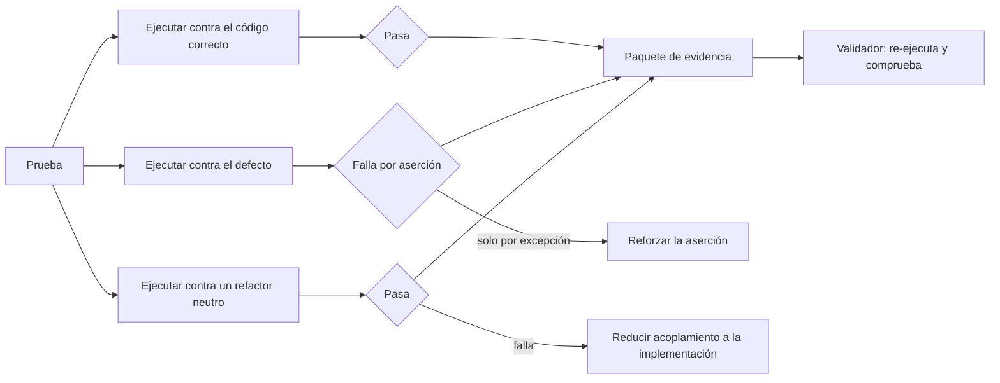
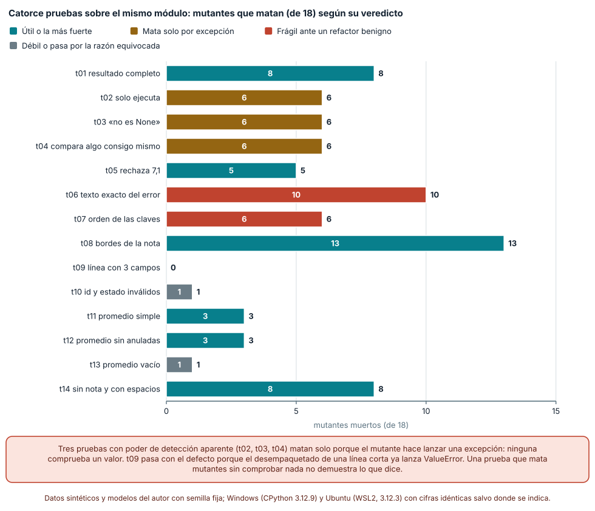
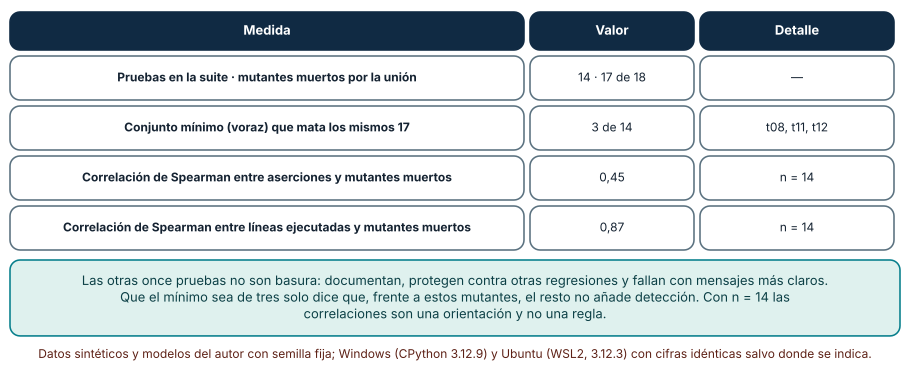
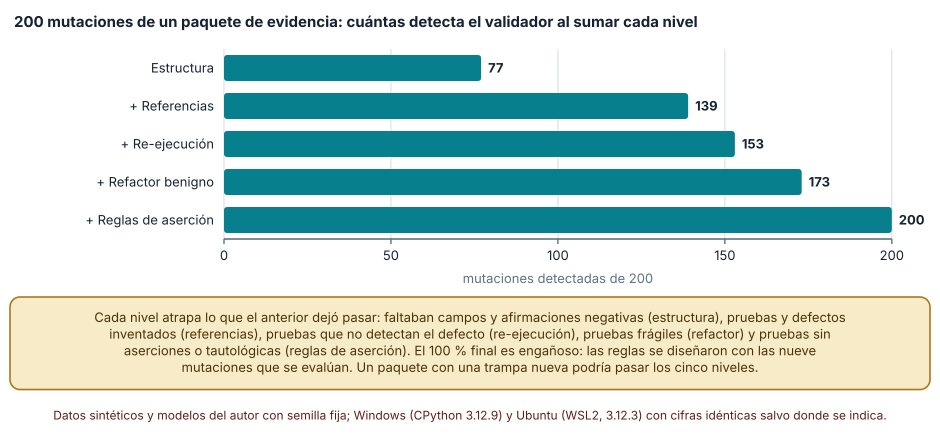

# SE-371 — Taller: demostrar que una prueba detecta defectos

[← SE-370 — Flakiness, diagnóstico y mantenimiento](../../classes/part-30-estrategia-y-tecnicas-de-prueba/se-370-flakiness-diagnostico-y-mantenimiento/README.md) · [↑ Parte 30](../../classes/part-30-estrategia-y-tecnicas-de-prueba/README.md) · [📚 Índice completo](../../classes/README.md) · [🌐 Portal](../../site/classes/SE-371.html) · [SE-372 — Proyecto: estrategia ejecutable por riesgo →](../../classes/part-30-estrategia-y-tecnicas-de-prueba/se-372-proyecto-estrategia-ejecutable-por-riesgo/README.md)

## Punto profesional y fundamento pedagógico

**Punto profesional.** La clase es un taller: parte de una suite de catorce pruebas que «pasan» y exige demostrar, para cada una, qué defecto detecta, que falla con él y pasa sin él, y que no se rompe ante un refactor que conserva el comportamiento. Una prueba cuyo poder de detección no se ha demostrado es una hipótesis; esta clase enseña a convertirla en evidencia.

**Por qué aparece aquí.** Cierra los diez temas anteriores de la Parte 30 aplicándolos a una suite concreta: el riesgo de `SE-361`, las fronteras de `SE-362`, los contratos de `SE-363`, las propiedades de `SE-365`, la mutación de `SE-366` y el entorno de `SE-367` a `SE-370` confluyen en una pregunta práctica: ¿esta prueba sirve? El proyecto `SE-372` usa el resultado como evidencia de la estrategia.

**Error conceptual que debe corregir.** Creer que una prueba que pasa y que ejecuta código «detecta» defectos. Tres de las catorce pruebas del taller matan mutantes sin comprobar ningún valor, una pasa por la razón equivocada y dos se rompen con refactorizaciones que no cambian lo que hace el código.

**Secuencia de aprendizaje.** Antes de leer los resultados, predices cuántas de catorce pruebas matan al menos un mutante y cuántas son frágiles; después construyes la matriz de pruebas contra mutantes y refactorizaciones, buscas el conjunto mínimo y mides qué indicador barato se parece más al poder de detección, y validas un paquete de evidencia con 200 mutaciones. La secuencia usa predicción, explicación propia, contraste y recuperación. [ICAP](https://icap.education.asu.edu/research) distingue participación de construcción de conocimiento; [How People Learn II](https://nap.nationalacademies.org/catalog/24783/how-people-learn-ii-learners-contexts-and-cultures) exige conectar conocimiento previo, contexto y transferencia; la [práctica de recuperación](https://pubmed.ncbi.nlm.nih.gov/16507066/) respalda producir de nuevo la explicación tras una demora; y [Education for Life and Work](https://nap.nationalacademies.org/resource/13398/dbasse_084153.pdf) exige devolución que explique la causa del error.

**Evidencia de aprendizaje.** `deteccion-log.md` con la predicción, la matriz de catorce pruebas contra dieciocho mutantes y seis refactorizaciones, el conjunto mínimo, las correlaciones con indicadores baratos, el paquete de evidencia en JSON y el resultado del validador con sus mutaciones.

**Límite de la conclusión.** La suite de catorce pruebas se escribió con defectos de calidad a propósito; los 18 mutantes y las seis refactorizaciones son del autor. Las correlaciones usan catorce observaciones. El validador se ajustó con las nueve mutaciones que lo evalúan: su exactitud real es desconocida, y el 100 % del último nivel es una consecuencia de ese ajuste.

### Trazabilidad fuente → afirmación

| Fuente primaria u oficial | Afirmación que respalda | Lo que no prueba |
|---|---|---|
| [DeMillo, Lipton y Sayward (1978)](https://doi.org/10.1109/C-M.1978.218136) | Propone evaluar conjuntos de pruebas con variantes del programa. | No define umbrales. |
| [Google Testing Blog: Mutation Testing (2021)](https://testing.googleblog.com/2021/04/mutation-testing.html) | Describe el uso de mutantes en la revisión de código para señalar pruebas que no detectan cambios. | Es una práctica de una organización. |
| [Inozemtseva y Holmes (ICSE 2014)](https://doi.org/10.1145/2568225.2568271) | Encontró que la cobertura no está fuertemente correlacionada con la eficacia de una suite. | No usa este módulo. |
| [Martin Fowler, «SelfTestingCode»](https://martinfowler.com/bliki/SelfTestingCode.html) | Define código que se comprueba a sí mismo con una suite que detecta errores. | No dice cómo medir la suite. |
| [Martin Fowler, «TestDrivenDevelopment»](https://martinfowler.com/bliki/TestDrivenDevelopment.html) | Describe el ciclo rojo-verde: ver fallar la prueba antes de hacerla pasar. | No garantiza que la prueba sea la correcta. |
| [Documentación de coverage.py](https://coverage.readthedocs.io/) | Documenta la medición de cobertura de líneas y ramas en Python. | No mide detección. |

## Antes de empezar

Recupera lo aprendido en `SE-366`: un mutante superviviente es una pregunta. La pregunta activa es: **de estas catorce pruebas, ¿cuáles puedo defender con un defecto concreto que detectan, cuáles ejecutan sin comprobar y cuáles romperían con un refactor?**

## Prerrequisitos

- Haber completado `SE-362`, `SE-366` y `SE-367` o poder explicar qué es un mutante, una aserción débil y un refactor neutro.
- Python 3.11 o posterior con `ast`, `inspect` y `json`.
- Disponer del módulo `parsear`/`resumen` de `SE-366`.

## Problema auténtico

La suite de un módulo de la plataforma tiene catorce pruebas verdes y se pide «subir el nivel de confianza» antes de un cambio grande. Una revisión de código encuentra una prueba que compara un valor consigo mismo, otra que ejecuta la función y no afirma nada, una que comprueba el texto exacto de un mensaje de error y otra que pasa porque el desempaquetado de una línea corta ya lanza la excepción que se esperaba. Nadie sabe cuántas de las catorce cambiarían de color si el código tuviera un defecto, ni cuántas se romperían con un refactor correcto. El equipo debe demostrar, prueba a prueba, qué detecta cada una, y dejar esa demostración como evidencia revisable.

## Objetivos observables

Al terminar podrás:

1. construir una matriz de pruebas contra mutantes y refactorizaciones neutras y leer de ella el poder de detección y la fragilidad de cada prueba;
2. distinguir una prueba que mata por aserción de una que mata por excepción, y reconocer una tautología;
3. encontrar el conjunto mínimo de pruebas que mata los mismos mutantes y explicar qué aportan las demás;
4. comparar indicadores baratos (aserciones, líneas) con el poder de detección;
5. escribir un paquete de evidencia (prueba, defecto, resultado rojo y verde) y un validador que lo compruebe re-ejecutando.

## Mapa conceptual



El mapa muestra la demostración en tres ejecuciones: la prueba debe pasar con el código correcto, fallar con el defecto y volver a pasar con un refactor neutro. Un paquete de evidencia solo vale si alguien puede repetir las tres.

## Temas y por qué importan

| Tema | Por qué cambia una decisión profesional | Evidencia mínima |
|---|---|---|
| Rojo, verde y refactor | Es la demostración mínima de que una prueba sirve. | Tres resultados por prueba en `deteccion-log.md` |
| Aserción frente a excepción | Una prueba que mata por excepción detecta caídas, no errores de valor. | Muertes por aserción y por excepción |
| Fragilidad | Un refactor correcto no debe romper una prueba. | Pruebas que fallan con refactores neutros |
| Redundancia | Pocas pruebas bien elegidas pueden bastar para detectar lo mismo. | Conjunto mínimo y razón de conservar las demás |
| Evidencia revisable | Un paquete que otra persona puede re-ejecutar vale más que una afirmación. | Paquete JSON y validador por niveles |

## Conceptos y decisiones

### 1. Rojo, verde y refactor

Demostrar que una prueba detecta un defecto exige tres ejecuciones. Con el defecto (o el mutante) la prueba falla: rojo. Con el código correcto, pasa: verde. Con una refactorización que conserva el comportamiento, vuelve a pasar. El primer paso es el que casi nunca se hace: se escribe la prueba contra un código que ya funciona, y no se sabe si habría fallado con el defecto. En el desarrollo guiado por pruebas, ver fallar la prueba antes de hacerla pasar es exactamente esa comprobación.

### 2. Aserción frente a excepción

Una prueba puede fallar porque una aserción no se cumple o porque el código lanza una excepción inesperada. Si todos los mutantes que mata lo hacen por excepción, la prueba es un detector de caídas: sirve para saber que el código no explota con una entrada, no para saber que el resultado es correcto. Una prueba sin aserciones y una que compara un valor consigo mismo pertenecen a esa familia: su poder aparente proviene de que el mutante rompe la ejecución. No son inútiles (un detector de caídas es barato), pero no deben contarse como pruebas de comportamiento.

### 3. Fragilidad

Una prueba frágil falla cuando el código cambia sin cambiar su comportamiento observable: se compara el texto exacto de un mensaje de error, el orden de las claves de un diccionario, el número de llamadas a una dependencia. La fragilidad se mide con refactorizaciones neutras: renombrar variables, extraer una función, cambiar el orden de las claves, reescribir un mensaje. Cada falla es un costo de mantenimiento y un incentivo a no refactorizar. Una prueba puede tener alto poder de detección y ser frágil a la vez; el veredicto debe nombrar ambas cosas.

### 4. Redundancia

Entre las catorce pruebas, tres matan los mismos 17 mutantes que todas juntas. Las otras once matan mutantes que esas tres ya matan; no aportan detección adicional frente a estos mutantes. Eso no las hace prescindibles: documentan casos de negocio, fallan con mensajes más claros, cubren mutantes que no se generaron o protegen contra regresiones futuras. El conjunto mínimo sirve para decidir qué ejecutar antes y qué dejar para la noche, no para borrar pruebas.

### 5. Evidencia revisable

El resultado de la demostración se guarda como un paquete (un archivo JSON con, por cada prueba, el defecto que detecta, que falla con él, que pasa sin él y cuántas veces se ejecutó). Un validador que lee el paquete debe comprobarlo, no solo leerlo: la estructura, las referencias, la re-ejecución y las reglas sobre las aserciones son niveles de comprobación cada vez más caros y más capaces. Un paquete cuyas afirmaciones no se pueden repetir es un documento, no evidencia.

### Catorce pruebas, dieciocho mutantes, seis refactorizaciones

Se parte del módulo `parsear`/`resumen` de `SE-366` y de 18 mutantes no equivalentes. Se escriben catorce pruebas de calidad desigual (un resultado completo; una que solo ejecuta; otra que comprueba que no es `None`; otra que compara un valor consigo mismo; un rechazo de 7,1; una con el texto exacto del error; una con el orden de las claves; los bordes de la nota; una línea con tres campos; id y estado inválidos; un promedio simple; uno sin anuladas; uno vacío; y uno con nota ausente y espacios) y seis refactorizaciones que conservan el comportamiento: renombrar locales, reescribir los mensajes de error, reordenar las claves del diccionario, extraer una función auxiliar, usar un bucle en el resumen y partir con un límite de campos.

```python
def razon(src, t):
    ns = cargar(src)
    try: t(ns); return "ok"
    except AssertionError: return "aserción"
    except Exception: return "excepción"
```

| Prueba | Mutantes muertos | Falla con refactor neutro | Veredicto |
|---|---|---|---|
| t01 resultado completo | 8 | No | Útil |
| t02 solo ejecuta | 6 (todos por excepción) | No | Sin aserciones: solo caza caídas |
| t03 «no es None» | 6 (todos por excepción) | No | Aserción casi vacía |
| t04 compara algo consigo mismo | 6 (todos por excepción) | No | Tautología |
| t05 rechaza 7,1 | 5 | No | Útil |
| t06 texto exacto del error | 10 | Sí (mensajes) | Frágil |
| t07 orden de las claves | 6 | Sí (claves) | Frágil |
| t08 bordes de la nota | 13 | No | La más fuerte |
| t09 línea con 3 campos | 0 | No | Pasa por la razón equivocada |
| t10 id y estado inválidos | 1 | No | Débil |
| t11 promedio simple | 3 | No | Útil |
| t12 promedio sin anuladas | 3 | No | Útil |
| t13 promedio vacío | 1 | No | Débil |
| t14 sin nota y con espacios | 8 | No | Útil |

La suite mata 17 de 18 mutantes. t02, t03 y t04 matan 6 cada una, todos por excepción: el mutante hace que una entrada válida se rechace y el código lanza `ValueError`, no que se compruebe un valor. t09 no mata ninguno: con el mutante que invierte la comprobación de campos, una línea de tres campos ya lanza `ValueError` al desempaquetar, así que la prueba que espera esa excepción pasa por una razón distinta de la que declara. t06 y t07 son frágiles: matan 10 y 6 mutantes y se rompen con refactorizaciones que no cambian el comportamiento.



**Cómo leer la figura.** Cada barra es una prueba, su longitud los mutantes que mata y su color el veredicto: verde, útil; dorado, mata solo por excepción; rojo, frágil ante refactorizaciones benignas; gris, débil. Mira que las barras doradas son tan largas como las útiles. **Dónde deja de valer:** son 18 mutantes y seis refactorizaciones del autor y los veredictos usan reglas simples (número de aserciones, comparación idéntica); una prueba «útil» aquí puede no serlo contra defectos reales. La figura enseña a leer una matriz, no a clasificar pruebas con esos umbrales.

### Cuántas pruebas hacen falta y qué indicador se parece

Con una cobertura voraz de mutantes se busca el subconjunto mínimo que mata los mismos 17. Además se calcula la correlación de rangos de Spearman entre dos indicadores baratos (número de aserciones, líneas del módulo que ejecuta la prueba) y el poder de detección (mutantes muertos).

```python
rest = set(union); elegidas = []
while rest:
    mejor = max(PRUEBAS, key=lambda t: len(mat_kill[t.__name__] & rest))
    elegidas.append(mejor.__name__); rest -= mat_kill[mejor.__name__]
```

| Medida | Valor | Detalle |
|---|---|---|
| Pruebas en la suite · mutantes muertos por la unión | 14 · 17 de 18 | — |
| Conjunto mínimo (voraz) que mata los mismos 17 | 3 de 14 | t08, t11, t12 |
| Correlación de Spearman entre aserciones y mutantes muertos | 0,45 | n = 14 |
| Correlación de Spearman entre líneas ejecutadas y mutantes muertos | 0,87 | n = 14 |

Tres pruebas bastan para matar los mismos 17 mutantes. La cantidad de aserciones se parece poco al poder de detección (0,45) y las líneas ejecutadas mucho más (0,87): en este módulo, una prueba que ejecuta más código tiene más oportunidades de que un mutante la afecte, aunque esa «muerte» sea por excepción. Con catorce observaciones, ambas correlaciones son indicios, no reglas, y la segunda esconde el problema que la clase señala: las líneas ejecutadas premian a las pruebas que matan por excepción.



**Cómo leer la figura.** Cada barra es un indicador y su longitud, la correlación de rangos con los mutantes muertos, de 0 a 1. Mira la diferencia entre las dos. **Dónde deja de valer:** con 14 pruebas de un solo módulo, una correlación de 0,87 puede cambiar mucho con otra suite; el conjunto mínimo depende de los 18 mutantes y de un algoritmo voraz que no es óptimo en general. La figura no dice que las otras once pruebas sobren.

### Un paquete de evidencia y su validador

El paquete contiene las tres pruebas del conjunto mínimo con el defecto que cada una detecta (un identificador de mutante), que falla con él y pasa sin él, cuántas veces se ejecutó (al menos tres) y la semilla. El validador tiene cinco niveles acumulativos: estructura; referencias (que la prueba y el defecto existan); re-ejecución (que la prueba realmente falle con el mutante y pase con el original); refactores neutros (que la prueba no se rompa con ellos); y reglas sobre las aserciones (que haya al menos una y que no sea una tautología). Se aplican 200 mutaciones de nueve tipos al paquete.

```python
if nivel >= 3:
    i = int(e["defecto"][1:]); m = [x for x in mut if x[0] == i][0][3]
    if pasa(m, nombres[e["prueba"]]): errs.append("la prueba NO falla con el defecto")
    if not pasa(SRC, nombres[e["prueba"]]): errs.append("la prueba falla sin el defecto")
```

| Tipo de mutación del paquete (cantidad) | Primer nivel que la detecta |
|---|---|
| Campo faltante (26) o afirmación negativa (22) | Estructura |
| Menos de 3 ejecuciones (14) · prueba repetida (15) | Estructura |
| Prueba inventada (22) · defecto inventado (40) | Referencias |
| La prueba no detecta ese defecto (14) | Re-ejecución |
| Prueba frágil que sí detecta (20) | Refactor benigno |
| Prueba sin aserciones o tautológica (27) | Reglas de aserción |

El acumulado por nivel es: estructura 77 de 200, referencias 139, re-ejecución 153, refactor 173 y reglas de aserción 200. Dos tipos de mutación pasan los tres primeros niveles: la prueba frágil que sí detecta el defecto (es verdadero que lo detecta) y la prueba sin aserciones que mata por excepción (también lo detecta). Solo el cuarto y quinto nivel los atrapan, porque preguntan cómo detecta y qué comprueba, no solo si detecta.



**Cómo leer la figura.** Cada barra suma un nivel más al anterior; la línea punteada es el total de 200 mutaciones. Mira cuánto aporta cada nivel nuevo. **Dónde deja de valer:** las reglas se diseñaron con las nueve mutaciones que se evalúan, de modo que el 100 % del último nivel es una consecuencia del ajuste; un paquete con una trampa nueva podría pasar los cinco niveles. La figura muestra por qué hacen falta niveles distintos, no la exactitud de un validador real.

## Definiciones de trabajo

- **rojo, verde, refactor:** demostración de una prueba: falla con el defecto, pasa sin él y pasa con una reescritura neutra.
- **muerte por aserción:** mutante que una prueba detecta porque un valor comprobado no coincide.
- **muerte por excepción:** mutante que una prueba detecta solo porque el código lanza una excepción inesperada.
- **prueba frágil:** prueba que falla ante un cambio que no altera el comportamiento observable.
- **paquete de evidencia:** archivo que asocia cada prueba con el defecto que detecta y el resultado de ejecutarla con y sin él.

Las definiciones son operativas para la plataforma de entregas y deben contrastarse con la documentación primaria enlazada al final.

## Ejemplo mínimo

El fragmento demuestra rojo y verde para una prueba. Antes de ejecutarlo, predice en qué ejecución falla.

```python
def nota(b, h): return b * (0.9 if 0 < h <= 24 else 1.0)
def prueba(f): assert f(6.0, 24) == 5.4
mutante = lambda b, h: b * (0.9 if 0 < h < 24 else 1.0)     # < en vez de <=
prueba(nota)                                                # verde
try: prueba(mutante); print("el mutante sobrevive")
except AssertionError: print("rojo: la prueba detecta el defecto")
```

La prueba falla con el mutante porque 24 horas deja de contar como atraso. Registra versión, comando y salida; después reescribe `nota` con otra estructura y confirma que sigue en verde.

## Ejemplo profesional

El equipo de la plataforma exige que toda prueba nueva de un módulo crítico llegue con su demostración: una línea en `evidencia.json` con el defecto que detecta (un mutante o un caso histórico), la confirmación de que falla con él y pasa sin él, y el resultado de las refactorizaciones del repositorio. Un trabajo de la integración continua re-ejecuta el paquete en cada cambio del módulo y falla si una prueba deja de matar su defecto. Las pruebas sin aserciones se aceptan solo con la etiqueta «humo» y no cuentan para el nivel de detección; las que comprueban un mensaje exacto necesitan una justificación (un contrato de cara al usuario). Una vez al trimestre se calcula el conjunto mínimo para decidir qué corre antes del despliegue y qué corre de noche.

## Práctica guiada

1. Toma el módulo `parsear`/`resumen` y escribe catorce pruebas de calidad variada.
2. Predice cuántas matan al menos un mutante y cuántas son frágiles.
3. Genera los 18 mutantes y seis refactorizaciones y construye la matriz de muertes y de fallos neutros.
4. Separa las muertes por aserción de las muertes por excepción.
5. Calcula el conjunto mínimo y las correlaciones con aserciones y líneas.
6. Escribe el paquete de evidencia del conjunto mínimo y un validador de cinco niveles.
7. Entrega `deteccion-log.md` y pide a otra persona que añada una prueba que el validador acepte y que no detecte nada.

## Ejercicios

1. **Rojo:** elige una prueba de tu código y demuestra que falla con un defecto concreto; si no puedes, explica qué le falta.
2. **Frágil:** reescribe una prueba que compara un mensaje exacto para que compruebe el tipo de error y observa si sobrevive al refactor de los mensajes.
3. **Excepción:** encuentra una prueba que mate un mutante solo por excepción y refuérzala con una aserción sobre un valor.
4. **Validador:** añade al validador una regla nueva (por ejemplo, que la prueba no use `assert True`) y mide qué mutaciones nuevas detecta.

## Reto verificable

Entrega `deteccion-log.md` con la predicción, la matriz de catorce pruebas, el conjunto mínimo, las correlaciones, el paquete de evidencia y el validador con las 200 mutaciones. Se aprueba si otra persona ejecuta el código, obtiene la misma matriz y puede decir qué prueba aceptaría el validador sin detectar nada. No se aprueba por mostrar que «todas las pruebas pasan».

## Caso conductor

La plataforma de entregas es el caso conductor. Esta clase deja el undécimo artefacto: la matriz de detección de las pruebas del módulo de entregas, el conjunto mínimo y el paquete de evidencia con su validador. `SE-372` integra todo en una estrategia ejecutable. Cambia después una sola decisión, ejecutar solo el conjunto mínimo en cada propuesta de cambio, y observa qué mutantes de la lista completa dejarían de detectarse.

## Preguntas frecuentes

### ¿Una prueba sin aserciones debe borrarse?

No necesariamente: un detector de caídas es barato y útil. Debe etiquetarse como «humo» y no contarse como prueba de comportamiento. Si hay una aserción posible, se añade.

### ¿Qué hago con una prueba frágil que detecta mucho?

Se reescribe para que compruebe el comportamiento y no la representación: en lugar del texto exacto del error, su tipo y sus datos; en lugar del orden de las claves, su contenido. Mientras tanto se declara frágil y se conserva.

### ¿El conjunto mínimo es el que debo ejecutar siempre?

Es el que detecta lo mismo frente a los mutantes conocidos; no frente a los defectos desconocidos. Se usa para ordenar y para dar feedback rápido, y el resto corre completo antes del despliegue.

### ¿Cuántas ejecuciones cuentan como «demostración»?

Al menos tres en el experimento, para descartar azar. Para pruebas inestables, el número se calcula como en `SE-370`.

## Fallo controlado y diagnóstico

Reproduce el fallo clásico de la clase: **una prueba que pasa por la razón equivocada**. Ejecuta `t09` (una línea con tres campos debe lanzar `ValueError`) contra el mutante que invierte la comprobación del número de campos.

Registra síntoma, entrada mínima, hipótesis, observación que descarta cada hipótesis, causa, corrección y prueba de regresión. **Síntoma:** la prueba pasa con el código correcto y con el mutante, de modo que no detecta el cambio que dice proteger. **Hipótesis rivales:** (a) el mutante es equivalente; (b) la prueba no se ejecuta; (c) otra parte del código lanza la misma excepción. **Prueba:** ejecuta `parsear("1;ana;6.5")` contra el mutante y comprueba que lanza `ValueError` al desempaquetar tres valores en cuatro variables, y que con una línea de cinco campos el mutante no lanza nada. **Conclusión:** el desempaquetado cubre el caso de tres campos y la prueba nunca ejerce la comprobación. **Regresión:** añade el caso de cinco campos, comprueba que falla con el mutante y exige un mensaje o una causa específica en la excepción. No cambies a la vez el código y la prueba.

## Errores comunes y cómo corregirlos

| Síntoma | Causa probable | Corrección |
|---|---|---|
| Una prueba «mata» mutantes y no afirma ningún valor | Muertes por excepción | Reforzar con aserciones sobre valores y etiquetar las de humo |
| Una prueba pasa con y sin el defecto | Pasa por una razón distinta de la que declara | Caso que solo el defecto rompa |
| Refactores correctos rompen pruebas | Acoplamiento a mensajes, orden o llamadas | Comprobar comportamiento observable |
| El paquete de evidencia nunca se re-ejecuta | Se trata como documento | Validador en la integración continua |
| Se borran pruebas «redundantes» y se pierde documentación | Conjunto mínimo usado como lista de borrado | Usarlo para ordenar, no para eliminar |

## Entorno y archivos clave

```text
work/SE-371/
├── README.md
├── modulo/parsear.py
├── pruebas/
│   ├── t01_ok.py
│   └── ...
├── mutantes/generar.py
├── refactores/neutros.py
├── evidencia/
│   ├── paquete.json
│   └── validador.py
└── evidence/deteccion-log.md
```

El `README` declara plataforma, versión de Python, semilla (371) y comandos. Los experimentos usan solo la biblioteca estándar (`ast`, `inspect`, `json`, `random`) y se ejecutaron con CPython 3.12.9 en Windows 11 y 3.12.3 en Ubuntu bajo WSL2: las salidas fueron idénticas. Si añades una dependencia, fija procedencia y versión.

## Seguridad, ética y accesibilidad

- una prueba que «mata» un mutante de una validación de seguridad sin comprobar el valor da una confianza que no existe: exige aserciones en los controles de seguridad;
- el paquete de evidencia puede incluir fragmentos de código sensible: no lo publiques sin revisarlo;
- una métrica de «pruebas con demostración» no debe usarse para evaluar a las personas: se usa para decidir qué reforzar;
- las pruebas de accesibilidad que solo ejecutan código sin comprobar el resultado son una falsa garantía: exige criterios observables;
- documenta qué defectos no se pueden demostrar con mutantes (concurrencia, rendimiento) y qué otro método los cubre.

## Puente hacia el trabajo con agentes

Un agente al que se le pide «escribe pruebas que detecten los defectos de este código» generará pruebas que ejecutan el camino feliz, a menudo sin aserciones o con aserciones tautológicas, y declarará que cubren el módulo. Pídele en cambio, para cada prueba, el defecto que detecta con la evidencia de rojo y verde, el resultado ante refactorizaciones neutras y la separación entre muertes por aserción y por excepción. Revisa especialmente que cada prueba pueda fallar y que el paquete se pueda re-ejecutar: son los dos controles que la clase mostró que faltan con más frecuencia.

## Transferencia

Traslada el taller a otro módulo (por ejemplo, el cálculo de la multa de una biblioteca): escribe diez pruebas de calidad variada, genera mutantes y refactorizaciones neutras, construye la matriz y calcula el conjunto mínimo. La transferencia está lograda cuando puedes decir qué prueba aceptaría tu validador sin detectar nada, no cuando la matriz se parece.

## Evaluación y evidencia

| Criterio | Evidencia para aprobar |
|---|---|
| comprensión | explicación de la diferencia entre rojo/verde/refactor y de por qué una muerte por excepción no es detección de valor |
| corrección | matriz, conjunto mínimo y validador reproducibles con las mismas semillas |
| diseño | paquete de evidencia con tres ejecuciones y reglas por niveles |
| diagnóstico | reproducción del fallo «prueba que pasa por la razón equivocada» con regresión |
| incertidumbre | declaración de que mutantes, refactores y reglas son del autor y de que las correlaciones usan 14 observaciones |
| reproducibilidad | versiones, semillas, comandos, salida y límites declarados |

## Fuentes

- [DeMillo, Lipton y Sayward, «Hints on test data selection»](https://doi.org/10.1109/C-M.1978.218136) — origen de los mutantes para evaluar pruebas; autoridad: artículo original de 1978.
- [Google Testing Blog: Mutation Testing](https://testing.googleblog.com/2021/04/mutation-testing.html) — mutantes en la revisión de código; autoridad: equipo de pruebas de Google.
- [Inozemtseva y Holmes, «Coverage is not strongly correlated with test suite effectiveness»](https://doi.org/10.1145/2568225.2568271) — cobertura y eficacia; autoridad: artículo revisado de ICSE 2014.
- [Martin Fowler, «SelfTestingCode»](https://martinfowler.com/bliki/SelfTestingCode.html) — código que se comprueba a sí mismo; autoridad: autor del texto.
- [Martin Fowler, «TestDrivenDevelopment»](https://martinfowler.com/bliki/TestDrivenDevelopment.html) — ciclo rojo-verde; autoridad: autor del texto.
- [Documentación de coverage.py](https://coverage.readthedocs.io/) — cobertura de líneas y ramas; autoridad: documentación oficial del proyecto.

Cada fuente respalda el mecanismo indicado; ninguna demuestra que tres de catorce pruebas maten los mismos 17 mutantes o que la correlación de 0,87 se observe en el módulo y la suite de la plataforma. Esa afirmación depende de los mutantes y de las pruebas.

## Límites y siguiente paso

Se ejecutaron tres experimentos sobre un módulo sintético con 18 mutantes, seis refactorizaciones y catorce pruebas escritas por el autor, en Windows y Ubuntu (WSL2), con salidas idénticas. Los veredictos usan reglas simples, las correlaciones usan 14 observaciones y el validador se ajustó con las mutaciones que lo evalúan. No se usó una herramienta de mutación ni una suite real. La siguiente y última clase de la parte es el proyecto: una estrategia ejecutable por riesgo que integra el reparto de `SE-361`, los niveles de las clases intermedias y esta demostración.

## Glosario

- **rojo, verde, refactor:** demostración de una prueba: falla con el defecto, pasa sin él y pasa con una reescritura neutra.
- **muerte por aserción:** mutante que una prueba detecta porque un valor comprobado no coincide.
- **muerte por excepción:** mutante que una prueba detecta solo porque el código lanza una excepción inesperada.
- **prueba frágil:** prueba que falla ante un cambio que no altera el comportamiento observable.
- **paquete de evidencia:** archivo que asocia cada prueba con el defecto que detecta y el resultado de ejecutarla con y sin él.

---

[← SE-370 — Flakiness, diagnóstico y mantenimiento](../../classes/part-30-estrategia-y-tecnicas-de-prueba/se-370-flakiness-diagnostico-y-mantenimiento/README.md) · [↑ Parte 30](../../classes/part-30-estrategia-y-tecnicas-de-prueba/README.md) · [📚 Índice completo](../../classes/README.md) · [🌐 Portal](../../site/classes/SE-371.html) · [SE-372 — Proyecto: estrategia ejecutable por riesgo →](../../classes/part-30-estrategia-y-tecnicas-de-prueba/se-372-proyecto-estrategia-ejecutable-por-riesgo/README.md)
