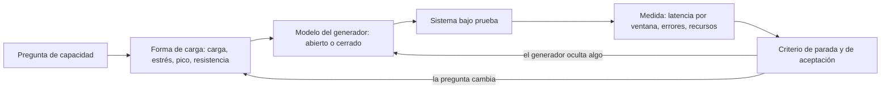

# SE-375 — Carga, estrés, picos y endurance

[← SE-374 — Revisión, análisis estático y quality gates](../../classes/part-31-calidad-rendimiento-y-resiliencia/se-374-revision-analisis-estatico-y-quality-gates/README.md) · [↑ Parte 31](../../classes/part-31-calidad-rendimiento-y-resiliencia/README.md) · [📚 Índice completo](../../classes/README.md) · [🌐 Portal](../../site/classes/SE-375.html) · [SE-376 — Latencia, throughput, saturación y capacidad →](../../classes/part-31-calidad-rendimiento-y-resiliencia/se-376-latencia-throughput-saturacion-y-capacidad/README.md)

## Punto profesional y fundamento pedagógico

**Punto profesional.** La clase existe para que elijas la forma de carga que responde a tu pregunta (cuánto aguanta en régimen, dónde se rompe, cómo se recupera de un pico, qué se degrada con las horas) y para que sepas qué hace trampa en una prueba: un generador que deja de enviar cuando el servidor se detiene, un arranque frío mezclado con el régimen estable o una duración demasiado corta para ver una fuga.

**Por qué aparece aquí.** Sigue a **Revisión, análisis estático y quality gates**: la compuerta decide si un cambio entra; ahora hay que medir si el sistema cumple el escenario de eficiencia que `SE-373` escribió. La prueba de carga es el instrumento que produce esa medida y, como cualquier instrumento, tiene errores propios que hay que conocer antes de fiarse de su número. El caso conductor es la API de entregas durante el cierre de un plazo.

**Error conceptual que debe corregir.** Creer que una prueba de carga «mide la capacidad» con un número: cada forma de prueba (carga, estrés, pico, resistencia) responde una pregunta distinta, y el generador de carga forma parte del sistema medido, porque la manera de enviar peticiones cambia lo que se observa.

**Secuencia de aprendizaje.** Antes de leer los resultados, predices el momento en que un servidor de capacidad nominal 80 solicitudes por segundo empieza a degradarse con una rampa y cuánto tarda en recuperarse de un pico; después mides cuatro pruebas sobre el mismo sistema, comparas tres generadores ante una pausa de diez segundos y estimas el p99 con distintas duraciones y calentamientos. La secuencia usa predicción, explicación propia, contraste y recuperación. [ICAP](https://icap.education.asu.edu/research) distingue participación de construcción de conocimiento; [How People Learn II](https://nap.nationalacademies.org/catalog/24783/how-people-learn-ii-learners-contexts-and-cultures) respalda diseñar la práctica con contextos reales y retroalimentación.

**Evidencia de aprendizaje.** `carga-log.md` con la predicción, las tres figuras reproducidas, un plan de pruebas con la pregunta, el modelo de carga, la duración, el criterio de parada y lo que cada prueba no ve, y una nota que separe lo medido del modelo.

**Límite de la conclusión.** Todo ocurre en un simulador de tiempo virtual con una cola de cuatro servidores y servicio exponencial de 50 ms; no se envió una sola petición real, no se midió ningún servidor, red, base de datos ni contenedor, y las pruebas con carga real tienen ruido que aquí no existe. Los números dependen de supuestos del autor (la paciencia de 2 s del cliente, la fuga de una conexión cada 5 000 solicitudes, el calentamiento del 30 %), y se declaran uno a uno.

### Trazabilidad fuente → afirmación

| Fuente primaria u oficial | Afirmación que respalda | Lo que no prueba |
|---|---|---|
| [Grafana k6: tipos de pruebas](https://grafana.com/docs/k6/latest/testing-guides/test-types/) | Distingue prueba de humo, de carga, de estrés, de pico y de resistencia (soak) por su forma y su pregunta. | No fija cifras para ningún sistema ajeno. |
| [Schroeder, Wierman y Harchol-Balter, «Open versus closed: a cautionary tale» (NSDI 2006)](https://www.usenix.org/legacy/event/nsdi06/tech/full_papers/schroeder/schroeder.pdf) | Muestra que el modelo de carga abierto y el cerrado dan resultados distintos y que elegir mal cambia las conclusiones. | No cuantifica el efecto sobre este sistema. |
| [Tene, wrk2: README sobre coordinated omission](https://github.com/giltene/wrk2) | Describe la omisión coordinada: un generador que espera la respuesta antes de enviar la siguiente deja de registrar la espera que esa pausa causa. | No es una publicación revisada; sirve para el mecanismo, no para cifras. |
| [Google SRE: Addressing Cascading Failures](https://sre.google/sre-book/addressing-cascading-failures/) | Describe cómo la sobrecarga provoca más sobrecarga y por qué conviene descartar trabajo cuyo cliente ya se fue. | No dice el valor del descarte para este simulador. |

## Antes de empezar

Recupera lo aprendido en `SE-374`: una compuerta decide con una medida. La pregunta activa es: **¿qué forma de carga responde la pregunta de capacidad de la plataforma y cómo me aseguro de que el generador no oculte justo lo que busco?**

## Prerrequisitos

- Haber completado `SE-374` o poder explicar qué decide una compuerta con una medida.
- Python 3.11 o posterior; los experimentos usan solo la biblioteca estándar (`random`, `heapq`, `statistics`).
- Saber qué es una cola FIFO y qué significa «utilización».

## Problema auténtico

La plataforma preparó el cierre del cuatrimestre con una prueba de carga: sesenta solicitudes por segundo durante cinco minutos, p95 de 202 ms y sin fallos. El informe dijo «aguanta». El día del cierre llegaron picos de 240 solicitudes por segundo durante veinte segundos cuando un docente publicó el plazo en un chat. La latencia máxima superó los 40 s y el servicio tardó casi tres minutos en volver a la normalidad. Semanas después, una fuga de conexiones que ninguna prueba de cinco minutos podía ver agotó el pool a la hora y siete minutos. Las tres cosas habían estado dentro del sistema todo el tiempo; la prueba que se ejecutó solo hacía una de las preguntas. La clase enseña qué pregunta responde cada forma de carga y qué trucos del generador alteran la respuesta.

## Objetivos observables

Al terminar podrás:

1. distinguir carga, estrés, pico y resistencia por su pregunta, su forma y lo que cada una no ve;
2. localizar el codo de latencia y el punto de colapso con una rampa y explicar por qué el servidor puede colapsar cuando ya no hay más llegadas;
3. medir cuánto se tarda en recuperar la normalidad tras un pico y por qué es mucho mayor que el pico;
4. mostrar con un experimento la omisión coordinada y elegir entre un modelo de carga abierto y uno cerrado;
5. decidir la duración y el calentamiento de una prueba y justificar qué parte del arranque se descarta.

## Mapa conceptual



El mapa separa la **forma de la carga** (qué llega y cuándo), el **modelo del generador** (si el ritmo de llegada depende de las respuestas) y la **medida**. Los errores de una prueba suelen estar en el segundo bloque, el menos visible.

## Temas y por qué importan

| Tema | Por qué cambia una decisión profesional | Evidencia mínima |
|---|---|---|
| Carga y régimen estable | Dice si el escenario se cumple en el uso esperado. | Predicción, traza causal y contraejemplo de **Carga y régimen estable** en `carga-log.md` |
| Estrés y colapso | Encuentra el límite y cómo se rompe: degradación suave o caída brusca. | Predicción, traza causal y contraejemplo de **Estrés y colapso** en `carga-log.md` |
| Picos y recuperación | La recuperación dura más que el pico y es lo que se vive como incidente. | Predicción, traza causal y contraejemplo de **Picos y recuperación** en `carga-log.md` |
| Resistencia y fugas | Los fallos acumulativos solo aparecen con el tiempo. | Predicción, traza causal y contraejemplo de **Resistencia y fugas** en `carga-log.md` |
| Generador y duración | El modo de enviar peticiones y la duración cambian la medida. | Predicción, traza causal y contraejemplo de **Generador y duración** en `carga-log.md` |

## Conceptos y decisiones

### 1. Carga y régimen estable

Una **prueba de carga** aplica la carga esperada (o la prevista para un evento) durante el tiempo suficiente para que el sistema alcance su régimen estable, y comprueba que el escenario de calidad se cumple. En el simulador de la clase, cuatro servidores con 50 ms de servicio medio tienen una capacidad nominal de 80 solicitudes por segundo; a 60 solicitudes por segundo la utilización es del 75 %, y con llegadas aleatorias eso ya produce colas pasajeras: la mediana es de 57 ms, el p95 de 202 ms y el p99 de 285 ms. La carga estable responde «¿cumple en el uso esperado?» y no responde «¿hasta dónde?». Su valor depende de que el perfil de llegadas se parezca al real: un ritmo constante exacto, sin variación, subestima las colas, porque las llegadas reales son irregulares.

### 2. Estrés y colapso

Una **prueba de estrés** aumenta la carga hasta romper el sistema y observa cómo se rompe. La forma importa: un sistema bien diseñado degrada de forma gradual (la latencia sube y se rechaza lo que sobra), uno mal diseñado cae de golpe. En el simulador, la rampa de 20 a 160 solicitudes por segundo en ocho minutos muestra el codo cerca de la capacidad: el p95 es de 288 ms a 68 por segundo, 357 ms a 77 y 1 718 ms a 86, con el 32,7 % de las solicitudes fallando por superar los 2 s de paciencia del cliente. Después de esa ventana, el 100 % falla y no se recupera aunque la carga solo siga subiendo. El colapso no es un límite de capacidad: es una consecuencia de que el servidor sigue procesando solicitudes cuyo cliente ya se fue. Cada respuesta llega tarde y cuenta como fallo, de modo que el trabajo útil cae a cero con el sistema al 100 % de ocupación. Si el servidor descarta las solicitudes vencidas al sacarlas de la cola, las respuestas útiles se estabilizan en torno a 80 por segundo, la capacidad nominal.

### 3. Picos y recuperación

Una **prueba de pico** aplica una ráfaga súbita y mide dos cosas: si el sistema la sobrevive y cuánto tarda en volver a la normalidad. El segundo número es el que suele sorprender. Un pico de 240 solicitudes por segundo durante 20 segundos sobre una base de 60 añade unos 3 200 solicitudes de exceso (160 por segundo de más, durante 20 s) a un sistema con apenas 20 por segundo de margen. Vaciar esa cola exige 160 segundos, más de ocho veces la duración del pico: la latencia máxima llega a 41,4 s y el p95 vuelve por debajo de 200 ms 165 s después de terminar el pico. La relación se deduce de la aritmética de colas: el tiempo de recuperación es el exceso dividido por la capacidad sobrante, y esa capacidad sobrante es pequeña cuanto más cerca de la saturación se opera. Un sistema que trabaja al 75 % tarda mucho más en recuperarse que uno al 40 %.

### 4. Resistencia y fugas

Una **prueba de resistencia** (soak) mantiene una carga moderada durante horas para encontrar lo que se acumula: fugas de memoria o de conexiones, archivos que no se cierran, logs que llenan el disco, caches que crecen sin límite. En el simulador, una de cada 5 000 solicitudes pierde una conexión de un pool de 50. A 60 solicitudes por segundo, en cinco minutos se pierden unas tres conexiones (el 6 % del pool), una prueba de carga de esa duración no lo vería, y el pool se agota a los 67 minutos tras 241 135 solicitudes. La duración de la prueba tiene que justificarse por el mecanismo que se busca: con una fuga conocida se puede calcular el tiempo de agotamiento antes de ejecutar nada y decidir cuántas horas hacen falta. Lo que se observa son recursos, no solo latencia: la conexiones en uso, la memoria, los descriptores de archivo.

### 5. Generador y duración

El generador de carga es parte del experimento. Un **generador abierto** envía las peticiones según un calendario independiente de las respuestas, como llegan los usuarios reales; un **generador cerrado** tiene un número fijo de usuarios virtuales que esperan la respuesta antes de enviar la siguiente. Los dos son legítimos y responden preguntas distintas, pero el cerrado oculta una cosa: cuando el servidor se detiene, los usuarios virtuales quedan esperando y dejan de enviar, de modo que casi nadie registra la espera. Este efecto se llama **omisión coordinada**. La duración también cambia la medida: una prueba corta tiene un intervalo de confianza amplio para un percentil alto y mezcla el arranque con el régimen. Hay que decidir de antemano cuánto se descarta (por ejemplo, los primeros dos minutos) y publicarlo.

### Cuatro pruebas sobre el mismo sistema

Se simula una cola FIFO de cuatro servidores con servicio exponencial de 50 ms, con tiempo virtual y semillas fijas. El cliente se va tras 2 s de espera; el servidor, en la variante base, sigue trabajando para clientes que ya se fueron.

```python
res = run(arr, lambda i, t: r.expovariate(1 / 0.050), 4, patience=2.0)          # el servidor no descarta
res2 = run(arr2, lambda i, t: r.expovariate(1 / 0.050), 4, patience=2.0, shed_expired=True)
```

| Prueba | Qué se observa |
|---|---|
| Carga: 60 req/s durante 5 min | n = 17 829; p50 57, p95 202, p99 285 ms; sin fallos |
| Estrés: rampa de 20 a 160 req/s | p95 288 ms a 68/s, 357 ms a 77/s, 1 718 ms y 32,7 % de fallos a 86/s; después, 100 % |
| Estrés, entre los 360 y los 480 s | 0 respuestas útiles/s sin descartar; 80,8 respuestas útiles/s descartando las vencidas (de 142 llegadas/s) |
| Pico: 240 req/s durante 20 s | latencia máxima 41,4 s; 165 s para volver a p95 < 200 ms |
| Resistencia: fuga de 1 conexión cada 5 000 solicitudes | pool de 50 agotado a los 67 min (241 135 solicitudes) |

La misma cola da cuatro respuestas porque cada prueba hace una pregunta. La más importante para el diseño es la tercera fila: el servidor que descarta trabajo vencido atiende 80,8 respuestas útiles por segundo con 142 llegadas por segundo, y el que no lo hace atiende cero.


**Cómo leer la figura.** El eje horizontal es la carga ofrecida en solicitudes por segundo y el vertical, en escala logarítmica, el percentil 95; la línea roja es la rampa de estrés, el cuadrado verde la prueba de carga estable y la línea discontinua vertical la capacidad nominal. Mira primero el salto entre 77 y 86 solicitudes por segundo, y que la carga estable a 60 queda lejos del codo. **Dónde deja de valer:** el tiempo virtual no tiene ruido de reloj, de red ni de recolección de memoria, el servicio exponencial es un supuesto y la paciencia de 2 s del cliente decide qué cuenta como fallo; el colapso observado depende de que el servidor no descarte lo vencido y de que los clientes no reintenten. Con reintentos (`SE-378`) el comportamiento sería peor.

### Omisión coordinada

El mismo sistema, con 40 solicitudes por segundo (utilización del 50 %), se detiene por completo 10 segundos entre el 60 y el 70 de una prueba de 180 s. Se mide con tres generadores: uno abierto con llegadas de Poisson y latencia contada desde la hora prevista de llegada; uno cerrado con 8 usuarios virtuales que esperan la respuesta y 0,2 s entre peticiones; y el cerrado con una corrección que rellena las muestras que habrían existido.

| Generador | Muestras | p50 | p99 | p99,9 | > 1 s |
|---|---:|---:|---:|---:|---:|
| Abierto | 7 117 | 45 ms | 9 071 ms | 9 848 ms | 10,51 % |
| Cerrado (8 usuarios) | 5 438 | 35 ms | 232 ms | 9 916 ms | 0,15 % |
| Cerrado con corrección | 5 827 | 38 ms | 8 600 ms | 9 916 ms | 6,23 % |

El sistema es el mismo y el p99 pasa de 9 071 ms a 232 ms: el generador cerrado dejó de enviar durante la pausa y el 99,85 % de sus muestras son de antes o de después. El p99,9 sí ve la pausa (9 916 ms) porque las 8 peticiones atrapadas son lo bastante lentas; el p99 no. La corrección recupera una parte porque asume un intervalo esperado entre envíos. Un informe que diga «p99 de 232 ms» con el generador cerrado afirma algo que ninguna persona real vivió.


**Cómo leer la figura.** Cada fila es un generador de carga observando el mismo servidor con la misma pausa; el cuadrado es la mediana, el triángulo el percentil 99 y el rombo el percentil 99,9, en escala logarítmica. Mira primero dónde cae el triángulo: en el generador cerrado se queda en 232 ms, lejos de los 9 071 del abierto. **Dónde deja de valer:** un generador cerrado es el modelo correcto cuando la población es de verdad un número fijo de personas que esperan (una sala de examen con 30 estudiantes); en ese caso no hay omisión porque no hay más llegadas. La corrección de omisión supone un intervalo esperado y no se aplica sin conocerlo.

### Duración y calentamiento

Se repite 30 veces cada configuración con semillas distintas y se registra el p99. En una variante hay una caché fría que ralentiza el servicio un 30 % durante los primeros 60 segundos.

```python
def serv(i, t):
    base = r.expovariate(1 / 0.050)
    return base * (1.3 if calentamiento and t < 60 else 1.0)       # caché fría: x1,3 durante 60 s
```

| Prueba | p99 medio | Mínimo – máximo (30 repeticiones) |
|---|---:|---:|
| 30 s, sin calentamiento | 290 ms | 244 – 378 ms |
| 120 s, sin calentamiento | 301 ms | 268 – 359 ms |
| 600 s, sin calentamiento | 301 ms | 279 – 343 ms |
| 300 s con caché fría de 60 s, todo | 1 045 ms | 609 – 2 724 ms |
| 300 s con caché fría, descartando los 120 s iniciales | 300 ms | 266 – 340 ms |
| 900 s con caché fría, todo | 904 ms | 376 – 1 671 ms |
| 900 s con caché fría, descartando los 120 s iniciales | 298 ms | 279 – 321 ms |

Una prueba más larga estrecha el intervalo (de 134 ms de rango a 64) y aun así el sesgo mayor viene del arranque: incluirlo lleva el p99 de 300 a 1 045 ms. Descartar el tramo inicial recupera el valor del régimen estable, con la condición de decidirlo antes, escribir cuánto se descartó y comprobar que el arranque realmente es transitorio.


**Cómo leer la figura.** Cada fila es una configuración de prueba; el círculo hueco es el mínimo y el relleno el máximo del p99 en 30 repeticiones, en escala logarítmica, y a la derecha va la media. Mira primero la longitud del segmento: es el rango de las repeticiones, que se estrecha con la duración y se dispara cuando se incluye el arranque con caché fría. **Dónde deja de valer:** el calentamiento del 30 % durante 60 s es un supuesto; descartar un tramo por conveniencia es un sesgo: si el «arranque» es en realidad un defecto que reaparece (cada vez que el proceso se reinicia), descartarlo oculta el problema.

## Definiciones de trabajo

- **prueba de carga:** ejecución con la carga esperada para comprobar el cumplimiento en régimen estable.
- **prueba de estrés:** ejecución con carga creciente hasta el límite para observar cómo se rompe el sistema.
- **prueba de pico:** ráfaga súbita de carga para medir la supervivencia y el tiempo de recuperación.
- **prueba de resistencia:** ejecución larga con carga moderada para encontrar fallos acumulativos.
- **omisión coordinada:** subregistro de la espera causada por una pausa del servidor cuando el generador deja de enviar mientras espera respuesta.

Las definiciones son operativas para la API de entregas. No convierten términos con una historia más amplia en sinónimos y deben contrastarse con la documentación primaria enlazada al final.

## Ejemplo mínimo

El fragmento calcula cuánto tarda en vaciarse la cola de un pico. Antes de ejecutarlo, predice si tarda más o menos que el propio pico.

```python
exceso = (240 - 80) * 20           # solicitudes que no caben mientras dura el pico de 20 s
margen = 80 - 60                    # capacidad sobrante tras el pico
print(exceso / margen)
```

La cola de 3 200 solicitudes necesita 160 s para vaciarse con 20 por segundo de margen (la simulación mide 165 s porque las llegadas y los servicios son aleatorios). Registra versión de Python, comando y salida; después reduce la base de 60 a 40 solicitudes por segundo y comprueba que la recuperación se acorta de forma desproporcionada.

## Ejemplo profesional

El equipo prepara el cierre de plazo con un plan de tres pruebas. La de carga reproduce el perfil del cierre anterior con generador abierto, 60 solicitudes por segundo y cinco minutos tras descartar los dos primeros. La de pico aplica 240 solicitudes por segundo durante 20 s y mide el tiempo hasta volver a p95 < 200 ms; el criterio de aceptación es 60 s, y como la simulación dio 165 s, el equipo decide que el servidor descarte las solicitudes cuyo cliente ya se fue y añade un tope de cola. La de resistencia usa 30 solicitudes por segundo durante 8 horas con las conexiones, la memoria y los descriptores de archivo en un panel. Cada prueba tiene su pregunta, su modelo de generador, su criterio de parada (se aborta si el error supera el 5 % durante un minuto) y la lista de lo que no ve. Compara con la prueba única de antes: ahora cada forma de carga tiene un motivo.

## Práctica guiada

1. Escribe tu simulador de cola con `heapq` y comprueba que a 60 solicitudes por segundo el p95 es cercano a 202 ms.
2. Predice el codo de una rampa de 20 a 160 solicitudes por segundo y escríbelo antes de medir.
3. Ejecuta la rampa con y sin descarte de solicitudes vencidas y compara las respuestas útiles por segundo.
4. Aplica un pico de 240 solicitudes por segundo durante 20 s y mide el tiempo de recuperación; repite con base de 40.
5. Detén el servidor 10 s con un generador abierto y con uno cerrado de 8 usuarios y compara el p99.
6. Repite 30 veces una prueba de 30 s y otra de 600 s y compara el intervalo del p99; añade el calentamiento y decide cuánto descartar.
7. Entrega `carga-log.md` y pide a otra persona que encuentre una pregunta de capacidad que tu plan no responde.

## Ejercicios

1. **Recuperación:** calcula el tiempo de recuperación de un pico de 300 solicitudes por segundo durante 10 s en un sistema de capacidad 100 con base 70, y explica por qué baja mucho si la base es 50.
2. **Fuga:** una fuga pierde un descriptor cada 2 000 solicitudes con un límite de 1 024 y 40 solicitudes por segundo; calcula la duración mínima de la prueba de resistencia.
3. **Generador:** una sala de examen de 30 estudiantes envía una entrega cada uno: decide si el modelo correcto es abierto o cerrado y justifícalo.
4. **Criterio:** escribe el criterio de parada de una prueba de estrés que protege a los demás servicios compartidos.

## Reto verificable

Entrega `carga-log.md` con la predicción, las tres tablas de resultados, el plan de tres pruebas con pregunta, modelo de generador, duración, criterio de parada y lo que cada una no ve. Se aprueba si otra persona ejecuta el código desde un checkout limpio, obtiene los mismos números con las mismas semillas y puede decir por qué el p99 cerrado de 232 ms no es el p99 que vivió una persona. No se aprueba por ejecutar una sola prueba de carga ni por afirmar que el sistema «aguanta» sin una prueba de pico y de duración.

## Caso conductor

La API de entregas es el caso conductor de la Parte 31. Esta clase deja el tercer artefacto: un plan de pruebas de carga con su generador y su criterio. `SE-376` explicará con teoría de colas por qué la latencia crece tanto cerca de la saturación y `SE-378` añadirá los reintentos que aquí no existen. Cambia después un solo parámetro, la utilización base, y observa cuánto cambia el tiempo de recuperación.

## Preguntas frecuentes

### ¿Cuánta carga debe tener una prueba de carga?

La que el escenario de calidad declare: el perfil esperado y, aparte, el del evento más exigente previsto. La cifra sale del negocio (cuántas entregas simultáneas habrá), no de la capacidad del sistema; la de estrés es la que parte de la capacidad.

### ¿Es mejor un generador abierto o uno cerrado?

Depende de la población. Para usuarios que llegan sin esperar a otros (un sitio público, una API abierta) el modelo abierto es el realista; para una población fija que espera respuesta (una sala de examen, una aplicación interna con pocos usuarios) el cerrado también lo es. Lo que no es válido es usar el cerrado y llamar «p99» a su resultado cuando hay pausas.

### ¿Hay que probar en producción?

Es una decisión de riesgo. Una prueba sobre producción puede afectar a personas reales; una sobre un entorno de ensayo puede no parecerse a producción. Lo razonable es empezar en el entorno de ensayo con datos y configuración lo más parecidos que se pueda, y declarar en qué se diferencia.

### ¿Cuánto debe durar una prueba de resistencia?

Lo que dicte el mecanismo que se busca: con una fuga estimada se calcula el tiempo hasta el agotamiento y se multiplica por un factor de seguridad. Sin una hipótesis, la duración habitual (de varias horas a un día) es una apuesta; con ella, es una decisión.

## Fallo controlado y diagnóstico

Reproduce el fallo clásico de la clase: **un p99 «excelente» que oculta una pausa del servidor**. Ejecuta la prueba de 180 s con una pausa de 10 s y un generador cerrado de 8 usuarios.

Registra síntoma, entrada mínima, hipótesis, observación que descarta cada hipótesis, causa, corrección y prueba de regresión. **Síntoma:** el informe de carga muestra p99 de 232 ms y las personas usuarias reportaron diez segundos de espera. **Hipótesis rivales:** (a) las quejas son de otro servicio; (b) la pausa no ocurrió durante la prueba; (c) el generador dejó de enviar durante la pausa. **Prueba:** cuenta las muestras por segundo y compara con el ritmo esperado; si hay un hueco de diez segundos con casi ninguna muestra, la causa es la omisión coordinada. **Conclusión:** el sistema se detuvo y el generador no lo registró. **Regresión:** pasa a un generador abierto, añade una prueba que simule la pausa y exija que el p99 supere 5 s y otra que falle si el número de muestras por segundo cae a cero. No cambies a la vez el generador y el sistema.

## Errores comunes y cómo corregirlos

| Síntoma | Causa probable | Corrección |
|---|---|---|
| El p99 es excelente y hay quejas de pausas | Omisión coordinada del generador cerrado | Generador abierto o corrección documentada |
| La prueba «aguanta» y el sistema cae en el cierre | Solo se hizo prueba de carga | Añadir prueba de pico y de resistencia |
| La latencia sigue alta cuando acabó la carga | Trabajo acumulado o no descartado | Descartar solicitudes vencidas y acotar la cola |
| El p99 cambia mucho entre ejecuciones | Prueba demasiado corta o con arranque incluido | Alargar y descartar el calentamiento declarado |
| La memoria sube en un día y no en cinco minutos | Falta prueba de resistencia | Ejecutar horas con recursos instrumentados |

## Entorno y archivos clave

```text
work/SE-375/
├── README.md
├── carga/
│   ├── cola.py
│   ├── generadores.py
│   └── pruebas.py
├── tests/test_carga.py
└── evidence/carga-log.md
```

El `README` declara plataforma, versión de Python, semillas y comandos. Los experimentos usan solo la biblioteca estándar (`random`, `heapq`, `statistics`) y se ejecutaron con CPython 3.12.9 en Windows 11 y 3.12.3 en Ubuntu bajo WSL2: las salidas fueron idénticas porque el tiempo es virtual. Si añades una dependencia, fija procedencia y versión.

## Seguridad, ética y accesibilidad

- una prueba de carga contra un sistema ajeno o compartido sin permiso es un ataque de denegación de servicio: prueba solo sistemas propios o con autorización por escrito;
- los datos de prueba deben ser sintéticos: no uses cuentas ni datos reales de estudiantes;
- una prueba de estrés puede dañar datos o servicios dependientes: define de antemano el criterio de parada y el plan de recuperación;
- un informe de carga con una sola figura de color debe tener también la tabla en texto para lectores de pantalla;
- respeta las licencias de las herramientas de carga y atribuye lo adaptado.

## Puente hacia el trabajo con agentes

Un agente al que se le pide «haz una prueba de carga de la API» generará un script con un número fijo de usuarios virtuales en lazo cerrado, una duración corta y un informe con el p95. Pídele en cambio que declare la pregunta que responde, que use un generador abierto o justifique el cerrado, que descarte y publique el calentamiento, que reporte el número de muestras por segundo y que repita las pruebas de pico y de resistencia. Revisa especialmente si el informe menciona la omisión coordinada y si su criterio de parada protege a otros sistemas: son los dos defectos que esta clase mostró sin aviso.

## Transferencia

Traslada el análisis a otro sistema (por ejemplo, un servicio de generación de PDF): cambia la cola y el servicio y conserva el procedimiento de elegir la forma de carga por la pregunta, comparar un generador abierto con uno cerrado, medir la recuperación de un pico y decidir la duración. La transferencia está lograda cuando puedes decir qué pregunta responde cada prueba y qué oculta, no cuando el número se parece al de la plataforma.

## Evaluación y evidencia

| Criterio | Evidencia para aprobar |
|---|---|
| comprensión | explicación de qué pregunta responde cada forma de carga y de por qué la recuperación supera al pico |
| corrección | tablas de las cuatro pruebas, de los tres generadores y de la duración reproducibles con las mismas semillas |
| diseño | plan con pregunta, generador, duración, criterio de parada y límites por prueba |
| diagnóstico | reproducción del fallo «p99 excelente con una pausa» con regresión |
| incertidumbre | declaración de que el simulador, el servicio exponencial y la paciencia de 2 s son supuestos |
| reproducibilidad | versiones, comandos, salida y límites declarados |

## Fuentes

- [Grafana k6: tipos de pruebas](https://grafana.com/docs/k6/latest/testing-guides/test-types/) — carga, estrés, pico y resistencia; autoridad: documentación de la herramienta.
- [Schroeder, Wierman y Harchol-Balter, «Open versus closed: a cautionary tale»](https://www.usenix.org/legacy/event/nsdi06/tech/full_papers/schroeder/schroeder.pdf) — modelos abierto y cerrado; autoridad: artículo de NSDI 2006.
- [wrk2](https://github.com/giltene/wrk2) — omisión coordinada y su corrección; autoridad: repositorio del autor de la herramienta.
- [Google SRE: Addressing Cascading Failures](https://sre.google/sre-book/addressing-cascading-failures/) — sobrecarga que se amplifica y descarte de trabajo; autoridad: Google, libro de ingeniería de confiabilidad.
- [Python: heapq](https://docs.python.org/3/library/heapq.html) — cola de prioridad usada en el simulador; autoridad: documentación de Python.

Cada fuente respalda el mecanismo indicado; ninguna demuestra que los 165 s de recuperación, el p99 de 232 ms o los 67 minutos de la fuga se observen en un sistema real. Esa afirmación depende del servidor, de la carga y del generador.

## Límites y siguiente paso

Se ejecutaron tres experimentos con tiempo virtual y semillas fijas en Windows y Ubuntu (WSL2) con resultados idénticos. No se envió ninguna petición real ni se midió ningún servidor, red o recurso; el servicio exponencial, los cuatro servidores, la paciencia de 2 s, la fuga de una conexión cada 5 000 solicitudes y el calentamiento del 30 % son supuestos del autor, no hay reintentos ni ruido de reloj y la omisión coordinada se muestra con un generador de ocho usuarios elegido para hacerla visible. La siguiente clase explica con teoría de colas por qué la latencia crece tanto cerca de la saturación.

## Glosario

- **prueba de carga:** ejecución con la carga esperada para comprobar el cumplimiento en régimen estable.
- **prueba de estrés:** ejecución con carga creciente hasta el límite para observar cómo se rompe el sistema.
- **prueba de pico:** ráfaga súbita de carga para medir la supervivencia y el tiempo de recuperación.
- **prueba de resistencia:** ejecución larga con carga moderada para encontrar fallos acumulativos.
- **omisión coordinada:** subregistro de la espera causada por una pausa del servidor cuando el generador deja de enviar mientras espera respuesta.

---

[← SE-374 — Revisión, análisis estático y quality gates](../../classes/part-31-calidad-rendimiento-y-resiliencia/se-374-revision-analisis-estatico-y-quality-gates/README.md) · [↑ Parte 31](../../classes/part-31-calidad-rendimiento-y-resiliencia/README.md) · [📚 Índice completo](../../classes/README.md) · [🌐 Portal](../../site/classes/SE-375.html) · [SE-376 — Latencia, throughput, saturación y capacidad →](../../classes/part-31-calidad-rendimiento-y-resiliencia/se-376-latencia-throughput-saturacion-y-capacidad/README.md)
