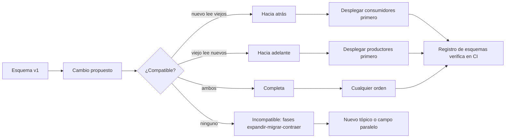

# SE-380 — Compatibilidad de esquemas y registros

[← SE-379 — Webhooks, polling y suscripciones](../../classes/part-31-integracion-eventos-y-mensajeria/se-379-webhooks-polling-y-suscripciones/README.md) · [↑ Parte 31](../../classes/part-31-integracion-eventos-y-mensajeria/README.md) · [📚 Índice completo](../../classes/README.md) · [🌐 Portal](../../site/classes/SE-380.html) · [SE-381 — Anti-corruption layers y traducción de modelos →](../../classes/part-31-integracion-eventos-y-mensajeria/se-381-anti-corruption-layers-y-traduccion-de-modelos/README.md)

## Punto profesional y fundamento pedagógico

**Punto profesional.** La clase existe para que cambies la forma de un mensaje sin romper a quien ya lo consume: aprenderás a comprobar con código, y no de memoria, qué cambios de esquema son compatibles hacia atrás y hacia adelante para un lector tolerante y para uno estricto, cuántos mensajes fallan durante un despliegue gradual según qué lado se actualiza primero y qué hace cada política de un consumidor cuando aparece un valor nuevo de una enumeración.

**Por qué aparece aquí.** Sigue a **Webhooks, polling y suscripciones**: allí el proveedor externo enviaba avisos y la plataforma los aceptaba; ahora se pregunta qué pasa cuando cualquiera de los dos cambia la forma de los datos. Los mensajes viven más que el código que los escribió (un log retenido, una cola con retraso, un consumidor que nadie despliega desde hace meses), así que el esquema es un contrato con quien aún no existe.

**Error conceptual que debe corregir.** Creer que «añadir un campo es compatible» o que basta con avisar a los equipos. La compatibilidad depende de quién lee y de cómo lee: un lector estricto convierte cualquier campo nuevo en un fallo, un lector tolerante lo ignora; y durante un despliegue gradual conviven versiones nuevas y viejas de productores y consumidores, de modo que los cambios incompatibles producen fallos aunque cada equipo haya hecho «lo correcto».

**Secuencia de aprendizaje.** Antes de leer los resultados, predices cuáles de siete cambios de esquema rompen a un lector tolerante y a uno estricto en cada sentido, cuántos mensajes fallan si se despliega primero el productor o primero el consumidor, y qué ocurre con los mensajes que siguen a un valor desconocido de una enumeración; después mides los tres casos y comparas con tu predicción. La secuencia usa predicción, explicación propia, contraste y recuperación. [ICAP](https://icap.education.asu.edu/research) distingue participación de construcción de conocimiento; [How People Learn II](https://nap.nationalacademies.org/catalog/24783/how-people-learn-ii-learners-contexts-and-cultures) exige conectar conocimiento previo, contexto y transferencia; la [práctica de recuperación](https://pubmed.ncbi.nlm.nih.gov/16507066/) respalda producir de nuevo la explicación tras una demora; y [Education for Life and Work](https://nap.nationalacademies.org/resource/13398/dbasse_084153.pdf) exige devolución que explique la causa del error.

**Evidencia de aprendizaje.** `esquemas-log.md` con las predicciones, las tres figuras reproducidas, el esquema versionado de `EntregaRecibida` con sus reglas de cambio, una tabla de órdenes de despliegue para tres cambios y la política del consumidor ante valores desconocidos.

**Límite de la conclusión.** Los esquemas son diccionarios de campos con tipo y obligatoriedad, y los lectores son funciones de Python de unas pocas líneas: no se usó Avro, Protocol Buffers, JSON Schema ni registro de esquemas real. El despliegue gradual en cinco pasos del 20 %, el 6 % de valores nuevos en la segunda mitad del flujo y el tamaño de los lotes son supuestos del autor. Los resultados muestran la lógica de la compatibilidad, no el comportamiento de un formato concreto.

### Trazabilidad fuente → afirmación

| Fuente primaria u oficial | Afirmación que respalda | Lo que no prueba |
|---|---|---|
| [Confluent: evolución de esquemas y compatibilidad](https://docs.confluent.io/platform/current/schema-registry/fundamentals/schema-evolution.html) | Define los modos de compatibilidad hacia atrás, hacia adelante y completa y explica cómo un registro los verifica y qué cambios los respetan en Avro. | No fija el modo adecuado para la plataforma de entregas ni cubre otros formatos. |
| [Apache Avro: especificación](https://avro.apache.org/docs/current/specification/) | Define la resolución de esquemas entre el del escritor y el del lector, con valores por defecto para campos que faltan. | No describe la resolución en JSON simple ni en otros formatos. |
| [Fowler, «Tolerant Reader»](https://martinfowler.com/bliki/TolerantReader.html) | Recomienda que el lector use solo los campos que necesita e ignore el resto, para tolerar la evolución del emisor. | No elimina la necesidad de validar lo que el lector sí usa. |
| [Versionado semántico](https://semver.org/) | Propone distinguir cambios compatibles e incompatibles de una interfaz con el número de versión. | No es un mecanismo de verificación ni cubre el comportamiento. |
| [CloudEvents: especificación](https://github.com/cloudevents/spec/blob/main/cloudevents/spec.md) | Incluye un atributo para el tipo del evento y otro para el esquema de datos, de modo que el consumidor identifique la versión. | No obliga a ningún esquema concreto ni a una política de cambios. |

## Antes de empezar

Recupera lo aprendido en `SE-374` (el mensaje tiene un sobre con versión) y en `SE-354` sobre migraciones compatibles de bases de datos: expandir, migrar y contraer. La estrategia es la misma, con una diferencia que cambia todo: en una migración de base el equipo controla cuándo termina la convivencia; con mensajes retenidos o consumidores ajenos, no. La pregunta activa es: **¿quién puede estar leyendo esto con una versión distinta de la mía, y qué le pasa?**

## Prerrequisitos

- Haber completado `SE-379` o poder explicar por qué un receptor externo es no confiable.
- Python 3.11 o posterior; los experimentos usan solo la biblioteca estándar y generadores con semilla fija.
- Entender qué es un campo opcional, uno obligatorio, un valor por defecto y una enumeración.

## Problema auténtico

El mensaje `EntregaRecibida` tiene `id`, `estudiante`, `curso` y `estado`. Un martes el equipo de analítica pide añadir `intento` y lo marca como obligatorio; el productor se despliega por la tarde y el consumidor de avisos, que no se había actualizado, empieza a rechazar los mensajes nuevos porque su lector estricto no admite campos que no conoce. Al día siguiente otro equipo renombra `estudiante` a `alumno` «para ser consistente», y la cola retenida de la semana anterior queda ilegible para el consumidor nuevo. Una semana después aparece un estado nuevo, `revision_pendiente`, y un consumidor que lanza una excepción ante lo desconocido se detiene en el primer mensaje y bloquea los demás. Los tres equipos creyeron que su cambio era compatible; ninguno lo comprobó contra los lectores reales.

## Objetivos observables

Al terminar podrás:

1. clasificar siete cambios de esquema como compatibles hacia atrás, hacia adelante o ninguno, según el tipo de lector, y comprobarlo con código;
2. medir cuántos mensajes fallan en un despliegue gradual según se actualice primero el productor o el consumidor;
3. comparar cuatro políticas de un consumidor ante un valor desconocido de una enumeración por mensajes bloqueados, perdidos y conservados;
4. escribir las reglas de evolución de un esquema (qué cambios se permiten, cuáles requieren fases) y la verificación que las exige;
5. diseñar el orden de despliegue de un cambio incompatible en pasos compatibles.

## Mapa conceptual



El mapa separa el **tipo de compatibilidad** del **orden de despliegue** que cada tipo permite. Un cambio incompatible no se prohíbe: se divide en pasos compatibles, como en las migraciones de base de datos.

## Temas y por qué importan

| Tema | Por qué cambia una decisión profesional | Evidencia mínima |
|---|---|---|
| Tipos de compatibilidad | Decide quién puede desplegar primero y cuántas versiones deben convivir. | Predicción, traza causal y contraejemplo de **Tipos de compatibilidad** en `esquemas-log.md` |
| Lector tolerante y estricto | La misma evolución es compatible o no según cómo lee el consumidor. | Predicción, traza causal y contraejemplo de **Lector tolerante y estricto** en `esquemas-log.md` |
| Cambios seguros y peligrosos | Añadir es casi seguro; renombrar, cambiar un tipo o hacer obligatorio no lo es. | Predicción, traza causal y contraejemplo de **Cambios seguros y peligrosos** en `esquemas-log.md` |
| Registro de esquemas | Convierte una regla de equipo en una comprobación automática. | Predicción, traza causal y contraejemplo de **Registro de esquemas** en `esquemas-log.md` |
| Orden de despliegue y enumeraciones | Los fallos ocurren en la ventana de convivencia y con el valor nuevo. | Predicción, traza causal y contraejemplo de **Orden de despliegue y enumeraciones** en `esquemas-log.md` |

## Conceptos y decisiones

### 1. Tipos de compatibilidad

Un cambio de esquema es **compatible hacia atrás** si un lector con el esquema **nuevo** puede leer datos escritos con el **viejo**; es **compatible hacia adelante** si un lector con el esquema **viejo** puede leer datos escritos con el **nuevo**; y es **completo** si lo es en ambos sentidos. Se necesita hacia atrás cuando hay datos viejos que leer (un log retenido, una cola atrasada, un consumidor que se despliega primero); se necesita hacia adelante cuando hay lectores viejos activos mientras los productores ya escriben con el esquema nuevo. Un log retenido durante meses exige compatibilidad hacia atrás durante meses, y esa duración, no el código, es lo que fija cuánto vive cada versión.

### 2. Lector tolerante y estricto

La compatibilidad no es una propiedad solo del esquema: depende de **cómo** lee el consumidor. Un **lector tolerante** usa los campos que conoce e ignora los demás (la recomendación de Fowler); un **lector estricto** rechaza cualquier campo que no esté en su esquema. Con un lector tolerante, añadir un campo es compatible hacia adelante; con uno estricto, no lo es. El lector tolerante no es una excusa para no validar: debe comprobar tipo y rango de los campos que sí usa, y no debe confiar en que un campo desconocido sea inocuo si lo reenvía a otro sistema. La regla práctica es escribir lectores tolerantes con los campos que necesitan y estrictos con sus tipos.

### 3. Cambios seguros y peligrosos

Los cambios se ordenan por riesgo. **Añadir un campo opcional con valor por defecto** es el cambio más seguro. **Añadir uno obligatorio** rompe a los lectores nuevos con datos viejos, que no lo tienen. **Quitar un campo opcional** rompe a un lector estricto que lo esperaba; **quitar uno obligatorio**, a todos los lectores viejos. **Renombrar** equivale a quitar y añadir a la vez: rompe en los dos sentidos. **Cambiar el tipo** también rompe en ambos. **Volver obligatorio un campo opcional** rompe la lectura de datos viejos. Para los cambios peligrosos se aplica la misma estrategia de `SE-354`: añadir lo nuevo en paralelo, migrar a los consumidores, dejar de escribir lo viejo y solo entonces quitarlo.

### 4. Registro de esquemas

Un **registro de esquemas** guarda las versiones de cada esquema y comprueba, antes de aceptar una nueva, que respete el modo de compatibilidad configurado para ese tema. El mensaje lleva el identificador de su esquema y el lector lo recupera para interpretar los datos. Así la regla pasa de estar en un documento a ser una comprobación que se ejecuta en la integración continua del productor: un cambio incompatible no llega a publicarse. No sustituye el diseño (el registro solo conoce la forma, no el sentido de un campo renombrado) ni el ensayo con los consumidores reales, pero cierra la mayor parte de los errores de forma.

### 5. Orden de despliegue y enumeraciones

El orden en que se actualizan productores y consumidores decide quién ve mensajes que no entiende. Con un cambio compatible hacia atrás se despliegan **primero los consumidores**: leen lo nuevo y lo viejo, y el productor puede cambiar después. Con uno compatible solo hacia adelante se despliegan **primero los productores**. Con uno incompatible no hay orden seguro y hay que dividirlo en fases. Las **enumeraciones** merecen atención propia: un valor nuevo es un cambio de datos que ningún registro de formas detecta, y la política del consumidor ante lo desconocido (excepción, descarte, valor por defecto, conservar y revisar) decide si es un incidente, una pérdida silenciosa o una tarea.

### Qué cambios rompen a qué lector

Se definen esquemas como diccionarios `campo → (tipo, obligatorio)` y dos lectores: el tolerante ignora campos extra y el estricto los rechaza; ambos exigen los obligatorios y comprueban el tipo. Para cada cambio se genera un mensaje mínimo (solo obligatorios) y uno máximo (todos los campos) con cada esquema, y se prueba si el lector nuevo lee los del escritor viejo (hacia atrás) y si el lector viejo lee los del escritor nuevo (hacia adelante); el resultado es verdadero solo si ambos mensajes se leen.

```python
def leer(esquema, msg, estricto):
    for campo, (tipo, obligatorio) in esquema.items():
        if campo not in msg:
            if obligatorio: raise KeyError(campo)
        elif not isinstance(msg[campo], tipo): raise TypeError(campo)
    if estricto and set(msg) - set(esquema): raise ValueError("campos desconocidos")
```

| Cambio | Tolerante: nuevo lee viejos | Tolerante: viejo lee nuevos | Estricto: nuevo lee viejos | Estricto: viejo lee nuevos |
|---|---|---|---|---|
| Añadir un campo opcional | Sí | Sí | Sí | No |
| Añadir un campo obligatorio | No | Sí | No | No |
| Quitar un campo opcional | Sí | Sí | No | Sí |
| Quitar un campo obligatorio | Sí | No | No | No |
| Renombrar un campo | No | No | No | No |
| Cambiar el tipo de un campo | No | No | No | No |
| Volver obligatorio un campo opcional | No | Sí | No | Sí |

Con lectores tolerantes, los únicos cambios completos son añadir y quitar un campo opcional. Con lectores estrictos, ni siquiera añadir un opcional es seguro hacia adelante. Renombrar y cambiar el tipo no son compatibles en ninguna combinación: son la prueba de que «renombrar» no es un cambio, es una eliminación seguida de una adición.


**Cómo leer la figura.** Cada fila es un cambio y cada columna una combinación de tipo de lector y de sentido de la lectura; las celdas oscuras con «Sí» son compatibles. Las filas van ordenadas de más a menos compatible, de modo que la mancha oscura se deshace de arriba abajo hasta quedarse vacía en renombrar y en cambiar el tipo. **Dónde deja de valer:** los esquemas solo tienen campos simples y tipos primitivos; un registro real también distingue uniones, valores por defecto, alias y listas. Los lectores son los más sencillos posibles, y un lector que además valide rangos o formatos añadiría casos que esta figura no cubre.

### Despliegue gradual y orden

Se simula un despliegue en cinco pasos: en cada paso se actualiza un 20 % más de instancias. Se comparan dos órdenes: productores primero (llevan una etapa de ventaja sobre los consumidores) y consumidores primero. Para cada paso se procesan 2 000 mensajes: cada uno lo escribe una instancia nueva con probabilidad igual a la fracción de productores actualizados y lo lee una instancia nueva con la de consumidores; fallan los que su lector no puede leer. Se cuentan los fallos de 10 000 mensajes para tres cambios y los dos tipos de lector.

```python
fp, fc = (f, max(0, f - 0.2)) if orden == "productores primero" else (max(0, f - 0.2), f)
esc = nuevo if r.random() < fp else viejo
lec = nuevo if r.random() < fc else viejo
```

| Cambio | Lector | Productores primero | Consumidores primero |
|---|---|---:|---:|
| Añadir campo opcional | Tolerante | 0 | 0 |
| Añadir campo opcional | Estricto | 2 825 | 820 |
| Añadir campo obligatorio | Tolerante | 801 | 2 809 |
| Añadir campo obligatorio | Estricto | 3 626 | 3 629 |
| Renombrar campo | Tolerante | 3 626 | 3 629 |
| Renombrar campo | Estricto | 3 626 | 3 629 |

Añadir un opcional con lectores tolerantes no falla en ningún orden; con estrictos falla en ambos, más cuando los productores van primero (los estrictos viejos reciben campos que no conocen). Añadir un obligatorio con lectores tolerantes falla menos si los productores van primero (801 frente a 2 809): los consumidores nuevos casi siempre reciben datos nuevos. Renombrar falla en torno a 3 600 mensajes en cualquier orden, porque el desfase entre versiones existe siempre: no hay orden que lo evite, solo fases.


**Cómo leer la figura.** Cada grupo es un cambio con un tipo de lector y las dos barras son los mensajes que fallan según se actualicen primero los productores (coral) o los consumidores (verde azulada). Mira dónde las dos barras difieren, porque el orden importa, y dónde son del mismo tamaño, porque ningún orden salva el cambio. **Dónde deja de valer:** el despliegue por pasos iguales del 20 % y la ventaja de una etapa son un modelo; en un despliegue real el desfase puede ser de días (un consumidor sin mantenimiento) o de segundos. Tampoco se modelan los mensajes retenidos que se leen semanas después, que alargan la ventana de compatibilidad hacia atrás.

### Un valor nuevo en una enumeración

Se generan 10 000 mensajes con tres estados (`recibida`, `calificada`, `devuelta`); desde la mitad del flujo, el 6 % de los mensajes lleva un estado nuevo, `revision_pendiente` (338 mensajes, el primero en la posición 5 009). Se comparan cuatro políticas de consumidor ante el valor desconocido.

```python
if estado not in CONOCIDOS:
    if politica == "excepcion":  raise ValueError(estado)           # y se reintenta sin fin
    if politica == "descartar":  continue
    if politica == "por_defecto": estado = "desconocido"
    if politica == "conservar":   enviar_a_revision(msg)           # se guarda el valor original
```

| Política del consumidor | Mensajes bloqueados | Mensajes perdidos | Mensajes con el valor nuevo procesados |
|---|---:|---:|---:|
| Lanzar una excepción y reintentar sin fin | 4 991 | 0 | 0 |
| Descartar el valor desconocido | 0 | 338 | 0 |
| Sustituir por «desconocido» | 0 | 0 | 338 sin su significado |
| Conservar el valor y enviarlo a revisión | 0 | 0 | 338 con su valor |

La excepción convierte un valor nuevo en una parada: el primer mensaje con `revision_pendiente` y los 4 990 siguientes (4 991 en total) esperan a que alguien intervenga. Descartar evita la parada y pierde 338 mensajes sin aviso. Sustituir conserva los mensajes pero borra lo que los distinguía. Conservar el valor original y derivar esos mensajes a una revisión es la única política que mantiene el flujo, la información y la visibilidad.


**Cómo leer la figura.** Cada grupo es una política del consumidor ante lo desconocido y cada color mide un efecto sobre el flujo: bloqueados (coral), perdidos (dorado) y procesados con el valor nuevo (verde azulado). Mira que solo la excepción produce una barra enorme y que las dos últimas políticas tienen la misma barra, pero se distinguen por si el valor se conserva. **Dónde deja de valer:** el 6 % y el momento en que aparece el valor son supuestos, y la política de excepción supone un reintento infinito sobre la partición, algo que depende del corredor. La figura no dice que conservar sea siempre posible: exige que haya a quién derivar los mensajes y que alguien los revise.

## Definiciones de trabajo

- **compatibilidad hacia atrás:** propiedad de un cambio de esquema por la cual un lector con el esquema nuevo lee datos escritos con el viejo.
- **compatibilidad hacia adelante:** propiedad por la cual un lector con el esquema viejo lee datos escritos con el nuevo.
- **lector tolerante:** consumidor que usa los campos que conoce e ignora los demás.
- **registro de esquemas:** servicio que guarda versiones de esquemas y verifica su compatibilidad antes de aceptar una nueva.
- **expandir y contraer:** estrategia de cambio incompatible en fases: añadir lo nuevo en paralelo, migrar a los consumidores y retirar lo viejo.

Las definiciones son operativas para la plataforma de entregas. No convierten términos con una historia más amplia en sinónimos y deben contrastarse con la documentación primaria enlazada al final.

## Ejemplo mínimo

El fragmento prueba si añadir un campo opcional rompe a un lector estricto viejo. Antes de ejecutarlo, predice el resultado para el lector tolerante y para el estricto.

```python
V1 = {"id": (str, True), "curso": (str, True)}
dato_nuevo = {"id": "e1", "curso": "c1", "comentario": "hola"}
def leer(esq, m, estricto):
    for k, (t, req) in esq.items():
        if req and k not in m: return False
    return not (estricto and set(m) - set(esq))
print(leer(V1, dato_nuevo, False), leer(V1, dato_nuevo, True))
```

El tolerante lee (`True`) y el estricto no (`False`). Registra versión de Python y salida; después marca `comentario` como obligatorio en el esquema nuevo y prueba si el lector nuevo lee un mensaje viejo.

## Ejemplo profesional

El equipo de la plataforma fija las reglas de evolución de `EntregaRecibida`. **Modo del registro:** compatibilidad completa, porque el log se retiene 14 días y hay consumidores que se despliegan con semanas de desfase. **Reglas:** se permite añadir campos opcionales con valor por defecto y quitar campos opcionales; se prohíbe renombrar, cambiar tipos y volver obligatorio un campo. **Lectores:** todos los consumidores usan lectores tolerantes sobre los campos que necesitan y validan su tipo; los estados desconocidos se conservan y se derivan a una cola de revisión con una alarma. Para el cambio que pidió analítica, `intento` obligatorio, definen las fases: primero añadir `intento` como opcional con valor por defecto 1; luego migrar los productores para que siempre lo envíen; cuando el log retenido ya no contiene mensajes sin él, marcarlo obligatorio. Para «renombrar estudiante a alumno» definen la alternativa: escribir ambos campos durante un periodo, migrar a los consumidores y quitar el viejo cuando nadie lo lea. El registro verifica las reglas en la integración continua del productor. Compara con el cambio original: el consumidor de avisos no se rompe y la cola retenida sigue siendo legible.

## Práctica guiada

1. Escribe el esquema actual de `EntregaRecibida` y lista quién lo lee y con qué versión.
2. Predice cuáles de los siete cambios rompen a un lector estricto en cada sentido.
3. Implementa los dos lectores y reproduce la matriz de siete cambios.
4. Simula el despliegue en cinco pasos con productores primero y consumidores primero para tres cambios.
5. Implementa las cuatro políticas ante un valor desconocido y cuenta bloqueados, perdidos y conservados.
6. Escribe las fases de un cambio incompatible (obligatorio y renombrado) con las condiciones para pasar de una a otra.
7. Entrega `esquemas-log.md` y pide a otra persona que proponga un cambio que tus reglas permitan y que rompa a un consumidor.

## Ejercicios

1. **Clasificación:** `calificacion` pasa de entero a decimal; clasifica el cambio por lector y propone las fases.
2. **Orden:** un cambio es compatible solo hacia adelante; indica quién se despliega primero y qué ocurre con el log retenido.
3. **Enumeración:** el estado `devuelta` se divide en `devuelta_con_nota` y `devuelta_sin_nota`; diseña una transición que no rompa consumidores estrictos.
4. **Registro:** escribe tres reglas de compatibilidad que verificaría tu registro y una que no puede verificar y requiere una prueba con los consumidores.

## Reto verificable

Entrega `esquemas-log.md` con las predicciones, las tres tablas reproducidas con las mismas semillas, las reglas de evolución, las fases de un cambio incompatible y la política ante valores desconocidos. Se aprueba si otra persona ejecuta el código desde un checkout limpio, obtiene la matriz de siete cambios, 2 825 y 820 fallos para el opcional con lectores estrictos y 4 991 mensajes bloqueados por la política de excepción, y puede decir qué cambio de los siete no tiene ningún orden de despliegue seguro. No se aprueba por afirmar que «añadir campos es compatible» sin indicar el tipo de lector ni por renombrar un campo en un solo paso.

## Caso conductor

El flujo de entrega, calificación, aviso y registro de la plataforma es el caso conductor de la Parte 31. Esta clase deja el octavo artefacto: las reglas de evolución de los mensajes con su verificación y la política ante lo desconocido. `SE-381` pregunta cómo traducir los modelos de un sistema externo al de la plataforma sin que sus cambios la contaminen. Cambia después una sola decisión, el tipo de lector de un consumidor, y observa qué cambios dejan de romperlo.

## Preguntas frecuentes

### ¿Siempre debo usar un registro de esquemas?

No hace falta para dos servicios del mismo equipo que se despliegan juntos. Se vuelve valioso cuando hay varios equipos, mensajes retenidos o consumidores ajenos, porque convierte las reglas en una comprobación automática. Sin registro, la misma disciplina puede lograrse con pruebas de contrato en la integración continua.

### ¿Por qué no versionar el mensaje y mantener todas las versiones?

Se puede, pero cada versión es un código que mantener y los consumidores deben elegir cuál leen. Es razonable para cambios incompatibles inevitables (`EntregaRecibidaV2` en un tema nuevo), no como política para cada cambio: la compatibilidad evita multiplicar versiones.

### ¿Un lector tolerante no es peligroso?

Lo es si ignora campos que le importaban o si reenvía lo desconocido sin revisarlo. El lector tolerante sigue validando tipo y rango de lo que usa. Lo que no hace es fallar por lo que no usa.

### ¿Cómo se renombra un campo de verdad?

En fases: se añade el nombre nuevo y se escriben ambos, se migra a cada consumidor, se verifica con las métricas que nadie lee el viejo y se deja de escribir. Cada fase es compatible; el renombrado completo ocurre en varios despliegues y puede durar semanas.

## Fallo controlado y diagnóstico

Reproduce el fallo clásico de la clase: **añadir un campo obligatorio a un mensaje con lectores en versiones mezcladas**. Despliega el productor con `intento` obligatorio mientras un consumidor sigue con el esquema viejo.

Registra síntoma, entrada mínima, hipótesis, observación que descarta cada hipótesis, causa, corrección y prueba de regresión. **Síntoma:** el consumidor de avisos rechaza mensajes con «campos desconocidos» o el nuevo consumidor rechaza los de la cola retenida por no tener `intento`. **Hipótesis rivales:** (a) el productor envía mensajes mal formados; (b) el mensaje se corrompió en el transporte; (c) el lector no tolera el campo nuevo o el dato viejo no lo tiene. **Prueba:** lee el mismo mensaje con cada versión del lector; si el viejo falla por el campo nuevo y el nuevo falla con el dato viejo, la causa es la combinación de versiones. **Conclusión:** el cambio no era compatible en ningún sentido para estos lectores. **Regresión:** añadir `intento` como opcional con valor por defecto, migrar productores y luego volverlo obligatorio, con una prueba que lea mensajes de ambos esquemas con ambos lectores. No cambies a la vez el esquema y el lector.

## Errores comunes y cómo corregirlos

| Síntoma | Causa probable | Corrección |
|---|---|---|
| Un consumidor viejo rechaza mensajes nuevos | Lector estricto frente a un campo añadido | Lector tolerante para campos desconocidos |
| Un consumidor nuevo no lee la cola retenida | Campo obligatorio añadido sin valor por defecto | Añadir como opcional con valor por defecto y migrar |
| Dos versiones del mismo mensaje sin camino de migración | Renombrado en un solo paso | Escribir ambos nombres, migrar y retirar el viejo |
| Un consumidor se detiene con un estado nuevo | Excepción ante un valor desconocido | Conservar el valor original y derivarlo a revisión |
| Los cambios incompatibles llegan a producción | No hay verificación automática de compatibilidad | Registro de esquemas o prueba de contrato en la integración continua |

## Entorno y archivos clave

```text
work/SE-380/
├── README.md
├── esquemas/
│   ├── entrega-recibida.v1.json
│   ├── lectores.py
│   └── despliegue.py
├── tests/test_esquemas.py
└── evidence/esquemas-log.md
```

El `README` declara plataforma, versión de Python, semillas y comandos. El código de los tres experimentos está en `scripts/experiments_part31_b.py` (funciones `e332_matriz`, `e332_despliegue` y `e332_enum`) y se ejecuta con `python scripts/experiments_part31_b.py`. Solo usa la biblioteca estándar y se ejecutó con CPython 3.12.9 en Windows 11 y 3.12.3 en Ubuntu bajo WSL2: las salidas fueron idénticas. Si añades una dependencia (por ejemplo, un validador de esquemas), fija procedencia y versión.

## Seguridad, ética y accesibilidad

- un lector tolerante que reenvía campos desconocidos puede propagar datos que no debía: lista los campos que se reenvían y revisa si alguno es personal;
- un campo nuevo puede introducir datos personales en todos los consumidores a la vez: evalúa el impacto de privacidad antes de añadirlo (`SE-358`);
- un estado desconocido derivado a revisión debe tener dueño y plazo, o se convierte en una cola de personas sin respuesta;
- documenta los esquemas y las reglas de cambio en texto navegable y con ejemplos, no solo en un archivo de esquema;
- los datos de prueba son sintéticos; no uses mensajes retenidos reales para ensayar migraciones.

## Puente hacia el trabajo con agentes

Un agente al que se le pide «añade este campo al evento» suele marcarlo como obligatorio, renombrar un campo «por claridad» o cambiar un tipo sin considerar a los lectores, y actualiza solo el productor. Pídele en cambio que clasifique el cambio como compatible hacia atrás, hacia adelante o ninguno para cada tipo de lector, que proponga las fases y el orden de despliegue, que actualice el registro o la prueba de contrato y que incluya una prueba que lea mensajes de la versión anterior con el lector nuevo y viceversa. Revisa especialmente si renombra o vuelve obligatorio un campo en un solo paso y si trata los valores desconocidos de una enumeración: son los dos defectos que esta clase mostró sin aviso.

## Transferencia

Traslada el análisis a otro dominio (por ejemplo, la interfaz de un proveedor de pagos con varias versiones de clientes): cambia el esquema y conserva el procedimiento de clasificar el cambio por sentido y por tipo de lector, elegir el orden de despliegue y dividir lo incompatible en fases. La transferencia está lograda cuando puedes decir qué lector rompe un cambio, no cuando el esquema «valida».

## Evaluación y evidencia

| Criterio | Evidencia para aprobar |
|---|---|
| comprensión | explicación de compatibilidad hacia atrás, hacia adelante y completa y del papel del lector |
| corrección | matriz, fallos de despliegue y políticas de enumeración reproducibles con las mismas semillas |
| diseño | reglas de evolución, fases de un cambio incompatible y política ante lo desconocido |
| diagnóstico | reproducción de un campo obligatorio con versiones mezcladas y regresión |
| incertidumbre | declaración de que los esquemas y lectores son mínimos y de que el despliegue es un modelo |
| reproducibilidad | versiones, comandos, salida y límites declarados |

## Fuentes

- [Confluent: evolución de esquemas y compatibilidad](https://docs.confluent.io/platform/current/schema-registry/fundamentals/schema-evolution.html) — modos de compatibilidad y su verificación en un registro; autoridad: documentación de Confluent.
- [Apache Avro: especificación](https://avro.apache.org/docs/current/specification/) — resolución de esquemas entre escritor y lector; autoridad: proyecto Apache Avro.
- [Fowler, «Tolerant Reader»](https://martinfowler.com/bliki/TolerantReader.html) — lector que ignora lo que no necesita; autoridad: autor del texto.
- [Versionado semántico](https://semver.org/) — distinguir cambios compatibles e incompatibles; autoridad: especificación del proyecto.
- [CloudEvents: especificación](https://github.com/cloudevents/spec/blob/main/cloudevents/spec.md) — tipo del evento y esquema de datos como atributos; autoridad: proyecto CloudEvents de la CNCF.

Cada fuente respalda el mecanismo indicado; ninguna demuestra que los 2 825 fallos, los 4 991 mensajes bloqueados o las clasificaciones de la matriz se observen en un formato o un registro concretos. Esa afirmación depende del formato, del lector y del calendario de despliegue de cada sistema.

## Límites y siguiente paso

Se ejecutaron tres experimentos con datos sintéticos en Windows y Ubuntu (WSL2) con resultados idénticos. No se usó Avro, Protocol Buffers, JSON Schema ni registro de esquemas: los esquemas, los lectores, el despliegue en cinco pasos del 20 % y el 6 % de valores nuevos son construcciones del autor, y los resultados no se extrapolan a ningún formato ni producto. La siguiente clase pregunta cómo protegerse de los cambios de un modelo ajeno traduciéndolo en una frontera propia: las capas anticorrupción.

## Glosario

- **compatibilidad hacia atrás:** propiedad de un cambio de esquema por la cual un lector con el esquema nuevo lee datos escritos con el viejo.
- **compatibilidad hacia adelante:** propiedad por la cual un lector con el esquema viejo lee datos escritos con el nuevo.
- **lector tolerante:** consumidor que usa los campos que conoce e ignora los demás.
- **registro de esquemas:** servicio que guarda versiones de esquemas y verifica su compatibilidad antes de aceptar una nueva.
- **expandir y contraer:** estrategia de cambio incompatible en fases: añadir lo nuevo en paralelo, migrar a los consumidores y retirar lo viejo.

---

[← SE-379 — Webhooks, polling y suscripciones](../../classes/part-31-integracion-eventos-y-mensajeria/se-379-webhooks-polling-y-suscripciones/README.md) · [↑ Parte 31](../../classes/part-31-integracion-eventos-y-mensajeria/README.md) · [📚 Índice completo](../../classes/README.md) · [🌐 Portal](../../site/classes/SE-380.html) · [SE-381 — Anti-corruption layers y traducción de modelos →](../../classes/part-31-integracion-eventos-y-mensajeria/se-381-anti-corruption-layers-y-traduccion-de-modelos/README.md)
