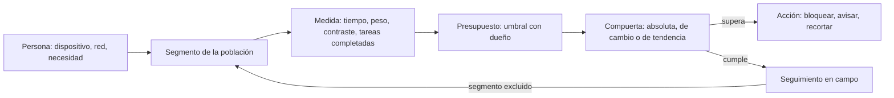

# SE-382 — Calidad de experiencia y presupuestos

[← SE-381 — Compatibilidad, portabilidad e interoperabilidad](../../classes/part-31-calidad-rendimiento-y-resiliencia/se-381-compatibilidad-portabilidad-e-interoperabilidad/README.md) · [↑ Parte 31](../../classes/part-31-calidad-rendimiento-y-resiliencia/README.md) · [📚 Índice completo](../../classes/README.md) · [🌐 Portal](../../site/classes/SE-382.html) · [SE-383 — Taller: someter un sistema a presión controlada →](../../classes/part-31-calidad-rendimiento-y-resiliencia/se-383-taller-someter-un-sistema-a-presion-controlada/README.md)

## Punto profesional y fundamento pedagógico

**Punto profesional.** La clase existe para que conviertas «que se sienta bien» en presupuestos que un equipo puede vigilar: cuánto puede pesar una página, cuánto puede tardar en mostrar lo importante, qué contraste mínimo deben tener los textos, y para que sepas qué parte de la experiencia de una persona captura cada medida y cuál se escapa. Un presupuesto es una restricción de diseño con dueño y con medida, no una aspiración.

**Por qué aparece aquí.** Sigue a **Compatibilidad, portabilidad e interoperabilidad**: allí el mismo software se enfrentó a sistemas distintos; aquí se enfrenta a personas con dispositivos y redes distintos. Cierra los atributos de calidad percibida por quien usa el producto (capacidad de interacción y eficiencia de desempeño vista desde el cliente) antes del taller y del proyecto de la parte. El caso conductor es el portal de la plataforma de entregas en los dispositivos de sus estudiantes.

**Error conceptual que debe corregir.** Creer que una medida de laboratorio representa a las personas usuarias y que un promedio o un percentil de la población protege a todos: el laboratorio mide el mejor dispositivo disponible, el percentil 75 de la población deja sin cubrir a las personas con dispositivos más lentos, y ninguna fórmula de contraste ve el orden de lectura ni el foco.

**Secuencia de aprendizaje.** Antes de leer los resultados, predices cuántas cargas de la misma página superan 2,5 s en el campo cuando el laboratorio da 0,5 s y cuántas compilaciones tarda en saltar un presupuesto absoluto frente a una compuerta de tendencia; después modelas tres segmentos de dispositivos, simulas una deriva de peso de 80 compilaciones con tres compuertas y mides el contraste de los colores del propio repositorio. La secuencia usa predicción, explicación propia, contraste y recuperación. [ICAP](https://icap.education.asu.edu/research) distingue participación de construcción de conocimiento; [How People Learn II](https://nap.nationalacademies.org/catalog/24783/how-people-learn-ii-learners-contexts-and-cultures) respalda diseñar la práctica con contextos reales y retroalimentación.

**Evidencia de aprendizaje.** `presupuestos-log.md` con la predicción, las tres figuras reproducidas, un presupuesto de experiencia del portal (peso, tiempo hasta el contenido principal, contraste) con su dueño y su comprobación automática, y una nota que separe qué cubre cada medida de qué deja fuera.

**Límite de la conclusión.** El tiempo de carga se calcula con un modelo aritmético (viajes, ancho de banda, procesamiento) con tres segmentos de dispositivos elegidos por el autor, sin ejecutar ningún navegador; la deriva de peso es sintética; solo el contraste es una medición exacta, calculada sobre los colores del propio repositorio. No se midió ninguna persona, ningún dispositivo ni ningún navegador, y no se evaluó ninguna conformidad con WCAG: el contraste es una sola comprobación entre muchas.

### Trazabilidad fuente → afirmación

| Fuente primaria u oficial | Afirmación que respalda | Lo que no prueba |
|---|---|---|
| [web.dev: Largest Contentful Paint](https://web.dev/articles/lcp) | Define el LCP, propone 2,5 s o menos como valor bueno y recomienda evaluarlo en el percentil 75 de las cargas de campo. | No dice que 2,5 s sea el umbral correcto para la plataforma ni cubre a los segmentos por debajo del percentil 75. |
| [web.dev: performance budgets 101](https://web.dev/articles/performance-budgets-101) | Describe un presupuesto como un límite medible (peso, tiempo, número de solicitudes) que se vigila en cada cambio. | No fija los valores para este portal. |
| [W3C: Understanding Contrast (Minimum), WCAG 2.2](https://www.w3.org/WAI/WCAG22/Understanding/contrast-minimum.html) | Define la razón de contraste mínima de 4,5 a 1 para texto normal y de 3 a 1 para texto grande y la fórmula de luminancia. | No es una evaluación de accesibilidad completa. |
| [W3C: Understanding Non-text Contrast, WCAG 2.2](https://www.w3.org/WAI/WCAG22/Understanding/non-text-contrast.html) | Exige un contraste de 3 a 1 para componentes de interfaz y gráficos necesarios para comprender el contenido. | No dice cuándo un borde es un componente necesario. |
| [Nielsen Norman Group: los tres límites de tiempo de respuesta](https://www.nngroup.com/articles/response-times-3-important-limits/) | Resume los límites de 0,1, 1 y 10 segundos para la sensación de reacción inmediata, de flujo y de atención. | No es un estudio de esta plataforma. |

## Antes de empezar

Recupera lo aprendido en `SE-381`: los valores por defecto de un entorno cambian el resultado. La pregunta activa es: **¿qué experiencia tiene la persona con el dispositivo más modesto que debemos atender y qué presupuesto, comprobado en cada cambio, la protege?**

## Prerrequisitos

- Haber completado `SE-381` o poder explicar qué es una matriz de compatibilidad.
- Python 3.11 o posterior; los experimentos usan solo la biblioteca estándar (`random`, `statistics`, `math`).
- Saber qué es una razón de contraste y qué es el peso de una página.

## Problema auténtico

El portal de la plataforma se probaba con el equipo del desarrollador: una página de 440 KB cargaba en medio segundo y el informe decía «rápido». Los comentarios de estudiantes con teléfonos económicos y conexión móvil decían lo contrario. Por otra parte, el peso de la página había subido de 800 KB a 1 300 KB en ochenta compilaciones sin que ninguna compuerta se disparara, porque cada compilación solo añadía una fracción pequeña. Y una revisión de accesibilidad encontró que la etiqueta superior de cada clase tenía un contraste insuficiente: un color coral sobre papel que a nadie le había parecido un problema. Las tres cosas eran la misma: una medida tomada en el lugar equivocado, con el umbral equivocado, o ausente. La clase fija presupuestos y comprueba cada uno.

## Objetivos observables

Al terminar podrás:

1. calcular un tiempo de carga con un modelo de viajes, ancho de banda y procesamiento y compararlo entre segmentos de dispositivos;
2. explicar por qué el percentil 75 de la población puede cumplir mientras un segmento entero no cumple;
3. comparar un presupuesto absoluto, una compuerta contra la compilación anterior y una de tendencia ante una deriva lenta;
4. medir el contraste de un par de colores con la fórmula de luminancia y decidir si cumple según el uso;
5. escribir un presupuesto de experiencia con dueño, medida, umbral y acción cuando se supera.

## Mapa conceptual



El mapa parte de **personas y segmentos**, no de una cifra. La flecha final importa: el seguimiento en campo puede descubrir un segmento que el presupuesto no cubría.

## Temas y por qué importan

| Tema | Por qué cambia una decisión profesional | Evidencia mínima |
|---|---|---|
| Laboratorio y campo | El laboratorio mide un caso; el campo, la población. | Predicción, traza causal y contraejemplo de **Laboratorio y campo** en `presupuestos-log.md` |
| Percentiles y segmentos | Un percentil de la población deja fuera a un segmento. | Predicción, traza causal y contraejemplo de **Percentiles y segmentos** en `presupuestos-log.md` |
| Presupuestos de rendimiento | Convierten una aspiración en una restricción comprobable. | Predicción, traza causal y contraejemplo de **Presupuestos de rendimiento** en `presupuestos-log.md` |
| Compuertas de deriva | Un cambio pequeño cada vez suma uno grande. | Predicción, traza causal y contraejemplo de **Compuertas de deriva** en `presupuestos-log.md` |
| Accesibilidad medible | Algunos criterios son exactos y otros no se pueden automatizar. | Predicción, traza causal y contraejemplo de **Accesibilidad medible** en `presupuestos-log.md` |

## Conceptos y decisiones

### 1. Laboratorio y campo

Una **medición de laboratorio** ejecuta la página en un entorno controlado (un dispositivo, una red simulada, una caché limpia) y es repetible; una **medición de campo** recoge los tiempos de las cargas reales de las personas usuarias y es representativa. Se necesitan las dos: el laboratorio permite depurar y comparar versiones con poco ruido; el campo dice a quién le va bien y a quién no. El laboratorio con el equipo de desarrollo es casi siempre el caso más favorable de la población, porque la persona que construye el producto usa un dispositivo potente y una red rápida. Cuando se reporta un tiempo hay que decir de dónde sale y qué segmento representa; un número de laboratorio presentado como experiencia de las personas usuarias es una afirmación sin base.

### 2. Percentiles y segmentos

Los indicadores de campo suelen ser el percentil 75 de las cargas: la experiencia que tiene o mejora el 75 % de ellas. Es un compromiso razonable entre el caso típico y los extremos, y tiene un efecto que hay que conocer: el 25 % peor queda fuera de lo que el indicador exige, y si ese 25 % no se reparte al azar sino que corresponde a un grupo (los teléfonos modestos, una región con redes lentas), el indicador sale bien mientras ese grupo tiene una experiencia mala. Por eso se segmenta: por tipo de dispositivo, por tipo de conexión, por región. Y por eso se decide quién es la persona de referencia del diseño: «el dispositivo más modesto que debemos atender» es una decisión de producto con consecuencias de equidad, no un detalle técnico.

### 3. Presupuestos de rendimiento

Un **presupuesto** es un límite medible sobre una magnitud que importa: peso de la página en bytes, número de solicitudes, tiempo hasta el contenido principal, tiempo de bloqueo del hilo, razón de contraste. Tiene un dueño (alguien responde por él), un umbral con una razón, una medición automática y una acción al superarlo. El peso es una buena variable de partida porque es determinista y fácil de comprobar, pero es solo un indicador indirecto: la misma cantidad de bytes puede cargarse rápido o lento según qué sea (una imagen grande retrasa menos que el mismo peso en JavaScript que hay que ejecutar). Por eso un presupuesto de bytes se complementa con uno de tiempo medido en un perfil de dispositivo y red declarado, y con el seguimiento de campo.

### 4. Compuertas de deriva

La degradación del rendimiento rara vez llega de golpe: cada cambio añade un poco y ninguno parece grave. Un **presupuesto absoluto** («la página no pasa de 1 000 KB») avisa cuando ya es tarde, pues se cruza tras el crecimiento acumulado. Una compuerta **contra la compilación anterior** («no más de +2 %») no ve la deriva si cada paso es menor que el umbral y, con ruido de medición, se dispara por azar. Una compuerta de **tendencia** compara la mediana de las últimas compilaciones con una línea base fija o móvil («no más de +10 % sobre la mediana de las diez primeras») y combina las ventajas: ve la deriva acumulada y es robusta al ruido. Necesita decidir la línea base y revisarla cuando una mejora o una decisión deliberada la mueve; una línea base que nunca se revisa acaba bloqueando cambios legítimos.

### 5. Accesibilidad medible

Algunos criterios de accesibilidad se miden con exactitud y otros no se pueden automatizar. La **razón de contraste** entre texto y fondo se calcula con la luminancia relativa de cada color: (L1 + 0,05)/(L2 + 0,05), con L1 la mayor. Para texto normal las pautas piden al menos 4,5 a 1; para texto grande, 3 a 1; para componentes de interfaz y gráficos necesarios para entender el contenido, 3 a 1. Es una medida exacta y automatizable y, por eso, tentadora como sustituto de la accesibilidad completa. No lo es: ninguna fórmula de contraste comprueba el orden de lectura, el foco por teclado, el texto alternativo, la comprensión de las instrucciones ni el comportamiento con un lector de pantalla. Una comprobación automática encuentra una parte de los problemas; el resto necesita personas, incluidas las que usan tecnologías de apoyo.

### Laboratorio frente a campo

Una página de 440 KB (40 KB de HTML, 140 KB de recursos críticos y 260 KB de imagen principal) se carga con un modelo aritmético: tres viajes de ida y vuelta, el tiempo de transferencia y un tiempo de procesamiento de 0,25 s multiplicado por un factor del dispositivo, con un ruido lognormal del 25 %. Se definen tres segmentos: escritorio rápido (55 %, 50 Mbit/s, 30 ms, factor 1), teléfono medio (35 %, 8 Mbit/s, 80 ms, factor 3) y teléfono lento (10 %, 1,6 Mbit/s, 150 ms, factor 6).

```python
def tiempo(r, bw, rtt, cpu_f):
    jit = r.lognormvariate(0, 0.25)
    return (3 * rtt + sum(PAG.values()) * 8 / bw + 0.25 * cpu_f) * jit
```

| Medición | Población | Mediana | p75 | Cargas > 2,5 s |
|---|---:|---:|---:|---:|
| Laboratorio: solo escritorio rápido | 100 % | — | 0,49 s | — |
| Escritorio rápido | 55 % | 0,41 s | 0,49 s | 0 % |
| Teléfono medio | 35 % | 1,43 s | 1,69 s | 1 % |
| Teléfono lento | 10 % | 4,16 s | 4,93 s | 98 % |
| Campo: la población completa | 100 % | — | 1,50 s | 10,2 % |

El laboratorio dice 0,49 s y el campo, 1,50 s: tres veces más, y todavía dentro del 2,5 s «bueno». El p75 cumple y el 10 % con teléfono lento tiene una mediana de 4,16 s, con el 98 % de las cargas por encima de 2,5 s. Para esa persona, con ese modelo, el presupuesto de bytes que permitiría 2,5 s sería de unos 110 KB frente a los 440 KB actuales, y eso suponiendo que el procesamiento no cambie: los tres viajes y la CPU ya consumen 1,95 s.


**Cómo leer la figura.** Cada barra es una medición o un segmento de dispositivos y su longitud, el percentil 75 del tiempo de carga; la línea discontinua es el límite de 2,5 s. Mira primero que el laboratorio y la población completa quedan bajo la línea y que el teléfono lento, que es el 10 % de la población, casi la dobla. **Dónde deja de valer:** el modelo es aritmético y no ejecuta un navegador; los tres segmentos, sus proporciones y los factores de CPU son supuestos del autor, y el tiempo real de una página depende del orden de carga, de la caché, de las fuentes y de decenas de factores más.

### Una deriva de peso y tres compuertas

Se simulan 80 compilaciones de una página que parte de 800 KB y engorda un 0,6 % por compilación, con un ruido de medición lognormal del 1,2 %. Se comparan tres compuertas: un presupuesto absoluto de 1 000 KB, una comparación con la compilación anterior con un margen del 2 % y una de tendencia (mediana de las últimas 3 compilaciones contra la mediana de las 10 primeras, con un margen del 10 %). Se repite con 80 compilaciones planas, sin deriva, para contar las falsas alarmas.

```python
peso *= 1.006                                    # deriva real
pesos.append(peso * r.lognormvariate(0, 0.012))  # ruido de medicion
tendencia = st.median(pesos[i - 2:i + 1]) > st.median(pesos[:10]) * 1.10
```

| Compuerta | Con deriva | Falsas alarmas sin deriva |
|---|---|---:|
| Presupuesto absoluto de 1 000 KB | Primera falla en la compilación 38 (+25 %) | 0 de 80 |
| Contra la compilación anterior, +2 % | Falla en 21 de 79 compilaciones, todas por ruido | 15 de 79 |
| Tendencia: mediana de 3 contra las 10 primeras, +10 % | Primera falla en la 26 (926 KB, +16 %) | 0 de 70 |

La página llega a 1 324 KB (+66 %). El presupuesto absoluto avisa en la compilación 38, con la página ya un 25 % más pesada; la compuerta contra la compilación anterior se dispara 21 veces por ruido y ninguna por la deriva (un 0,6 % es menor que su margen); y la de tendencia avisa en la 26, doce compilaciones antes y con un 16 % de aumento, sin falsas alarmas en 70 comprobaciones sin deriva. La de «+2 %» da 15 alarmas falsas incluso sin deriva real: es un ruido que habitúa al equipo a ignorarla.


**Cómo leer la figura.** El eje horizontal es el número de compilación; cada carril es una compuerta, el tramo gris es el periodo sin aviso y el de color, desde que avisa. Mira primero dónde empieza el color en cada carril (compilaciones 38 y 26) y que la compuerta contra la anterior avisa por ruido en todo el recorrido. **Dónde deja de valer:** la deriva constante del 0,6 %, el ruido del 1,2 % y la línea base fija de las diez primeras compilaciones son supuestos del autor; una deriva a saltos o una línea base desactualizada cambian el resultado, y el peso es un indicador indirecto del tiempo.

### Contraste medido en el propio repositorio

Se calcula la razón de contraste con la fórmula de luminancia relativa de WCAG sobre los colores del repositorio: los seis tipos de recuadro de las figuras (texto sobre relleno y borde sobre blanco) y cinco combinaciones del portal.

```python
def lum(h):
    c = [int(h[i:i + 2], 16) / 255 for i in (1, 3, 5)]
    c = [x / 12.92 if x <= 0.03928 else ((x + 0.055) / 1.055) ** 2.4 for x in c]
    return 0.2126 * c[0] + 0.7152 * c[1] + 0.0722 * c[2]
ratio = (max(la, lb) + 0.05) / (min(la, lb) + 0.05)
```

| Combinación | Razón | Criterio |
|---|---:|---|
| Texto de figura sobre su relleno (seis tipos) | 9,91:1 a 16,12:1 | ≥ 4,5:1: cumplen los seis |
| Pie de las figuras (`#5c1f14` sobre blanco) | 12,64:1 | Cumple |
| Texto atenuado del portal sobre el papel | 5,24:1 | Cumple |
| Enlaces del portal sobre el papel | 5,60:1 | Cumple |
| Etiqueta superior del portal: coral `#d85845` sobre el papel `#f6f3ec` | 3,51:1 | No cumple el 4,5:1 del texto pequeño |
| Borde dorado de las figuras sobre blanco | 3,98:1 | Cumple el 3:1 de componentes gráficos |
| Borde gris de las figuras sobre blanco | 2,90:1 | No cumple el 3:1 si el borde fuera la única señal |

La medida es exacta y encuentra algo concreto: la etiqueta `eyebrow` del portal, cuando se muestra sobre el papel claro (por ejemplo, en la introducción de cada parte, no sobre la cabecera oscura de una clase), usa texto pequeño en mayúsculas con una razón de 3,51:1, por debajo del 4,5:1 exigido. Es un hallazgo que el repositorio no había registrado. El borde gris de las figuras queda en 2,90:1; no es un incumplimiento mientras cada recuadro lleve texto (el borde no es la única señal), pero sí un riesgo si alguien lo usara como único indicador. Todos los textos dentro de las figuras superan con holgura el mínimo.


**Cómo leer la figura.** Cada barra es un par de colores y su longitud, la razón de contraste; las líneas discontinuas son el umbral de 3:1 de los componentes gráficos y el de 4,5:1 del texto pequeño. Mira primero qué barras no llegan al umbral que les corresponde: el borde gris (gráfico) y la etiqueta del portal (texto). **Dónde deja de valer:** el contraste es una de las muchas comprobaciones y esta no prueba que el portal sea accesible: no mide orden de lectura, foco, texto alternativo, ampliación ni comportamiento con lector de pantalla. El valor de 3,51:1 corresponde al color declarado en el estilo y no se verificó en un navegador real con ampliación ni modo oscuro.

## Definiciones de trabajo

- **presupuesto de rendimiento:** límite medible sobre una magnitud de la experiencia, con dueño y acción al superarse.
- **medición de campo:** medición recogida de cargas reales de personas usuarias.
- **percentil 75:** valor bajo el cual queda el 75 % de las cargas; es el indicador de campo recomendado para el LCP.
- **deriva:** cambio acumulado lento de una magnitud a lo largo de muchos cambios pequeños.
- **razón de contraste:** cociente (L1 + 0,05)/(L2 + 0,05) entre las luminancias relativas del color más claro y del más oscuro.

Las definiciones son operativas para el portal de la plataforma. No convierten términos con una historia más amplia en sinónimos y deben contrastarse con la documentación primaria enlazada al final.

## Ejemplo mínimo

El fragmento calcula la razón de contraste entre texto negro y fondo blanco. Antes de ejecutarlo, predice si supera 4,5 a 1.

```python
def lum(c):
    c = [x / 255 for x in c]
    c = [x / 12.92 if x <= 0.03928 else ((x + 0.055) / 1.055) ** 2.4 for x in c]
    return 0.2126 * c[0] + 0.7152 * c[1] + 0.0722 * c[2]
print((lum((255, 255, 255)) + 0.05) / (lum((0, 0, 0)) + 0.05))
```

La razón es 21 a 1, el máximo posible. Registra versión de Python, comando y salida; después calcula la del gris `#777777` sobre blanco y comprueba si cumple 4,5 a 1.

## Ejemplo profesional

El equipo escribe el presupuesto de experiencia del portal. Peso: 400 KB de recursos críticos, dueño del equipo de interfaz, comprobado en cada cambio con una compuerta de tendencia del +10 % sobre la mediana de las últimas diez fusiones. Tiempo hasta el contenido principal: p75 de campo de 2,5 s y, aparte, p75 del segmento de teléfonos modestos de 4 s, medidos con datos de las cargas reales de las personas que aceptan la medición y revisados cada semana. Contraste: razón mínima de 4,5 a 1 para texto y de 3 a 1 para componentes, comprobada en integración continua sobre los colores del sistema de diseño; el hallazgo de la etiqueta coral se corrige oscureciendo el color. Cuando un presupuesto se supera, el cambio no entra salvo excepción registrada con motivo y fecha de revisión. Las medidas automáticas se complementan con una revisión trimestral con personas que usan lector de pantalla y teclado. Compara con la medición del equipo del desarrollador: ahora cada promesa de experiencia tiene dueño, número y segmento.

## Práctica guiada

1. Modela el tiempo de carga de una página de 440 KB con tres segmentos de dispositivo y calcula la mediana y el p75 de cada uno.
2. Predice el p75 de la población y el porcentaje de cargas por encima de 2,5 s y escríbelo antes de medir.
3. Calcula cuántos KB cabrían en el presupuesto del segmento lento para llegar a 2,5 s.
4. Simula 80 compilaciones con deriva y compara las tres compuertas; repite sin deriva para contar falsas alarmas.
5. Calcula la razón de contraste de los colores de tu sistema de diseño y marca los que no cumplen.
6. Escribe el presupuesto de experiencia del portal con dueño, medida, umbral y acción.
7. Entrega `presupuestos-log.md` y pide a otra persona que encuentre un segmento que tu presupuesto deja fuera.

## Ejercicios

1. **Segmento:** calcula el p75 de la población si el teléfono lento fuera el 30 % y el rápido el 35 % y decide si cumpliría 2,5 s.
2. **Compuerta:** con una deriva del 0,3 % por compilación y un ruido del 1 %, estima en qué compilación avisaría la compuerta de tendencia del +10 %.
3. **Contraste:** encuentra un color de texto que, sobre el papel `#f6f3ec`, tenga al menos 4,5 a 1 y sea lo más cercano al coral `#d85845`.
4. **Medida:** propón una medición de la capacidad de interacción con teclado que no sea un contraste y que se pueda automatizar solo en parte.

## Reto verificable

Entrega `presupuestos-log.md` con la predicción, las tres tablas de resultados, el presupuesto de experiencia del portal con dueño, medida, umbral y acción y la lista de lo que ninguna de las medidas ve. Se aprueba si otra persona ejecuta el código desde un checkout limpio, obtiene los mismos números con las mismas semillas y puede decir qué persona usuaria queda fuera de tu presupuesto. No se aprueba por reportar un tiempo de laboratorio como experiencia de las personas ni por afirmar que el portal es accesible porque los contrastes cumplen.

## Caso conductor

El portal de la plataforma de entregas es el caso conductor de la Parte 31. Esta clase deja el décimo artefacto: un presupuesto de experiencia con sus compuertas. `SE-383` reunirá todas las defensas y medidas de la parte en una prueba bajo presión controlada. Cambia después un solo dato, la proporción de teléfonos lentos, y observa qué le pasa al percentil 75 de la población.

## Preguntas frecuentes

### ¿Por qué el percentil 75 y no el 95?

Es un compromiso entre representar a la mayoría y no depender de unos pocos casos extremos, y es el que recomiendan los indicadores de campo más usados. Pero deja fuera al 25 %, y por eso se complementa con segmentación y con un objetivo específico para las personas con peor experiencia.

### ¿Es el peso de la página un buen presupuesto?

Es un buen comienzo porque es exacto y fácil de vigilar, y un mal final porque no mide el tiempo: el mismo peso en imágenes o en JavaScript pesa distinto en la experiencia. Conviene un presupuesto de peso, uno de tiempo en un perfil declarado y el seguimiento de campo.

### ¿Basta con superar los contrastes para ser accesible?

No. El contraste es una de las comprobaciones que se pueden automatizar y no sustituye a la revisión con tecnologías de apoyo. Una página con contrastes perfectos puede ser inutilizable con teclado o con un lector de pantalla.

### ¿Cómo elijo el dispositivo de referencia?

Con datos de la población real (si se conocen y con consentimiento) o con una decisión explícita de producto: «atendemos hasta este dispositivo y esta red». La decisión debe escribirse y revisarse, porque define quién queda dentro y quién fuera de la promesa.

## Fallo controlado y diagnóstico

Reproduce el fallo clásico de la clase: **un presupuesto que se cumple con el laboratorio y se rompe en el campo**. Mide la página con el escritorio rápido y con el teléfono lento.

Registra síntoma, entrada mínima, hipótesis, observación que descarta cada hipótesis, causa, corrección y prueba de regresión. **Síntoma:** el informe de laboratorio dice 0,49 s y las personas con teléfonos económicos esperan cinco segundos. **Hipótesis rivales:** (a) las quejas son de una red caída; (b) el servidor tuvo un pico; (c) el laboratorio mide un dispositivo que no representa a esas personas. **Prueba:** mide el tiempo con el perfil de teléfono lento (1,6 Mbit/s, 150 ms, CPU × 6); si da 4,16 s de mediana y el 98 % de las cargas supera 2,5 s, la causa es el segmento. **Conclusión:** el presupuesto se definió sobre el caso más favorable. **Regresión:** añade un perfil de dispositivo lento a la medición de integración continua, un presupuesto de 4 s de p75 para ese segmento y una prueba que falle si el peso supera el que lo permite. No cambies a la vez el perfil y el umbral.

## Errores comunes y cómo corregirlos

| Síntoma | Causa probable | Corrección |
|---|---|---|
| El laboratorio dice rápido y las personas se quejan | Medición con el mejor dispositivo | Perfiles de dispositivo y red modestos y datos de campo |
| El presupuesto avisa cuando ya es tarde | Solo umbral absoluto | Añadir compuerta de tendencia |
| La compuerta de +2 % se ignora | Falsas alarmas por ruido | Medir el ruido y fijar el margen por encima de él |
| El contraste cumple y la página no es usable | Se midió solo una comprobación automática | Revisión con teclado y lector de pantalla |
| El presupuesto bloquea cambios legítimos | Línea base nunca revisada | Revisar la línea base con una decisión registrada |

## Entorno y archivos clave

```text
work/SE-382/
├── README.md
├── presupuestos/
│   ├── carga.py
│   ├── deriva.py
│   └── contraste.py
├── tests/test_presupuestos.py
└── evidence/presupuestos-log.md
```

El `README` declara plataforma, versión de Python, semillas y comandos. Los experimentos usan solo la biblioteca estándar (`random`, `statistics`, `math`) y el módulo de colores del propio repositorio (`scripts/figure_kit.py`), y se ejecutaron con CPython 3.12.9 en Windows 11 y 3.12.3 en Ubuntu bajo WSL2: las salidas fueron idénticas. Si añades una dependencia, fija procedencia y versión.

## Seguridad, ética y accesibilidad

- medir el tiempo de carga en campo recoge datos de personas: pide consentimiento, minimiza y no conserves identificadores;
- un presupuesto que solo mira al percentil 75 puede excluir sistemáticamente a quienes tienen menos recursos: es una decisión de equidad que debe escribirse;
- la accesibilidad no se agota en el contraste: incluye teclado, lector de pantalla, ampliación, movimiento reducido y lenguaje claro, y debe probarse con personas;
- documenta las tablas y las figuras con texto alternativo y en un formato que un lector de pantalla pueda recorrer;
- respeta las licencias de las herramientas de medición y atribuye lo adaptado.

## Puente hacia el trabajo con agentes

Un agente al que se le pide «mejora el rendimiento del portal» comprimirá imágenes, reportará la mejora del tiempo en su equipo y declarará la tarea completa. Pídele en cambio que declare el perfil de dispositivo y de red de cada medida, que distinga laboratorio de campo, que fije un presupuesto con dueño y una compuerta de tendencia, que compruebe los contrastes de los colores que cambia y que enumere lo que no mide. Revisa especialmente si presenta un tiempo de laboratorio como experiencia de las personas usuarias y si trata el contraste como accesibilidad completa: son los dos defectos que esta clase mostró sin aviso.

## Transferencia

Traslada el análisis a otra interfaz (por ejemplo, una aplicación móvil de la plataforma): cambia las medidas (arranque, consumo de datos, tamaño de la aplicación) y conserva el procedimiento de segmentar por dispositivo, fijar un presupuesto con dueño, vigilar la deriva con una compuerta de tendencia y medir lo medible de la accesibilidad. La transferencia está lograda cuando puedes decir qué persona queda fuera de tu presupuesto, no cuando las cifras cumplen.

## Evaluación y evidencia

| Criterio | Evidencia para aprobar |
|---|---|
| comprensión | explicación de la diferencia entre laboratorio y campo y de qué deja fuera un percentil |
| corrección | tablas de segmentos, deriva y contraste reproducibles con las mismas semillas |
| diseño | presupuesto con dueño, medida, umbral y acción, y compuerta de tendencia |
| diagnóstico | reproducción del fallo «cumple en el laboratorio y se rompe en el campo» con regresión |
| incertidumbre | declaración de que el modelo de carga, los segmentos y la deriva son supuestos del autor |
| reproducibilidad | versiones, comandos, salida y límites declarados |

## Fuentes

- [web.dev: Largest Contentful Paint](https://web.dev/articles/lcp) — definición del LCP y umbral recomendado; autoridad: Google, documentación de web.dev.
- [web.dev: performance budgets 101](https://web.dev/articles/performance-budgets-101) — presupuestos de rendimiento; autoridad: Google, documentación de web.dev.
- [W3C: Understanding SC 1.4.3 Contrast (Minimum)](https://www.w3.org/WAI/WCAG22/Understanding/contrast-minimum.html) — razón de contraste y fórmula; autoridad: W3C.
- [W3C: Understanding SC 1.4.11 Non-text Contrast](https://www.w3.org/WAI/WCAG22/Understanding/non-text-contrast.html) — contraste de componentes y gráficos; autoridad: W3C.
- [Nielsen Norman Group: Response Times, the 3 Important Limits](https://www.nngroup.com/articles/response-times-3-important-limits/) — límites de tiempo de respuesta; autoridad: Nielsen Norman Group.

Cada fuente respalda el mecanismo indicado; ninguna demuestra que los 1,50 s de campo, las 26 compilaciones o el 3,51:1 de la etiqueta se observen en otro sitio. Esa afirmación depende de la población, de la página y de los colores.

## Límites y siguiente paso

Se ejecutaron tres experimentos en Windows y Ubuntu (WSL2) con resultados idénticos. No se ejecutó ningún navegador ni se midió ninguna persona o dispositivo; el modelo de tiempo de carga, los tres segmentos y sus proporciones, la deriva del 0,6 % y el ruido del 1,2 % son supuestos del autor, el contraste mide los colores declarados y no una página renderizada, y no se evaluó ninguna conformidad con WCAG. El hallazgo de la etiqueta del portal queda registrado como seguimiento y no se corrige en esta clase. La siguiente clase reúne las defensas y medidas de la parte en un taller de presión controlada.

## Glosario

- **presupuesto de rendimiento:** límite medible sobre una magnitud de la experiencia, con dueño y acción al superarse.
- **medición de campo:** medición recogida de cargas reales de personas usuarias.
- **percentil 75:** valor bajo el cual queda el 75 % de las cargas; es el indicador de campo recomendado para el LCP.
- **deriva:** cambio acumulado lento de una magnitud a lo largo de muchos cambios pequeños.
- **razón de contraste:** cociente (L1 + 0,05)/(L2 + 0,05) entre las luminancias relativas del color más claro y del más oscuro.

---

[← SE-381 — Compatibilidad, portabilidad e interoperabilidad](../../classes/part-31-calidad-rendimiento-y-resiliencia/se-381-compatibilidad-portabilidad-e-interoperabilidad/README.md) · [↑ Parte 31](../../classes/part-31-calidad-rendimiento-y-resiliencia/README.md) · [📚 Índice completo](../../classes/README.md) · [🌐 Portal](../../site/classes/SE-382.html) · [SE-383 — Taller: someter un sistema a presión controlada →](../../classes/part-31-calidad-rendimiento-y-resiliencia/se-383-taller-someter-un-sistema-a-presion-controlada/README.md)
