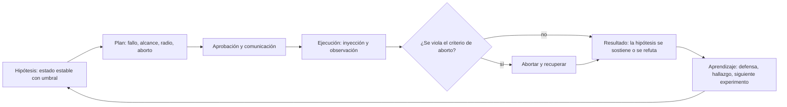

# SE-383 — Taller: someter un sistema a presión controlada

[← SE-382 — Calidad de experiencia y presupuestos](../../classes/part-31-calidad-rendimiento-y-resiliencia/se-382-calidad-de-experiencia-y-presupuestos/README.md) · [↑ Parte 31](../../classes/part-31-calidad-rendimiento-y-resiliencia/README.md) · [📚 Índice completo](../../classes/README.md) · [🌐 Portal](../../site/classes/SE-383.html) · [SE-384 — Proyecto: informe reproducible de calidad →](../../classes/part-31-calidad-rendimiento-y-resiliencia/se-384-proyecto-informe-reproducible-de-calidad/README.md)

## Punto profesional y fundamento pedagógico

**Punto profesional.** El taller existe para que ejecutes una prueba de presión controlada sobre un sistema: formules una hipótesis sobre su comportamiento estable, inyectes un fallo con un radio de impacto acotado, observes con criterios de aborto definidos de antemano y concluyas qué defensa funcionó y cuál era una creencia. La habilidad no es romper cosas sino diseñar un experimento en el que romper una cosa enseñe algo sin dañar a nadie.

**Por qué aparece aquí.** Cierra el bloque de rendimiento y resiliencia de la **Parte 31** después de **Calidad de experiencia y presupuestos**: las clases anteriores midieron el escenario de eficiencia (`SE-373` a `SE-377`), diseñaron reintentos, interruptores y mamparos (`SE-378` y `SE-379`), calcularon disponibilidad y recuperación (`SE-380`) y fijaron presupuestos (`SE-382`). Este taller las junta en un experimento: someter la API de entregas a cuatro fallos y comprobar si cada defensa hace lo que su diseño dice. Después viene el proyecto, que empaqueta la evidencia en un informe reproducible.

**Error conceptual que debe corregir.** Creer que una prueba de caos o un día de simulacro demuestran resiliencia: demuestran el comportamiento ante los fallos que se inyectaron, con la sensibilidad del criterio de «estado estable» que se eligió, y un experimento mal diseñado da falsas alarmas, no ve fallos sutiles o daña a las personas usuarias.

**Secuencia de aprendizaje.** Antes de leer los resultados, predices qué fallos de cuatro (más latencia, errores, caída total, más tráfico) siguen dañando al sistema tras endurecerlo y cuántas ejecuciones de base hacen falta para fijar un umbral que no dé falsas alarmas; después ejecutas un experimento sobre un modelo con dos configuraciones, comparas tres umbrales de la hipótesis de estado estable y mides cuánto tráfico hay que afectar para detectar un fallo débil. La secuencia usa predicción, explicación propia, contraste y recuperación. [ICAP](https://icap.education.asu.edu/research) distingue participación de construcción de conocimiento; [How People Learn II](https://nap.nationalacademies.org/catalog/24783/how-people-learn-ii-learners-contexts-and-cultures) respalda diseñar la práctica con contextos reales y retroalimentación.

**Evidencia de aprendizaje.** `taller-log.md` con la predicción, las tres figuras reproducidas, el protocolo del experimento (hipótesis de estado estable, fallo, radio de impacto, criterio de aborto), los resultados por fallo y configuración y una nota que separe lo que el experimento demostró de lo que no puede demostrar.

**Límite de la conclusión.** El sistema es un modelo de tiempo virtual: seis trabajadores, 40 solicitudes por segundo, una base de datos de 30 ms y dos configuraciones (ingenua y endurecida); no se inyectó ningún fallo en un sistema real, no se usó ninguna herramienta de caos y los resultados dependen de los supuestos del autor. La clase no autoriza a ejecutar ninguna de estas pruebas contra sistemas ajenos o de producción sin aprobación.

### Trazabilidad fuente → afirmación

| Fuente primaria u oficial | Afirmación que respalda | Lo que no prueba |
|---|---|---|
| [Basiri et al., «Chaos Engineering» (IEEE Software, 2016)](https://doi.org/10.1109/MS.2016.60) | Presenta la ingeniería del caos como experimentación sobre un sistema para ganar confianza en su capacidad de resistir condiciones turbulentas, con hipótesis de estado estable y variación de eventos reales. | No demuestra que un experimento en este modelo sea representativo de producción. |
| [Principios del caos](https://principlesofchaos.org/) | Enumera los principios: hipótesis en torno al estado estable, variar eventos del mundo real, ejecutar en producción cuando sea posible, automatizar y minimizar el radio de impacto. | No dice cómo hacerlo con seguridad en la plataforma de entregas. |
| [Google SRE: Testing for Reliability](https://sre.google/sre-book/testing-reliability/) | Describe pruebas de configuración, de estrés y de recuperación y explica cómo reducir la confianza injustificada en un sistema que no se ha probado bajo fallo. | No fija un plan para este sistema. |
| [AWS Well-Architected: pilar de fiabilidad, probar la fiabilidad](https://docs.aws.amazon.com/wellarchitected/latest/reliability-pillar/test-reliability.html) | Recomienda usar pruebas de fallo y días de simulacro (game days) para validar la resiliencia y la capacidad de respuesta de las personas. | No sustituye la autorización ni el análisis de riesgo de cada experimento. |

## Antes de empezar

Recupera lo aprendido en `SE-378` a `SE-382`: reintentos con presupuesto, interruptor, mamparos, presupuestos de fiabilidad y de experiencia. La pregunta activa es: **¿qué comportamiento estable afirma la plataforma, qué fallo lo pondría a prueba y cómo me aseguro de que el experimento enseñe sin hacer daño?**

## Prerrequisitos

- Haber completado `SE-382` o poder explicar qué es un presupuesto de experiencia y de fiabilidad.
- Python 3.11 o posterior; el experimento usa solo la biblioteca estándar (`heapq`, `random`, `math`, `statistics`).
- Haber visto `SE-378` y `SE-379` (reintentos, interruptores y mamparos) y `SE-375` (carga).

## Problema auténtico

La plataforma celebró un día de simulacro antes del cierre del cuatrimestre. El equipo apagó la base de datos de ensayo durante dos minutos «para ver qué pasaba». Pasó lo siguiente: no se había escrito qué se esperaba, de modo que nadie supo decir si el resultado era bueno; el panel mostraba cientos de errores y alguien decidió abortar a los 40 segundos, antes de saber si el interruptor se abría; y el informe concluyó «el sistema es resiliente» porque al final volvió a funcionar. Dos semanas después, una degradación de latencia (que no se había inyectado, porque el equipo había pensado solo en caídas totales) hundió el servicio. El taller enseña a diseñar el experimento para que la conclusión se pueda defender: hipótesis antes, radio acotado, criterio de aborto, fallos variados y una comparación con una configuración de referencia.

## Objetivos observables

Al terminar podrás:

1. formular una hipótesis de estado estable con un umbral que haya superado una prueba A/A y justificar cómo se fijó;
2. inyectar cuatro tipos de fallo (latencia, errores, caída total y tráfico) en un modelo y medir errores, respuestas degradadas, latencia y recuperación;
3. comparar una configuración ingenua con una endurecida y decir qué defensa evitó qué daño y qué fallo exige más capacidad;
4. calcular cuánto tráfico hay que afectar para detectar un fallo débil y el costo en solicitudes erróneas;
5. escribir un plan de experimento con alcance, aprobaciones, criterio de aborto y plan de recuperación.

## Mapa conceptual



El mapa tiene el orden que el simulacro desordenado del problema invirtió: la **hipótesis y el plan** vienen antes de la inyección, y el **criterio de aborto** se decide antes, no durante.

## Temas y por qué importan

| Tema | Por qué cambia una decisión profesional | Evidencia mínima |
|---|---|---|
| Hipótesis de estado estable | Sin ella no hay manera de decir si el resultado fue bueno. | Predicción, traza causal y contraejemplo de **Hipótesis de estado estable** en `taller-log.md` |
| Inyección de fallos | Cada tipo de fallo prueba una defensa distinta. | Predicción, traza causal y contraejemplo de **Inyección de fallos** en `taller-log.md` |
| Radio de impacto y aborto | Acotan el daño de aprender. | Predicción, traza causal y contraejemplo de **Radio de impacto y aborto** en `taller-log.md` |
| Comparar con una referencia | Sin una configuración de referencia no se sabe qué defensa funcionó. | Predicción, traza causal y contraejemplo de **Comparar con una referencia** en `taller-log.md` |
| Aprender del experimento | El resultado debe cambiar el diseño o la creencia. | Predicción, traza causal y contraejemplo de **Aprender del experimento** en `taller-log.md` |

## Conceptos y decisiones

### 1. Hipótesis de estado estable

Un experimento de presión empieza con una afirmación comprobable sobre el sistema en funcionamiento normal: «el p95 de latencia por ventana de diez segundos es menor de X y la tasa de errores menor de Y». Esa afirmación es la **hipótesis de estado estable**, y el experimento busca refutarla bajo un fallo. El umbral importa más de lo que parece: uno tomado del máximo de una sola ejecución base falla sola con frecuencia (da falsas alarmas); uno demasiado holgado no detecta fallos sutiles. Por eso se mide el ruido de base con varias ejecuciones y se verifica con una prueba A/A que el umbral no se supera cuando no pasa nada. Una hipótesis sin umbral no se puede refutar, y una con un umbral que nadie comprobó produce conclusiones que dependen del azar.

### 2. Inyección de fallos

Cada tipo de fallo ataca una defensa distinta. La **latencia añadida** (la base responde, pero más lenta) pone a prueba los timeouts, la cola y la capacidad: es el fallo más traicionero porque no produce errores sino colas. Los **errores intermitentes** ponen a prueba los reintentos, los respaldos y la idempotencia. La **caída total** pone a prueba el interruptor, el mamparo y la respuesta degradada. El **aumento de tráfico** pone a prueba el descarte de carga y la capacidad. Un plan que solo inyecte caídas totales (lo que se le ocurre a todo el mundo) ignora que los incidentes reales suelen ser degradaciones parciales. La inyección debe ser parecida a un evento real, controlada (se puede detener) y observable (se sabe cuándo empezó y cuándo terminó).

### 3. Radio de impacto y aborto

El **radio de impacto** es la fracción del sistema o del tráfico afectada por el experimento. Empezar con el más pequeño que permita detectar el efecto reduce el daño de aprender. Hay una relación directa entre el radio y la capacidad de detección: un fallo fuerte se ve con una fracción mínima del tráfico y uno sutil necesita más solicitudes. El **criterio de aborto** es la condición, escrita antes, que detiene el experimento (por ejemplo, «si la tasa de errores de las solicitudes no afectadas supera el 2 % durante 10 s») y el **plan de recuperación** dice cómo se vuelve al estado anterior. Sin esas dos cosas, un experimento de caos es un incidente provocado.

### 4. Comparar con una referencia

Un experimento que solo mira el sistema endurecido no dice qué defensa lo endureció. Se ejecuta el mismo fallo sobre una **configuración de referencia** (sin interruptor, sin tope de cola, sin respaldo) y sobre la variante con las defensas, y se comparan las mismas métricas. Así se puede atribuir: el interruptor evitó que la caída total produjera errores; el respaldo convirtió los errores de la base en respuestas degradadas; la cola acotada limitó el daño del tráfico. Y se descubre lo que ninguna defensa arregla: con una latencia añadida, el sistema endurecido sigue con errores porque la capacidad es insuficiente, y ningún mecanismo de resiliencia sustituye a la capacidad.

### 5. Aprender del experimento

Un experimento termina con una de dos conclusiones: la hipótesis se sostiene (el sistema se comportó según lo esperado) o se refuta (algo pasó). Las dos son informativas, y la segunda exige acción: un hallazgo con dueño, una corrección y un experimento de seguimiento que verifique la corrección. También hay que registrar lo que el experimento no demostró: un fallo que no se inyectó, un tráfico que no se simuló, una combinación de fallos. Un informe que dice «el sistema es resiliente» sin decir ante qué fallos, con qué radio y con qué criterio es una opinión.

### El umbral de la hipótesis de estado estable

Se modela la API como seis trabajadores atendidos por una cola, 90 solicitudes por segundo y una base de datos de 30 ms de mediana (sin interruptor ni defensas en esta parte). Se mide el p95 por ventana de 10 s en 30 ejecuciones base de 5 minutos. Se comparan tres umbrales y se evalúan contra 100 ejecuciones nuevas sin fallo, y contra 100 ejecuciones en las que la base añade 10 ms durante 30 s.

```python
base = [ventanas_p95(sim("ingenua", None, seed=38300 + s, dur=300.0, rate=90.0)) for s in range(30)]
umbral = pct(todas, 99.9) * 1.2                       # el tercero: p99,9 de 30 ejecuciones base por 1,2
```

| Umbral | Ventanas falsas | Ejecuciones sanas con alarma | Detecta +10 ms |
|---|---:|---:|---:|
| Máximo de una ejecución base de 5 min = 73 ms | 2,00 % | 46 de 100 | 100 de 100 |
| Ese máximo × 1,5 = 110 ms | 0,00 % | 0 de 100 | 41 de 100 |
| p99,9 de 30 ejecuciones base × 1,2 = 94 ms | 0,00 % | 0 de 100 | 92 de 100 |

El umbral tomado del máximo de una sola ejecución da falsas alarmas en 46 de 100 ejecuciones sanas, aunque detecta todo; multiplicarlo por 1,5 elimina las falsas alarmas y solo detecta 41 de 100 el aumento de 10 ms; el calculado con 30 ejecuciones y un margen del 20 % no da falsas alarmas y detecta 92 de 100. Un experimento de caos basado en el primero habría abortado ejecuciones sanas casi la mitad de las veces; basado en el segundo, habría aprobado un fallo real seis de cada diez.


**Cómo leer la figura.** Cada fila es una manera de fijar el umbral; las columnas miden los dos errores: alarmar sin fallo y no ver un fallo sutil. **Dónde deja de valer:** el aumento de 10 ms sobre 50 ms de servicio al 75 % de utilización es un fallo elegido por el autor por ser sutil; el ruido del modelo es el de una cola con llegadas de Poisson, más estable que el de un sistema real con otros procesos, de modo que los umbrales reales deberán ser más holgados.

### La matriz de fallos

Se ejecutan cuatro fallos, de 30 s cada uno, sobre la misma API en dos configuraciones: la **ingenua** (cola sin límite, sin timeout de la base de datos, sin interruptor, sin respaldo) y la **endurecida** (timeout de 0,5 s en la base, interruptor tras cinco fallos con 5 s abierto, cola acotada a 30, respuesta de respaldo desde caché y descarte de solicitudes que esperaron más de 2 s). Se toma la mediana de 10 semillas.

```python
if fault == "caida" and en:
    h += 0.5 if dura and not abierto else (0.002 if dura else 30.0)        # timeout corto, respaldo inmediato o espera de 30 s
```

| Fallo inyectado (de 60 a 90 s) | Configuración ingenua | Configuración endurecida |
|---|---|---|
| Sin fallo | 0,0 % · p99 70 ms | 0,0 % · p99 70 ms |
| +200 ms en la base de datos | 90,6 % errores · p99 1 968 ms · recupera en 5 s | 35,9 % errores · p99 1 481 ms |
| 20 % de errores de la base | 19,7 % errores | 0,0 % errores · 19,7 % degradadas |
| Caída total de la base | 100 % errores · recupera en 10 s | 0,0 % errores · 100 % degradadas · p99 510 ms |
| Tráfico × 5 | 82,9 % errores · recupera en 15 s | 27,5 % errores · p99 276 ms |

La endurecida resuelve dos fallos del todo (errores intermitentes y caída total, que pasan a ser respuestas degradadas) y mejora mucho otros dos sin resolverlos: con +200 ms de latencia sigue con el 35,9 % de errores, porque 6 trabajadores con 240 ms de servicio no alcanzan para 40 solicitudes por segundo; y con el tráfico multiplicado por 5, el 27,5 % de errores es el exceso que ninguna defensa puede atender. Ese es el hallazgo central: la resiliencia cambia el tipo de fallo (de error a respuesta degradada o a rechazo) y la capacidad sigue siendo una restricción.


**Cómo leer la figura.** Cada fila es un fallo; las dos columnas comparan la configuración de referencia con la endurecida. **Dónde deja de valer:** las dos configuraciones son modelos sencillos construidos para ilustrar el efecto de las defensas, el respaldo supone que servir desde caché es aceptable (una decisión de producto), el modelo no tiene reintentos de los clientes y los fallos se inyectan uno a uno: la combinación de dos (una degradación más un pico) no se probó y es la más peligrosa.

### Detección frente a radio de impacto

Se inyecta un error de 2 %, 5 % o 20 % a una fracción del tráfico (1 %, 5 %, 10 % o 100 %) durante 60 s a 40 solicitudes por segundo, con un error base de 0,3 %. Se detecta el fallo si el número de errores supera el que una cola binomial exacta permite con un nivel del 1 % de falsos positivos. Cada celda se estima con 2 000 repeticiones.

```python
def detecta(n, p0=0.003, alfa=0.01):
    k = 0
    while cola_binom(n, k, p0) > alfa: k += 1          # el menor numero de errores improbable con el error base
    return k
```

| Error inyectado | 1 % del tráfico | 5 % | 10 % | 100 % |
|---|---|---|---|---|
| 2 % | 9 % · 0 | 43 % · 2 | 70 % · 5 | 100 % · 48 |
| 5 % | 33 % · 1 | 94 % · 6 | 100 % · 12 | 100 % · 120 |
| 20 % | 97 % · 5 | 100 % · 24 | 100 % · 48 | 100 % · 480 |

Cada celda da la probabilidad de detección y las solicitudes erróneas esperadas. Un error del 20 % se detecta el 97 % de las veces con el 1 % del tráfico y cinco solicitudes erróneas; uno del 5 % exige el 5 % del tráfico (94 % de detección con seis erróneas) y uno del 2 % solo se detecta con certeza con todo el tráfico y 48 solicitudes erróneas: con el 1 % del tráfico, se escapa en el 91 % de las ejecuciones. Es una relación entre detección y daño: ver un fallo sutil cuesta exponer a más personas, o ejecutar más tiempo.


**Cómo leer la figura.** Cada fila es la intensidad del fallo y cada columna la fracción de tráfico afectada; cada celda tiene la detección y el daño. **Dónde deja de valer:** los errores son independientes entre solicitudes y el error base es del 0,3 %, supuestos del autor; con errores que dependen de la persona (por ejemplo, de un curso concreto) la detección y el daño se reparten de forma desigual, y 60 s a 40 por segundo es poco tiempo para un fallo que solo ocurre en un tipo de solicitud.

## Definiciones de trabajo

- **hipótesis de estado estable:** afirmación comprobable, con umbral, sobre el comportamiento normal del sistema que el experimento busca refutar.
- **radio de impacto:** fracción del sistema o del tráfico que un experimento afecta.
- **criterio de aborto:** condición, escrita antes, que detiene el experimento.
- **inyección de fallos:** introducción deliberada de un fallo (latencia, error, caída, carga) para observar la respuesta del sistema.
- **día de simulacro (game day):** ejercicio planificado en que un equipo responde a un fallo inyectado.

Las definiciones son operativas para la API de entregas. No convierten términos con una historia más amplia en sinónimos y deben contrastarse con la documentación primaria enlazada al final.

## Ejemplo mínimo

El fragmento calcula el umbral de una hipótesis de estado estable desde varias ejecuciones base. Antes de ejecutarlo, predice si el máximo de una ejecución coincide con el percentil 99,9 de treinta.

```python
import statistics
base = [[62, 64, 66, 61], [63, 70, 65, 60], [61, 62, 78, 64]]      # p95 por ventana, tres ejecuciones
todas = sorted(v for b in base for v in b)
print(max(base[0]), todas[int(len(todas) * 0.999) - 1], max(todas))
```

El máximo de la primera ejecución (66) queda por debajo del máximo del conjunto (78): con más ejecuciones aparecen ventanas peores que la peor de una sola. Registra versión de Python, comando y salida; después usa el máximo del conjunto con un margen como umbral y compruébalo con una prueba A/A.

## Ejemplo profesional

El equipo planifica un día de simulacro sobre el entorno de ensayo con una copia anonimizada. El plan dice: hipótesis (p95 por ventana de 10 s menor de 94 ms y errores menores del 0,5 %, con el umbral calculado con 30 ejecuciones base y verificado con una prueba A/A), cuatro fallos (latencia, errores, caída de la base y pico de tráfico) ejecutados de uno en uno con 30 s cada uno, radio inicial del 5 % del tráfico del entorno de ensayo, criterio de aborto (errores en solicitudes no afectadas mayor del 2 % durante 10 s o cualquier pérdida de datos), plan de recuperación (quitar la inyección y reiniciar los clientes) y responsables (una persona dirige, otra observa y otra puede abortar). La comunicación avisa a los equipos que comparten recursos. Tras el experimento, los hallazgos (la latencia añadida sigue produciendo errores por falta de capacidad) entran en el tablero con dueño y fecha, y el siguiente día de simulacro probará la combinación de una degradación y un pico. Compara con el simulacro desordenado del problema: ahora el experimento se puede defender y repetir.

## Práctica guiada

1. Escribe la hipótesis de estado estable de la API con su métrica, su ventana y su umbral, sin fijar todavía el valor.
2. Mide 30 ejecuciones base y calcula tres umbrales; evalúalos con 100 ejecuciones nuevas sanas y 100 con un fallo sutil.
3. Predice qué fallos sigue sufriendo la configuración endurecida y escríbelo antes de medir.
4. Ejecuta los cuatro fallos sobre las dos configuraciones con 10 semillas cada una y construye la matriz.
5. Calcula la detección y el daño de un error del 2 %, 5 % y 20 % con radios del 1 %, 5 %, 10 % y 100 %.
6. Escribe el plan del experimento: alcance, radio, criterio de aborto, recuperación, responsables y aprobaciones.
7. Entrega `taller-log.md` y pide a otra persona que encuentre un fallo que tu plan no inyecta y que ella consideraría probable.

## Ejercicios

1. **Umbral:** con tus 30 ejecuciones base, calcula el umbral que da menos del 1 % de falsas alarmas en una prueba A/A y estima qué aumento mínimo detectas.
2. **Aborto:** escribe tres criterios de aborto distintos para el fallo de caída de la base y di cuál protegería más a las personas usuarias.
3. **Combinación:** diseña un experimento que combine una degradación de la base con un pico de tráfico y predice qué defensa falla primero.
4. **Radio:** calcula cuántas solicitudes erróneas esperadas cuesta detectar con el 90 % de probabilidad un error del 3 % con 40 solicitudes por segundo.

## Reto verificable

Entrega `taller-log.md` con la predicción, las tres tablas de resultados, el plan de experimento con hipótesis, fallos, radio, criterio de aborto y recuperación, y los hallazgos con dueño. Se aprueba si otra persona ejecuta el código desde un checkout limpio, obtiene los mismos números con las mismas semillas y puede decir qué fallo sigue dañando al sistema tras las defensas y por qué. No se aprueba por ejecutar un fallo sin hipótesis, sin criterio de aborto o sin una configuración de referencia, ni por concluir que el sistema es «resiliente».

## Caso conductor

La API de entregas es el caso conductor de la Parte 31. Este taller deja el undécimo artefacto: un plan de experimento y sus hallazgos. `SE-384` lo integrará con la evidencia de la parte en un informe reproducible y verificable. Cambia después un solo dato, el umbral de la hipótesis, y observa cuántas ejecuciones sanas abortan.

## Preguntas frecuentes

### ¿Hay que hacer caos en producción?

Los principios lo recomiendan cuando es posible porque es el único entorno realmente representativo, y exigen mucha madurez: hipótesis, radio mínimo, criterio de aborto automático y comunicación. Para un equipo que empieza, el entorno de ensayo con datos anonimizados y el mismo despliegue es el punto de partida razonable.

### ¿Cuántas ejecuciones base hacen falta?

Las suficientes para conocer la forma del ruido: con treinta, el umbral del experimento dio cero falsas alarmas y detectó el 92 % de un fallo sutil; con una, dio falsas alarmas en 46 de 100. La cifra concreta depende del ruido del sistema y se verifica con una prueba A/A.

### ¿Qué hago si el experimento revela un fallo grave?

Abortar según el criterio, recuperar, registrar el hallazgo con dueño y no repetir hasta corregirlo. Que el experimento encuentre algo es su éxito, no su fracaso, siempre que el daño estuviera acotado de antemano.

### ¿Se puede automatizar el caos?

Sí, y es el siguiente paso cuando los experimentos manuales son estables: una batería de fallos que se ejecuta de forma continua con criterios de aborto automáticos. Automatizar un experimento que no se entiende solo produce incidentes más frecuentes.

## Fallo controlado y diagnóstico

Reproduce el fallo clásico del taller: **un umbral de estado estable tomado de una sola ejecución base que aborta ejecuciones sanas**. Fija el umbral en el máximo de la primera ejecución y ejecútalo contra 100 ejecuciones sin fallo.

Registra síntoma, entrada mínima, hipótesis, observación que descarta cada hipótesis, causa, corrección y prueba de regresión. **Síntoma:** el experimento aborta en 46 de 100 ejecuciones en las que no se inyectó nada. **Hipótesis rivales:** (a) el sistema se degradó solo; (b) la inyección se ejecutó sin avisar; (c) el umbral es demasiado estrecho para el ruido de base. **Prueba:** mide el p95 por ventana en 30 ejecuciones base y compara el máximo de una con la distribución del conjunto; si el 46 % de las ejecuciones nuevas superan el máximo de la primera, el umbral es la causa. **Conclusión:** una sola ejecución subestima el ruido. **Regresión:** fija el umbral con 30 ejecuciones y un margen, añade una prueba A/A que falle si hay más del 1 % de falsas alarmas y otra que inyecte +10 ms y exija detección mayor del 90 %. No cambies a la vez el umbral y el fallo.

## Errores comunes y cómo corregirlos

| Síntoma | Causa probable | Corrección |
|---|---|---|
| El experimento aborta sin fallo | Umbral demasiado estrecho | Fijarlo con varias ejecuciones base y una prueba A/A |
| No se ve un fallo sutil | Umbral holgado o radio demasiado pequeño | Calcular la detección y ajustar |
| El informe dice «es resiliente» | No se declararon los fallos inyectados | Listar fallos, radio y lo que no se probó |
| El sistema endurecido sigue con errores | El fallo es de capacidad, no de resiliencia | Añadir capacidad o limitar la carga |
| Hubo daño a las personas usuarias | Sin criterio de aborto ni radio acotado | Escribirlos antes y ensayar en entorno de ensayo |

## Entorno y archivos clave

```text
work/SE-383/
├── README.md
├── presion/
│   ├── modelo.py
│   ├── umbrales.py
│   └── deteccion.py
├── tests/test_presion.py
└── evidence/taller-log.md
```

El `README` declara plataforma, versión de Python, semillas, comandos y la lista de aprobaciones. El experimento usa solo la biblioteca estándar (`heapq`, `random`, `math`, `statistics`) y se ejecutó con CPython 3.12.9 en Windows 11 y 3.12.3 en Ubuntu bajo WSL2: las salidas fueron idénticas porque el tiempo es virtual; tarda alrededor de un minuto y medio, ejecútalo en segundo plano. Si añades una dependencia, fija procedencia y versión.

## Seguridad, ética y accesibilidad

- inyectar fallos en un sistema que no es tuyo o sin aprobación es sabotaje: obtén autorización por escrito, comunica a los equipos afectados y no toques datos reales de estudiantes;
- un experimento puede dañar a las personas usuarias aunque el sistema se recupere: limita el radio, define el aborto y prefiere entornos de ensayo con datos sintéticos;
- el día de simulacro es también un ejercicio humano: cuida el cansancio, los turnos y la cultura sin culpas para que aprender no tenga costo personal;
- documenta el plan y los resultados con texto alternativo y en un formato que un lector de pantalla pueda recorrer, incluidas las instrucciones de aborto;
- respeta las licencias de las herramientas de inyección de fallos y atribuye lo adaptado.

## Puente hacia el trabajo con agentes

Un agente al que se le pide «prueba la resiliencia del sistema» apagará un servicio, observará que se recupera y declarará el resultado. Pídele en cambio que escriba antes la hipótesis con su umbral, que fije el radio y el criterio de aborto, que ejecute los cuatro tipos de fallo sobre una referencia y la variante endurecida, que verifique su umbral con una prueba A/A y que liste lo que no inyectó. Revisa especialmente si el agente tiene permiso para ejecutar el fallo en el entorno elegido y si concluye resiliencia general desde un único fallo: son los dos defectos que este taller mostró sin aviso.

## Transferencia

Traslada el taller a otro sistema (por ejemplo, una cola de correos): cambia el modelo, los fallos y la hipótesis y conserva el procedimiento de fijar el estado estable con ejecuciones base, inyectar varios tipos de fallo, comparar con una referencia y limitar el radio. La transferencia está lograda cuando puedes decir qué fallo sigue dañando al sistema y por qué, no cuando el sistema se recupera.

## Evaluación y evidencia

| Criterio | Evidencia para aprobar |
|---|---|
| comprensión | explicación de la hipótesis de estado estable, el radio y el aborto |
| corrección | tablas de umbrales, de la matriz de fallos y de la detección reproducibles con las mismas semillas |
| diseño | plan de experimento con alcance, aprobaciones, aborto y recuperación |
| diagnóstico | reproducción del fallo «umbral de una sola ejecución» con regresión |
| incertidumbre | declaración de que el sistema es un modelo y de qué fallos no se inyectaron |
| reproducibilidad | versiones, comandos, salida y límites declarados |

## Fuentes

- [Basiri et al., «Chaos Engineering»](https://doi.org/10.1109/MS.2016.60) — experimentación sobre sistemas para ganar confianza; autoridad: IEEE Software, 2016.
- [Principios del caos](https://principlesofchaos.org/) — hipótesis, variación de eventos y radio mínimo; autoridad: comunidad de ingeniería del caos.
- [Google SRE: Testing for Reliability](https://sre.google/sre-book/testing-reliability/) — pruebas de estrés y de recuperación; autoridad: Google, libro de ingeniería de confiabilidad.
- [AWS Well-Architected: probar la fiabilidad](https://docs.aws.amazon.com/wellarchitected/latest/reliability-pillar/test-reliability.html) — pruebas de fallo y días de simulacro; autoridad: Amazon Web Services.
- [Python: heapq](https://docs.python.org/3/library/heapq.html) — cola de eventos del modelo; autoridad: documentación de Python.

Cada fuente respalda el mecanismo indicado; ninguna demuestra que el 90,6 %, el 35,9 % o el 92 % de detección se observen en un sistema real. Esa afirmación depende del sistema, de las defensas y de la hipótesis.

## Límites y siguiente paso

Se ejecutó el experimento con tiempo virtual y semillas fijas en Windows y Ubuntu (WSL2) con resultados idénticos. No se inyectó ningún fallo en un sistema real ni se usó una herramienta de caos; el modelo de seis trabajadores, las dos configuraciones, el aumento de 10 ms, los cuatro fallos independientes, el error base de 0,3 % y las 10 semillas por celda son supuestos del autor, no se probó ninguna combinación de fallos y el respaldo desde caché se asume aceptable. La siguiente clase, el proyecto, empaqueta la evidencia de la parte en un informe reproducible de calidad.

## Glosario

- **hipótesis de estado estable:** afirmación comprobable, con umbral, sobre el comportamiento normal del sistema que el experimento busca refutar.
- **radio de impacto:** fracción del sistema o del tráfico que un experimento afecta.
- **criterio de aborto:** condición, escrita antes, que detiene el experimento.
- **inyección de fallos:** introducción deliberada de un fallo (latencia, error, caída, carga) para observar la respuesta del sistema.
- **día de simulacro (game day):** ejercicio planificado en que un equipo responde a un fallo inyectado.

---

[← SE-382 — Calidad de experiencia y presupuestos](../../classes/part-31-calidad-rendimiento-y-resiliencia/se-382-calidad-de-experiencia-y-presupuestos/README.md) · [↑ Parte 31](../../classes/part-31-calidad-rendimiento-y-resiliencia/README.md) · [📚 Índice completo](../../classes/README.md) · [🌐 Portal](../../site/classes/SE-383.html) · [SE-384 — Proyecto: informe reproducible de calidad →](../../classes/part-31-calidad-rendimiento-y-resiliencia/se-384-proyecto-informe-reproducible-de-calidad/README.md)
