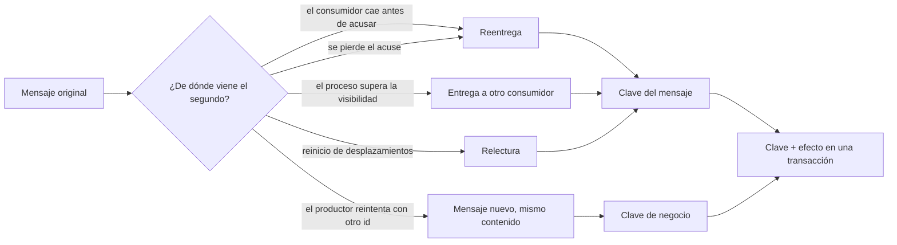

# SE-383 — Taller: provocar y contener mensajes duplicados

[← SE-382 — Observabilidad y seguridad de integraciones](../../classes/part-31-integracion-eventos-y-mensajeria/se-382-observabilidad-y-seguridad-de-integraciones/README.md) · [↑ Parte 31](../../classes/part-31-integracion-eventos-y-mensajeria/README.md) · [📚 Índice completo](../../classes/README.md) · [🌐 Portal](../../site/classes/SE-383.html) · [SE-384 — Proyecto: flujo integrado tolerante a reintentos →](../../classes/part-31-integracion-eventos-y-mensajeria/se-384-proyecto-flujo-integrado-tolerante-a-reintentos/README.md)

## Punto profesional y fundamento pedagógico

**Punto profesional.** El taller existe para que aprendas a contener duplicados provocándolos primero: producirás a propósito cinco causas distintas de un efecto repetido en un consumidor sin defensa, medirás qué defensa contiene cada una, y descubrirás dos formas en que una defensa mal colocada falla al revés (perdiendo el efecto en lugar de duplicarlo, o descartando intentos legítimos). Termina con un procedimiento reutilizable para diagnosticar un duplicado real a partir de su causa y no de su síntoma.

**Por qué aparece aquí.** Es el taller de la **Parte 31**: reúne la entrega al menos una vez (`SE-376`), el outbox y la inbox (`SE-377`), el receptor externo (`SE-379`) y la observabilidad (`SE-382`) en una práctica donde el objetivo es romper y arreglar. En la plataforma de entregas, un duplicado significa una calificación repetida o un correo doble, y el equipo necesita un método para encontrar su origen sin adivinar.

**Error conceptual que debe corregir.** Creer que «los duplicados» son un solo problema con una sola solución (una tabla de mensajes vistos). Hay causas que nacen antes del corredor, en el corredor y después, y una defensa que atrapa unas deja pasar otras; además, colocar la defensa en el orden o en el alcance equivocado produce pérdidas y rechazos injustos que se parecen a un duplicado resuelto.

**Secuencia de aprendizaje.** Antes de medir, predices cuántos duplicados produce cada causa de las cinco, qué defensas contienen cuáles y qué pasa si se guarda la clave de idempotencia y se cae el proceso antes de aplicar el efecto; después mides, ajustas y repites. La secuencia usa predicción, explicación propia, contraste y recuperación. [ICAP](https://icap.education.asu.edu/research) distingue participación de construcción de conocimiento; [How People Learn II](https://nap.nationalacademies.org/catalog/24783/how-people-learn-ii-learners-contexts-and-cultures) exige conectar conocimiento previo, contexto y transferencia; la [práctica de recuperación](https://pubmed.ncbi.nlm.nih.gov/16507066/) respalda producir de nuevo la explicación tras una demora; y [Education for Life and Work](https://nap.nationalacademies.org/resource/13398/dbasse_084153.pdf) exige devolución que explique la causa del error.

**Evidencia de aprendizaje.** `taller-duplicados-log.md` con las predicciones, las tres figuras reproducidas, una bitácora de provocación (una entrada por causa con su parámetro y su recuento), la matriz de defensas con lo que queda, el análisis de las dos defensas rotas y un procedimiento de diagnóstico de un duplicado de seis pasos.

**Límite de la conclusión.** Los duplicados se provocan en un modelo del autor: caídas del 5 %, acuses perdidos del 5 %, reintentos del productor del 5 %, un tiempo de proceso lognormal de mediana 16 s con un plazo de visibilidad de 30 s y un reinicio de desplazamientos de 200 mensajes. Los efectos se escriben en SQLite real, pero no hay corredor, red ni concurrencia entre consumidores. Dos de las defensas se miden contando filas, no valores. Los resultados muestran dónde cada defensa funciona o falla, no la tasa de duplicados de ningún sistema.

### Trazabilidad fuente → afirmación

| Fuente primaria u oficial | Afirmación que respalda | Lo que no prueba |
|---|---|---|
| [Amazon SQS: tiempo de visibilidad](https://docs.aws.amazon.com/AWSSimpleQueueService/latest/SQSDeveloperGuide/sqs-visibility-timeout.html) | Explica que un mensaje recibido deja de ser visible durante un plazo y vuelve a serlo si no se borra, de modo que otro consumidor puede recibirlo si el proceso tarda más. | No mide cuántos mensajes superan el plazo en una carga real. |
| [EIP: Idempotent Receiver](https://www.enterpriseintegrationpatterns.com/patterns/messaging/IdempotentReceiver.html) | Describe un receptor que tolera recibir un mismo mensaje varias veces sin repetir su efecto. | No indica dónde guardar la clave ni el orden respecto del efecto. |
| [Stripe: peticiones idempotentes](https://docs.stripe.com/api/idempotent_requests) | Muestra una clave de idempotencia que el cliente reutiliza en los reintentos de una misma operación. | No cubre cuando el cliente genera una clave nueva en cada intento. |
| [SQLite: UPSERT](https://www.sqlite.org/lang_upsert.html) | Documenta `INSERT ... ON CONFLICT DO UPDATE` con una condición, la base de la actualización condicionada por versión. | No garantiza que la condición exprese la regla de negocio correcta. |
| [SQLite: cláusula ON CONFLICT](https://www.sqlite.org/lang_conflict.html) | Documenta `INSERT OR IGNORE` y `INSERT OR REPLACE` como resolución de conflictos con restricciones únicas. | No describe qué clave única corresponde al negocio. |

## Antes de empezar

Recupera lo aprendido en `SE-376` (a lo sumo, al menos y exactamente una vez; ventana de deduplicación), en `SE-377` (la inbox registra la clave junto con el efecto) y en `SE-382` (correlación para investigar). Un taller no enseña conceptos nuevos: pone a prueba los anteriores con fallos provocados. La pregunta activa es: **de estas cinco formas de que llegue dos veces un mensaje, ¿cuál atrapa mi defensa y cuál no?**

## Prerrequisitos

- Haber completado `SE-382` o poder explicar la correlación y las señales de un consumidor.
- Python 3.11 o posterior con el módulo `sqlite3`; el resto usa solo la biblioteca estándar y generadores con semilla fija.
- Leer `INSERT OR IGNORE`, índices únicos y transacciones de SQLite.

## Problema auténtico

El registro de calificaciones de la plataforma muestra, en la revisión del lunes, 87 estudiantes con dos calificaciones idénticas para la misma entrega. El equipo reúne cinco hipótesis: el calificador se cayó antes de acusar, se perdió un acuse, el servicio de entregas reintentó tras un tiempo agotado, un mensaje tardó más del plazo de visibilidad y alguien reinició los desplazamientos de un grupo para reprocesar. Cada una tiene un arreglo distinto y ninguno se probó. Se añade una tabla de mensajes vistos con el identificador del mensaje y los duplicados bajan, pero no desaparecen. Al intentar un arreglo mejor («guardar la clave y luego aplicar el efecto»), una caída hace que 14 notas no se apliquen nunca. En el taller se reproduce todo esto de forma controlada para saber qué defensa va dónde.

## Objetivos observables

Al terminar podrás:

1. provocar cinco causas de duplicados en un consumidor sin defensa y medir el recuento de cada una;
2. aplicar cinco defensas y llenar la matriz de defensas por causas con lo que queda de cada una;
3. explicar por qué la clave del mensaje no atrapa el reintento del productor y la clave de negocio sí;
4. demostrar con un experimento que guardar la clave y el efecto en transacciones separadas pierde o duplica según el orden, y que una sola transacción no;
5. escribir un procedimiento de seis pasos para diagnosticar un duplicado a partir de su causa.

## Mapa conceptual



El mapa separa **de dónde viene el segundo mensaje** de **qué defensa lo reconoce**. La rama del productor es la única donde el identificador del mensaje cambia, y por eso exige la clave de negocio.

## Temas y por qué importan

| Tema | Por qué cambia una decisión profesional | Evidencia mínima |
|---|---|---|
| Causas de un duplicado | Cada causa se detecta y se contiene en un lugar distinto. | Predicción, traza causal y contraejemplo de **Causas de un duplicado** en `taller-duplicados-log.md` |
| Clave del mensaje frente a clave de negocio | Una reconoce reentregas; la otra, también las repeticiones con otro identificador. | Predicción, traza causal y contraejemplo de **Clave del mensaje frente a clave de negocio** en `taller-duplicados-log.md` |
| Efecto idempotente | Cambiar la forma del efecto elimina la necesidad de recordar. | Predicción, traza causal y contraejemplo de **Efecto idempotente** en `taller-duplicados-log.md` |
| Orden de clave y efecto | Una defensa mal ordenada pierde o duplica. | Predicción, traza causal y contraejemplo de **Orden de clave y efecto** en `taller-duplicados-log.md` |
| Alcance de la clave | Una clave demasiado gruesa descarta operaciones legítimas. | Predicción, traza causal y contraejemplo de **Alcance de la clave** en `taller-duplicados-log.md` |

## Conceptos y decisiones

### 1. Causas de un duplicado

Un efecto repetido tiene al menos cinco orígenes. **El consumidor cae antes de acusar**: procesó, no confirmó y el corredor reentrega. **El acuse se pierde** en el camino: el corredor cree que no se procesó. **El productor reintenta** tras un tiempo agotado: el primer envío sí llegó y el reintento crea un segundo mensaje con otro identificador. **El plazo de visibilidad vence** antes de terminar el proceso: el corredor entrega el mensaje a otro consumidor mientras el primero sigue trabajando. **Se reinician los desplazamientos** o se reprocesa a propósito: los mensajes se releen. La misma entrada produce el mismo síntoma por caminos que se diagnostican y se contienen de forma diferente.

### 2. Clave del mensaje frente a clave de negocio

La **clave del mensaje** es el identificador que el corredor o el productor asigna al enviarlo; una tabla de mensajes vistos con esa clave reconoce cualquier **reentrega** del mismo mensaje. No reconoce un mensaje **distinto** que repite la misma operación, como el reintento del productor. La **clave de negocio** identifica la operación misma (la entrega y el intento, la calificación de una entrega): una restricción única sobre ella reconoce la repetición sea cual sea el mensaje que la trajo. La clave de negocio es más fuerte, pero exige saber qué identifica una operación, y esa es una decisión del dominio, no de la infraestructura.

### 3. Efecto idempotente

La tercera defensa es cambiar la forma del efecto para que repetirlo no cambie el resultado. **Actualización condicionada por versión**: «poner la nota de la entrega 7 en 6,0 si la versión es mayor que la guardada». **Operación naturalmente idempotente**: «poner» en lugar de «sumar». Estas formas no necesitan recordar mensajes ni claves, porque el estado final es el mismo con una o con diez aplicaciones. Su límite es que solo funcionan cuando el efecto se puede expresar como estado: enviar un correo o cobrar una tarjeta no es un valor que se «ponga», y ahí hace falta una clave que el proveedor reconozca.

### 4. Orden de clave y efecto

Guardar la clave de idempotencia y aplicar el efecto son dos escrituras; si se hacen en transacciones separadas, una caída entre ellas deja un estado intermedio. **Clave primero, efecto después**: una caída entre ambos deja la clave guardada sin efecto, y la reentrega se descarta como duplicado: el efecto **se pierde**. **Efecto primero, clave después**: una caída entre ambos aplica el efecto sin registrar la clave, y la reentrega lo aplica de nuevo: **se duplica**. Solo guardar la clave y el efecto en una **sola transacción** hace que ocurran los dos o ninguno, que es lo que la defensa pretendía.

### 5. Alcance de la clave

La clave debe identificar la operación, no a la persona ni al recurso en general. Una clave por **estudiante** descarta un segundo intento legítimo del mismo estudiante como si fuera un duplicado; una por **estudiante e intento** distingue los intentos legítimos y aun así reconoce el reenvío de uno. Una clave demasiado fina (por ejemplo, con la marca de tiempo) no reconoce nada; una demasiado gruesa elimina operaciones válidas. El síntoma de una clave gruesa es el inverso del duplicado: quejas de que «mi segunda entrega no cuenta», que se parecen a una pérdida.

### Provocar las cinco causas

Se procesan 2 000 mensajes con un consumidor que inserta un efecto por mensaje sin ninguna defensa. Se provocan las cinco causas, cada una con semilla fija y su propio parámetro, y se cuentan los efectos duplicados (cada efecto de más cuenta uno).

```python
r = random.Random(3351)
caida = sum(1 for _ in range(N) if r.random() < 0.05)                  # antes de acusar
visibilidad = sum(1 for _ in range(N) if r.lognormvariate(2.8, 0.7) > 30)   # proceso > 30 s
reinicio = 200                                                         # mensajes releídos
```

| Causa provocada | Parámetro | Efectos duplicados (de 2 000) |
|---|---|---:|
| Caída del consumidor antes de acusar | 5 % de los mensajes | 106 |
| Acuse perdido en la red | 5 % de los acuses | 122 |
| Reintento del productor tras un tiempo agotado | 5 % de los envíos, con otro identificador | 103 |
| Visibilidad de 30 s menor que el proceso | proceso lognormal, mediana 16 s | 378 |
| Reinicio de desplazamientos | 200 mensajes releídos | 200 |

La causa que más duplica no es un fallo sino un valor de configuración: un plazo de 30 segundos con un proceso de mediana 16 s deja que el 19 % de los mensajes (378 de 2 000) superen el plazo y se entreguen a un segundo consumidor mientras el primero sigue. Las otras cuatro son fallos del 5 % o un reinicio deliberado. Esto se conoce como la regla del taller: **un duplicado también puede ser una consecuencia de una configuración**, no solo de un fallo.


**Cómo leer la figura.** Cada barra es una causa provocada por separado, con su parámetro en la etiqueta, y su longitud es el número de efectos de más. Mira que la causa de visibilidad es unas tres veces mayor que las otras y que las cinco producen el mismo síntoma por caminos distintos. **Dónde deja de valer:** los parámetros son del autor, la distribución del tiempo de proceso es lognormal por conveniencia y las causas se provocan por separado, no combinadas; en un sistema real coexisten y una reentrega puede ser a su vez causa de otra. Tampoco hay concurrencia entre consumidores.

### Qué defensa contiene qué causa

Se repiten las cinco provocaciones con cinco defensas: ninguna, tabla de mensajes vistos por el identificador del mensaje, índice único por clave de negocio (`entrega`, `intento`), actualización condicionada por versión sobre una fila por entrega y una operación naturalmente idempotente (`INSERT OR REPLACE` de una fila por entrega). Se cuentan las filas de más. En la causa del productor, el mensaje repetido lleva un identificador distinto.

```python
cur = con.execute("insert or ignore into vistos values(?)", (msg_id,))    # clave del mensaje
if cur.rowcount: con.execute("insert into efecto values(?,?,?)", (msg_id, entrega, intento))
con.execute("create unique index un on efecto(entrega, intento)")         # clave de negocio
con.execute("insert into estado values(?,?) on conflict(entrega) do update "
            "set v=excluded.v where excluded.v > estado.v", (entrega, version))
```

| Defensa | Caída | Acuse | Productor | Visibilidad | Desplazamientos |
|---|---:|---:|---:|---:|---:|
| Ninguna | 106 | 122 | 103 | 378 | 200 |
| Clave del mensaje | 0 | 0 | 103 | 0 | 0 |
| Clave de negocio única | 0 | 0 | 0 | 0 | 0 |
| Actualización condicionada por versión | 0 | 0 | 0 | 0 | 0 |
| Operación naturalmente idempotente | 0 | 0 | 0 | 0 | 0 |

La clave del mensaje elimina cuatro de las cinco causas y deja intactos los 103 del reintento del productor, porque el segundo mensaje llega con otro identificador. Las otras tres defensas dejan cero en todas. Pero hay una advertencia sobre las dos últimas: se midieron **contando filas**, y con una fila por entrega un duplicado no puede añadir filas; si el efecto fuera «sumar a la nota» en lugar de «poner», la fila seguiría siendo una y el valor sería el doble. La tabla dice que no hay filas de más, no que el valor sea el correcto.


**Cómo leer la figura.** Cada fila es una defensa y cada columna una causa del duplicado; cuanto más oscura la celda, más duplicados quedan, y el contorno marca el hueco de la clave del mensaje. Mira cómo la fila superior está llena y las tres inferiores vacías: la diferencia entre defensas está en qué causas no alcanzan. **Dónde deja de valer:** cuenta filas y no valores; no incluye concurrencia, de modo que dos consumidores aplicando a la vez el mismo mensaje podrían hacerlo antes de que la clave exista (la restricción única lo resolvería, la tabla de vistos con `INSERT OR IGNORE` también, un `SELECT` seguido de `INSERT` no). Una clave de negocio solo es correcta si el dominio dice qué identifica una operación.

### Cuando la defensa falla al revés

Se simulan 2 000 mensajes con un 5 % de caídas entre el paso de guardar la clave y el de aplicar el efecto; tras la caída el corredor reentrega el mensaje. Se comparan tres diseños: clave y luego efecto en transacciones separadas, efecto y luego clave en transacciones separadas, y ambos en una sola transacción. En una segunda prueba, 300 estudiantes tienen entre uno y tres intentos legítimos distintos (609 en total) y se reenvían 100 de ellos como duplicados reales; se comparan una clave solo por estudiante y una por estudiante e intento.

```python
con.execute("begin")                    # una sola transacción
con.execute("insert or ignore into vistos values(?)", (m,))
con.execute("insert into efecto values(?,?,?)", (m, m, 1))
con.execute("commit")                   # los dos o ninguno
```

| Diseño de la defensa | Efectos perdidos | Efectos duplicados | Intentos legítimos descartados |
|---|---:|---:|---:|
| Clave y luego efecto (dos transacciones) | 100 | 0 | — |
| Efecto y luego clave (dos transacciones) | 0 | 100 | — |
| Clave y efecto en una sola transacción | 0 | 0 | — |
| Clave gruesa: solo el estudiante | 0 | 0 | 309 |
| Clave fina: estudiante e intento | 0 | 0 | 0 |

Con la clave primero, la caída deja la clave guardada y la reentrega se descarta como ya vista: 100 efectos nunca se aplican, y ningún conteo de duplicados lo detecta porque no hay duplicados. Con el efecto primero, la reentrega vuelve a aplicarlo: 100 efectos dobles. Solo la transacción única los evita. Aparte, la clave gruesa descarta 309 de los 609 intentos legítimos y los trata como duplicados, mientras la clave por estudiante e intento descarta únicamente los 100 duplicados reales.


**Cómo leer la figura.** Cada grupo es un diseño de la defensa y cada color mide un fallo: efectos perdidos (coral), efectos duplicados (dorado) e intentos legítimos descartados (azul oscuro). Mira que cada diseño defectuoso muestra una sola barra y que los dos correctos, la transacción única y la clave fina, no tienen ninguna. **Dónde deja de valer:** la caída del 5 % entre pasos y los 100 duplicados reales son supuestos del autor; el número de intentos por estudiante también. La clave fina solo es correcta si cada intento tiene un identificador de negocio único que el cliente conserve al reintentar, algo que la simulación da por supuesto.

## Definiciones de trabajo

- **clave del mensaje:** identificador asignado a un mensaje concreto al enviarlo; reconoce reentregas de ese mensaje.
- **clave de negocio:** identificador de la operación del dominio; reconoce repeticiones de la operación sea cual sea el mensaje que las trajo.
- **plazo de visibilidad:** tiempo durante el cual un mensaje recibido no se entrega a otros consumidores si no se confirma.
- **actualización condicionada por versión:** escritura que se aplica solo si la versión del cambio supera la guardada.
- **transacción única de clave y efecto:** diseño que registra el identificador y aplica el efecto en la misma transacción, de modo que ocurran ambos o ninguno.

Las definiciones son operativas para la plataforma de entregas. No convierten términos con una historia más amplia en sinónimos y deben contrastarse con la documentación primaria enlazada al final.

## Ejemplo mínimo

El fragmento prueba una defensa por clave de negocio contra un mensaje que llega dos veces con identificadores distintos. Antes de ejecutarlo, predice cuántas filas hay con y sin el índice único.

```python
import sqlite3
con = sqlite3.connect(":memory:")
con.execute("create table efecto(msg text, entrega int, intento int)")
for msg in ("m1", "m2"):                                  # el productor reintentó
    con.execute("insert into efecto values(?,7,1)", (msg,))
print(con.execute("select count(*) from efecto").fetchone()[0])      # sin defensa
con.execute("delete from efecto"); con.execute("create unique index u on efecto(entrega, intento)")
for msg in ("m1", "m2"):
    con.execute("insert or ignore into efecto values(?,7,1)", (msg,))
print(con.execute("select count(*) from efecto").fetchone()[0])      # con clave de negocio
```

Salen `2` y `1`. Registra versión de Python y de SQLite y salida; después usa el identificador del mensaje como clave y comprueba que la segunda inserción entra.

## Ejemplo profesional

El equipo reproduce el incidente de las 87 calificaciones dobles con el taller. Primero ejecutan las cinco provocaciones y observan que la configuración del plazo de visibilidad produce más duplicados que cualquier fallo; ajustan el plazo a tres veces el percentil 99 del tiempo de proceso y añaden una extensión del plazo para tareas largas. Después aplican como defensa principal el índice único por `(entrega, intento)` sobre las calificaciones, porque el servicio de entregas puede reintentar con un nuevo identificador y la clave del mensaje no lo cubre; la tabla de mensajes vistos queda como segunda capa para los efectos externos (los correos). Guardan clave y efecto en una sola transacción, y escriben una prueba que inyecta una caída entre ambos pasos. Documentan el alcance de la clave: un estudiante puede tener varios intentos, cada uno con su identificador de negocio que el cliente conserva en los reintentos. Antes de cerrar, usan la correlación de `SE-382` para ordenar los duplicados restantes por causa. Compara con el arreglo apresurado: el recuento de duplicados baja a cero y ninguna nota queda sin aplicar ni se rechaza un segundo intento legítimo.

## Práctica guiada

1. Escribe tus predicciones: duplicados por causa, defensa que contiene cada una y efecto de guardar la clave primero.
2. Implementa el consumidor sin defensa y las cinco provocaciones con las semillas dadas; reproduce el recuento de cada causa.
3. Añade las cinco defensas y llena la matriz de defensas por causas.
4. Explica por qué la clave del mensaje deja intactos los duplicados del productor y comprueba la explicación con una prueba mínima.
5. Implementa los tres diseños de clave y efecto con una caída entre pasos y cuenta pérdidas y duplicados.
6. Compara la clave gruesa y la fina con 609 intentos legítimos y 100 duplicados reales.
7. Escribe el procedimiento de diagnóstico de seis pasos y pídele a otra persona que lo aplique a un duplicado nuevo.

## Ejercicios

1. **Parámetro:** calcula con la distribución lognormal el plazo de visibilidad que mantiene en menos del 1 % los mensajes que superan el tiempo de proceso y compáralo con el percentil 99.
2. **Clave:** el reintento del productor ahora conserva el identificador; razona qué causa de la tabla desaparece sin cambiar el consumidor.
3. **Efecto:** convierte «sumar 0,5 a la nota» en una operación idempotente y explica qué estado nuevo necesita.
4. **Fallo:** diseña una prueba que detecte que la clave y el efecto se guardan en transacciones separadas sin depender de que ocurra una caída real.

## Reto verificable

Entrega `taller-duplicados-log.md` con las predicciones, las tres tablas reproducidas con las mismas semillas, el análisis de las dos defensas rotas y el procedimiento de diagnóstico. Se aprueba si otra persona ejecuta el código desde un checkout limpio, obtiene 378 duplicados por visibilidad, 103 que la clave del mensaje deja pasar del reintento del productor, 100 efectos perdidos con la clave primero y 309 intentos descartados con la clave gruesa, y puede aplicar tu procedimiento a un duplicado nuevo e identificar su causa. No se aprueba por afirmar que la tabla de mensajes vistos resuelve los duplicados sin probar el reintento del productor ni por una prueba que no inyecta una caída entre los dos pasos.

## Caso conductor

El flujo de entrega, calificación, aviso y registro de la plataforma es el caso conductor de la Parte 31. El taller deja el undécimo artefacto: la matriz de defensas por causas y el procedimiento de diagnóstico de un duplicado. `SE-384` los integra en un flujo completo tolerante a reintentos. Cambia después una sola decisión, el plazo de visibilidad, y observa cuántas causas del taller dependen de un valor de configuración.

## Preguntas frecuentes

### ¿Por qué no usar siempre la clave de negocio?

Porque exige saber qué identifica una operación en el dominio, y no siempre es evidente (¿un segundo envío del mismo archivo es un reintento o una entrega nueva?). Cuando es claro, es la defensa más fuerte; cuando no, la clave del mensaje cubre las reentregas y la discusión de negocio sigue pendiente.

### ¿Un duplicado siempre es un defecto?

No. En un sistema al menos una vez los duplicados son esperables, y el defecto es que su efecto se repita. Medir cuántos duplicados llegan es útil para dimensionar la ventana y vigilar la salud del flujo; lo que debe ser cero es el efecto repetido.

### ¿Cómo evito que dos consumidores apliquen a la vez el mismo mensaje?

Con una restricción única en la base de datos, que decide cuál gana aunque ambos lleguen al mismo tiempo; una comprobación previa con `SELECT` seguida de `INSERT` tiene una carrera que dos consumidores pueden ganar a la vez. La restricción mueve la decisión al motor.

### ¿La actualización condicionada por versión protege un correo enviado?

No: un correo no es un estado que se pueda poner. Para efectos externos se usa una clave de idempotencia que el proveedor reconozca, o un estado «avisado» guardado en la misma transacción que decide enviar, aceptando que una caída justo después de enviar puede repetir el correo.

## Fallo controlado y diagnóstico

Reproduce el fallo clásico del taller: **guardar la clave en una transacción y aplicar el efecto en otra**. Haz que el consumidor registre el mensaje como visto, aplique el efecto y que una caída ocurra entre ambos pasos.

Registra síntoma, entrada mínima, hipótesis, observación que descarta cada hipótesis, causa, corrección y prueba de regresión. **Síntoma:** algunas calificaciones nunca se aplican, no hay errores y el recuento de duplicados es cero. **Hipótesis rivales:** (a) el productor no envió esos mensajes; (b) el corredor los perdió; (c) el consumidor los marcó como vistos y no aplicó el efecto. **Prueba:** compara la tabla de mensajes vistos con la de efectos por identificador; si hay claves sin efecto, la causa es el orden. **Conclusión:** la defensa registró la clave antes de que existiera el efecto y descartó la reentrega. **Regresión:** clave y efecto en una sola transacción y una prueba que inyecte una caída entre los pasos y compruebe que, tras la reentrega, el efecto existe exactamente una vez. No cambies a la vez el orden de las escrituras y la clave.

## Errores comunes y cómo corregirlos

| Síntoma | Causa probable | Corrección |
|---|---|---|
| Efectos que nunca se aplican, sin error | La clave se guardó antes que el efecto, en otra transacción | Clave y efecto en una sola transacción |
| Efectos duplicados tras una caída | El efecto se aplicó antes de guardar la clave | Clave y efecto en una sola transacción |
| Duplicados del productor que pasan la defensa | La clave es el identificador del mensaje y el reintento trae otro | Clave de negocio única |
| «Mi segunda entrega no cuenta» | La clave identifica al estudiante y no a la operación | Clave por estudiante e intento |
| Muchas reentregas sin ningún fallo | Plazo de visibilidad menor que el tiempo de proceso | Medir el percentil 99 y fijar el plazo con margen |

## Entorno y archivos clave

```text
work/SE-383/
├── README.md
├── taller/
│   ├── provocar.py
│   ├── defensas.py
│   └── orden_clave.py
├── tests/test_taller.py
└── evidence/taller-duplicados-log.md
```

El `README` declara plataforma, versión de Python y de SQLite, semillas y comandos. El código de los tres experimentos está en `scripts/experiments_part31_b.py` (funciones `e335_causas`, `e335_defensas` y `e335_orden_y_clave`) y se ejecuta con `python scripts/experiments_part31_b.py`. Solo usa la biblioteca estándar y se ejecutó con CPython 3.12.9 en Windows 11 (SQLite 3.45.3) y 3.12.3 en Ubuntu bajo WSL2 (SQLite 3.45.1): las salidas fueron idénticas. Si añades una dependencia, fija procedencia y versión.

## Seguridad, ética y accesibilidad

- un efecto repetido sobre una persona (dos sanciones, dos cobros, dos correos) es un daño; prueba las defensas antes de activar reintentos automáticos;
- descartar un intento legítimo por una clave demasiado gruesa también daña a la persona, y es más difícil de notar: monitorea los rechazos por duplicado y revisa una muestra;
- las tablas de mensajes vistos contienen identificadores que pueden enlazarse con personas: fija su retención y su acceso (`SE-358`);
- una reproducción de mensajes con datos reales en un entorno de prueba es una copia de datos personales: usa solo datos sintéticos;
- documenta el procedimiento de diagnóstico en texto claro para que quien atienda un incidente de madrugada pueda seguirlo.

## Puente hacia el trabajo con agentes

Un agente al que se le pide «evita que se procesen mensajes duplicados» suele añadir una tabla de mensajes vistos con el identificador del mensaje, a veces comprobada con un `SELECT` antes del `INSERT` y a veces guardada en una transacción aparte del efecto. Pídele en cambio que enumere las causas de duplicados que su defensa cubre y las que no, que use una clave de negocio o una restricción única, que guarde clave y efecto en una sola transacción y que incluya pruebas que provoquen cada causa, incluido el reintento del productor con otro identificador y una caída entre los dos pasos. Revisa especialmente si la defensa depende del identificador del mensaje y si la clave y el efecto comparten transacción: son los dos defectos que esta clase mostró sin aviso.

## Transferencia

Traslada el taller a otro dominio (por ejemplo, un sistema de pagos con cobros y reembolsos): cambia el efecto y conserva el procedimiento de provocar cada causa, medir antes de defender, elegir la clave que identifica la operación y verificar que la defensa no pierde ni descarta lo legítimo. La transferencia está lograda cuando puedes demostrar con una prueba que tu defensa falla en una causa concreta, no cuando el recuento baja a cero.

## Evaluación y evidencia

| Criterio | Evidencia para aprobar |
|---|---|
| comprensión | explicación de las cinco causas y de la diferencia entre clave del mensaje y clave de negocio |
| corrección | tablas de causas, defensas y orden de clave reproducibles con las mismas semillas |
| diseño | defensa elegida con clave, transacción y alcance justificados |
| diagnóstico | reproducción de la clave guardada antes del efecto y procedimiento de seis pasos |
| incertidumbre | declaración de que los parámetros son supuestos y de que dos defensas se midieron por filas |
| reproducibilidad | versiones, comandos, salida y límites declarados |

## Fuentes

- [Amazon SQS: tiempo de visibilidad](https://docs.aws.amazon.com/AWSSimpleQueueService/latest/SQSDeveloperGuide/sqs-visibility-timeout.html) — reentrega de un mensaje cuyo proceso supera el plazo; autoridad: Amazon Web Services.
- [EIP: Idempotent Receiver](https://www.enterpriseintegrationpatterns.com/patterns/messaging/IdempotentReceiver.html) — receptor que tolera mensajes repetidos; autoridad: autores del libro.
- [Stripe: peticiones idempotentes](https://docs.stripe.com/api/idempotent_requests) — clave reutilizada en los reintentos; autoridad: documentación oficial de Stripe.
- [SQLite: UPSERT](https://www.sqlite.org/lang_upsert.html) — inserción con conflicto y actualización condicionada; autoridad: documentación oficial de SQLite.
- [SQLite: cláusula ON CONFLICT](https://www.sqlite.org/lang_conflict.html) — `INSERT OR IGNORE` y `INSERT OR REPLACE`; autoridad: documentación oficial de SQLite.

Cada fuente respalda el mecanismo indicado; ninguna demuestra que los 378 duplicados de visibilidad, los 100 efectos perdidos o los 309 intentos descartados se observen en un sistema real. Esa afirmación depende del corredor, de la configuración y de la clave que el dominio defina.

## Límites y siguiente paso

Se ejecutaron tres experimentos con datos sintéticos en Windows y Ubuntu (WSL2) con resultados idénticos. No se usó ningún corredor, red ni concurrencia entre consumidores: las probabilidades, la distribución del tiempo de proceso, el plazo de 30 s, los 200 mensajes del reinicio y los intentos por estudiante son construcciones del autor, y dos de las defensas se miden contando filas y no valores. Los resultados no se extrapolan a ningún producto. La siguiente clase, el proyecto de la parte, integra estas defensas con el outbox, la inbox, el esquema y la observabilidad en un flujo completo tolerante a reintentos.

## Glosario

- **clave del mensaje:** identificador asignado a un mensaje concreto al enviarlo; reconoce reentregas de ese mensaje.
- **clave de negocio:** identificador de la operación del dominio; reconoce repeticiones de la operación sea cual sea el mensaje que las trajo.
- **plazo de visibilidad:** tiempo durante el cual un mensaje recibido no se entrega a otros consumidores si no se confirma.
- **actualización condicionada por versión:** escritura que se aplica solo si la versión del cambio supera la guardada.
- **transacción única de clave y efecto:** diseño que registra el identificador y aplica el efecto en la misma transacción, de modo que ocurran ambos o ninguno.

---

[← SE-382 — Observabilidad y seguridad de integraciones](../../classes/part-31-integracion-eventos-y-mensajeria/se-382-observabilidad-y-seguridad-de-integraciones/README.md) · [↑ Parte 31](../../classes/part-31-integracion-eventos-y-mensajeria/README.md) · [📚 Índice completo](../../classes/README.md) · [🌐 Portal](../../site/classes/SE-383.html) · [SE-384 — Proyecto: flujo integrado tolerante a reintentos →](../../classes/part-31-integracion-eventos-y-mensajeria/se-384-proyecto-flujo-integrado-tolerante-a-reintentos/README.md)
