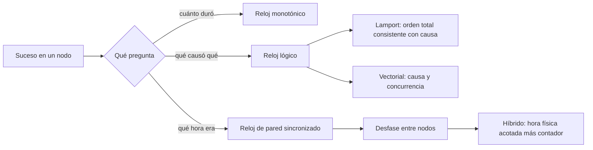
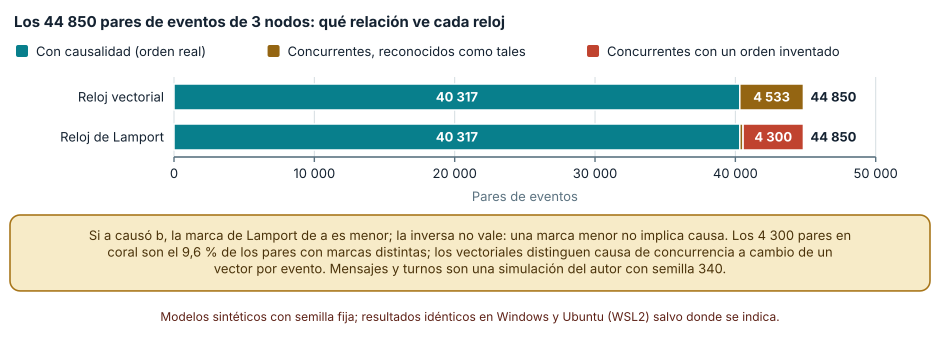
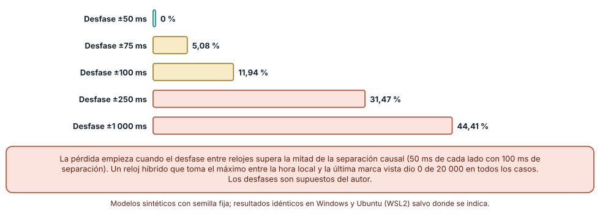
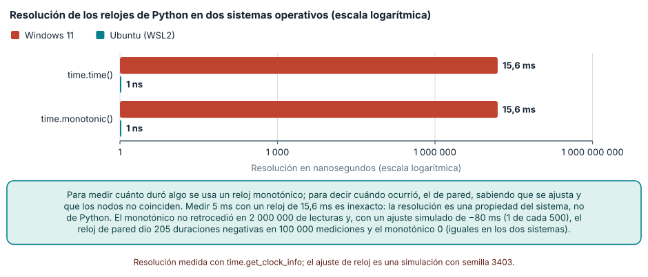

# SE-388 — Tiempo, relojes y orden parcial

[← SE-387 — Actores, canales y structured concurrency](../../classes/part-32-concurrencia-y-sistemas-distribuidos/se-387-actores-canales-y-structured-concurrency/README.md) · [↑ Parte 32](../../classes/part-32-concurrencia-y-sistemas-distribuidos/README.md) · [📚 Índice completo](../../classes/README.md) · [🌐 Portal](../../site/classes/SE-388.html) · [SE-389 — Fallos parciales y modelos de red →](../../classes/part-32-concurrencia-y-sistemas-distribuidos/se-389-fallos-parciales-y-modelos-de-red/README.md)

## Punto profesional y fundamento pedagógico

**Punto profesional.** La clase existe para que dejes de usar la hora como si fuera un orden: que sepas cuándo basta un reloj monotónico para medir una duración, cuándo una marca de tiempo de pared ordena mal los sucesos de dos máquinas y qué ofrece cada reloj lógico (Lamport, vectorial, híbrido) para decidir qué ocurrió antes de qué, y qué sucesos son simplemente concurrentes.

**Por qué aparece aquí.** Sigue a **Actores, canales y structured concurrency**, donde el buzón conservaba el orden de cada emisor y de nada más. Entre máquinas distintas no existe ni siquiera un reloj común con el que comparar. En el caso conductor, la plataforma de entregas recibe una entrega de un estudiante en un servidor y su corrección en otro; hay que decidir cuál es posterior y cuál versión gana cuando dos réplicas discrepan.

**Error conceptual que debe corregir.** Creer que «la marca de tiempo más alta es la más reciente»: es cierta solo si los relojes coinciden, y no coinciden; la marca de tiempo de una máquina no es una medida del orden causal.

**Secuencia de aprendizaje.** Antes de leer los resultados, predices qué fracción de los pares de sucesos de tres nodos son concurrentes y si un reloj de Lamport los distingue; después mides cuántas escrituras causalmente posteriores pierden frente a una anterior por el desfase de los relojes de pared, y qué resolución tienen y cuánto se equivocan los relojes de dos sistemas operativos. La secuencia usa predicción, explicación propia, contraste y recuperación. [ICAP](https://icap.education.asu.edu/research) distingue participación de construcción de conocimiento; [How People Learn II](https://nap.nationalacademies.org/catalog/24783/how-people-learn-ii-learners-contexts-and-cultures) exige conectar conocimiento previo, contexto y transferencia; la [práctica de recuperación](https://pubmed.ncbi.nlm.nih.gov/16507066/) respalda producir de nuevo la explicación tras una demora; y [Education for Life and Work](https://nap.nationalacademies.org/resource/13398/dbasse_084153.pdf) exige devolución que explique la causa del error.

**Evidencia de aprendizaje.** `tiempo-log.md` con la predicción, las tres figuras reproducidas, la decisión de qué reloj se usa para qué en la plataforma (medir, ordenar, expirar) y una nota que señale dónde el orden total es una ficción.

**Límite de la conclusión.** Los eventos, los mensajes y los desfases son sintéticos con semilla fija; los desfases de ±50 a ±1 000 ms son supuestos del autor y no describen ninguna red ni sincronización real. La resolución de los relojes se midió en dos sistemas, pero no su deriva ni su sincronización. No se midió ningún servicio de tiempo.

### Trazabilidad fuente → afirmación

| Fuente primaria u oficial | Afirmación que respalda | Lo que no prueba |
|---|---|---|
| [Lamport, «Time, clocks, and the ordering of events in a distributed system» (1978)](https://doi.org/10.1145/359545.359563) | Define la relación «ocurrió antes de» y un reloj lógico que la respeta. | No afirma que una marca menor implique causalidad. |
| [Kulkarni et al., «Logical Physical Clocks» (2014)](https://cse.buffalo.edu/tech-reports/2014-04.pdf) | Propone un reloj híbrido que combina la hora física con un contador lógico y limita su desvío. | No mide su desempeño en un sistema concreto de la plataforma. |
| [RFC 5905: Network Time Protocol versión 4](https://www.rfc-editor.org/rfc/rfc5905) | Describe cómo se sincronizan relojes por red y que la sincronización tiene un error y puede ajustar el reloj en saltos. | No dice qué desfase tienen los servidores de ningún despliegue. |
| [Python: time](https://docs.python.org/3/library/time.html) | Distingue `time.time`, `time.monotonic` y `time.perf_counter` y expone su resolución con `get_clock_info`. | No garantiza que un reloj de pared no retroceda en un sistema real. |
| [Kleppmann, «Designing Data-Intensive Applications»](https://dataintensive.net/) | Explica por qué el último escritor gana con marcas de tiempo de pared puede descartar escrituras sin aviso. | No mide la frecuencia con que ocurre en un sistema dado. |

## Antes de empezar

Recupera lo aprendido en `SE-387`: un buzón ordena por emisor. La pregunta activa es: **¿cómo se dice, entre dos máquinas, qué ocurrió antes, qué fue concurrente, y qué reloj usarías para medir cuánto duró algo?** Son tres preguntas distintas con tres herramientas distintas.

## Prerrequisitos

- Haber completado `SE-387` o poder explicar qué orden garantiza un buzón.
- Python 3.11 o posterior; los experimentos usan solo la biblioteca estándar (`random`, `itertools`, `time`).
- Saber qué es un vector y la comparación elemento a elemento.

## Problema auténtico

La plataforma replicó las calificaciones en dos servidores. Un docente corrigió una entrega desde su portátil, que atiende el servidor A; segundos después otro docente la reabrió y cambió la nota, en el servidor B. Al sincronizar, ganó la nota antigua. El registro lo explicaba sin culpa: los dos cambios tenían marca de tiempo, y la del servidor B era 80 ms menor que la del A. El reloj del servidor B iba retrasado desde una actualización del sistema, y la regla «gana la marca más alta» descartó una corrección legítima sin dejar error. Más tarde, al medir cuánto tardaba una consulta, una duración salió negativa porque el reloj se había ajustado en mitad de la medición.

## Objetivos observables

Al terminar podrás:

1. distinguir un reloj de pared de uno monotónico y decir para qué sirve cada uno;
2. definir «ocurrió antes de» y reconocer cuándo dos sucesos son concurrentes;
3. mostrar con un experimento que una marca de Lamport ordena pares que son concurrentes y que un reloj vectorial no;
4. calcular a partir de qué desfase una regla «gana la marca más alta» empieza a perder escrituras;
5. decidir qué reloj usar para expirar, medir y ordenar en cada parte de la plataforma.

## Mapa conceptual



El mapa separa tres preguntas que suelen mezclarse. La duración usa un reloj que solo avanza. La hora de un suceso usa un reloj de pared con su error. La causalidad no usa la hora: usa contadores que viajan en los mensajes.

## Temas y por qué importan

| Tema | Por qué cambia una decisión profesional | Evidencia mínima |
|---|---|---|
| Reloj de pared y monotónico | Una duración negativa o una expiración errónea nacen de elegir mal. | Predicción, traza causal y contraejemplo de **Reloj de pared y monotónico** en `tiempo-log.md` |
| Ocurrió antes y concurrencia | Define qué pares de sucesos tienen orden y cuáles no. | Predicción, traza causal y contraejemplo de **Ocurrió antes y concurrencia** en `tiempo-log.md` |
| Relojes de Lamport | Dan un orden consistente con la causa, pero inventan orden entre concurrentes. | Predicción, traza causal y contraejemplo de **Relojes de Lamport** en `tiempo-log.md` |
| Relojes vectoriales | Distinguen causa de concurrencia a cambio de espacio. | Predicción, traza causal y contraejemplo de **Relojes vectoriales** en `tiempo-log.md` |
| Relojes híbridos y último escritor | Acotan el desfase físico sin perder la causalidad. | Predicción, traza causal y contraejemplo de **Relojes híbridos y último escritor** en `tiempo-log.md` |

## Conceptos y decisiones

### 1. Reloj de pared y monotónico

El **reloj de pared** dice qué hora es según el sistema: se sincroniza con servidores de tiempo y por eso puede saltar, hacia adelante o hacia atrás, al corregirse. El **reloj monotónico** solo avanza: su valor absoluto no significa nada, pero la diferencia entre dos lecturas del mismo nodo es una duración fiable. La regla es sencilla: duraciones, tiempos de espera y expiraciones locales, con el monotónico; marcas que se muestran a una persona o que se comparan con un calendario, con el de pared. El segundo, además, difiere entre nodos: la sincronización por red (el protocolo NTP de la RFC 5905) tiene un error que depende de la red y puede dejar relojes a decenas o cientos de milisegundos entre sí.

### 2. Ocurrió antes y concurrencia

Lamport definió la relación «ocurrió antes de» sin usar relojes: un suceso ocurre antes que otro si están en el mismo proceso en ese orden, o si uno es el envío de un mensaje y el otro su recepción, o si hay una cadena de estas relaciones. Dos sucesos que no están relacionados por ninguna cadena son **concurrentes**: ninguno pudo influir en el otro, y que uno tenga una hora anterior no significa nada. Es un **orden parcial**: algunos pares están ordenados y otros no. La consecuencia práctica es que preguntar «¿cuál fue primero?» puede tener como respuesta correcta «ninguno». Un sistema que fuerza una respuesta decide por azar, y si lo hace al sincronizar dos réplicas descarta una escritura.

### 3. Relojes de Lamport

Un **reloj de Lamport** es un contador por nodo: cada suceso lo incrementa, un mensaje lleva el contador del emisor y el receptor toma el máximo de su valor y el recibido, más uno. Garantiza que si *a* ocurrió antes que *b*, la marca de *a* es menor que la de *b*. La inversa no vale: una marca menor no implica causa. Por eso sirve para construir un orden total consistente con la causa (desempatando con el identificador del nodo), útil para ordenar un registro, pero no para saber si dos sucesos eran concurrentes: les da marcas distintas igualmente y hace parecer ordenado lo que no lo estaba.

### 4. Relojes vectoriales

Un **reloj vectorial** guarda un contador por nodo en cada suceso. La marca de *a* es menor o igual que la de *b* en todas las posiciones, y distinta, solo si *a* ocurrió antes que *b*; si ninguna es menor, son concurrentes. Es la herramienta exacta para detectar conflictos: dos versiones de un dato con vectores incomparables son escrituras concurrentes que hay que reconciliar, no una más antigua que otra. El precio es el tamaño: un contador por nodo en cada marca, que crece con el número de participantes y obliga a podar o a usar variantes.

### 5. Relojes híbridos y último escritor

El **reloj híbrido** (*hybrid logical clock*) guarda una hora física y un contador lógico: al enviar o recibir, toma el máximo entre la hora local y la mayor marca vista, y desempata con el contador. Así la marca respeta la causalidad (nunca es menor que la de un suceso que ya vio) y se mantiene cerca de la hora física, útil para humanos y para consultas por intervalo. Frente a esto, la regla **último escritor gana** con marcas de pared compara horas de máquinas distintas: si los relojes difieren más que la separación entre dos escrituras, la posterior pierde. Es una regla simple y es pérdida de datos silenciosa.

### Qué orden inventa Lamport

Tres nodos generan 300 sucesos (internos, envíos y recepciones, con semilla fija). Cada suceso lleva un reloj de Lamport y un reloj vectorial. Se comparan los 44 850 pares de sucesos: cuántos están causalmente relacionados según el vectorial, cuántos son concurrentes y cuántos de los pares con marcas de Lamport distintas son concurrentes en realidad.

```python
if inbox[i] and r.random() < 0.5:                   # recibir
    L[i] = max(L[i], sl) + 1
    V[i] = [max(a, b) for a, b in zip(V[i], sv)]; V[i][i] += 1
else:                                              # suceso interno o envío
    L[i] += 1; V[i][i] += 1
```

| Medida | Cantidad | Porcentaje |
|---|---:|---:|
| Pares de sucesos | 44 850 | — |
| Con relación causal (vectorial) | 40 317 | 89,9 % |
| Concurrentes (vectorial) | 4 533 | 10,1 % |
| Pares con marcas de Lamport distintas | 44 617 | 99,5 % |
| …de ellos, concurrentes de verdad | 4 300 | 9,6 % |

Lamport asigna una marca distinta a casi todos los pares (44 617) y por eso parece ordenar 4 300 pares que en realidad no tienen orden. No es un defecto del reloj, es lo que promete: un orden total *consistente* con la causa. El defecto está en leer esa consistencia como causalidad.



**Cómo leer la figura.** Cada barra es un reloj y suma los mismos 44 850 pares; verde son los pares con causalidad, dorado los concurrentes reconocidos como tales y coral los concurrentes a los que el reloj asigna un orden. Mira que el segmento coral solo existe en la barra de Lamport: es el orden que ese reloj inventa. **Dónde deja de valer:** la fracción de concurrentes (10,1 %) depende de cuánto se comunican los nodos (aquí, 40 % de envíos y recepción con probabilidad 0,5); con más comunicación hay menos concurrencia. La simulación es del autor con semilla 340 y no describe ninguna red real.

### Cuánto desfase tolera «gana la marca más alta»

Una escritura A y una escritura B, causalmente posterior y separada 100 ms, se comparan por marca de pared. Los relojes de A y B tienen un desfase aleatorio uniforme de ±*d* ms. Se cuentan, sobre 20 000 pares, los casos en que la escritura posterior pierde, y los que pierde si se usa un reloj híbrido que toma el máximo entre la hora local y la última marca vista.

```python
ta = t0 + off_a                       # A escribe primero
tb = t0 + gap_ms + off_b              # B escribe después, tras leer lo de A
if tb <= ta: wrong += 1               # gana la marca más alta: B pierde
tb2 = max(tb, ta + 0.001)             # reloj híbrido: nunca menor que lo que ya vio
```

| Desfase máximo | Escrituras posteriores que pierden | Con reloj híbrido |
|---|---:|---:|
| ±50 ms | 0 | 0 |
| ±75 ms | 1 017 de 20 000 (5,08 %) | 0 |
| ±100 ms | 2 387 (11,94 %) | 0 |
| ±250 ms | 6 294 (31,47 %) | 0 |
| ±1 000 ms | 8 882 (44,41 %) | 0 |

La pérdida empieza exactamente cuando el desfase entre relojes puede superar la separación causal (con ±50 por lado, la diferencia máxima es 100 ms, igual a la separación). Con desfases mayores, casi la mitad de las escrituras posteriores se pierde. El reloj híbrido las salva todas porque incorpora lo que ya ha visto; a cambio, su marca puede adelantarse a la hora física.



**Cómo leer la figura.** Cada barra es un desfase máximo entre relojes y su longitud, el porcentaje de escrituras posteriores que pierden. **Dónde deja de valer:** el desfase uniforme y la separación fija de 100 ms son supuestos del autor; en una red real el desfase cambia con el tiempo y con la sincronización. El resultado transferible es el umbral: la regla funciona hasta que el desfase iguala la separación entre las escrituras que se quieren ordenar.

### Reloj de pared, reloj monotónico y la resolución del sistema

Se consultan la resolución de los tres relojes de Python, se leen dos millones de veces `time.monotonic` buscando retrocesos, y se simula la medición de 100 000 duraciones donde 1 de cada 500 cruza un ajuste del reloj de pared de −80 ms.

```python
time.get_clock_info("time").resolution
prev = time.monotonic()
for _ in range(2_000_000):
    now = time.monotonic()
    if now < prev: back += 1
    prev = now
measured_wall = d + (-80 if r.random() < 1 / 500 else 0)   # reloj de pared con ajuste
```

| Medida | Windows 11 | Ubuntu (WSL2) |
|---|---:|---:|
| Resolución de `time.time()` | 15,6 ms | 1 ns |
| Resolución de `time.monotonic()` | 15,6 ms | 1 ns |
| Retrocesos de `monotonic` en 2 000 000 de lecturas | 0 | 0 |
| Duraciones negativas por el ajuste simulado | 205 de 100 000 | 205 de 100 000 |
| Duraciones erróneas con el reloj monotónico | 0 | 0 |

El reloj monotónico nunca retrocedió y el de pared, ante el ajuste simulado, produjo 205 duraciones erróneas (todas negativas, porque el ajuste de −80 ms supera la duración máxima de 50 ms). La resolución difiere entre sistemas: con 15,6 ms, medir una operación de 5 ms con ese reloj da 0 o 15,6 ms. La resolución es una propiedad del sistema, no de Python.



**Cómo leer la figura.** Cada fila es un reloj de Python y los dos extremos son los dos sistemas; el eje es logarítmico en nanosegundos y el segmento largo muestra la brecha de resolución. Mira que las dos filas coinciden: la resolución es del sistema operativo y no del reloj elegido. **Dónde deja de valer:** el ajuste de −80 ms con frecuencia de 1 de cada 500 es un supuesto del autor; la resolución sí es medida y es lo único de la figura que difiere entre sistemas. Que el monotónico no retroceda en dos millones de lecturas es una observación sobre estos dos sistemas, no una garantía general; la documentación de Python es la referencia.

## Definiciones de trabajo

- **reloj de pared:** reloj que da la hora del sistema y puede ajustarse hacia atrás o adelante al sincronizarse.
- **reloj monotónico:** reloj que solo avanza y sirve para medir duraciones locales.
- **ocurrió antes de:** relación de orden parcial entre sucesos definida por el orden en un proceso y por el envío y la recepción de mensajes.
- **sucesos concurrentes:** sucesos entre los que no existe cadena de «ocurrió antes de» en ningún sentido.
- **reloj vectorial:** marca con un contador por nodo que permite decidir si dos sucesos están ordenados o son concurrentes.

Las definiciones son operativas para la plataforma de entregas. No convierten términos con una historia más amplia en sinónimos y deben contrastarse con la documentación primaria enlazada al final.

## Ejemplo mínimo

El fragmento muestra que un reloj vectorial detecta concurrencia donde Lamport no. Antes de ejecutarlo, predice si `a` y `b` son concurrentes.

```python
# nodo 0 hace un suceso; nodo 1 hace otro sin haber visto el primero
a_l, a_v = 1, (1, 0)
b_l, b_v = 1, (0, 1)
menor = lambda u, v: all(x <= y for x, y in zip(u, v)) and u != v
assert not menor(a_v, b_v) and not menor(b_v, a_v)      # concurrentes
# Lamport los empata y se desempata por nodo, inventando un orden
assert a_l == b_l
```

Los vectores son incomparables, así que son concurrentes; las marcas de Lamport son iguales y habría que desempatar con el identificador del nodo, creando un orden que no existía. Registra versión de Python y salida; después añade un mensaje de `a` a `b` y observa que los vectores pasan a estar ordenados.

## Ejemplo profesional

El equipo de calificaciones separa tres usos del tiempo. Las expiraciones de sesión y los tiempos límite usan el reloj monotónico de cada servidor. Las marcas que ve el estudiante («entregado el 12 de noviembre a las 23:58») usan la hora de pared del servidor que recibió la entrega, registrada como dato y no usada para decidir. Para reconciliar las réplicas de calificaciones, cada versión de una nota lleva un vector con un contador por servidor: si los vectores son comparables, gana el posterior; si son incomparables, se conservan ambas versiones y se pide a la docente resolver, con un aviso. Se descarta «gana la marca más alta» porque el equipo midió que el desfase entre sus servidores puede superar la separación entre correcciones consecutivas. Cada decisión queda en `tiempo-log.md` con la medida que la respalda.

## Práctica guiada

1. Genera 300 sucesos de tres nodos con relojes de Lamport y vectoriales y semilla fija.
2. Predice qué fracción de los pares es concurrente y comprueba con el reloj vectorial.
3. Cuenta cuántos pares concurrentes reciben marcas de Lamport distintas.
4. Simula dos escrituras con 100 ms de separación causal y desfases de ±50, ±75, ±100, ±250 y ±1 000 ms; mide cuántas pierden.
5. Añade un reloj híbrido y repite.
6. Imprime la resolución de `time`, `monotonic` y `perf_counter` en tu sistema y mide un retroceso de `monotonic` en un millón de lecturas.
7. Entrega `tiempo-log.md` y pide a otra persona que identifique una comparación de horas entre máquinas en tu diseño.

## Ejercicios

1. **Cálculo:** con relojes sincronizados a ±30 ms, ¿cuál es la separación mínima entre dos escrituras para que «gana la marca más alta» no pierda ninguna?
2. **Vectores:** tres nodos con vectores (2,0,1) y (1,1,1), ¿están ordenados? ¿Y (2,0,1) y (2,1,1)?
3. **Contraejemplo:** diseña un caso en que una marca de Lamport menor no implica que el suceso fuera anterior.
4. **Diagnóstico:** una duración de −3 ms aparece en el registro. Formula tres hipótesis y la observación que descarta cada una.

## Reto verificable

Entrega `tiempo-log.md` con la predicción, las tres tablas, la decisión de reloj por uso (medir, mostrar, ordenar, reconciliar) y la política ante vectores incomparables. Se aprueba si otra persona ejecuta el código desde un checkout limpio, obtiene los mismos conteos con las mismas semillas y puede decir a partir de qué desfase falla la regla del último escritor. No se aprueba por afirmar que «los relojes están sincronizados con NTP» sin cuantificar el error ni por usar la hora de pared para medir una duración.

## Caso conductor

La reconciliación de calificaciones entre servidores es el artefacto de esta clase en el caso conductor de la Parte 32. `SE-389` pregunta qué se sabe cuando una respuesta no llega: otra forma de no tener un estado común. Cambia después una sola decisión, el reloj usado para reconciliar, y observa qué otra (la política ante vectores incomparables) se ve afectada.

## Preguntas frecuentes

### ¿No basta con sincronizar los relojes con NTP?

Reduce el desfase, no lo elimina, y puede introducir saltos. Con una separación entre escrituras menor que el error de sincronización, la regla de la marca más alta sigue perdiendo datos; con una mayor, funciona hasta el día en que un servidor pierde la sincronización.

### ¿Por qué no usar siempre relojes vectoriales?

Su tamaño crece con el número de nodos y exigen podarlos o limitar los participantes. Para ordenar un registro, Lamport basta; para detectar conflictos entre réplicas, el vectorial; para ordenar cerca de la hora física, el híbrido.

### ¿Qué reloj se usa para un tiempo de espera?

El monotónico, porque un ajuste del reloj de pared no debe acortar ni alargar la espera. Y recuerda su resolución: con 15,6 ms, un tiempo límite de 10 ms no es observable.

### ¿Dos sucesos concurrentes son un error?

No. Son una característica del sistema: indican que ninguno pudo ver al otro. Lo que sí es un error es tratarlos como ordenados sin decidir cómo reconciliarlos.

## Fallo controlado y diagnóstico

Reproduce el fallo clásico de la clase: **ordenar por marca de tiempo de pared entre nodos y perder una escritura posterior**. Simula dos escrituras con 100 ms de separación causal y relojes con desfase de ±250 ms.

Registra síntoma, entrada mínima, hipótesis, observación que descarta cada hipótesis, causa, corrección y prueba de regresión. **Síntoma:** una corrección de nota desaparece tras la sincronización de réplicas, sin error en el registro. **Hipótesis rivales:** (a) una escritura que nunca llegó; (b) un fallo de la réplica al aplicar; (c) la regla de reconciliación descartó la escritura por tener una marca menor. **Prueba:** compara las marcas de las dos versiones y el orden real en que ocurrieron (según el servicio que las recibió); si la versión posterior tiene la marca menor, la causa es el desfase. **Conclusión:** «gana la marca más alta» comparó relojes de máquinas distintas. **Regresión:** cambia a vectores o a reloj híbrido y añade una prueba que simule un desfase mayor que la separación y compruebe que la escritura posterior sobrevive. No cambies a la vez la regla de reconciliación y la sincronización de los servidores.

## Errores comunes y cómo corregirlos

| Síntoma | Causa probable | Corrección |
|---|---|---|
| Una escritura reciente pierde frente a una antigua | Comparación de marcas de pared entre nodos | Vector o reloj híbrido |
| Duraciones negativas o enormes en el registro | Duración medida con el reloj de pared | Usar el monotónico |
| Un tiempo límite corto nunca se cumple | Resolución del reloj mayor que el tiempo | Conocer `get_clock_info` y usar un reloj adecuado |
| Todos los pares aparecen ordenados en el registro | Se leyó Lamport como causalidad | Reloj vectorial para detectar concurrencia |
| Conflictos que se resuelven en silencio | Vectores incomparables resueltos al azar | Conservar ambas versiones y reconciliar con una regla explícita |

## Entorno y archivos clave

```text
work/SE-388/
├── README.md
├── modelo/
│   ├── relojes_logicos.py
│   ├── ultimo_escritor.py
│   └── relojes_del_sistema.py
├── tests/test_tiempo.py
└── evidence/tiempo-log.md
```

El `README` declara plataforma, versión de Python, semillas (340, 3402 y 3403) y comandos. Los experimentos usan solo la biblioteca estándar (`random`, `itertools`, `time`) y se ejecutaron con CPython 3.12.9 en Windows 11 y 3.12.3 en Ubuntu bajo WSL2: las salidas fueron idénticas salvo la resolución de los relojes, que es propia de cada sistema. Si añades una dependencia, fija procedencia y versión.

## Seguridad, ética y accesibilidad

- una regla que descarta escrituras por desfase de reloj puede borrar una calificación o una corrección sin rastro: registra los conflictos en lugar de descartarlos;
- los registros con marcas de tiempo pueden revelar hábitos de personas; trátalas como datos personales cuando se asocien a un estudiante;
- las marcas visibles para estudiantes (plazos) deben declarar la zona horaria y no depender del reloj del dispositivo de la persona;
- documenta la política de reconciliación en texto accesible, además del diagrama;
- respeta las licencias de los artículos citados y atribuye lo adaptado.

## Puente hacia el trabajo con agentes

Un agente al que se le pide «resuelve los conflictos de sincronización» propondrá casi siempre «gana la marca de tiempo más reciente», porque es la solución más corta. Pídele en cambio que identifique qué relojes se comparan, que cuantifique el desfase posible entre ellos, que proponga vectores o un reloj híbrido si el desfase supera la separación entre escrituras y que incluya una prueba que simule el desfase. Revisa especialmente si compara horas de máquinas distintas y si usa la hora de pared para medir una duración: son los dos defectos que esta clase mostró sin aviso.

## Transferencia

Traslada el análisis a otro dominio (por ejemplo, un editor colaborativo de apuntes): cambia los sucesos y conserva el procedimiento de separar medir, mostrar y ordenar, cuantificar el desfase, elegir el reloj lógico que alcanza y decidir qué se hace con lo concurrente. La transferencia está lograda cuando puedes explicar qué pares de sucesos no tienen orden, no cuando el sistema usa vectores.

## Evaluación y evidencia

| Criterio | Evidencia para aprobar |
|---|---|
| comprensión | explicación de «ocurrió antes de» y de la concurrencia con ejemplos de la plataforma |
| corrección | conteos de pares, pérdida por desfase y resolución de relojes reproducibles |
| diseño | decisión de reloj por uso y política ante vectores incomparables |
| diagnóstico | reproducción de la escritura perdida con regresión por desfase |
| incertidumbre | declaración de que el desfase es un supuesto y la resolución es medida |
| reproducibilidad | versiones, comandos, salida y límites declarados |

## Fuentes

- [Lamport, «Time, clocks, and the ordering of events…»](https://doi.org/10.1145/359545.359563) — orden parcial y relojes lógicos; autoridad: artículo original (1978).
- [Kulkarni et al., «Logical Physical Clocks»](https://cse.buffalo.edu/tech-reports/2014-04.pdf) — reloj híbrido; autoridad: informe técnico de los autores.
- [RFC 5905: NTP versión 4](https://www.rfc-editor.org/rfc/rfc5905) — sincronización de relojes y su error; autoridad: IETF.
- [Python: time](https://docs.python.org/3/library/time.html) — relojes y resolución; autoridad: documentación de Python.
- [Kleppmann, «Designing Data-Intensive Applications»](https://dataintensive.net/) — pérdida de escrituras con marcas de pared; autoridad: autor del libro.

Cada fuente respalda el mecanismo indicado; ninguna demuestra que el 10,1 % de concurrencia, el umbral de 50 ms o las 205 duraciones erróneas se observen en un despliegue real. Esa afirmación depende de la red, de la sincronización y de la comunicación entre nodos.

## Límites y siguiente paso

Se ejecutaron tres experimentos en Windows y Ubuntu (WSL2); los conteos fueron idénticos y la resolución de los relojes difirió, como se declara. No se midió ningún servicio de tiempo ni la deriva real de relojes: los eventos, los desfases y el ajuste de −80 ms son construcciones del autor. La siguiente clase aborda el otro lado del problema: qué se sabe cuando una respuesta no llega.

## Glosario

- **reloj de pared:** reloj que da la hora del sistema y puede ajustarse hacia atrás o adelante al sincronizarse.
- **reloj monotónico:** reloj que solo avanza y sirve para medir duraciones locales.
- **ocurrió antes de:** relación de orden parcial entre sucesos definida por el orden en un proceso y por el envío y la recepción de mensajes.
- **sucesos concurrentes:** sucesos entre los que no existe cadena de «ocurrió antes de» en ningún sentido.
- **reloj vectorial:** marca con un contador por nodo que permite decidir si dos sucesos están ordenados o son concurrentes.

---

[← SE-387 — Actores, canales y structured concurrency](../../classes/part-32-concurrencia-y-sistemas-distribuidos/se-387-actores-canales-y-structured-concurrency/README.md) · [↑ Parte 32](../../classes/part-32-concurrencia-y-sistemas-distribuidos/README.md) · [📚 Índice completo](../../classes/README.md) · [🌐 Portal](../../site/classes/SE-388.html) · [SE-389 — Fallos parciales y modelos de red →](../../classes/part-32-concurrencia-y-sistemas-distribuidos/se-389-fallos-parciales-y-modelos-de-red/README.md)
