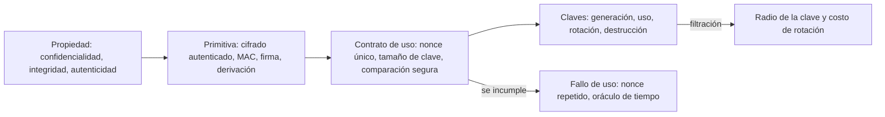
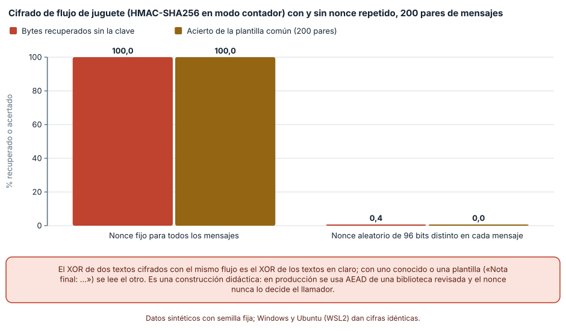
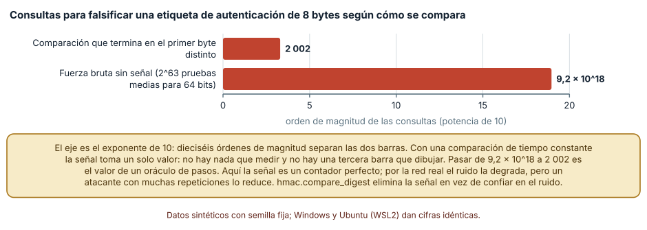

# SE-389 — Criptografía aplicada y gestión de claves

[← SE-388 — Validación, codificación y clases de inyección](../../classes/part-32-seguridad-privacidad-y-cumplimiento/se-388-validacion-codificacion-y-clases-de-inyeccion/README.md) · [↑ Parte 32](../../classes/part-32-seguridad-privacidad-y-cumplimiento/README.md) · [📚 Índice completo](../../classes/README.md) · [🌐 Portal](../../site/classes/SE-389.html) · [SE-390 — Secretos, configuración y separación de ambientes →](../../classes/part-32-seguridad-privacidad-y-cumplimiento/se-390-secretos-configuracion-y-separacion-de-ambientes/README.md)

## Punto profesional y fundamento pedagógico

**Punto profesional.** La clase existe para que uses la criptografía como un contrato con condiciones de uso y no como un adjetivo («está cifrado»). La habilidad profesional no es diseñar algoritmos, que no se hace, sino saber qué propiedad entrega cada primitiva (confidencialidad, integridad, autenticidad), qué obligaciones impone al llamador (nonce único, comparación de tiempo constante, claves que rotan) y qué ocurre cuando el llamador incumple una de ellas.

**Por qué aparece aquí.** Sigue a **Validación, codificación y clases de inyección**: se controló lo que entra y lo que se interpreta; ahora se trata de lo que se guarda y viaja. Los fallos de criptografía casi nunca son del algoritmo: son del uso (un nonce repetido, una comparación que filtra, una clave que nunca cambió). El caso conductor es **la plataforma de entregas**: proteger tokens de recuperación de cuenta, cifrar archivos adjuntos en reposo y firmar enlaces de descarga con vencimiento.

**Error conceptual que debe corregir.** Creer que usar un algoritmo fuerte equivale a ser seguro. Un cifrado de calidad con un nonce repetido entrega los mensajes a quien conoce uno, y una etiqueta de autenticación comparada con `==` se puede reconstruir byte a byte si la comparación termina en la primera diferencia. La seguridad es la del uso.

**Secuencia de aprendizaje.** Antes de mirar el resultado, predices qué fracción de un mensaje recupera quien conoce otro cifrado con el mismo nonce y cuántas consultas necesita para falsificar una etiqueta de 8 bytes si la comparación termina en el primer byte distinto; después mides la colisión de nonces de 24 bits frente a la fórmula del cumpleaños y calculas cuánto cuesta rotar una clave según cómo esté estructurada. La secuencia usa predicción, contraste y explicación propia. [ICAP](https://icap.education.asu.edu/research) distingue participar de construir conocimiento; [How People Learn II](https://nap.nationalacademies.org/catalog/24783/how-people-learn-ii-learners-contexts-and-cultures) respalda diseñar la práctica con contextos reales y retroalimentación.

**Evidencia de aprendizaje.** `cripto-log.md` con la predicción, el contrato de uso por primitiva, las tres tablas, la política de claves de la plataforma (generación, uso, rotación, destrucción) y una nota que separe qué parte es medida, cuál es modelo y cuál es suposición.

**Límite de la conclusión.** El cifrado de flujo de la clase está construido con HMAC-SHA256 como ejemplo didáctico para mostrar un modo de falla; **no debe usarse en producción**, donde se emplea un cifrado autenticado de una biblioteca revisada. Los oráculos de comparación cuentan pasos virtuales, sin red ni reloj; la colisión de nonces usa semilla fija. No se probó ninguna implementación real ni se midió ninguna canalización de tiempo.

### Trazabilidad fuente → afirmación

| Fuente primaria u oficial | Afirmación que respalda | Lo que no prueba |
|---|---|---|
| [NIST SP 800-38D: GCM y GMAC](https://csrc.nist.gov/pubs/sp/800/38/d/final) | Recomienda IV de 96 bits y limita a 2^32 las invocaciones por clave cuando los IV se generan al azar; exige unicidad del IV. | No cubre otros modos ni otras longitudes de nonce. |
| [NIST SP 800-57 Parte 1 Rev. 5](https://csrc.nist.gov/pubs/sp/800/57/pt1/r5/final) | Describe el ciclo de vida de una clave (generación, uso, almacenamiento, rotación, destrucción) y el criterio de periodo criptográfico. | No fija el periodo de rotación de la plataforma. |
| [OWASP Cryptographic Storage Cheat Sheet](https://cheatsheetseries.owasp.org/cheatsheets/Cryptographic_Storage_Cheat_Sheet.html) | Recomienda cifrado autenticado, generación de claves con generador criptográfico, jerarquía de claves y separación de la clave de los datos. | No audita una implementación concreta. |
| [Python: hmac.compare_digest](https://docs.python.org/3/library/hmac.html) | Documenta una comparación diseñada para evitar ataques por análisis de tiempo. | No garantiza tiempo constante en toda la ruta del programa. |
| [Python: secrets](https://docs.python.org/3/library/secrets.html) | Documenta el generador adecuado para claves, tokens y contraseñas. | No dice cuánta entropía necesita cada uso. |
| [Crosby, Wallach y Riedi, «Opportunities and Limits of Remote Timing Attacks»](https://doi.org/10.1145/1455526.1455530) | Mide qué diferencias de tiempo se pueden distinguir por una red real y por una red local. | No traslada sus resultados a la plataforma. |

## Antes de empezar

Recupera lo aprendido en `SE-386` (generar identificadores con el generador del sistema, no con una semilla predecible) y en `SE-388` (el canal de datos no debe cambiar de papel). La pregunta activa es: **si dos mensajes de la plataforma se cifran con la misma clave y el mismo nonce, ¿qué sabe un atacante que conoce uno de los dos?**

## Prerrequisitos

- Haber completado `SE-388` o poder explicar por qué una defensa depende del intérprete.
- Python 3.11 o posterior; los experimentos usan solo la biblioteca estándar (`hmac`, `hashlib`, `secrets`, `random`, `math`).
- Saber qué es un XOR y una probabilidad.

## Problema auténtico

En un escenario ilustrativo, la plataforma cifraba los comentarios privados de los docentes con un cifrado de flujo y generaba el nonce con un contador que se reiniciaba al reiniciar el servicio. Tras un despliegue, dos comentarios distintos se cifraron con el mismo nonce. Un estudiante que conocía su propio comentario (lo había escrito él) podía leer el comentario del docente sobre otro estudiante: bastaba un XOR. Meses antes, el equipo había añadido una firma a los enlaces de descarga y la verificaba con una comparación de cadenas simple; un investigador observó que la respuesta tardaba unos microsegundos más cuando el primer byte de la firma era correcto. Y cuando se supo que una clave de cifrado había estado almacenada en un repositorio, nadie sabía cuántos datos estaban cifrados con ella ni cuánto costaría cambiarla. Los tres fallos eran de uso, no de algoritmo. La clase enseña a escribir el contrato de uso de cada primitiva y a probar que se cumple.

## Objetivos observables

Al terminar podrás:

1. distinguir confidencialidad, integridad y autenticidad y elegir una primitiva por propiedad, sin inventar una;
2. demostrar el efecto de repetir un nonce y explicar por qué un contador que se reinicia es un riesgo;
3. explicar y medir qué filtra una comparación que termina en la primera diferencia, y usar una comparación de tiempo constante;
4. calcular la probabilidad de colisión de nonces aleatorios y el límite de uso por clave;
5. diseñar la jerarquía y el ciclo de vida de claves con un costo de rotación conocido.

## Mapa conceptual



El mapa separa la **propiedad** buscada, la **primitiva** que la entrega, su **contrato de uso** y el **ciclo de vida de las claves**. El camino de la derecha muestra que un incumplimiento del contrato y una filtración de la clave son problemas distintos con respuestas distintas.

## Temas y por qué importan

| Tema | Por qué cambia una decisión profesional | Evidencia mínima |
|---|---|---|
| Propiedades y primitivas | Elegir por la propiedad evita cifrar cuando lo que hacía falta era autenticar. | Tabla de usos de la plataforma con su propiedad y su primitiva |
| Cifrado autenticado y nonces | El nonce repetido destruye la confidencialidad sin que haya error visible. | Demostración del efecto y política de nonces |
| Autenticación de mensajes y comparación | Una comparación que filtra deja falsificar una etiqueta con pocas consultas. | Conteo de consultas con y sin comparación segura |
| Aleatoriedad, colisión y límites por clave | Los nonces aleatorios chocan según una fórmula conocida. | Tabla de colisión frente a la fórmula |
| Gestión de claves | La clave que no se puede rotar es una deuda. | Jerarquía de claves y costo de rotación |

## Conceptos y decisiones

### 1. Propiedades y primitivas

La **confidencialidad** impide leer; la **integridad** detecta modificaciones; la **autenticidad** vincula el mensaje con quien lo produjo. No son la misma cosa y cifrar no da las otras dos: un texto cifrado sin autenticación se puede alterar a ciegas y muchas veces el cambio se refleja en el texto en claro. Por eso se usa **cifrado autenticado con datos asociados** (AEAD), que entrega confidencialidad e integridad a la vez, y se rechazan los modos sin autenticación. Para firmar enlaces o tokens de recuperación se usa un **código de autenticación de mensaje** (MAC, por ejemplo HMAC) con una clave del servidor; para que un tercero verifique sin poder firmar hace falta una firma de clave pública. Para derivar claves a partir de contraseñas se usa una función con costo (clase `SE-386`); para derivar subclaves de una clave maestra, una función de derivación con etiquetas de contexto. La regla de oro es **no construir criptografía propia**: la clase usa construcciones didácticas con el único fin de mostrar un modo de falla, y la solución siempre es una biblioteca revisada con el modo y los parámetros recomendados.

### 2. Nonces: la obligación del llamador

Un cifrado de flujo (y los modos de contador, entre ellos GCM) produce una secuencia pseudoaleatoria a partir de la clave y un **nonce** (número usado una vez) y la combina por XOR con el mensaje. Si dos mensajes usan la misma clave y el mismo nonce, comparten la secuencia, y el XOR de los dos textos cifrados es el XOR de los dos textos en claro: quien conoce uno recupera el otro entero, y quien conoce una parte común (una plantilla, una cabecera, un formato) recupera esa parte del otro. No hay mensaje de error: todo funciona. El nonce debe ser **único por clave**, no secreto. Se genera con un contador persistente que nunca retrocede (cuidado al reiniciar, restaurar una copia o escalar a varias instancias) o con un generador aleatorio de tamaño suficiente (96 bits para GCM). Los modos que resisten el mal uso del nonce existen (SIV) y degradan el daño; no lo eliminan.

### 3. Autenticar y comparar sin filtrar

Verificar una etiqueta es comparar la calculada con la recibida. Una comparación que se detiene en el primer byte distinto tarda más cuanto más largo es el prefijo correcto, y esa diferencia de tiempo es una señal: el atacante prueba 256 valores para el primer byte, se queda con el más lento, repite con el segundo, y reconstruye la etiqueta en una cantidad lineal de consultas en vez de exponencial. En una red real el ruido oculta una parte de la señal, y Crosby y sus colegas midieron qué diferencias son distinguibles; con muchas repeticiones se promedian. Por eso se usa una **comparación de tiempo constante** (`hmac.compare_digest`) que examina todos los bytes sin importar dónde está la primera diferencia, y se evita que otra parte del código (un registro, una rama temprana) reintroduzca la señal. También se compara la etiqueta *antes* de tocar el contenido y se responde igual ante cualquier fallo.

### 4. Aleatoriedad, colisiones y el límite por clave

Los nonces aleatorios no se repiten por diseño sino por probabilidad. Con un espacio de 2^k valores y n mensajes, la probabilidad de que alguno se repita es aproximadamente 1 − exp(−n²/2^(k+1)): la paradoja del cumpleaños. Con k = 24 (16 millones de valores) basta con unos pocos miles de mensajes para tener una colisión probable; con k = 96, una probabilidad de 2^-32 llega con unos 6 mil millones de mensajes por clave. NIST SP 800-38D limita a 2^32 las invocaciones por clave cuando los IV son aleatorios, precisamente por esta razón. La consecuencia de diseño es que una clave tiene un **presupuesto de usos** que se agota, y que rotar la clave antes de agotarlo es parte del contrato. Todo valor que deba ser impredecible (claves, tokens, nonces aleatorios) sale del generador criptográfico del sistema (`secrets`, `os.urandom`), nunca de un generador con semilla, como en la clase `SE-386`.

### 5. Gestión de claves: jerarquía, rotación y radio

Las claves tienen un ciclo de vida: generación, activación, uso, rotación, retiro y destrucción (NIST SP 800-57). Dos estructuras reducen el costo de rotar. La **jerarquía de claves** (cifrado de sobre) cifra cada objeto con una clave de datos propia y envuelve las claves de datos con una clave maestra: rotar la maestra obliga a reenvolver las claves de datos (pequeñas), no a recifrar los datos (grandes). La **separación por propósito** usa una clave por función (cifrar adjuntos, firmar enlaces, tokens de recuperación) para que la filtración de una no comprometa las demás. Tras una filtración hay que saber qué datos cifró la clave, de modo que cada objeto cifrado registra el identificador de la clave que lo protegió. La clave maestra vive en un servicio de gestión de claves o un módulo de hardware, no en el repositorio ni en una variable de entorno compartida (ver `SE-390`). Una clave que no se puede rotar sin una caída es una deuda que se paga durante el incidente.

### Un nonce repetido entrega los mensajes

Se construye un cifrado de flujo de juguete con HMAC-SHA256 en modo contador. Se cifran 200 pares de mensajes de la forma «Nota final: NN/70. Comentario: …». El atacante conoce el primer mensaje de cada par (el suyo) y obtiene el segundo restando la secuencia sin conocer la clave. En un segundo ataque solo conoce la plantilla común «Nota final: ».

```python
c1 = xor(m1, keystream(key, nonce, len(m1)))
c2 = xor(m2, keystream(key, nonce, len(m2)))
recuperado = xor(xor(c1[:n], c2[:n]), m1[:n])   # = m2[:n] si el nonce se repitió
```

| Uso del nonce | Bytes del segundo mensaje recuperados | Plantilla común acierta |
|---|---:|---:|
| Nonce fijo para todos los mensajes | 100,0 % | 200 de 200 |
| Nonce aleatorio de 96 bits distinto en cada mensaje | 0,4 % | 0 de 200 |

El 0,4 % de la segunda fila es el azar (coincidencias de un byte entre dos mensajes con vocabulario parecido). La recuperación del 100 % no necesita la clave ni romper el algoritmo.



**Cómo leer la figura.** Cada fila es una política de nonce; la columna central es lo que obtiene quien conoce un mensaje. **Dónde deja de valer:** el cifrado es una construcción didáctica; GCM con un nonce repetido tiene además la consecuencia de que se filtra la clave de autenticación y pueden forjarse mensajes, algo que este experimento no cubre. La cifra de 0,4 % depende de la redundancia del vocabulario; con mensajes aleatorios sería menor.

### Una comparación que cuenta los bytes correctos

Se modela un oráculo que devuelve cuántos bytes se compararon antes de fallar, como lo haría un atacante que mide el tiempo con precisión perfecta. La etiqueta tiene 8 bytes. El atacante prueba los 256 valores del primer byte, elige el que más pasos produce y continúa.

```python
for pos in range(8):
    for v in range(256):
        ok, pasos = oraculo(bytes(conocido[:pos]) + bytes([v]) + b"\0" * (7 - pos))
        if ok: break
        if pasos > mejor: mejor, mejor_v = pasos, v
```

| Comparación | Consultas | Efecto |
|---|---:|---|
| Termina en el primer byte distinto | 2 002 | etiqueta de 8 bytes recuperada |
| Tiempo constante | — | la señal toma un solo valor |
| Fuerza bruta sin señal | 9,2 × 10^18 esperadas | 2^63 pruebas medias para 64 bits |

La diferencia es de unos quince órdenes de magnitud y se debe a una sola línea de código.



**Cómo leer la figura.** La primera fila es el valor de un oráculo de pasos; las otras muestran qué queda sin él. **Dónde deja de valer:** el oráculo es perfecto: por la red el ruido y la variación del servidor degradan la señal, de modo que el ataque necesita muchas repeticiones por byte (Crosby et al. miden cuántas); contra la misma máquina o en la misma red local el ataque es mucho más práctico. No es un argumento para confiar en el ruido: `hmac.compare_digest` elimina la señal en vez de ocultarla.

### Colisiones de nonces aleatorios

Se sortean nonces de 24 bits y se mide cuántas veces, en 1 500 repeticiones, aparece alguno repetido entre los primeros n mensajes. Se compara con 1 − exp(−n(n−1)/2^25).

| Mensajes con la misma clave | Colisión observada | Fórmula del cumpleaños |
|---:|---:|---:|
| 500 | 0,9 % | 0,7 % |
| 1 000 | 2,9 % | 2,9 % |
| 2 000 | 12,1 % | 11,2 % |
| 4 000 | 39,5 % | 37,9 % |
| 8 000 | 84,8 % | 85,1 % |

Con 96 bits, una probabilidad de 2^-32 llega con unos 6,07 × 10^9 mensajes por clave, y NIST SP 800-38D limita a 2^32 (4 294 967 296) las invocaciones por clave con IV aleatorios. En la jerarquía de claves, reenvolver un millón de claves de datos de 48 bytes mueve 48 MB; recifrar 2 TB de datos para cambiar una clave directa mueve unas 40 000 veces más.


**Cómo leer la figura.** La columna observada y la teórica coinciden salvo ruido de muestreo (1 500 repeticiones); el riesgo crece con n al cuadrado, no linealmente. **Dónde deja de valer:** la fórmula supone nonces independientes y uniformes; un generador defectuoso o un contador reiniciado rompen la suposición y la colisión llega antes. Los tamaños de datos de la rotación son una aritmética de ejemplo, no una medición.

## Definiciones de trabajo

- **cifrado autenticado (AEAD):** primitiva que entrega confidencialidad e integridad de un mensaje y de los datos asociados con una sola clave y un nonce único.
- **nonce:** valor que no debe repetirse con la misma clave; no es secreto.
- **código de autenticación de mensaje (MAC):** etiqueta calculada con una clave secreta que permite verificar la integridad y el origen de un mensaje.
- **comparación de tiempo constante:** comparación cuyo tiempo no depende de en qué posición difieren los valores comparados.
- **cifrado de sobre:** estructura en la que cada dato se cifra con una clave propia y esa clave se cifra con otra superior, de modo que rotar la superior no obliga a recifrar los datos.

Las definiciones son operativas para la plataforma de entregas. No convierten términos con una historia más amplia en sinónimos y deben contrastarse con la documentación primaria enlazada al final.

## Ejemplo mínimo

El fragmento muestra qué pasa al XOR de dos textos cifrados con el mismo flujo. Antes de ejecutarlo, predice qué imprime.

```python
import hashlib, hmac
def ks(k, n): return hmac.new(k, b"\0" + n, hashlib.sha256).digest()
k, n = b"k" * 32, b"n" * 12
m1, m2 = b"nota: 5/70   ", b"nota: 70/70  "
c1 = bytes(a ^ b for a, b in zip(m1, ks(k, n)))
c2 = bytes(a ^ b for a, b in zip(m2, ks(k, n)))
print(bytes(a ^ b ^ c for a, b, c in zip(c1, c2, m1)))
```

Imprime `b'nota: 70/70  '`: el segundo mensaje, sin usar la clave. Registra versión de Python, comando y salida; después cambia el nonce de `m2` y comprueba que la salida deja de ser legible.

## Ejemplo profesional

El equipo define tres usos y su primitiva: adjuntos en reposo con AEAD y clave de datos por archivo envuelta con una clave maestra del servicio de gestión de claves; enlaces de descarga firmados con HMAC-SHA256 con una clave propia de ese propósito, vencimiento incluido en la firma y verificación con `hmac.compare_digest`; tokens de recuperación de cuenta generados con `secrets`, guardados solo como hash y de un solo uso. Para los nonces usa nonces aleatorios de 96 bits y un contador de uso por clave de datos que fuerza una clave nueva antes de 2^32 usos. Cada objeto cifrado guarda el identificador de la clave, de modo que ante una filtración se sabe qué hay que recifrar. La rotación de la maestra se ensaya trimestralmente y cuesta el reenvuelto de las claves de datos; la de las claves de firma admite dos claves vigentes durante una ventana. En la aritmética de la clase, rotar la maestra reenvuelve 48 MB de claves de datos en lugar de recifrar 2 TB de datos.

## Práctica guiada

1. Escribe tu predicción de la fracción de un mensaje que recupera quien conoce otro cifrado con el mismo nonce.
2. Implementa el cifrado de flujo de juguete y reproduce la recuperación con nonce fijo y con nonce aleatorio.
3. Escribe el oráculo de comparación y cuenta las consultas necesarias con y sin comparación de tiempo constante.
4. Simula la colisión de nonces de 24 bits y compara con la fórmula; calcula el n para 96 bits y 2^-32.
5. Dibuja la jerarquía de claves de la plataforma y calcula el costo de rotar la maestra frente al de recifrar.
6. Escribe el contrato de uso de cada primitiva: propiedad, nonce, comparación, rotación y destrucción.
7. Entrega `cripto-log.md` y pide a otra persona que encuentre un incumplimiento de contrato en tu diseño.

## Ejercicios

1. **Nonce:** explica por qué un contador que se reinicia al reiniciar el servicio es peor que un nonce aleatorio de 96 bits en una plataforma con varias instancias.
2. **Comparación:** calcula cuántas consultas necesita un atacante para una etiqueta de 16 bytes con un oráculo perfecto y cuántas con una señal que acierta el 60 % de las veces.
3. **Colisión:** calcula el número de mensajes para una probabilidad de colisión de 1 % con nonces de 32 bits.
4. **Rotación:** diseña un esquema para cambiar la clave de firma de enlaces sin invalidar los enlaces vigentes.

## Reto verificable

Entrega `cripto-log.md` con la predicción, las tres tablas, el contrato de uso por primitiva, la jerarquía de claves con su costo de rotación y la política de nonces. Se aprueba si otra persona ejecuta el código desde un checkout limpio, obtiene las mismas cifras con las mismas semillas y puede decir cuál de tus usos fallaría primero si se incumpliera su contrato y qué prueba lo detectaría. No se aprueba por listar algoritmos fuertes sin su contrato de uso ni por afirmar que «se usa AES» como evidencia de seguridad.

## Caso conductor

La plataforma de entregas de tareas continúa como caso conductor. Esta clase deja el quinto artefacto: el contrato de uso de las primitivas y la política de claves. `SE-390` preguntará dónde viven los secretos, cómo se configuran y cómo se rotan sin caída. Cambia después un solo dato, la longitud del nonce de 24 a 32 bits, y observa cuántos mensajes soportan la misma probabilidad de colisión.

## Preguntas frecuentes

### ¿Puedo diseñar mi propio cifrado si es sencillo?

No. Los fallos de un diseño propio rara vez aparecen en las pruebas y los de uso aparecen en producción. La clase usa un cifrado de juguete para mostrar un modo de falla; en producción se usa una biblioteca revisada, un modo autenticado y los parámetros recomendados.

### ¿Hay que rotar las claves aunque no se hayan filtrado?

Sí, por dos razones: acota el volumen cifrado con una clave (el presupuesto de usos) y ensaya el procedimiento antes de necesitarlo. NIST SP 800-57 trata el periodo criptográfico como una decisión que depende de la sensibilidad, el volumen y la amenaza.

### ¿Un hash de la contraseña con HMAC sirve como MAC de un mensaje?

HMAC es un MAC; el problema es la clave. La clave de un MAC debe ser aleatoria y secreta, no una contraseña. Si la clave se deriva de una contraseña, se pasa antes por una función de derivación con costo.

### ¿Cifrar los datos en la base de datos resuelve la privacidad?

Resuelve el robo de los discos o de las copias; no resuelve el acceso con las credenciales de la aplicación, que descifra para quien se autentica. Es una capa con un modelo de amenaza concreto, no una garantía de privacidad.

## Fallo controlado y diagnóstico

Reproduce el fallo clásico de la clase: **un nonce repetido que no produce ningún error**. Reinicia el contador de nonces a cero, cifra dos comentarios y calcula el XOR de los textos cifrados.

Registra síntoma, entrada mínima, hipótesis, observación que descarta cada hipótesis, causa, corrección y prueba de regresión. **Síntoma:** un estudiante lee un comentario ajeno sin la clave y las pruebas funcionales de cifrado y descifrado pasan. **Hipótesis rivales:** (a) la clave se filtró; (b) el algoritmo está roto; (c) dos mensajes usaron la misma clave y el mismo nonce. **Prueba:** compara los nonces de los dos textos cifrados; si coinciden y el XOR de los textos cifrados coincide con el XOR de los textos en claro, la causa es el nonce repetido. **Conclusión:** la clave y el algoritmo funcionan; el contrato de uso se incumplió. **Regresión:** usa nonces aleatorios de 96 bits, registra el nonce con cada mensaje y añade una prueba que cifre 10 000 mensajes y falle si dos nonces coinciden. No cambies a la vez el algoritmo y el esquema de nonce.

## Errores comunes y cómo corregirlos

| Síntoma | Causa probable | Corrección |
|---|---|---|
| Un mensaje se lee sin la clave | Nonce repetido con la misma clave | Nonce aleatorio de 96 bits o contador persistente y una clave nueva antes del límite |
| Se puede falsificar una firma por red | Comparación con `==` | `hmac.compare_digest` y respuesta uniforme |
| Un texto cifrado alterado se descifra | Cifrado sin autenticación | AEAD y rechazo ante fallo de la etiqueta |
| Una clave filtrada obliga a recifrarlo todo | Una sola clave para todo | Cifrado de sobre y claves por propósito con identificador de clave en cada objeto |
| Los tokens son predecibles | Generador con semilla | `secrets` o `os.urandom` |

## Entorno y archivos clave

```text
work/SE-389/
├── README.md
├── cripto/
│   ├── nonce_repetido.py
│   ├── comparacion.py
│   └── cumpleanos.py
├── tests/test_cripto.py
└── evidence/cripto-log.md
```

El `README` declara plataforma, versión de Python, semillas y comandos. Los experimentos usan solo la biblioteca estándar (`hmac`, `hashlib`, `secrets`, `random`, `math`) y se ejecutaron con CPython 3.12.9 en Windows 11 y 3.12.3 en Ubuntu bajo WSL2: las salidas fueron idénticas. Si añades una dependencia, fija procedencia y versión.

## Seguridad, ética y accesibilidad

- los mensajes, claves y etiquetas son sintéticos: no uses claves reales ni material de producción en los experimentos;
- no publiques ni uses construcciones didácticas como cifrado de datos reales;
- no pruebes ataques de tiempo contra servicios ajenos;
- los datos cifrados de personas (calificaciones, comentarios) siguen siendo datos personales: la clave los protege, no los anula;
- documenta el procedimiento de rotación para que quien opere de noche pueda seguirlo, con pasos claros y comprobaciones accesibles.

## Puente hacia el trabajo con agentes

Un agente al que se le pide «cifra los adjuntos» puede escribir AES en un modo sin autenticación, un nonce fijo «para que sea determinista» y una clave literal en el código. Pídele en cambio que use un cifrado autenticado de una biblioteca revisada, que explique cómo se genera y registra el nonce, que compare etiquetas con una función de tiempo constante, que derive una clave por propósito y que muestre el costo de rotación. Revisa especialmente que no haya claves en el repositorio, que el identificador de la clave se guarde con el objeto y que existan pruebas que fallen si se repite un nonce. El defecto típico es el algoritmo fuerte usado fuera de su contrato.

## Transferencia

Traslada el análisis a otro dominio (por ejemplo, una aplicación de mensajería entre un taller y sus clientes): cambia los datos y las claves y conserva el procedimiento de escribir el contrato de uso, medir el incumplimiento y calcular el costo de rotar. La transferencia está lograda cuando puedes decir qué contrato incumpliría primero el nuevo diseño y qué lo detectaría, no cuando se elige el mismo algoritmo.

## Evaluación y evidencia

| Criterio | Evidencia para aprobar |
|---|---|
| comprensión | explicación de cada propiedad, del nonce y de por qué una comparación filtra |
| corrección | tablas de nonce, comparación y colisión reproducibles con las mismas semillas |
| diseño | contrato de uso por primitiva y jerarquía de claves con costo de rotación |
| diagnóstico | reproducción del fallo «nonce repetido sin error» con regresión |
| incertidumbre | declaración de que el cifrado es didáctico y los oráculos son virtuales |
| reproducibilidad | versiones, comandos, salida y límites declarados |

## Fuentes

- [NIST SP 800-38D](https://csrc.nist.gov/pubs/sp/800/38/d/final) — GCM, IV y límite por clave; autoridad: NIST.
- [NIST SP 800-57 Parte 1 Rev. 5](https://csrc.nist.gov/pubs/sp/800/57/pt1/r5/final) — gestión del ciclo de vida de las claves; autoridad: NIST.
- [OWASP Cryptographic Storage Cheat Sheet](https://cheatsheetseries.owasp.org/cheatsheets/Cryptographic_Storage_Cheat_Sheet.html) — almacenamiento criptográfico; autoridad: OWASP.
- [Python: hmac](https://docs.python.org/3/library/hmac.html) y [Python: secrets](https://docs.python.org/3/library/secrets.html) — comparación segura y generador criptográfico; autoridad: documentación de Python.
- [Crosby, Wallach y Riedi, 2009](https://doi.org/10.1145/1455526.1455530) — límites de los ataques de tiempo remotos; autoridad: ACM Transactions on Information and System Security.
- [Saltzer y Schroeder, 1975](https://doi.org/10.1109/PROC.1975.9939) — economía de mecanismo y diseño abierto; autoridad: Proceedings of the IEEE.

Cada fuente respalda el mecanismo indicado; ninguna demuestra que el 100 %, las 2 002 consultas o el 84,8 % se observen en un sistema real. Esa afirmación depende de la implementación, del generador y de la red.

## Límites y siguiente paso

Se ejecutaron tres experimentos con datos sintéticos en Windows y Ubuntu (WSL2) con resultados idénticos. El cifrado de flujo es una construcción didáctica que no debe usarse en producción, el oráculo de comparación cuenta pasos virtuales sin red ni reloj, la colisión usa nonces de 24 bits con semilla fija y no se probó ninguna biblioteca criptográfica, servicio de claves ni módulo de hardware. La siguiente clase pregunta dónde viven los secretos y cómo se rotan sin caída.

## Glosario

- **cifrado autenticado (AEAD):** primitiva que entrega confidencialidad e integridad de un mensaje y de los datos asociados con una sola clave y un nonce único.
- **nonce:** valor que no debe repetirse con la misma clave; no es secreto.
- **código de autenticación de mensaje (MAC):** etiqueta calculada con una clave secreta que permite verificar la integridad y el origen de un mensaje.
- **comparación de tiempo constante:** comparación cuyo tiempo no depende de en qué posición difieren los valores comparados.
- **cifrado de sobre:** estructura en la que cada dato se cifra con una clave propia y esa clave se cifra con otra superior, de modo que rotar la superior no obliga a recifrar los datos.

---

[← SE-388 — Validación, codificación y clases de inyección](../../classes/part-32-seguridad-privacidad-y-cumplimiento/se-388-validacion-codificacion-y-clases-de-inyeccion/README.md) · [↑ Parte 32](../../classes/part-32-seguridad-privacidad-y-cumplimiento/README.md) · [📚 Índice completo](../../classes/README.md) · [🌐 Portal](../../site/classes/SE-389.html) · [SE-390 — Secretos, configuración y separación de ambientes →](../../classes/part-32-seguridad-privacidad-y-cumplimiento/se-390-secretos-configuracion-y-separacion-de-ambientes/README.md)
