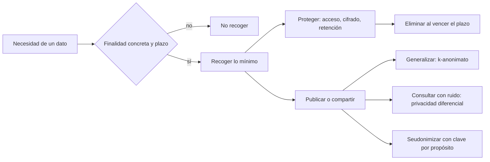
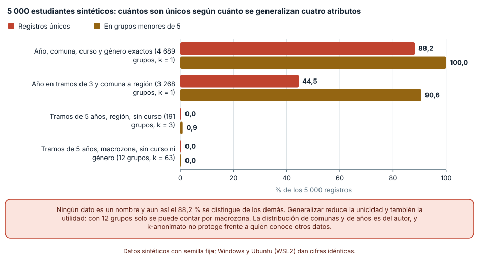
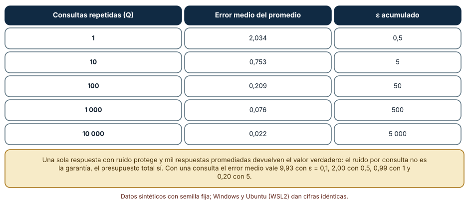
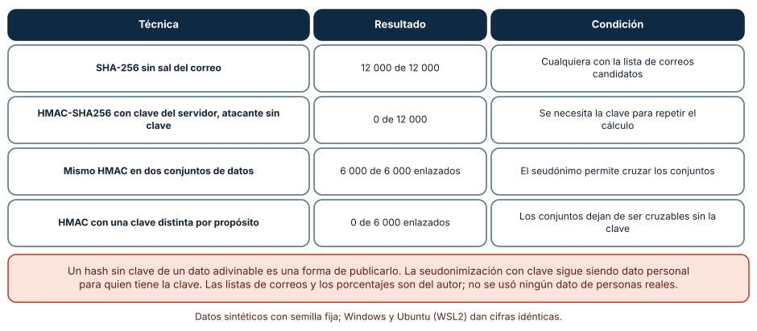

# SE-391 — Privacidad por diseño y minimización

[← SE-390 — Secretos, configuración y separación de ambientes](../../classes/part-32-seguridad-privacidad-y-cumplimiento/se-390-secretos-configuracion-y-separacion-de-ambientes/README.md) · [↑ Parte 32](../../classes/part-32-seguridad-privacidad-y-cumplimiento/README.md) · [📚 Índice completo](../../classes/README.md) · [🌐 Portal](../../site/classes/SE-391.html) · [SE-392 — Secure SDLC, abuso y pruebas negativas →](../../classes/part-32-seguridad-privacidad-y-cumplimiento/se-392-secure-sdlc-abuso-y-pruebas-negativas/README.md)

## Punto profesional y fundamento pedagógico

**Punto profesional.** La clase existe para que puedas decidir qué datos de personas debe guardar un sistema, por cuánto tiempo y con qué grado de identificación, y para que demuestres con números que «anonimizar» no es borrar el nombre. La habilidad profesional es reducir lo que se recoge antes de proteger lo que se recoge, medir cuánto identifica una combinación de atributos y reconocer el momento en que una técnica de privacidad deja de proteger: el ruido que se promedia, el hash que se adivina, la generalización que ya no sirve para nada.

**Por qué aparece aquí.** Sigue a **Secretos, configuración y separación de ambientes**: allí se cerró que la separación de credenciales no cubre los datos; esta clase se ocupa de los datos mismos. Las defensas de las clases anteriores protegen datos; la privacidad pregunta primero si hacía falta tenerlos. El caso conductor es **la plataforma de entregas**: matrícula, entregas, calificaciones, registros de acceso, estadísticas para la coordinación y un conjunto de datos para investigación educativa.

**Error conceptual que debe corregir.** Creer que quitar nombres y correos anonimiza un conjunto de datos. Un conjunto con año de nacimiento, comuna, curso y género exactos deja a nueve de cada diez personas distinguibles de todas las demás; el nombre no era el identificador, la combinación de atributos lo era.

**Secuencia de aprendizaje.** Antes de mirar el resultado, predices qué fracción de 5 000 estudiantes sintéticos es única según cuatro atributos exactos y cuánto debes generalizar para que nadie lo sea; después promedias consultas con ruido hasta recuperar el valor verdadero y reidentificas correos seudonimizados con y sin clave. La secuencia usa predicción, contraste y explicación propia. [ICAP](https://icap.education.asu.edu/research) distingue participar de construir conocimiento; [How People Learn II](https://nap.nationalacademies.org/catalog/24783/how-people-learn-ii-learners-contexts-and-cultures) respalda diseñar la práctica con contextos reales y retroalimentación.

**Evidencia de aprendizaje.** `privacidad-log.md` con la predicción, el inventario de datos de la plataforma con finalidad y retención, las tres tablas, la decisión de qué dato deja de recogerse y una nota que separe qué parte es medida, cuál es modelo y cuál es suposición.

**Límite de la conclusión.** Los 5 000 estudiantes, las comunas, los años de nacimiento, los 100 000 correos candidatos y las consultas con ruido son sintéticos, generados con semilla fija con distribuciones elegidas por el autor. No se usó ningún dato de personas reales y la clase **no** da asesoría legal: describe lo que dicen las fuentes y no determina qué exige la ley a una organización concreta.

### Trazabilidad fuente → afirmación

| Fuente primaria u oficial | Afirmación que respalda | Lo que no prueba |
|---|---|---|
| [Reglamento (UE) 2016/679 (RGPD)](https://eur-lex.europa.eu/eli/reg/2016/679/oj) | Establece principios como la minimización de datos y la limitación del plazo de conservación (art. 5), la protección de datos desde el diseño y por defecto (art. 25) y define la seudonimización (art. 4). | No determina qué obligaciones tiene la plataforma en una jurisdicción concreta. |
| [Ley 21.719 de Chile](https://www.bcn.cl/leychile/navegar?idNorma=1209272) | Regula la protección y el tratamiento de los datos personales y crea la Agencia de Protección de Datos Personales; publicada en 2024, con entrada en vigencia diferida de sus normas. | No sustituye una opinión jurídica ni dice qué datos concretos debe guardar la plataforma. |
| [Sweeney, «k-anonymity»](https://doi.org/10.1142/S0218488502001648) | Define el k-anonimato: cada combinación de atributos cuasi-identificadores aparece al menos k veces en el conjunto publicado. | No garantiza privacidad frente a atacantes con conocimiento adicional. |
| [Dwork y Roth, «The algorithmic foundations of differential privacy»](https://doi.org/10.1561/0400000042) | Formaliza la privacidad diferencial y su presupuesto acumulado: cada respuesta con ruido consume parte de una garantía total. | No dice qué ε elegir para un producto. |
| [Narayanan y Shmatikov, «Robust de-anonymization of large sparse datasets»](https://doi.org/10.1109/SP.2008.33) | Muestra que conjuntos «anonimizados» se reidentifican cruzándolos con información auxiliar. | No mide la reidentificación en la plataforma. |
| [NIST Privacy Framework](https://www.nist.gov/privacy-framework) | Ofrece un marco voluntario para gestionar el riesgo de privacidad por separado del de seguridad. | No es una norma de cumplimiento. |

## Antes de empezar

Recupera lo aprendido en `SE-390` sobre separar ambientes: una copia de producción en staging expone todos los registros aunque la credencial no abra producción. La pregunta activa es: **de todos los datos que recoge la plataforma, ¿cuáles dejarías de guardar mañana sin que ninguna función deje de existir, y qué evidencia tienes?**

## Prerrequisitos

- Haber completado `SE-390` o poder explicar el radio de una filtración.
- Python 3.11 o posterior; los experimentos usan solo la biblioteca estándar (`random`, `hashlib`, `hmac`, `collections`).
- Saber qué es un identificador, una probabilidad y un hash.

## Problema auténtico

En un escenario ilustrativo, la coordinación de la plataforma pidió un conjunto de datos «anonimizado» para un estudio sobre abandono: sin nombre ni correo, con año de nacimiento, comuna de residencia, curso y género. El equipo lo entregó con la tranquilidad de haber quitado los identificadores. Un investigador mostró en una tarde que, cruzando el conjunto con una lista pública de ganadores de una feria escolar (nombre, comuna, curso, año), podía asignar nombre a decenas de filas. Casi nadie era «difícil de encontrar»: la combinación de los cuatro atributos era única para la gran mayoría. El equipo, además, guardaba la dirección IP completa de cada acceso desde hace años «por si acaso», y los correos seudonimizados con un hash sin clave se invertían con una lista de candidatos en segundos. La clase enseña a medir cuánto identifica cada combinación, a reducir lo que se recoge y a elegir una técnica según la amenaza que cubre.

## Objetivos observables

Al terminar podrás:

1. inventariar los datos personales de la plataforma con finalidad, base de uso, retención y destino;
2. medir la unicidad de un conjunto según los atributos que se conservan y su generalización;
3. explicar qué protege y qué no el k-anonimato y calcular el k mínimo de un conjunto;
4. explicar por qué el ruido por consulta no es la garantía de la privacidad diferencial y calcular cuánto presupuesto consume un promedio;
5. distinguir seudonimización de anonimización y elegir una técnica de enlace con o sin clave según la finalidad.

## Mapa conceptual



El mapa pone primero la pregunta de **finalidad**: la mejor protección de un dato es no tenerlo. Tras recoger lo mínimo, la protección en uso y la publicación se tratan por separado, y cada técnica de publicación cubre una amenaza distinta.

## Temas y por qué importan

| Tema | Por qué cambia una decisión profesional | Evidencia mínima |
|---|---|---|
| Minimización, finalidad y retención | Lo que no se recoge no se filtra ni se pide en una orden. | Inventario de datos con finalidad y plazo |
| Identificadores y cuasi-identificadores | La combinación de atributos identifica aunque no haya nombre. | Medición de unicidad por conjunto de atributos |
| Generalización y k-anonimato | Reduce la distinción entre personas a costa de utilidad. | Tabla de k mínimo y utilidad restante |
| Ruido y privacidad diferencial | Protege respuestas agregadas y consume un presupuesto. | Error y presupuesto acumulado por número de consultas |
| Seudonimización y enlace | Un hash sin clave no protege datos adivinables; una clave única enlaza conjuntos. | Reidentificación con y sin clave |

## Conceptos y decisiones

### 1. Minimización, finalidad y retención

La **minimización** exige que los datos sean adecuados, pertinentes y limitados a lo necesario para la finalidad (RGPD art. 5); la **limitación del plazo** exige que no se conserven más tiempo del necesario. En términos de ingeniería: cada dato tiene una finalidad escrita, un plazo y un lugar donde se elimina. La plataforma recoge calificaciones (necesarias mientras dure el curso y un plazo legal), correos (necesarios para notificar), direcciones IP completas de cada acceso (necesarias para investigar abusos por un plazo corto, no para siempre) y comentarios de docentes (necesarios para la retroalimentación). La pregunta que decide es qué función dejaría de existir si el dato no estuviera; si ninguna, el dato sobra. La retención es una propiedad del sistema, no de una política en un documento: un trabajo programado elimina o agrega lo vencido y una prueba verifica que lo hace. El artículo 25 del RGPD formula la idea como protección de datos desde el diseño y por defecto: la configuración inicial debe recoger lo mínimo.

### 2. Identificadores y cuasi-identificadores

Un **identificador directo** (nombre, correo, número de documento) apunta a una persona. Un **cuasi-identificador** (año de nacimiento, comuna, curso, género) no lo hace solo y lo hace combinado, sobre todo si existe otra fuente donde esos atributos acompañen al nombre. La unicidad depende de la combinación y de la población: con 48 comunas, 30 cursos, 19 años y 3 valores de género hay unas 82 000 combinaciones posibles para 5 000 personas, de modo que casi cada una cae en una celda propia. El atacante no necesita adivinar: necesita **otra fuente** donde la misma combinación aparezca con un nombre (una lista de una feria, una red social, otro conjunto de datos). Narayanan y Shmatikov mostraron con un conjunto de calificaciones de películas «anonimizado» que la información auxiliar escasa basta. La defensa no es quitar más columnas al azar sino medir la unicidad del conjunto que se publica.

### 3. Generalización y k-anonimato

El k-anonimato exige que cada combinación de cuasi-identificadores aparezca al menos k veces; se logra **generalizando** (año en tramos, comuna en región, quitar atributos) y **suprimiendo** filas raras. Cada paso reduce la unicidad y la utilidad: con tramos de cinco años, macrozona y sin género, el conjunto del experimento tiene 12 grupos y k mínimo de 63, y sirve para contar por macrozona y poco más. El k-anonimato tiene límites conocidos. No protege cuando todos los miembros de un grupo comparten el valor del atributo sensible (si las 63 personas de un grupo abandonaron, saber el grupo revela el abandono); no protege frente a quien conoce un dato más; y no resiste que se publiquen varias versiones del mismo conjunto, que se pueden cruzar. Por eso es una **medida de riesgo** que se calcula y se declara, no un sello.

### 4. Ruido y privacidad diferencial

La privacidad diferencial responde preguntas agregadas añadiendo ruido calibrado, de modo que la respuesta apenas cambia si una persona está o no en los datos. Para un conteo, el ruido de Laplace tiene escala 1/ε: cuanto menor ε, más ruido y más privacidad. Lo importante para un ingeniero es la **composición**: cada respuesta consume una parte de un presupuesto total, y las respuestas se suman. Si el mismo conteo se pregunta mil veces con ruido nuevo cada vez, el promedio converge al valor verdadero; la garantía no está en el ruido de una respuesta sino en el presupuesto que se gasta, y el sistema debe contarlo y negarse a responder cuando se agota. Esto sirve para estadísticas agregadas con un presupuesto central y un responsable de gastarlo; no sirve para publicar filas individuales. Elegir ε es una decisión de producto y riesgo que no tiene una respuesta universal.

### 5. Seudonimización, enlace y datos de prueba

La **seudonimización** sustituye identificadores por seudónimos y mantiene la capacidad de volver a ellos con información adicional guardada aparte; para el RGPD los datos seudonimizados siguen siendo datos personales. Un hash criptográfico sin clave de un correo no es un seudónimo robusto: quien dispone de una lista de correos candidatos calcula los hashes y los compara. Un **HMAC con una clave del servidor** impide eso a quien no tiene la clave. Y una clave única para todos los conjuntos hace que los seudónimos coincidan entre conjuntos y se puedan **enlazar**; una **clave por propósito** hace que cada conjunto tenga seudónimos distintos y solo el que tiene las claves pueda cruzarlos. Los entornos de prueba merecen la misma disciplina: datos sintéticos o enmascarados, nunca una copia de producción (ver `SE-390`). Todos los datos anteriores se rigen además por los derechos de las personas a acceder, rectificar y suprimir, que deben ser operaciones del sistema y no peticiones manuales.

### Cuántas personas son únicas

Se generan 5 000 estudiantes con año de nacimiento (1990–2008, campana alrededor de 2000), comuna (48, con distribución sesgada), curso (30) y género (3 valores). Se agrupan por combinación de atributos con cuatro niveles de generalización y se mide el número de grupos, el k mínimo, el porcentaje de personas únicas y el de personas en grupos de menos de cinco.

| Nivel de generalización | Grupos | k mínimo | Únicos | En grupos de menos de 5 |
|---|---:|---:|---:|---:|
| Año, comuna, curso y género exactos | 4 689 | 1 | 88,2 % | 100,0 % |
| Año en tramos de 3 y comuna a región | 3 268 | 1 | 44,5 % | 90,6 % |
| Tramos de 5 años, región, sin curso | 191 | 3 | 0,0 % | 0,9 % |
| Tramos de 5 años, macrozona, sin curso ni género | 12 | 63 | 0,0 % | 0,0 % |

Con los atributos exactos, 4 411 de 5 000 personas se distinguen del resto. La tercera fila elimina la unicidad y deja grupos de tres personas como mínimo; la cuarta garantiza un k de 63 con una utilidad muy pequeña.



**Cómo leer la figura.** Cada grupo es un nivel de generalización con su número de grupos y su k mínimo en la etiqueta; la barra coral son los registros únicos y la dorada, los que están en grupos de menos de cinco. Mira cómo las dos barras se acortan al generalizar, a costa de que quedan 12 grupos para contar. **Dónde deja de valer:** la distribución de comunas y años es del autor y la unicidad depende de ella (en una población más concentrada baja); el k mínimo no mide el riesgo de atributos sensibles homogéneos ni el de quien conoce información adicional.

### Promediar el ruido

Se consulta el conteo verdadero de 312 estudiantes con ruido de Laplace de escala 1/ε. Con una sola consulta el error absoluto medio es 9,93 con ε = 0,1; 2,00 con ε = 0,5; 0,99 con ε = 1 y 0,20 con ε = 5. Luego se repite la misma consulta con ε = 0,5 por respuesta y se promedian las respuestas (200 repeticiones del ataque).

```python
def lap(eps): return r.expovariate(eps) - r.expovariate(eps)
promedio = sum(verdadero + lap(0.5) for _ in range(Q)) / Q
```

| Consultas repetidas (Q) | Error medio del promedio | ε acumulado |
|---:|---:|---:|
| 1 | 2,034 | 0,5 |
| 10 | 0,753 | 5 |
| 100 | 0,209 | 50 |
| 1 000 | 0,076 | 500 |
| 10 000 | 0,022 | 5 000 |

Con cien consultas, el atacante conoce el conteo con un error de 0,2 estudiantes; el ruido de cada respuesta era el mismo desde la primera.



**Cómo leer la figura.** El eje horizontal son las consultas repetidas y el ε acumulado, y el vertical el error medio del promedio, ambos en escala logarítmica. Mira que el error baja como una recta mientras el presupuesto acumulado de privacidad sube de 0,5 a 5 000: el ruido por consulta no es la garantía. **Dónde deja de valer:** el valor 312, la escala del ruido y las 200 repeticiones son del autor; las garantías formales se establecen sobre el mecanismo completo y su contabilidad, que aquí no se implementa. El experimento muestra por qué hace falta la contabilidad, no cómo se hace bien.

### Seudónimos que se invierten y se enlazan

Hay 20 000 correos seudonimizados, 12 000 de ellos presentes en una lista de 100 000 candidatos que tiene el atacante. Se comparan un hash SHA-256 sin sal, un HMAC con clave del servidor y el enlace entre dos conjuntos (6 000 personas en ambos).

| Técnica | Resultado | Condición |
|---|---|---|
| SHA-256 sin sal del correo | 12 000 de 12 000 reidentificados | quien tiene la lista de candidatos |
| HMAC-SHA256 con clave, atacante sin clave | 0 de 12 000 | se necesita la clave |
| Mismo HMAC en dos conjuntos | 6 000 de 6 000 enlazables | los seudónimos coinciden |
| HMAC con una clave por propósito | 0 de 6 000 enlazables | los conjuntos no se cruzan sin las claves |



**Cómo leer la figura.** Cada tarjeta es una técnica y, a la derecha, lo que se reidentifica o se enlaza: coral si el atacante lo consigue y verde azulado si no. Mira el contraste entre filas vecinas: añadir una clave detiene la reidentificación y una clave distinta por propósito detiene el cruce. **Dónde deja de valer:** el 60 % de correos presentes en la lista de candidatos y el tamaño de la lista son del autor; si el atacante no tiene una lista de candidatos, el hash sin clave resiste más, pero no se puede asumir. Quien tiene la clave puede revertir ambos casos: la seudonimización con clave no anonimiza.

## Definiciones de trabajo

- **minimización de datos:** principio de recoger y conservar solo los datos adecuados, pertinentes y necesarios para una finalidad declarada.
- **cuasi-identificador:** atributo que no identifica a una persona por sí solo y sí combinado con otros o con una fuente auxiliar.
- **k-anonimato:** propiedad de un conjunto en el que cada combinación de cuasi-identificadores aparece al menos k veces.
- **presupuesto de privacidad (ε):** cantidad acumulada de pérdida de privacidad que consumen las respuestas con ruido de un mismo conjunto de datos.
- **seudonimización:** sustitución de identificadores por seudónimos, con la información que permite revertirla guardada aparte.

Las definiciones son operativas para la plataforma de entregas. No convierten términos con una historia más amplia en sinónimos y deben contrastarse con la documentación primaria enlazada al final.

## Ejemplo mínimo

El fragmento muestra que un hash sin clave de un dato adivinable se invierte. Antes de ejecutarlo, predice qué imprime.

```python
import hashlib
candidatos = [f"persona{i}@ejemplo.test" for i in range(1000)]
tabla = {hashlib.sha256(c.encode()).hexdigest(): c for c in candidatos}
print(tabla[hashlib.sha256(b"persona731@ejemplo.test").hexdigest()])
```

Imprime `persona731@ejemplo.test`: el «seudónimo» se revierte con una tabla. Registra versión de Python, comando y salida; después sustituye el hash por un HMAC con una clave generada y comprueba que la tabla ya no sirve.

## Ejemplo profesional

El equipo hace un inventario de 18 datos personales con finalidad, plazo y destino. Deja de guardar la dirección IP completa (guarda los dos primeros octetos para estadísticas y la completa solo siete días para investigar abusos), elimina el campo «teléfono de contacto» porque ninguna función lo usa y reduce la retención de registros de acceso de «indefinida» a 90 días con un trabajo programado que lo hace y una prueba que lo comprueba. Para el estudio sobre abandono entrega cifras agregadas con un presupuesto de privacidad y un conjunto generalizado con k mínimo declarado (no filas individuales). Los seudónimos para análisis se calculan con una clave por propósito. Los entornos de prueba reciben datos sintéticos. Atiende los derechos de acceso y supresión con una operación documentada y probada. Se mide por lo que cambia: en el modelo de la clase, el conjunto publicado pasó de 88,2 % de personas únicas a 0,0 %.

## Práctica guiada

1. Escribe tu predicción de la fracción de estudiantes únicos con cuatro atributos exactos.
2. Inventaría los datos personales de la plataforma con finalidad, plazo y destino; marca el que eliminarías.
3. Genera los 5 000 estudiantes con semilla fija y mide unicidad, k mínimo y grupos pequeños en cuatro niveles de generalización.
4. Implementa el ruido de Laplace, mide el error por ε y reproduce el promedio de consultas repetidas.
5. Reidentifica correos seudonimizados con SHA-256 y con HMAC; mide el enlace con la misma clave y con claves distintas.
6. Escribe la política de retención con su trabajo de eliminación y la prueba que lo verifica.
7. Entrega `privacidad-log.md` y pide a otra persona que proponga una fuente auxiliar que reidentifique tu conjunto generalizado.

## Ejercicios

1. **Unicidad:** calcula el número de combinaciones posibles para tus cuasi-identificadores y compáralo con la población; explica qué esperas de la unicidad antes de medirla.
2. **k-anonimato:** construye un ejemplo donde k = 20 y aun así se revela el valor sensible de todos los miembros de un grupo.
3. **Presupuesto:** calcula cuántas consultas con ε = 0,1 puede responder un sistema con un presupuesto total de 2 y qué hacer cuando se agota.
4. **Seudónimos:** diseña las claves para que el análisis de abandono y el de rendimiento no puedan cruzarse entre sí sin una decisión explícita.

## Reto verificable

Entrega `privacidad-log.md` con la predicción, el inventario con finalidad y plazo, las tres tablas, la política de retención con su prueba y la decisión de un dato que dejas de recoger. Se aprueba si otra persona ejecuta el código desde un checkout limpio, obtiene las mismas cifras con las mismas semillas y puede decir qué técnica elegirías para publicar cada conjunto y qué amenaza deja abierta. No se aprueba por afirmar que un conjunto «está anonimizado» sin medir su unicidad ni por proponer un hash sin clave como protección.

## Caso conductor

La plataforma de entregas de tareas continúa como caso conductor. Esta clase deja el séptimo artefacto: el inventario de datos con finalidad y plazo y las decisiones de publicación. `SE-392` preguntará cómo se incorpora la seguridad al proceso de desarrollo y cómo se piensa como un abusador. Cambia después un solo dato, el número de comunas de 48 a unas 350, y observa cómo cambia la unicidad.

## Preguntas frecuentes

### ¿Anonimizar y seudonimizar son lo mismo?

No. Un dato anonimizado no permite identificar a la persona por ningún medio razonable; uno seudonimizado se puede revertir con información adicional y sigue siendo dato personal. En la práctica, muchos conjuntos llamados «anonimizados» son seudonimizados.

### ¿Qué valor de k es suficiente?

Ninguno lo es por sí solo. No existe un valor universal: depende de la sensibilidad y del contexto, y se evalúa además la diversidad del atributo sensible dentro de cada grupo y qué otras fuentes existen. El k es una medida, no una garantía.

### ¿La privacidad diferencial es obligatoria?

No. Es una técnica para publicar agregados con una garantía matemática; para muchos casos basta con minimizar, agregar con umbrales mínimos y controlar el acceso. Se usa cuando se publican estadísticas repetidas y se necesita contabilizar la fuga acumulada.

### ¿Esta clase me dice qué exige la ley?

No. Las leyes (el RGPD, la Ley 21.719 de Chile) fijan principios y obligaciones que cambian por jurisdicción, tamaño y tipo de dato. La clase usa sus ideas de ingeniería (minimización, finalidad, plazo) y remite a asesoría legal para determinar la obligación concreta.

## Fallo controlado y diagnóstico

Reproduce el fallo clásico de la clase: **un conjunto «anonimizado» que se reidentifica**. Publica el conjunto con los cuatro atributos exactos y cruza una lista auxiliar con nombres.

Registra síntoma, entrada mínima, hipótesis, observación que descarta cada hipótesis, causa, corrección y prueba de regresión. **Síntoma:** un investigador asigna nombre a decenas de filas de un conjunto sin nombres. **Hipótesis rivales:** (a) hubo una filtración del archivo de matrícula; (b) hay una columna con el identificador que se pasó por alto; (c) la combinación de atributos identifica. **Prueba:** cuenta cuántas combinaciones aparecen una sola vez; si el 88,2 % de las filas es única, la causa es la combinación. **Conclusión:** el nombre no era el identificador; la combinación de atributos lo era. **Regresión:** añade una comprobación de publicación que calcule el k mínimo y la fracción de personas únicas, y que bloquee la publicación si el k mínimo es menor que el acordado. No cambies a la vez la generalización y el conjunto de columnas.

## Errores comunes y cómo corregirlos

| Síntoma | Causa probable | Corrección |
|---|---|---|
| Se reidentifica un conjunto sin nombres | Combinación de cuasi-identificadores única | Medir unicidad y generalizar o publicar agregados |
| Un hash de correo se invierte | Hash sin clave de un dato adivinable | HMAC con clave y clave por propósito |
| Se guardan datos «por si acaso» | Sin finalidad ni plazo | Inventario con finalidad, plazo y eliminación automatizada |
| Las consultas con ruido revelan el valor | Sin presupuesto acumulado | Contabilizar el ε y negar al agotarlo |
| Staging contiene datos reales | Copia de producción | Datos sintéticos o enmascarados |

## Entorno y archivos clave

```text
work/SE-391/
├── README.md
├── privacidad/
│   ├── unicidad.py
│   ├── ruido.py
│   └── seudonimos.py
├── tests/test_privacidad.py
└── evidence/privacidad-log.md
```

El `README` declara plataforma, versión de Python, semillas y comandos. Los experimentos usan solo la biblioteca estándar (`random`, `hashlib`, `hmac`, `collections`) y se ejecutaron con CPython 3.12.9 en Windows 11 y 3.12.3 en Ubuntu bajo WSL2: las salidas fueron idénticas. Si añades una dependencia, fija procedencia y versión.

## Seguridad, ética y accesibilidad

- todos los datos son sintéticos: no uses datos reales de estudiantes, ni siquiera «anonimizados», para ensayar una reidentificación;
- un experimento de reidentificación sobre datos reales sin autorización es en sí un daño; si lo encuentras en un conjunto ajeno, avisa al responsable;
- la minimización tiene un lado de equidad: quitar atributos como el género o la comuna también impide detectar sesgos; documenta qué se pierde;
- los avisos de privacidad deben estar en lenguaje claro y ser accesibles con lector de pantalla;
- los menores de edad exigen especial cuidado: la finalidad y la retención deben revisarse con quien corresponda legalmente.

## Puente hacia el trabajo con agentes

Un agente al que se le pide «anonimiza este conjunto» suele eliminar las columnas de nombre y correo y declarar el trabajo terminado. Pídele en cambio que mida la unicidad por combinación de atributos, que reporte el k mínimo y el porcentaje de personas en grupos pequeños, que proponga generalizaciones y muestre la utilidad que se pierde, y que escriba una prueba de publicación que falle cuando el k baje. Revisa que no use hashes sin clave como seudónimos, que el inventario liste finalidad y plazo y que ningún dato de prueba proceda de producción. El defecto típico es declarar «anónimo» un conjunto con cuasi-identificadores.

## Transferencia

Traslada el análisis a otro dominio (por ejemplo, un programa de fidelización de un comercio): cambia los datos y las finalidades y conserva el procedimiento de inventariar con finalidad y plazo, medir unicidad antes de publicar y elegir la técnica por amenaza. La transferencia está lograda cuando puedes decir qué amenaza deja abierta cada técnica en ese dominio, no cuando las tablas se parecen a las de la plataforma.

## Evaluación y evidencia

| Criterio | Evidencia para aprobar |
|---|---|
| comprensión | explicación de cuasi-identificador, k-anonimato, presupuesto y seudonimización |
| corrección | tablas de unicidad, ruido y seudónimos reproducibles con las mismas semillas |
| diseño | inventario con finalidad y plazo, política de retención verificada |
| diagnóstico | reproducción del fallo «conjunto anonimizado que se reidentifica» con regresión |
| incertidumbre | declaración de que la población, las listas y el ruido son sintéticos |
| reproducibilidad | versiones, comandos, salida y límites declarados |

## Fuentes

- [Reglamento (UE) 2016/679](https://eur-lex.europa.eu/eli/reg/2016/679/oj) — principios de minimización y plazo, protección desde el diseño y seudonimización; autoridad: Unión Europea.
- [Ley 21.719](https://www.bcn.cl/leychile/navegar?idNorma=1209272) — protección y tratamiento de datos personales en Chile; autoridad: Biblioteca del Congreso Nacional de Chile.
- [Sweeney, 2002](https://doi.org/10.1142/S0218488502001648) — k-anonimato; autoridad: International Journal of Uncertainty, Fuzziness and Knowledge-Based Systems.
- [Dwork y Roth, 2014](https://doi.org/10.1561/0400000042) — privacidad diferencial; autoridad: Foundations and Trends in Theoretical Computer Science.
- [Narayanan y Shmatikov, 2008](https://doi.org/10.1109/SP.2008.33) — reidentificación de conjuntos dispersos; autoridad: IEEE Symposium on Security and Privacy.
- [NIST Privacy Framework](https://www.nist.gov/privacy-framework) — gestión del riesgo de privacidad; autoridad: NIST.

Cada fuente respalda el mecanismo indicado; ninguna demuestra que el 88,2 %, el error de 0,209 o las 12 000 reidentificaciones se observen en un conjunto real. Esa afirmación depende de la población, de las fuentes auxiliares y de la contabilidad del presupuesto. La Ley 21.719 tiene entrada en vigencia diferida (el primer día del mes vigésimo cuarto posterior a su publicación en el Diario Oficial): comprueba en la fuente la fecha vigente.

## Límites y siguiente paso

Se ejecutaron tres experimentos con datos sintéticos en Windows y Ubuntu (WSL2) con resultados idénticos. No se usó ningún dato de personas reales; la población, las comunas, los 100 000 correos candidatos y la escala del ruido son construcciones del autor; la clase no implementa un sistema formal de privacidad diferencial ni da asesoría legal. La siguiente clase pregunta cómo se incorpora la seguridad al proceso de desarrollo y cómo se piensa como un abusador.

## Glosario

- **minimización de datos:** principio de recoger y conservar solo los datos adecuados, pertinentes y necesarios para una finalidad declarada.
- **cuasi-identificador:** atributo que no identifica a una persona por sí solo y sí combinado con otros o con una fuente auxiliar.
- **k-anonimato:** propiedad de un conjunto en el que cada combinación de cuasi-identificadores aparece al menos k veces.
- **presupuesto de privacidad (ε):** cantidad acumulada de pérdida de privacidad que consumen las respuestas con ruido de un mismo conjunto de datos.
- **seudonimización:** sustitución de identificadores por seudónimos, con la información que permite revertirla guardada aparte.

---

[← SE-390 — Secretos, configuración y separación de ambientes](../../classes/part-32-seguridad-privacidad-y-cumplimiento/se-390-secretos-configuracion-y-separacion-de-ambientes/README.md) · [↑ Parte 32](../../classes/part-32-seguridad-privacidad-y-cumplimiento/README.md) · [📚 Índice completo](../../classes/README.md) · [🌐 Portal](../../site/classes/SE-391.html) · [SE-392 — Secure SDLC, abuso y pruebas negativas →](../../classes/part-32-seguridad-privacidad-y-cumplimiento/se-392-secure-sdlc-abuso-y-pruebas-negativas/README.md)
