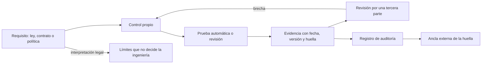
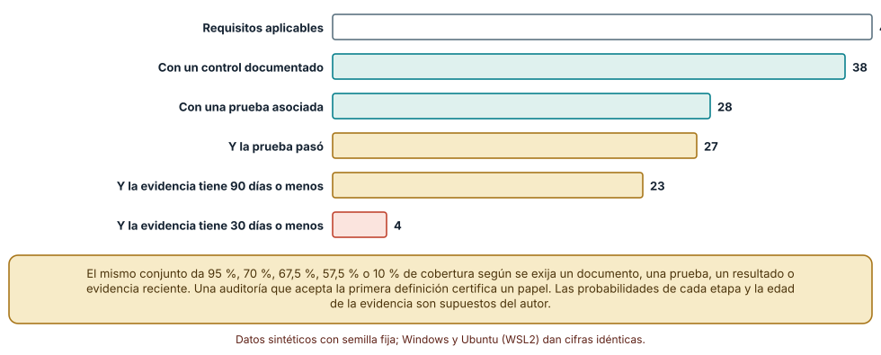
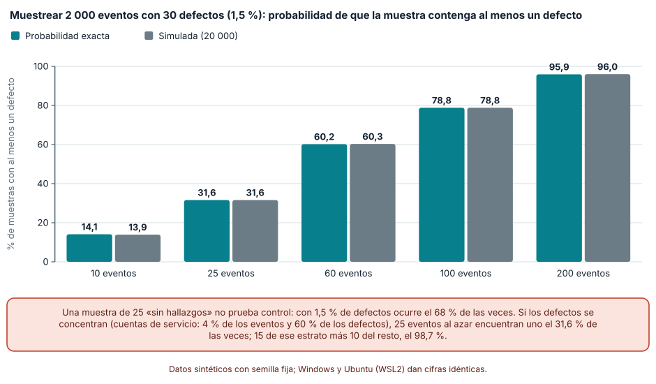

# SE-394 — Cumplimiento, evidencia y límites legales

[← SE-393 — Vulnerabilidades, divulgación y respuesta](../../classes/part-32-seguridad-privacidad-y-cumplimiento/se-393-vulnerabilidades-divulgacion-y-respuesta/README.md) · [↑ Parte 32](../../classes/part-32-seguridad-privacidad-y-cumplimiento/README.md) · [📚 Índice completo](../../classes/README.md) · [🌐 Portal](../../site/classes/SE-394.html) · [SE-395 — Taller: explotar y reparar un control aparente →](../../classes/part-32-seguridad-privacidad-y-cumplimiento/se-395-taller-explotar-y-reparar-un-control-aparente/README.md)

## Punto profesional y fundamento pedagógico

**Punto profesional.** La clase existe para que puedas demostrar a una tercera persona, con evidencia y no con afirmaciones, que un control existe, funciona y sigue funcionando, y para que sepas dónde termina lo que la ingeniería puede demostrar y empieza lo que decide una norma, un contrato o un tribunal. La habilidad profesional es construir una cadena trazable desde un requisito hasta una evidencia vigente, medir qué parte de esa cadena está realmente cubierta y diseñar registros que resistan la manipulación.

**Por qué aparece aquí.** Sigue a **Vulnerabilidades, divulgación y respuesta**: el equipo ya sabe prevenir, detectar y responder; ahora debe poder mostrarlo. Cumplir es una relación entre un requisito externo, un control propio, una prueba y una evidencia, y cada eslabón puede fallar de manera distinta. El caso conductor es **la plataforma de entregas**: una auditoría pide demostrar que los accesos a las calificaciones se registran y que los registros no se pueden alterar.

**Error conceptual que debe corregir.** Creer que cumplir es tener un documento que dice que se cumple. Un control documentado, uno probado, uno que pasó su última prueba y uno con evidencia de este trimestre son cuatro cosas distintas, y la proporción de requisitos «cubiertos» depende de cuál se exige.

**Secuencia de aprendizaje.** Antes de mirar el resultado, predices qué parte de 40 requisitos queda cubierta con evidencia de menos de 30 días cuando la mayoría tiene un control documentado, cuántos eventos hay que muestrear para encontrar un defecto que afecta al 1,5 % y qué ataques detecta un registro encadenado; después comparas las cifras. La secuencia usa predicción, contraste y explicación propia. [ICAP](https://icap.education.asu.edu/research) distingue participar de construir conocimiento; [How People Learn II](https://nap.nationalacademies.org/catalog/24783/how-people-learn-ii-learners-contexts-and-cultures) respalda diseñar la práctica con contextos reales y retroalimentación.

**Evidencia de aprendizaje.** `cumplimiento-log.md` con la predicción, la matriz requisito–control–prueba–evidencia de la plataforma con su embudo de cobertura, el cálculo del tamaño de muestra, la prueba del registro encadenado y una nota que separe qué parte es medida, cuál es modelo y cuál es suposición legal.

**Límite de la conclusión.** El embudo de 40 requisitos (probabilidades de tener control, prueba y resultado y edad de la evidencia) es una simulación con semilla fija; el muestreo usa una población de 2 000 eventos con 30 defectos; la cadena de huellas usa 1 000 eventos sintéticos. No se auditó ninguna organización, no se verificó conformidad con ninguna norma y la clase **no** da asesoría legal: lo que exige una ley a una organización concreta lo determinan personas habilitadas para ello.

### Trazabilidad fuente → afirmación

| Fuente primaria u oficial | Afirmación que respalda | Lo que no prueba |
|---|---|---|
| [Reglamento (UE) 2016/679 (RGPD)](https://eur-lex.europa.eu/eli/reg/2016/679/oj) | Establece que quien trata datos debe poder demostrar el cumplimiento de los principios (responsabilidad proactiva, art. 5.2). | No dice cómo se demuestra en una organización concreta. |
| [Ley 21.719 de Chile](https://www.bcn.cl/leychile/navegar?idNorma=1209272) | Regula la protección y el tratamiento de los datos personales y crea la Agencia de Protección de Datos Personales; sus normas entran en vigencia de forma diferida. | No determina las obligaciones de la plataforma ni sustituye una opinión jurídica. |
| [NIST SP 800-53 Rev. 5](https://csrc.nist.gov/pubs/sp/800/53/r5/upd1/final) | Ofrece un catálogo de controles de seguridad y privacidad, entre ellos familias de auditoría y rendición de cuentas. | No es obligatorio para la plataforma ni dice cuáles seleccionar. |
| [NIST/SEMATECH e-Handbook of Statistical Methods](https://www.itl.nist.gov/div898/handbook/) | Documenta métodos estadísticos de muestreo y de inferencia sobre poblaciones finitas. | No fija el tamaño de muestra de una auditoría. |
| [Schneier y Kelsey, «Secure audit logs to support computer forensics»](https://doi.org/10.1145/317087.317089) | Propone registros de auditoría con cadenas de huellas para detectar alteraciones posteriores a un compromiso. | No dice qué registrar en la plataforma. |
| [RFC 6962: Certificate Transparency](https://www.rfc-editor.org/rfc/rfc6962) | Muestra un registro público de solo anexado con pruebas de inclusión y de consistencia verificables por terceros. | No lo aplica a registros internos. |

## Antes de empezar

Recupera lo aprendido en `SE-393` sobre plazos medibles y en `SE-392` sobre pruebas que fallan. La pregunta activa es: **si una auditora te pide hoy la evidencia de que los accesos a las calificaciones se registran, ¿qué le entregas, de qué fecha es y cómo sabe que nadie la alteró?**

## Prerrequisitos

- Haber completado `SE-393` o poder explicar la diferencia entre un control y la evidencia de que funciona.
- Python 3.11 o posterior; los experimentos usan solo la biblioteca estándar (`random`, `hashlib`, `math`).
- Saber qué es un hash y una probabilidad.

## Problema auténtico

En un escenario ilustrativo, una institución cliente pidió a la plataforma una «certificación de cumplimiento» para renovar el contrato. El equipo reunió un documento de políticas, una lista de controles y capturas de pantalla de la configuración. La auditora hizo tres preguntas. Primera: ¿qué requisito cubre este control? El equipo no tenía una tabla; la reconstruyó en dos días y encontró cuatro requisitos sin control. Segunda: ¿cuándo se probó por última vez? Las pruebas existían, pero la evidencia más reciente de la mitad era de hacía seis meses. Tercera: ¿cómo sé que el registro de accesos no fue editado? El registro era una tabla en la base de datos, modificable por la cuenta de la aplicación. Ninguna respuesta era un incumplimiento de una norma concreta; las tres eran ausencia de evidencia. La clase enseña a construir esa cadena, a medirla y a diseñar registros que resistan la edición.

## Objetivos observables

Al terminar podrás:

1. construir una matriz requisito–control–prueba–evidencia y calcular su cobertura con distintas definiciones de «cubierto»;
2. explicar qué distingue un control documentado, probado, aprobado y con evidencia vigente;
3. calcular el tamaño de una muestra de auditoría para encontrar un defecto de una tasa dada y reconocer cuándo el muestreo aleatorio falla;
4. diseñar un registro de auditoría que detecte alteraciones y decir qué ataques no detecta sin un ancla externa;
5. separar lo que la ingeniería demuestra de lo que decide un marco legal o contractual.

## Mapa conceptual



El mapa muestra la **cadena de trazabilidad** de izquierda a derecha y el **registro con ancla** como una rama. La flecha hacia los límites legales indica que la interpretación de un requisito no la decide el equipo técnico.

## Temas y por qué importan

| Tema | Por qué cambia una decisión profesional | Evidencia mínima |
|---|---|---|
| Del requisito a la evidencia | Cada eslabón ausente es un hueco que otra persona descubrirá. | Matriz con los cuatro eslabones por requisito |
| Cobertura y frescura de la evidencia | «Cubierto» depende de lo que se exija: documento, prueba o resultado reciente. | Embudo de cobertura por definición |
| Muestreo y auditoría | Una muestra pequeña sin hallazgos no demuestra ausencia de defectos. | Probabilidad de detección por tamaño de muestra |
| Registros que resisten la manipulación | Un registro editable no sirve como evidencia. | Prueba de alteraciones contra una cadena con y sin ancla |
| Límites legales y contractuales | La ingeniería aporta evidencia; la obligación la fija una norma. | Lista de lo que depende de asesoría legal |

## Conceptos y decisiones

### 1. De la exigencia a la evidencia

Un **requisito** puede venir de una ley (proteger los datos de las personas), de un contrato (un registro de accesos durante un año) o de una política interna. Un **control** es lo que la organización hace para cumplirlo (un registro de accesos con retención). Una **prueba** comprueba que el control funciona (generar un acceso y verificar que aparece en el registro). La **evidencia** es el resultado de la prueba con fecha, versión del sistema y huella, de modo que otra persona pueda verificarla. Un requisito sin control es un hueco, un control sin prueba es una promesa, una prueba sin evidencia vigente es una afirmación antigua. La relación es de muchos a muchos: un control cubre varios requisitos y un requisito necesita varios controles. Por eso se mantiene una **matriz** (en un archivo versionado, no en una hoja de cálculo que se pierde) que enumera los cuatro eslabones y cuyas celdas vacías son el trabajo pendiente. El RGPD resume la idea en la responsabilidad proactiva: no basta cumplir, hay que poder demostrarlo.

### 2. Cobertura y frescura

«El 95 % de los requisitos tiene un control» y «el 10 % tiene evidencia de este mes» pueden ser verdad a la vez sobre el mismo conjunto. La cobertura se define por el eslabón que se exige: documentada (existe un control escrito), implementada (existe en el sistema), probada (existe una prueba), aprobada (la prueba pasó) y vigente (la evidencia tiene menos de N días). La **frescura** importa porque el sistema cambia: una prueba que pasó hace seis meses describe una versión que ya no existe. La política de frescura depende del riesgo (un control de acceso a las calificaciones puede exigir evidencia continua; una política de formación, anual) y la automatización es la manera práctica de mantenerla: las pruebas se ejecutan en cada versión y el resultado se guarda con su huella. Un tablero que muestra el embudo completo es más útil que un porcentaje único, porque dice qué eslabón mejorar.

### 3. Muestrear sin engañarse

Auditar todo es caro, de modo que se examina una muestra de los registros, los cambios o los accesos. La probabilidad de que una muestra aleatoria de n elementos contenga al menos un defecto, en una población de N con D defectuosos, es 1 − C(N − D, n)/C(N, n) (distribución hipergeométrica). Con una tasa de 1,5 %, para tener un 95 % de probabilidad de ver al menos un defecto hacen falta unos 200 elementos; con una muestra de 25 «sin hallazgos» se puede tener un defecto del 1,5 % más del 68 % de las veces. La consecuencia es doble. Un resultado sin hallazgos de una muestra pequeña acota la tasa, no la descarta: la conclusión correcta es «la tasa de defectos es probablemente menor que x con confianza y». Y el muestreo aleatorio simple falla cuando los defectos se **concentran**: si las cuentas de servicio son el 4 % de los eventos y el 60 % de los defectos, conviene estratificar y muestrear más donde el riesgo es mayor.

### 4. Registros de auditoría que resisten la manipulación

Un registro es evidencia solo si no puede alterarse sin dejar rastro. Una tabla modificable por la aplicación no lo es: quien compromete la aplicación puede editarla. Un registro con **cadena de huellas** (cada entrada incluye el hash de la anterior) detecta la modificación, el borrado y el reordenamiento de entradas intermedias, porque cualquier cambio rompe la huella siguiente. No detecta dos ataques: el **truncamiento** de las últimas entradas (la cadena que queda es válida) y la **reescritura** desde un punto con huellas recalculadas (quien puede escribir puede recalcular). La defensa es un **ancla externa**: publicar periódicamente la huella final fuera del alcance de quien puede escribir (un tercero, un sellado de tiempo, un registro de transparencia como el de los certificados, RFC 6962), de modo que cualquier alteración posterior al ancla se detecta al compararla. El ancla debe ser anterior al ataque: una huella publicada después no prueba nada sobre el pasado. Se complementan con control de acceso al registro (solo anexar), retención y sincronización de relojes.

### 5. Lo que decide la ley y no el equipo

La ingeniería puede producir evidencia de que un control existe y funciona. No puede decidir si ese control satisface una obligación legal: qué datos son personales, cuánto tiempo se pueden conservar, qué se debe notificar y a quién, qué derechos tienen las personas y con qué plazos, qué diferencia hay entre el responsable y el encargado del tratamiento. Esas respuestas dependen de la jurisdicción (el RGPD en la Unión Europea, la Ley 21.719 en Chile), del tipo de dato (los de menores merecen especial atención), del contrato y de la interpretación de autoridades y tribunales. El papel del equipo técnico es hacer visible lo que sabe (qué datos hay, dónde, quién accede, cuánto tiempo), no firmar el cumplimiento. Una declaración de cumplimiento sin revisión de quien tiene competencia para ello es una afirmación con riesgo.

### De 40 requisitos a evidencia vigente

Se simulan 40 requisitos aplicables a la plataforma. Por supuesto del autor, el 90 % tiene un control documentado, el 78 % de ellos tiene una prueba, el 93 % de las pruebas pasó en la última ejecución y la edad de la evidencia sigue una distribución exponencial con media de 70 días. Se cuenta cuántos requisitos cumplen cada definición de «cubierto».

| Definición | Requisitos cubiertos (de 40) | % |
|---|---:|---:|
| Con un control documentado | 38 | 95,0 |
| Con una prueba asociada | 28 | 70,0 |
| Con una prueba que pasó | 27 | 67,5 |
| Y la evidencia tiene 90 días o menos | 23 | 57,5 |
| Y la evidencia tiene 30 días o menos | 4 | 10,0 |

El mismo conjunto de 40 requisitos da una cobertura de 95 % o de 10 % según el eslabón que se exija. Una auditoría que acepta el primero certifica un papel; una que exige el último está midiendo si las pruebas se ejecutan de manera continua.



**Cómo leer la figura.** Cada barra es una definición más exigente de «cubierto»; la caída entre las dos últimas es el efecto de la frescura. **Dónde deja de valer:** las probabilidades de cada etapa y la edad de la evidencia son supuestos del autor; con pruebas automáticas en cada versión, la última barra se acerca a la tercera. La simulación no mide la calidad de las pruebas ni su pertinencia para el requisito.

### Cuántos eventos hay que mirar

Hay 2 000 eventos con 30 defectuosos (1,5 %). Se calcula la probabilidad exacta de que una muestra aleatoria contenga al menos uno y se comprueba con 20 000 simulaciones. Después se concentran los defectos: las cuentas de servicio son 80 eventos con 18 defectuosos, y los 1 920 restantes tienen 12.

| Tamaño de la muestra | Probabilidad exacta | Simulada (20 000) |
|---:|---:|---:|
| 10 | 14,1 % | 13,9 % |
| 25 | 31,6 % | 31,6 % |
| 60 | 60,2 % | 60,3 % |
| 100 | 78,8 % | 78,8 % |
| 200 | 95,9 % | 96,0 % |

Con 25 elementos al azar, una muestra «sin hallazgos» ocurre en el 68,4 % de los casos aunque haya un 1,5 % de defectos. Con la misma población y los defectos concentrados, 25 elementos al azar siguen encontrando un defecto el 31,6 % de las veces, pero 15 de las cuentas de servicio más 10 del resto lo encuentran el 98,7 %.



**Cómo leer la figura.** La columna exacta y la simulada coinciden dentro del ruido; el tamaño crece rápido para cada punto de confianza adicional. **Dónde deja de valer:** el cálculo supone muestreo sin reposición de una población finita de la que se conoce la tasa; en una auditoría real la tasa es la incógnita y se trabaja con una cota. Los defectos concentrados son del autor; en la práctica se conocen por el análisis de riesgo.

### Un registro de 1 000 eventos y cinco ataques

Se construye una cadena donde cada entrada guarda el hash SHA-256 de la huella anterior concatenada con su texto. Se simulan 100 ataques de cada tipo sobre una copia y se cuenta cuántos detecta la verificación de la cadena y cuántos detecta además la comparación con la huella final publicada fuera del sistema antes del ataque.

```python
h = hashlib.sha256((prev + cuerpo).encode()).hexdigest()
cadena.append((cuerpo, h)); prev = h
```

| Ataque al registro | Solo la cadena | Cadena y huella publicada |
|---|---:|---:|
| Modificar un evento | 100 de 100 | 100 de 100 |
| Borrar un evento intermedio | 100 de 100 | 100 de 100 |
| Reordenar dos eventos | 100 de 100 | 100 de 100 |
| Truncar los últimos 10 eventos | 0 de 100 | 100 de 100 |
| Reescribir desde un evento recalculando las huellas | 0 de 100 | 100 de 100 |

La cadena sola ve todo lo que rompe un eslabón y nada de lo que lo reconstruye o lo corta por el final. La huella publicada fuera cierra esos dos casos.


**Cómo leer la figura.** Las filas son ataques de menor a mayor capacidad; la tercera columna es lo que se gana al publicar la huella. **Dónde deja de valer:** la huella publicada debe ser anterior al ataque y estar fuera del alcance del atacante; una huella almacenada en el mismo sistema no sirve. No se modeló un atacante que compromete también el canal de publicación ni la pérdida de entradas por fallo del sistema.

## Definiciones de trabajo

- **trazabilidad:** relación verificable entre un requisito, el control que lo cubre, la prueba que lo comprueba y la evidencia que lo respalda.
- **evidencia:** resultado de una prueba o inspección con fecha, versión y huella que permite a otra persona verificar un control.
- **muestreo de auditoría:** selección de un subconjunto de eventos o registros para inferir la tasa de defectos de la población completa.
- **registro de solo anexado:** registro en el que solo se pueden añadir entradas y cualquier modificación posterior es detectable.
- **ancla externa:** huella de un registro publicada fuera del alcance de quien puede escribir en él.

Las definiciones son operativas para la plataforma de entregas. No convierten términos con una historia más amplia en sinónimos y deben contrastarse con la documentación primaria enlazada al final.

## Ejemplo mínimo

El fragmento muestra por qué una muestra pequeña sin hallazgos no descarta un defecto. Antes de ejecutarlo, predice la probabilidad de no ver ninguno.

```python
import math
N, D, n = 2000, 30, 25
print(round(math.comb(N - D, n) / math.comb(N, n), 3))
```

Imprime `0.684`: con 25 elementos y un 1,5 % de defectos, el 68,4 % de las muestras no contiene ninguno. Registra versión de Python, comando y salida; después busca el menor n con una probabilidad de no ver ninguno inferior al 5 %.

## Ejemplo profesional

El equipo de la plataforma crea en el repositorio un archivo `trazabilidad.csv` con 40 requisitos y las columnas control, prueba, última evidencia (fecha, versión y huella) y responsable. Una tarea de la integración continua ejecuta las pruebas de cada control en cada versión, guarda el resultado con su huella y recalcula el embudo de cobertura, y falla si un requisito crítico pasa de 30 días sin evidencia. El registro de accesos a las calificaciones es de solo anexado: cada entrada incluye la huella de la anterior, la aplicación no puede modificar entradas ya escritas y la huella final se publica cada hora en un servicio externo. Para la auditoría muestrea 200 accesos estratificados (cuentas de servicio y accesos fuera de horario con mayor peso) y entrega, junto con la evidencia, una lista de lo que depende de asesoría legal (retención, notificación, base de tratamiento). Se mide por lo que cambia: en el modelo de la clase, la cobertura con evidencia de 30 días pasa de 10 % a la de las pruebas automáticas ejecutadas por versión.

## Práctica guiada

1. Escribe tu predicción de la cobertura con evidencia de 30 días de un conjunto de 40 requisitos.
2. Construye la matriz requisito–control–prueba–evidencia de la plataforma con 20 requisitos propios.
3. Simula el embudo con semilla fija y mide la cobertura con cinco definiciones.
4. Calcula la probabilidad exacta de ver un defecto para cinco tamaños de muestra y comprueba con 20 000 simulaciones.
5. Implementa la cadena de huellas y ejecuta 100 ataques de cada tipo con y sin la huella publicada.
6. Escribe la lista de lo que depende de asesoría legal y marca qué evidencia técnica la respalda.
7. Entrega `cumplimiento-log.md` y pide a otra persona que encuentre un requisito sin control en tu matriz.

## Ejercicios

1. **Cobertura:** calcula la cobertura de tu matriz con cada definición y explica qué eslabón mejorarías primero.
2. **Muestreo:** calcula el tamaño de muestra para 95 % de probabilidad de ver un defecto con una tasa de 0,5 % en 10 000 eventos.
3. **Registro:** explica por qué una huella publicada después del ataque no detecta la alteración y propón un calendario de anclaje.
4. **Límites:** redacta tres afirmaciones que la ingeniería puede respaldar con evidencia y tres que no puede decidir sin una persona competente en derecho.

## Reto verificable

Entrega `cumplimiento-log.md` con la predicción, la matriz, el embudo, el cálculo del tamaño de muestra, la prueba de la cadena con y sin ancla y la lista de límites legales. Se aprueba si otra persona ejecuta el código desde un checkout limpio, obtiene las mismas cifras con las mismas semillas y puede decir qué parte de la cobertura es evidencia vigente y qué ataque sobre el registro no detectarías sin ancla. No se aprueba por entregar un porcentaje de cobertura sin definir «cubierto» ni por afirmar que el sistema «cumple» una norma.

## Caso conductor

La plataforma de entregas de tareas continúa como caso conductor. Esta clase deja el décimo artefacto: la matriz de trazabilidad con su evidencia y el registro con ancla. `SE-395` pondrá a prueba un control que parece funcionar: lo explotará y lo reparará. Cambia después un solo dato, la frescura exigida de 30 a 90 días, y observa cómo cambia la cobertura que el equipo puede declarar.

## Preguntas frecuentes

### ¿Cumplir una norma es lo mismo que ser seguro?

No. Una norma fija un mínimo de controles en un momento y para un alcance; un sistema puede cumplirla y tener un camino barato hacia sus activos (`SE-385`), o ser seguro sin haber demostrado conformidad con ninguna. Se complementan: la norma ordena, el modelo de amenazas prioriza.

### ¿Hace falta una herramienta de cumplimiento?

No necesariamente. Hace falta que la matriz, las pruebas y las evidencias estén versionadas y se actualicen con el sistema. Las herramientas ayudan a automatizar la recolección; no deciden qué requisito aplica ni si el control basta.

### ¿Cuánta evidencia es suficiente?

La que permita a una persona independiente llegar a la misma conclusión con el mismo material. Para controles críticos, evidencia continua; para el resto, periódica. La suficiencia depende del riesgo y de lo que el marco o el contrato exijan.

### ¿Qué hago si un requisito legal no está claro?

Se escala a quien tiene competencia legal y se registra la decisión con su razón y su fecha. El equipo técnico documenta lo que el sistema hace; la interpretación no es suya.

## Fallo controlado y diagnóstico

Reproduce el fallo clásico de la clase: **un registro de auditoría que no detecta que le quitaron el final**. Construye la cadena de 1 000 eventos, trunca los últimos 10 y verifica la cadena.

Registra síntoma, entrada mínima, hipótesis, observación que descarta cada hipótesis, causa, corrección y prueba de regresión. **Síntoma:** la verificación del registro dice «íntegro» y faltan los accesos de las últimas horas. **Hipótesis rivales:** (a) la verificación está mal implementada; (b) los eventos no se registraron; (c) se eliminó el final del registro. **Prueba:** compara la huella final con la publicada fuera del sistema; si no coincide y la cadena restante es válida, la causa es un truncamiento. **Conclusión:** la cadena detecta eslabones rotos, no ausencias al final; sin ancla externa el truncamiento es invisible. **Regresión:** publica la huella final cada hora en un servicio externo y añade una prueba que simule truncamiento y reescritura y exija que la comparación los detecte. No cambies a la vez el formato del registro y el calendario del ancla.

## Errores comunes y cómo corregirlos

| Síntoma | Causa probable | Corrección |
|---|---|---|
| Un requisito no tiene control | Sin matriz de trazabilidad | Matriz versionada con las celdas vacías visibles |
| La evidencia es de hace seis meses | Pruebas manuales y esporádicas | Automatizar y guardar resultado con fecha y huella por versión |
| Una muestra sin hallazgos tranquiliza | Tamaño insuficiente para la tasa buscada | Calcular el tamaño necesario y estratificar |
| El registro de accesos se puede editar | Tabla modificable por la aplicación | Solo anexado, cadena de huellas y ancla externa |
| Se declara «cumple» sin revisión | Se confunde evidencia técnica con conformidad | Separar lo demostrable de lo que decide una persona competente |

## Entorno y archivos clave

```text
work/SE-394/
├── README.md
├── cumplimiento/
│   ├── trazabilidad.csv
│   ├── embudo.py
│   ├── muestreo.py
│   └── cadena.py
├── tests/test_cumplimiento.py
└── evidence/cumplimiento-log.md
```

El `README` declara plataforma, versión de Python, semillas y comandos. Los experimentos usan solo la biblioteca estándar (`random`, `hashlib`, `math`) y se ejecutaron con CPython 3.12.9 en Windows 11 y 3.12.3 en Ubuntu bajo WSL2: las salidas fueron idénticas. Si añades una dependencia, fija procedencia y versión.

## Seguridad, ética y accesibilidad

- los eventos, requisitos y registros son sintéticos: no uses registros reales de accesos de personas en los experimentos;
- un registro de auditoría contiene datos personales (quién accedió a qué): protégelo con mínimo privilegio y retención, y no lo conviertas en una vigilancia sin finalidad;
- no declares cumplimiento de una norma que no has verificado con una persona competente; hacerlo expone a la organización y a las personas;
- los informes de evidencia deben ser legibles con lector de pantalla y con una estructura que permita verificar sin herramientas especiales;
- la presión por «pasar» una auditoría no debe llevar a preparar evidencia solo para el día de la auditoría.

## Puente hacia el trabajo con agentes

Un agente al que se le pide «prepara la evidencia de cumplimiento» puede generar documentos con redacción convincente y capturas que parecen respaldar cada requisito. Pídele en cambio que construya la matriz con los cuatro eslabones, que marque las celdas vacías, que ejecute las pruebas y guarde los resultados con fecha y huella, que calcule la cobertura con cinco definiciones y que liste explícitamente lo que no puede decidir. Revisa que no invente referencias a artículos o controles, que cada evidencia sea un resultado ejecutable y que el registro de auditoría no sea modificable por la aplicación. El defecto típico es un informe que afirma cumplimiento sin una prueba detrás.

## Transferencia

Traslada el análisis a otro dominio (por ejemplo, un taller que guarda historiales de reparaciones de clientes): cambia los requisitos y los registros y conserva el procedimiento de construir la cadena requisito–control–prueba–evidencia, medir la cobertura por definición, calcular la muestra y diseñar el registro con ancla. La transferencia está lograda cuando puedes decir qué parte de la cobertura declarada es evidencia vigente y qué ataque sobre tu registro sería invisible, no cuando la matriz se parece a la de la plataforma.

## Evaluación y evidencia

| Criterio | Evidencia para aprobar |
|---|---|
| comprensión | explicación de la cadena requisito–control–prueba–evidencia y de la frescura |
| corrección | embudo, muestreo y cadena reproducibles con las mismas semillas |
| diseño | matriz versionada y registro de solo anexado con ancla |
| diagnóstico | reproducción del fallo «truncamiento invisible» con regresión |
| incertidumbre | declaración de que las probabilidades y la población son del autor y de qué decide la ley |
| reproducibilidad | versiones, comandos, salida y límites declarados |

## Fuentes

- [Reglamento (UE) 2016/679](https://eur-lex.europa.eu/eli/reg/2016/679/oj) — responsabilidad proactiva; autoridad: Unión Europea.
- [Ley 21.719](https://www.bcn.cl/leychile/navegar?idNorma=1209272) — protección y tratamiento de datos personales en Chile; autoridad: Biblioteca del Congreso Nacional de Chile.
- [NIST SP 800-53 Rev. 5](https://csrc.nist.gov/pubs/sp/800/53/r5/upd1/final) — catálogo de controles; autoridad: NIST.
- [NIST/SEMATECH e-Handbook of Statistical Methods](https://www.itl.nist.gov/div898/handbook/) — métodos estadísticos; autoridad: NIST.
- [Schneier y Kelsey, 1999](https://doi.org/10.1145/317087.317089) — registros de auditoría seguros; autoridad: ACM Transactions on Information and System Security.
- [RFC 6962](https://www.rfc-editor.org/rfc/rfc6962) — registro público de solo anexado; autoridad: IETF.

Cada fuente respalda el mecanismo indicado; ninguna demuestra que el 57,5 %, el 95,9 % o el 100 % de detección con ancla se observen en una organización real. Esa afirmación depende de las pruebas, de la población auditada y del ancla. Las normas citadas no se interpretan: consulta la versión vigente con una persona competente.

## Límites y siguiente paso

Se ejecutaron tres experimentos con datos sintéticos en Windows y Ubuntu (WSL2) con resultados idénticos. No se auditó ninguna organización ni se verificó conformidad con ninguna norma; el embudo, la población de 2 000 eventos y la cadena de 1 000 eventos son construcciones del autor, y la clase no da asesoría legal ni interpreta ninguna ley. La siguiente clase es un taller: explotar un control que parece funcionar y repararlo.

## Glosario

- **trazabilidad:** relación verificable entre un requisito, el control que lo cubre, la prueba que lo comprueba y la evidencia que lo respalda.
- **evidencia:** resultado de una prueba o inspección con fecha, versión y huella que permite a otra persona verificar un control.
- **muestreo de auditoría:** selección de un subconjunto de eventos o registros para inferir la tasa de defectos de la población completa.
- **registro de solo anexado:** registro en el que solo se pueden añadir entradas y cualquier modificación posterior es detectable.
- **ancla externa:** huella de un registro publicada fuera del alcance de quien puede escribir en él.

---

[← SE-393 — Vulnerabilidades, divulgación y respuesta](../../classes/part-32-seguridad-privacidad-y-cumplimiento/se-393-vulnerabilidades-divulgacion-y-respuesta/README.md) · [↑ Parte 32](../../classes/part-32-seguridad-privacidad-y-cumplimiento/README.md) · [📚 Índice completo](../../classes/README.md) · [🌐 Portal](../../site/classes/SE-394.html) · [SE-395 — Taller: explotar y reparar un control aparente →](../../classes/part-32-seguridad-privacidad-y-cumplimiento/se-395-taller-explotar-y-reparar-un-control-aparente/README.md)
