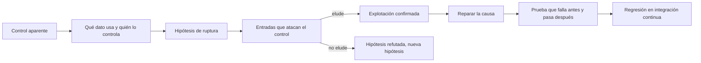

# SE-395 — Taller: explotar y reparar un control aparente

[← SE-394 — Cumplimiento, evidencia y límites legales](../../classes/part-32-seguridad-privacidad-y-cumplimiento/se-394-cumplimiento-evidencia-y-limites-legales/README.md) · [↑ Parte 32](../../classes/part-32-seguridad-privacidad-y-cumplimiento/README.md) · [📚 Índice completo](../../classes/README.md) · [🌐 Portal](../../site/classes/SE-395.html) · [SE-396 — Proyecto: producto con seguridad verificable →](../../classes/part-32-seguridad-privacidad-y-cumplimiento/se-396-proyecto-producto-con-seguridad-verificable/README.md)

## Punto profesional y fundamento pedagógico

**Punto profesional.** El taller existe para que practiques el ciclo completo con el que se descubre que un control aparente no controla: formular qué debería impedir, intentar romperlo con entradas que lo ataquen a él y no a su caso más conocido, reparar la causa y no el síntoma, y dejar una prueba que habría fallado antes de la reparación. La habilidad profesional es desconfiar con método de los controles que pasan todas las pruebas felices.

**Por qué aparece aquí.** Es el taller de la Parte 32 y reúne lo aprendido: la frontera de confianza (`SE-385`), la identidad y la autorización (`SE-386` y `SE-387`), la entrada que cambia de papel (`SE-388`), el uso de la criptografía (`SE-389`) y las pruebas negativas (`SE-392`). Cada una de las cuatro defensas que se ataquen hoy parece cumplir su función y confía en un dato que controla quien ataca. El caso conductor sigue siendo **la plataforma de entregas**: descarga de archivos adjuntos, límite de intentos de inicio de sesión, protección contra solicitudes forzadas desde otro sitio y token de sesión.

**Error conceptual que debe corregir.** Creer que un control que existe y que tiene pruebas es un control que funciona. Un filtro que quita `../` una vez, un limitador que cuenta por una cabecera que envía el cliente, una defensa que comprueba que haya un token pero no su valor y un verificador que acepta el algoritmo que el propio token declara pasan sus pruebas felices y fallan frente a la entrada que el diseñador no imaginó.

**Secuencia de aprendizaje.** Antes de mirar los resultados, escribes para cada control la entrada que crees que lo rompe; después ejecutas cinco mil cargas generadas al azar contra tres versiones de un filtro de rutas, cinco peticiones contra tres implementaciones de una defensa de solicitudes forzadas, mil intentos contra un limitador y cuatro tokens contra dos verificadores; finalmente reparas y dejas la regresión. La secuencia usa predicción, contraste y explicación propia. [ICAP](https://icap.education.asu.edu/research) distingue participar de construir conocimiento; [How People Learn II](https://nap.nationalacademies.org/catalog/24783/how-people-learn-ii-learners-contexts-and-cultures) respalda diseñar la práctica con contextos reales y retroalimentación.

**Evidencia de aprendizaje.** `taller-log.md` con la hipótesis de ruptura por control, las cargas que la confirman o la refutan, la causa de cada uno, la reparación con su prueba de regresión, las tablas de resultados antes y después y una nota que separe qué parte es medida, cuál es modelo y cuál es suposición.

**Límite de la conclusión.** Los cuatro controles son funciones de juguete en memoria; las cinco mil cargas se generan con semilla fija desde un alfabeto del autor y las rutas se resuelven con los módulos `posixpath` y `ntpath` (no con un sistema de archivos real). No se atacó ningún servicio, red o sistema ajeno, y ninguna de las reparaciones sustituye una biblioteca revisada de sesiones, de tokens firmados o de protección contra solicitudes forzadas.

### Trazabilidad fuente → afirmación

| Fuente primaria u oficial | Afirmación que respalda | Lo que no prueba |
|---|---|---|
| [CWE-22](https://cwe.mitre.org/data/definitions/22.html) y [OWASP: recorrido de rutas](https://owasp.org/www-community/attacks/Path_Traversal) | Describen el acceso a archivos fuera de la carpeta prevista manipulando variables con secuencias como «../» y rutas absolutas. | No dicen cuántas cargas de un filtro concreto escapan. |
| [OWASP CSRF Prevention Cheat Sheet](https://cheatsheetseries.owasp.org/cheatsheets/Cross-Site_Request_Forgery_Prevention_Cheat_Sheet.html) | Describe el patrón de token sincronizador y la cookie de doble envío firmada con HMAC, y desaconseja la versión ingenua. | No sustituye los atributos `SameSite` ni los encabezados de metadatos de la petición. |
| [MDN: X-Forwarded-For](https://developer.mozilla.org/en-US/docs/Web/HTTP/Headers/X-Forwarded-For) | Explica que las partes de la cabecera no añadidas por un proxy de confianza pueden falsificarse. | No indica cómo configurar los proxies de la plataforma. |
| [RFC 8725: mejores prácticas para JWT](https://www.rfc-editor.org/rfc/rfc8725) | Describe ataques en que el algoritmo se cambia a «none» y la validación omite la firma, y recomienda fijar los algoritmos aceptados. | No cubre toda la superficie de ataque de los tokens. |
| [RFC 7519: JWT](https://www.rfc-editor.org/rfc/rfc7519) | Define la estructura del token con encabezado, carga y firma. | No dice cómo gestionar sesiones. |
| [Python: os.path](https://docs.python.org/3/library/os.path.html) | Documenta `normpath` y las diferencias entre `posixpath` y `ntpath`, incluido el separador de ruta. | No sustituye la resolución del sistema de archivos real con enlaces simbólicos. |

## Antes de empezar

Recupera `SE-388` (la entrada que se decodifica después de validar) y `SE-386` (el límite por dirección que no actúa sobre el relleno). La pregunta activa es: **para cada uno de estos cuatro controles, ¿qué dato usa para decidir y quién lo controla?**

## Prerrequisitos

- Haber completado `SE-394` o poder explicar la cadena requisito–control–prueba–evidencia.
- Python 3.11 o posterior; los experimentos usan solo la biblioteca estándar (`posixpath`, `ntpath`, `urllib.parse`, `hmac`, `hashlib`, `base64`, `json`, `random`).
- Haber leído `SE-388` y `SE-392`; el taller reutiliza sus ideas.

## Problema auténtico

En un escenario ilustrativo, la plataforma pasó una revisión con cuatro controles marcados como «implementados»: una función que sirve adjuntos eliminaba las secuencias `../` del nombre pedido, el inicio de sesión limitaba a cinco los intentos por dirección leyendo la cabecera `X-Forwarded-For`, los formularios incluían un token contra solicitudes forzadas que el servidor comprobaba que estuviera presente, y las sesiones eran tokens firmados cuyo encabezado indicaba el algoritmo. Cada control tenía pruebas unitarias en verde. Un colega nuevo, en una tarde, descargó un archivo de configuración con el nombre `....//....//config`, hizo mil intentos con mil cabeceras distintas, envió un formulario con un token inventado y presentó un token con `"alg": "none"` y el rol de docente. Los cuatro funcionaron. Nada de eso exigía una herramienta sofisticada: exigía preguntarse, para cada control, en qué dato confía y quién lo controla. El taller reproduce los cuatro ataques, repara cada causa y deja las regresiones.

## Objetivos observables

Al terminar podrás:

1. formular para cada control aparente una hipótesis de ruptura basada en el dato en que confía;
2. generar cargas que ataquen el control y medir cuántas lo eluden antes y después de la reparación;
3. distinguir reparar la causa (resolver y comprobar, ligar el token a la sesión, fijar el algoritmo, contar por la conexión) de endurecer el filtro;
4. escribir pruebas de regresión que fallen con la versión vulnerable y pasen con la reparada;
5. documentar el taller de manera que otra persona repita el ataque y la reparación.

## Mapa conceptual



El mapa del taller es un ciclo de **hipótesis, ataque, reparación y regresión**. Cada control recorre las mismas etapas con un dato distinto en el centro: la ruta, la cabecera, el token y el algoritmo.

## Temas y por qué importan

| Tema | Por qué cambia una decisión profesional | Evidencia mínima |
|---|---|---|
| Del dato en que confía el control al ataque | El control falla en el dato que no verifica. | Tabla de control, dato y quién lo controla |
| Rutas: filtrar o resolver | Un filtro sobre el texto no equivale a comprobar el destino. | Cargas que escapan por versión y sistema |
| Cabeceras que controla el cliente | Un límite sobre un dato falsificable no limita. | Intentos permitidos con y sin rotación |
| Tokens de solicitud y de sesión | Comprobar que existe no es comprobar que vale. | Matriz de peticiones por implementación |
| Reparar la causa y dejar la regresión | Una reparación sin prueba se deshace en la siguiente refactorización. | Pruebas que fallan antes y pasan después |

## Conceptos y decisiones

### 1. El dato en que confía el control

Todo control toma una decisión con un dato. La pregunta de revisión es: ¿de dónde viene ese dato y puede cambiarlo quien ataca? El filtro de rutas decide con el nombre que escribió el cliente; el limitador, con una cabecera que escribe el cliente; la defensa contra solicitudes forzadas, con un token que devuelve el cliente; el verificador de sesión, con un encabezado que escribe quien presenta el token. En cada caso el control sustituye una **comprobación del hecho** (¿el archivo final está dentro de la carpeta?, ¿de qué conexión viene la petición?, ¿este token se emitió para esta sesión?, ¿está firmado con el algoritmo que yo elegí?) por una **comprobación de una declaración** (¿el texto contiene `../`?, ¿qué dice la cabecera?, ¿hay un token?, ¿qué algoritmo dice el token?). Esa diferencia es la que se explota. La reparación consiste en volver a la comprobación del hecho con datos que decide el servidor.

### 2. Rutas: de filtrar texto a comprobar destino

Un filtro que elimina `../` una vez convierte `....//secreto` en `../secreto`: al quitar la subcadena interna queda la que forma la secuencia. Quitarla en un bucle cierra ese caso y deja abiertos otros: la decodificación porcentual que ocurre después (`%2e%2e%2f`) vuelve a formar la secuencia, la barra invertida es un separador en Windows y no en POSIX, y las rutas absolutas ignoran la carpeta base. El patrón es el de `SE-388` (validar antes de transformar). La reparación es **resolver la ruta final con la misma lógica que usará el sistema y comprobar que sigue dentro de la raíz**: decodificar, unir con la carpeta base, normalizar y comparar el prefijo con la raíz, rechazando si no coincide. En entornos con enlaces simbólicos hay que resolver los enlaces, y la comprobación debe hacerse con la función del sistema que abre el archivo para evitar carreras entre la comprobación y el uso. La lista blanca de nombres (identificadores, no rutas) es aún más robusta: el cliente pide el archivo 4521 y el servidor sabe dónde está.

### 3. Cabeceras que escribe el cliente

La cabecera `X-Forwarded-For` la añaden los proxies para indicar la dirección original del cliente, y la puede escribir cualquiera: si el servidor la toma a ciegas, quien ataca elige la dirección con la que se le cuenta. MDN lo advierte: solo las partes añadidas por un proxy de confianza son fiables. Un limitador que cuenta por esa cabecera permite 1 000 intentos de 1 000 si cada intento lleva un valor distinto, y 5 si no cambia; el control funciona solo contra quien no sabe que existe. La reparación es contar por la **dirección de la conexión** (la que ve el servidor) o, detrás de un proxy, por el elemento de la cadena que añadió el último proxy de confianza, y limitar además por **cuenta** y por **comportamiento**. Es el mismo principio de `SE-386`: un límite por un dato que el atacante puede cambiar no limita.

### 4. Tokens: presencia, valor y ligadura

Una defensa contra solicitudes forzadas desde otro sitio añade un token que el navegador envía con cada formulario y que un sitio externo no puede conocer. Comprobar que **haya** un token es equivalente a no comprobar nada: el atacante envía cualquiera. Comparar con un **valor global** compartido rechaza los inventados pero acepta el de cualquier sesión (el atacante abre su propia cuenta, copia su token y lo usa contra la víctima). La defensa correcta **liga el token a la sesión**: un HMAC de la sesión con una clave del servidor, o un valor aleatorio guardado en la sesión, comparado con una función de tiempo constante. OWASP recomienda el patrón de token sincronizador o la cookie de doble envío firmada, y desaconseja la versión ingenua. Los atributos `SameSite` de la cookie y la comprobación del origen de la petición son capas adicionales.

### 5. Tokens firmados: quién elige el algoritmo

Un token firmado trae un encabezado que declara el algoritmo de firma. Si el verificador usa el algoritmo que dice el token, el atacante elige: `none` significa «sin firma» y algunas bibliotecas lo aceptaron, y cambiar un algoritmo asimétrico por uno simétrico hizo que otras usaran la clave pública como secreto compartido. RFC 8725 recoge estos ataques y recomienda que el verificador **fije la lista de algoritmos aceptados**. La reparación es exigir un algoritmo concreto en el servidor, rechazar todo lo demás y verificar siempre la firma antes de leer la carga. El principio general se repite: el algoritmo, la clave y la política de validación los decide el servidor, no el dato que se valida.

### Cinco mil cargas contra tres filtros de rutas

Se generan 5 000 cargas concatenando de 1 a 5 elementos de un alfabeto (`..`, `.`, `/`, `\`, `%2e`, `%2f`, `....//`, `..././`, `%2e%2e%2f`, `a`, `x`). Una ruta «sale» si, tras aplicar el control y decodificar, la ruta normalizada unida a la raíz queda fuera de ella. Se evalúa con las reglas de POSIX y de Windows (`posixpath` y `ntpath`).

```python
def sale(modulo, ruta_final, base):
    p = modulo.normpath(modulo.join(base, ruta_final.lstrip("/\\")))
    b = modulo.normpath(base)
    return not (p == b or p.startswith(b + modulo.sep))
```

| Control | Salen de la raíz (POSIX) | Salen de la raíz (Windows) |
|---|---:|---:|
| Quitar «../» una vez y decodificar después | 2 072 | 2 154 |
| Quitar «../» en bucle y decodificar después | 1 106 | 1 181 |
| Decodificar, resolver y comprobar el prefijo de la raíz | 0 (903 rechazadas) | 0 (958 rechazadas) |

El filtro de una pasada deja salir el 41,4 % de las cargas aleatorias en POSIX; el bucle, el 22,1 %. Con la comprobación del destino ninguna sale: las 903 y 958 cargas que habrían salido se rechazan.


**Cómo leer la figura.** Cada fila es una versión del control; las dos columnas son las reglas de cada sistema, que difieren en el separador. **Dónde deja de valer:** el alfabeto y el número de elementos son del autor, así que las proporciones de escape (41,4 % y 22,1 %) no estiman nada real; cambian con otro alfabeto. Que la tercera fila dé cero es una propiedad de la comprobación del prefijo, no de las cargas. No se modelaron enlaces simbólicos ni carreras entre comprobación y uso.

### Un token que solo comprueba presencia

Se prueban cinco peticiones contra tres implementaciones: comprobar que haya token, compararlo con un valor global y ligarlo a la sesión con un HMAC.

```python
def v_ligado(sesion, tok):
    return hmac.compare_digest(tok or "", hmac.new(clave, sesion.encode(), hashlib.sha256).hexdigest())
```

| Petición | Solo presencia | Valor global | Ligado a la sesión |
|---|---|---|---|
| Sin token | rechaza | rechaza | rechaza |
| Token inventado | ACEPTA | rechaza | rechaza |
| Token con un espacio | ACEPTA | rechaza | rechaza |
| Token válido de la sesión de otra persona | ACEPTA | ACEPTA | rechaza |
| Token propio de la sesión | acepta | rechaza | acepta |

Las pruebas felices (sin token rechaza, token propio acepta) pasan en la primera columna. La segunda parece mejor y falla en la otra dirección: rechaza el token propio, porque el valor global es el de la sesión de otra persona.


**Cómo leer la figura.** Las filas son peticiones de menos a más sofisticadas; las mayúsculas marcan donde el control acepta lo que debía rechazar. **Dónde deja de valer:** las tres funciones son de juguete; no incluyen cookies, `SameSite` ni rotación del token, y la comprobación del origen de la petición es una capa adicional. La lección es sobre qué comprueba el servidor, no sobre cómo implementar la defensa completa.

### Un limitador y un verificador que confían en el cliente

Se evalúan mil intentos de inicio de sesión contra dos limitadores (por cabecera y por dirección de la conexión) y cuatro tokens firmados contra dos verificadores (el que lee el algoritmo del token y el que fija HS256).

| Prueba | Control aparente | Control reparado |
|---|---|---|
| 1 000 intentos con una cabecera distinta en cada uno | 1 000 permitidos | 5 permitidos |
| 1 000 intentos sin cambiar de dirección | 5 permitidos | 5 permitidos |
| Token legítimo | acepta | acepta |
| Token con `alg: none` y rol docente | ACEPTA | rechaza |
| Token con la firma de otra clave | rechaza | rechaza |
| Token con la carga alterada y la firma vieja | rechaza | rechaza |

Los dos controles aparentes cumplen contra el caso que se probó (sin cambiar de dirección, firmas ajenas, carga alterada) y fallan frente al dato que decide el atacante.


**Cómo leer la figura.** Cada fila es un intento; la diferencia entre columnas está en pocas filas, y esas filas son las que ninguna prueba feliz ejecuta. **Dónde deja de valer:** detrás de un proxy la dirección de la conexión es la del proxy: la reparación real exige configurar qué proxies son de confianza y leer el elemento correcto de la cadena. El verificador reparado es de juguete; en producción se usa una biblioteca revisada configurada con una lista cerrada de algoritmos.

## Definiciones de trabajo

- **control aparente:** control que existe, tiene pruebas favorables y decide con un dato que controla quien ataca.
- **hipótesis de ruptura:** enunciado de qué entrada eludiría un control y por qué, formulado antes de probarla.
- **resolver la ruta:** convertir un nombre de archivo en la ruta final que usará el sistema, aplicando decodificación, unión con la raíz y normalización.
- **token ligado a la sesión:** valor de comprobación derivado de la sesión con una clave del servidor, de modo que solo vale para ella.
- **prueba de regresión:** prueba que falla con el defecto y pasa con la corrección, y que se conserva para detectar su reaparición.

Las definiciones son operativas para la plataforma de entregas. No convierten términos con una historia más amplia en sinónimos y deben contrastarse con la documentación primaria enlazada al final.

## Ejemplo mínimo

El fragmento muestra el filtro de una pasada. Antes de ejecutarlo, predice qué imprime.

```python
filtrar = lambda s: s.replace("../", "")
print(filtrar("....//secreto"), filtrar("../secreto"))
```

Imprime `../secreto` y `secreto`: el filtro funciona contra la entrada obvia y reconstruye la secuencia con la entrada que dobla el patrón. Registra versión de Python, comando y salida; después sustituye el filtro por la resolución de la ruta y la comprobación del prefijo y comprueba que `....//secreto` queda fuera.

## Ejemplo profesional

El equipo de la plataforma organiza el taller como una sesión de tres horas con dos roles: quien ataca escribe una hipótesis por control sin ver la implementación y quien defiende la reparación. Quien ataca ejecuta las cargas (las 5 000 del experimento y las suyas), registra cuáles eluden el control y cuál es el dato en que se apoya; quien defiende repara la causa: resolver y comprobar el prefijo, contar por la conexión y por cuenta, ligar el token a la sesión con un HMAC y fijar el algoritmo del verificador. Cada reparación se acompaña de una prueba de regresión que falla con la versión anterior. El equipo añade al catálogo de casos de abuso (`SE-392`) las cuatro entradas y una regla de la revisión de cambios que pregunta, para cada control nuevo, «¿qué dato usa y quién lo controla?». Se mide por lo que cambia: en el modelo de la clase, las cargas que eluden el control de rutas pasan de 2 072 a 0.

## Práctica guiada

1. Escribe tu hipótesis de ruptura para cada uno de los cuatro controles, antes de ver la implementación.
2. Implementa los tres filtros de rutas y genera 5 000 cargas con semilla fija; mide cuántas salen con reglas de POSIX y de Windows.
3. Implementa las tres defensas contra solicitudes forzadas y ejecuta las cinco peticiones.
4. Implementa el limitador por cabecera y por conexión y lanza 1 000 intentos con y sin cabecera rotada.
5. Implementa los dos verificadores de tokens y presenta los cuatro tokens.
6. Para cada control escribe la prueba de regresión que falla con la versión vulnerable y pasa con la reparada.
7. Entrega `taller-log.md` y pide a otra persona que encuentre una entrada que eluda alguna de tus reparaciones.

## Ejercicios

1. **Ruta:** escribe una carga que eluda el filtro en bucle y no la de resolver con prefijo, o demuestra con la salida que no existe en tu alfabeto.
2. **Cabecera:** explica cómo debe leerse `X-Forwarded-For` detrás de dos proxies de confianza y qué ocurre si hay uno que no lo es.
3. **Token:** explica por qué el valor global rechaza el token propio y diseña la prueba que lo detecta.
4. **Algoritmo:** escribe la lista de algoritmos que aceptaría la plataforma y la política para añadir uno nuevo.

## Reto verificable

Entrega `taller-log.md` con las cuatro hipótesis, las cuatro tablas de resultados (antes y después), las pruebas de regresión y la causa de cada control. Se aprueba si otra persona ejecuta el código desde un checkout limpio, obtiene las mismas cifras (todos los experimentos del taller son deterministas), puede reproducir los cuatro ataques en la versión vulnerable y comprobar que fallan en la reparada. No se aprueba por reparar solo la carga que se usó para descubrir el defecto ni por una regresión que pasa con la versión vulnerable.

## Caso conductor

La plataforma de entregas de tareas continúa como caso conductor. El taller deja el undécimo artefacto: cuatro controles reparados con sus regresiones y la pregunta de revisión «¿qué dato usa y quién lo controla?». `SE-396` integra la Parte 32 en un producto con seguridad verificable. Cambia después un solo dato, el alfabeto de las cargas (añade `;` y `%00`), y observa si el control de rutas reparado sigue en cero.

## Preguntas frecuentes

### ¿Basta con una lista de caracteres prohibidos en el nombre del archivo?

No. La lista actúa sobre el texto, y lo que importa es la ruta final: decodificada, unida a la raíz y normalizada. Una lista de nombres permitidos o un identificador que el servidor traduce a una ruta es más robusto.

### ¿Por qué no bloquear las direcciones que hacen muchos intentos?

Es una capa útil y se esquiva con rotación de direcciones, como muestra el experimento. Por eso se limita también por cuenta, por comportamiento y con un segundo factor, sin depender de un solo dato.

### ¿Puedo confiar en una biblioteca de tokens firmados?

En una biblioteca revisada y bien configurada: con la lista de algoritmos fijada por el servidor, validación de firma antes de leer la carga y comprobación de caducidad y audiencia. Los defectos históricos de «none» y de confusión de algoritmo muestran que el uso por defecto no basta.

### ¿Esto sirve contra un atacante real?

Sirve para encontrar la clase de defecto, no para enumerar todos los caminos. Un atacante real combina defectos y encuentra los que el taller no previó; por eso el taller termina con una pregunta de revisión y una regresión, no con una declaración de seguridad.

## Fallo controlado y diagnóstico

Reproduce el fallo clásico de la clase: **un control cuyas pruebas pasan y que no controla**. Ejecuta las cinco peticiones de solicitudes forzadas contra la implementación que solo comprueba presencia y registra el resultado.

Registra síntoma, entrada mínima, hipótesis, observación que descarta cada hipótesis, causa, corrección y prueba de regresión. **Síntoma:** las pruebas del control pasan (sin token rechaza, token propio acepta) y un formulario con un token inventado se acepta. **Hipótesis rivales:** (a) el servidor no ejecuta la comprobación; (b) la comparación tiene un error; (c) la comprobación solo mira que el token exista. **Prueba:** envía un token con un valor arbitrario; si se acepta, la causa es que no se compara el valor. **Conclusión:** el control comprueba una declaración (hay token) y no un hecho (el token pertenece a esta sesión). **Regresión:** liga el token a la sesión con un HMAC, compara con tiempo constante y añade pruebas para el token inventado, el de otra sesión y el propio. No cambies a la vez la implementación y las pruebas: primero pon las pruebas en rojo.

## Errores comunes y cómo corregirlos

| Síntoma | Causa probable | Corrección |
|---|---|---|
| Un archivo fuera de la carpeta se descarga | Filtro de texto en lugar de comprobar el destino | Decodificar, resolver y comprobar el prefijo de la raíz |
| El límite de intentos no frena a nadie | Se cuenta por una cabecera que escribe el cliente | Contar por la conexión, por cuenta y por comportamiento |
| Un token inventado se acepta | Solo se comprueba que haya token | Ligar el token a la sesión y comparar con tiempo constante |
| Un token firmado con `none` se acepta | El verificador usa el algoritmo del token | Fijar la lista de algoritmos en el servidor |
| La reparación se deshace sin que nadie lo note | Sin prueba que falle con el defecto | Regresión que falla antes y pasa después |

## Entorno y archivos clave

```text
work/SE-395/
├── README.md
├── taller/
│   ├── rutas.py
│   ├── limitador.py
│   ├── csrf.py
│   └── token.py
├── tests/test_taller.py
└── evidence/taller-log.md
```

El `README` declara plataforma, versión de Python, semillas y comandos. Los experimentos usan solo la biblioteca estándar (`posixpath`, `ntpath`, `urllib.parse`, `hmac`, `hashlib`, `base64`, `json`, `random`) y se ejecutaron con CPython 3.12.9 en Windows 11 y 3.12.3 en Ubuntu bajo WSL2: las salidas fueron idénticas. Si añades una dependencia, fija procedencia y versión. No ejecutes el taller contra un servicio real: todo ocurre en memoria.

## Seguridad, ética y accesibilidad

- todo es de juguete y en memoria: no apliques estas cargas, tokens ni rotaciones de cabeceras contra servicios que no son tuyos, y no sin autorización escrita contra los tuyos;
- el rol de quien ataca incluye reglas de participación escritas: alcance, datos permitidos, qué hacer si se encuentra algo más grave;
- un taller de ataque entre colegas debe cuidar el clima: el objetivo es el control, no la persona que lo escribió;
- las pruebas de regresión y los mensajes de rechazo deben ser legibles con lector de pantalla y sin revelar detalles internos;
- registra qué se aprendió, no solo qué se rompió: el aprendizaje alimenta el catálogo de casos de abuso.

## Puente hacia el trabajo con agentes

Un agente al que se le pide «revisa estos controles» tiende a confirmar que están y a sugerir mejoras generales. Pídele en cambio que, para cada control, declare el dato en que confía y quién lo controla, que genere cargas que ataquen *ese* dato, que las ejecute contra el código y muestre la salida antes de proponer la reparación, y que escriba una regresión que falle con la versión actual. Revisa que no sustituya la causa por un filtro adicional (más patrones prohibidos) y que no declare reparado un control que solo resiste las cargas que él escribió. El defecto típico es reparar el caso demostrado y no la causa.

## Transferencia

Traslada el taller a otro dominio (por ejemplo, un servicio de cargas de fotos de un taller de reparaciones): cambia los controles y conserva la pregunta de qué dato usa cada uno y quién lo controla, la generación de cargas contra ese dato y la regresión. La transferencia está lograda cuando puedes decir qué control de ese dominio confía en una declaración y cuál sería la entrada que lo rompe, no cuando eliges los mismos cuatro controles.

## Evaluación y evidencia

| Criterio | Evidencia para aprobar |
|---|---|
| comprensión | explicación de declaración frente a hecho y del dato en que confía cada control |
| corrección | ataques reproducibles con las mismas semillas y resultados antes y después |
| diseño | reparaciones de causa con regresión que falla con la versión vulnerable |
| diagnóstico | reproducción del fallo «control con pruebas verdes que no controla» con regresión |
| incertidumbre | declaración de que los controles, el alfabeto y los verificadores son de juguete |
| reproducibilidad | versiones, comandos, salida y límites declarados |

## Fuentes

- [CWE-22](https://cwe.mitre.org/data/definitions/22.html) — recorrido de rutas; autoridad: MITRE.
- [OWASP: Path Traversal](https://owasp.org/www-community/attacks/Path_Traversal) — descripción del ataque; autoridad: OWASP.
- [OWASP CSRF Prevention Cheat Sheet](https://cheatsheetseries.owasp.org/cheatsheets/Cross-Site_Request_Forgery_Prevention_Cheat_Sheet.html) — tokens contra solicitudes forzadas; autoridad: OWASP.
- [MDN: X-Forwarded-For](https://developer.mozilla.org/en-US/docs/Web/HTTP/Headers/X-Forwarded-For) — uso seguro de la cabecera; autoridad: MDN.
- [RFC 8725](https://www.rfc-editor.org/rfc/rfc8725) y [RFC 7519](https://www.rfc-editor.org/rfc/rfc7519) — tokens firmados y mejores prácticas; autoridad: IETF.
- [Python: os.path](https://docs.python.org/3/library/os.path.html) — normalización de rutas y módulos por sistema; autoridad: documentación de Python.

Cada fuente respalda el mecanismo indicado; ninguna demuestra que las 2 072 cargas, los 1 000 intentos o el token con `none` se observen en un sistema real. Esa afirmación depende de la implementación, de los proxies y de la biblioteca.

## Límites y siguiente paso

Se ejecutaron cuatro experimentos con datos sintéticos en Windows y Ubuntu (WSL2) con resultados idénticos. Los cuatro controles son funciones de juguete en memoria, las 5 000 cargas salen de un alfabeto del autor, las rutas se resuelven con módulos de Python y no con un sistema de archivos, y no se atacó ningún servicio ni sistema real. La siguiente clase integra la Parte 32 en un producto con seguridad verificable.

## Glosario

- **control aparente:** control que existe, tiene pruebas favorables y decide con un dato que controla quien ataca.
- **hipótesis de ruptura:** enunciado de qué entrada eludiría un control y por qué, formulado antes de probarla.
- **resolver la ruta:** convertir un nombre de archivo en la ruta final que usará el sistema, aplicando decodificación, unión con la raíz y normalización.
- **token ligado a la sesión:** valor de comprobación derivado de la sesión con una clave del servidor, de modo que solo vale para ella.
- **prueba de regresión:** prueba que falla con el defecto y pasa con la corrección, y que se conserva para detectar su reaparición.

---

[← SE-394 — Cumplimiento, evidencia y límites legales](../../classes/part-32-seguridad-privacidad-y-cumplimiento/se-394-cumplimiento-evidencia-y-limites-legales/README.md) · [↑ Parte 32](../../classes/part-32-seguridad-privacidad-y-cumplimiento/README.md) · [📚 Índice completo](../../classes/README.md) · [🌐 Portal](../../site/classes/SE-395.html) · [SE-396 — Proyecto: producto con seguridad verificable →](../../classes/part-32-seguridad-privacidad-y-cumplimiento/se-396-proyecto-producto-con-seguridad-verificable/README.md)
