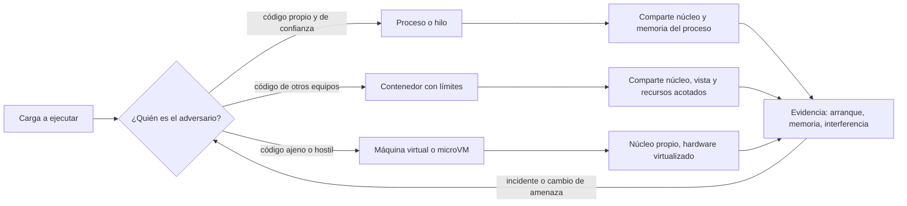
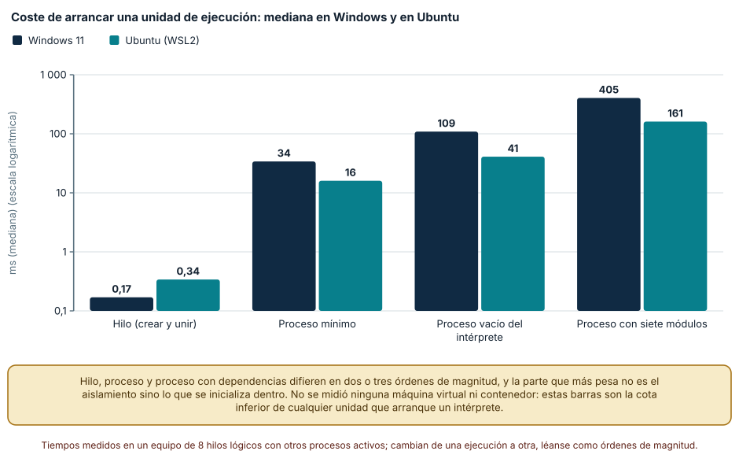
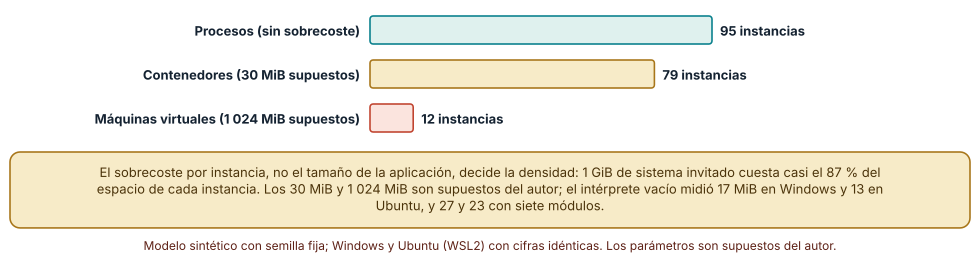
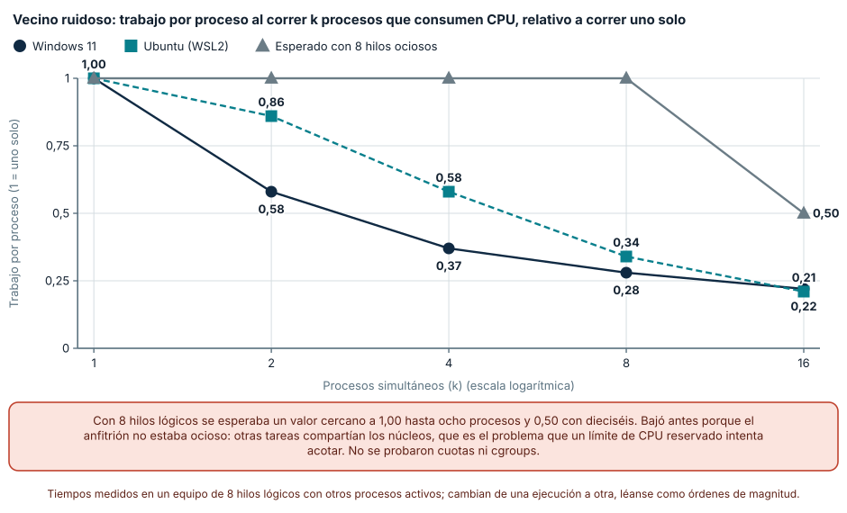

# SE-398 — Máquinas virtuales, contenedores y aislamiento

[← SE-397 — IaaS, PaaS, SaaS y responsabilidad compartida](../../classes/part-33-cloud-plataforma-e-infraestructura/se-397-iaas-paas-saas-y-responsabilidad-compartida/README.md) · [↑ Parte 33](../../classes/part-33-cloud-plataforma-e-infraestructura/README.md) · [📚 Índice completo](../../classes/README.md) · [🌐 Portal](../../site/classes/SE-398.html) · [SE-399 — Orquestación y scheduling →](../../classes/part-33-cloud-plataforma-e-infraestructura/se-399-orquestacion-y-scheduling/README.md)

## Punto profesional y fundamento pedagógico

**Punto profesional.** La clase existe para que distingas tres fronteras que suelen llamarse «aislamiento» sin serlo en el mismo grado: la que separa procesos dentro de un sistema operativo, la que separa contenedores que comparten un núcleo y la que separa máquinas virtuales con su propio núcleo. Cada una cuesta distinto, arranca distinto y se rompe distinto, y la elección depende de a quién tienes enfrente.

**Por qué aparece aquí.** Sigue a **IaaS, PaaS, SaaS y responsabilidad compartida**: ya sabes qué capas se delegan; ahora miras la capa que más se delega primero, la que ejecuta tu código junto al de otros. El caso conductor de la parte es la plataforma de entregas de tareas llevada a una infraestructura gestionada, y esta clase decide cómo se separa su servicio de entregas del de calificaciones y del de otras organizaciones.

**Error conceptual que debe corregir.** Creer que «contenedor» y «máquina virtual» son dos tamaños de lo mismo. Un contenedor es un proceso del núcleo anfitrión con una vista restringida del sistema; una máquina virtual ejecuta un núcleo propio sobre hardware virtualizado. Lo que los separa no es el peso sino quién aplica la frontera y qué superficie de ataque tiene.

**Secuencia de aprendizaje.** Antes de leer los resultados, predices cuántas veces más tarda arrancar un proceso que crear un hilo y cuántas instancias de 150 MiB caben en 16 GiB según el sobrecoste de cada unidad; después mides el arranque de un hilo y de procesos, el tamaño de memoria de un intérprete vacío y qué ocurre con el trabajo por proceso cuando corren varios que consumen CPU a la vez. La secuencia usa predicción, explicación propia, contraste y recuperación. [ICAP](https://icap.education.asu.edu/research) distingue participación de construcción de conocimiento; [How People Learn II](https://nap.nationalacademies.org/catalog/24783/how-people-learn-ii-learners-contexts-and-cultures) exige conectar conocimiento previo, contexto y transferencia; la [práctica de recuperación](https://pubmed.ncbi.nlm.nih.gov/16507066/) respalda producir de nuevo la explicación tras una demora; y [Education for Life and Work](https://nap.nationalacademies.org/resource/13398/dbasse_084153.pdf) exige devolución que explique la causa del error.

**Evidencia de aprendizaje.** `aislamiento.md` con la predicción, las tres figuras reproducidas, un cuadro de qué frontera elegirías para cada pieza de la plataforma (y frente a quién), y una nota con el modelo de amenaza de cada elección.

**Límite de la conclusión.** Solo se midieron hilos y procesos del intérprete de Python en un equipo de 8 hilos lógicos con otras tareas activas; no se arrancó ninguna máquina virtual ni contenedor, no se usaron cuotas ni cgroups y el sobrecoste de memoria de contenedores y máquinas virtuales es un supuesto del autor. Los tiempos cambian de una ejecución a otra: se publican como órdenes de magnitud.

### Trazabilidad fuente → afirmación

| Fuente primaria u oficial | Afirmación que respalda | Lo que no prueba |
|---|---|---|
| [namespaces(7), manual de Linux](https://man7.org/linux/man-pages/man7/namespaces.7.html) | Un espacio de nombres da a los procesos que pertenecen a él una vista propia de un recurso global, como los identificadores de proceso, la red o los montajes. | No dice que los espacios de nombres basten para contener a un atacante: comparten núcleo. |
| [Control groups v2, documentación del núcleo Linux](https://docs.kernel.org/admin-guide/cgroup-v2.html) | Los grupos de control distribuyen recursos como CPU, memoria y E/S entre jerarquías de procesos y pueden fijar límites. | No explica cómo configurar una cuota para una carga concreta. |
| [OCI Runtime Specification](https://github.com/opencontainers/runtime-spec) | Define cómo se describe y se ejecuta un contenedor: su configuración, su sistema de archivos y su ciclo de vida. | No define qué frontera de seguridad ofrece cada implementación. |
| [Agache et al., «Firecracker: Lightweight Virtualization for Serverless Applications» (NSDI 2020)](https://www.usenix.org/conference/nsdi20/presentation/agache) | Describe un monitor de máquinas virtuales mínimo que busca el aislamiento de una máquina virtual con un arranque y una huella próximos a los de un contenedor. | Las cifras de arranque y memoria son de sus autores en su entorno; no son aquí una medición. |

## Antes de empezar

Recupera lo aprendido en la clase anterior: cada modelo de servicio delega algunas capas. La pregunta activa es: **¿quién comparte mi núcleo, qué puede hacer si lo compromete y qué cuesta cada frontera que pongo entre nosotros?**

## Prerrequisitos

- Haber completado `SE-397` o poder explicar qué capas entrega IaaS y cuáles quedan del cliente.
- Python 3.11 o posterior; los experimentos usan solo la biblioteca estándar (`subprocess`, `threading`, `time`, `ctypes` en Windows) y no necesitan Docker ni una máquina virtual.
- Saber qué es un proceso, un hilo y un núcleo de sistema operativo, y qué pasa al arrancar un programa.

## Problema auténtico

La plataforma de entregas tenía un único servidor que ejecutaba la aplicación web, el servicio que corrige entregas con código enviado por estudiantes y el que genera informes. Un estudiante envió un programa que agotó la memoria del servidor al corregirse y la aplicación web dejó de responder para todos. El equipo propuso «meter cada cosa en un contenedor» y alguien preguntó si eso impediría que un código malicioso saliera hacia las otras piezas. La respuesta correcta depende de una frontera que la propuesta no nombró: un contenedor limita lo que ve y lo que consume, pero comparte el núcleo con quien lo aloja.

## Objetivos observables

Al terminar podrás:

1. distinguir hilo, proceso, contenedor y máquina virtual por quién aplica la frontera y qué comparten;
2. medir el coste de arrancar un hilo y un proceso y explicar por qué lo que se inicializa dentro pesa más que la frontera;
3. calcular cuántas instancias caben en un anfitrión según el sobrecoste de cada unidad y qué supuestos sostienen el resultado;
4. observar cómo procesos que compiten por CPU se quitan trabajo entre sí y qué mecanismo acotaría el efecto;
5. escribir un modelo de amenaza que justifique qué frontera usar entre la corrección de código ajeno y el resto de la plataforma.

## Mapa conceptual



El mapa empieza por el adversario, no por la tecnología: la frontera se elige según de quién se protege la plataforma. Cada rama comparte algo distinto, y esa lista de lo compartido es lo que se contrasta con la evidencia de arranque, memoria e interferencia.

## Temas y por qué importan

| Tema | Por qué cambia una decisión profesional | Evidencia mínima |
|---|---|---|
| Máquinas virtuales | Ofrecen núcleo propio y una frontera de hardware, a cambio de memoria y arranque. | Cálculo de densidad con el sobrecoste declarado |
| Contenedores | Son procesos del anfitrión con vista y recursos acotados; arrancan casi como un proceso. | Medición de arranque de proceso y de lo que se inicializa dentro |
| Espacios de nombres y grupos de control | Son el mecanismo que da vista propia y límites a un proceso. | Lectura de la especificación y tabla de qué aísla cada uno |
| Interferencia entre vecinos | Sin límites, un proceso reduce el trabajo del otro. | Medición del trabajo por proceso con k procesos simultáneos |
| Modelo de amenaza | Decide qué frontera se paga y frente a quién. | Cuadro de piezas, adversario y frontera elegida |

## Conceptos y decisiones

### 1. Máquinas virtuales

Una máquina virtual ejecuta un sistema operativo completo sobre hardware que un monitor, el hipervisor, presenta como propio. El núcleo invitado no comparte memoria ni estructuras del núcleo anfitrión, y la separación la aplican instrucciones del procesador pensadas para virtualizar. La superficie por la que un invitado puede alcanzar al anfitrión es la interfaz del monitor: dispositivos emulados, llamadas al hipervisor. Es una superficie más pequeña que la de todas las llamadas al sistema de un núcleo, y por eso las máquinas virtuales se consideran la frontera fuerte entre inquilinos que no se conocen. El precio es que cada una carga su propio sistema operativo: memoria base, arranque medido en segundos y un disco.

### 2. Contenedores

Un contenedor no es un objeto del núcleo: es un proceso, o un grupo de procesos, al que el núcleo muestra una vista restringida mediante espacios de nombres y al que limita los recursos mediante grupos de control. Las especificaciones de OCI fijan cómo se describe su configuración, su sistema de archivos y su ciclo de vida, lo que permite que distintos entornos de ejecución cumplan el mismo contrato. Como comparte núcleo con el anfitrión y con los demás contenedores, una vulnerabilidad del núcleo o una configuración que concede demasiados privilegios puede dejar a un proceso salir de su vista. Un contenedor es excelente para empaquetar y repetir un entorno, y es una frontera de seguridad más débil que una máquina virtual.

### 3. Espacios de nombres y grupos de control

Los **espacios de nombres** responden a «qué ve»: identificadores de proceso, red, montajes, nombre del anfitrión, usuarios. Los **grupos de control** responden a «cuánto consume»: CPU, memoria, entrada y salida, número de procesos. Son independientes, y un contenedor mal configurado puede tener uno sin el otro: una vista propia sin límite de memoria agota el anfitrión, y un límite de memoria con la vista del anfitrión deja ver y señalar procesos ajenos. Que ambos existan es la razón por la que «contenedor» es una convención de uso y no un tipo de objeto.

### 4. Interferencia entre vecinos

Cuando varias cargas comparten núcleos, memoria y disco, la que consume más reduce el servicio de las demás. Sin límites, el reparto lo decide el planificador del sistema operativo, y con límites lo decide la cuota. El problema no es de seguridad sino de predecibilidad: una corrección de entregas que usa todos los núcleos retrasa la aplicación web aunque ninguna haya fallado. Por eso las cuotas de CPU y memoria forman parte del contrato de un contenedor y no un ajuste opcional.

### 5. Modelo de amenaza

Un modelo de amenaza responde a tres preguntas: qué activo se protege, quién es el adversario y qué capacidad tiene. La frontera adecuada sale de ahí. Entre dos servicios del mismo equipo, un contenedor con límites suele bastar; entre una plataforma y el código enviado por terceros, la brecha es mayor y se acude a una máquina virtual o a una microVM, un monitor de máquinas virtuales mínimo diseñado para arrancar rápido. Ninguna frontera es absoluta: se elige la que hace el ataque más costoso que el beneficio, y se complementa con permisos mínimos, red cerrada y límites de recursos.

### Qué cuesta arrancar una unidad

Se mide el arranque de un hilo (crear y unir) 3 000 veces, y el de un proceso del intérprete (mínimo, vacío y con siete módulos importados) 25 veces cada uno, con `time.perf_counter` y `subprocess`.

```python
t0 = time.perf_counter(); th = threading.Thread(target=lambda: None); th.start(); th.join()
subprocess.run([sys.executable, "-I", "-S", "-c", "pass"], check=True)   # proceso mínimo
subprocess.run([sys.executable, "-c", "import sqlite3,json,decimal,asyncio,ssl,email,http.client"], check=True)
```

| Unidad | Windows 11 (mediana, rango) | Ubuntu en WSL2 (mediana, rango) |
|---|---|---|
| Hilo | ≈ 170 µs (150–860) | ≈ 340 µs (185–2 040) |
| Proceso mínimo | ≈ 34 ms (33–51) | ≈ 16 ms (14–25) |
| Proceso vacío | ≈ 109 ms (105–156) | ≈ 41 ms (33–65) |
| Proceso con siete módulos | ≈ 405 ms (383–544) | ≈ 161 ms (139–201) |

Un proceso mínimo tarda entre 50 y 200 veces más que un hilo, y uno que carga siete módulos, unas diez veces más que el mínimo. La conclusión útil no es el cociente entre hilo y proceso sino la última fila: lo que se inicializa dentro de la unidad pesa más que la frontera que la separa. Estos tiempos son una cota inferior de lo que cuesta una unidad que arranca un intérprete; una máquina virtual o un contenedor suman a eso su propio arranque, que aquí no se midió.



**Cómo leer la figura.** Cada grupo es una unidad de ejecución y cada barra, el mismo código en un sistema; el eje es logarítmico, de modo que cada marca vale diez veces la anterior y la altura solo se compara entre barras del mismo color. Mira la distancia entre el hilo y el proceso con módulos: tres órdenes de magnitud. La tabla da el mínimo y el máximo observados. **Dónde deja de valer:** el equipo tenía otras tareas activas y los valores cambian de una ejecución a otra (un hilo se observó entre 150 y 860 µs en Windows). Son órdenes de magnitud, no una especificación; y el intérprete de Python no es el mismo caso que un binario compilado.

### Cuántas instancias caben

Se calcula cuántas instancias de una aplicación con 150 MiB de memoria de trabajo caben en un anfitrión de 16 GiB que reserva 2 GiB para el sistema, con un sobrecoste por instancia de 0 (proceso), 30 MiB (contenedor, supuesto) y 1 024 MiB (máquina virtual con su sistema invitado, supuesto). Para anclar el supuesto, se mide el tamaño en memoria de un intérprete: 17,2 MiB vacío y 26,7 MiB con siete módulos en Windows, 13,2 y 22,8 en Ubuntu.

```python
host, reserved, app = 16 * 1024, 2 * 1024, 150
for nombre, ov in (("proceso", 0), ("contenedor", 30), ("máquina virtual", 1024)):
    print(nombre, (host - reserved) // (app + ov))
```

| Unidad | Sobrecoste por instancia | Instancias que caben |
|---|---:|---:|
| Proceso | 0 MiB | 95 |
| Contenedor | 30 MiB (supuesto) | 79 |
| Máquina virtual | 1 024 MiB (supuesto) | 12 |

La diferencia entre 79 y 12 no viene de la aplicación, igual en los tres casos, sino del sobrecoste: un gibibyte de sistema invitado consume el 87 % del espacio de cada instancia. Por eso una máquina virtual por cada microservicio pequeño resulta cara y una por cada carga que no se debe mezclar resulta razonable.



**Cómo leer la figura.** La longitud de cada barra es el número de instancias; la diferencia entre barras es el sobrecoste, no la aplicación. **Dónde deja de valer:** el sobrecoste de 30 MiB y de 1 024 MiB son supuestos del autor; una máquina virtual mínima pesa mucho menos que un sistema invitado completo, y los contenedores comparten páginas de memoria entre instancias. No se midió ninguno de los dos.

### Un vecino que consume CPU

Se lanzan `k` procesos del intérprete que cuentan iteraciones durante 1,5 s, con `k` igual a 1, 2, 4, 8 y 16 en un equipo con 8 hilos lógicos, y se calcula el trabajo medio por proceso relativo al de `k = 1`, con siete repeticiones por valor.

```python
def spin(seconds):
    end = time.perf_counter() + seconds
    n = 0
    while time.perf_counter() < end:
        for _ in range(1000):
            n += 1
    return n
```

| Procesos simultáneos | Windows 11: mediana (rango) | Ubuntu en WSL2: mediana (rango) |
|---|---|---|
| 1 | 1,00 | 1,00 |
| 2 | 0,58 (0,26–0,80) | 0,86 (0,73–1,05) |
| 4 | 0,37 (0,25–0,40) | 0,58 (0,39–0,62) |
| 8 | 0,28 (0,25–0,31) | 0,34 (0,32–0,42) |
| 16 | 0,22 (0,18–0,23) | 0,21 (0,18–0,25) |

Con 8 hilos lógicos se esperaba un trabajo cercano a 1,00 hasta ocho procesos y 0,50 con dieciséis. Bajó antes porque el equipo no estaba ocioso: otras tareas compartían los núcleos. Eso es justamente lo que la medida enseña, aunque no se planeara: un proceso al que nadie reservó CPU recibe la que sobra, y lo que sobra cambia con quién más está ejecutándose. Un límite o una reserva de CPU convierte «lo que sobra» en «lo que está garantizado».



**Cómo leer la figura.** El eje horizontal es el número de procesos simultáneos, en escala logarítmica, y el vertical el trabajo por proceso respecto de correr uno solo (1 = sin interferencia). La línea gris con triángulos es lo esperado con 8 hilos ociosos; la brecha entre ella y las dos medidas (azul oscuro Windows, verde azulado Ubuntu) es lo que el anfitrión ocupado se llevó. La tabla da el rango de siete repeticiones. **Dónde deja de valer:** la medida mezcla la competencia entre los propios procesos con la de otras tareas del equipo y no puede separarlas; no se usaron cuotas, afinidad ni cgroups. Muestra que el reparto sin garantías es impredecible, no cuánto lo mejoraría una cuota.

## Definiciones de trabajo

- **hipervisor:** programa que presenta hardware virtual a uno o varios sistemas invitados y los aísla entre sí.
- **contenedor:** proceso o grupo de procesos al que el núcleo muestra una vista restringida y limita los recursos, sin un núcleo propio.
- **espacio de nombres:** mecanismo del núcleo que da a un conjunto de procesos una vista propia de un recurso global.
- **grupo de control:** mecanismo del núcleo que reparte y limita el consumo de recursos de un conjunto de procesos.
- **vecino ruidoso:** carga que, al consumir recursos compartidos, degrada el servicio que reciben las demás.

Las definiciones son operativas para la plataforma de entregas. Los productos usan estos términos con matices (por ejemplo, contenedores que se ejecutan dentro de una máquina virtual ligera) y deben contrastarse con la documentación primaria enlazada al final.

## Ejemplo mínimo

El fragmento mide cuánto tarda arrancar un proceso mínimo del intérprete. Antes de ejecutarlo, predice si estará más cerca de 1 ms, de 10 ms o de 100 ms en tu equipo.

```python
import subprocess, sys, time
t0 = time.perf_counter()
subprocess.run([sys.executable, "-I", "-S", "-c", "pass"], check=True)
print(round((time.perf_counter() - t0) * 1000, 1), "ms")
```

Registra versión de Python, sistema, número de núcleos y la salida de cinco ejecuciones; después repítelo con `-c "import json,sqlite3"` y compara.

## Ejemplo profesional

El equipo de la plataforma separa tres piezas con fronteras distintas. La aplicación web y el servicio de informes, del mismo equipo y con código revisado, corren como contenedores con límites de CPU y memoria y un sistema de archivos de solo lectura, en el mismo anfitrión. El corrector de entregas, que ejecuta código de estudiantes, corre cada ejecución en una unidad con su propio núcleo (una microVM o una máquina virtual efímera), sin red y con un tiempo máximo, y se destruye al terminar. La base de datos está en un servicio gestionado y no comparte anfitrión con ninguna de las anteriores. Cada elección se escribe con su modelo de amenaza, el límite de recursos, la medida de arranque y quién responde de qué. Compara con el estado inicial: el programa que agotaba la memoria ahora termina en su límite sin tocar la aplicación web.

## Práctica guiada

1. Predice el arranque de un hilo, un proceso mínimo y un proceso con módulos, y apunta tus números antes de medir.
2. Mide los tres con 25 repeticiones y publica mediana y rango, no solo el promedio.
3. Mide el tamaño en memoria del intérprete vacío y con módulos en tu sistema.
4. Calcula cuántas instancias caben con tus tamaños y con 30 y 1 024 MiB de sobrecoste, y cambia el supuesto de la máquina virtual a 256 MiB.
5. Ejecuta `k` procesos que consumen CPU para `k` = 1, 2, 4, 8 y 16, anota el número de núcleos y las tareas que tenías abiertas.
6. Escribe el modelo de amenaza para cada pieza de la plataforma y elige la frontera.
7. Entrega `aislamiento.md` y pide a otra persona que nombre un caso en que tu frontera no basta.

## Ejercicios

1. **Densidad:** si una microVM de 5 MiB de sobrecoste fuera cierta, ¿cuántas instancias de 150 MiB cabrían? Explica qué supuesto sostiene el cálculo.
2. **Arranque:** explica por qué un proceso con siete módulos tarda varias veces más que uno mínimo y qué lo reduciría sin cambiar la frontera.
3. **Interferencia:** con 8 núcleos y un límite de 2 núcleos por proceso, ¿cuántos procesos pueden correr sin perder trabajo? ¿Qué pasa con 5?
4. **Amenaza:** para el corrector de entregas, enumera tres capacidades de un código hostil y qué frontera detiene cada una.

## Reto verificable

Entrega `aislamiento.md` con la predicción, las tres tablas medidas en tu equipo (con núcleos y carga declarados), el cuadro de piezas con frontera y modelo de amenaza, y la lista de lo que no se midió. Se aprueba si otra persona ejecuta los scripts, obtiene órdenes de magnitud comparables y puede decir qué le pasaría al servicio de informes si el corrector consumiera toda la memoria. No se aprueba por afirmar que «los contenedores aíslan» sin decir de qué, ni por publicar un único promedio de tiempos.

## Caso conductor

La plataforma de entregas es el caso conductor de la Parte 33. Esta clase deja el segundo artefacto: el cuadro de fronteras para sus piezas. `SE-399` pregunta quién decide dónde corre cada unidad y qué hace cuando falla. Cambia una pieza, por ejemplo mover el corrector a un contenedor, y mira qué parte del modelo de amenaza deja de sostenerse.

## Preguntas frecuentes

### ¿Un contenedor es más seguro que un proceso?

Algo más: tiene una vista restringida, límites de recursos y, normalmente, menos privilegios. Pero comparte el núcleo, y una vulnerabilidad del núcleo o un contenedor con privilegios excesivos anula esa ventaja. La respuesta depende de cómo se configure.

### ¿Cuándo basta un contenedor y cuándo hace falta una máquina virtual?

Un contenedor basta entre servicios del mismo equipo y con código revisado; la máquina virtual (o una microVM) se justifica cuando ejecutas código de quien no controlas o cuando una regulación exige una frontera de hardware. El criterio es el adversario, no la moda.

### ¿Por qué mide la clase procesos de Python y no contenedores?

Porque el equipo del curso no necesita Docker para reproducir los experimentos y porque lo medido, el coste de lo que se inicializa dentro y la interferencia por CPU, existe también dentro de un contenedor. Lo que falta, el arranque propio de contenedores y máquinas virtuales, se declara como límite.

### ¿Los límites de CPU y memoria impiden que un proceso afecte a otro?

Acotan cuánto consume cada uno, pero no impiden otras formas de interferencia, como la contención de disco, de red o de caché del procesador. La garantía depende de qué recursos se limitan.

## Fallo controlado y diagnóstico

Reproduce el fallo clásico de la clase: **una carga sin límites desplaza a su vecina**. Lanza un proceso que consume toda la CPU junto a otro que mide su trabajo por segundo.

Registra síntoma, entrada mínima, hipótesis, observación que descarta cada hipótesis, causa, corrección y prueba de regresión. **Síntoma:** el trabajo por segundo del proceso medido cae a la mitad sin que haya cambiado su código. **Hipótesis rivales:** (a) un defecto introducido en el código medido; (b) una caída del equipo por temperatura o energía; (c) otra carga compartiendo los núcleos. **Prueba:** mide el proceso solo y luego junto al vecino, y revisa el uso de CPU por proceso durante la medición. **Conclusión:** el trabajo cae en proporción a los procesos que compiten por los núcleos. **Regresión:** documenta la reserva o el límite de CPU que acota al vecino y repite la medida con él activo. No arregles a la vez el código medido y el reparto de recursos.

## Errores comunes y cómo corregirlos

| Síntoma | Causa probable | Corrección |
|---|---|---|
| Un contenedor agota la memoria del anfitrión | Se aisló la vista y no se limitó el consumo | Fijar límite de memoria y de procesos |
| Se asume que un contenedor contiene código hostil | Se confunde la vista restringida con una frontera de hardware | Usar una máquina virtual o microVM para código ajeno |
| El arranque de una función es lento aunque su código sea corto | Las dependencias se cargan al iniciar | Reducir módulos importados y medir el arranque con y sin ellos |
| La densidad prevista no se cumple | Se ignoró el sobrecoste de memoria por instancia | Medir el tamaño real y recalcular |
| El mismo servicio cambia de velocidad según la hora | Un vecino comparte núcleos sin límite | Reservar CPU y medir con vecinos activos |

## Entorno y archivos clave

```text
work/SE-398/
├── README.md
├── aislamiento/
│   ├── arranque.py
│   ├── densidad.py
│   └── vecino.py
├── tests/test_aislamiento.py
└── evidence/aislamiento.md
```

El `README` declara sistema, número de núcleos, versión de Python, tareas abiertas y comandos. Los experimentos usan solo la biblioteca estándar y se ejecutaron con CPython 3.12.9 en Windows 11 y 3.12.3 en Ubuntu bajo WSL2 en el mismo equipo de 8 hilos lógicos; los tiempos cambian entre ejecuciones y se publican con su rango. Si usas Docker o una máquina virtual, declara versión, imagen y limpieza.

## Seguridad, ética y accesibilidad

- no ejecutes código hostil real para probar la frontera: usa programas sintéticos que consumen recursos de forma acotada;
- un contenedor con privilegios o con el socket del motor montado equivale a acceso al anfitrión: documenta cualquier excepción y quién la aprobó;
- el corrector de entregas procesa trabajo de estudiantes, incluidas personas menores: aísla los resultados por persona y borra los artefactos de cada ejecución;
- describe las fronteras en texto además del diagrama, para que un lector de pantalla pueda seguirlas;
- respeta las licencias de las imágenes base y atribuye lo adaptado.

## Puente hacia el trabajo con agentes

Un agente al que se le pide «empaqueta la plataforma en contenedores» producirá una imagen que arranca, normalmente con el usuario administrador, sin límites de recursos y con una base amplia. Pídele en cambio que declare para cada pieza el adversario, la frontera y los límites de CPU y memoria, y que incluya una prueba que consuma recursos en una pieza y compruebe que otra no se degrada. Revisa especialmente con qué usuario corre el proceso y qué permisos y montajes concedió: son los dos lugares donde un contenedor suele dejar de contener.

## Transferencia

Traslada el análisis a otro dominio (por ejemplo, un servicio que convierte archivos subidos por clientes): cambia las piezas y conserva el procedimiento de escribir el modelo de amenaza, medir arranque y memoria, calcular densidad con sobrecoste declarado y comprobar la interferencia. La transferencia está lograda cuando puedes decir qué frontera elegirías para cada pieza y por qué, no cuando los comandos se parecen.

## Evaluación y evidencia

| Criterio | Evidencia para aprobar |
|---|---|
| comprensión | explicación de qué comparte y qué no comparte cada unidad de aislamiento |
| corrección | mediciones con rango y número de núcleos declarados |
| decisión | cuadro de piezas con adversario, frontera y límites |
| diagnóstico | reproducción del fallo «vecino sin límite» con regresión |
| incertidumbre | declaración de que no se midieron máquinas virtuales ni contenedores |
| reproducibilidad | versiones, comandos, salida y límites declarados |

## Fuentes

- [namespaces(7)](https://man7.org/linux/man-pages/man7/namespaces.7.html) — espacios de nombres como vista propia de recursos globales; autoridad: manual de Linux (proyecto man-pages).
- [Control Group v2](https://docs.kernel.org/admin-guide/cgroup-v2.html) — grupos de control y distribución de recursos; autoridad: documentación del núcleo Linux.
- [OCI Runtime Specification](https://github.com/opencontainers/runtime-spec) — configuración y ciclo de vida de un contenedor; autoridad: Open Container Initiative.
- [Firecracker: Lightweight Virtualization for Serverless Applications](https://www.usenix.org/conference/nsdi20/presentation/agache) — microVMs como compromiso entre aislamiento y arranque; autoridad: artículo de USENIX NSDI 2020.
- [Python: subprocess](https://docs.python.org/3/library/subprocess.html) — API usada para medir procesos; autoridad: documentación de Python.

Cada fuente respalda el mecanismo indicado; ninguna demuestra que los 34 ms, el 87 % de sobrecoste ni el 0,28 de trabajo relativo se observen en otro equipo. Esa afirmación depende del procesador, del sistema operativo y de las demás tareas activas.

## Límites y siguiente paso

Se ejecutaron tres experimentos en un equipo con Windows y Ubuntu (WSL2) y los tiempos cambiaron entre ejecuciones; el cálculo de densidad es un modelo con sobrecostes supuestos. No se arrancó ninguna máquina virtual ni contenedor, no se probaron cuotas ni cgroups, y no se evaluó ninguna vulnerabilidad de escape. La siguiente clase mira quién decide dónde corre cada unidad y qué hace cuando alguna falla.

## Glosario

- **hipervisor:** programa que presenta hardware virtual a uno o varios sistemas invitados y los aísla entre sí.
- **contenedor:** proceso o grupo de procesos al que el núcleo muestra una vista restringida y limita los recursos, sin un núcleo propio.
- **espacio de nombres:** mecanismo del núcleo que da a un conjunto de procesos una vista propia de un recurso global.
- **grupo de control:** mecanismo del núcleo que reparte y limita el consumo de recursos de un conjunto de procesos.
- **vecino ruidoso:** carga que, al consumir recursos compartidos, degrada el servicio que reciben las demás.

---

[← SE-397 — IaaS, PaaS, SaaS y responsabilidad compartida](../../classes/part-33-cloud-plataforma-e-infraestructura/se-397-iaas-paas-saas-y-responsabilidad-compartida/README.md) · [↑ Parte 33](../../classes/part-33-cloud-plataforma-e-infraestructura/README.md) · [📚 Índice completo](../../classes/README.md) · [🌐 Portal](../../site/classes/SE-398.html) · [SE-399 — Orquestación y scheduling →](../../classes/part-33-cloud-plataforma-e-infraestructura/se-399-orquestacion-y-scheduling/README.md)
