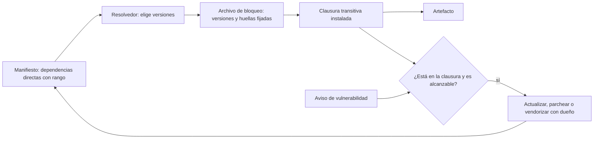
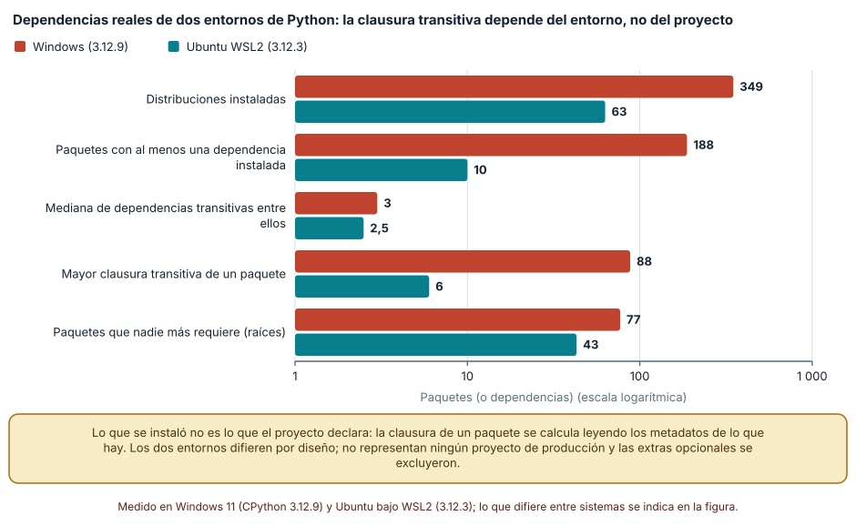
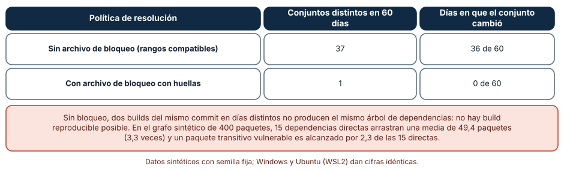
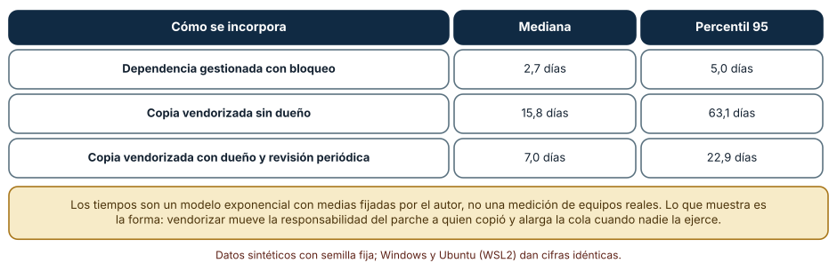

# SE-399 — Dependencias directas, transitivas y vendorización

[← SE-398 — Artefactos, repositorios y promoción](../../classes/part-33-build-release-y-cadena-de-suministro/se-398-artefactos-repositorios-y-promocion/README.md) · [↑ Parte 33](../../classes/part-33-build-release-y-cadena-de-suministro/README.md) · [📚 Índice completo](../../classes/README.md) · [🌐 Portal](../../site/classes/SE-399.html) · [SE-400 — SBOM, procedencia y atestaciones →](../../classes/part-33-build-release-y-cadena-de-suministro/se-400-sbom-procedencia-y-atestaciones/README.md)

## Punto profesional y fundamento pedagógico

**Punto profesional.** La clase existe para que sepas qué código ajeno ejecuta tu producto, cómo llegó allí y qué haces cuando alguien anuncia que una pieza concreta es vulnerable. Casi todo el código de un servicio moderno lo escribieron otras personas: las dependencias directas que eliges, y sobre todo las transitivas que arrastran sin que las hayas elegido. La habilidad profesional es hacer ese inventario **resoluble, fijado y mantenible**, y decidir cuándo conviene copiar el código en lugar de depender de él.

**Por qué aparece aquí.** Sigue a **Artefactos, repositorios y promoción**: allí se decidió que un artefacto se identifica por su contenido; aquí se abre el contenido para ver de qué está hecho. Precede a **SBOM, procedencia y atestaciones**, que necesita ese inventario para poder declararlo. El caso conductor es la API de entregas, que depende de unas pocas bibliotecas para HTTP, serialización y acceso a datos.

**Error conceptual que debe corregir.** Creer que «dependemos de quince paquetes» porque el manifiesto lista quince. El manifiesto lista las dependencias directas; el código que se ejecuta es la **clausura transitiva**, varias veces mayor, y sus versiones exactas solo quedan determinadas si alguien las fijó. Sin fijarlas, dos construcciones del mismo commit en días distintos instalan software distinto.

**Secuencia de aprendizaje.** Antes de medir, predices cuántos paquetes arrastra una dependencia típica y cuántas versiones distintas resolverás construyendo cada día durante dos meses sin archivo de bloqueo; después mides la clausura de los paquetes realmente instalados en dos entornos, comparas la resolución con y sin bloqueo y modelas cuánto tarda en aplicarse el parche de una vulnerabilidad según cómo se incorporó la dependencia. La secuencia usa datos reales de los metadatos del entorno, un grafo sintético con semilla y un modelo de tiempos.

**Evidencia de aprendizaje.** `dependencias-log.md` con la predicción, las tres figuras reproducidas, el inventario de dependencias directas y transitivas de la API de entregas con su versión fijada y su justificación, y una política de actualización y de vendorización.

**Límite de la conclusión.** Los datos reales son los metadatos de las distribuciones de Python instaladas en dos equipos (349 en Windows y 63 en Ubuntu), que no representan ningún proyecto de producción; el grafo de 400 paquetes, la tasa de publicación de 0,03 diaria y los tiempos de parche son supuestos del autor. No se descargó ningún paquete, no se resolvió con `pip` ni con un resolvedor real y no se consultó ninguna base de vulnerabilidades.

### Trazabilidad fuente → afirmación

| Fuente primaria u oficial | Afirmación que respalda | Lo que no prueba |
|---|---|---|
| [Python: importlib.metadata](https://docs.python.org/3/library/importlib.metadata.html) | Documenta cómo leer los metadatos de las distribuciones instaladas, incluida su lista de requisitos, que es la base de la medición real de la clase. | No garantiza que lo instalado sea lo que el proyecto declaró. |
| [PEP 440 — Version Identification and Dependency Specification](https://peps.python.org/pep-0440/) | Define el formato de las versiones y los especificadores de rango de dependencias de Python. | No dice qué rango conviene a un proyecto. |
| [pip: instalaciones seguras (comprobación de huellas)](https://pip.pypa.io/en/stable/topics/secure-installs/) | Describe cómo fijar versiones y exigir la huella de cada paquete en el momento de instalar. | No prueba que la huella corresponda a código benigno. |
| [Ohm et al., «Backstabber's Knife Collection» (2020)](https://doi.org/10.1007/978-3-030-52683-2_2) | Revisa ataques reales a paquetes de código abierto y los clasifica por modo de ataque y de distribución, incluidos paquetes con nombre parecido al legítimo. | No mide la frecuencia actual ni en tu ecosistema. |
| [NVD: CVE-2021-44228](https://nvd.nist.gov/vuln/detail/CVE-2021-44228) | Documenta la vulnerabilidad de Apache Log4j 2 conocida como Log4Shell, un ejemplo de pieza transitiva presente en muchísimos productos. | No dice si tu producto la contiene ni si es alcanzable. |

## Antes de empezar

Recupera lo aprendido en `SE-398`: un artefacto se identifica por su contenido y se promueve sin reconstruirlo. La pregunta activa es: **¿qué hay dentro de ese contenido, quién lo escribió y cómo me entero cuando una de sus piezas deja de ser de fiar?**

## Prerrequisitos

- Haber completado `SE-398` o poder explicar por qué un artefacto se promueve por huella.
- Python 3.11 o posterior; los experimentos usan solo la biblioteca estándar (`importlib.metadata`, `random`, `collections`, `statistics`).
- Saber qué es un grafo dirigido y un recorrido en profundidad.

## Problema auténtico

Un viernes se anuncia una vulnerabilidad crítica en una biblioteca de serialización. El equipo de la plataforma no la lista en su manifiesto, y durante dos días nadie sabe si el servicio la contiene. La busca primero un ingeniero a mano en el repositorio (no aparece), luego en la imagen desplegada (aparece, a través de una biblioteca de validación que depende de otra que depende de ella) y finalmente en tres servicios más. Cuando se prepara el parche, la copia que otro equipo tenía vendorizada hace dos años sigue sin actualizarse, porque nadie sabía que existía.

El problema real es de visibilidad y de responsabilidad: sin inventario completo y fijado, no se puede responder «¿estamos afectados?», y sin dueño de cada pieza, no se sabe quién la actualiza.

## Objetivos observables

Al terminar podrás:

1. distinguir dependencias directas, transitivas y la clausura que se ejecuta, y medir esta última a partir de metadatos;
2. explicar por qué un rango de versiones sin bloqueo hace irreproducible una construcción y cuantificar la deriva con un modelo;
3. decidir entre depender, fijar y vendorizar una pieza según el costo de mantenerla y el tiempo de parche;
4. evaluar una dependencia nueva con criterios de mantenimiento, licencia, tamaño de su clausura y confianza en quien la publica;
5. responder «¿estamos afectados por esta vulnerabilidad?» con un inventario y razonar sobre la alcanzabilidad.

## Mapa conceptual



El mapa muestra que el manifiesto no es el inventario: el bloqueo y la clausura lo son. El aviso de una vulnerabilidad se compara con la clausura y vuelve al manifiesto como una actualización.

## Temas y por qué importan

| Tema | Por qué cambia una decisión profesional | Evidencia mínima |
|---|---|---|
| Directas, transitivas y clausura | Lo que se ejecuta es mayor que lo que se declara. | Predicción, traza causal y contraejemplo de **Directas y transitivas** en `dependencias-log.md` |
| Rangos y resolución | Sin fijar, la construcción deriva con el tiempo. | Predicción, traza causal y contraejemplo de **Rangos y resolución** en `dependencias-log.md` |
| Archivo de bloqueo y huellas | Fijar versiones y huellas hace comparable el build. | Predicción, traza causal y contraejemplo de **Bloqueo** en `dependencias-log.md` |
| Vendorización | Copiar elimina un riesgo de disponibilidad y crea otro de mantenimiento. | Predicción, traza causal y contraejemplo de **Vendorización** en `dependencias-log.md` |
| Elección y alcanzabilidad | No toda pieza vulnerable es explotable en tu producto. | Predicción, traza causal y contraejemplo de **Elección y alcanzabilidad** en `dependencias-log.md` |

## Conceptos y decisiones

### 1. Directas, transitivas y clausura

Una dependencia **directa** es la que tu proyecto declara; una **transitiva** es la que necesita una dependencia tuya, o una dependencia de esa. La **clausura transitiva** es el conjunto de todas las piezas que se instalan y, por tanto, que pueden ejecutarse. El grafo suele tener forma de cola larga: unas pocas bibliotecas muy usadas aparecen en muchas clausuras y muchas bibliotecas aparecen en una sola. Esto tiene una consecuencia de seguridad directa: una pieza muy compartida, cuando falla, afecta a muchos proyectos a la vez, y a un proyecto concreto le llegan por varios caminos. Calcular la clausura exige leer los requisitos de cada pieza instalada y recorrer el grafo, algo que la biblioteca estándar permite con los metadatos de las distribuciones.

### 2. Rangos y resolución

El manifiesto suele declarar **rangos**: «cualquier versión compatible con 2.3». Un **resolvedor** elige, en el momento de instalar, las versiones concretas que satisfacen todos los rangos a la vez. Mientras los paquetes publican versiones nuevas, el resultado cambia: el mismo manifiesto instalado hoy y dentro de un mes produce árboles distintos. Esto no es un defecto del resolvedor, es el significado de un rango. Para un servicio que se despliega, esa deriva es una entrada no declarada del build: contradice lo que se enseñó en `SE-397`. La solución es separar dos documentos con funciones distintas: el **manifiesto** (qué rango acepto) y el **archivo de bloqueo** (qué versiones concretas, con su huella, se instalaron y se probaron).

### 3. Archivo de bloqueo y huellas

El **archivo de bloqueo** lista cada pieza de la clausura con su versión exacta y la **huella** de su archivo. Instalar con exigencia de huellas hace que el instalador rechace cualquier archivo cuyo contenido no coincida con el esperado, de modo que una versión reemplazada en el índice no entra sin que alguien cambie el bloqueo. El bloqueo se actualiza de forma explícita, en un cambio revisable (una solicitud de integración con la diferencia del bloqueo), no como efecto colateral de una instalación. Es la pieza que convierte un rango en una entrada declarada del build y la que alimenta el SBOM de la clase siguiente. Su límite: una huella dice que el archivo es el mismo que se vio al fijarla, no que ese archivo sea benigno.

### 4. Vendorización

**Vendorizar** es copiar el código de una dependencia dentro de tu repositorio. Ventajas: no depende de un índice externo, se puede revisar línea a línea, se puede parchear sin esperar al autor. Costos: la copia deja de recibir las actualizaciones automáticamente y, si nadie es dueño, envejece; los avisos de vulnerabilidad se emiten para el paquete publicado, y una herramienta que mire solo el manifiesto no verá la copia. Las copias bien gestionadas tienen un dueño, un registro de su origen (versión y huella del original), un procedimiento de actualización y una comprobación automática de que la copia coincide con el original o declara sus diferencias. Una copia sin dueño es la peor de las opciones: tiene todos los riesgos de la dependencia y ninguna de sus ventajas.

### 5. Elección, confianza y alcanzabilidad

Añadir una dependencia es contratar a su equipo de mantenimiento. Los criterios útiles para decidir son: qué parte de su funcionalidad se usará realmente (si es una función, quizá convenga escribirla), cuántas piezas arrastra, quién la mantiene y con qué frecuencia, cómo ha respondido a vulnerabilidades pasadas, su licencia y la facilidad para sustituirla. La confianza es un riesgo concreto: existen ataques con paquetes de nombre muy parecido al legítimo, con cuentas de mantenedores comprometidas o con un nuevo mantenedor que gana confianza durante meses antes de insertar código malicioso. Frente a un aviso de vulnerabilidad, la pregunta no es solo «¿está la pieza?» sino «¿es alcanzable?»: la función vulnerable puede no usarse o no recibir datos externos. Esa pregunta reduce el pánico pero no sustituye el parche, porque la alcanzabilidad cambia con el siguiente cambio de código.

### Dependencias reales de dos entornos

Se leen los metadatos (`importlib.metadata`) de todas las distribuciones de Python instaladas en dos equipos, se construye el grafo de requisitos (sin las extras opcionales) y se calcula, para cada paquete, el tamaño de su clausura.

```python
for d in md.distributions():
    deps = {re.match(r"[A-Za-z0-9_.\-]+", r).group(0) for r in (d.requires or []) if "extra ==" not in r}
```



**Cómo leer la figura.** Cada fila es una medida del grafo de lo instalado; el entorno de Windows, con más herramientas, tiene un grafo mucho mayor que el de Ubuntu. La mediana de transitivas es baja (3 y 2,5), pero el máximo es 88: la distribución tiene cola larga. En el entorno de Windows la razón de transitivas a directas tiene mediana 1,00 y máximo 48, de modo que algunas piezas arrastran muchas veces su número de requisitos declarados. **Dónde deja de valer:** son los paquetes de dos equipos, instalados por razones heterogéneas, y no el árbol de un servicio; las extras opcionales se ignoraron, lo que subestima la clausura de quien las active. Lo que se sostiene es la forma: la clausura es mayor que el manifiesto y desigual.

### Deriva de la resolución

Se modela un proyecto con 25 dependencias, cada una con probabilidad diaria de 0,03 de publicar una versión nueva compatible, que se construye cada día durante 60 días, una vez resolviendo los rangos cada vez y otra con un bloqueo hecho el primer día. En un grafo sintético de 400 paquetes con ataque preferencial se mide además cuánto crece la clausura respecto de 15 dependencias directas y por cuántos caminos llega un paquete vulnerable.



**Cómo leer la figura.** Cada fila es una política; la columna central cuenta los conjuntos de versiones distintos que se instalaron en 60 días. Sin bloqueo, 36 de las 60 construcciones instalaron algo distinto de la anterior. En el grafo sintético las 15 dependencias directas arrastran una media de 49,4 paquetes (3,3 veces) y un paquete transitivo vulnerable es alcanzado, de media, por 2,3 de las 15 directas (mediana 1). **Dónde deja de valer:** la probabilidad de 0,03 diaria, la forma del grafo y el supuesto de que toda versión nueva es compatible son del autor; con rangos más estrechos (fijar la versión menor) la deriva sería menor y la actualización de seguridad, más lenta. El resultado no depende de las cifras: sin bloqueo, el build no es reproducible.

### Latencia de parche

Se modela el tiempo, en días, desde el aviso hasta que el parche está aplicado: para una dependencia gestionada con bloqueo (2 días de base más una cola exponencial de media 1), una copia vendorizada sin dueño (2 más una cola de media 20) y una copia con dueño y revisión periódica (2 más una de media 7).



**Cómo leer la figura.** Cada fila es una forma de incorporar la dependencia; las columnas son la mediana y el percentil 95 del tiempo hasta parchear. La copia sin dueño tiene una cola muy larga: en 1 de cada 20 casos tarda más de dos meses. **Dónde deja de valer:** las medias de las colas son supuestos del autor y el modelo exponencial es una simplificación; en un equipo con revisión semanal la copia con dueño se acerca a la gestionada. La figura no dice que vendorizar sea malo: dice que mueve la responsabilidad de parchear a quien copió y que esa responsabilidad necesita nombre y calendario.

## Definiciones de trabajo

- **dependencia directa:** pieza que el proyecto declara en su manifiesto.
- **dependencia transitiva:** pieza que otra dependencia necesita, directa o indirectamente.
- **clausura transitiva:** conjunto de todas las piezas que se instalan y pueden ejecutarse.
- **archivo de bloqueo:** documento que fija la versión exacta y la huella de cada pieza de la clausura.
- **vendorización:** copia del código de una dependencia dentro del repositorio propio.

Las definiciones son operativas para la API de entregas. No convierten términos con una historia más amplia en sinónimos y deben contrastarse con la documentación primaria enlazada al final.

## Ejemplo mínimo

El fragmento calcula el tamaño de la clausura de un paquete en un grafo muy pequeño. Antes de ejecutarlo, predice cuántos paquetes se instalan al pedir `api`.

```python
grafo = {"api": {"http", "validacion"}, "http": {"ssl"}, "validacion": {"serial"},
         "serial": set(), "ssl": set()}
def clausura(raiz, visto=None):
    visto = visto if visto is not None else set()
    for d in grafo[raiz]:
        if d not in visto:
            visto.add(d); clausura(d, visto)
    return visto
print(len(clausura("api")), sorted(clausura("api")))
```

Se instalan cuatro paquetes para dos dependencias directas. Registra versión de Python, comando y salida; después añade una dependencia de `ssl` hacia `serial` y comprueba que el tamaño de la clausura no cambia aunque el número de aristas sí.

## Ejemplo profesional

El equipo de la API de entregas mantiene un manifiesto con seis dependencias directas y rangos amplios, y un archivo de bloqueo con 31 piezas, versiones exactas y huellas. Instalar en el CI exige las huellas y rechaza cualquier archivo distinto. Las actualizaciones llegan como solicitudes semanales automáticas que modifican el bloqueo; cada una muestra la diferencia de versiones y de huellas y pasa las pruebas antes de fusionarse. Una biblioteca de análisis de fechas de 300 líneas se vendoriza en `third_party/` con un archivo `ORIGEN.md` (versión, huella del original, diferencias aplicadas) y un dueño nombrado; un trabajo mensual compara la copia con la última versión publicada. Cuando se anuncia una vulnerabilidad, el equipo consulta el bloqueo y la copia, no el manifiesto, para responder si está afectado.

## Práctica guiada

1. Lee los metadatos de tu entorno de Python y construye el grafo de requisitos sin extras.
2. Predice el tamaño de la clausura de tres paquetes que uses y escríbelo antes de calcular.
3. Calcula la clausura de cada paquete instalado y localiza el mayor, la mediana y la razón transitivas/directas.
4. Simula 60 días de construcciones con y sin bloqueo y cuenta los conjuntos distintos.
5. Modela el tiempo de parche de tres formas de incorporar una dependencia con tus propias medias y completa la tabla.
6. Redacta la política de la API de entregas: qué se fija, quién actualiza, qué se vendoriza y quién es dueño.
7. Entrega `dependencias-log.md` y pide a otra persona que localice una dependencia sin dueño en tu inventario.

## Ejercicios

1. **Clausura:** dado un grafo de diez paquetes, calcula la clausura de tres raíces y la intersección entre ellas; explica qué implica para una vulnerabilidad en esa intersección.
2. **Bloqueo:** escribe el contenido mínimo de un archivo de bloqueo con tres piezas y decide qué cambio en el manifiesto obliga a regenerarlo y cuál no.
3. **Vendorización:** para una biblioteca de 500 líneas que usas en un único módulo, compara el costo anual de mantenerla vendorizada con el de depender de ella.
4. **Alcanzabilidad:** ante un aviso sobre una función de una biblioteca que usas, describe qué análisis haría falta para saber si tu código la llama con datos externos.

## Reto verificable

Entrega `dependencias-log.md` con la predicción, las tres tablas, el inventario de la API de entregas (directas, transitivas, versión y huella) y la política de actualización y vendorización. Se aprueba si otra persona ejecuta los cálculos desde un checkout limpio, obtiene las mismas cifras con las mismas semillas y puede responder, solo con tu inventario, si un aviso hipotético sobre una pieza concreta afecta al servicio. No se aprueba por listar solo el manifiesto ni por afirmar «actualizamos las dependencias» sin un procedimiento ni un dueño.

## Caso conductor

La API de entregas es el caso conductor de la Parte 33. Esta clase deja el tercer artefacto: un inventario fijado con política de actualización y de copias. `SE-400` convertirá ese inventario en un documento que otra persona pueda leer, el SBOM, y añadirá la procedencia del artefacto. Cambia después un solo dato, la probabilidad diaria de publicación, y observa a partir de cuándo el bloqueo deja de ser opcional.

## Preguntas frecuentes

### ¿Basta con fijar versiones en el manifiesto?

Fija las directas, no las transitivas, y no exige huellas. El archivo de bloqueo cubre la clausura completa y, con huellas, impide sustituciones en el índice. Fijar solo las directas deja la deriva en el resto del árbol.

### ¿Hay que actualizar siempre a la última versión?

No: hay que actualizar de forma planificada. Las versiones nuevas corrigen vulnerabilidades y pueden introducir regresiones o, con menos frecuencia, código malicioso. Una espera corta y las pruebas son el compromiso; para vulnerabilidades críticas el plazo se acorta.

### ¿Vendorizar es más seguro?

Elimina la dependencia de un índice externo y permite revisar, y añade una obligación de mantenimiento. Es más seguro si hay dueño, registro de origen y revisión periódica; sin ellos, es un riesgo oculto.

### Si la función vulnerable no se llama, ¿puedo ignorar el aviso?

Puedes priorizarlo más bajo, no ignorarlo: la alcanzabilidad se debe documentar y revisar, porque un cambio posterior de código puede volverla alcanzable. Además, un parche sencillo suele costar menos que mantener el argumento.

## Fallo controlado y diagnóstico

Reproduce el fallo clásico de la clase: **dos construcciones del mismo commit instalan versiones distintas y una de ellas falla**. Construye dos días seguidos sin archivo de bloqueo con una publicación nueva entre ambos.

Registra síntoma, entrada mínima, hipótesis, observación que descarta cada hipótesis, causa, corrección y prueba de regresión. **Síntoma:** el CI pasa el lunes y falla el martes sin cambios en el repositorio. **Hipótesis rivales:** (a) un cambio en el código; (b) un problema del entorno; (c) una dependencia transitiva cambió de versión. **Prueba:** compara la lista de versiones instaladas de ambas ejecuciones; si difieren, la causa es (c). **Conclusión:** la resolución deriva. **Regresión:** genera el archivo de bloqueo con huellas, instala exigiéndolas y añade una comprobación que falle si el bloqueo no coincide con el manifiesto.

## Errores comunes y cómo corregirlos

| Síntoma | Causa probable | Corrección |
|---|---|---|
| El CI falla sin cambios en el repositorio | Resolución sin bloqueo | Archivo de bloqueo con versiones y huellas |
| No se sabe si un aviso afecta | Inventario solo del manifiesto | Inventario de la clausura desde el bloqueo |
| Una copia vendorizada lleva años sin actualizarse | Falta de dueño y de registro de origen | Dueño, `ORIGEN.md` y comprobación periódica |
| Se instala un paquete con nombre parecido al legítimo | Dependencia añadida sin verificar | Revisar el nombre, el mantenedor y la historia antes de añadir |
| Un aviso crítico lleva semanas sin atender | No hay plazo ni responsable | Política con plazos según gravedad y alcanzabilidad |

## Entorno y archivos clave

```text
work/SE-399/
├── README.md
├── dependencias/
│   ├── clausura.py
│   ├── deriva.py
│   └── parche.py
├── third_party/ORIGEN.md
├── tests/test_dependencias.py
└── evidence/dependencias-log.md
```

El `README` declara plataforma, versión de Python, semillas y comandos. La medición real depende de los paquetes instalados en el equipo, de modo que cambia entre sistemas por diseño: las cifras de Windows (349 distribuciones) y Ubuntu (63) son lecturas de dos equipos concretos. Las simulaciones con semilla fija son idénticas en ambos. Si añades un resolvedor real, fija su versión. El código completo del experimento está en `scripts/experiments_part33/e399.py` y se ejecuta con `python scripts/experiments_part33/e399.py`.

## Seguridad, ética y accesibilidad

- cada dependencia es código que ejecuta con los permisos de tu servicio: revisa quién la mantiene y qué hace al instalarse, porque algunas ejecutan código en la instalación;
- no instales paquetes desde fuentes no verificadas ni pegues comandos de instalación sin leerlos;
- vendorizar código obliga a respetar su licencia y a conservar los avisos de autoría;
- las vulnerabilidades se comunican de forma responsable: no publiques una explotación de una pieza que otros aún no pueden parchear;
- documenta las tablas y las figuras con texto alternativo y en un formato recorrible con lector de pantalla.

## Puente hacia el trabajo con agentes

Un agente al que se le pide «añade soporte para X» instalará el primer paquete que resuelva la tarea, sin fijar su versión, y puede escribir un nombre parecido al correcto. Pídele en cambio que justifique la dependencia (qué parte usa, qué arrastra, quién la mantiene), que actualice el archivo de bloqueo con huellas en el mismo cambio y que enumere la diferencia de la clausura. Revisa especialmente los paquetes que no conozcas, los nombres con una letra de diferencia y cualquier dependencia añadida para una tarea que podría resolver una función de diez líneas.

## Transferencia

Traslada el análisis a otro ecosistema (Node, Java, Rust, imágenes de contenedor): cambia el formato de manifiesto y de bloqueo y conserva el procedimiento de calcular la clausura, fijar con huellas, decidir qué se copia y quién lo mantiene. La transferencia está lograda cuando puedes decir qué archivo cumple en el nuevo ecosistema el papel del bloqueo y qué herramienta calcula la clausura, no cuando repites los nombres de Python.

## Evaluación y evidencia

| Criterio | Evidencia para aprobar |
|---|---|
| comprensión | explicación de la diferencia entre manifiesto, bloqueo y clausura con un ejemplo de la API de entregas |
| corrección | tablas de la clausura, la deriva y el parche reproducibles; las lecturas reales declaran que cambian por equipo |
| diseño | inventario fijado con política de actualización, dueño y registro de origen de las copias |
| diagnóstico | reproducción del fallo «versiones distintas en dos días» con regresión que exige huellas |
| incertidumbre | declaración de que los equipos y los parámetros son del autor y de qué no se descargó ni resolvió |
| reproducibilidad | versiones, comandos, salida y límites declarados |

## Fuentes

- [Python: importlib.metadata](https://docs.python.org/3/library/importlib.metadata.html) — lectura de metadatos de distribuciones; autoridad: documentación de Python.
- [PEP 440](https://peps.python.org/pep-0440/) — versiones y especificadores; autoridad: Python Enhancement Proposals.
- [pip: instalaciones seguras](https://pip.pypa.io/en/stable/topics/secure-installs/) — fijar y comprobar huellas; autoridad: documentación de pip.
- [Ohm et al., «Backstabber's Knife Collection»](https://doi.org/10.1007/978-3-030-52683-2_2) — ataques a paquetes de código abierto; autoridad: DIMVA 2020, Springer.
- [NVD: CVE-2021-44228](https://nvd.nist.gov/vuln/detail/CVE-2021-44228) — ejemplo de vulnerabilidad en una pieza transitiva; autoridad: NIST National Vulnerability Database.

Cada fuente respalda el mecanismo indicado; ninguna demuestra que las 37 resoluciones distintas, el 3,3 de razón de la clausura o la mediana de 15,8 días se observen en tu proyecto. Esa afirmación depende de tu ecosistema y de tu equipo.

## Límites y siguiente paso

Se ejecutó una medición real de los metadatos de dos entornos de Python (349 y 63 distribuciones, que difieren por diseño) y tres simulaciones con semilla fija, idénticas en Windows 11 (CPython 3.12.9) y Ubuntu bajo WSL2 (3.12.3). No se descargó ni se resolvió ningún paquete, no se usó ninguna base de vulnerabilidades ni ninguna herramienta de análisis de composición, y la forma del grafo sintético, la probabilidad diaria de publicación de 0,03 y los tiempos de parche son supuestos del autor. La siguiente clase convierte el inventario en un documento legible por otras personas y añade la procedencia del artefacto: SBOM y atestaciones.

## Glosario

- **dependencia directa:** pieza que el proyecto declara en su manifiesto.
- **dependencia transitiva:** pieza que otra dependencia necesita, directa o indirectamente.
- **clausura transitiva:** conjunto de todas las piezas que se instalan y pueden ejecutarse.
- **archivo de bloqueo:** documento que fija la versión exacta y la huella de cada pieza de la clausura.
- **vendorización:** copia del código de una dependencia dentro del repositorio propio.

---

[← SE-398 — Artefactos, repositorios y promoción](../../classes/part-33-build-release-y-cadena-de-suministro/se-398-artefactos-repositorios-y-promocion/README.md) · [↑ Parte 33](../../classes/part-33-build-release-y-cadena-de-suministro/README.md) · [📚 Índice completo](../../classes/README.md) · [🌐 Portal](../../site/classes/SE-399.html) · [SE-400 — SBOM, procedencia y atestaciones →](../../classes/part-33-build-release-y-cadena-de-suministro/se-400-sbom-procedencia-y-atestaciones/README.md)
