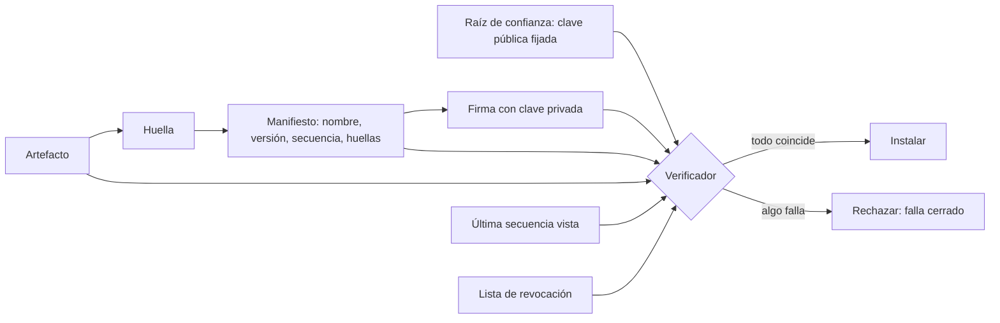
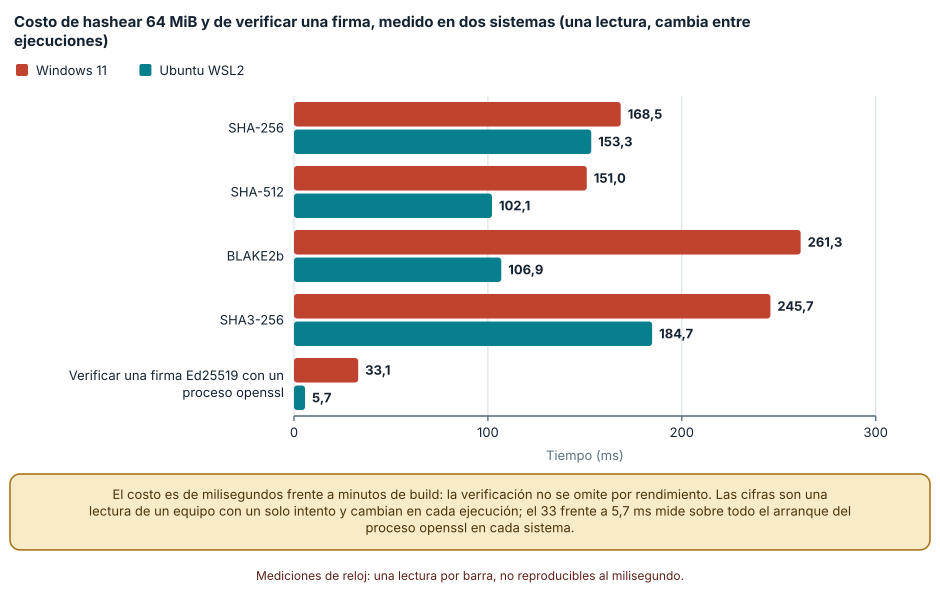

# SE-401 — Firmas, checksums y verificación

[← SE-400 — SBOM, procedencia y atestaciones](../../classes/part-33-build-release-y-cadena-de-suministro/se-400-sbom-procedencia-y-atestaciones/README.md) · [↑ Parte 33](../../classes/part-33-build-release-y-cadena-de-suministro/README.md) · [📚 Índice completo](../../classes/README.md) · [🌐 Portal](../../site/classes/SE-401.html) · [SE-402 — Versionado, compatibilidad y changelog →](../../classes/part-33-build-release-y-cadena-de-suministro/se-402-versionado-compatibilidad-y-changelog/README.md)

## Punto profesional y fundamento pedagógico

**Punto profesional.** La clase existe para que puedas decidir qué comprueba quien instala tu software antes de ejecutarlo, y para que sepas qué ataque detiene cada comprobación y cuál no. Un checksum detecta corrupción; una firma digital detecta manipulación solo si quien verifica ya tiene, por un camino independiente, la clave de quien firma; una secuencia o una fecha de caducidad detecta que le sirven una versión vieja pero válida. La habilidad profesional es **mover la confianza a un lugar pequeño y protegible** y diseñar la verificación para que falle cerrada.

**Por qué aparece aquí.** Sigue a **SBOM, procedencia y atestaciones**: allí se crearon documentos que afirman cosas sobre un artefacto; aquí se les da un responsable verificable. Precede a las clases de versionado y entrega progresiva, que asumen que lo que se despliega está verificado. El caso conductor es el release de la API de entregas, con su manifiesto de huellas.

**Error conceptual que debe corregir.** Creer que «publicar el SHA-256 junto al archivo» o «firmar el release» bastan. Un checksum publicado en el mismo sitio que el archivo lo controla quien controla el sitio; una firma cuya clave se descarga de la misma página la controla quien controla la página; y una firma válida de una versión antigua es una firma válida. Cada control cubre un ataque y deja otros.

**Secuencia de aprendizaje.** Antes de medir, predices cuántos de nueve ataques rechaza cada una de seis estrategias de verificación; después construyes firmas Ed25519 reales con `openssl`, ejecutas la matriz de ataques, mides el costo de verificar y revocas una clave para ver qué cambia. La secuencia usa predicción, cripto real con una herramienta estándar y un análisis de lo que cada estrategia da por bueno.

**Evidencia de aprendizaje.** `firmas-log.md` con la predicción, las tres figuras reproducidas, la política de verificación de la API de entregas (qué se comprueba, en qué orden, con qué raíz de confianza y cómo falla) y una nota que separe los ataques que se rechazan de los que no.

**Límite de la conclusión.** Las firmas son reales (Ed25519 con `openssl`, 3.5.7 en Windows y 3.0.13 en Ubuntu) pero el «sitio», el «atacante» y los canales son objetos de un programa; no hay red, ni servidor, ni usuarios, y los nueve ataques son construcciones del autor. Las mediciones de tiempo son lecturas de un equipo que cambian en cada ejecución. No se probó GPG, Sigstore, firmas de código del sistema operativo ni ninguna infraestructura de claves real.

### Trazabilidad fuente → afirmación

| Fuente primaria u oficial | Afirmación que respalda | Lo que no prueba |
|---|---|---|
| [RFC 8032: Edwards-Curve Digital Signature Algorithm (EdDSA)](https://www.rfc-editor.org/rfc/rfc8032) | Especifica el algoritmo de firma Ed25519 que usan los experimentos y sus propiedades. | No dice cómo distribuir ni custodiar las claves. |
| [The Update Framework (TUF): especificación](https://theupdateframework.io/specification/) | Describe un marco de actualización seguro con claves por rol, metadatos con caducidad y número de versión, y defensa frente a ataques de repetición y de congelación. | No fija la política concreta de la API de entregas. |
| [Samuel, Mathewson, Cappos y Dingledine, «Survivable key compromise in software update systems» (2010)](https://doi.org/10.1145/1866307.1866315) | Analiza cómo diseñar sistemas de actualización que sobrevivan al compromiso de claves de firma mediante delegación y umbrales. | No mide la frecuencia de compromisos de claves. |
| [Sigstore: documentación](https://docs.sigstore.dev/) | Describe la firma de artefactos con identidades efímeras y un registro de transparencia, una alternativa a custodiar claves de larga vida. | No se usó en esta clase. |
| [OpenSSL: pkeyutl](https://docs.openssl.org/3.0/man1/openssl-pkeyutl/) | Documenta la orden con la que se generan y verifican las firmas de los experimentos. | No garantiza el mismo resultado de tiempo entre versiones. |
| [Python: hashlib](https://docs.python.org/3/library/hashlib.html) | Documenta las funciones hash (SHA-2, SHA-3, BLAKE2) que se usan para las huellas. | No indica cuál conviene a cada amenaza. |

## Antes de empezar

Recupera lo aprendido en `SE-400`: un SBOM y una procedencia están ligados a un artefacto por su huella, y ninguno dice quién responde por ellos. La pregunta activa es: **¿qué comprueba quien instala, contra qué raíz de confianza, y qué ataque pasa a pesar de todo?**

## Prerrequisitos

- Haber completado `SE-400` o poder explicar qué es una huella y qué es una atestación.
- Python 3.11 o posterior y `openssl` 3.x disponible en la línea de órdenes; los experimentos usan `hashlib`, `subprocess`, `json` y `tempfile`.
- Saber qué es un par de claves pública y privada a nivel conceptual.

## Problema auténtico

La plataforma publica el instalador de un cliente de línea de órdenes en su página de descargas, con un archivo `SHA256SUMS` al lado y una firma. Un atacante compromete el servidor de la página. Sustituye el instalador, recalcula `SHA256SUMS` y publica otra firma generada con su propia clave y su clave pública junto a ella. Quien sigue las instrucciones («comprueba el checksum y la firma») ve que todo coincide.

En otro incidente, nadie toca el servidor, pero el equipo publica por error un instalador antiguo, con una vulnerabilidad ya corregida, firmado correctamente en su día. Las firmas de las versiones antiguas siguen siendo válidas, y los clientes lo aceptan porque no recuerdan cuál es la versión más reciente.

## Objetivos observables

Al terminar podrás:

1. distinguir integridad, autenticidad y frescura, y decir qué comprobación da cada una;
2. generar y verificar una firma Ed25519 y explicar qué prueba (y qué no) una verificación correcta;
3. diseñar una verificación con una raíz de confianza fijada de antemano y un manifiesto firmado con número de secuencia;
4. evaluar seis estrategias frente a nueve ataques y justificar qué ataques quedan sin cubrir;
5. planificar rotación y revocación de claves y qué hacen los clientes durante la ventana de exposición.

## Mapa conceptual



El mapa muestra que la firma no basta: el verificador combina cuatro cosas ajenas al atacante (clave fijada, secuencia recordada, revocación y la huella calculada por sí mismo) y rechaza ante cualquier fallo.

## Temas y por qué importan

| Tema | Por qué cambia una decisión profesional | Evidencia mínima |
|---|---|---|
| Checksums | Detectan corrupción; no autentican a nadie. | Predicción, traza causal y contraejemplo de **Checksums** en `firmas-log.md` |
| Firmas digitales | Autentican si la clave de verificación es de confianza. | Predicción, traza causal y contraejemplo de **Firmas** en `firmas-log.md` |
| Raíz de confianza | La clave fijada es el punto que debe protegerse. | Predicción, traza causal y contraejemplo de **Raíz de confianza** en `firmas-log.md` |
| Frescura y repetición | Una firma válida antigua es un ataque. | Predicción, traza causal y contraejemplo de **Frescura** en `firmas-log.md` |
| Rotación y revocación | La clave se pierde o se roba; el plan debe existir antes. | Predicción, traza causal y contraejemplo de **Rotación y revocación** en `firmas-log.md` |

## Conceptos y decisiones

### 1. Checksums: integridad sin autenticidad

Un **checksum** criptográfico (SHA-256, por ejemplo) es la huella de un archivo. Si coincide con el valor esperado, el archivo no se corrompió ni se alteró *respecto de ese valor*. La seguridad de la comprobación está en cómo se obtuvo el valor esperado: si llega por el mismo canal que el archivo, quien controla el canal cambia ambos. Un checksum sirve para detectar descargas truncadas y errores de transmisión, y sirve contra manipulación solo cuando el valor viene por un canal independiente y anterior al ataque. Además, en una cadena de comprobaciones el hash protege la integridad de un documento (un manifiesto) cuya firma se comprueba una sola vez: se firma una lista de huellas, no cada archivo.

### 2. Firmas digitales

Una **firma digital** se calcula con una clave privada sobre unos datos y se verifica con la clave pública correspondiente. La verificación correcta prueba que quien posee la clave privada firmó exactamente esos bytes; no prueba quién es esa persona, que la clave sea de quien se cree, que el contenido sea benigno ni que sea reciente. Ed25519 es un algoritmo de firma moderno, con claves y firmas cortas (32 y 64 bytes) y verificación rápida, especificado en el RFC 8032. Usar firmas en lugar de solo huellas permite que el publicador y el verificador no compartan un secreto y que cualquiera pueda comprobar. La firma sobre un manifiesto con nombre, versión, número de secuencia y huellas es mejor que una firma sobre el archivo suelto, porque liga la versión y el nombre al contenido.

### 3. Raíz de confianza

Toda verificación termina en algo que se da por bueno sin comprobarlo: la **raíz de confianza**. Si la clave pública llega con el archivo, la raíz es el sitio de descarga y el atacante que controla el sitio controla la raíz. Si la clave se **fija de antemano** (viene en el instalador anterior, en el sistema operativo, en un repositorio de claves independiente, en el propio cliente), el atacante tiene que comprometer esa distribución anterior. Mover la raíz a un lugar más pequeño, de actualización rara y mejor vigilado es la estrategia: no se elimina la confianza, se la confina. Por eso los sistemas de actualización robustos distinguen claves por rol (raíz, objetivos, marca de tiempo) y guardan las de mayor valor fuera de línea.

### 4. Frescura y ataques de repetición

Una firma válida no caduca por sí misma. Un atacante que puede servir archivos (un espejo, un registro, una red) puede ofrecer una versión antigua, firmada y vulnerable, en lugar de la actual (**ataque de retroceso**), o impedir que el cliente vea las versiones nuevas (**ataque de congelación**). Las defensas son un número de **secuencia** o versión monótono dentro de lo firmado, que el cliente recuerda y no acepta que disminuya, y una **fecha de caducidad** en los metadatos que obliga a renovarlos con regularidad. También debe firmarse el *nombre* del producto: un manifiesto firmado de otro producto con la misma clave es una firma válida sobre un contenido que no es el esperado (confusión entre productos).

### 5. Rotación, revocación y compromiso

Las claves se pierden, se filtran o caducan. La **rotación** es el cambio planificado de la clave; la **revocación**, la declaración de que una clave ya no debe usarse. Una rotación sólida se **declara antes de necesitarla**, firmada con la clave vigente, de modo que los clientes aprendan la clave nueva por la cadena de confianza anterior. Una revocación necesita llegar a los clientes, y entre el robo de la clave y la llegada de la revocación hay una ventana en la que el atacante puede firmar. Si el compromiso es del sistema de construcción y no de la clave (un CI comprometido que firma con la clave real), la firma es válida y el contenido, malicioso: ninguna verificación criptográfica lo ve, y la defensa está en claves de vida corta atadas a la identidad del trabajo, en revisión y en reconstrucción independiente.

### Matriz de ataques

Se construye un release legítimo (un artefacto de unos 2 KB, un manifiesto con nombre, versión, secuencia y huella, y su firma Ed25519 con `openssl`) y nueve ataques. Se evalúan seis estrategias de verificación, de la más débil a la más completa.

```text
openssl genpkey -algorithm ED25519 -out release.pem
openssl pkeyutl -sign -inkey release.pem -rawin -in manifiesto.json -out manifiesto.sig
openssl pkeyutl -verify -pubin -inkey release.pub -rawin -in manifiesto.json -sigfile manifiesto.sig
```


**Cómo leer la figura.** Cada fila es un ataque y cada columna una estrategia; R indica que el verificador rechaza y P que lo deja pasar. La estrategia 1 solo detecta el cuerpo cambiado sin tocar el checksum y el truncado; la 3 deja pasar a quien publica su clave junto a su firma; la 4 (clave fijada) cierra eso, pero no el retroceso ni la confusión entre productos; la 5 los cierra con el manifiesto firmado y la secuencia; las filas de la clave robada y del CI comprometido pasan en todas las firmas. **Dónde deja de valer:** el atacante, los canales y la «independencia» del checksum por canal aparte son objetos del programa: la estrategia 2 rechaza más porque el valor esperado se supone obtenido antes del ataque, y esa suposición es la que falla en un compromiso previo. La fila de la firma corrupta no daña al usuario (el artefacto es el legítimo): rechazarla es seguro pero deja sin instalar algo válido. Los nueve ataques son los que el autor construyó, no un catálogo.

### Costo de verificar

Se mide el tiempo de hashear 64 MiB con cuatro funciones y de verificar una firma Ed25519 con un proceso de `openssl`.



**Cómo leer la figura.** Cada fila es una operación y las columnas son una lectura en cada sistema; todo cuesta décimas de segundo para 64 MiB y decenas de milisegundos para una firma. **Dónde deja de valer:** son lecturas únicas de un equipo (no se repitió, no se controlaron el reloj ni la carga) y cambian en cada ejecución; la diferencia entre sistemas mide en buena parte el arranque del proceso externo y la versión de la biblioteca, no el algoritmo. La conclusión que sobrevive es de orden de magnitud: verificar cuesta mucho menos que construir, y no hay excusa de rendimiento para omitirlo.

### Qué da por bueno cada estrategia

Se resume lo que cada estrategia supone y lo que no cubre.


**Cómo leer la figura.** Cada fila añade una confianza y cierra un ataque de la matriz: el recorrido de arriba abajo mueve la raíz desde la página de descarga hacia una clave pequeña, fijada y vigilada. **Dónde deja de valer:** es un análisis del autor a partir de nueve ataques; otros ataques (a la distribución de la clave fijada, a la lista de revocación, a la hora del cliente) añaden filas. La última estrategia sigue sin cubrir el compromiso del sistema de construcción con la clave vigente.

## Definiciones de trabajo

- **checksum:** huella criptográfica de un archivo usada para detectar cambios.
- **firma digital:** valor calculado con una clave privada que cualquiera puede verificar con la clave pública.
- **raíz de confianza:** clave o dato que el verificador da por bueno sin comprobarlo.
- **secuencia:** número monótono dentro de lo firmado que impide aceptar una versión anterior.
- **revocación:** declaración de que una clave ya no debe aceptarse.

Las definiciones son operativas para la API de entregas. No convierten términos con una historia más amplia en sinónimos y deben contrastarse con la documentación primaria enlazada al final.

## Ejemplo mínimo

El fragmento comprueba un checksum y detecta un cambio de un byte. Antes de ejecutarlo, predice si una comparación de huellas detectaría también un cambio hecho por quien controla el valor esperado.

```python
import hashlib
original = b"instalador 1.4.0"
esperado = hashlib.sha256(original).hexdigest()
recibido = b"instalador 1.4.0!"
print(hashlib.sha256(recibido).hexdigest() == esperado)
```

El resultado es `False`: la huella detecta el cambio. Si quien manipula el archivo controla también `esperado`, la comparación vuelve a ser `True`. Registra versión de Python, comando y salida; después reemplaza `esperado` por un valor fijado en otro archivo que el atacante no controla y explica qué cambió.

## Ejemplo profesional

La API de entregas publica un manifiesto (`release.json`) con nombre, versión, número de secuencia y las huellas del artefacto, del SBOM y de la procedencia, firmado con Ed25519. El cliente de línea de órdenes incorpora la clave pública en cada versión que él mismo distribuye y recuerda la mayor secuencia vista; antes de instalar calcula la huella del archivo descargado, comprueba la firma del manifiesto con la clave incorporada, comprueba el nombre, rechaza una secuencia inferior a la recordada y falla cerrado ante cualquier discrepancia. La clave de firma vive en un servicio de claves con acceso solo desde el trabajo de publicación, y existe una declaración de rotación firmada y preparada con una clave de reserva guardada fuera de línea. Una vez al trimestre se ensaya la rotación y la revocación con un cliente de prueba.

## Práctica guiada

1. Genera un par de claves Ed25519 con `openssl` y firma un manifiesto JSON con nombre, versión, secuencia y huella.
2. Predice cuántos de nueve ataques rechaza cada una de las seis estrategias y escríbelo antes de ejecutar.
3. Implementa las seis estrategias como funciones y ejecuta la matriz con los nueve ataques.
4. Revoca la clave del release y comprueba qué estrategia deja de aceptar el ataque de la clave robada y qué ocurre con el release legítimo.
5. Mide el costo de hashear 64 MiB con cuatro funciones y el de verificar una firma, y anota que son lecturas únicas.
6. Redacta la política de verificación de la API de entregas: raíz, orden de comprobaciones, falla cerrada, rotación.
7. Entrega `firmas-log.md` y pide a otra persona que proponga un décimo ataque que tu mejor estrategia deje pasar.

## Ejercicios

1. **Raíz:** una página de descargas publica `instalador.exe`, `SHA256SUMS` y `SHA256SUMS.sig` con su clave pública en la misma página; describe en cuántos pasos un atacante que controla la página engaña a un usuario.
2. **Secuencia:** diseña los campos de un manifiesto para que un cliente rechace una versión antigua firmada y explica qué le pasa a un cliente que se reinstala desde cero.
3. **Rotación:** escribe la secuencia de pasos de una rotación planificada de clave que no deje clientes sin poder actualizar.
4. **Compromiso:** el CI firma con la clave real el artefacto de un commit malicioso; lista dos controles que no son firmas y que lo detectarían.

## Reto verificable

Entrega `firmas-log.md` con la predicción, las tres tablas, la política de verificación de la API de entregas y una nota con los ataques que ninguna estrategia cubre. Se aprueba si otra persona ejecuta los experimentos desde un checkout limpio, obtiene la misma matriz de ataques en su sistema y puede decir qué parte de la política impide aceptar una versión antigua firmada y cuál no impide aceptar un release firmado por un CI comprometido. No se aprueba por afirmar «el release está firmado» sin decir dónde está la clave de verificación ni por omitir la comprobación de la secuencia.

## Caso conductor

La API de entregas es el caso conductor de la Parte 33. Esta clase deja el quinto artefacto: un manifiesto firmado con una política de verificación, de rotación y de revocación. `SE-402` tratará qué significa el número de versión que ese manifiesto firma y qué promete a quien actualiza. Cambia después un solo dato, la procedencia de la clave pública, y observa cuántos ataques más pasan.

## Preguntas frecuentes

### ¿Es suficiente publicar el SHA-256 junto al archivo?

Para detectar descargas corruptas, sí; contra manipulación, no, porque quien cambia el archivo cambia el checksum. Gana valor cuando el valor esperado llega por un canal independiente, anterior al ataque, o está dentro de un documento firmado con una clave fijada.

### ¿Por qué se firma un manifiesto y no cada archivo?

Porque un manifiesto puede ligar nombre, versión, secuencia y las huellas de todos los archivos de un release en una sola firma y obliga a verificar el conjunto. Firmar archivos sueltos permite mezclar archivos de releases distintos con firmas válidas.

### ¿Qué hago si pierdo la clave privada?

Si preparaste una declaración de rotación firmada con una clave de reserva o delegaste en varias claves con un umbral, los clientes pueden continuar. Si no, tendrás que distribuir una clave nueva por un canal que los clientes ya acepten, normalmente con una acción manual. Es la pregunta que debe responderse antes de necesitarla.

### ¿Firmar con identidades efímeras (por ejemplo, con un proveedor de identidad) elimina el problema de las claves?

Desplaza el problema: ya no custodias una clave de larga vida, pero confías en el proveedor de identidad y en un registro público que permita auditar. Cambia la superficie de ataque y la raíz de confianza; no las elimina. Evalúa qué raíz es más fácil de proteger para tu caso.

## Fallo controlado y diagnóstico

Reproduce el fallo clásico de la clase: **un instalador sustituido junto con su checksum y su firma, que pasan la verificación**. Construye un ataque en el que el atacante publica cuerpo, checksum, firma y clave pública propios.

Registra síntoma, entrada mínima, hipótesis, observación que descarta cada hipótesis, causa, corrección y prueba de regresión. **Síntoma:** el usuario ejecuta un instalador malicioso tras seguir las instrucciones de verificación. **Hipótesis rivales:** (a) la firma es falsa; (b) el algoritmo es débil; (c) la clave de verificación procede de la misma fuente que el archivo. **Prueba:** comprueba la firma con la clave fijada que el cliente trae incorporada; si falla, la causa es (c). **Conclusión:** la raíz de confianza estaba en manos del atacante. **Regresión:** el verificador toma la clave de una fuente independiente fijada de antemano, rechaza cualquier otra clave y se prueba con la matriz de ataques del experimento.

## Errores comunes y cómo corregirlos

| Síntoma | Causa probable | Corrección |
|---|---|---|
| El atacante firma con su clave y pasa | Clave de verificación descargada de la misma página | Clave fijada de antemano en una fuente independiente |
| Se acepta una versión antigua vulnerable | Sin secuencia ni caducidad en lo firmado | Número monótono firmado y recordado por el cliente |
| Se acepta un manifiesto de otro producto | No se firma ni se comprueba el nombre | Incluir el nombre en lo firmado y verificarlo |
| Perder la clave deja a los clientes sin actualizar | Rotación no preparada | Declarar la rotación y guardar una clave de reserva fuera de línea |
| Se instala aunque falle una comprobación | Falla abierta | Rechazar ante cualquier error, incluida una excepción |

## Entorno y archivos clave

```text
work/SE-401/
├── README.md
├── firmas/
│   ├── firmar.py
│   ├── verificar.py
│   └── ataques.py
├── tests/test_firmas.py
├── claves/               # solo claves de prueba; nunca versionar claves reales
└── evidence/firmas-log.md
```

El `README` declara plataforma, versión de Python, versión de `openssl`, semillas y comandos. Los resultados de la matriz de ataques son idénticos en Windows (OpenSSL 3.5.7) y Ubuntu (3.0.13) porque son decisiones lógicas sobre firmas válidas o no; las claves se generan de nuevo en cada ejecución. Las mediciones de tiempo no son reproducibles al milisegundo. No incluyas nunca una clave privada real en el repositorio. El código completo del experimento está en `scripts/experiments_part33/e401.py` y se ejecuta con `python scripts/experiments_part33/e401.py`.

## Seguridad, ética y accesibilidad

- una clave de firma es un secreto de máxima sensibilidad: guárdala en un servicio de claves o un dispositivo, limita quién puede usarla y registra cada uso;
- verificar debe fallar cerrado y con un mensaje que explique qué comprobación falló y qué hacer, sin ofrecer una opción para «continuar de todos modos» a quien no sabe lo que hace;
- no publiques claves de prueba como si fueran de producción ni reutilices la clave de firma para otros fines;
- las instrucciones de verificación para usuarios deben poder seguirse con lector de pantalla y sin depender de conocimientos de criptografía;
- respeta las licencias de las herramientas de firma y atribuye lo adaptado.

## Puente hacia el trabajo con agentes

Un agente al que se le pide «firma el release» generará una firma y publicará la clave pública en la misma carpeta, o añadirá un `SHA256SUMS` sin firmarlo, y afirmará que el release está verificado. Pídele en cambio que firme un manifiesto con nombre, versión y secuencia, que incorpore la clave en el cliente, que escriba el verificador con falla cerrada y que ejecute la matriz de ataques mostrando cuáles pasan. Revisa especialmente si deja la clave de verificación junto al archivo, si omite la comprobación de la secuencia y si guarda la clave privada en el repositorio.

## Transferencia

Traslada el análisis a otro canal (una imagen de contenedor, un paquete de un índice, una actualización de firmware): cambia el formato de firma y el mecanismo de distribución de la clave y conserva el procedimiento de identificar la raíz de confianza, firmar un manifiesto con nombre y secuencia, fallar cerrado y planificar rotación. La transferencia está lograda cuando puedes decir qué ataque de la matriz seguiría pasando en el nuevo canal, no cuando repites las órdenes de `openssl`.

## Evaluación y evidencia

| Criterio | Evidencia para aprobar |
|---|---|
| comprensión | explicación de por qué un checksum en la misma página y una clave en la misma página no protegen |
| corrección | matriz de nueve ataques por seis estrategias reproducible con firmas reales |
| diseño | política con raíz fijada, manifiesto firmado con secuencia, falla cerrada y plan de rotación |
| diagnóstico | reproducción del fallo «clave y firma del atacante» con regresión que la rechaza |
| incertidumbre | declaración de que los ataques son del autor y de qué ninguna estrategia cubre (CI comprometido, clave robada antes de revocar) |
| reproducibilidad | versiones de `openssl` y de Python, comandos, salida y límites declarados |

## Fuentes

- [RFC 8032: EdDSA](https://www.rfc-editor.org/rfc/rfc8032) — algoritmo de firma Ed25519; autoridad: IETF.
- [The Update Framework: especificación](https://theupdateframework.io/specification/) — actualizaciones seguras, secuencia y caducidad; autoridad: proyecto TUF, CNCF.
- [Samuel et al., «Survivable key compromise in software update systems»](https://doi.org/10.1145/1866307.1866315) — diseño frente al compromiso de claves; autoridad: ACM CCS 2010.
- [Sigstore: documentación](https://docs.sigstore.dev/) — firma con identidades efímeras y registro de transparencia; autoridad: proyecto Sigstore, OpenSSF.
- [OpenSSL: pkeyutl](https://docs.openssl.org/3.0/man1/openssl-pkeyutl/) — firma y verificación en los experimentos; autoridad: proyecto OpenSSL.
- [Python: hashlib](https://docs.python.org/3/library/hashlib.html) — funciones hash; autoridad: documentación de Python.

Cada fuente respalda el mecanismo indicado; ninguna demuestra que los 7 de 9 de la matriz, los 168,5 ms o la ventana de revocación se observen en tu canal. Esa afirmación depende de tu distribución de claves y de tus clientes.

## Límites y siguiente paso

Se ejecutaron tres experimentos, con firmas Ed25519 reales de `openssl` y hashes de `hashlib`, en Windows 11 (CPython 3.12.9, OpenSSL 3.5.7) y Ubuntu bajo WSL2 (3.12.3, OpenSSL 3.0.13); la matriz de ataques fue idéntica en ambos y las mediciones de tiempo, no. No hay red, servidor, usuarios, GPG, Sigstore ni infraestructura de claves real, y los nueve ataques y la independencia del canal del checksum son construcciones del autor. La siguiente clase se ocupa de qué promete el número de versión que el manifiesto firma: versionado, compatibilidad y registro de cambios.

## Glosario

- **checksum:** huella criptográfica de un archivo usada para detectar cambios.
- **firma digital:** valor calculado con una clave privada que cualquiera puede verificar con la clave pública.
- **raíz de confianza:** clave o dato que el verificador da por bueno sin comprobarlo.
- **secuencia:** número monótono dentro de lo firmado que impide aceptar una versión anterior.
- **revocación:** declaración de que una clave ya no debe aceptarse.

---

[← SE-400 — SBOM, procedencia y atestaciones](../../classes/part-33-build-release-y-cadena-de-suministro/se-400-sbom-procedencia-y-atestaciones/README.md) · [↑ Parte 33](../../classes/part-33-build-release-y-cadena-de-suministro/README.md) · [📚 Índice completo](../../classes/README.md) · [🌐 Portal](../../site/classes/SE-401.html) · [SE-402 — Versionado, compatibilidad y changelog →](../../classes/part-33-build-release-y-cadena-de-suministro/se-402-versionado-compatibilidad-y-changelog/README.md)
