# Parte 34 — SaaS y plataformas de producto

Las partes anteriores enseñaron a construir, probar, desplegar y operar software, a diseñar su arquitectura y a decidir qué producto vale la pena hacer. Esta parte junta esas capacidades en un tipo de producto que cambia casi todas las decisiones: el software que un proveedor opera para muchos clientes a la vez y cuyo ingreso no ocurre en la venta sino cada ciclo. El trabajo se organiza sobre *Tablero*, una herramienta ficticia de gestión de proyectos que pasa de licencia instalada a servicio en línea, abre un mercado de plantillas y lanza una tienda de merchandising. Cada clase mide un mecanismo con experimentos ejecutados de verdad (colas con y sin cuotas, un alta que se corta y se reanuda, un medidor de uso con eventos duplicados, un motor de derechos, un libro mayor de doble entrada con conciliación, hilos contra un inventario limitado) o con simulaciones de semilla fija cuyos parámetros son del autor.

## Pregunta rectora

> Para un producto que se entrega continuamente a muchos clientes y se cobra cada ciclo, ¿qué debe cumplirse siempre para cada cliente, qué mide y qué prueba que se cumple, qué cuesta mantenerlo y qué parte de la promesa deja de valer si falla un supuesto?

## Antes del recorrido clase por clase

Esta parte no defiende un modelo de negocio: enseña a leer un producto SaaS como **un conjunto de invariantes con costo y con evidencia**. Cada clase toma una propiedad (que un cliente no vea ni degrade a otro, que dar de alta no deje cuentas a medias, que el estado de una suscripción sea una decisión guardada, que cada evento de uso se cuente una sola vez, que lo contratado se haga cumplir donde se actúa, que el precio sea una decisión medible, que el dinero deje un libro que cuadra y que la promesa de servicio se pueda comprobar) y la lleva a una medición y a un límite declarado. La primera clase fija el vocabulario y la economía (entrega continua, multi-inquilino y ciclo de ingresos). Las dos siguientes tratan el aislamiento y el alta. Las cuatro del siguiente bloque cubren el ciclo de ingresos desde la suscripción hasta el precio. Las tres siguientes llevan el dinero a plataformas de dos lados, pagos y una tienda. La penúltima compromete el servicio con niveles y la última reúne todo en un taller y un proyecto integrador con evidencia reproducible.

```mermaid
flowchart LR
    A[Qué es SaaS] --> B[Aislamiento y vecino ruidoso]
    B --> C[Alta y configuración]
    C --> D[Suscripciones y dunning]
    D --> E[Medición de uso]
    E --> F[Planes, derechos y banderas]
    F --> G[Precios y límites]
    G --> H[Marketplaces]
    H --> I[Pagos, idempotencia y conciliación]
    I --> J[Tienda: carrito, inventario, devoluciones]
    J --> K[SLA, soporte y operación]
    K --> L[Taller y proyecto integrador]
    L -->|un defecto no visto| B
```

El diagrama se lee de izquierda a derecha y no es un orden obligatorio de adopción: es el orden en que se explican los mecanismos y sus costos. El retorno indica que un defecto que la batería final no ve vuelve a empezar el recorrido desde el aislamiento: se escribe la prueba que faltaba y se repite la evidencia.

## Resultados acumulativos

Podrás calcular con SQL el ingreso recurrente mensual de un conjunto de suscripciones y descomponer su variación en nuevos, expansión, contracción y bajas comprobando que la suma cuadra, y estimar en cuántos meses se recupera el costo de adquirir un cliente según su tasa de baja. Podrás simular la ráfaga de un cliente sobre una capacidad compartida con una cola única, una cuota de tasa y una cola justa, leer qué paga cada parte, y comparar el costo por cliente de un entorno dedicado, un modelo puente y uno compartido a 10, 100 y 1 000 clientes.

Podrás ejecutar un alta de cinco pasos que se corta, se reanuda sin duplicar nada y deja estado visible, medir cuánto más cuesta crear un esquema propio que una fila de inquilino, y modelar la configuración por capas. Podrás implementar la máquina de estados de una suscripción con transiciones explícitas, un ciclo anclado al día de alta, un prorrateo en centavos y un calendario de reintentos con su recuperación por etapa, y procesar eventos del procesador de forma idempotente.

Podrás medir un uso con entrega «al menos una vez», mostrar que sumar sin identificador factura de más y que una clave única lo corrige, asignar eventos tardíos por su tiempo de ocurrencia y comparar tramos graduales con precio por volumen en sus bordes. Podrás construir un motor de derechos con plan, excepción con vencimiento, estado de cuenta y consumo que responde con razón legible, y distinguir plan, derecho y bandera con su ciclo de vida.

Podrás comparar tres diseños de precio sobre una población con cola larga, leer una curva de ingreso con su meseta y calcular qué porcentaje de clientes supera cada límite. Podrás modelar la liquidez de una plataforma de dos lados, calcular el reparto de una venta con costo fijo del procesador y diseñar el flujo de un pago retenido. Podrás repetir un cobro con una clave de idempotencia y comprobar que no se cobra dos veces, registrar movimientos en un libro de partida doble inmutable y conciliarlo cobro por cobro explicando toda la brecha.

Podrás lanzar 40 hilos contra un inventario de 10 unidades y mostrar que «comprobar y luego escribir» vende de más y que una actualización condicional no, medir cuánto bloquea una reserva larga y diseñar los estados de un pedido y de una devolución. Podrás calcular los minutos de caída por nivel de disponibilidad, la disponibilidad de una cadena de componentes, comprobar que un indicador agregado puede cumplir mientras un cliente no y diseñar un presupuesto de errores y una tabla de soporte por severidad. Y podrás sembrar seis defectos en un producto mínimo y comprobar qué prueba detecta cada uno.

## Prerrequisitos enlazados

- [Parte 11 — Economía, métricas y decisiones de producto](../../classes/part-11-economia-metricas-y-decisiones-de-producto/): modelos de negocio y sostenibilidad (`SE-133`), costos de construcción, operación y oportunidad (`SE-134`), telemetría de producto y consentimiento (`SE-137`) y FinOps de producto (`SE-140`).
- [Parte 20 — Backend, APIs y procesamiento asíncrono](../../classes/part-20-backend-apis-y-procesamiento-asincrono/): idempotencia, reintentos y deduplicación (`SE-246`), jobs y colas (`SE-247`) y caching, rate limiting y protección (`SE-249`).
- [Parte 24 — Software especializado y dominios](../../classes/part-24-software-especializado-y-dominios/): fintech, contabilidad e invariantes monetarias (`SE-294`).
- [Parte 29 — Datos, persistencia y recuperación](../../classes/part-29-datos-persistencia-y-recuperacion/): transacciones, aislamiento y concurrencia (`SE-351`), restricciones e invariantes (`SE-352`) y backups y recuperación (`SE-357`).
- [Parte 31 — Integración, eventos y mensajería](../../classes/part-31-integracion-eventos-y-mensajeria/): webhooks, polling y suscripciones (`SE-379`), entrega, orden y duplicación (`SE-376`) e idempotencia en procesamiento distribuido (`SE-392`).
- [Parte 28 — Estilos arquitectónicos](../../classes/part-28-estilos-arquitectonicos/): multi-tenancy y aislamiento (`SE-342`), arquitectura celular y radio de impacto (`SE-344`) y 12-factor (`SE-345`).
- [Parte 36 — Calidad, rendimiento y resiliencia](../../classes/part-36-calidad-rendimiento-y-resiliencia/): latencia, throughput y saturación (`SE-436`), circuit breakers, bulkheads y degradación (`SE-439`) y pruebas de caos (`SE-394`).
- [Parte 38 — Seguridad, privacidad y cumplimiento](../../classes/part-38-seguridad-privacidad-y-cumplimiento/): autorización y mínimo privilegio (`SE-459`) y privacidad por diseño (`SE-463`).
- [Parte 39 — Build, release y cadena de suministro](../../classes/part-39-build-release-y-cadena-de-suministro/): feature flags y entrega progresiva (`SE-475`) y entrega y despliegue continuos (`SE-485`).
- [Parte 41 — Observabilidad, SRE e incidentes](../../classes/part-41-observabilidad-sre-e-incidentes/): SLI, SLO, SLA y presupuestos de error (`SE-497`), runbooks y guardias (`SE-499`) y gestión de incidentes (`SE-500`).
- Python 3.11+ y terminal. Todos los experimentos usan solo la biblioteca estándar (`sqlite3`, `threading`, `tempfile`, `random`); no se necesita ningún paquete ni servicio externo.

## Bloques y progresión

1. **Qué es SaaS y cómo se aísla al cliente:** las clases 409 a 411 fijan las tres propiedades del producto, miden el vecino ruidoso con y sin cuotas y construyen un alta que se puede repetir.
2. **El ciclo de ingresos:** las clases 412 a 415 modelan la suscripción y sus cobros fallidos, la medición exacta del uso, el motor de derechos con sus banderas y el precio con sus límites.
3. **Plataformas y dinero:** las clases 416 a 418 llevan el producto a dos lados, registran el dinero con idempotencia y partida doble y construyen el camino de una tienda con inventario y devoluciones.
4. **Operar y demostrar:** las clases 419 y 420 convierten la promesa en niveles medibles y reúnen todo en un expediente con defectos sembrados y pruebas que los detectan.

## Evidencia medida y límites

Las figuras y los ejemplos de esta parte usan experimentos ejecutados en Windows 11 con CPython 3.12.9 y la biblioteca estándar (`sqlite3` incluido). Los recuentos, los tamaños y las simulaciones con semilla 34 se repiten idénticos; los tiempos de reloj (la medición de la alta como fila frente a esquema, que varió entre unas 99 y unas 155 veces) cambian de una ejecución y de un equipo a otro.

Lo que se ejecutó de verdad: una descomposición del ingreso recurrente con SQL sobre 440 clientes sintéticos; una alta de cinco pasos con un fallo inyectado y su reanudación; la creación de 200 inquilinos como fila y como esquema; un medidor de uso con 30 000 eventos y 6 % de duplicados con y sin identificador; el motor de derechos con siete consultas; un libro de partida doble con 500 cobros, sus asientos y la conciliación de cuatro diferencias sembradas; 40 hilos concurrentes contra un archivo sqlite3 temporal con y sin actualización condicional; y la batería del taller con seis defectos y seis comprobaciones, repetida tres veces con salida idéntica.

Lo que es un modelo con parámetros del autor y semilla fija: la simulación de colas del vecino ruidoso (ocho clientes, capacidad de 20 trabajos por tick); el costo por cliente de los tres modelos de aislamiento; la recuperación de cobros fallidos con probabilidades por etapa; la población de 1 000 clientes y las tres ofertas de precio; la liquidez de una plataforma de dos lados; el tiempo de reserva de una tienda; la disponibilidad por inquilino con una tasa de fallos sembrada; y los planes, los tramos y los créditos de ejemplo.

Lo que **no se ejecutó** y se declara en cada clase: ningún procesador de pagos real ni dinero real (el procesador es un doble simulado); ningún proveedor de identidad, de nube o de colas; ninguna base de datos distinta de sqlite3; ningún tráfico, mercado ni cliente reales; ningún contrato, SLA ni asesoría legal o fiscal; y ninguna evaluación de PCI DSS ni de otra norma. Los precios, las tasas de baja, los márgenes y las comisiones son didácticos y no describen ningún producto ni proveedor. Los casos de Stripe, Airbnb, Uber y Mercado Libre se citan desde las fichas del curso, con sus propias fuentes; no se comparan cifras entre ellos. No se afirma revisión humana externa del contenido.

## Guía razonada clase por clase

*Tablero* pasa de licencia a servicio y, en el camino, enfrenta los problemas que el servicio crea: clientes que se afectan entre sí, altas a medias, cobros duplicados, facturas que no se pueden reproducir, límites que nadie hace cumplir, un mercado sin masa, una tienda que vende de más y una promesa de servicio que no se sabe medir. Cada clase explica qué mecanismo atiende el problema, qué experimento lo mide, qué no demuestra y qué evidencia permitiría abandonar la conclusión.

### Bloque 1 — Qué es SaaS y cómo se aísla al cliente

#### SE-409 — Qué hace distinto a un producto SaaS

Un producto SaaS se entrega continuamente desde una sola operación a muchos clientes y su ingreso depende de cada ciclo, no de la venta. La clase fija las tres propiedades y calcula con SQL la descomposición del ingreso recurrente (nuevos, expansión, contracción y bajas, comprobando que la suma cuadra), la diferencia entre retención bruta y neta y los meses que tarda en recuperarse el costo de adquirir un cliente con tres tasas de baja.

El estudiante entrega el mapa de propiedades con las decisiones técnicas derivadas y su cálculo de recuperación. `SE-410` toma la segunda propiedad y mide el vecino ruidoso.

#### SE-410 — Aislamiento multi-inquilino y vecino ruidoso

Aislar datos no aísla recursos: un cliente puede hacer esperar a los demás sin tocar sus datos. La clase simula la ráfaga de un cliente sobre una capacidad compartida con una cola única, una cuota de tasa y una cola justa, mide la latencia de los otros y lo que paga el vecino en cada caso, compara el costo por cliente de tres modelos de aislamiento y trata el traslado de un cliente entre niveles.

El estudiante entrega la política de aislamiento por plan con la medición de la latencia de los otros. `SE-411` automatiza el alta para asignar el nivel al crear al cliente.

#### SE-411 — Alta, aprovisionamiento y configuración por cliente

El alta es una saga con varios sistemas y debe poder cortarse y repetirse sin duplicar. La clase ejecuta un alta de cinco pasos con un fallo inyectado y la reanuda con registro de pasos, mide el costo de crear un inquilino como fila frente a esquema, estudia la compensación y diseña la configuración por capas y la diferencia entre configuración y derecho.

El estudiante entrega el contrato de alta con sus pasos, su estado y su política de compensación. `SE-412` parte del estado activo que el alta deja.

### Bloque 2 — El ciclo de ingresos

#### SE-412 — Suscripciones, ciclos de facturación y dunning

Una suscripción es una máquina de estados con fechas, importes y eventos externos. La clase implementa transiciones explícitas, un ciclo anclado al día de alta, un prorrateo en centavos y un calendario de reintentos cuya recuperación por etapa se simula, y trata el manejo idempotente de los eventos del procesador y la política de acceso por estado.

El estudiante entrega la tabla de estados y transiciones, el ciclo anclado y la política de cobros fallidos. `SE-413` pasa del cobro fijo al cobro por uso.

#### SE-413 — Medición de uso y facturación por consumo

Con entrega «al menos una vez», sumar eventos sin identidad factura de más. La clase mide 30 000 eventos con duplicados y tardíos con y sin identificador, asigna cada evento a su periodo de ocurrencia, define el cierre y compara tramos graduales con precio por volumen, con el borde donde el segundo baja al consumir más.

El estudiante entrega la definición de la métrica facturable, el esquema del evento y la política de cierre. `SE-414` hace cumplir lo contratado.

#### SE-414 — Planes, derechos de uso y banderas de funcionalidad

Plan, derecho y bandera son tres cosas con tres dueños. La clase construye con sqlite3 un motor de derechos que combina plan, excepción con vencimiento, estado de cuenta y consumo y contesta siete consultas con razón legible, trata el cambio de plan y clasifica las banderas por tipo y fecha de retiro.

El estudiante entrega el modelo de derechos con su orden de decisión y su política de bajada de plan. `SE-415` decide qué se pone en cada plan.

#### SE-415 — Precios, empaquetado y límites por plan

El diseño del precio mueve el ingreso más que su valor exacto. La clase compara con una población simulada un precio único, tres planes con límites y un precio por puesto, lee la meseta de la curva de ingreso, calcula qué porcentaje de clientes supera cada límite y trata el plan gratuito como una inversión y el cambio de precio como un cambio de contrato.

El estudiante entrega el catálogo de planes con la métrica de valor y la razón de cada corte. `SE-416` lleva el precio a una plataforma con dos lados.

### Bloque 3 — Plataformas y dinero

#### SE-416 — Marketplaces y plataformas de dos lados

En una plataforma de dos lados el valor de uno depende de la masa del otro. La clase modela la liquidez según el número de vendedores, calcula el reparto de una venta con el costo fijo del procesador, diseña el flujo de un pago retenido y enlaza los casos del curso (Airbnb, Mercado Libre y Uber) para la confianza, la custodia y los lados múltiples.

El estudiante entrega el diseño de un mercado mínimo con su métrica de liquidez, su comisión y su flujo de dinero. `SE-417` registra y concilia ese dinero.

#### SE-417 — Pagos, idempotencia y conciliación

Un reintento sin clave cobra dos veces y una brecha pequeña puede ocultar cuatro causas. La clase cobra 1 000 renovaciones con y sin clave de idempotencia, registra 500 cobros en un libro de partida doble con sqlite3, lo concilia con una liquidación con diferencias sembradas y explica toda la brecha.

El estudiante entrega la clave de cada operación de dinero, el plan de cuentas y el procedimiento de conciliación. `SE-418` los aplica a una tienda.

#### SE-418 — Comercio electrónico: carrito, inventario, pagos y devoluciones

«Comprobar y luego escribir» vende de más. La clase lanza 40 hilos contra 10 unidades con y sin actualización condicional, simula el compromiso de la duración de una reserva, diseña los estados de un pedido y trata la devolución como un proceso en el que se repone al recibir.

El estudiante entrega la política de inventario, reserva y devolución con su prueba de concurrencia. `SE-419` compromete el servicio.

### Bloque 4 — Operar y demostrar

#### SE-419 — SLA por nivel, soporte y operación del producto

Una disponibilidad agregada puede cumplir mientras un cliente no. La clase calcula los minutos de caída por nivel, la disponibilidad compuesta de una cadena de componentes, simula 100 inquilinos para mostrar la diferencia entre agregado y peor inquilino, lee tres meses de consumo de un presupuesto de errores y diseña la tabla de soporte por severidad y plan.

El estudiante entrega el SLI, el SLO, el SLA con su cálculo de composición y la política de presupuesto. `SE-420` reúne todo.

#### SE-420 — Taller y proyecto integrador: producto SaaS mínimo con evidencia

Una prueba que nunca ha fallado no demuestra nada. El taller siembra seis defectos en un producto mínimo y comprueba qué prueba detecta cada uno; el proyecto exige un expediente con invariantes, matriz predicha y medida, ejecución limpia repetida, un caso que cruza dos mecanismos y la lista de lo que no se cubre.

El estudiante entrega el expediente reproducible de su producto mínimo. Con esta clase se cierra la parte.

## Resumen operativo del recorrido

| Clase | Núcleo profesional | Aporte acumulativo |
|---|---|---|
| [SE-409](../../classes/part-34-saas-y-plataformas-de-producto/se-409-que-hace-distinto-a-un-producto-saas/) | Qué hace distinto a un producto SaaS | Entrega el mapa de propiedades con las decisiones técnicas derivadas y su cálculo de recuperación |
| [SE-410](../../classes/part-34-saas-y-plataformas-de-producto/se-410-aislamiento-multi-inquilino-y-vecino-ruidoso/) | Aislamiento multi-inquilino y vecino ruidoso | Entrega la política de aislamiento por plan con la medición de la latencia de los otros |
| [SE-411](../../classes/part-34-saas-y-plataformas-de-producto/se-411-alta-aprovisionamiento-y-configuracion-por-cliente/) | Alta, aprovisionamiento y configuración por cliente | Entrega el contrato de alta con sus pasos, su estado y su política de compensación |
| [SE-412](../../classes/part-34-saas-y-plataformas-de-producto/se-412-suscripciones-ciclos-de-facturacion-y-dunning/) | Suscripciones, ciclos de facturación y dunning | Entrega la tabla de estados y transiciones, el ciclo anclado y la política de cobros fallidos |
| [SE-413](../../classes/part-34-saas-y-plataformas-de-producto/se-413-medicion-de-uso-y-facturacion-por-consumo/) | Medición de uso y facturación por consumo | Entrega la definición de la métrica facturable, el esquema del evento y la política de cierre |
| [SE-414](../../classes/part-34-saas-y-plataformas-de-producto/se-414-planes-derechos-de-uso-y-banderas-de-funcionalidad/) | Planes, derechos de uso y banderas de funcionalidad | Entrega el modelo de derechos con su orden de decisión y su política de bajada de plan |
| [SE-415](../../classes/part-34-saas-y-plataformas-de-producto/se-415-precios-empaquetado-y-limites-por-plan/) | Precios, empaquetado y límites por plan | Entrega el catálogo de planes con la métrica de valor y la razón de cada corte |
| [SE-416](../../classes/part-34-saas-y-plataformas-de-producto/se-416-marketplaces-y-plataformas-de-dos-lados/) | Marketplaces y plataformas de dos lados | Entrega el diseño de un mercado mínimo con su métrica de liquidez, su comisión y su flujo de dinero |
| [SE-417](../../classes/part-34-saas-y-plataformas-de-producto/se-417-pagos-idempotencia-y-conciliacion/) | Pagos, idempotencia y conciliación | Entrega la clave de cada operación de dinero, el plan de cuentas y el procedimiento de conciliación |
| [SE-418](../../classes/part-34-saas-y-plataformas-de-producto/se-418-comercio-electronico-carrito-inventario-pagos-y-devoluciones/) | Comercio electrónico: carrito, inventario, pagos y devoluciones | Entrega la política de inventario, reserva y devolución con su prueba de concurrencia |
| [SE-419](../../classes/part-34-saas-y-plataformas-de-producto/se-419-sla-por-nivel-soporte-y-operacion-del-producto/) | SLA por nivel, soporte y operación del producto | Entrega el SLI, el SLO, el SLA con su cálculo de composición y la política de presupuesto |
| [SE-420](../../classes/part-34-saas-y-plataformas-de-producto/se-420-taller-y-proyecto-integrador-producto-saas-minimo-con-evidencia/) | Taller y proyecto integrador: producto SaaS mínimo con evidencia | Entrega el expediente reproducible de su producto mínimo |

## Fuentes

- [AWS Well-Architected: SaaS Lens](https://docs.aws.amazon.com/wellarchitected/latest/saas-lens/saas-lens.html), [fundamentos de arquitectura SaaS](https://docs.aws.amazon.com/whitepapers/latest/saas-architecture-fundamentals/saas-architecture-fundamentals.html) y [estrategias de aislamiento de inquilinos](https://docs.aws.amazon.com/whitepapers/latest/saas-tenant-isolation-strategies/saas-tenant-isolation-strategies.html) — modelo, aislamiento y operación
- [Microsoft Learn: aplicaciones multi-inquilino](https://learn.microsoft.com/en-us/azure/architecture/guide/multitenant/overview), [modelos de tenencia](https://learn.microsoft.com/en-us/azure/architecture/guide/multitenant/considerations/tenancy-models), [modelos de precios](https://learn.microsoft.com/en-us/azure/architecture/guide/multitenant/considerations/pricing-models), [vecino ruidoso](https://learn.microsoft.com/en-us/azure/architecture/antipatterns/noisy-neighbor/noisy-neighbor), [limitación de tasa](https://learn.microsoft.com/en-us/azure/architecture/patterns/rate-limiting-pattern) y [patrón Saga](https://learn.microsoft.com/en-us/azure/architecture/patterns/saga) — tenencia, precios, contención y alta
- [Stripe: suscripciones](https://docs.stripe.com/billing/subscriptions/overview), [ciclo](https://docs.stripe.com/billing/subscriptions/billing-cycle), [prorrateos](https://docs.stripe.com/billing/subscriptions/prorations), [pruebas](https://docs.stripe.com/billing/subscriptions/trials), [reintentos](https://docs.stripe.com/billing/revenue-recovery/smart-retries), [uso](https://docs.stripe.com/billing/subscriptions/usage-based), [derechos](https://docs.stripe.com/billing/entitlements), [idempotencia](https://docs.stripe.com/api/idempotent_requests), [PaymentIntents](https://docs.stripe.com/payments/payment-intents), [reembolsos](https://docs.stripe.com/refunds), [disputas](https://docs.stripe.com/disputes), [webhooks](https://docs.stripe.com/webhooks) y [Connect](https://docs.stripe.com/connect) — facturación, pagos y plataformas
- [PCI DSS](https://www.pcisecuritystandards.org/standards/pci-dss/), [IETF: cabecera `Idempotency-Key` (borrador)](https://datatracker.ietf.org/doc/draft-ietf-httpapi-idempotency-key-header/) y [Fowler: Accounting Transaction](https://martinfowler.com/eaaDev/AccountingTransaction.html) — seguridad de pagos, idempotencia y libro
- [Fowler: Feature Toggles](https://martinfowler.com/articles/feature-toggles.html), [OpenFeature](https://openfeature.dev/), [The Twelve-Factor App](https://12factor.net/), [PostgreSQL: seguridad a nivel de fila](https://www.postgresql.org/docs/current/ddl-rowsecurity.html) y [microservices.io: Saga](https://microservices.io/patterns/data/saga.html) — banderas, configuración y patrones
- [Google SRE: objetivos de nivel de servicio](https://sre.google/sre-book/service-level-objectives/), [Implementing SLOs](https://sre.google/workbook/implementing-slos/) y [Shopify Engineering: balanceo de fragmentos](https://shopify.engineering/mysql-database-shard-balancing-terabyte-scale) — disponibilidad y traslado de inquilinos
- [SQLite: `UPSERT`](https://www.sqlite.org/lang_upsert.html) y [aislamiento](https://www.sqlite.org/isolation.html), y la [documentación de Python](https://docs.python.org/3/) (`sqlite3`, `threading`, `random`, `tempfile`, `datetime`, `calendar`) — herramientas de los experimentos
- Casos de estudio del curso: [Stripe](https://github.com/vladimiracunadev-create/modern-software-engineering-program/blob/main/casos/exito/stripe.md), [Airbnb](https://github.com/vladimiracunadev-create/modern-software-engineering-program/blob/main/casos/exito/airbnb.md), [Uber](https://github.com/vladimiracunadev-create/modern-software-engineering-program/blob/main/casos/exito/uber.md) y [Mercado Libre](https://github.com/vladimiracunadev-create/modern-software-engineering-program/blob/main/casos/exito/mercado-libre.md)

Las fuentes se vinculan también dentro de cada clase. Definen vocabulario y describen mecanismos; que una decisión de producto, de precio o de aislamiento convenga a un negocio se demuestra con el caso, la evidencia medida y la revisión de otra persona, no con la autoridad de la fuente. Varias son documentación de proveedores y describen su propio producto; el curso las usa para el vocabulario y los mecanismos, no como recomendación comercial. Ninguna fuente sustituye la asesoría legal, fiscal o regulatoria que un producto de pagos o un marketplace necesitan en cada jurisdicción.

## Criterios de aceptación de la parte

- cada clase conecta mecanismo, medida y límite en una conclusión revisable;
- cada medida puede reproducirse desde un checkout limpio con las mismas versiones y semillas, salvo las lecturas de reloj, que declaran por qué no;
- ninguna afirmación sobre un procesador de pagos, un mercado, un contrato o una norma se apoya en una medición que no se hizo: lo no ejecutado se declara;
- el expediente final se puede aplicar a un producto nuevo por otra persona y declara sus invariantes, su matriz de defectos y pruebas, y lo que su producto no cubre.

[Volver al índice de clases](../../classes/README.md)
