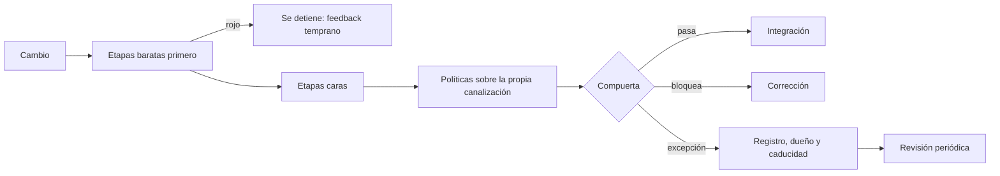
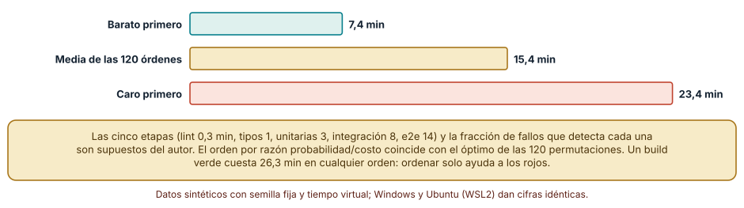

# SE-411 — Tests, seguridad y políticas como gates

[← SE-410 — Pipelines, jobs, matrices y cachés](../../classes/part-34-ci-cd-iac-y-platform-engineering/se-410-pipelines-jobs-matrices-y-caches/README.md) · [↑ Parte 34](../../classes/part-34-ci-cd-iac-y-platform-engineering/README.md) · [📚 Índice completo](../../classes/README.md) · [🌐 Portal](../../site/classes/SE-411.html) · [SE-412 — Credenciales efímeras y OIDC →](../../classes/part-34-ci-cd-iac-y-platform-engineering/se-412-credenciales-efimeras-y-oidc/README.md)

## Punto profesional y fundamento pedagógico

**Punto profesional.** La clase existe para que decidas qué comprobaciones bloquean un cambio, en qué orden se ejecutan y qué pasa cuando alguien quiere saltárselas. Una compuerta es una decisión de riesgo con un costo: bloquea a las personas, consume tiempo y puede dar una falsa seguridad. La habilidad profesional es medir lo que cada compuerta detecta, lo que cuesta y lo que deja pasar, antes de convertirla en obligatoria.

**Por qué aparece aquí.** Sigue a **Pipelines, jobs, matrices y cachés**: la clase anterior organizó los trabajos de la canalización; esta decide cuáles de ellos son compuertas y con qué criterio. El caso conductor sigue siendo la canalización de la API de entregas, ahora con cinco etapas de verificación (lint, tipos, pruebas unitarias, de integración y de extremo a extremo), un análisis de seguridad y reglas sobre los propios archivos de la canalización.

**Error conceptual que debe corregir.** Creer que cuantas más compuertas, más seguridad: cada compuerta tiene una tasa de falsas alarmas y de defectos no vistos, y una compuerta ruidosa se evita, se reintenta hasta que pasa o se desactiva, con lo que protege menos que la ausencia declarada de compuerta.

**Secuencia de aprendizaje.** Antes de mirar los resultados, predices cuánto cambia el tiempo hasta ver un rojo si ordenas las cinco etapas de la más barata a la más cara, y cuántas falsas alarmas produce una regla de texto sobre archivos de canalización; después reproduces el orden de las etapas, evalúas dos conjuntos de reglas sobre 160 archivos con defectos sembrados y mides qué hacen los reintentos con un defecto intermitente. La secuencia usa predicción, explicación propia, contraste y recuperación. [ICAP](https://icap.education.asu.edu/research) distingue participación de construcción de conocimiento; [How People Learn II](https://nap.nationalacademies.org/catalog/24783/how-people-learn-ii-learners-contexts-and-cultures) respalda diseñar la práctica con contextos reales y retroalimentación.

**Evidencia de aprendizaje.** `gates-log.md` con la predicción, las tres figuras reproducidas, la lista de compuertas con su orden, su costo, lo que detectan y lo que dejan pasar, la política de excepciones y una nota que separe qué parte de cada conclusión es medida, cuál inferida y cuál supuesta.

**Límite de la conclusión.** Las duraciones y las fracciones de fallos por etapa, los 160 archivos de flujo de trabajo, los defectos sembrados y las tasas de inestabilidad son sintéticos y elegidos por el autor; las reglas se afinaron con los mismos señuelos que las evalúan. No se analizó ninguna canalización real ni se usó ninguna herramienta de análisis de seguridad o de política concreta.

### Trazabilidad fuente → afirmación

| Fuente primaria u oficial | Afirmación que respalda | Lo que no prueba |
|---|---|---|
| [GitHub Actions: uso seguro](https://docs.github.com/en/actions/reference/security/secure-use) | Recomienda fijar acciones a un SHA completo, limitar los permisos del token, y tratar las expresiones con datos controlados por terceros como una vía de inyección de comandos. | No lista todos los defectos posibles de un archivo de flujo de trabajo ni dice cuántos aparecen en la práctica. |
| [NIST SP 800-218, Secure Software Development Framework](https://csrc.nist.gov/pubs/sp/800/218/final) | Establece prácticas de desarrollo seguro, entre ellas revisar el código, comprobar el cumplimiento y verificar las dependencias. | No prescribe una herramienta ni un orden de comprobaciones. |
| [Open Policy Agent](https://www.openpolicyagent.org/docs) | Documenta las políticas como código evaluadas sobre datos estructurados con decisiones auditables. | No garantiza que una política escrita cubra el riesgo que se quiere controlar. |
| [Luo et al., «An empirical analysis of flaky tests»](https://doi.org/10.1145/2635868.2635920) | Analiza pruebas inestables en proyectos de código abierto y sus causas más frecuentes (esperas asíncronas, concurrencia, orden). | Los porcentajes dependen de los proyectos estudiados; no se transfieren a tu repositorio. |
| [Google Testing Blog: flaky tests](https://testing.googleblog.com/2016/05/flaky-tests-at-google-and-how-we.html) | Describe cómo una fracción de pruebas inestables consume tiempo de ingeniería y cómo se gestionan. | Es una experiencia de una organización concreta, no una norma. |

## Antes de empezar

Recupera lo aprendido en `SE-410`: la canalización es un grafo y la duración mínima es su camino crítico. La pregunta activa es: **¿qué compuertas bloquean un cambio, en qué orden se ejecutan y qué detecta cada una que ninguna otra detecta?**

## Prerrequisitos

- Haber completado `SE-410` o poder calcular el camino crítico de una canalización.
- Python 3.11 o posterior; los experimentos usan solo la biblioteca estándar (`itertools`, `re`, `random`).
- Saber leer un archivo de flujo de trabajo (YAML) y distinguir una prueba de un análisis estático.

## Problema auténtico

Caso ilustrativo, no un incidente real: la canalización de la API de entregas ejecutaba las pruebas de extremo a extremo primero «porque son las más importantes». Cuando un cambio tenía un error de sintaxis, el equipo esperaba catorce minutos para enterarse. Después añadieron un escáner de dependencias que bloqueaba todo cambio y falló tres semanas seguidas por una vulnerabilidad sin corrección disponible; alguien añadió una opción para ignorar el resultado y nunca se quitó. En paralelo, una prueba de integración fallaba una de cada diez ejecuciones; el equipo configuró dos reintentos y el verde volvió, hasta que un defecto real de concurrencia empezó a pasar porque «al segundo intento funciona». Cada decisión parecía razonable. Juntas, la canalización bloqueaba lo menos importante, ignoraba lo más importante y reintentaba lo que debía alertar. La clase enseña a ordenar, medir y gobernar las compuertas.

## Objetivos observables

Al terminar podrás:

1. clasificar las comprobaciones de una canalización como pruebas, análisis estático, análisis de dependencias, de secretos y políticas, y decir qué clase de defecto ve cada una;
2. ordenar las etapas por la razón entre su probabilidad de detección y su costo y calcular el tiempo esperado hasta el primer rojo;
3. evaluar un conjunto de reglas con precisión, exhaustividad y falsos positivos por regla;
4. calcular qué hacen los reintentos con rojos falsos y con defectos intermitentes;
5. escribir una política de excepciones con responsable, caducidad y registro.

## Mapa conceptual



El mapa separa el **orden** de las etapas (cuál detiene antes), la **decisión** de la compuerta (pasa, bloquea o excepción) y el **gobierno** de las excepciones. Una compuerta sin gobierno acaba siendo una sugerencia.

## Temas y por qué importan

| Tema | Por qué cambia una decisión profesional | Evidencia mínima |
|---|---|---|
| Qué es una compuerta | Una comprobación informativa y una que bloquea tienen costos y consecuencias distintas. | Lista de compuertas con su efecto |
| Orden de las etapas | El mismo conjunto, bien ordenado, da el primer rojo en un tercio del tiempo. | Figura 1 y el tiempo esperado |
| Políticas como código | Convierte un criterio en una regla verificable, con sus falsas alarmas. | Figura 2 y la evaluación de las reglas |
| Pruebas inestables y reintentos | Reintentar elimina rojos falsos y puede ocultar defectos reales. | Figura 3 y la política de reintentos |
| Excepciones y gobierno | Una compuerta que se puede saltar sin rastro deja de serlo. | Política de excepciones con caducidad |

## Conceptos y decisiones

### 1. Qué es una compuerta

Una **compuerta** (gate) es una comprobación cuyo resultado decide si un cambio avanza. Se distingue de un **informe**, que informa y no bloquea. La misma comprobación puede ser una u otra: un análisis de dependencias puede bloquear solo vulnerabilidades críticas con corrección disponible y avisar de las demás. La diferencia importa porque bloquear tiene un costo (espera, fricción, presión para saltarla) y no bloquear tiene otro (el defecto llega más lejos). Las comprobaciones se agrupan en familias que ven cosas distintas: las **pruebas** ven si el comportamiento coincide con lo esperado; el **análisis estático** ve patrones en el código sin ejecutarlo; el **análisis de dependencias** ve componentes con vulnerabilidades publicadas; la **búsqueda de secretos** ve credenciales en el repositorio; y las **políticas** ven si la configuración (incluida la de la propia canalización) cumple reglas. Ninguna sustituye a otra.

### 2. Orden de las etapas y razón de detección

Cuando un cambio es defectuoso, el tiempo hasta la primera señal depende del orden. Si cada etapa detecta una fracción `p` de los defectos y cuesta `c`, el orden que minimiza el tiempo esperado hasta el primer rojo es el de **razón `p/c` decreciente**: primero lo que detecta mucho por minuto invertido. Es el mismo argumento de planificación que se enseña en secuenciación de tareas, y coincide con la intuición «lo barato primero» cuando los costos varían más que las probabilidades. Dos precisiones. Primero, el orden no cambia el tiempo de un cambio sin defectos: todas las etapas se ejecutan igual. Segundo, el orden se mide con las probabilidades de tu repositorio, que cambian: una etapa cara que detecta mucho puede ganar su lugar delante de una barata que casi nunca falla.

### 3. Políticas como código y su evaluación

Una **política como código** es una regla escrita en un lenguaje ejecutable que se evalúa sobre datos de entrada (la configuración de infraestructura, un archivo de flujo de trabajo, una lista de dependencias) y produce una decisión. Las reglas pueden basarse en **texto** (patrones que buscan cadenas) o en **estructura** (reglas sobre el árbol analizado del archivo). Las de texto son simples y producen falsas alarmas: un comentario que contiene una instrucción peligrosa, un nombre de paso que menciona un evento, un valor que parece un dato controlado por un tercero pero es un número. Se evalúan con tres medidas: **precisión** (de lo que avisa, qué parte es real), **exhaustividad** (de lo real, qué parte avisa) y falsos positivos por regla. Una regla ruidosa se vuelve una excepción permanente. La política necesita además un caso negativo (un archivo correcto que debe pasar) y un caso positivo (un archivo defectuoso que debe fallar) como pruebas propias.

### 4. Pruebas inestables y reintentos

Una **prueba inestable** es la que, sin cambios en el código, a veces pasa y a veces falla. Sus causas habituales son esperas basadas en tiempo, dependencia del orden, datos compartidos y concurrencia. Una suite grande con pruebas con una pequeña probabilidad de fallo espontáneo tiene una probabilidad alta de fallo espurio: con 600 pruebas y 0,05 % cada una, el 26 % de las ejecuciones sale rojo sin defecto. El **reintento** de pruebas fallidas la reduce a casi cero, y ahí empieza el riesgo: un defecto real intermitente (una carrera, un fallo de reconexión) también pasa al reintentar. Un defecto que aparece una vez de cada cinco pasa el 99 % de las veces con dos reintentos. La política segura no es no reintentar, es **contar** cada reintento, marcar la prueba como sospechosa y llevarla a cuarentena con responsable y plazo, de modo que lo intermitente se arregle en vez de ocultarse.

### 5. Excepciones, gobierno y teatro de seguridad

Toda compuerta recibe un día la petición de saltarla. Una excepción sin gobierno se convierte en la norma. El gobierno mínimo tiene cuatro elementos: **quién** puede autorizarla (distinto de quien la pide), **qué** cubre exactamente (un hallazgo concreto, no toda una familia), **hasta cuándo** (una fecha de caducidad, tras la cual la compuerta vuelve a bloquear) y **dónde queda registrada** (un archivo versionado, no un mensaje). Hay un fallo opuesto, el **teatro de seguridad**: compuertas que se cumplen en el papel sin reducir riesgo, como un escáner configurado para no fallar nunca o una revisión de código que se aprueba sin leer. La señal de teatro es que nadie sabe cuántos defectos ha detenido una compuerta; por eso se mide qué detiene cada una y se retira la que no detiene nada.

### El orden de las etapas

Cinco etapas con su duración y la fracción de los builds rojos que cada una detecta (cada defecto lo ve una sola etapa): lint 0,3 min (22 %), tipos 1 min (14 %), unitarias 3 min (30 %), integración 8 min (22 %) y extremo a extremo 14 min (12 %). Se calcula el tiempo esperado hasta el primer rojo para las 120 permutaciones.

```python
def esperado(orden):
    total = 0.0
    for etapa, (_, p) in ETAPAS.items():
        t = 0.0
        for s in orden:
            t += ETAPAS[s][0]
            if s == etapa:
                break
        total += p * t
    return total
```

| Orden | Minutos esperados hasta el primer rojo |
|---|---:|
| Barato primero (lint, tipos, unitarias, integración, e2e) | 7,4 |
| Media de las 120 órdenes | 15,4 |
| Caro primero | 23,4 |

El orden por razón `p/c` coincide con el óptimo de las 120 permutaciones. Un build verde tarda 26,3 minutos en cualquier orden.



**Cómo leer la figura.** Cada barra es un orden; lo que se compara es cuánto espera una persona cuya integración tiene un defecto. **Dónde deja de valer:** las duraciones y las fracciones son supuestos del autor, y suponer que cada defecto lo detecta una sola etapa es una simplificación: en la práctica varias etapas ven el mismo defecto y la ganancia del orden es menor. Además, el orden no ahorra nada a los cambios correctos, que son la mayoría.

### Reglas de texto sobre archivos de canalización

Se generan 160 archivos de flujo de trabajo con ocho clases de defecto sembradas al azar (acción sin fijar, permisos de escritura generales, evento peligroso con descarga del código del cambio, inyección de datos de un tercero, ejecución de un script descargado, escritura de un secreto al registro, `continue-on-error` en un trabajo, credencial en el texto) y seis señuelos que parecen defectos sin serlo (un comentario con la instrucción, una acción local, una expresión segura, un nombre de paso que menciona el evento, una referencia de rama y el número del PR). Se evalúan dos conjuntos de reglas.

| Conjunto de reglas | Aciertos | Falsos positivos | Defectos no vistos | Precisión | Exhaustividad |
|---|---:|---:|---:|---:|---:|
| Ingenuas (buscan la cadena) | 209 | 180 | 0 | 54 % | 100 % |
| Afinadas (ignoran comentarios, miran solo líneas de ejecución) | 204 | 45 | 5 | 82 % | 98 % |

Las ingenuas producen 100 falsos positivos en la regla de inyección, 44 en la de evento peligroso y 36 en la de script descargado. Las afinadas pierden cinco defectos que estaban en bloques de varias líneas y siguen avisando del número del PR, que es seguro.


**Cómo leer la figura.** Cada fila es un conjunto de reglas; los falsos positivos son el costo de atención y los no vistos son el costo de confianza. **Dónde deja de valer:** las reglas afinadas se escribieron conociendo los señuelos que las evalúan, así que su 82 % y su 98 % son una frontera y no una tasa estimable. Una regla de texto no entiende el significado de una expresión: no distingue el título de un PR, controlado por un tercero, del número de un PR; eso exige reglas sobre la estructura o una lista de contextos de confianza.

### Qué hacen los reintentos

Se calcula con exactitud la probabilidad de que una suite de 600 pruebas, cada una con una probabilidad de fallo espontáneo de 0,05 %, salga roja con 0, 1 o 2 reintentos por prueba fallida, y se simula con 40 000 ejecuciones qué fracción de las ejecuciones con un defecto real intermitente pasa.

| Situación | Sin reintentos | 1 reintento | 2 reintentos |
|---|---:|---:|---:|
| Rojo falso de la suite | 25,9 % | 0,015 % | 0,000008 % |
| Defecto que aparece en el 50 % de las ejecuciones: la suite pasa | 49,7 % | 74,6 % | 87,6 % |
| Defecto que aparece en el 20 %: la suite pasa | 80,1 % | 96,1 % | 99,2 % |
| Defecto que aparece en el 5 %: la suite pasa | 94,9 % | 99,7 % | 99,99 % |

Con dos reintentos la suite casi nunca falla por inestabilidad y también casi nunca falla por un defecto que aparece una vez de cada cinco.


**Cómo leer la figura.** Las tres primeras filas son defectos reales que el reintento deja pasar; la última es el rojo falso que el reintento elimina. **Dónde deja de valer:** el modelo trata cada reintento como independiente; en un defecto real de estado (una base corrupta) el reintento fallará igual, y en una carrera de datos puede fallar con más probabilidad después de un primer fallo. Los 600 tests y el 0,05 % son supuestos; lo que se muestra es la forma del compromiso, no un valor para tu suite.

## Definiciones de trabajo

- **compuerta:** comprobación cuyo resultado decide si un cambio puede avanzar.
- **política como código:** regla ejecutable evaluada sobre datos de entrada que produce una decisión auditable.
- **precisión:** fracción de los avisos de una regla que corresponden a un problema real.
- **exhaustividad:** fracción de los problemas reales que una regla avisa.
- **prueba inestable:** prueba que pasa y falla sobre el mismo código sin que nada haya cambiado.

Las definiciones son operativas para la canalización de la API de entregas. No convierten términos con una historia más amplia en sinónimos y deben contrastarse con la documentación primaria enlazada al final.

## Ejemplo mínimo

El fragmento calcula la probabilidad de que una suite salga roja por inestabilidad pura. Antes de ejecutarlo, predice si con 600 pruebas y 0,05 % cada una la probabilidad supera el 10 %.

```python
p, n = 0.0005, 600
print(round(1 - (1 - p) ** n, 3), round(1 - (1 - p ** 2) ** n, 6))
```

Salen 0,259 y 0,00015: una cuarta parte de las ejecuciones sale roja sin defecto y, con un reintento por prueba fallida, una de cada 6 700. Registra versión de Python, comando y salida; después cambia `n` a 6 000 y observa cómo se agrava el problema.

## Ejemplo profesional

El equipo de la API de entregas ordena sus etapas por razón `p/c` con las fracciones de los últimos 100 builds rojos: lint, tipos, unitarias, integración y e2e, con lo que el primer rojo llega en 7 minutos de media en lugar de 23. Para la seguridad define tres compuertas con distinto efecto: la búsqueda de secretos bloquea siempre (no hay excepción posible, solo rotación); el análisis de dependencias bloquea vulnerabilidades críticas con corrección disponible y avisa de las demás; las reglas sobre la canalización (acciones fijadas, permisos mínimos, ninguna expresión con datos de terceros en un script) bloquean sobre el árbol del archivo, no sobre texto. Para las pruebas inestables, permiten un reintento por prueba, registran cada uno en un archivo del informe y llevan a cuarentena con responsable y 14 días las pruebas que acumulan tres reintentos en una semana. Toda excepción es un archivo versionado con hallazgo, autorizante distinto del solicitante, caducidad máxima de 30 días y enlace al problema. Cada trimestre revisan cuántos defectos detuvo cada compuerta y cuántas excepciones caducaron sin renovar. Compara con el punto de partida: ahora cada compuerta tiene un motivo, un costo conocido y una forma de retirarse.

## Práctica guiada

1. Lista las comprobaciones de una canalización propia y clasifícalas en prueba, análisis estático, dependencias, secretos o política; marca las que bloquean y las que informan.
2. Predice el tiempo esperado hasta el primer rojo en el orden actual y en el de razón `p/c`, y escribe los números antes de calcular.
3. Calcula con tus duraciones y fracciones las 120 permutaciones y compara con la tabla de la clase.
4. Escribe las ocho reglas de texto, genera 160 archivos con defectos y señuelos y mide precisión y exhaustividad; después afina las reglas y anota qué dejaron de ver.
5. Calcula la probabilidad de rojo falso de tu suite con 0, 1 y 2 reintentos y simula un defecto intermitente del 20 %.
6. Escribe una política de excepciones con autorizante, alcance, caducidad y registro.
7. Entrega `gates-log.md` y pide a otra persona que escriba un archivo defectuoso que tus reglas afinadas no vean.

## Ejercicios

1. **Orden:** dado un conjunto de cuatro etapas con costos y fracciones, calcula el orden óptimo y demuestra con un intercambio de dos etapas adyacentes que el orden por `p/c` no se puede mejorar.
2. **Reglas:** escribe una regla de texto para detectar un secreto escrito en un script y una señuelo que la haga fallar; explica si una regla estructural la evitaría.
3. **Reintentos:** calcula cuántos reintentos necesitas para que el rojo falso de una suite de 2 000 pruebas con 0,1 % cada una baje del 1 %, y cuánto sube la probabilidad de que pase un defecto del 10 %.
4. **Excepción:** redacta una excepción para una vulnerabilidad sin corrección con los cuatro elementos del gobierno y la condición que la cancela.

## Reto verificable

Entrega `gates-log.md` con la predicción, las tres tablas, la lista de compuertas con su efecto, la política de reintentos y la de excepciones. Se aprueba si otra persona ejecuta el código desde un checkout limpio, obtiene las mismas tablas con las mismas semillas y puede decir qué compuerta retiraría y qué defecto no detectaría ninguna. No se aprueba por añadir compuertas sin medir lo que detectan ni por configurar reintentos sin registrar cuándo se usan.

## Caso conductor

La canalización de la API de entregas es el caso conductor de la Parte 34. Esta clase deja el tercer artefacto: la lista ordenada de compuertas con su política de excepciones. `SE-412` retirará de esas compuertas las credenciales de larga vida y `SE-413` decidirá qué debe cumplirse para desplegar. Cambia después un solo dato, la fracción de defectos que detecta la etapa más cara, y observa si el orden óptimo cambia.

## Preguntas frecuentes

### ¿Las pruebas más lentas deben ir siempre al final?

Normalmente sí, pero depende de lo que detectan. Si una prueba cara detecta muchos defectos que ninguna barata ve, puede ir antes que una barata que casi nunca falla. El criterio es la razón entre lo que detecta y lo que cuesta, no la duración sola.

### ¿Un análisis de dependencias debe bloquear siempre?

No. Bloquear siempre por una vulnerabilidad sin corrección disponible paraliza el trabajo y empuja a desactivar el análisis. Una política razonable bloquea las críticas con corrección y deja las otras como informe con fecha, de modo que se traten sin detener el flujo.

### ¿Reintentar una prueba es hacer trampa?

No si se registra. Reintentar elimina el ruido de las pruebas inestables, que cuesta atención. Es trampa cuando el reintento es invisible y un defecto real intermitente pasa sin que nadie lo sepa. La diferencia está en el contador de reintentos y en la cuarentena.

### ¿Cuántas reglas debe tener una política?

Las que se puedan mantener y explicar. Una regla con muchas falsas alarmas se desactiva; una regla que nunca dispara quizá no se evalúa contra un caso real. Cada regla debe tener al menos un ejemplo defectuoso que la hace fallar y uno correcto que la deja pasar.

## Fallo controlado y diagnóstico

Reproduce el fallo clásico de la clase: **un defecto intermitente real que pasa por los reintentos**. Simula un defecto que aparece en el 20 % de las ejecuciones y una suite con dos reintentos.

Registra síntoma, entrada mínima, hipótesis, observación que descarta cada hipótesis, causa, corrección y prueba de regresión. **Síntoma:** el defecto aparece en producción aunque la canalización estaba verde. **Hipótesis rivales:** (a) la prueba no cubría ese caso; (b) la prueba falló y el reintento la hizo pasar; (c) el entorno de la canalización difiere del de producción. **Prueba:** consulta el registro de reintentos de la ejecución; si la prueba aparece con un fallo seguido de un éxito, la causa es el reintento. **Conclusión:** con dos reintentos un defecto del 20 % pasa el 99,2 % de las veces; el reintento lo ocultó. **Regresión:** registra cada reintento, falla la ejecución cuando una prueba necesita reintento más de tres veces en una semana y lleva esa prueba a cuarentena con responsable. No cambies a la vez el número de reintentos y la prueba.

## Errores comunes y cómo corregirlos

| Síntoma | Causa probable | Corrección |
|---|---|---|
| El primer rojo tarda más de diez minutos | Las etapas caras van primero | Ordenar por razón de detección sobre costo |
| El análisis de seguridad se ignora | Bloquea por hallazgos sin corrección | Separar bloqueo (críticos con corrección) de informe |
| Las reglas se desactivan | Muchas falsas alarmas | Medir precisión y afinar con casos negativos |
| Pasa tras reintentar y falla en producción | Reintentos invisibles | Contar y registrar los reintentos; cuarentena |
| Hay excepciones de hace un año | Sin caducidad ni dueño | Fecha máxima, autorizante distinto y revisión |

## Entorno y archivos clave

```text
work/SE-411/
├── README.md
├── gates/
│   ├── orden.py
│   ├── reglas.py
│   └── reintentos.py
├── tests/test_gates.py
├── excepciones/
└── evidence/gates-log.md
```

El `README` declara plataforma, versión de Python, semillas y comandos. Los experimentos usan solo la biblioteca estándar (`itertools`, `re`, `random`) y se ejecutaron con CPython 3.12.9 en Windows 11 y 3.12.3 en Ubuntu bajo WSL2: las salidas fueron idénticas. Si añades una herramienta de análisis, fija su procedencia y su versión.

## Seguridad, ética y accesibilidad

- los archivos de la canalización son código con privilegios: una regla sobre ellos protege más que una sobre la aplicación, porque ven secretos y despliegan;
- una excepción es una decisión de riesgo tomada por personas: registra quién la autoriza para que la responsabilidad no se diluya;
- no uses el contador de reintentos o de rojos como métrica individual: refleja el sistema, no a quien lo toca;
- los resultados de las compuertas deben ser legibles sin color y con mensajes que digan qué falló y cómo reproducirlo;
- documenta las tablas con el texto alternativo de cada figura.

## Puente hacia el trabajo con agentes

Un agente al que se le pide «añade análisis de seguridad a la canalización» probablemente añadirá un escáner que bloquea siempre, un reintento global para estabilizar las pruebas y dirá que la canalización es más segura. Pídele en cambio que clasifique cada comprobación por el defecto que detecta, que ordene las etapas con las fracciones medidas del historial, que evalúe cada regla con casos positivos y negativos, que registre cada reintento y que escriba la política de excepciones con caducidad. Revisa especialmente si desactiva un resultado «para que pase» y si el reintento oculta un fallo: son los dos defectos que esta clase mostró con números.

## Transferencia

Traslada el análisis a otro contexto (por ejemplo, una canalización de infraestructura que valida planes antes de aplicar): cambia las etapas y las reglas, y conserva el procedimiento de ordenar por `p/c`, evaluar cada regla con precisión y exhaustividad, y gobernar las excepciones. La transferencia está lograda cuando puedes decir qué defecto no ve ninguna compuerta y qué excepción caducó sin renovar, no cuando la lista de compuertas se parece a la de la plataforma.

## Evaluación y evidencia

| Criterio | Evidencia para aprobar |
|---|---|
| comprensión | explicación de qué detecta cada familia de compuertas y qué costo tiene bloquear |
| corrección | tablas de orden, reglas y reintentos reproducibles con las mismas semillas |
| diseño | lista ordenada de compuertas con política de excepciones con caducidad |
| diagnóstico | reproducción del fallo «defecto intermitente que pasa por los reintentos» con regresión |
| incertidumbre | declaración de que duraciones, fracciones, archivos y señuelos son sintéticos o del autor |
| reproducibilidad | versiones, comandos, salida y límites declarados |

## Fuentes

- [GitHub Actions: uso seguro](https://docs.github.com/en/actions/reference/security/secure-use) — acciones fijadas, permisos del token e inyección en scripts; autoridad: documentación de GitHub.
- [NIST SP 800-218 (SSDF)](https://csrc.nist.gov/pubs/sp/800/218/final) — prácticas de desarrollo seguro; autoridad: NIST.
- [Open Policy Agent](https://www.openpolicyagent.org/docs) — políticas como código; autoridad: documentación del proyecto.
- [Luo et al., «An empirical analysis of flaky tests»](https://doi.org/10.1145/2635868.2635920) — causas de las pruebas inestables (FSE 2014); autoridad: artículo con DOI verificado en Crossref.
- [Google Testing Blog: flaky tests](https://testing.googleblog.com/2016/05/flaky-tests-at-google-and-how-we.html) — gestión de pruebas inestables; autoridad: Google.

Cada fuente respalda el mecanismo indicado; ninguna demuestra que 7,4 minutos, un 82 % de precisión o un 99,2 % de defectos que pasan se observen en tu repositorio. Esa afirmación depende de las etapas, de las reglas y de la frecuencia de cada defecto.

## Límites y siguiente paso

Se ejecutaron tres experimentos con datos sintéticos en Windows y Ubuntu (WSL2) con resultados idénticos. No se analizó ninguna canalización real ni se usó una herramienta de análisis o de política concreta; las duraciones y fracciones por etapa, la detección por una sola etapa, los 160 archivos, los defectos y señuelos sembrados, las tasas de inestabilidad y la independencia entre reintentos son construcciones del autor, y las reglas afinadas se escribieron con los mismos señuelos que las evalúan. La siguiente clase retira las credenciales de larga vida de esos trabajos.

## Glosario

- **compuerta:** comprobación cuyo resultado decide si un cambio puede avanzar.
- **política como código:** regla ejecutable evaluada sobre datos de entrada que produce una decisión auditable.
- **precisión:** fracción de los avisos de una regla que corresponden a un problema real.
- **exhaustividad:** fracción de los problemas reales que una regla avisa.
- **prueba inestable:** prueba que pasa y falla sobre el mismo código sin que nada haya cambiado.

---

[← SE-410 — Pipelines, jobs, matrices y cachés](../../classes/part-34-ci-cd-iac-y-platform-engineering/se-410-pipelines-jobs-matrices-y-caches/README.md) · [↑ Parte 34](../../classes/part-34-ci-cd-iac-y-platform-engineering/README.md) · [📚 Índice completo](../../classes/README.md) · [🌐 Portal](../../site/classes/SE-411.html) · [SE-412 — Credenciales efímeras y OIDC →](../../classes/part-34-ci-cd-iac-y-platform-engineering/se-412-credenciales-efimeras-y-oidc/README.md)
