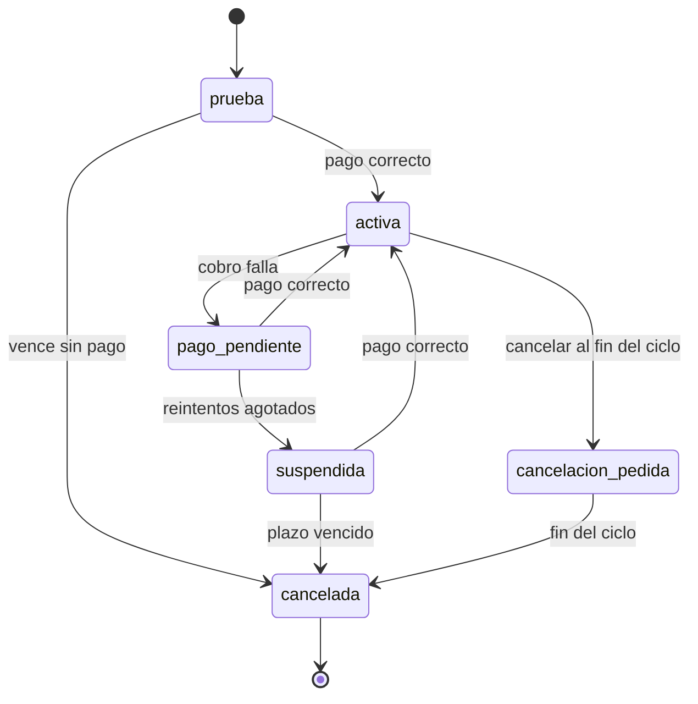
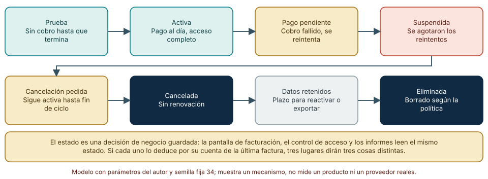
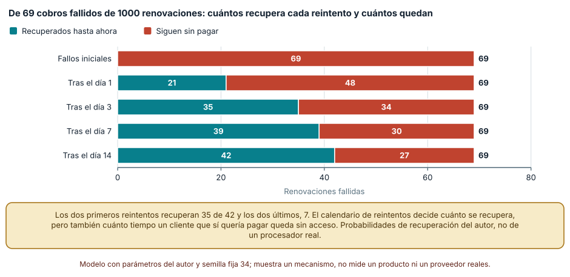
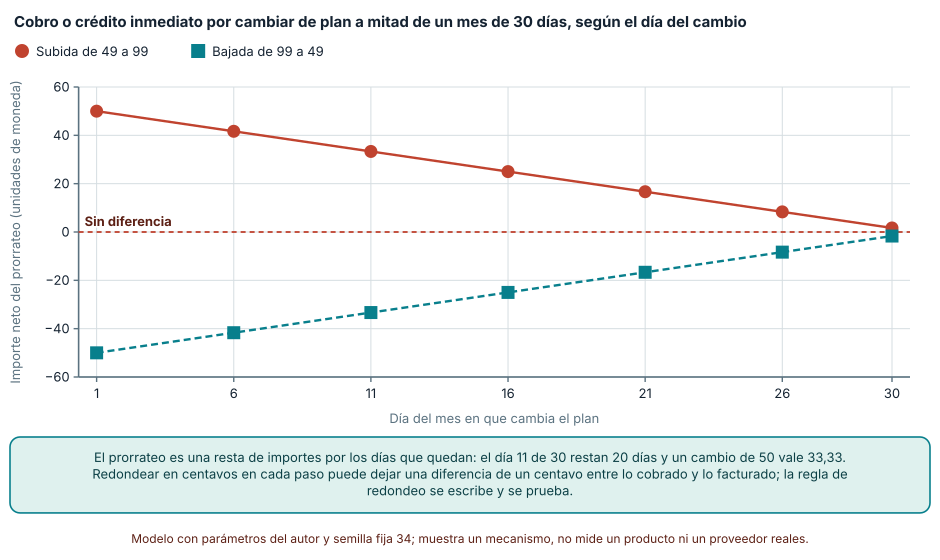

# SE-412 — Suscripciones, ciclos de facturación y dunning

## Punto profesional y fundamento pedagógico

**Punto profesional.** La clase existe para que modeles una suscripción como lo que es: una máquina de estados con fechas, importes y eventos externos, y no como una fila con un campo «plan» y otro «vence». De ese modelo dependen casi todas las decisiones visibles para el cliente (cuándo se le cobra, cuánto, qué pasa si el cobro falla, hasta cuándo conserva el acceso) y casi todas las discrepancias que más cuestan a un equipo (una factura que no coincide con lo cobrado, un cliente suspendido que había pagado, un cambio de plan que cobra de más). El dunning, la gestión de los cobros fallidos, es la parte menos glamorosa y una de las que más ingreso recupera.

**Por qué aparece aquí.** Sigue a `SE-411`, que termina con un inquilino en estado `activo` y un cliente de facturación creado. Esa cuenta tiene ahora un ciclo de vida de cobros: cada periodo se factura, se intenta cobrar, puede fallar y puede cambiar de plan. Retoma los eventos de `SE-379` (webhooks), la entrega con duplicados de `SE-376` y la idempotencia de `SE-246`, y prepara `SE-413`, donde parte de la factura se calcula con uso medido, y `SE-417`, donde el cobro se concilia con el libro mayor.

**Error conceptual que debe corregir.** Creer que «si el cobro falla, se vuelve a intentar mañana» es una política. Una política decide cuántos reintentos, en qué días, qué ocurre con el acceso en cada etapa, qué se comunica al cliente y cuándo se da la suscripción por perdida; cada decisión cambia cuánto dinero se recupera y cuánto tiempo un cliente que sí quería pagar queda sin servicio. En la simulación de la clase, de 69 cobros fallidos sobre 1 000 renovaciones, un calendario de cuatro reintentos recupera 42 (61 %), y los dos primeros recuperan 35 de esos 42: el valor está al inicio, y el costo de los reintentos tardíos (más tiempo de incertidumbre para el cliente) debe pesarse contra los siete cobros que añaden.

**Secuencia de aprendizaje.** Antes de ejecutar, predices qué fecha tendrá la renovación de un cliente que se suscribió el día 31 en febrero y en abril, y cuánto cobrar al pasar del plan de 49 al de 99 el día 11 de un mes de 30 días. Después ejecutas una máquina de estados con transiciones válidas, una función de ciclo anclado al día y un cálculo de prorrateo en centavos, simulas un calendario de reintentos con semilla fija y lees tres figuras: los estados, la recuperación por reintento y el prorrateo según el día. Terminas escribiendo una política de cobros fallidos.

**Evidencia de aprendizaje.** `suscripcion.md` con la tabla de estados y transiciones de tu producto, la regla de ciclo anclado, la fórmula de prorrateo con su regla de redondeo, el calendario de reintentos con acceso en cada etapa y la prueba que rechaza una transición inválida.

**Límite de la conclusión.** Se ejecutaron una máquina de estados, un cálculo de ciclo y prorrateo y una simulación de reintentos con semilla 34 y probabilidades de recuperación fijadas por el autor; no se llamó a ningún procesador, no se cobró ninguna tarjeta, no se incluyó la tributación ni la regulación de cobros recurrentes de ninguna jurisdicción. No se afirma revisión humana externa del contenido.

### Trazabilidad fuente → afirmación

| Fuente primaria u oficial | Afirmación que respalda | Lo que no prueba |
|---|---|---|
| [Stripe: suscripciones](https://docs.stripe.com/billing/subscriptions/overview) | Muestra el modelo de una suscripción con estados (por ejemplo prueba, activa, vencida, cancelada) y sus facturas. | No fija los estados que debe tener tu producto. |
| [Stripe: ciclo de facturación](https://docs.stripe.com/billing/subscriptions/billing-cycle) y [prorrateos](https://docs.stripe.com/billing/subscriptions/prorations) | Documenta el ancla del ciclo, el prorrateo por cambio de plan y sus opciones de comportamiento. | Es la política de un proveedor; otros redondean o ancla distinto. |
| [Stripe: recuperación inteligente de pagos](https://docs.stripe.com/billing/revenue-recovery/smart-retries) | Describe reintentos programados y comunicación al cliente como mecanismos de recuperación de ingresos. | No da las probabilidades de recuperación de tu base de clientes. |
| [Stripe: webhooks de suscripciones](https://docs.stripe.com/billing/subscriptions/webhooks) | Explica que los cambios llegan como eventos y que el producto debe procesarlos para actualizar su estado. | No garantiza orden ni una única entrega. |
| [Stripe: pruebas gratuitas](https://docs.stripe.com/billing/subscriptions/trials) | Describe la prueba como un periodo sin cobro con una fecha de fin y qué ocurre si no hay método de pago. | No define tu política antiabuso. |

## Antes de empezar

Recupera lo aprendido en `SE-057` sobre estado, transiciones y eventos: un sistema con estado se entiende por las transiciones que permite, no por los valores que puede tener. La pregunta activa es: **¿cuántos estados tiene la suscripción de tu producto, quién puede cambiarlos y qué decide el acceso del cliente en cada uno?**

## Prerrequisitos

- Haber completado `SE-409` a `SE-411` y `SE-057` (modelado de estado y transiciones).
- Conocer la idempotencia y la entrega «al menos una vez» (`SE-246`, `SE-376`) y los webhooks (`SE-379`).
- Saber usar `datetime` y `calendar` de la biblioteca estándar de Python.
- Python 3.11 o posterior.

## Problema auténtico

*Tablero* cobra el plan de equipo (49 al mes) con tarjeta. El producto guarda para cada cliente un `plan` y un `vence`, y un trabajo nocturno cobra a quien vence ese día. En cinco meses aparecen seis problemas. Un cliente que se suscribió el 31 de enero ve su renovación el 2 de marzo, el 1 de abril y el 1 de mayo, porque el código suma 30 días y su ciclo deriva respecto del calendario. Un cliente que pasa del plan de 49 al de 99 el día 11 recibe una factura que cobra el mes completo del plan nuevo sin descontar lo ya pagado. Un cobro rechazado marca la cuenta como «vencida» y la bloquea de inmediato: el 40 % de los afectados sólo tenía la tarjeta caducada, pagó al día siguiente y escribió furioso. Un cobro aceptado llega al producto tres minutos tarde, por un reintento de entrega del procesador, y el trabajo nocturno ya había suspendido la cuenta. Cancelar un plan elimina el acceso al instante aunque el cliente pagó hasta fin de mes. Y el informe de ingresos muestra más clientes activos que facturas pagadas, porque nadie definió qué estado cuenta como «activo».

Ninguno de los seis es un error de programación aislado; todos son consecuencias de no tener un modelo de ciclo de vida explícito. La suscripción es una máquina de estados con un conjunto pequeño de eventos (pago correcto, pago fallido, plazo agotado, cambio de plan, cancelación, fin de ciclo), y cada decisión de facturación y de acceso debería poder leerse de ella.

El problema de la clase es modelar esa máquina, calcular con exactitud el ciclo y el prorrateo, diseñar el calendario de reintentos con una política de acceso por etapa y manejar los eventos del procesador con la seguridad de que pueden llegar tarde, repetidos o desordenados.

## Objetivos observables

Al terminar podrás:

1. definir los estados y las transiciones de una suscripción y escribir una función que rechace una transición no permitida;
2. calcular las fechas de renovación con un ciclo anclado al día de alta, incluidos los meses más cortos, y explicar por qué sumar días fijos deriva;
3. calcular el prorrateo de un cambio de plan en centavos, con una regla de redondeo declarada, y explicar qué cobra y qué acredita cada opción de comportamiento;
4. diseñar un calendario de reintentos con acceso y comunicación en cada etapa y estimar, con una simulación con semilla fija, cuánto recupera cada etapa;
5. procesar eventos del procesador de pagos de forma idempotente y tolerante al desorden, y explicar por qué el estado se actualiza a partir de ellos y no de la respuesta del cobro.

## Mapa conceptual



Cada flecha es un evento con una fecha. El acceso del cliente se decide a partir del estado: plenos derechos en `activa` y `cancelacion_pedida`, derechos plenos con aviso en `pago_pendiente`, derechos reducidos o solo lectura en `suspendida`, ninguno en `cancelada`. Lo que no aparece como flecha no puede ocurrir: una suscripción cancelada no vuelve a `activa` por un pago tardío, sino que exige una reactivación explícita.

## Temas y por qué importan

| Tema | Por qué cambia una decisión profesional | Evidencia mínima |
|---|---|---|
| Máquina de estados | Hace explícito qué puede ocurrir y qué decide el acceso. | Tabla de transiciones y rechazo de una inválida |
| Ciclo anclado | Evita que las renovaciones deriven y que fechas importantes caigan en días inexistentes. | Fechas de renovación de un ancla del día 31 |
| Prorrateo | Un cambio de plan a mitad de ciclo debe cobrar y acreditar con exactitud. | Importe neto en centavos con regla de redondeo |
| Cobro fallido (dunning) | Recupera ingresos y decide cuánto tiempo el cliente queda sin servicio. | Recuperación por reintento con semilla |
| Eventos del procesador | El estado cambia por mensajes que pueden repetirse o llegar tarde. | Manejador idempotente probado con duplicados |
| Cancelación y reactivación | Define qué conserva el cliente y por cuánto tiempo. | Política de acceso por estado |
| Pruebas gratuitas | Su fin es un evento con consecuencias de cobro. | Fecha de fin y qué ocurre sin método de pago |

## Conceptos y decisiones

### 1. La suscripción es una máquina de estados con fechas

Una suscripción tiene un estado, un plan, un periodo actual (inicio y fin), una fecha de próxima factura y un método de pago. Los eventos que la mueven son pocos y se pueden enumerar. El valor de escribir la tabla de transiciones no es teórico: una función `aplicar(estado, evento)` que lanza un error ante una combinación no listada convierte los errores de lógica (una cancelación que reabre una cuenta, un pago que reactiva algo que se canceló a propósito) en fallos visibles, en lugar de estados imposibles que se descubren en el informe de ingresos. El estado debe tener un solo dueño: el acceso, los informes y las pantallas lo leen; nadie lo deduce de la última factura.

### 2. El ciclo se ancla a una fecha, no se suma en días

Sumar 30 días a cada renovación parece suficiente y se desvía: un cliente que empieza el 31 de enero ve renovaciones el 2 de marzo, el 1 de abril y el 1 de mayo; el ciclo anclado al día 31 produce el 28 de febrero, el 31 de marzo, el 30 de abril y el 31 de mayo, que es lo que el cliente espera. La regla es guardar el *ancla* (el día del mes en que empezó) y, para cada mes, usar el mínimo entre el ancla y el último día de ese mes. Los planes anuales y las pruebas gratuitas añaden su propia lógica (la prueba termina en una fecha concreta; el anual se ancla al día y mes). El huso horario importa: «el día 31» se define en una zona horaria declarada, o la renovación de un cliente en Santiago puede caer el día 1 en UTC.

### 3. El prorrateo es una resta de importes por los días que quedan

Cuando un cliente cambia de plan a mitad de ciclo se puede cobrar el cambio de inmediato o a partir del siguiente ciclo. Si se cobra de inmediato, se acredita la parte no usada del plan viejo y se cobra la parte restante del nuevo. En el experimento, un cambio del plan de 49 al de 99 el día 11 de un mes de 30 días deja 20 días restantes: crédito de 49 × 20/30 = 32,67, cargo de 99 × 20/30 = 66,00, neto de 33,33. Al revés (de 99 a 49) el neto es −33,33: un crédito que se aplica a la factura siguiente. El redondeo importa: se trabaja en la unidad mínima de la moneda (centavos), se redondea cada componente con una regla declarada y se guarda cada línea en la factura, porque una diferencia de un centavo entre lo cobrado y lo facturado genera reclamaciones y descuadres contables.

### 4. Una factura es un documento con su propio ciclo

Una factura nace en borrador, se emite (abierta), se paga, se anula o se declara incobrable. Una vez emitida es inmutable: un error se corrige con una nota de crédito y una nueva factura, no editando la anterior (`SE-413` y `SE-417` retoman esta regla). La suscripción genera facturas; el cobro intenta pagarlas; la conciliación las compara con lo que el procesador liquidó. Mantener esas tres entidades separadas (suscripción, factura, cobro) evita el error clásico de usar el estado de la suscripción para saber si «está pagado».

### 5. Un cobro puede fallar de muchas maneras y no todas se tratan igual

Una tarjeta puede ser rechazada por fondos insuficientes (el cobro puede tener éxito más tarde), por caducidad o cancelación (no lo tendrá hasta que el cliente actualice el método), por sospecha de fraude o por un error del emisor. La distinción entre rechazos blandos (reintentar) y duros (pedir otro medio de pago) decide si reintentar sirve. Los procesadores documentan códigos de rechazo y ofrecen reintentos programados inteligentes que eligen el momento; un producto propio puede arrancar con un calendario fijo y refinarlo con sus datos.

### 6. El calendario de reintentos es una política con costo

En la simulación, 69 de 1 000 renovaciones fallan en el primer intento. Con cuatro reintentos (días 1, 3, 7 y 14, con probabilidades de recuperación del autor de 35 %, 25 %, 20 % y 12 % sobre los que siguen sin pagar) se recuperan **21, 14, 4 y 3 cobros**: un total de 42 (61 %); quedan 27 sin recuperar. Los dos primeros reintentos aportan 35 de los 42; los dos últimos, 7. La política equilibra tres costos: el ingreso perdido por no insistir, la molestia al cliente que queda sin servicio mientras tanto y el riesgo de reintentar mucho (los emisores pueden penalizar los reintentos excesivos). La comunicación forma parte del calendario: un aviso al fallar el primer cobro, otro antes del último reintento y uno al suspender. Una parte de la recuperación viene del cliente que actualiza su tarjeta tras el aviso, no del reintento automático.

### 7. El acceso por etapa es una decisión de producto

Bloquear la cuenta al primer rechazo recupera poco y enfurece mucho; mantener el servicio completo durante semanas pierde dinero. Un diseño razonable usa un periodo de gracia: acceso completo con un aviso visible mientras la suscripción está en `pago_pendiente`; acceso reducido (solo lectura, sin crear proyectos nuevos) en `suspendida`; exportación de datos disponible hasta el borrado. La política se escribe, se muestra al cliente en lenguaje claro y se prueba: un cliente en cada estado debe obtener los derechos que se dice. Los derechos concretos se resuelven con el motor de `SE-414`, que lee el estado.

### 8. El procesador manda eventos, y el estado se actualiza con ellos

La respuesta a «cobra esta factura» es un resultado inmediato, pero el estado final del pago puede cambiar después (un pago asíncrono, un cobro disputado, un reintento automático del procesador). Por eso los procesadores envían eventos (webhooks) que el producto recibe para actualizar su estado. Estos eventos se entregan «al menos una vez»: pueden repetirse y llegar fuera de orden. Un manejador correcto verifica la firma del evento, guarda su identificador para ignorar los repetidos, valida que el cambio de estado sea una transición permitida desde el estado actual (descarta un evento antiguo que llegaría después de uno más reciente) y responde con un código de éxito rápido para evitar reentregas innecesarias. El trabajo pesado se encola.

### 9. Cancelar no es borrar: cuatro maneras de dejar de pagar

El cliente puede cancelar inmediatamente (pierde el acceso ya y recibe, si corresponde, un crédito), al final del periodo pagado (conserva el acceso hasta entonces), pausar (el ciclo se detiene con una fecha de reanudación) o simplemente dejar de pagar. Cada una es una transición distinta con efectos en el acceso, en la facturación y en los informes. Los productos que esconden la cancelación o la hacen más difícil que la compra acumulan quejas, reembolsos y, en algunas jurisdicciones, sanciones. La cancelación al final del ciclo es la opción más común y conviene hacerla simétrica a la compra: igual de fácil, con confirmación y con la fecha exacta en que termina el acceso.

### 10. Qué no resuelve este modelo

La máquina de estados no decide los impuestos aplicables (que dependen de la jurisdicción del cliente y del producto), ni la regulación sobre cobros recurrentes y avisos previos, ni el reconocimiento contable del ingreso en planes anuales, ni la facturación electrónica que algunos países exigen. Son restricciones reales que se incorporan al modelo con asesoría especializada; un procesador de pagos o un servicio de facturación puede absorber parte de ellas, con su propio costo y dependencia.

## Los estados y lo que dispara cada cambio



**Cómo leer la figura.** Las cajas son los estados y el color agrupa el nivel de riesgo: verde para pago al día, amarillo para atención, rojo para acceso perdido, azul para cierres. Mira que el camino de la cancelación es distinto al del impago: ambos terminan sin acceso, pero conservan los datos por plazos y por razones diferentes. **Dónde deja de valer:** la figura es una versión de ocho estados; un producto con pausas, planes anuales o múltiples suscripciones por cliente tiene más, y conviene dibujarlos antes de codificarlos.

## Cuánto recupera cada reintento



**Cómo leer la figura.** Cada barra es una etapa del calendario; el verde crece con lo recuperado hasta ese momento y el rojo decrece con lo que sigue sin pagar. Observa que los saltos de verde son grandes al principio y casi desaparecen al final. **Dónde deja de valer:** las probabilidades de recuperación (35, 25, 20 y 12 %) son del autor y los resultados dependen de ellas; en un producto real se miden con su propia base, por tipo de rechazo, y se separan los que se recuperan solos de los que requieren que el cliente haga algo.

## El prorrateo según el día del cambio



**Cómo leer la figura.** El eje horizontal es el día del mes en que cambia el plan y el vertical el importe neto en unidades de moneda: positivo es un cargo, negativo un crédito. Las dos líneas son simétricas porque el cálculo es lineal en los días restantes. **Dónde deja de valer:** supone mes de 30 días, cobro inmediato y redondeo en centavos; con ciclos de otra duración, cambios entre planes de ciclos distintos o crédito en lugar de cobro, las líneas cambian de forma.

## Definiciones de trabajo

- **Suscripción:** contrato recurrente de un cliente con un plan, un ciclo y un estado.
- **Ancla del ciclo:** día del mes (o fecha del año) a partir del cual se calculan las renovaciones.
- **Prorrateo:** ajuste de importes proporcional a los días restantes del ciclo cuando algo cambia a mitad de él.
- **Factura:** documento que fija lo que se debe por un periodo; inmutable una vez emitida.
- **Dunning:** proceso de reintentar y comunicar los cobros fallidos hasta recuperarlos o darlos por perdidos.
- **Periodo de gracia:** plazo en que el cliente conserva acceso pese a tener un pago pendiente.
- **Webhook:** mensaje que el procesador envía al producto para notificar un evento.

## Ejemplo mínimo

La máquina de estados con transiciones explícitas y el ciclo anclado:

```python
import calendar
import datetime as dt

TRANSICIONES = {
    ("prueba", "pago_ok"): "activa", ("prueba", "vence_sin_pago"): "cancelada",
    ("activa", "cobro_falla"): "pago_pendiente", ("pago_pendiente", "pago_ok"): "activa",
    ("pago_pendiente", "agotado"): "suspendida", ("suspendida", "pago_ok"): "activa",
    ("activa", "cancelar_fin_ciclo"): "cancelacion_pedida", ("cancelacion_pedida", "fin_ciclo"): "cancelada",
    ("suspendida", "plazo"): "cancelada",
}


def aplicar(estado: str, evento: str) -> str:
    return TRANSICIONES[(estado, evento)]      # KeyError si la transición no existe: es un fallo visible


def siguiente(ancla: int, desde: dt.date) -> dt.date:
    anio, mes = desde.year + desde.month // 12, desde.month % 12 + 1
    return dt.date(anio, mes, min(ancla, calendar.monthrange(anio, mes)[1]))


estado = "prueba"
for evento in ["pago_ok", "cobro_falla", "pago_ok", "cobro_falla", "agotado"]:
    estado = aplicar(estado, evento)
print(estado)                                           # suspendida
try:
    aplicar("cancelada", "pago_ok")
except KeyError as error:
    print("rechazado", error)                           # rechazado ('cancelada', 'pago_ok')
fecha = dt.date(2026, 1, 31)
print([(fecha := siguiente(31, fecha)).isoformat() for _ in range(4)])   # 28 feb, 31 mar, 30 abr, 31 may
```

Sumar `timedelta(days=30)` desde el 31 de enero da 2 de marzo, 1 de abril, 1 de mayo y 31 de mayo: el cliente ve fechas distintas cada mes. El ciclo anclado conserva el día pedido siempre que el mes lo permita.

## Ejemplo profesional

*Escenario ilustrativo: las cifras y los resultados de este ejemplo son supuestos de la narración, no mediciones.*

El equipo de *Tablero* rediseña su facturación recurrente. Escribe la tabla de nueve transiciones y la convierte en pruebas: una por cada transición válida y una por cada transición inválida importante (un pago sobre una cuenta cancelada pide reactivación explícita). Reemplaza el campo `vence` por un ancla y un periodo actual, con una prueba de renovaciones desde el 29, 30 y 31 en un año bisiesto. Para el prorrateo define la regla («cobro inmediato al subir, crédito en la siguiente factura al bajar; redondeo hacia el centavo más cercano en cada línea») y la escribe también en la página de precios.

El calendario de cobros fallidos queda en cuatro reintentos (días 1, 3, 7 y 14) con avisos por correo y dentro del producto, y una política de acceso: completo con aviso hasta el día 7, solo lectura hasta el día 14, exportación hasta el día 45. Un manejador de eventos guarda el identificador de cada evento recibido, descarta repetidos, valida la transición y devuelve éxito en menos de un segundo, con el trabajo pesado en una cola. Tras un trimestre comparan la recuperación por etapa con sus datos y la política se ajusta: el aviso del día 1 se adelanta a la hora del fallo, porque la mayor parte de las tarjetas actualizadas se actualizan en las primeras horas. El informe de ingresos separa «MRR confirmado» de «MRR con pago pendiente».

## Práctica guiada

1. Ejecuta el ejemplo mínimo y comprueba que la transición inválida lanza un error. Añade dos transiciones propias (por ejemplo `pausada`) y sus pruebas.
2. Ejecuta `python scripts/experiments_part34_metering.py` y localiza `prorrateo` y `dunning`. Recalcula a mano el neto del día 11 y compara con la figura.
3. Cambia la probabilidad de recuperación del primer reintento de 35 % a 15 % y observa qué parte de la recuperación depende de los reintentos tardíos.
4. Escribe una prueba que ejecute cinco veces el mismo evento `pago_ok` sobre la misma suscripción y compruebe que el estado y el número de facturas pagadas no cambian.
5. Escribe la política de acceso por estado de tu producto (qué puede hacer el cliente en cada estado) y revisa si coincide con lo que hoy hace el código.

## Ejercicios

1. **Básico.** Explica por qué el ciclo anclado al día 31 produce 28 de febrero y 31 de marzo, y por qué sumar 30 días no.
2. **Intermedio.** Un cliente con plan anual de 480 (pagado el 1 de enero) cambia el 1 de abril a un plan anual de 960. Calcula el prorrateo con la fórmula de días restantes, declara el redondeo y explica qué debe aparecer en la factura.
3. **Avanzado.** Diseña el manejador de eventos del procesador para tolerar un evento `pago_ok` que llega después de `agotado` y la suspensión de la cuenta. Define qué estado debe resultar, qué se comunica al cliente y qué prueba lo comprueba.

## Reto verificable

Entrega `suscripcion.md` con tu tabla de transiciones y un módulo con la función `aplicar`, el ciclo anclado y el prorrateo, con al menos diez pruebas (cinco válidas, cuatro inválidas, una de ciclo desde el 31). Es válido si otra persona ejecuta las pruebas, obtiene el mismo resultado y puede explicar a partir de tu documento qué acceso tiene el cliente en cada estado.

## Caso conductor

*Tablero* tenía fechas que derivaban, cobros que bloqueaban a quien solo tenía una tarjeta caducada y cambios de plan que cobraban de más. Esta clase da el modelo (estados, ciclo, prorrateo, reintentos) y el manejo de eventos que lo mantiene coherente con el procesador. En `SE-413` parte de la factura pasará a depender de lo que el cliente consume.

## Preguntas frecuentes

### ¿Cuántos reintentos hay que hacer?

No hay un número universal: depende del tipo de rechazo y de lo que cada reintento recupere en tu base. Comienza con un calendario corto (por ejemplo 1, 3 y 7 días), mide cuánto aporta cada etapa y recorta o amplía según los datos. Los reintentos tardíos aportan poco y mantienen mucho tiempo al cliente en incertidumbre.

### ¿Se debe bloquear al cliente en el primer fallo?

Rara vez. La mayoría de los primeros fallos son recuperables (tarjeta caducada, fondos temporales). Un periodo de gracia con aviso visible recupera más y molesta menos; el acceso se reduce en etapas y se restablece al pagar.

### ¿El estado de la suscripción se guarda o se calcula?

Se guarda, junto con el historial de eventos que lo cambiaron. Calcularlo cada vez a partir de facturas y pagos lleva a respuestas distintas en distintos lugares y a un costo alto por consulta. Los eventos son la fuente para reconstruir y auditar el estado.

### ¿Por qué no confiar en la respuesta del cobro para marcar pagado?

Porque el estado final puede cambiar después (disputas, pagos asíncronos, reintentos del procesador) y porque la respuesta puede perderse. El evento del procesador, verificado e idempotente, es la señal que actualiza el estado.

## Fallo controlado y diagnóstico

**Fallo.** Tras un incidente del procesador de pagos, 214 clientes de *Tablero* que habían pagado correctamente aparecen como suspendidos.

**Diagnóstico paso a paso.** (1) Se compara el estado del producto con el del procesador: los 214 pagos figuran como correctos, con fecha anterior a la suspensión. (2) Los eventos `pago_ok` de esos 214 llegaron al producto con un retraso de 40 minutos y el trabajo de reintento ya había ejecutado `agotado`. (3) El manejador recibió `pago_ok` en estado `suspendida`, la transición existe (`suspendida → activa`) y reactivó la cuenta en los casos normales; pero para estos 214 la suspensión se había aplicado en un estado `cancelada` por un plazo vencido mientras el evento estaba retenido, y la transición `cancelada + pago_ok` no existe. (4) El manejador descartaba el evento con un registro de advertencia que nadie leía. (5) Se corrige con una regla explícita: un `pago_ok` sobre una cuenta cancelada con pago confirmado crea una reactivación automática y avisa a soporte; se añade una alerta cuando se descarta un evento de pago. (6) Se reconcilian los 214 casos contra el procesador y se restablece el acceso.

**Lección.** Los eventos pueden llegar tarde y el estado puede haber avanzado. Una transición inválida ante un evento de dinero es un caso que se decide (reactivar, reembolsar o escalar), no uno que se descarta en silencio.

## Errores comunes y cómo corregirlos

- **Guardar `plan` y `vence` y nada más.** No se puede explicar ningún caso intermedio. Corrige con estados, periodo actual y eventos.
- **Sumar días fijos para renovar.** Las fechas derivan. Corrige con ancla y mínimo con el último día del mes.
- **Redondear al final de toda la factura.** Las líneas no suman el total. Corrige redondeando cada línea con una regla declarada.
- **Bloquear al primer rechazo.** Se pierde a quien quería pagar. Corrige con gracia y acceso por etapas.
- **Marcar pagado según la respuesta del cobro.** Se ignoran cambios posteriores. Corrige con eventos verificados e idempotentes.
- **Descartar en silencio un evento inválido.** Se pierden pagos reales. Corrige con una política para cada caso y una alerta.

## Entorno y archivos clave

- `scripts/experiments_part34_metering.py`: funciones `prorrateo` y `dunning`, ejecutables con `python scripts/experiments_part34_metering.py`.
- `scripts/figures_part34_a.py`: las tres figuras de la clase.
- Requiere Python 3.11 o posterior y solo la biblioteca estándar; no se llama a ningún procesador de pagos.

## Seguridad, ética y accesibilidad

Los eventos del procesador son una entrada externa: verifica siempre su firma antes de actuar, rechaza los que no la tengan válida y no registres datos de tarjetas (el producto no debería recibirlos; el procesador los custodia, y las normas del sector, como PCI DSS, restringen lo que se puede guardar). Las comunicaciones de cobro fallido deben ser claras y honestas: qué falló, cuándo se reintenta, qué se perderá y cómo evitarlo, sin presión engañosa. La cancelación debe ser tan accesible como la compra, y los avisos de pago deben llegar por más de un canal y poder leerse con lector de pantalla. No uses la fricción en la cancelación para retener clientes: es una práctica engañosa y puede ser ilegal.

## Puente hacia el trabajo con agentes

Un agente que ayuda a mantener el sistema de facturación puede proponer cambios de código que parecen correctos y rompen una invariante sutil (un redondeo, un ancla, una transición). Dale la tabla de transiciones y la suite de pruebas como contrato, y exige que cualquier cambio en facturación pase todas las pruebas y añada una nueva para el caso que lo motivó. Si el agente atiende al cliente (por ejemplo, para explicar un cobro o tramitar una cancelación), limita sus acciones a las que la política permite y registra cada una; un agente que cancela o reembolsa sin límites puede causar daño económico a escala.

## Transferencia

Toma una suscripción que tengas (streaming, nube, un servicio de software) y reconstruye su máquina de estados: qué ocurre si cancelas hoy, si el pago falla, si cambias de plan a mitad de ciclo. Anota lo que no pudiste responder sin probar. Eso es lo que el producto debería haber puesto por escrito.

## Evaluación y evidencia

| Criterio | Evidencia aceptable | Rechazo |
|---|---|---|
| Estados | Tabla de transiciones y pruebas que rechazan las inválidas | Un campo de texto libre |
| Ciclo | Fechas desde un ancla de fin de mes | Suma de días fijos |
| Prorrateo | Importe en centavos con redondeo declarado | Cálculo en coma flotante sin regla |
| Reintentos | Calendario con acceso por etapa y recuperación medida | «Reintentar unas veces» |
| Eventos | Manejador idempotente probado con duplicados y desorden | Confianza en la respuesta del cobro |

## Fuentes

- Stripe. [Suscripciones](https://docs.stripe.com/billing/subscriptions/overview), [ciclo de facturación](https://docs.stripe.com/billing/subscriptions/billing-cycle), [prorrateos](https://docs.stripe.com/billing/subscriptions/prorations), [pruebas](https://docs.stripe.com/billing/subscriptions/trials), [reintentos inteligentes](https://docs.stripe.com/billing/revenue-recovery/smart-retries) y [webhooks de suscripciones](https://docs.stripe.com/billing/subscriptions/webhooks).
- PCI Security Standards Council. [PCI DSS](https://www.pcisecuritystandards.org/standards/pci-dss/).
- Python. [`datetime`](https://docs.python.org/3/library/datetime.html) y [`calendar`](https://docs.python.org/3/library/calendar.html).
- Caso de estudio del curso: [Stripe](https://github.com/vladimiracunadev-create/modern-software-engineering-program/blob/main/casos/exito/stripe.md).

## Límites y siguiente paso

Se ejecutaron una máquina de estados, un ciclo anclado y un prorrateo, y se simularon reintentos con semilla 34 y probabilidades del autor; no se llamó a un procesador, no hubo cobros reales ni se trataron impuestos, facturación electrónica ni reconocimiento contable de ingresos. Las probabilidades de recuperación no son las de ningún procesador. El siguiente paso, `SE-413`, pasa del cobro fijo al cobro por consumo: cómo se mide el uso de forma exacta con eventos duplicados y tardíos, y cómo se convierte en un importe.

## Glosario

| Término | Definición breve |
|---|---|
| Suscripción | Contrato recurrente con plan, ciclo y estado |
| Ancla del ciclo | Día base de las renovaciones |
| Prorrateo | Ajuste proporcional por días restantes |
| Factura | Documento inmutable del importe de un periodo |
| Dunning | Gestión de reintentos y avisos por cobros fallidos |
| Periodo de gracia | Acceso conservado con pago pendiente |
| Webhook | Notificación de un evento del procesador |
