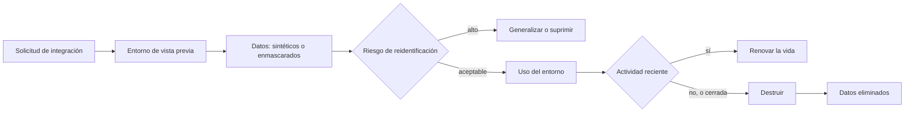
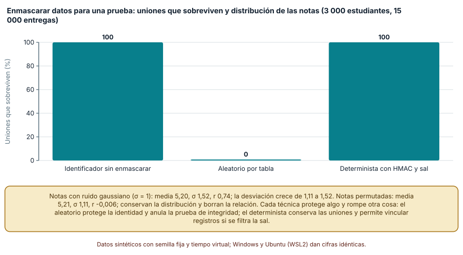

# SE-416 — Entornos preview y datos seguros

[← SE-415 — GitOps y reconciliación](../../classes/part-34-ci-cd-iac-y-platform-engineering/se-415-gitops-y-reconciliacion/README.md) · [↑ Parte 34](../../classes/part-34-ci-cd-iac-y-platform-engineering/README.md) · [📚 Índice completo](../../classes/README.md) · [🌐 Portal](../../site/classes/SE-416.html) · [SE-417 — Developer portals y capacidades de plataforma →](../../classes/part-34-ci-cd-iac-y-platform-engineering/se-417-developer-portals-y-capacidades-de-plataforma/README.md)

## Punto profesional y fundamento pedagógico

**Punto profesional.** La clase existe para que puedas dar a cada cambio un entorno propio, temporal y probable sin llevar datos de personas reales a un lugar donde nadie los protege. La habilidad profesional es doble: decidir cuánto dura y cuánto cuesta un entorno efímero, y decidir qué datos lo llenan sabiendo que quitar el nombre no anonimiza, que enmascarar rompe cosas y que cada técnica protege algo a cambio de perder otra.

**Por qué aparece aquí.** Sigue a **GitOps y reconciliación**: la clase anterior mostró cómo un repositorio gobierna un clúster; esta lo usa para crear, por cada cambio propuesto, una copia del sistema en la que revisar. El caso conductor sigue siendo la API de entregas: un entorno de vista previa por solicitud de integración, con una base de datos que debe parecerse a la real sin contener a nadie.

**Error conceptual que debe corregir.** Creer que una copia de producción sin los nombres es segura para pruebas: combinaciones de datos corrientes (fecha de nacimiento, código postal, género) bastan para identificar a casi todas las personas, y un entorno de vista previa suele ser más accesible y menos vigilado que producción.

**Secuencia de aprendizaje.** Antes de mirar los resultados, predices qué fracción de una población de 6 000 estudiantes es única por fecha de nacimiento, código postal y género, y cuánto se reduce si generalizas esos datos; después reproduces el ataque de vinculación, las uniones que sobreviven a cada enmascarado y el costo de las políticas de vida de los entornos. La secuencia usa predicción, explicación propia, contraste y recuperación. [ICAP](https://icap.education.asu.edu/research) distingue participación de construcción de conocimiento; [How People Learn II](https://nap.nationalacademies.org/catalog/24783/how-people-learn-ii-learners-contexts-and-cultures) respalda diseñar la práctica con contextos reales y retroalimentación.

**Evidencia de aprendizaje.** `preview-log.md` con la predicción, las tres figuras reproducidas, la política de datos de los entornos (qué datos, cómo se obtienen, quién accede), la política de vida con TTL y una nota que separe qué parte de cada conclusión es medida, cuál inferida y cuál supuesta.

**Límite de la conclusión.** La población de 6 000 estudiantes, la lista externa del 70 %, los códigos postales, los 480 PR, el abandono del 15 % y los costos en horas de entorno son sintéticos y elegidos por el autor. No se usaron datos de personas reales, no se creó ningún entorno en la nube y no se evaluó el cumplimiento de ninguna normativa: la clase explica el mecanismo técnico, no ofrece asesoría jurídica.

### Trazabilidad fuente → afirmación

| Fuente primaria u oficial | Afirmación que respalda | Lo que no prueba |
|---|---|---|
| [NIST SP 800-188: de-identificación de conjuntos de datos](https://csrc.nist.gov/pubs/sp/800/188/final) | Describe técnicas de de-identificación (supresión, generalización, ruido) y el riesgo de reidentificación de los datos publicados o compartidos. | No garantiza que un conjunto concreto sea anónimo; el riesgo depende de datos auxiliares. |
| [Sweeney, «k-anonymity: a model for protecting privacy»](https://doi.org/10.1142/S0218488502001648) | Propone que cada registro sea indistinguible de al menos otros k−1 respecto de los cuasi-identificadores. | La propiedad no protege frente a ataques que usan otros atributos ni garantiza utilidad. |
| [Reglamento (UE) 2016/679 (RGPD)](https://eur-lex.europa.eu/eli/reg/2016/679/oj) | Define la seudonimización como un tratamiento tras el cual los datos no pueden atribuirse a una persona sin información adicional que se mantiene separada. | La clase no ofrece asesoría jurídica ni determina si un conjunto es dato personal en tu jurisdicción. |
| [GitHub: despliegues y entornos](https://docs.github.com/en/actions/reference/workflows-and-actions/deployments-and-environments) | Describe los entornos asociados a un flujo de trabajo, con reglas de protección y secretos propios. | No cubre la creación de infraestructura efímera ni su destrucción. |
| [Argo CD: ApplicationSet](https://argo-cd.readthedocs.io/en/stable/operator-manual/applicationset/) | Documenta la generación de aplicaciones a partir de plantillas, incluido un generador por solicitud de integración. | No fija políticas de vida ni de costos. |

## Antes de empezar

Recupera lo aprendido en `SE-415`: un controlador crea y borra recursos según lo que declara el repositorio, y la poda puede destruir datos. La pregunta activa es: **¿qué datos pondrías en un entorno que se crea para cada cambio, quién podría verlos y cuándo se destruye?**

## Prerrequisitos

- Haber completado `SE-415` o poder explicar cómo un controlador crea y borra recursos desde un repositorio.
- Python 3.11 o posterior; los experimentos usan solo la biblioteca estándar (`random`, `hmac`, `hashlib`, `math`, `collections`).
- Saber qué es un identificador, un cuasi-identificador y una clave foránea.

## Problema auténtico

Caso ilustrativo, no un incidente real: para probar mejor, el equipo de la API de entregas copió la base de producción, borró los nombres y correos y la cargó en los entornos de vista previa de cada cambio. Los entornos eran públicos para facilitar la revisión. Un colaborador externo que revisaba un cambio notó que una entrega tenía la fecha de nacimiento, el código postal y el género de quien la había hecho, y que ese conjunto de tres datos, cruzado con una lista pública de un club escolar, identificaba a la persona sin ambigüedad. Al mismo tiempo, la cuenta de la nube del equipo mostraba 74 000 horas de entorno al mes, porque nadie cerraba los cambios abandonados. Los dos problemas parecían técnicos y eran de diseño: qué datos entran y cuándo salen los entornos. La clase enseña a medir ambos.

## Objetivos observables

Al terminar podrás:

1. describir el ciclo de vida de un entorno de vista previa (creación, uso, renovación, destrucción) y su política de expiración;
2. calcular la unicidad de un conjunto de cuasi-identificadores y el efecto de generalizarlos en la reidentificación por vinculación;
3. comparar técnicas de enmascarado por las uniones y las distribuciones que conservan;
4. comparar políticas de vida de entornos por horas de entorno, recreaciones y huérfanos;
5. escribir una política de datos y de vida de los entornos de vista previa.

## Mapa conceptual



El mapa tiene dos bucles de decisión: uno sobre los **datos** (¿se pueden reidentificar?) y otro sobre la **vida** (¿sigue en uso?). Cada uno tiene un modo de fallo distinto: el primero expone personas, el segundo gasta recursos y deja datos olvidados.

## Temas y por qué importan

| Tema | Por qué cambia una decisión profesional | Evidencia mínima |
|---|---|---|
| Entornos de vista previa | Dan retroalimentación temprana y obligan a que el sistema se pueda crear y destruir con código. | Diagrama del ciclo de vida |
| De dónde vienen los datos | Los datos reales trasladan el riesgo de producción a un entorno menos protegido. | Política de datos escrita |
| Reidentificación | Quitar el nombre no anonimiza; los cuasi-identificadores sí identifican. | Figura 1 y la unicidad medida |
| Utilidad del enmascarado | Cada técnica conserva unas propiedades y rompe otras. | Figura 2 y la elección justificada |
| Vida y costo | Los entornos abandonados son el principal gasto y la principal fuga. | Figura 3 y la política de TTL |

## Conceptos y decisiones

### 1. Entornos de vista previa

Un **entorno de vista previa** (preview) es una instancia completa y temporal de la aplicación creada para un cambio propuesto, con una dirección propia donde revisar el resultado antes de integrarlo. Convierte la revisión en algo que se prueba y no solo se lee, y exige que el sistema se pueda levantar desde código: infraestructura declarada, configuración por entorno y datos iniciales. Su ciclo de vida tiene cuatro momentos: se **crea** al abrir o actualizar la solicitud, se **usa** durante la revisión, se **renueva** cuando hay actividad y se **destruye** al cerrarse la solicitud o al vencer su vida. Un generador de aplicaciones a partir de las solicitudes abiertas (como el generador por solicitud de integración de algunas herramientas de GitOps) automatiza la creación y la destrucción. Cada entorno se parece a producción lo bastante como para revelar defectos y es lo bastante aislado como para que un error no afecte a nadie.

### 2. De dónde vienen los datos

Un entorno sin datos prueba poco; un entorno con datos de producción traslada el riesgo. Hay tres opciones. Los **datos sintéticos** se generan desde cero con las distribuciones y relaciones que importan: no contienen a nadie, pero pueden no reproducir los casos raros que rompen el sistema. Un **subconjunto enmascarado** de producción conserva la forma real a costa de transformarlo; tiene un riesgo residual de reidentificación. Una **copia completa de producción** es la más fiel y la más peligrosa, y debería tratarse con las mismas protecciones que producción, lo que contradice la razón de tener entornos baratos y abiertos. La decisión por defecto razonable es sintéticos, con un subconjunto enmascarado solo cuando hay una necesidad demostrada y un propietario de la decisión. En cualquier caso, los datos de un entorno se destruyen con el entorno.

### 3. Cuasi-identificadores y reidentificación

Un **identificador directo** (nombre, correo) señala a una persona. Un **cuasi-identificador** es un dato que por sí solo no identifica pero que, combinado con otros, sí: fecha de nacimiento, código postal, género, curso. La investigación de Sweeney mostró que una gran parte de la población estadounidense era única por esos tres datos. En un **ataque de vinculación** se cruza el conjunto «anonimizado» con otra fuente que sí contiene nombres y los mismos cuasi-identificadores; donde la combinación es única en ambos, la identidad se recupera. La defensa técnica más sencilla es **generalizar** (año en lugar de fecha completa, tres dígitos del código postal) y **suprimir** los grupos pequeños, hasta que cada combinación corresponda a al menos *k* personas (k-anonimato). Tiene límites: no protege si todos los registros de un grupo comparten un valor sensible, y cada generalización reduce la utilidad de los datos.

### 4. Utilidad del enmascarado: uniones y distribuciones

Enmascarar es transformar los datos para ocultar su valor conservando algo de su utilidad. Las técnicas más habituales son la **sustitución aleatoria**, la **sustitución determinista** (el mismo valor se transforma siempre igual, por ejemplo con una función de resumen con clave), la **perturbación** (añadir ruido a un valor numérico) y la **permutación** (mezclar los valores entre registros). Cada una conserva propiedades distintas. La sustitución aleatoria por tabla rompe las **uniones** entre tablas: la clave foránea de la entrega ya no coincide con la clave del estudiante. La determinista las conserva, pero permite vincular registros entre sistemas y, si la clave se filtra, revertir con diccionarios. El ruido conserva la media y aumenta la dispersión. La permutación conserva la distribución y destruye la relación entre columnas. Qué técnica elegir depende de qué se quiere probar con esos datos: una prueba de integridad necesita uniones; una de rendimiento, volumen; una de interfaz, forma.

### 5. Vida, costo y aislamiento de los entornos

Un entorno cuesta mientras existe. Los entornos de las solicitudes que se cierran los destruye el propio cierre; los de las solicitudes **abandonadas** (nadie las cierra) no se destruyen nunca si esa es la única política, y acaban dominando el gasto. Un **tiempo de vida** (TTL) fijo desde la creación los destruye aunque la solicitud siga activa, lo que obliga a recrearlos; un TTL que se **renueva** con cada actividad destruye los inactivos y mantiene los activos. También hay un tema de aislamiento: un entorno de vista previa suele tener una dirección pública y credenciales distintas de las de producción; sus secretos deben ser propios, de corta vida y sin acceso a recursos de producción; y ningún dato del entorno debe poder salir de él. La política de vida es una política de seguridad.

### Cuántas personas son únicas sin su nombre

Se genera una población de 6 000 estudiantes con fecha de nacimiento en un rango de once años, un código postal de 30 con distribución desigual, un género de tres categorías y una nota. Una lista externa contiene al 70 % de las personas con nombre y los mismos datos. Para cada nivel de generalización se cuentan las personas únicas en el conjunto, la fracción de la lista externa que se puede reidentificar por vinculación (única en ambos conjuntos) y la fracción en grupos de menos de cinco.

| Datos conservados | Únicos | Reidentificados | En grupos de menos de 5 | Grupos |
|---|---:|---:|---:|---:|
| Fecha de nacimiento, código postal y género | 97,6 % | 97,6 % | 100 % | 5 928 |
| Año de nacimiento, código postal y género | 1,2 % | 1,2 % | 22,3 % | 966 |
| Año, tres dígitos del código y género | 0,02 % | 0 % | 1,2 % | 363 |
| Bienio, dos dígitos del código, sin género | 0 % | 0 % | 0 % | 12 |

Con los tres datos sin generalizar, 5 857 de 6 000 estudiantes son únicos; con año en lugar de fecha completa casi nadie lo es, pero el 22 % sigue en grupos de menos de cinco. Con 12 grupos ya no se distingue casi nada de la población.


**Cómo leer la figura.** Cada grupo es un conjunto de cuasi-identificadores que se conservan; las barras son el porcentaje de únicos (roja), de reidentificados (azul oscura) y de personas en grupos de menos de cinco (dorada). Mira primero cómo se acortan las tres al generalizar y cuánto detalle se pierde; los grupos que quedan están en la nota. **Dónde deja de valer:** la población, la distribución de los códigos postales, la lista del 70 % y la independencia de los atributos son supuestos del autor; una población real tiene correlaciones (el código postal y el curso) que hacen más fácil reidentificar. El resultado de la primera fila no depende del azar sino de la combinatoria: 4 026 fechas por 30 códigos por 3 géneros son unas 362 000 casillas para 6 000 personas.

### Qué sobrevive al enmascarado

Se enmascara el identificador de 3 000 estudiantes que aparece en 15 000 entregas y se mide la fracción de entregas cuya unión con su estudiante sobrevive. Además se transforman las notas con ruido (desviación 1,0) y con permutación entre registros.

| Técnica | Uniones que sobreviven | Notas (media, desviación, correlación con el original) |
|---|---:|---|
| Identificador sin enmascarar | 100 % | sin cambio |
| Aleatorio por tabla | 0 % | — |
| Determinista con resumen con clave y sal | 100 % | — |
| Notas con ruido gaussiano (σ = 1) | — | 5,20 · 1,52 · 0,74 |
| Notas permutadas | — | 5,21 · 1,11 · −0,006 |

La nota original tiene media 5,21 y desviación 1,11. El ruido conserva la media pero sube la desviación de 1,11 a 1,52; la permutación conserva la distribución exacta y destruye la relación con cada estudiante.



**Cómo leer la figura.** Cada barra es una técnica de enmascarado y su altura el porcentaje de uniones que sobreviven. Mira primero la del aleatorio, vacía: protege la identidad pero rompe las pruebas que unen tablas; la distribución de las notas con ruido y permutadas está en la nota. **Dónde deja de valer:** el 100 % de la sustitución determinista es una consecuencia del diseño del experimento, no un hallazgo; su peligro (vincular registros entre sistemas y revertir con diccionarios si la clave se filtra) no aparece en la tabla. Las notas normales y la desviación del ruido son supuestos del autor.

### El costo de los entornos según su vida

Se simulan 60 días con 8 solicitudes por día (480), el 15 % abandonadas; cada una tiene una vida de actividad de mediana 48 horas y recibe un cambio nuevo cada 14 horas de media mientras está activa. Se miden las horas de entorno con tres políticas.

| Política | Horas de entorno | Frente a «al cerrar» | Recreaciones | Huérfanos al final |
|---|---:|---:|---:|---:|
| Solo se destruye al cerrar la solicitud | 74 357 | 100 % | 0 | 64 |
| TTL de 72 h desde la creación | 33 383 | 45 % | 186 | 0 |
| TTL de 24 h renovado con cada cambio | 30 460 | 41 % | 293 | 0 |

Los 64 entornos abandonados consumen más de la mitad de las horas de la primera política. El TTL los elimina y paga con recreaciones cuando alguien vuelve a una solicitud cuyo entorno ya no existe.


**Cómo leer la figura.** Cada barra es una política de limpieza y su longitud las horas de entorno acumuladas en 60 días. Mira primero la distancia entre la primera barra y las otras dos; las recreaciones y los huérfanos que cuesta cada una están en la nota. **Dónde deja de valer:** las 8 solicitudes diarias, el 15 % de abandono, la vida lognormal y un cambio cada 14 horas son supuestos; en un equipo con ráfagas o revisiones lentas, el TTL de 24 horas recrearía más. Tampoco incluye el costo de crear un entorno ni el de la espera de la persona.

## Definiciones de trabajo

- **entorno de vista previa:** instancia temporal y completa de la aplicación creada para un cambio propuesto.
- **cuasi-identificador:** dato que no identifica por sí solo pero sí en combinación con otros.
- **k-anonimato:** propiedad por la que cada combinación de cuasi-identificadores corresponde al menos a *k* registros.
- **enmascarado determinista:** transformación que da siempre el mismo resultado para el mismo valor de entrada.
- **TTL:** tiempo máximo de vida de un recurso tras el cual se destruye salvo que se renueve.

Las definiciones son operativas para los entornos de la API de entregas. No convierten términos con una historia más amplia en sinónimos y deben contrastarse con la documentación primaria enlazada al final.

## Ejemplo mínimo

El fragmento calcula cuántas personas son únicas por tres datos corrientes. Antes de ejecutarlo, predice si más de la mitad lo será.

```python
import random
from collections import Counter
r = random.Random(1)
gente = [(r.randrange(4000), r.randrange(30), r.choice("FMX")) for _ in range(6000)]
cuentas = Counter(gente)
print(sum(1 for g in gente if cuentas[g] == 1))
```

Salen 5 904 de 6 000: hay 360 000 casillas posibles para 6 000 personas, así que casi todas caen solas. Registra versión de Python, comando y salida; después cambia el primer dato a `r.randrange(11)` (un año de nacimiento entre once) y comprueba que la unicidad baja a 9.

## Ejemplo profesional

El equipo de la API de entregas fija la política de sus entornos de vista previa. Los datos son sintéticos, generados desde un esquema con las distribuciones de producción y con casos raros añadidos a mano (nombres con tilde, archivos vacíos, entregas fuera de plazo); no hay datos reales en ningún entorno. Cuando una prueba exige un volumen o una forma real, se extrae un subconjunto de producción con el identificador sustituido de forma determinista con una clave que solo conoce la canalización, las fechas reducidas al año, el código postal a tres dígitos y los grupos de menos de cinco suprimidos; esa extracción requiere la aprobación de quien administra los datos, queda registrada y se destruye con el entorno. Cada entorno vive 24 horas desde el último cambio, se destruye al cerrarse la solicitud y tiene secretos propios de corta vida. Cada semana un informe lista los entornos más antiguos y su costo. Registran la decisión con su fecha y el dato que la revisaría: si las recreaciones superan las 400 al mes, suben el TTL a 48 horas. Compara con el punto de partida: ahora nadie está en un entorno sin quererlo y nadie paga por un entorno que no se usa.

## Práctica guiada

1. Dibuja el ciclo de vida de un entorno de vista previa en un sistema que conozcas, con creación, renovación y destrucción.
2. Predice la fracción de personas únicas por fecha, código postal y género y escribe la cifra antes de medir.
3. Genera la población sintética, mide la unicidad y la reidentificación por vinculación y reproduce la tabla; generaliza paso a paso hasta que no quede nadie reidentificable.
4. Enmascara un identificador con tres técnicas y cuenta las uniones que sobreviven; transforma las notas con ruido y con permutación.
5. Simula 60 días de solicitudes con las tres políticas de vida y compara horas, recreaciones y huérfanos.
6. Escribe la política de datos y de vida con quién aprueba qué.
7. Entrega `preview-log.md` y pide a otra persona que reidentifique a alguien con tus datos generalizados y una lista externa propia.

## Ejercicios

1. **Unicidad:** calcula cuántas casillas hay para fecha completa (11 años), código postal (30) y género (3), y explica por qué la proporción de únicos depende de ese número y no solo de los datos.
2. **k-anonimato:** elige el nivel de generalización más fino que logra un mínimo de cinco registros por grupo en el 99 % de las personas y justifica qué utilidad pierdes.
3. **Enmascarado:** elige técnica para tres pruebas (integridad de uniones, rendimiento con volumen real, apariencia de la interfaz) y razona qué propiedad necesita cada una.
4. **Vida:** con los datos de la figura, decide el TTL y calcula cuántas recreaciones al mes admites antes de cambiarlo.

## Reto verificable

Entrega `preview-log.md` con la predicción, las tres tablas, la política de datos (origen, enmascarado, aprobación) y la política de vida (TTL, renovación, destrucción). Se aprueba si otra persona ejecuta el código desde un checkout limpio, obtiene las mismas tablas con las mismas semillas y puede decir qué datos entran a un entorno, quién lo aprobó y cuándo se destruyen. No se aprueba por afirmar que los datos están «anonimizados» sin medir la unicidad ni por crear entornos sin una política de expiración.

## Caso conductor

La canalización de la API de entregas es el caso conductor de la Parte 34. Esta clase deja el octavo artefacto: la política de datos y de vida de los entornos de vista previa. `SE-417` ofrecerá estos entornos como capacidad de autoservicio de una plataforma interna, y `SE-419` endurecerá la canalización que los crea. Cambia después un solo dato, el nivel de generalización, y observa cuánto cambia la unicidad.

## Preguntas frecuentes

### ¿Los datos sintéticos son suficientes para probar?

Para la mayoría de las pruebas, sí, si incluyen los casos raros que importan. Fallan cuando el defecto depende de una distribución real que no se conoce (un cliente con diez mil entregas, por ejemplo). Se complementan con un subconjunto enmascarado cuando haya una necesidad concreta y una aprobación.

### ¿Cuánto debe valer k en el k-anonimato?

No hay valor universal. Valores de 5 a 10 son frecuentes como mínimo; el adecuado depende del riesgo, de los datos auxiliares disponibles y del daño de una reidentificación. Más k significa más generalización y menos utilidad.

### ¿Enmascarar con una función de resumen es seguro?

No por sí solo. Si el espacio de valores es pequeño (números de identificación), un atacante calcula el resumen de todos los posibles y recupera el original. El resumen necesita una clave secreta o una sal bien protegida, y aun así permite vincular registros.

### ¿Un entorno de vista previa debe ser público?

Debería estar protegido por defecto (autenticación y red restringida) y público solo si el contenido lo permite. Una dirección que se puede adivinar y datos reales forman una combinación frecuente en los incidentes.

## Fallo controlado y diagnóstico

Reproduce el fallo clásico de la clase: **un entorno de vista previa con datos sin nombre que identifican a personas por vinculación**. Mide la unicidad con fecha, código postal y género y cruza con una lista externa del 70 %.

Registra síntoma, entrada mínima, hipótesis, observación que descarta cada hipótesis, causa, corrección y prueba de regresión. **Síntoma:** una persona ajena identifica a un estudiante en un entorno de revisión. **Hipótesis rivales:** (a) el enmascarado falló en algún campo; (b) alguien filtró el nombre; (c) la combinación de datos corrientes es única y permite la vinculación. **Prueba:** cuenta cuántos registros comparten cada combinación de cuasi-identificadores; si el 97,6 % es único y existe una lista externa con los mismos datos, la causa es la combinación. **Conclusión:** quitar el nombre no era anonimizar; la fecha completa, el código postal y el género identifican. **Regresión:** generaliza a año y tres dígitos, suprime los grupos de menos de cinco y añade una prueba que calcule la unicidad y falle si supera el 1 %. No cambies a la vez la generalización y el origen de los datos.

## Errores comunes y cómo corregirlos

| Síntoma | Causa probable | Corrección |
|---|---|---|
| Una persona es identificable en un entorno de pruebas | Cuasi-identificadores sin generalizar | Medir la unicidad; generalizar y suprimir grupos pequeños |
| Las pruebas de integridad fallan con datos enmascarados | Sustitución aleatoria por tabla | Sustitución determinista con clave protegida |
| La factura de entornos crece cada mes | Solicitudes abandonadas sin expiración | TTL renovable y destrucción al cierre |
| Un entorno expira mientras se revisa | TTL fijo desde la creación | Renovar con la actividad |
| Datos reales sobreviven a su entorno | Volúmenes no se destruyen con el entorno | Declarar los volúmenes como parte del entorno y verificar su destrucción |

## Entorno y archivos clave

```text
work/SE-416/
├── README.md
├── preview/
│   ├── reidentificacion.py
│   ├── enmascarado.py
│   └── vida.py
├── tests/test_preview.py
└── evidence/preview-log.md
```

El `README` declara plataforma, versión de Python, semillas y comandos. Los experimentos usan solo la biblioteca estándar (`random`, `hmac`, `hashlib`, `math`, `collections`) y se ejecutaron con CPython 3.12.9 en Windows 11 y 3.12.3 en Ubuntu bajo WSL2: las salidas fueron idénticas salvo la última cifra decimal de una correlación. No uses datos de personas reales en la práctica.

## Seguridad, ética y accesibilidad

- los datos de personas, sobre todo de estudiantes menores, merecen el máximo cuidado: la política de privacidad aplicable debe leerse antes de extraer cualquier subconjunto real;
- una medida de unicidad es una estimación sobre el conjunto que tienes; datos auxiliares que desconoces pueden aumentar el riesgo;
- el acceso a un entorno de vista previa debe estar autenticado y registrar quién entró;
- las direcciones y los avisos de los entornos deben ser accesibles con teclado y lector de pantalla, como cualquier otro entorno;
- documenta las tablas con el texto alternativo de cada figura.

## Puente hacia el trabajo con agentes

Un agente al que se le pide «crea entornos de vista previa con datos realistas» probablemente copiará un volcado de producción, borrará los nombres y creará los entornos sin fecha de expiración. Pídele en cambio que genere datos sintéticos desde el esquema, que mida la unicidad de cualquier subconjunto real antes de usarlo y se niegue a usarlo si supera el umbral, y que cree cada entorno con TTL y destrucción de sus volúmenes. Revisa especialmente si trata «sin nombre» como «anónimo» y si hay un TTL: son los dos defectos que esta clase mostró con datos.

## Transferencia

Traslada el análisis a otro contexto (por ejemplo, un entorno de formación con datos de clientes de una tienda): cambia los cuasi-identificadores disponibles y la lista externa posible, y conserva el procedimiento de medir la unicidad, generalizar hasta un umbral, elegir la técnica de enmascarado por la prueba que se hará y fijar la vida del entorno. La transferencia está lograda cuando puedes decir quién podría reidentificar a quién con qué datos, no cuando el entorno se parece al de la plataforma.

## Evaluación y evidencia

| Criterio | Evidencia para aprobar |
|---|---|
| comprensión | explicación de por qué quitar el nombre no anonimiza y de qué conserva cada técnica de enmascarado |
| corrección | tablas de unicidad, uniones y vida reproducibles con las mismas semillas |
| diseño | política de datos y de vida con aprobación, TTL y destrucción de volúmenes |
| diagnóstico | reproducción del fallo «vinculación con una lista externa» con regresión |
| incertidumbre | declaración de que población, lista externa y tasas de abandono son sintéticas o del autor |
| reproducibilidad | versiones, comandos, salida y límites declarados |

## Fuentes

- [NIST SP 800-188: de-identificación de conjuntos de datos](https://csrc.nist.gov/pubs/sp/800/188/final) — técnicas y riesgos de reidentificación; autoridad: NIST.
- [Sweeney, «k-anonymity: a model for protecting privacy»](https://doi.org/10.1142/S0218488502001648) — modelo de k-anonimato (International Journal of Uncertainty, Fuzziness and Knowledge-Based Systems, 2002); autoridad: artículo con DOI verificado en Crossref.
- [Reglamento (UE) 2016/679](https://eur-lex.europa.eu/eli/reg/2016/679/oj) — definición de seudonimización; autoridad: Unión Europea, EUR-Lex.
- [GitHub: despliegues y entornos](https://docs.github.com/en/actions/reference/workflows-and-actions/deployments-and-environments) — entornos con protecciones y secretos propios; autoridad: documentación de GitHub.
- [Argo CD: ApplicationSet](https://argo-cd.readthedocs.io/en/stable/operator-manual/applicationset/) — generación de aplicaciones desde plantillas; autoridad: documentación de Argo CD.

Cada fuente respalda el mecanismo indicado; ninguna demuestra que el 97,6 % de unicidad, el 22,3 % de grupos pequeños o las 74 357 horas se observen en tu organización. Esa afirmación depende de la población, de los datos auxiliares y de la actividad de los cambios.

## Límites y siguiente paso

Se ejecutaron tres experimentos con datos sintéticos en Windows y Ubuntu (WSL2) con resultados idénticos en las cifras publicadas. No se usaron datos de personas reales ni se creó ningún entorno en la nube, no se evaluó el cumplimiento de ninguna normativa y la clase no es asesoría jurídica; la población de 6 000, la lista del 70 %, la distribución de los códigos postales, el abandono del 15 %, la vida lognormal y el ritmo de cambios son construcciones del autor. La siguiente clase ofrece estos entornos como capacidad de autoservicio de una plataforma.

## Glosario

- **entorno de vista previa:** instancia temporal y completa de la aplicación creada para un cambio propuesto.
- **cuasi-identificador:** dato que no identifica por sí solo pero sí en combinación con otros.
- **k-anonimato:** propiedad por la que cada combinación de cuasi-identificadores corresponde al menos a *k* registros.
- **enmascarado determinista:** transformación que da siempre el mismo resultado para el mismo valor de entrada.
- **TTL:** tiempo máximo de vida de un recurso tras el cual se destruye salvo que se renueve.

---

[← SE-415 — GitOps y reconciliación](../../classes/part-34-ci-cd-iac-y-platform-engineering/se-415-gitops-y-reconciliacion/README.md) · [↑ Parte 34](../../classes/part-34-ci-cd-iac-y-platform-engineering/README.md) · [📚 Índice completo](../../classes/README.md) · [🌐 Portal](../../site/classes/SE-416.html) · [SE-417 — Developer portals y capacidades de plataforma →](../../classes/part-34-ci-cd-iac-y-platform-engineering/se-417-developer-portals-y-capacidades-de-plataforma/README.md)
