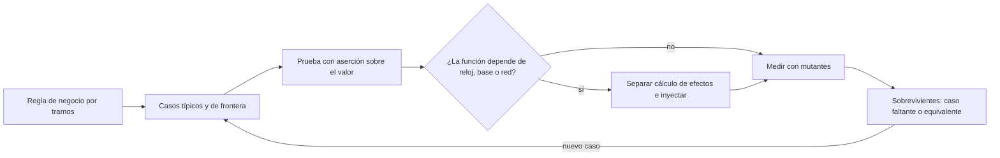
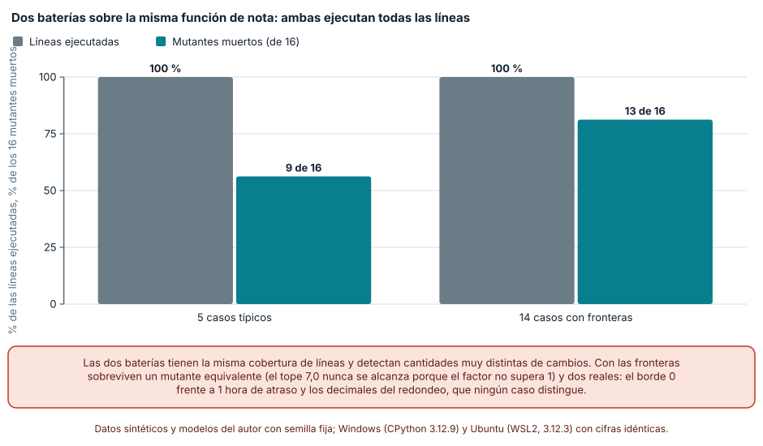
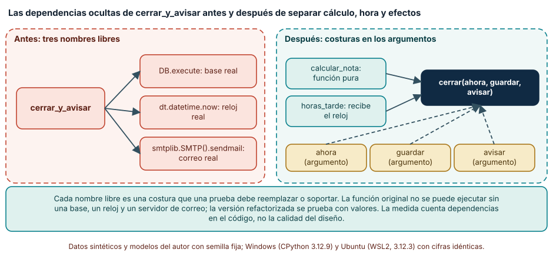
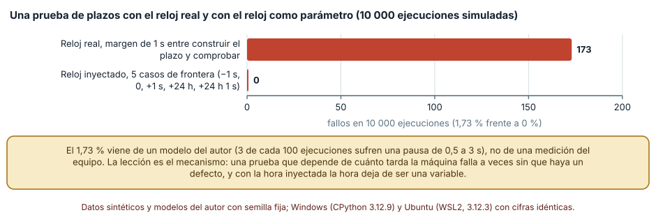

# SE-422 — Pruebas unitarias y diseño testable

[← SE-421 — Calidad por riesgo y propósito de las pruebas](../../classes/part-35-estrategia-y-tecnicas-de-prueba/se-421-calidad-por-riesgo-y-proposito-de-las-pruebas/README.md) · [↑ Parte 35](../../classes/part-35-estrategia-y-tecnicas-de-prueba/README.md) · [📚 Índice completo](../../classes/README.md) · [🌐 Portal](../../site/classes/SE-422.html) · [SE-423 — Integración, componentes y contratos →](../../classes/part-35-estrategia-y-tecnicas-de-prueba/se-423-integracion-componentes-y-contratos/README.md)

## Punto profesional y fundamento pedagógico

**Punto profesional.** La clase existe para que escribas pruebas unitarias que detectan cambios de comportamiento y no solo ejecutan código, y para que reconozcas qué decisiones de diseño (dependencias ocultas, hora global, efectos mezclados con cálculo) hacen que una función sea cara de probar. La prueba unitaria es la más barata de la estrategia y, si el diseño no la permite, la barata se vuelve imposible.

**Por qué aparece aquí.** Sigue a **Calidad por riesgo y propósito de las pruebas**: allí se decidió que la lógica pura y las fronteras de datos se comprueban en el nivel unitario. Esta clase pregunta cómo hacerlo bien y qué debe cambiar en el código para que sea posible.

**Error conceptual que debe corregir.** Creer que una prueba unitaria es buena porque ejecuta todas las líneas de la función. Una batería puede recorrer el 100 % de las líneas y comprobar casi nada: lo que importa es qué cambios del código hace fallar, y eso depende de las fronteras y de lo que se afirma sobre el resultado.

**Secuencia de aprendizaje.** Antes de leer los resultados, predices cuántos de 16 cambios mecánicos de una función de nota detecta una batería de cinco casos típicos con cobertura completa; después mides una batería con fronteras, analizas las dependencias ocultas de una función y mides cuánto falla una prueba de plazos con el reloj real. La secuencia usa predicción, explicación propia, contraste y recuperación. [ICAP](https://icap.education.asu.edu/research) distingue participación de construcción de conocimiento; [How People Learn II](https://nap.nationalacademies.org/catalog/24783/how-people-learn-ii-learners-contexts-and-cultures) exige conectar conocimiento previo, contexto y transferencia; la [práctica de recuperación](https://pubmed.ncbi.nlm.nih.gov/16507066/) respalda producir de nuevo la explicación tras una demora; y [Education for Life and Work](https://nap.nationalacademies.org/resource/13398/dbasse_084153.pdf) exige devolución que explique la causa del error.

**Evidencia de aprendizaje.** `unitarias-log.md` con la predicción, la función de nota con sus pruebas, el análisis de dependencias antes y después del refactor, la matriz de mutantes contra baterías y la prueba de plazos con la hora inyectada.

**Límite de la conclusión.** Los 16 mutantes son cambios mecánicos de operadores y constantes generados con `ast` sobre una función de 11 líneas; no representan los defectos humanos reales y uno resultó equivalente. El 1,73 % de fallos de la prueba con reloj real viene de un modelo de pausas del autor. No se midió el tiempo de ejecución de las pruebas ni se usó un marco de pruebas externo.

### Trazabilidad fuente → afirmación

| Fuente primaria u oficial | Afirmación que respalda | Lo que no prueba |
|---|---|---|
| [Documentación de `unittest`](https://docs.python.org/3/library/unittest.html) | Describe cómo se organizan casos, fixtures y aserciones en la biblioteca estándar de Python. | No dice qué pruebas escribir. |
| [Documentación de `unittest.mock`](https://docs.python.org/3/library/unittest.mock.html) | Muestra cómo sustituir objetos y qué verifican los dobles de interacción. | No decide cuándo usar un doble. |
| [Documentación del módulo `ast`](https://docs.python.org/3/library/ast.html) | Describe el árbol sintáctico con el que se generan los mutantes y se detectan nombres libres. | No define qué mutante es realista. |
| [Martin Fowler, «UnitTest»](https://martinfowler.com/bliki/UnitTest.html) | Distingue pruebas unitarias «solitarias» y «sociables» según sustituyan o no colaboradores. | No fija un tamaño correcto de unidad. |
| [xUnit Patterns: Test Double](http://xunitpatterns.com/Test%20Double.html) | Clasifica los dobles (dummy, stub, spy, mock, fake) por lo que hacen. | No evalúa su fidelidad. |
| [Inozemtseva y Holmes (ICSE 2014)](https://doi.org/10.1145/2568225.2568271) | Encontró que la cobertura no está fuertemente correlacionada con la eficacia de una suite. | No mide la plataforma de esta clase. |

## Antes de empezar

Recupera lo aprendido en `SE-421`: la lógica pura se prueba en el nivel unitario. La pregunta activa es: **¿qué debe cambiar en una función para poder probarla sin una base de datos, un servidor de correo ni el reloj, y qué casos hay que escribir para que la prueba falle cuando el comportamiento cambia?**

## Prerrequisitos

- Haber completado `SE-421` o poder explicar qué clase de fallo cubre una prueba unitaria.
- Python 3.11 o posterior y el módulo `ast`.
- Saber escribir una función con parámetros y una comprobación con `assert`.

## Problema auténtico

La plataforma tiene una función que calcula la nota final con una penalización por atraso: 10 % hasta 24 horas, 25 % hasta 48 y cero después. Las pruebas existentes comprueban cinco casos típicos y la herramienta de cobertura muestra 100 %. Alguien cambia `<=` por `<` en una frontera y ninguna prueba falla; otra persona descubre que la función que cierra el curso lee la hora del sistema, abre la base de datos y envía el correo en el mismo cuerpo, de modo que solo puede probarse con los tres servicios activos. El equipo quiere saber qué tan débil es su batería, cómo medirlo sin esperar al próximo incidente y qué refactor mínimo hace testable la función de cierre.

## Objetivos observables

Al terminar podrás:

1. escribir una prueba unitaria con entrada, comportamiento esperado y razón, y distinguir comprobar un valor de ejecutar una línea;
2. diseñar los casos de frontera de una regla por tramos y medir cuántos cambios mecánicos detecta cada batería;
3. identificar las dependencias ocultas de una función (reloj, base de datos, red, aleatoriedad) y separarlas del cálculo;
4. reemplazar el reloj por un parámetro y explicar por qué elimina una fuente de fallos aleatorios;
5. reconocer qué mutantes sobrevivientes señalan un caso faltante y cuáles son equivalentes.

## Mapa conceptual



El mapa parte de la regla y no de la herramienta: la frontera determina el caso, y el diseño determina si el caso se puede escribir. El retorno indica que un mutante superviviente añade un caso, no cierra la tarea.

## Temas y por qué importan

| Tema | Por qué cambia una decisión profesional | Evidencia mínima |
|---|---|---|
| Qué comprueba una prueba unitaria | Distingue ejecutar una línea de afirmar un resultado. | Predicción, caso y contraejemplo en `unitarias-log.md` |
| Fronteras y particiones | Las fronteras concentran los defectos de las reglas por tramos. | Tabla de casos por tramo con su frontera |
| Dependencias ocultas | Cada nombre global leído es una costura que la prueba debe soportar. | Análisis de dependencias antes y después |
| Hora, azar y efectos | Una prueba que depende de ellos falla sin que haya un defecto. | Prueba determinista con la hora inyectada |
| Qué detecta una batería | La cobertura de líneas no mide detección. | Matriz de mutantes contra baterías |

## Conceptos y decisiones

### 1. Qué comprueba una prueba unitaria

Una prueba unitaria llama a una unidad con una entrada conocida y afirma algo sobre el resultado o el efecto visible. La unidad suele ser una función o una clase pequeña; lo decisivo es que el resultado no dependa de nada que la prueba no controle. Ejecutar una línea no es comprobarla: una prueba sin aserciones, o con una aserción que no puede fallar, «cubre» código sin protegerlo. Cada prueba debe poder responder qué cambio del código la haría fallar, y si la respuesta es «ninguno», es ruido.

### 2. Fronteras y particiones

Una regla por tramos (hasta 24 horas, hasta 48, más) divide el dominio en clases equivalentes. Dentro de una clase todas las entradas se comportan igual, así que basta una representativa; en las fronteras (0, 24, 25, 48, 49) la comparación (`<` frente a `<=`) decide, y es donde se concentran los defectos. Los casos típicos dan confianza de que la ruta feliz funciona y casi no detectan cambios en los límites: cinco casos típicos pueden cubrir todas las líneas y dejar sin ver la mitad de los cambios posibles.

### 3. Dependencias ocultas

Una función que lee `datetime.now()`, abre una conexión global o llama a un servicio de correo tiene dependencias que no figuran en su firma. Para probarla hay que reemplazar esos elementos, lo que complica la prueba y la acopla a la implementación. El diseño testable separa tres responsabilidades: calcular (entrada y salida, sin efectos), decidir cuándo (la hora llega como argumento) y actuar (guardar, avisar). Lo que antes era una función de 10 líneas con tres dependencias se vuelve tres funciones: dos puras y una que recibe lo que necesita.

### 4. Hora, azar y efectos

La hora, la aleatoriedad y los efectos externos son tres fuentes de resultados que cambian sin que cambie el código. Una prueba que compara «ahora» con un plazo construido un instante antes depende de cuánto tarde en ejecutarse: si una pausa lleva el reloj más allá del margen, la prueba falla sin que haya defecto, y el equipo aprende a ignorarla. La solución no es aumentar el margen: es que la hora sea un parámetro, y que el único lugar que lee el reloj real sea el borde del sistema.

### 5. Qué detecta una batería

La cobertura de líneas dice qué se ejecutó. La mutación dice qué cambios del código detecta una batería: se altera un operador o una constante y se comprueba si alguna prueba falla; un mutante que sobrevive indica un caso que falta o un cambio que no altera el comportamiento observable (equivalente). Ninguna de las dos medidas dice si la prueba afirma lo correcto, pero la segunda se acerca más a la pregunta útil.

### Cinco casos típicos frente a catorce con fronteras

La función bajo prueba es `nota_final(bruta, horas_tarde)`: factor 1,0 si no hay atraso, 0,9 hasta 24 h, 0,75 hasta 48 h y 0 después; el resultado se limita a [1,0; 7,0] y se redondea a un decimal. Con `ast` se generan 16 mutantes (cambiar `<=` por `<`, sumar 1 a una constante, cambiar `*` por `+`, cambiar `min` por `max`) y se ejecutan dos baterías.

```python
class Sitios(ast.NodeVisitor):
    def visit_Compare(self, n):
        if type(n.ops[0]) in CMP: self.sitios.append(("cmp", n))
        self.generic_visit(n)
    def visit_Constant(self, n):
        if isinstance(n.value, (int, float)) and not isinstance(n.value, bool):
            self.sitios.append(("const", n))
```

| Batería | Casos | Líneas ejecutadas | Mutantes muertos | Sobreviven |
|---|---:|---:|---:|---|
| Típica (6,0 a 0 h; 5,0 a 10 h; 7,0 a 0 h; 4,0 a 30 h; 5,0 a 100 h) | 5 | 100 % | 9 de 16 | 7 (1 equivalente) |
| Con fronteras (añade 24, 25, 48, 49 y −1 horas, 7,0, 1,0, 0,0 y 2,0 a 100 h) | 14 | 100 % | 13 de 16 | 3 (1 equivalente) |

Ambas baterías ejecutan todas las líneas. La típica deja sin ver siete cambios, entre ellos pasar `<= 24` a `< 24` y `<= 48` a `< 48`; añadir los casos de frontera mata cuatro más. Los tres supervivientes de la segunda se explican así: el límite superior 7,0 pasado a 8,0 no cambia ningún resultado porque el factor nunca supera 1 (equivalente), y los otros dos señalan casos que ninguna prueba contiene: la frontera entre 0 y 1 hora de atraso (`<= 0` frente a `<= 1`) y el redondeo (1 o 2 decimales), porque todos los resultados probados tienen un decimal.



**Cómo leer la figura.** Cada grupo es una batería; la barra gris es el porcentaje de líneas ejecutadas y la verde, el de los 16 mutantes que mata. Mira primero que las barras grises son iguales y las verdes no. **Dónde deja de valer:** los mutantes son cambios sintácticos mecánicos de una función de 11 líneas, no defectos que alguien introduciría; que una batería mate 13 de 16 no significa que detecte el 81 % de los defectos reales. La figura muestra que la cobertura no distingue las dos baterías y que una medida más fina sí.

### Las dependencias que no se ven

Con `ast` se calculan los nombres libres (los que la función lee sin recibirlos ni definirlos) y las llamadas a atributos externos de la función original `cerrar_y_avisar` y de su versión refactorizada.

```python
def libres(src, fname):
    fn = next(n for n in ast.walk(ast.parse(src)) if isinstance(n, ast.FunctionDef) and n.name == fname)
    locales = {a.arg for a in fn.args.args} | {n.id for n in ast.walk(fn) if isinstance(n, ast.Name) and isinstance(n.ctx, ast.Store)}
    usados = {n.id for n in ast.walk(fn) if isinstance(n, ast.Name) and isinstance(n.ctx, ast.Load)}
    return sorted(u for u in usados if u not in locales and not hasattr(builtins, u))
```

La original lee tres nombres globales (`DB`, `dt`, `smtplib`) y llama a `dt.datetime.now`, `DB.execute` y `smtplib.SMTP().sendmail`. Tras el refactor, `calcular_nota` no tiene dependencias, `horas_tarde` solo usa sus argumentos y `cerrar` recibe `ahora`, `guardar` y `avisar` como parámetros; sus únicos nombres libres son las dos funciones puras. Para probar la original hacen falta una base, un reloj y un servidor de correo; para probar las nuevas basta con valores.



**Cómo leer la figura.** A la izquierda, cada flecha sale de la función hacia una dependencia real que una prueba tendría que reemplazar o soportar; a la derecha, las dependencias entran como argumentos (cajas doradas) y las dos funciones puras no tienen ninguna flecha de salida. Mira cuántas flechas hacia afuera quedan en cada mitad. **Dónde deja de valer:** el análisis cuenta dependencias, no su gravedad; una función con un solo nombre libre puede ser muy difícil de probar si ese nombre es una base real. No dice si la separación en tres funciones es el mejor diseño, solo que cada función quedó con menos costuras.

### Una prueba que falla a veces

Se simula una prueba de plazos con el reloj real: construye un plazo un segundo en el futuro, llama a la función y espera «a_tiempo». En 10 000 ejecuciones simuladas, el 3 % sufre una pausa de 0,5 a 3 s (supuesto del autor), y la prueba falla en 173 (1,73 %) cuando la pausa pasa de 1 s. La misma lógica con la hora como parámetro prueba las cinco fronteras (−1 s, 0, +1 s, +24 h, +24 h y 1 s) sin azar.

```python
def estado_entrega(plazo, ahora):
    if ahora <= plazo: return "a_tiempo"
    if ahora <= plazo + dt.timedelta(hours=24): return "tarde"
    return "fuera_de_plazo"
```



**Cómo leer la figura.** Cada barra es una variante de la prueba y su longitud, los fallos en 10 000 ejecuciones; la barra de 173 es el azar del reloj real y la ausencia de barra es la prueba determinista. **Dónde deja de valer:** el 3 % de pausas es un modelo del autor; en un equipo real la proporción puede ser cercana a 0 (una máquina ociosa) o mucho mayor (un servidor de integración continua cargado). La prueba con la hora inyectada no cubre el borde del sistema donde sí se lee el reloj real, que necesita una prueba distinta.

## Definiciones de trabajo

- **prueba unitaria:** comprobación de una unidad pequeña cuyo resultado no depende de recursos que la prueba no controla.
- **frontera:** valor de entrada donde cambia la clase de comportamiento; allí la comparación (`<` o `<=`) decide.
- **costura:** punto del código donde se puede reemplazar una dependencia sin editar la unidad.
- **mutante:** copia del código con un cambio mecánico pequeño; «muerto» si alguna prueba falla, «superviviente» si todas pasan.
- **mutante equivalente:** mutante cuyo comportamiento observable es igual al original; no hay caso que lo mate.

Las definiciones son operativas para la plataforma de entregas. No convierten términos con una historia más amplia en sinónimos y deben contrastarse con la documentación primaria enlazada al final.

## Ejemplo mínimo

El fragmento comprueba una frontera. Antes de ejecutarlo, predice si el caso de las 24 horas exactas pasa con el factor 0,9 o con 0,75.

```python
def nota_final(bruta, horas_tarde):
    factor = 1.0 if horas_tarde <= 0 else 0.9 if horas_tarde <= 24 else 0.75 if horas_tarde <= 48 else 0.0
    return round(min(max(bruta * factor, 1.0), 7.0), 1)

assert nota_final(6.0, 24) == 5.4      # frontera inclusiva
assert nota_final(6.0, 25) == 4.5      # primer valor del tramo siguiente
```

Si cambias `<= 24` por `< 24`, el primer `assert` falla: esa es la prueba que mata el mutante que la batería típica dejaba vivo. Registra versión, comando y salida.

## Ejemplo profesional

El equipo de la plataforma separa la función de cierre en tres: `calcular_nota(bruta, horas)` (pura), `horas_tarde(plazo, ahora)` (aritmética de fechas) y `cerrar(entregas, ahora, guardar, avisar)`, que orquesta. La hora real se lee en un único punto, el controlador que llama a `cerrar`. Para cada regla por tramos, una tabla de casos lista el tramo, la frontera, el valor esperado y la razón de negocio («una entrega a las 24 horas exactas sigue en el primer tramo porque la política dice "hasta 24 horas"»). La tabla se ejecuta como prueba parametrizada y se mide con los 16 mutantes generados por `ast` cada vez que cambia la función; si un mutante sobrevive, el equipo decide si agrega un caso o lo documenta como equivalente. Las pruebas de `cerrar` usan listas de funciones espía en lugar de una base y un servidor de correo.

## Práctica guiada

1. Escribe la función `nota_final` con sus tramos y la tabla de casos típicos.
2. Predice cuántos de los 16 mutantes detectan los casos típicos y anótalo.
3. Genera los mutantes con `ast`, ejecútalos con la batería típica y cuenta los muertos.
4. Añade los casos de frontera y repite; clasifica cada superviviente como caso faltante o equivalente.
5. Escribe una función de cierre con reloj, base y correo globales y calcula con `ast` sus nombres libres.
6. Refactoriza en tres funciones, inyecta la hora y vuelve a medir las dependencias.
7. Entrega `unitarias-log.md` y pide a otra persona que añada un mutante propio y diga si tus pruebas lo detectan.

## Ejercicios

1. **Fronteras:** para una regla «hasta 3 intentos» y «hasta 10 MB» escribe la tabla de fronteras y los casos que las comprueban.
2. **Superviviente:** toma uno de los tres supervivientes de la batería con fronteras y escribe el caso que lo mata o demuestra que es equivalente.
3. **Costuras:** refactoriza una función tuya que lea la hora y escribe en un archivo, de modo que se pueda probar con valores, y compara el número de nombres libres antes y después.
4. **Tautología:** escribe una prueba que cubra todas las líneas de `nota_final` y no detecte ningún mutante, y explica qué le falta.

## Reto verificable

Entrega `unitarias-log.md` con la predicción, la función y sus dos baterías, la matriz de mutantes, el análisis de dependencias antes y después y la prueba de plazos con la hora inyectada. Se aprueba si otra persona ejecuta el código, obtiene los mismos mutantes muertos y supervivientes, y puede decir qué caso añadiría para el primer superviviente. No se aprueba por mostrar que «las pruebas pasan» o que la cobertura es 100 %.

## Caso conductor

La plataforma de entregas es el caso conductor. Esta clase deja el segundo artefacto: la función de nota con tabla de fronteras y la función de cierre separada en cálculo, hora y efectos. `SE-423` pregunta cómo comprobar que las piezas funcionan juntas. Cambia después una sola decisión, la política «hasta 24 horas» por «menos de 24 horas», y observa qué pruebas fallan: esa es la medida de lo protegida que estaba la frontera.

## Preguntas frecuentes

### ¿Cuántos casos por función son suficientes?

Los que cubran cada clase de comportamiento y cada frontera, no una cantidad fija. Para una regla con tres tramos hay tres casos representativos y cinco o seis fronteras; con 14 casos esta función mató 13 de 16 mutantes. El criterio práctico es: cada comparación (`<`, `<=`) tiene un caso por cada lado.

### ¿Hay que probar las funciones privadas?

Se prueban a través de la interfaz pública cuando es posible. Si una función privada tiene lógica compleja que merece sus propias fronteras, suele ser una unidad que se puede extraer y exponer. Probar detalles internos acopla la prueba a la implementación y la rompe con cualquier refactor, como mostrará `SE-427`.

### ¿Un mutante superviviente siempre indica una prueba que falta?

No: puede ser equivalente, como pasar el tope 7,0 a 8,0 cuando el factor nunca supera 1. Se decide con el razonamiento sobre el comportamiento, no con la herramienta. Un equivalente se documenta; no se escribe una prueba imposible.

### ¿Inyectar el reloj no complica el código?

Añade un parámetro y, a cambio, quita una variable que las pruebas no podían fijar. El costo es pequeño frente a un fallo intermitente que consume horas de diagnóstico. En el borde del sistema, un único lugar sigue leyendo la hora real.

## Fallo controlado y diagnóstico

Reproduce el fallo clásico de la clase: **una batería con 100 % de cobertura que deja pasar el cambio de `<=` a `<`**. Ejecuta los cinco casos típicos y aplica el mutante `horas_tarde <= 24` → `< 24`.

Registra síntoma, entrada mínima, hipótesis, observación que descarta cada hipótesis, causa, corrección y prueba de regresión. **Síntoma:** la cobertura es 100 %, todas las pruebas pasan y la frontera cambió. **Hipótesis rivales:** (a) la herramienta de cobertura no mide bien; (b) las pruebas se ejecutan contra otra versión; (c) ninguna prueba usa un valor en la frontera. **Prueba:** ejecuta la batería contra el mutante y comprueba que pasa; busca en las pruebas un caso con 24 horas exactas y comprueba que no lo hay. **Conclusión:** la cobertura cuenta líneas ejecutadas, y el cambio no altera qué líneas se ejecutan en los cinco casos. **Regresión:** añade el caso de 24 horas con su valor esperado (5,4), verifica que falla contra el mutante y documenta el límite en la tabla de fronteras. No cambies a la vez el código y la prueba.

## Errores comunes y cómo corregirlos

| Síntoma | Causa probable | Corrección |
|---|---|---|
| La cobertura es 100 % y un cambio de operador no rompe ninguna prueba | Casos típicos sin valores en las fronteras | Tabla de fronteras y medida con mutantes |
| Una prueba falla de vez en cuando sin cambios en el código | Depende del reloj, del azar o del orden | Inyectar la hora y la semilla; ver `SE-428` y `SE-430` |
| Para probar una función hay que levantar una base de datos | Cálculo y efectos mezclados en el mismo cuerpo | Separar cálculo, decisión y efecto |
| Una prueba pasa y no afirma nada | Ejecuta sin `assert` o compara un valor consigo mismo | Revisar qué cambio del código la haría fallar |
| Se escribe un caso imposible para un mutante | El mutante es equivalente | Razonar sobre el comportamiento y documentar |

## Entorno y archivos clave

```text
work/SE-422/
├── README.md
├── nota/
│   ├── nota.py
│   ├── mutantes.py
│   └── cierre.py
├── tests/
│   ├── test_nota_tipica.py
│   └── test_nota_fronteras.py
└── evidence/unitarias-log.md
```

El `README` declara plataforma, versiones de Python y semilla del modelo de pausas (362). Los experimentos usan solo la biblioteca estándar (`ast`, `sys.settrace`, `random`) y se ejecutaron con CPython 3.12.9 en Windows 11 y 3.12.3 en Ubuntu bajo WSL2: las salidas fueron idénticas. Si añades una dependencia, fija procedencia y versión.

## Seguridad, ética y accesibilidad

- las pruebas con datos personales reales exponen información: usa datos sintéticos y evita copiar entregas de estudiantes;
- una regla de penalización por atraso afecta a personas distintas de forma distinta (cortes de conectividad, zonas horarias): documenta la política y sus excepciones, y prueba los casos de borde de zona;
- una prueba que mide «tiempo de respuesta» en una máquina rápida oculta la experiencia de dispositivos lentos;
- guarda los casos de frontera con su razón de negocio para que quien los cambie sepa qué política rompe;
- no uses `eval` ni cargues código de terceros al generar mutantes: genera desde el árbol sintáctico propio.

## Puente hacia el trabajo con agentes

Un agente al que se le pide «escribe pruebas unitarias para esta función» generará cinco casos típicos con 100 % de cobertura y aserciones que repiten la implementación. Pídele en cambio la tabla de tramos y fronteras con su razón, los mutantes generados y cuáles sobreviven, y que refactorice las dependencias ocultas antes de escribir pruebas. Revisa especialmente si deja `datetime.now()` dentro de la función y si afirma el valor con una expresión copiada del código: ambas pruebas pasan siempre.

## Transferencia

Traslada el análisis a otra regla por tramos (por ejemplo, la tarifa de multa de una biblioteca): escribe sus fronteras, genera mutantes, mide dos baterías y separa el cálculo de la hora. La transferencia está lograda cuando puedes explicar qué caso mata cada superviviente, no cuando el código se parece.

## Evaluación y evidencia

| Criterio | Evidencia para aprobar |
|---|---|
| comprensión | explicación de por qué la cobertura de líneas no distingue dos baterías |
| corrección | mutantes muertos y supervivientes reproducibles |
| diseño | función separada en cálculo, hora y efectos con costuras medidas |
| diagnóstico | reproducción del fallo «100 % de cobertura con la frontera sin probar» con regresión |
| incertidumbre | declaración de que los mutantes no son defectos reales y de que el modelo de pausas es un supuesto |
| reproducibilidad | versiones, semilla, comandos, salida y límites declarados |

## Fuentes

- [Documentación de unittest](https://docs.python.org/3/library/unittest.html) — organización de pruebas; autoridad: documentación oficial de Python.
- [Documentación de unittest.mock](https://docs.python.org/3/library/unittest.mock.html) — dobles; autoridad: documentación oficial de Python.
- [Documentación del módulo ast](https://docs.python.org/3/library/ast.html) — árbol sintáctico; autoridad: documentación oficial de Python.
- [Martin Fowler, «UnitTest»](https://martinfowler.com/bliki/UnitTest.html) — qué es una unidad; autoridad: autor del texto.
- [xUnit Patterns: Test Double](http://xunitpatterns.com/Test%20Double.html) — tipos de dobles; autoridad: autor del libro.
- [Inozemtseva y Holmes, «Coverage is not strongly correlated with test suite effectiveness»](https://doi.org/10.1145/2568225.2568271) — cobertura y eficacia; autoridad: artículo revisado de ICSE 2014.

Cada fuente respalda el mecanismo indicado; ninguna demuestra que 13 de 16 mutantes muertos o el 1,73 % de fallos por reloj se observen en el código y el equipo de la plataforma. Esa afirmación depende de los defectos reales y de cómo se ejecutan las pruebas.

## Límites y siguiente paso

Se ejecutaron tres experimentos con una función sintética en Windows y Ubuntu (WSL2) con salidas idénticas. Los mutantes son cambios mecánicos y no defectos humanos; el modelo de pausas de la prueba con reloj real es un supuesto. No se midió tiempo de ejecución ni se usó un marco de pruebas distinto de `assert`. La siguiente clase pregunta cómo comprobar que varias unidades funcionan juntas y cómo se protege el acuerdo entre un proveedor y sus consumidores.

## Glosario

- **prueba unitaria:** comprobación de una unidad pequeña cuyo resultado no depende de recursos que la prueba no controla.
- **frontera:** valor de entrada donde cambia la clase de comportamiento; allí la comparación (`<` o `<=`) decide.
- **costura:** punto del código donde se puede reemplazar una dependencia sin editar la unidad.
- **mutante:** copia del código con un cambio mecánico pequeño; «muerto» si alguna prueba falla, «superviviente» si todas pasan.
- **mutante equivalente:** mutante cuyo comportamiento observable es igual al original; no hay caso que lo mate.

---

[← SE-421 — Calidad por riesgo y propósito de las pruebas](../../classes/part-35-estrategia-y-tecnicas-de-prueba/se-421-calidad-por-riesgo-y-proposito-de-las-pruebas/README.md) · [↑ Parte 35](../../classes/part-35-estrategia-y-tecnicas-de-prueba/README.md) · [📚 Índice completo](../../classes/README.md) · [🌐 Portal](../../site/classes/SE-422.html) · [SE-423 — Integración, componentes y contratos →](../../classes/part-35-estrategia-y-tecnicas-de-prueba/se-423-integracion-componentes-y-contratos/README.md)
