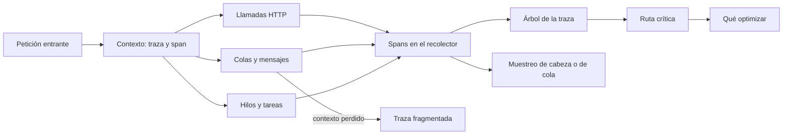

# SE-424 — Trazas distribuidas y contexto

[← SE-423 — Métricas, dimensiones y cardinalidad](../../classes/part-35-observabilidad-sre-e-incidentes/se-423-metricas-dimensiones-y-cardinalidad/README.md) · [↑ Parte 35](../../classes/part-35-observabilidad-sre-e-incidentes/README.md) · [📚 Índice completo](../../classes/README.md) · [🌐 Portal](../../site/classes/SE-424.html) · [SE-425 — SLI, SLO, SLA y presupuestos de error →](../../classes/part-35-observabilidad-sre-e-incidentes/se-425-sli-slo-sla-y-presupuestos-de-error/README.md)

## Punto profesional y fundamento pedagógico

**Punto profesional.** La clase existe para que expliques cómo una traza sigue una petición a través de varios servicios, qué hay que hacer en cada frontera para que no se rompa, cómo se lee la ruta crítica para saber qué optimizar y qué se pierde al muestrear. Una traza incompleta o mal leída produce una decisión confiada y equivocada, que es peor que no tener traza.

**Por qué aparece aquí.** Sigue a **Métricas, dimensiones y cardinalidad**: las métricas dicen que algo cambió y los registros dicen qué pasó; la traza dice dónde, en una petición concreta. Cierra el bloque de señales antes de usarlas para prometer algo (`SE-425`). El caso conductor sigue siendo la API de entregas con sus cinco servicios.

**Error conceptual que debe corregir.** Creer que instalar una biblioteca de trazado «da trazas», y que el span más largo es el que hay que optimizar. El contexto se pierde donde cambia el medio o la unidad de ejecución, y un span fuera de la ruta crítica puede acelerarse sin que la petición mejore.

**Secuencia de aprendizaje.** Antes de ver los resultados predices qué fracción de las peticiones queda en una sola traza con cuatro tipos de frontera, cuánto se ahorra al acelerar el span más largo frente al de la ruta crítica y cuántos errores conserva un muestreo del 1 %. Después contrastas con tres experimentos y escribes qué frontera auditarías primero. La secuencia usa predicción, explicación propia, contraste y recuperación. [ICAP](https://icap.education.asu.edu/research) distingue participación de construcción de conocimiento; [How People Learn II](https://nap.nationalacademies.org/catalog/24783/how-people-learn-ii-learners-contexts-and-cultures) respalda diseñar la práctica con contextos reales y retroalimentación.

**Evidencia de aprendizaje.** `trazas-log.md` con la predicción, las tres figuras reproducidas, un inventario de fronteras de la API de entregas con su mecanismo de propagación y una política de muestreo justificada.

**Límite de la conclusión.** Los árboles de spans, las probabilidades de pérdida por frontera y las proporciones de errores y lentas son sintéticos. No se usó ninguna biblioteca ni backend de trazado; el formato `traceparent` sí se implementó y se validó contra la especificación.

### Trazabilidad fuente → afirmación

| Fuente primaria u oficial | Afirmación que respalda | Lo que no prueba |
|---|---|---|
| [W3C Trace Context](https://www.w3.org/TR/trace-context/) | Define la cabecera `traceparent` (versión, identificador de traza de 16 bytes, identificador de span de 8 bytes y banderas) y su propagación. | No garantiza que cada servicio la propague. |
| [OpenTelemetry: propagación de contexto](https://opentelemetry.io/docs/concepts/context-propagation/) | Explica que el contexto viaja entre procesos mediante propagadores y que, entre hilos o tareas, depende del mecanismo del lenguaje. | No resuelve tu cliente de mensajería. |
| [OpenTelemetry: muestreo](https://opentelemetry.io/docs/concepts/sampling/) | Distingue muestreo de cabeza y de cola y avisa de que el de cola exige que los spans de una traza lleguen al mismo recolector. | No fija tasas de muestreo. |
| [Sigelman et al., «Dapper»](https://research.google/pubs/dapper-a-large-scale-distributed-systems-tracing-infrastructure/) | Presenta el trazado distribuido de bajo coste con muestreo por traza y propagación del contexto. | No mide la latencia de tu sistema. |

## Antes de empezar

Recupera lo aprendido en `SE-422` y `SE-423`: el registro necesita un identificador de correlación y la métrica resume. La pregunta activa es: **¿en qué punto exacto deja una petición de la API de entregas de pertenecer a una traza, y qué haces con una traza completa una vez que la tienes?**

## Prerrequisitos

- Haber completado `SE-422` o poder explicar qué es un identificador de correlación.
- Python 3.11 o posterior; los experimentos usan solo la biblioteca estándar (`random`, `re`, `math`).
- Nociones de árbol, de ejecución paralela y secuencial y de hilo frente a proceso.

## Problema auténtico

La traza de una entrega lenta muestra una sola línea: la pasarela. La entrega pasó por la API, la cola y un trabajador, pero el trabajador procesó el archivo en un hilo de un grupo que no heredó el contexto y escribió su traza aparte, sin padre. La guardia ve una traza «completa» de 80 ms y otra, huérfana, de 3 segundos que nadie asocia. Otro día, la traza sí está completa: tiene 40 spans y el más largo es la consulta a la base de datos con 140 ms. El equipo la optimiza a la mitad y la petición sigue tardando lo mismo, porque la consulta corría en paralelo con la subida del archivo, que tardaba 220 ms. Por último, el muestreo de cabeza del 1 % descartó la traza del error que reportó un cliente porque se decidió antes de saber que fallaría. La clase explica los tres.

## Objetivos observables

Al terminar podrás:

1. describir el modelo de traza y span y el formato `traceparent`, y validarlo;
2. calcular la fracción de peticiones que quedan en una sola traza según las fronteras y localizar la que más fragmenta;
3. identificar la ruta crítica de una traza y estimar el ahorro de optimizar un span concreto;
4. comparar muestreo de cabeza y de cola por lo interesante que conservan y por su coste;
5. explicar por qué el muestreo de cola exige enrutar todos los spans de una traza al mismo recolector.

## Mapa conceptual



El mapa separa el **contexto** (que viaja), los **spans** (que se emiten) y el **análisis** (ruta crítica y muestreo). La fragmentación nace en la propagación y se descubre en el análisis.

## Temas y por qué importan

| Tema | Por qué cambia una decisión profesional | Evidencia mínima |
|---|---|---|
| Traza y span | El modelo define qué se puede preguntar. | Predicción, traza causal y contraejemplo de **Traza y span** en `trazas-log.md` |
| Propagación de contexto | Sin contexto, la traza se parte. | Predicción, traza causal y contraejemplo de **Propagación de contexto** en `trazas-log.md` |
| Fronteras asíncronas | Colas, hilos y reintentos son los puntos de ruptura. | Predicción, traza causal y contraejemplo de **Fronteras asíncronas** en `trazas-log.md` |
| Ruta crítica | Optimizar fuera de ella no mejora la petición. | Predicción, traza causal y contraejemplo de **Ruta crítica** en `trazas-log.md` |
| Muestreo | Decidir antes de saber descarta lo interesante. | Predicción, traza causal y contraejemplo de **Muestreo** en `trazas-log.md` |

## Conceptos y decisiones

### 1. Traza y span

Una **traza** es el recorrido de una petición por un sistema; está formada por **spans**, cada uno con un nombre, un instante de inicio, una duración, atributos y una referencia a su span padre. El conjunto de relaciones padre-hijo forma un árbol. Dos tiempos describen cada span: su duración total, que incluye a sus hijos, y su **tiempo propio**, que es la duración menos el tiempo cubierto por los hijos. El tiempo propio indica dónde se gasta de verdad el tiempo (`SE-421`). Los atributos del span (endpoint, versión, estado, identificador de institución) son las dimensiones por las que se puede agrupar después, con la misma advertencia de cardinalidad y de datos personales que en las métricas.

### 2. Propagación de contexto

Para que un servicio conecte su span con el del llamador, recibe el **contexto**: el identificador de la traza y el del span padre. El estándar W3C lo transporta en la cabecera `traceparent`, con la forma `00-<traza de 32 hex>-<span de 16 hex>-<banderas de 2 hex>`; por ejemplo, `00-4bf92f3577b34da6a3ce929d0e0e4736-00f067aa0ba902b7-01`. Los identificadores de ceros son inválidos, las letras van en minúsculas y las banderas indican, entre otras cosas, si la traza está muestreada. Un receptor debe rechazar una cabecera mal formada y empezar una traza nueva; uno que la acepta con mayúsculas o con campos cortos produce identificadores que no coinciden con los del emisor. La **propagación** es la obligación de copiar ese contexto a toda llamada saliente.

### 3. Fronteras asíncronas

En HTTP, las bibliotecas copian `traceparent` solas. El contexto se pierde en cuatro lugares típicos. En una **cola de mensajes**, porque el contexto debe copiarse a las propiedades del mensaje y leerse en el consumidor. En un **grupo de hilos o una tarea asíncrona**, porque el contexto vive en una variable ligada al hilo y la tarea que se ejecuta después no la hereda sin ayuda. En un **reintento automático**, que abre una petición nueva sin enlazarla con la original. Y en una llamada a un servicio de terceros que descarta cabeceras desconocidas. Como cada frontera se puede romper de forma independiente, la fracción de peticiones que queda en una sola traza es el producto de las probabilidades de cada una, y las más fragmentadoras son las que no son HTTP.

### Dónde se rompe el contexto

Se modela una petición con seis saltos (HTTP, HTTP, cola, grupo de hilos, HTTP, reintento) y probabilidades de pérdida de 1 %, 15 %, 20 % y 10 % para HTTP, cola, hilos y reintento. Se simulan 5 000 peticiones y se cuenta en cuántos trozos se parte cada una; además se validan las cabeceras `traceparent`.

```python
for b in chain:
    if rng.random() < probs[b]: parts += 1          # cada pérdida abre un trozo nuevo
valid = re.fullmatch(r"00-(?!0{32})[0-9a-f]{32}-(?!0{16})[0-9a-f]{16}-[0-9a-f]{2}", value)
```

| Frontera | Pérdida de contexto | Efecto |
|---|---:|---|
| HTTP síncrono (3 saltos) | 1 % | Casi no fragmenta |
| Cola de mensajes | 15 % | La traza se parte en el productor |
| Grupo de hilos | 20 % | El trabajo posterior queda huérfano |
| Reintento automático | 10 % | El intento nuevo abre otra traza |
| Peticiones con una sola traza completa | 59,4 % | 1,48 trozos por petición (máximo 4) |
| Cabeceras inválidas rechazadas | 9 de 9 | Válidas aceptadas: 2 de 2 |


**Cómo leer la figura.** Las cuatro primeras filas muestran cada tipo de frontera con su pérdida y su efecto; las dos últimas, el resultado y la validación del formato. Dos de cada cinco peticiones quedan fragmentadas aunque cada frontera «casi siempre» funciona. **Dónde deja de valer:** las probabilidades por frontera son supuestos del autor; en un sistema real se miden contando qué fracción de las peticiones tiene todos sus servicios en la misma traza. La validación del formato comprueba 11 cabeceras construidas a mano, no el comportamiento de ninguna biblioteca.

### 4. Ruta crítica

En una traza con ramas paralelas, la latencia de la petición no es la suma de los spans sino el camino más largo desde la entrada hasta la salida: la **ruta crítica**. Un span fuera de ella puede acelerarse sin que la petición cambie, porque la rama paralela que la domina sigue tardando lo mismo. La identificación es mecánica: en cada nodo con hijos paralelos, el hijo cuya duración es la mayor pertenece a la ruta; en uno con hijos secuenciales, todos pertenecen. El ahorro de optimizar un span fuera de la ruta es cero hasta que alcanza al de la rama competidora, y la ganancia de optimizar uno dentro de ella tiene un tope cuando otra rama pasa a dominar.

### Reducir a la mitad un span

Se generan 600 árboles de spans sintéticos (3 a 5 hijos en la raíz, hasta tres niveles, la mitad de los nodos con hijos en paralelo, tiempo propio lognormal de mediana 15 ms). Para cada árbol se reduce a la mitad un span elegido con tres reglas y se mide cuánto baja la latencia de la petición.

```python
lat = self + (max(ks) if par else sum(ks))          # paralelo: manda el hijo más lento
saving = base - _lat(tree)                          # tras reducir a la mitad el span elegido
```

| Qué span se optimiza | Ahorro medio | Árboles sin ahorro |
|---|---:|---:|
| Un span al azar | 5,6 ms | 57,3 % |
| El span con más tiempo propio | 40,2 ms | 20,7 % |
| El span de la ruta crítica con más tiempo propio | 45,7 ms | 0 % |


**Cómo leer la figura.** Cada fila es una regla para elegir qué optimizar; la columna central es el ahorro medio y la última, la fracción de árboles donde la regla no produce ninguna mejora. Optimizar al azar no mejora la petición en más de la mitad de los casos; el span más largo falla en uno de cada cinco. **Dónde deja de valer:** el generador de árboles es del autor y la proporción de ramas paralelas (50 %) fija cuánto pesa la diferencia; con una traza casi secuencial las tres reglas se parecen. La regla de la ruta crítica también se agota: tras acelerar un span, otra rama pasa a dominar y hay que recalcular la ruta.

### 5. Muestreo

Guardar todas las trazas es caro. El **muestreo de cabeza** decide al empezar la petición, por ejemplo con probabilidad del 1 %, y es barato porque no retiene nada; descarta por igual lo normal y lo interesante. El **muestreo de cola** decide cuando la traza termina, a la vista de su duración y su estado: se conservan todas las que tuvieron error o fueron lentas, y una fracción del resto. Cuesta más: hay que mantener en memoria todos los spans de las trazas en curso (aproximadamente la tasa de llegada por la duración de la espera y por los spans de cada traza) y, sobre todo, hay que enrutar todos los spans de una traza al mismo recolector. Si cada span va a un recolector elegido al azar, ninguno ve la traza entera y el muestreo de cola decide con información parcial.

### Muestreo de cabeza, de cola y enrutado

Se generan 100 000 trazas con un 1 % de errores y un 2 % de lentas, y se comparan un muestreo de cabeza del 1 % y uno de cola que conserva todas las trazas con error o lentas más el 1 % del resto. Después se mide qué fracción de las trazas llega completa a un mismo recolector con 1, 2 y 4 recolectores y enrutado al azar o por hash del identificador de la traza.

```python
head[k] += rng.random() < 0.01
tail[k] += k != "normal" or rng.random() < 0.01
```

| Política | Resultado |
|---|---|
| Cabeza 1 %: errores conservados | 9 de 976 (0,9 %) |
| Cabeza 1 %: trazas lentas conservadas | 30 de 1 994 (1,5 %) |
| Cola: errores y lentas conservados | 2 970 de 2 970 (100 %) |
| Trazas almacenadas (cabeza frente a cola) | 1 045 frente a 3 967 (3,8 veces más) |
| Completas con 2 recolectores y enrutado al azar | 1,7 % (con hash del identificador: 100 %) |
| Completas con 4 recolectores y enrutado al azar | 0 % (con hash del identificador: 100 %) |


**Cómo leer la figura.** Las filas comparan qué política conserva lo interesante y cuánto cuesta en trazas almacenadas; las dos últimas muestran por qué el muestreo de cola obliga a un enrutado coherente. El de cabeza conserva menos del 2 % de lo que importa; el de cola lo conserva todo y almacena 3,8 veces más. **Dónde deja de valer:** las proporciones de 1 % de errores y 2 % de lentas son supuestos del autor, y «lenta» se definió como cualquier traza por encima de un umbral fijo; si los errores se conocen tarde (un fallo asíncrono posterior a la respuesta) ni siquiera el muestreo de cola los ve a tiempo. Tampoco se modeló la memoria que exige esperar a que termine cada traza.

## Definiciones de trabajo

- **traza:** conjunto de spans que describen el recorrido de una petición por un sistema.
- **span:** tramo de una traza con nombre, inicio, duración, atributos y referencia a su padre.
- **contexto de traza:** identificadores de traza y de span que viajan con la petición y permiten enlazar spans.
- **ruta crítica:** camino de spans que determina la latencia total de una petición.
- **muestreo de cola:** decisión de conservar una traza tomada después de que termina, a la vista de su resultado.

Las definiciones son operativas para la API de entregas. No convierten términos con una historia más amplia en sinónimos y deben contrastarse con la documentación primaria enlazada al final.

## Ejemplo mínimo

El fragmento genera y valida una cabecera `traceparent`. Antes de ejecutarlo, predice el resultado.

```python
import random, re
rng = random.Random(424)
tp = "00-%032x-%016x-01" % (rng.getrandbits(128), rng.getrandbits(64))
pattern = r"00-(?!0{32})[0-9a-f]{32}-(?!0{16})[0-9a-f]{16}-[0-9a-f]{2}"
print(tp, bool(re.fullmatch(pattern, tp)), bool(re.fullmatch(pattern, tp.upper())))
```

Imprime la cabecera, `True` y `False`: el formato exige minúsculas. Registra versión de Python, comando y salida; después construye tres cabeceras inválidas distintas y comprueba que se rechazan.

## Ejemplo profesional

Supón, como caso hipotético de la plataforma y no como medición, que el equipo hace el inventario de fronteras de la API de entregas: pasarela → API (HTTP, propaga solo), API → cola (el cliente de mensajería no copia propiedades), cola → trabajador (el trabajador lee el mensaje sin contexto), trabajador → hilo de procesamiento de archivos (grupo de hilos sin contexto) y trabajador → almacenamiento (HTTP, propaga solo). Tres de las cinco fronteras necesitan trabajo explícito. Escriben una prueba por frontera: enviar un identificador en la entrada y comprobar que el span de salida lo tiene como padre. Tras corregir la cola y el grupo de hilos, medirían la fracción de trazas con todos los servicios en una traza, que en este supuesto sube del 61 % al 96 %. Para el muestreo, adoptan cola con un recolector por hash del identificador, 100 % de errores y lentas por encima de 1 s y 1 % del resto, con un presupuesto de memoria calculado como tasa × espera × spans. No concluyen que la trazabilidad es total: el 4 % restante se atribuye a reintentos de un cliente externo y queda registrado como límite conocido.

## Práctica guiada

1. Predice la fracción de peticiones completas con las cuatro fronteras y escribe el número antes de medir.
2. Ejecuta `python scripts/experiments_part35_a.py e424` y compara; anota la mayor diferencia con tu predicción.
3. Cambia la pérdida de la cola de 0,15 a 0,02 y mide cuánto sube la fracción completa.
4. Cambia la proporción de nodos paralelos de 0,5 a 0,1 en el generador de árboles y mide cuánto se parecen las tres reglas.
5. Calcula la memoria que exige un muestreo de cola con 500 peticiones por segundo, 30 s de espera y siete spans por traza.
6. Construye un inventario de fronteras de un servicio propio y marca cuáles propagan solas.
7. Entrega `trazas-log.md` y pide a otra persona que encuentre una frontera que tu inventario no incluya.

## Ejercicios

1. **Formato:** escribe cinco cabeceras `traceparent` inválidas, cada una por una causa distinta, y la regla que las rechaza.
2. **Fragmentación:** una petición tiene ocho saltos, dos asíncronos con 12 % de pérdida y seis HTTP con 1 %; calcula la fracción completa.
3. **Ruta crítica:** una traza tiene una raíz de 10 ms y tres hijos paralelos de 120, 90 y 200 ms; calcula la latencia total y el ahorro de reducir a la mitad cada hijo.
4. **Muestreo:** con 2 000 peticiones por segundo, 0,5 % de errores y muestreo de cabeza del 1 %, calcula cuántas trazas de error se conservan por hora.

## Reto verificable

Entrega `trazas-log.md` con la predicción, las tres tablas de resultados reproducidas con las mismas semillas, el inventario de fronteras de un servicio propio con una prueba por frontera asíncrona y una política de muestreo justificada con el cálculo de memoria. Se aprueba si otra persona ejecuta el código desde un checkout limpio, obtiene los mismos números y no encuentra una frontera sin prueba. No se aprueba por afirmar que «la biblioteca propaga el contexto» ni por optimizar un span sin mostrar la ruta crítica.

## Caso conductor

La API de entregas es el caso conductor de la Parte 35. Esta clase deja el cuarto artefacto: un inventario de fronteras con su prueba de propagación y una política de muestreo. `SE-425` usa las señales para fijar objetivos con un presupuesto de error, y `SE-426` las convierte en alertas. Cambia después un solo parámetro, la pérdida de la cola, y observa cuántas peticiones recuperas.

## Preguntas frecuentes

### ¿Basta con usar OpenTelemetry para tener trazas completas?

No. Las bibliotecas instrumentan los clientes y servidores más comunes y propagan por HTTP. Las colas, los grupos de hilos, los reintentos y los clientes propios requieren configuración o código. El criterio es medir qué fracción de las peticiones queda en una sola traza.

### ¿Cuál es la diferencia entre traza y registro?

Un registro es un evento aislado con contexto; una traza es la estructura que une los eventos de una petición con relaciones de causalidad y de tiempo. Se complementan: el identificador de la traza va en cada registro, de modo que se pasa de uno a otro.

### ¿Cuánto cuesta trazar todo?

Cuesta CPU y memoria en el proceso (crear y cerrar spans), ancho de banda hacia el recolector y almacenamiento. Por eso se muestrea. Lo importante no es la tasa sino que la política conserve lo que se va a necesitar: errores y lentas.

### ¿Se puede optimizar sin mirar la ruta crítica?

Se puede, y a veces funciona, pero en uno de cada cinco casos de este experimento el span más largo no cambiaba la latencia. La ruta crítica es la que dice si el esfuerzo va a servir.

## Fallo controlado y diagnóstico

Reproduce el fallo clásico de la clase: **optimizar el span más largo cuando no está en la ruta crítica**. Genera una traza con una consulta de 140 ms en paralelo con una subida de 220 ms y reduce la consulta a la mitad.

Registra síntoma, entrada mínima, hipótesis, observación que descarta cada hipótesis, causa, corrección y prueba de regresión. **Síntoma:** el equipo optimiza la consulta de 140 ms a 70 ms y la latencia de la petición no cambia. **Hipótesis rivales:** (a) el cambio no se desplegó; (b) hay una caché que enmascara la mejora; (c) la consulta no está en la ruta crítica. **Prueba:** calcula la ruta crítica de la traza; si el hijo paralelo más largo es la subida de 220 ms, la hipótesis (c) explica la señal. **Conclusión:** acelerar una rama paralela que no domina no cambia la latencia. **Regresión:** añade al análisis un cálculo de ruta crítica y una prueba que rechace la propuesta de optimizar un span que no pertenece a ella. No cambies a la vez la consulta y la subida.

## Errores comunes y cómo corregirlos

| Síntoma | Causa probable | Corrección |
|---|---|---|
| Hay trazas huérfanas de 3 segundos | Contexto perdido en un grupo de hilos o en una cola | Copiar el contexto explícitamente y probar la frontera |
| Una traza está completa pero la mejora no llega | Se optimizó un span fuera de la ruta crítica | Calcular la ruta crítica antes de elegir |
| El error del cliente no tiene traza | Muestreo de cabeza descartó la petición | Muestreo de cola o regla por estado y duración |
| El muestreo de cola decide mal | Los spans de una traza llegan a recolectores distintos | Enrutar por hash del identificador de traza |
| El receptor acepta cabeceras mal formadas | Validación laxa de `traceparent` | Validar versión, longitudes y minúsculas |

## Entorno y archivos clave

```text
work/SE-424/
├── README.md
├── trazas/
│   ├── contexto.py
│   ├── ruta_critica.py
│   └── muestreo.py
├── tests/test_trazas.py
└── evidence/trazas-log.md
```

El `README` declara plataforma, versión de Python, semillas y comandos. Los experimentos usan solo la biblioteca estándar y se ejecutaron con CPython 3.12.9 en Windows 11 y 3.12.3 en Ubuntu bajo WSL2 con cifras idénticas. Para recuperar el estado, borra `work/SE-424/` y repite los scripts. Si añades una dependencia, fija procedencia y versión.

## Seguridad, ética y accesibilidad

- los atributos de un span pueden contener datos personales (URL con parámetros, cabeceras): filtra los atributos antes de exportarlos;
- el identificador de traza no debe derivarse de datos de la persona usuaria ni reutilizarse entre peticiones;
- un recolector de trazas concentra el recorrido de todas las peticiones: protégelo con acceso restringido y retención limitada;
- documenta las tablas y las figuras con texto alternativo y en un formato que un lector de pantalla pueda recorrer;
- respeta las licencias de los libros y artículos y atribuye lo adaptado.

## Puente hacia el trabajo con agentes

Un agente al que se le pide «añade trazado distribuido» tenderá a instalar el SDK, activar la instrumentación automática y declarar el trabajo terminado. Pídele en cambio que haga el inventario de fronteras, que identifique cuáles no propagan sola, que escriba una prueba por frontera asíncrona y que calcule la fracción de trazas completas con datos sintéticos. Revisa especialmente si incluye datos personales en los atributos, si el recolector enruta por hash y si propone optimizaciones sin calcular la ruta crítica.

## Transferencia

Traslada el análisis a otro flujo (una compra con pago externo o un trabajo programado): inventaría las fronteras, calcula la fracción esperada de trazas completas y calcula la ruta crítica de una ejecución. La transferencia está lograda cuando puedes decir qué frontera rompería la traza y cómo lo detectarías, no cuando el panel de trazas muestra un árbol.

## Evaluación y evidencia

| Criterio | Evidencia para aprobar |
|---|---|
| comprensión | explicación del contexto, de la propagación y de la diferencia entre duración total y tiempo propio |
| corrección | tablas de fragmentación, de ruta crítica y de muestreo reproducibles con las mismas semillas |
| diseño | inventario de fronteras con una prueba por frontera asíncrona y política de muestreo |
| diagnóstico | reproducción del fallo «optimizar fuera de la ruta crítica» con regresión |
| incertidumbre | declaración de que los árboles, las pérdidas y las proporciones son sintéticos |
| reproducibilidad | versiones, comandos, salida y límites declarados |

## Fuentes

- [W3C Trace Context](https://www.w3.org/TR/trace-context/) — formato y reglas de `traceparent`; autoridad: Recomendación del W3C.
- [OpenTelemetry: propagación de contexto](https://opentelemetry.io/docs/concepts/context-propagation/) — cómo viaja el contexto; autoridad: proyecto OpenTelemetry (CNCF).
- [OpenTelemetry: muestreo](https://opentelemetry.io/docs/concepts/sampling/) — muestreo de cabeza y de cola; autoridad: proyecto OpenTelemetry (CNCF).
- [Sigelman et al., «Dapper»](https://research.google/pubs/dapper-a-large-scale-distributed-systems-tracing-infrastructure/) — trazado distribuido de bajo coste; autoridad: informe técnico de Google Research.
- [Python: re](https://docs.python.org/3/library/re.html) — expresiones regulares usadas para validar el formato; autoridad: documentación de Python.

Cada fuente respalda el mecanismo indicado; ninguna demuestra que 59,4 % de trazas completas, 45,7 ms de ahorro o 3,8 veces más trazas almacenadas se observen en un sistema real. Esa afirmación depende del código, del tráfico y del recolector.

## Límites y siguiente paso

Se ejecutaron tres experimentos con tiempo virtual y semillas fijas en Windows y Ubuntu (WSL2) con resultados idénticos. No se usó ninguna biblioteca ni backend de trazado; las probabilidades de pérdida por frontera, los 600 árboles de spans, el 1 % de errores y el 2 % de lentas son construcciones del autor, y no se modeló la memoria necesaria para esperar a que cada traza termine ni los errores que se conocen tarde. La siguiente clase usa estas señales para fijar un objetivo de servicio y calcular cuánto fallo se puede permitir.

## Glosario

- **traza:** conjunto de spans que describen el recorrido de una petición por un sistema.
- **span:** tramo de una traza con nombre, inicio, duración, atributos y referencia a su padre.
- **contexto de traza:** identificadores de traza y de span que viajan con la petición y permiten enlazar spans.
- **ruta crítica:** camino de spans que determina la latencia total de una petición.
- **muestreo de cola:** decisión de conservar una traza tomada después de que termina, a la vista de su resultado.

---

[← SE-423 — Métricas, dimensiones y cardinalidad](../../classes/part-35-observabilidad-sre-e-incidentes/se-423-metricas-dimensiones-y-cardinalidad/README.md) · [↑ Parte 35](../../classes/part-35-observabilidad-sre-e-incidentes/README.md) · [📚 Índice completo](../../classes/README.md) · [🌐 Portal](../../site/classes/SE-424.html) · [SE-425 — SLI, SLO, SLA y presupuestos de error →](../../classes/part-35-observabilidad-sre-e-incidentes/se-425-sli-slo-sla-y-presupuestos-de-error/README.md)
