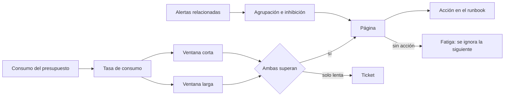

# SE-426 — Alertas accionables y fatiga

[← SE-425 — SLI, SLO, SLA y presupuestos de error](../../classes/part-35-observabilidad-sre-e-incidentes/se-425-sli-slo-sla-y-presupuestos-de-error/README.md) · [↑ Parte 35](../../classes/part-35-observabilidad-sre-e-incidentes/README.md) · [📚 Índice completo](../../classes/README.md) · [🌐 Portal](../../site/classes/SE-426.html) · [SE-427 — Runbooks, on-call y escalamiento →](../../classes/part-35-observabilidad-sre-e-incidentes/se-427-runbooks-on-call-y-escalamiento/README.md)

## Punto profesional y fundamento pedagógico

**Punto profesional.** La clase existe para que diseñes alertas que despierten a una persona solo cuando hay algo que hacer ahora, para que las derives del consumo del presupuesto de error en lugar de umbrales arbitrarios y para que midas el ruido que generan. Una alerta es una interrupción pagada con atención humana: cada una que no pide acción enseña a ignorar la siguiente.

**Por qué aparece aquí.** Sigue a **SLI, SLO, SLA y presupuestos de error**: el objetivo y el presupuesto dan la vara para decidir qué merece una página. Prepara `SE-427`, donde se define qué hace la persona que la recibe. El caso conductor sigue siendo la API de entregas.

**Error conceptual que debe corregir.** Creer que más alertas dan más seguridad y que una alerta correcta es la que se dispara cuando la métrica pasa un umbral. Una alerta es correcta si es urgente, accionable y específica; un umbral sin ventana ni consumo de presupuesto produce ruido o silencio.

**Secuencia de aprendizaje.** Antes de ver los resultados predices cuántas páginas genera un umbral de 1 % en 5 minutos en seis meses, cuántas de ellas corresponden a un incidente y qué ventana minimiza los falsos positivos sin retrasar demasiado una caída. Después contrastas con tres experimentos y rediseñas el conjunto de alertas de la API. La secuencia usa predicción, explicación propia, contraste y recuperación. [ICAP](https://icap.education.asu.edu/research) distingue participación de construcción de conocimiento; [How People Learn II](https://nap.nationalacademies.org/catalog/24783/how-people-learn-ii-learners-contexts-and-cultures) respalda diseñar la práctica con contextos reales y retroalimentación.

**Evidencia de aprendizaje.** `alertas-log.md` con la predicción, las tres figuras reproducidas, el conjunto de alertas de la API de entregas clasificadas en página, ticket y registro, y una nota que separe lo simulado de lo que habría que medir en producción.

**Límite de la conclusión.** El tráfico, las caídas, las degradaciones y los destellos son sintéticos y con semilla fija. No se usó ningún sistema de alertas ni se midió la reacción de ninguna persona; el estudio sobre fatiga citado es de un entorno clínico y se usa solo como respaldo del fenómeno, no de las cifras.

### Trazabilidad fuente → afirmación

| Fuente primaria u oficial | Afirmación que respalda | Lo que no prueba |
|---|---|---|
| [Google SRE Workbook: Alerting on SLOs](https://sre.google/workbook/alerting-on-slos/) | Compara estrategias de alerta sobre el consumo del presupuesto y recomienda alertas de varias ventanas y varias tasas de consumo. | No fija las tasas para tu servicio. |
| [Google SRE: Practical Alerting](https://sre.google/sre-book/practical-alerting/) | Propone alertar sobre síntomas, mantener las alertas simples y evitar páginas que no requieren acción inmediata. | No da cifras de ruido aceptable. |
| [Prometheus: Alertmanager](https://prometheus.io/docs/alerting/latest/alertmanager/) | Describe la agrupación, la inhibición y el silenciamiento de alertas. | No define tus reglas. |
| [Ancker et al., «Effects of workload, work complexity, and repeated alerts on alert fatigue» (2017)](https://doi.org/10.1186/s12911-017-0430-8) | Encontró que, en un sistema clínico de apoyo a decisiones, la probabilidad de aceptar una alerta disminuía cuando se repetía. | No mide guardias de software. |

## Antes de empezar

Recupera lo aprendido en `SE-425`: el presupuesto de error es la fiabilidad que se puede gastar. La pregunta activa es: **¿a qué ritmo de consumo del presupuesto debe sonar un teléfono a las 3 de la madrugada, y cuántas veces sonará sin que haya nada que hacer?**

## Prerrequisitos

- Haber completado `SE-425` o poder explicar qué es un presupuesto de error.
- Python 3.11 o posterior; los experimentos usan solo la biblioteca estándar (`random`, `math`).
- Nociones de ventana móvil y de proporción de errores.

## Problema auténtico

La API de entregas tiene 40 alertas. Cada vez que el cierre de un plazo satura la cola, suenan once a la vez: latencia de la pasarela, de la API, de la base, de la cola y de los trabajadores, cada una con sus propias oscilaciones. La persona de guardia las silencia en bloque. Un jueves de madrugada, una degradación lenta (0,6 % de errores durante seis horas) consume un tercio del presupuesto del mes sin superar ningún umbral porque todos eran del 1 % o más. Semanas después un umbral de 0,5 % en un minuto despierta a la guardia una docena de veces por noche por una sola petición fallida. La clase enseña a distinguir lo urgente de lo ruidoso y a medirlo.

## Objetivos observables

Al terminar podrás:

1. clasificar una condición como página, ticket o registro según su urgencia y su acción;
2. derivar una alerta del consumo del presupuesto con una tasa y dos ventanas;
3. medir de un conjunto de reglas sus páginas, sus falsos positivos, su retraso y las degradaciones lentas que pierde;
4. reducir el ruido con duración mínima y agrupación y cuantificar su efecto y su coste;
5. elegir la ventana de una alerta según el equilibrio entre ruido y retraso.

## Mapa conceptual



El mapa separa el **qué** (consumo del presupuesto), el **cuándo** (dos ventanas) y el **cuánto ruido** (agrupación). Una página sin acción cierra el ciclo hacia la fatiga.

## Temas y por qué importan

| Tema | Por qué cambia una decisión profesional | Evidencia mínima |
|---|---|---|
| Página, ticket y registro | Cada urgencia merece un canal distinto. | Predicción, traza causal y contraejemplo de **Página, ticket y registro** en `alertas-log.md` |
| Alertas por consumo | Convierten un objetivo en una condición verificable. | Predicción, traza causal y contraejemplo de **Alertas por consumo** en `alertas-log.md` |
| Umbrales y ventanas | La ventana fija el equilibrio entre ruido y retraso. | Predicción, traza causal y contraejemplo de **Umbrales y ventanas** en `alertas-log.md` |
| Ruido y agrupación | Una causa produce muchas alertas. | Predicción, traza causal y contraejemplo de **Ruido y agrupación** en `alertas-log.md` |
| Fatiga | Las páginas sin acción cuestan atención futura. | Predicción, traza causal y contraejemplo de **Fatiga** en `alertas-log.md` |

## Conceptos y decisiones

### 1. Página, ticket y registro

Una condición puede comunicarse de tres maneras. Una **página** interrumpe a una persona de inmediato y se reserva para lo que exige acción ahora. Un **ticket** se atiende en horario laboral y sirve para lo que no puede esperar demasiado pero no justifica interrumpir. Un **registro** (o un panel) conserva el dato para quien lo consulte. Tres preguntas ordenan la decisión: ¿afecta ya o afectará pronto a quien usa el servicio?, ¿es accionable por la persona de guardia con lo que sabe?, ¿puede esperar a mañana sin consecuencias? Una página que falla alguna de las tres es ruido. El libro de SRE añade una regla simple: alertar sobre síntomas (la tasa de errores que ve la persona usuaria) en vez de sobre causas posibles (CPU alta), porque un síntoma sin causa se investiga y una causa sin síntoma suele ser un falso positivo.

### 2. Alertas por consumo del presupuesto

Con un SLO se puede alertar por **tasa de consumo** (burn rate): cuántas veces más rápido que el ritmo normal se gasta el presupuesto. Con un SLO de 99,9 % el presupuesto se gasta en 28 días a una tasa de 1; una tasa de error de 1,44 % es una tasa de consumo de 14,4, y agota el presupuesto del mes en unas 47 horas. La regla de consumo exige además **dos ventanas**: una larga (una hora) que confirma que el consumo es sostenido, y una corta (cinco minutos) que confirma que sigue ocurriendo ahora y permite que la alerta se apague pronto cuando el problema se arregla. Para degradaciones lentas se añade una tasa menor con una ventana mayor (6 veces durante 6 horas, con una corta de 30 minutos) que suele generar un ticket y no una página.

### Seis reglas sobre 180 días

Se simulan 180 días con tráfico entre 30 y 300 peticiones por minuto, un 0,1 % de errores basales, 14 caídas (de 8 a 180 minutos, con 3 % a 100 % de errores) y 12 degradaciones lentas (0,4 % a 0,8 % de errores durante 4 a 10 horas). Se evalúan seis reglas: tres umbrales sobre errores y tres reglas de consumo. Una página cuenta como correcta si ocurre entre el inicio del incidente y 30 minutos tras su fin.

```python
ratio = (cum[m + 1] - cum[a]) / (cumt[m + 1] - cumt[a])            # errores / peticiones en la ventana
rule = ratio(m, 60) > 14.4 * 0.001 and ratio(m, 5) > 14.4 * 0.001    # consumo 14,4× en 1 h y 5 min
```

| Regla | Páginas | Caídas (de 14) | Degradaciones (de 12) | Retraso mediano | Sin incidente |
|---|---:|---:|---:|---:|---:|
| Umbral de 0,5 % en 1 min | 12 622 | 13 | 12 | 0 min | 11 748 |
| Umbral de 1 % en 5 min | 609 | 13 | 12 | 4 min | 396 |
| Umbral de 1 % en 30 min | 27 | 13 | 6 | 1 min | 0 |
| Consumo 14,4× (1 h y 5 min) | 13 | 13 | 1 | 1 min | 0 |
| Consumo 6× (6 h y 30 min) | 28 | 10 | 8 | 25 min | 0 |
| Consumo 14,4× o 6× | 31 | 13 | 8 | 8 min | 0 |


**Cómo leer la figura.** Cada fila es una regla; las columnas centrales dicen cuántos incidentes de cada tipo detecta, y las extremas cuántas páginas genera y cuántas no corresponden a un incidente. Los umbrales cortos detectan casi todo y despiertan miles de veces sin motivo; los de consumo tienen cero falsos positivos y pierden degradaciones lentas. **Dónde deja de valer:** la regla de 1 % en 5 minutos detecta las 12 degradaciones sin ser una buena regla: de noche, con 30 peticiones por minuto, dos errores bastan para superar el umbral, y de ahí vienen sus 396 falsos positivos. El tráfico diurno y nocturno, los incidentes inyectados y su tamaño son supuestos del autor, y los resultados de cada regla dependen de ellos: sirven para ver el equilibrio, no para elegir un umbral.

### 3. Umbrales y ventanas

La ventana de una alerta decide qué compromete. Una ventana de un minuto reacciona a todo y confunde un destello con un incidente, sobre todo cuando el tráfico es bajo y una petición fallida es un porcentaje enorme. Una ventana de una hora suprime el ruido y retrasa lo moderado. Para una caída total (100 % de errores) apenas importa la ventana, porque cualquier ventana la supera en un minuto; para un 2 % de errores, la ventana larga tarda decenas de minutos en acumular evidencia, porque la historia sana previa diluye lo malo. Por eso las alertas serias combinan ventanas: una larga para saber que es sostenido y una corta para saber que continúa.

### Ventanas de 1 a 60 minutos

Se simulan 120 días con 100 peticiones por minuto y un 0,1 % de errores basales para contar los falsos positivos de un umbral de 1 % con cuatro ventanas. Después se inyecta una degradación del 2 %, del 10 % y del 100 % de errores tras una historia sana y se mide la mediana de minutos hasta que la regla se dispara (300 repeticiones por celda).

```python
on = (cum[m + 1] - cum[m + 1 - w]) / (traffic * w) > 0.01
acc = [poisson(rng, traffic * 0.001) for _ in range(w)]         # historia sana previa que diluye el incidente
```

| Ventana | Falsos positivos por día | Con 2 % de errores | Con 10 % | Con caída total |
|---|---:|---:|---:|---:|
| 1 min | 6,85 | 1 min | 1 min | 1 min |
| 5 min | 0,02 | 3 min | 1 min | 1 min |
| 15 min | 0 | 8 min | 2 min | 1 min |
| 60 min | 0 | 28 min | 6 min | 1 min |


**Cómo leer la figura.** Cada fila es una ventana. La primera columna mide el ruido; las demás, el retraso según la gravedad. La ventana de un minuto es sensible y ruidosa; la de 60 es silenciosa y lenta para lo moderado. **Dónde deja de valer:** con 100 peticiones por minuto el ruido de una ventana corta es enorme; con 10 000 desaparece. La mediana oculta la cola de retrasos, y las degradaciones reales no son escalones sino rampas. La tabla enseña el equilibrio, no un valor.

### 4. Ruido, agrupación y duración mínima

Un incidente raramente genera una alerta: una dependencia lenta hace saltar alertas en todos los servicios que la llaman. Tres técnicas reducen ese ruido sin perder la señal. La **duración mínima** (`for`) exige que la condición se mantenga unos minutos antes de paginar, lo que descarta los destellos que se resuelven solos. La **agrupación** une en una sola notificación las alertas con un mismo contexto (el mismo servicio, la misma región). La **inhibición** silencia las alertas derivadas mientras la causa raíz está activa. Cada una cuesta algo: la duración mínima retrasa la página, la agrupación exige conocer el mapa de dependencias y la inhibición puede esconder una segunda falla detrás de la primera.

### Fatiga y agrupación

Se simulan 200 incidentes en cascada (de 1 a 15 alertas cada uno, 8,1 de media, cada una con tres oscilaciones) y 3 000 destellos autorresueltos que no merecen página. Se cuentan las páginas con tres políticas: sin filtros, con duración mínima (que descarta el 96 % de los destellos pero no las alertas de los incidentes) y con duración mínima y agrupación por incidente.

```python
raw = blips + sum(k * 3 for k in cascade)                 # cada alerta oscila tres veces
grouped = incidents + surviving                            # una página por incidente más los destellos que sobreviven
```

| Política | Páginas | Páginas que son un incidente |
|---|---:|---:|
| Sin filtros | 7 881 | 2,5 % |
| Con duración mínima | 1 735 | 11,5 % |
| Con duración mínima y agrupación por incidente | 308 | 64,9 % |


**Cómo leer la figura.** Las filas son tres políticas acumuladas y la última columna es la fracción de páginas que corresponden a un incidente real. Pasar de 7 881 a 308 páginas multiplica por 26 la proporción de páginas útiles. **Dónde deja de valer:** el 4 % de destellos que sobrevive al filtro, las 8,1 alertas por incidente y las tres oscilaciones son supuestos del autor; el 64,9 % restante lo forman los destellos que sobreviven, no incidentes que se pierdan. Agrupar requiere saber qué alertas son del mismo incidente: una agrupación equivocada puede esconder dos incidentes en una página.

### 5. Fatiga

La **fatiga de alertas** es la disminución de la respuesta a una alerta a medida que se repite o que se acumula con muchas otras. El fenómeno está documentado en entornos clínicos, donde la probabilidad de aceptar una alerta repetida baja, y en operaciones de software se observa como guardias que silencian en bloque, que tardan más en reconocer la página o que dejan de abrir el runbook. El coste no es proporcional: una página inútil no cuesta solo su duración, cuesta credibilidad a las siguientes. La métrica de salud de un conjunto de alertas es la fracción de páginas que llevaron a una acción, y se revisa cada trimestre eliminando o degradando las que no.

## Definiciones de trabajo

- **página:** alerta que interrumpe de inmediato a una persona porque exige acción ahora.
- **tasa de consumo:** cuántas veces más rápido que el ritmo normal se gasta el presupuesto de error.
- **alerta de varias ventanas:** regla que exige que la condición se cumpla en una ventana larga y en una corta.
- **agrupación:** unión de alertas relacionadas en una sola notificación.
- **fatiga de alertas:** disminución de la respuesta a las alertas por exceso o repetición.

Las definiciones son operativas para la API de entregas. No convierten términos con una historia más amplia en sinónimos y deben contrastarse con la documentación primaria enlazada al final.

## Ejemplo mínimo

El fragmento calcula la tasa de consumo y el tiempo que tardaría en agotarse el presupuesto. Antes de ejecutarlo, predice el resultado.

```python
slo, error = 0.999, 0.0144
burn = error / (1 - slo)
print(round(burn, 1), round(28 * 24 / burn, 1), "horas")
```

Imprime `14.4 46.7 horas`. Registra versión de Python, comando y salida; después calcula la tasa de 6 veces y el tiempo que tardaría y decide qué canal le asignas.

## Ejemplo profesional

Supón, como caso hipotético de la plataforma y no como medición, que el equipo reduce las 40 alertas de la API de entregas a seis páginas y cuatro tickets. Las páginas son: consumo 14,4× del SLO de entregas (1 h y 5 min), consumo 6× (6 h y 30 min, que genera ticket por la noche), cola de trabajos sin avanzar durante 15 minutos, base de datos sin réplica sana, certificado a menos de siete días de vencer y sonda externa sin respuesta durante tres lecturas. Cada alerta enlaza con su runbook (`SE-427`), tiene propietario y una nota de «qué hacer en cinco minutos». Las alertas de causa (CPU, memoria, disco) pasan a paneles o a tickets con umbrales conservadores. Un informe mensual muestra, por alerta, cuántas veces sonó, cuántas veces llevó a una acción y cuánto tardó en reconocerse; las que sonaron más de cinco veces sin acción se eliminan o se cambian de canal. El equipo no concluye que el conjunto sea bueno: lo someterá a un ejercicio de caída inyectada y medirá cuánto tardó la alerta correcta en llegar.

## Práctica guiada

1. Predice cuántas páginas genera cada regla en 180 días y cuántas serán falsas.
2. Ejecuta `python scripts/experiments_part35_a.py e426` y compara; anota la mayor diferencia con tu predicción.
3. Cambia el tráfico mínimo nocturno de 30 a 300 peticiones por minuto y mide cuánto caen los falsos positivos del umbral de 5 minutos.
4. Cambia la tasa de consumo de 14,4 a 10 y a 20 y mide el efecto en caídas detectadas y en retraso.
5. Añade una cuarta ventana a la regla de consumo y mide qué degradaciones adicionales detecta.
6. Clasifica las alertas de un servicio propio en página, ticket y registro y justifica cada decisión.
7. Entrega `alertas-log.md` y pide a otra persona que encuentre una condición urgente que tu conjunto no avise.

## Ejercicios

1. **Consumo:** con un SLO de 99,95 % en 28 días, calcula la tasa de consumo de una tasa de error de 0,6 % y el tiempo hasta agotar el presupuesto.
2. **Canal:** clasifica «CPU al 90 % durante 10 minutos», «tasa de error del 5 % durante 5 minutos» y «certificado vence en 20 días» en página, ticket o registro.
3. **Ventana:** con 20 peticiones por minuto, calcula cuántos errores en un minuto superan un umbral de 1 % y estima si esa ventana es razonable.
4. **Agrupación:** una caída de la base de datos dispara 12 alertas en 6 servicios; diseña la agrupación y la inhibición y di qué riesgo introduce.

## Reto verificable

Entrega `alertas-log.md` con la predicción, las tres tablas de resultados reproducidas con las mismas semillas, el conjunto de alertas de un servicio propio clasificado en página, ticket y registro con su regla y su ventana y una medida de ruido. Se aprueba si otra persona ejecuta el código desde un checkout limpio, obtiene los mismos números y no encuentra una página de tu conjunto que no pida acción. No se aprueba por contar alertas ni por afirmar que «las alertas de causa también son necesarias».

## Caso conductor

La API de entregas es el caso conductor de la Parte 35. Esta clase deja el sexto artefacto: un conjunto de alertas derivadas del SLO, con su ruido medido. `SE-427` define qué hace quien recibe la página: el runbook, la guardia y el escalamiento. Cambia después un solo parámetro, la ventana larga, y observa cuántas degradaciones recuperas y cuántas páginas pagas.

## Preguntas frecuentes

### ¿Cuántas alertas debería tener un servicio?

Las que puedan justificar una acción. No hay un número universal: en la práctica un servicio bien mantenido tiene pocas páginas (de cinco a diez) y más tickets. La medida útil es la fracción de páginas que llevó a una acción.

### ¿Por qué no alertar sobre CPU, memoria y disco?

Porque son causas posibles y no síntomas. Una CPU alta sin efecto en la persona usuaria no pide acción nocturna. Se usan como paneles para el diagnóstico y como tickets cuando predicen un problema (disco que se llenará en 24 horas).

### ¿Qué tasa de consumo y qué ventanas uso?

Las del libro de SRE (14,4× en 1 h y 5 min; 6× en 6 h y 30 min) son un punto de partida razonable para un SLO de 99,9 % con ventana de 28 o 30 días. Se ajustan midiendo, con tus incidentes pasados, qué detectan y cuánto ruido producen.

### ¿La agrupación no puede esconder un incidente?

Sí. Una página agrupada puede ocultar un segundo problema distinto. Por eso la agrupación se acompaña de un resumen de qué alertas contiene y de una revisión posterior a cada incidente que verifique si algo quedó oculto.

## Fallo controlado y diagnóstico

Reproduce el fallo clásico de la clase: **un umbral corto sobre tráfico bajo**. Aplica un umbral de 0,5 % en una ventana de un minuto a las tres de la madrugada con 30 peticiones por minuto: un solo error ya lo supera.

Registra síntoma, entrada mínima, hipótesis, observación que descarta cada hipótesis, causa, corrección y prueba de regresión. **Síntoma:** la guardia recibe unas catorce páginas por noche y ninguna corresponde a un incidente. **Hipótesis rivales:** (a) el servicio falla de noche; (b) el umbral es demasiado bajo; (c) con 30 peticiones por minuto, un solo error ya supera el umbral (1 de 30 es 3,3 %). **Prueba:** calcula la probabilidad de uno o más errores en un minuto con 30 peticiones y tasa basal de 0,1 %; si es cercana al 3 % por minuto, unas catorce veces en una noche de ocho horas, la hipótesis (c) explica el goteo. **Conclusión:** con tráfico bajo el porcentaje de errores es una medida ruidosa. **Regresión:** añade al conjunto de alertas una prueba con datos sintéticos de tráfico nocturno que cuente páginas falsas por semana y una exigencia de volumen mínimo en la regla. No cambies a la vez la ventana y el umbral.

## Errores comunes y cómo corregirlos

| Síntoma | Causa probable | Corrección |
|---|---|---|
| Suenan muchas páginas en un incidente | Una causa genera alertas en todos los servicios | Agrupar e inhibir por dependencia |
| Despiertan de noche sin incidente | Ventana corta con poco tráfico | Ventanas largas, volumen mínimo o regla de consumo |
| Una degradación consume el mes sin alertar | Solo hay umbrales altos y cortos | Añadir una regla de consumo lento con ventana larga |
| Se silencia en bloque | Fatiga por páginas sin acción | Retirar o degradar las que no llevan a acción |
| La alerta no dice qué hacer | Sin runbook ni contexto | Enlazar el runbook y el panel de la alerta |

## Entorno y archivos clave

```text
work/SE-426/
├── README.md
├── alertas/
│   ├── reglas.py
│   ├── ruido.py
│   └── ventanas.py
├── tests/test_alertas.py
└── evidence/alertas-log.md
```

El `README` declara plataforma, versión de Python, semillas y comandos. Los experimentos usan solo la biblioteca estándar y se ejecutaron con CPython 3.12.9 en Windows 11 y 3.12.3 en Ubuntu bajo WSL2 con cifras idénticas. Para recuperar el estado, borra `work/SE-426/` y repite los scripts. Si añades una dependencia, fija procedencia y versión.

## Seguridad, ética y accesibilidad

- las guardias tienen un coste humano: una página nocturna rompe el sueño, y un conjunto de alertas ruidoso es un riesgo para la salud de las personas y para la retención del equipo;
- las alertas no deben incluir datos personales en su texto, porque se envían a canales con menor protección;
- una alerta que solo llega por un canal (un teléfono) deja sin cobertura a quien no lo tenga: prevé un canal alternativo y accesible, con texto claro y sin depender solo del color;
- documenta las tablas y las figuras con texto alternativo y en un formato que un lector de pantalla pueda recorrer;
- respeta las licencias de los libros y artículos y atribuye lo adaptado.

## Puente hacia el trabajo con agentes

Un agente al que se le pide «configura alertas» tenderá a crear una por métrica con un umbral redondo (CPU > 80 %, errores > 1 %) y a enviarlas todas al mismo canal. Pídele en cambio que parta del SLO, que derive reglas de consumo con dos ventanas, que clasifique cada condición en página, ticket o registro, que enlace un runbook y que mida con datos sintéticos las páginas falsas por semana. Revisa especialmente si alerta sobre causas, si ignora el tráfico bajo y si agrupa sin documentar qué alertas contiene.

## Transferencia

Traslada el análisis a otro servicio (un sistema de pagos o un buscador): deriva sus reglas del SLO, mide el ruido con datos sintéticos y clasifica cada condición. La transferencia está lograda cuando puedes decir qué incidente no avisaría tu conjunto y a quién despertarías sin necesidad, no cuando existe un panel de alertas.

## Evaluación y evidencia

| Criterio | Evidencia para aprobar |
|---|---|
| comprensión | explicación de la tasa de consumo, de las dos ventanas y de la fatiga |
| corrección | tablas de reglas, de ruido y de ventanas reproducibles con las mismas semillas |
| diseño | conjunto de alertas clasificado en página, ticket y registro con runbook |
| diagnóstico | reproducción del fallo «umbral corto sobre tráfico bajo» con regresión |
| incertidumbre | declaración de que el tráfico, los incidentes y los destellos son sintéticos |
| reproducibilidad | versiones, comandos, salida y límites declarados |

## Fuentes

- [Google SRE Workbook: Alerting on SLOs](https://sre.google/workbook/alerting-on-slos/) — alertas por consumo del presupuesto y ventanas; autoridad: Google, SRE Workbook.
- [Google SRE: Practical Alerting](https://sre.google/sre-book/practical-alerting/) — alertar sobre síntomas; autoridad: libro de ingeniería de confiabilidad de Google.
- [Prometheus: Alertmanager](https://prometheus.io/docs/alerting/latest/alertmanager/) — agrupación, inhibición y silenciamiento; autoridad: documentación del proyecto Prometheus.
- [Ancker et al., «Effects of workload, work complexity, and repeated alerts on alert fatigue»](https://doi.org/10.1186/s12911-017-0430-8) — fatiga de alertas en un entorno clínico; autoridad: BMC Medical Informatics and Decision Making, 2017.
- [Google SRE Workbook: On-Call](https://sre.google/workbook/on-call/) — carga de la guardia y cómo medirla; autoridad: Google, SRE Workbook.

Cada fuente respalda el mecanismo indicado; ninguna demuestra que 609 páginas, 396 falsos positivos o un 64,9 % de páginas útiles se observen en un sistema real. Esa afirmación depende del tráfico, de las reglas y del equipo.

## Límites y siguiente paso

Se ejecutaron tres experimentos con tiempo virtual y semillas fijas en Windows y Ubuntu (WSL2) con resultados idénticos. No se usó ningún sistema de alertas ni se midió a ninguna persona; el tráfico, los 26 incidentes inyectados, los 3 000 destellos, las 8,1 alertas por incidente y la proporción de destellos que sobrevive al filtro son construcciones del autor, las reglas se evaluaron con los mismos incidentes con que se dibujaron, y el estudio de fatiga es de otro dominio. La siguiente clase pregunta qué debe hacer la persona que recibe la página y cómo se organiza la guardia.

## Glosario

- **página:** alerta que interrumpe de inmediato a una persona porque exige acción ahora.
- **tasa de consumo:** cuántas veces más rápido que el ritmo normal se gasta el presupuesto de error.
- **alerta de varias ventanas:** regla que exige que la condición se cumpla en una ventana larga y en una corta.
- **agrupación:** unión de alertas relacionadas en una sola notificación.
- **fatiga de alertas:** disminución de la respuesta a las alertas por exceso o repetición.

---

[← SE-425 — SLI, SLO, SLA y presupuestos de error](../../classes/part-35-observabilidad-sre-e-incidentes/se-425-sli-slo-sla-y-presupuestos-de-error/README.md) · [↑ Parte 35](../../classes/part-35-observabilidad-sre-e-incidentes/README.md) · [📚 Índice completo](../../classes/README.md) · [🌐 Portal](../../site/classes/SE-426.html) · [SE-427 — Runbooks, on-call y escalamiento →](../../classes/part-35-observabilidad-sre-e-incidentes/se-427-runbooks-on-call-y-escalamiento/README.md)
