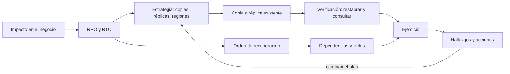

# SE-430 — Continuidad, disaster recovery y ejercicios

[← SE-429 — Postmortems sin culpa y aprendizaje](../../classes/part-35-observabilidad-sre-e-incidentes/se-429-postmortems-sin-culpa-y-aprendizaje/README.md) · [↑ Parte 35](../../classes/part-35-observabilidad-sre-e-incidentes/README.md) · [📚 Índice completo](../../classes/README.md) · [🌐 Portal](../../site/classes/SE-430.html) · [SE-431 — Taller: diagnosticar con telemetría incompleta →](../../classes/part-35-observabilidad-sre-e-incidentes/se-431-taller-diagnosticar-con-telemetria-incompleta/README.md)

## Punto profesional y fundamento pedagógico

**Punto profesional.** La clase existe para que prepares lo que todavía no ha ocurrido: que fijes cuántos datos puedes perder (RPO) y cuánto puedes tardar en volver (RTO), que verifiques las copias restaurándolas en lugar de confiar en que el trabajo terminó sin error, que descubras el orden real de recuperación y sus dependencias circulares antes de necesitarlo y que ensayes el plan con ejercicios. Un plan de recuperación que no se ha ejecutado es una hipótesis.

**Por qué aparece aquí.** Sigue a **Postmortems sin culpa y aprendizaje**: los postmortems enseñan de lo que ocurrió; los ejercicios enseñan de lo que podría ocurrir. Prepara `SE-431`, donde se diagnostica con telemetría incompleta, como pasa en un desastre. Retoma lo visto sobre disponibilidad y durabilidad en `SE-380`. El caso conductor sigue siendo la API de entregas.

**Error conceptual que debe corregir.** Creer que tener copias o réplicas equivale a poder recuperarse. La copia puede estar vacía, dañada o ser inalcanzable; la réplica copia también los errores; y el orden de arranque puede tener un ciclo que impide volver desde cero.

**Secuencia de aprendizaje.** Antes de ver los resultados predices cuántos minutos de datos pierde una copia diaria, una horaria y una réplica asíncrona, cuántos de 40 daños detecta cada comprobación de una copia y cuánto tarda en restaurarse un sistema de 12 componentes con y sin un ciclo oculto. Después contrastas con tres experimentos y escribes el plan de recuperación de la API de entregas. La secuencia usa predicción, explicación propia, contraste y recuperación. [ICAP](https://icap.education.asu.edu/research) distingue participación de construcción de conocimiento; [How People Learn II](https://nap.nationalacademies.org/catalog/24783/how-people-learn-ii-learners-contexts-and-cultures) respalda diseñar la práctica con contextos reales y retroalimentación.

**Evidencia de aprendizaje.** `recuperacion-log.md` con la predicción, las tres figuras reproducidas, el RPO y el RTO de la API de entregas con su evidencia, el orden de restauración con sus dependencias y un calendario de ejercicios.

**Límite de la conclusión.** Las pérdidas de datos y las dependencias son sintéticas y con semilla fija. La única medición real es la de las copias de una base SQLite en un directorio temporal, con un daño inyectado por el autor: no se recuperó ningún sistema real ni se usó ninguna herramienta de copia de producción.

### Trazabilidad fuente → afirmación

| Fuente primaria u oficial | Afirmación que respalda | Lo que no prueba |
|---|---|---|
| [NIST SP 800-34 Rev. 1: Contingency Planning Guide](https://csrc.nist.gov/pubs/sp/800/34/r1/upd1/final) | Define el análisis de impacto, el tiempo máximo tolerable de interrupción y las fases de un plan de contingencia, incluidas las pruebas y los ejercicios. | No fija el RTO de tu servicio. |
| [AWS Well-Architected: objetivos de recuperación ante desastres](https://docs.aws.amazon.com/wellarchitected/latest/reliability-pillar/disaster-recovery-dr-objectives.html) | Define RTO y RPO y relaciona la estrategia de recuperación con ambos objetivos. | No es neutral respecto de un proveedor. |
| [Google Cloud: guía de planificación de DR](https://cloud.google.com/architecture/dr-scenarios-planning-guide) | Describe RTO, RPO y los patrones de recuperación en frío, templado y caliente. | No elige el patrón por ti. |
| [SQLite: API de copia en línea](https://www.sqlite.org/backup.html) | Describe cómo copiar una base mientras se usa y qué garantiza el resultado. | No cubre otros motores. |
| [GitLab, postmortem de la interrupción de la base de datos de 2017](https://about.gitlab.com/blog/2017/02/10/postmortem-of-database-outage-of-january-31/) | Ejemplo público de una recuperación en la que las copias previstas no existían o no se podían usar. | No generaliza a otras organizaciones. |
| [Meta, «More details about the October 4 outage» (2021)](https://engineering.fb.com/2021/10/05/networking-traffic/outage-details/) | Ejemplo público de una caída que también dejó fuera las herramientas internas y obligó a intervenir físicamente. | No describe tu arquitectura. |

## Antes de empezar

Recupera lo aprendido en `SE-380` y `SE-429`: la disponibilidad se calcula con la causa común a la vista, y un postmortem convierte lo ocurrido en acciones. La pregunta activa es: **si mañana desapareciera el entorno de producción de la API de entregas, ¿cuántos datos perderíamos, cuánto tardaríamos en volver y qué orden seguiríamos si nadie lo ha probado?**

## Prerrequisitos

- Haber completado `SE-429` o poder explicar qué es una acción correctiva con verificación.
- Python 3.11 o posterior; los experimentos usan solo la biblioteca estándar (`random`, `sqlite3`, `hashlib`, `tempfile`).
- Nociones de grafo de dependencias y de ruta crítica.

## Problema auténtico

La plataforma firma que, ante un desastre, recuperará el servicio en menos de dos horas con una pérdida de datos de menos de 15 minutos. La base se respalda cada noche a las 02:00 y se replica de forma asíncrona a otra región. Un día un error de migración borra una tabla de entregas a las 16:30. La réplica copió el borrado en dos segundos. La última copia es de 14 horas antes, de modo que se pierden 14 horas y media de entregas, no 15 minutos. Al restaurarla se descubre que el trabajo de copia siempre terminó sin error, pero el archivo de ayer está dañado. En un simulacro posterior, al intentar arrancar el entorno desde cero, la identidad necesita los secretos y los secretos necesitan la identidad: nadie lo había descubierto porque nunca se había arrancado todo desde nada. La clase enseña a comprobar los tres.

## Objetivos observables

Al terminar podrás:

1. definir RPO y RTO, calcular la pérdida esperada de una estrategia de copia o réplica y compararla con el objetivo;
2. verificar una copia con varias comprobaciones y distinguir cuál detecta qué daño;
3. calcular el tiempo de recuperación de un sistema en serie y en paralelo y detectar ciclos de dependencia;
4. diseñar un ejercicio de recuperación con alcance, criterio de éxito y registro de hallazgos;
5. establecer un calendario de verificaciones y ejercicios con propietario.

## Mapa conceptual



El mapa separa los **objetivos** (RPO y RTO), los **medios** (copias, réplicas, orden) y la **evidencia** (verificación y ejercicio). Sin evidencia, los objetivos del primer nodo son una declaración.

## Temas y por qué importan

| Tema | Por qué cambia una decisión profesional | Evidencia mínima |
|---|---|---|
| RPO y RTO | Convierten la tolerancia al desastre en dos números verificables. | Predicción, traza causal y contraejemplo de **RPO y RTO** en `recuperacion-log.md` |
| Copias y réplicas | Cubren fallos distintos y no se sustituyen. | Predicción, traza causal y contraejemplo de **Copias y réplicas** en `recuperacion-log.md` |
| Verificar restaurando | Una copia solo vale si se puede restaurar. | Predicción, traza causal y contraejemplo de **Verificar restaurando** en `recuperacion-log.md` |
| Orden y dependencias | El tiempo real depende de la ruta crítica y de los ciclos. | Predicción, traza causal y contraejemplo de **Orden y dependencias** en `recuperacion-log.md` |
| Ejercicios | Convierten un plan en evidencia. | Predicción, traza causal y contraejemplo de **Ejercicios** en `recuperacion-log.md` |

## Conceptos y decisiones

### 1. RPO y RTO

La **continuidad del negocio** es la capacidad de mantener las funciones esenciales durante y después de una interrupción; la **recuperación ante desastres** (DR) es la parte técnica que restablece los sistemas. Dos objetivos la guían. El **objetivo de punto de recuperación (RPO)** es la cantidad máxima de datos que se acepta perder, medida en tiempo: un RPO de 15 minutos significa que tras la recuperación pueden faltar hasta los últimos 15 minutos de datos. El **objetivo de tiempo de recuperación (RTO)** es el tiempo máximo aceptable hasta volver a un servicio utilizable. Ambos salen de un análisis del impacto (cuánto cuesta cada hora sin servicio y cada minuto de datos perdidos), no de una preferencia técnica. Cuanto más pequeños, más caros: un RPO cercano a cero exige replicación síncrona, y un RTO de minutos exige un entorno ya encendido.

### 2. Copias y réplicas

Una **copia de seguridad** es una instantánea periódica y separada: protege contra la pérdida y el borrado, pero su RPO es su intervalo, porque lo escrito después de la última copia se pierde. Una **réplica** mantiene una segunda instancia al día: protege contra la pérdida de una máquina o una región y reduce el RPO a su retraso, pero replica también el borrado, la corrupción y el error de migración. Una réplica asíncrona tiene un retraso variable que se dispara con la carga, y el RPO real es el peor retraso, no el habitual. Las dos se complementan: la réplica para el fallo de infraestructura, la copia para el error lógico. Hay una tercera pieza que a veces falta, la **copia fuera de línea o inmutable**, que no puede ser borrada ni cifrada por quien comprometa las credenciales de producción.

### Datos perdidos según la estrategia

Se simulan 20 000 fallos en instantes aleatorios para tres estrategias de copia (diaria, cada 6 horas, cada hora) y una réplica asíncrona cuyo retraso es lognormal (mediana de 2 s) con un 1 % de picos de entre 10 y 300 s. La pérdida de una copia es el tiempo transcurrido desde la última; la de la réplica, su retraso en ese momento. Se compara con un RPO de 5 minutos.

```python
loss = [rng.uniform(0, interval) for _ in range(failures)]            # tiempo desde la última copia
lag = rng.uniform(10, 300) / 60 if rng.random() < 0.01 else rng.lognormvariate(math.log(2 / 60), 0.6)
```

| Estrategia | Pérdida mediana | p99 | Máxima | Incumple un RPO de 5 min |
|---|---:|---:|---:|---:|
| Copia diaria | 719,7 min | 1 424,5 min | 1 440 min | 99,6 % |
| Copia cada 6 h | 179,8 min | 356,5 min | 360 min | 98,5 % |
| Copia cada hora | 30,0 min | 59,4 min | 60 min | 91,4 % |
| Réplica asíncrona | 0,03 min | 0,27 min | 5,0 min | 0 % |


**Cómo leer la figura.** Cada fila es una estrategia y las columnas dan la pérdida mediana, el percentil 99, el máximo y la fracción de fallos que superan el RPO de 5 minutos. El RPO real de una copia periódica es su intervalo completo, no la mitad, y el de la réplica es su peor retraso. **Dónde deja de valer:** el 1 % de picos entre 10 y 300 s es un supuesto del autor; los retrasos reales se agrupan en picos de carga. Y la tabla supone un fallo de infraestructura: ante un borrado lógico (como el del problema), la réplica ya copió el error y su pérdida es la de la copia más reciente anterior al error.

### 3. Verificar restaurando

Una copia puede fallar de cuatro maneras que no hacen fallar al trabajo que la crea: está vacía, está incompleta, está dañada o no se puede leer con las herramientas y credenciales actuales. Por eso el «el trabajo terminó sin error» no es una comprobación. Las comprobaciones, de menos a más exigentes, son: **tamaño** (detecta una copia vacía), **huella criptográfica** (un hash que se calcula al crearla y se compara después; detecta cualquier alteración del archivo pero no que la copia original ya fuera mala), **chequeo de integridad del motor** (detecta daños de estructura) y **restauración con consulta** (se restaura en un entorno aislado y se comprueban filas y contenido). Solo la última demuestra que sirve, y es la que se programa de forma regular y se mide: cuánto tardó y cuántos datos faltaban.

### Cuarenta copias dañadas

Se crea una base SQLite con 20 000 filas en un directorio temporal, se copia con la API de copia en línea (`Connection.backup`) y se generan 40 copias dañadas alterando 8 bytes en posiciones aleatorias (semilla fija) de la copia buena. Se aplican seis comprobaciones.

```python
src.backup(dst)                                           # copia en línea consistente
data[rng.randrange(100, len(data))] ^= 0xFF               # ocho bytes alterados por copia
con.execute("PRAGMA integrity_check").fetchone()[0] != "ok"
```

| Comprobación | Daños detectados |
|---|---:|
| El trabajo de copia terminó sin error | 0 de 40 |
| El tamaño del archivo coincide | 0 de 40 |
| Huella sha256 distinta de la registrada | 40 de 40 |
| `PRAGMA integrity_check` | 20 de 40 |
| `COUNT(*)` de la tabla | 0 de 40 |
| Leer y comprobar todas las filas | 40 de 40 |


**Cómo leer la figura.** Cada fila es una comprobación y la columna cuenta los daños que detecta. Ninguna de las dos comprobaciones baratas (éxito y tamaño) ve nada; la huella ve todo cambio; el chequeo de integridad solo ve la mitad, porque los bytes alterados en el contenido de las filas no rompen la estructura. **Dónde deja de valer:** es una medición real (2 797 568 bytes por copia, resultado idéntico en Windows y Ubuntu) con un daño inyectado por el autor; los daños reales no son bytes alterados al azar. La lectura completa detecta el daño porque aquí invalida el texto: un daño que deje el texto válido pero distinto solo lo vería la huella. La copia y la verificación tardaron decenas de milisegundos; esos tiempos dependen del equipo y no forman parte del resultado.

### 4. Orden y dependencias de recuperación

Restaurar un sistema desde cero no es una operación, son muchas con dependencias: la red antes que la identidad, los secretos antes que la base de datos, la base antes que la API. El tiempo de recuperación no es la suma de los tiempos si se puede paralelizar, sino la **ruta crítica**: el camino de dependencias más largo. Y hay una dependencia que se descubre solo al intentarlo: la **circular**. Si el servicio de identidad necesita los secretos y los secretos necesitan la identidad, ninguno puede arrancar el primero, y el sistema funciona mientras esté encendido pero no se puede volver a levantar desde cero. La salida habitual es una pieza de arranque fuera del ciclo (credenciales de emergencia guardadas fuera de línea). En 2021, un fallo de red de Meta dejó sin servicio a las propias herramientas internas que se usaban para repararlo y obligó a intervenir físicamente en los centros de datos.

### Orden de restauración de 12 componentes

Se modela un entorno de 12 componentes con duraciones de restauración de 10 a 45 minutos y sus dependencias declaradas. Se calcula el tiempo en serie, la ruta crítica y la presencia de ciclos con un recorrido en profundidad. Después se añade una dependencia que solo un ejercicio revela (la identidad necesita los secretos), se rompe el ciclo con una pieza de emergencia de 20 minutos y se añade una segunda dependencia (el portal exige que la observabilidad esté sana).

```python
value = dur + max((finish(d) for d in deps), default=0)       # ruta crítica: duración propia más la de la dependencia más lenta
if state.get(n) == 1: cyc = True                              # nodo en curso encontrado de nuevo: hay un ciclo
```

| Conjunto de dependencias | Restauración en serie | Ruta crítica |
|---|---:|---:|
| Dependencias declaradas | 225 min | 125 min |
| Ejercicio 1: la identidad necesita los secretos | 225 min | ciclo: no arranca desde cero |
| Con credenciales de emergencia fuera de línea | 245 min | 130 min |
| Ejercicio 2: el portal exige observabilidad sana | 245 min | 130 min |


**Cómo leer la figura.** Cada fila es una versión del mapa de dependencias; la última columna es el tiempo mínimo si todo lo paralelizable se paraleliza. La declarada promete 125 minutos; el ciclo oculto anula la promesa; romperlo cuesta 5 minutos de ruta crítica. La segunda dependencia nueva no cambia la ruta porque la observabilidad ya estaba levantada antes de que el portal la necesite. **Dónde deja de valer:** los 12 componentes, sus duraciones y sus dependencias son un ejemplo del autor y no una medición de ningún sistema; una restauración real tiene esperas, verificaciones y errores que alargan la ruta. El RTO prometido tiene que salir de un ejercicio, no de la suma de una tabla.

### 5. Ejercicios

Un **ejercicio de recuperación** prueba el plan con un alcance declarado. Hay tres niveles de realismo: el de **mesa** (el equipo recorre el plan hablando; encuentra huecos de proceso y de comunicación), el **simulacro técnico** (se ejecuta la restauración en un entorno aislado; mide tiempos y encuentra dependencias) y la **inyección de fallos en producción controlada** (se retira un componente real con un radio y un criterio de aborto, como en `SE-383`). Cada ejercicio tiene objetivos escritos antes, un registro de lo que ocurrió y una lista de hallazgos con propietario y fecha. El ritmo lo dan los cambios del sistema y el riesgo, pero lo habitual es una restauración verificada cada mes o trimestre y un simulacro completo cada seis meses o un año.

## Definiciones de trabajo

- **RPO (objetivo de punto de recuperación):** cantidad máxima de datos, medida en tiempo, que se acepta perder tras una recuperación.
- **RTO (objetivo de tiempo de recuperación):** tiempo máximo aceptable hasta volver a un servicio utilizable.
- **réplica asíncrona:** copia que se actualiza con retraso variable respecto de la original.
- **dependencia circular:** relación en la que dos componentes se necesitan mutuamente para arrancar.
- **ejercicio de recuperación:** prueba programada del plan de recuperación con alcance, criterios y registro de hallazgos.

Las definiciones son operativas para la API de entregas. No convierten términos con una historia más amplia en sinónimos y deben contrastarse con la documentación primaria enlazada al final.

## Ejemplo mínimo

El fragmento copia una base SQLite en línea y comprueba el resultado. Antes de ejecutarlo, predice el valor impreso.

```python
import sqlite3
src = sqlite3.connect(":memory:")
src.execute("CREATE TABLE t (x)")
src.executemany("INSERT INTO t VALUES (?)", [(i,) for i in range(3)])
src.commit()
dst = sqlite3.connect(":memory:")
src.backup(dst)
print(dst.execute("SELECT COUNT(*) FROM t").fetchone()[0])
```

Imprime `3`. Registra versión de Python, comando y salida; después crea la copia en un archivo, altera un byte y comprueba qué detecta cada comprobación de la tabla.

## Ejemplo profesional

Supón, como caso hipotético de la plataforma y no como medición, que el equipo fija para la API de entregas un RPO de 15 minutos y un RTO de 2 horas, con una justificación: las instituciones pueden reprogramar un plazo si el servicio vuelve en dos horas, y 15 minutos de entregas se reenvían con un aviso. Para el RPO usa una réplica asíncrona con alerta si el retraso supera 2 minutos y copias cada hora enviadas a una cuenta distinta con borrado protegido. Cada noche una tarea restaura la última copia en un entorno aislado, cuenta las filas, lee todas las tablas, compara con la huella registrada y publica el resultado y el tiempo; si falla, genera una página (`SE-426`). El mapa de dependencias vive en el repositorio con las duraciones medidas en el último simulacro y un chequeo detecta ciclos. Cada seis meses hay un simulacro completo en una cuenta nueva con credenciales de emergencia guardadas fuera de línea; el equipo anota los hallazgos con propietario y los trata como las acciones de un postmortem (`SE-429`). La comunicación a las instituciones (`SE-428`) y la página de estado se hospedan fuera de la infraestructura que podría caer. No concluyen que el plan funciona: concluyen que cada afirmación tiene una fecha de la última vez que se comprobó.

## Práctica guiada

1. Predice la pérdida mediana y máxima de las cuatro estrategias y qué fracción incumple un RPO de 5 minutos.
2. Ejecuta `python scripts/experiments_part35_b.py e430` y compara; anota la mayor diferencia con tu predicción.
3. Cambia el intervalo de copia a 15 minutos y calcula el coste en copias por día frente a la pérdida máxima.
4. Cambia los bytes alterados de 8 a 1 y a 64 y mide cuántos daños detecta cada comprobación.
5. Dibuja el mapa de dependencias de un servicio propio y calcula su ruta crítica y sus ciclos.
6. Escribe el guion de un ejercicio de mesa de una hora para un desastre concreto, con objetivos y criterio de éxito.
7. Entrega `recuperacion-log.md` y pide a otra persona que encuentre una dependencia que tu mapa no incluya.

## Ejercicios

1. **RPO:** una copia cada 4 horas y una réplica con retraso máximo de 90 segundos; calcula el RPO ante un fallo de infraestructura y ante un borrado lógico.
2. **Comprobación:** ordena de menos a más exigente cuatro comprobaciones de una copia y di qué daño deja pasar cada una.
3. **Ruta crítica:** con cinco componentes de 10, 20, 15, 30 y 5 minutos y las dependencias que definas, calcula el tiempo en serie y la ruta crítica.
4. **Ejercicio:** diseña un simulacro técnico que descubra una dependencia circular sin afectar a producción.

## Reto verificable

Entrega `recuperacion-log.md` con la predicción, las tres tablas de resultados reproducidas con las mismas semillas, el RPO y el RTO de un servicio propio con la evidencia de la última restauración verificada, su mapa de dependencias con ruta crítica y ciclos y el calendario de ejercicios. Se aprueba si otra persona ejecuta el código desde un checkout limpio, obtiene los mismos números y restaura la copia de ejemplo con los pasos que escribiste. No se aprueba por declarar un RTO sin haberlo medido ni por afirmar que «la réplica es la copia de seguridad».

## Caso conductor

La API de entregas es el caso conductor de la Parte 35. Esta clase deja el décimo artefacto: un plan de recuperación con RPO, RTO, verificaciones y ejercicios. `SE-431` pone a prueba el diagnóstico cuando la telemetría falta, como ocurre en un desastre, y `SE-432` reúne todo en un paquete operativo. Cambia después un solo parámetro, el intervalo de copia, y observa cuánto cuesta cada minuto de RPO.

## Preguntas frecuentes

### ¿Una réplica es una copia de seguridad?

No. La réplica protege contra la pérdida de infraestructura; replica también el borrado, la corrupción y los errores de migración. La copia de seguridad, separada y con retención, protege contra el error lógico. Se usan juntas.

### ¿Con qué frecuencia debo probar la restauración?

Con la frecuencia con la que puedes permitirte no saber. Una restauración automática y diaria en un entorno aislado es posible para muchos sistemas y convierte la pregunta en una alerta. Un simulacro completo, más caro, se hace con menos frecuencia, y tras cambios grandes de arquitectura.

### ¿Cómo fijo el RTO y el RPO?

A partir del impacto: cuánto cuesta cada hora sin servicio y cada minuto de datos perdidos, y qué puede hacer el negocio mientras tanto. Se acuerdan con quien responde por el servicio, se miden en un ejercicio y se revisan. Un RTO que nadie ha medido es un deseo.

### ¿Qué pasa si el plan de recuperación depende del sistema caído?

Es un fallo frecuente: el documento está en el wiki que cayó, la comunicación va por el chat que cayó, las credenciales están en el gestor de secretos que hay que restaurar. Las herramientas de recuperación y comunicación deben poder usarse con el sistema principal apagado.

## Fallo controlado y diagnóstico

Reproduce el fallo clásico de la clase: **confiar en que una copia existe porque el trabajo terminó bien**. Daña una copia, ejecuta las comprobaciones baratas y después la restauración con consulta.

Registra síntoma, entrada mínima, hipótesis, observación que descarta cada hipótesis, causa, corrección y prueba de regresión. **Síntoma:** al restaurar tras un borrado, la última copia no se abre. **Hipótesis rivales:** (a) la herramienta de restauración tiene un defecto; (b) las credenciales son incorrectas; (c) la copia estaba dañada desde que se creó. **Prueba:** compara la huella de la copia con la que se registró al crearla y restaura copias anteriores; si la huella difiere o una copia anterior se abre, la hipótesis (c) o un daño posterior explica la señal. **Conclusión:** el estado del trabajo de copia no decía nada sobre su contenido. **Regresión:** añade una tarea diaria que restaure la última copia en un entorno aislado, cuente las filas y lea todas las tablas, y una alerta si falla o si el tiempo supera el presupuesto de RTO. No cambies a la vez la herramienta y el procedimiento.

## Errores comunes y cómo corregirlos

| Síntoma | Causa probable | Corrección |
|---|---|---|
| Se pierde más de lo previsto tras un borrado | La réplica copió el error y la copia es antigua | Copias separadas y un RPO diferenciado por tipo de fallo |
| La copia no se puede restaurar | Nunca se probó la restauración | Restauración periódica con consulta y alerta |
| No se puede arrancar desde cero | Dependencia circular o herramientas que dependen del sistema | Mapa de dependencias, simulacro y piezas de emergencia fuera de línea |
| El RTO prometido no se cumple | Se sumaron tiempos sin ruta crítica ni verificaciones | Medir en un simulacro y usar el resultado |
| El plan está en el sistema caído | Documentación y comunicación acopladas a producción | Copia del plan y canal de comunicación independientes |

## Entorno y archivos clave

```text
work/SE-430/
├── README.md
├── recuperacion/
│   ├── rpo.py
│   ├── copias.py
│   └── dependencias.py
├── plan/mapa-de-dependencias.md
├── tests/test_recuperacion.py
└── evidence/recuperacion-log.md
```

El `README` declara plataforma, versión de Python, semillas y comandos. Los experimentos de RPO y de dependencias usan solo la biblioteca estándar y dieron cifras idénticas en CPython 3.12.9 (Windows 11) y 3.12.3 (Ubuntu bajo WSL2). El experimento de copias crea y borra archivos en un directorio temporal del sistema y mide con un reloj: los resultados de detección fueron idénticos en ambos sistemas y los tiempos cambian. Para recuperar el estado, borra `work/SE-430/` y repite los scripts. Si añades una dependencia, fija procedencia y versión.

## Seguridad, ética y accesibilidad

- las copias contienen todos los datos de la plataforma, incluidos los personales: cífralas, restringe el acceso y aplica la misma retención y borrado que a producción;
- una copia que se restaura en un entorno de pruebas debe anonimizarse o aislarse: un simulacro no debe exponer datos reales a más personas;
- las credenciales de emergencia son un riesgo en sí mismas: guárdalas fuera de línea, con acceso doble y registro de uso;
- los ejercicios que afectan a producción necesitan autorización, radio acotado y criterio de aborto;
- documenta las tablas y las figuras con texto alternativo y en un formato que un lector de pantalla pueda recorrer, y respeta las licencias de los libros y artículos.

## Puente hacia el trabajo con agentes

Un agente al que se le pide «configura las copias de seguridad» escribirá un trabajo programado que vuelca la base a un bucket y comprobará que termina con código 0. Pídele en cambio que declare el RPO y el RTO que implementa, que registre una huella de cada copia, que añada una restauración periódica en un entorno aislado con consulta, que mantenga una copia separada y protegida contra borrado y que describa qué fallo cubre cada pieza. Revisa especialmente si guarda las copias con las mismas credenciales que la producción, si prueba la restauración y si el plan de recuperación depende de recursos del entorno que recupera.

## Transferencia

Traslada el análisis a otro servicio (un sistema de pagos o un repositorio de documentos): fija su RPO y su RTO, enumera sus copias y réplicas, verifica una restauración y dibuja su mapa de dependencias. La transferencia está lograda cuando puedes decir qué fallo no cubriría tu plan y qué ejercicio lo descubriría, no cuando existe una política de copias.

## Evaluación y evidencia

| Criterio | Evidencia para aprobar |
|---|---|
| comprensión | explicación de RPO y RTO, de la diferencia entre copia y réplica y de la ruta crítica |
| corrección | tablas de pérdida, de verificación de copias y de dependencias reproducibles con las mismas semillas |
| diseño | RPO y RTO con justificación, restauración periódica, mapa de dependencias y calendario de ejercicios |
| diagnóstico | reproducción del fallo «confiar en que la copia existe» con regresión |
| incertidumbre | declaración de que las pérdidas y las dependencias son sintéticas y de que la copia es una medición real con un daño inyectado |
| reproducibilidad | versiones, comandos, salida y límites declarados |

## Fuentes

- [NIST SP 800-34 Rev. 1: Contingency Planning Guide for Federal Information Systems](https://csrc.nist.gov/pubs/sp/800/34/r1/upd1/final) — planes de contingencia, pruebas y ejercicios; autoridad: NIST.
- [AWS Well-Architected: objetivos de recuperación ante desastres](https://docs.aws.amazon.com/wellarchitected/latest/reliability-pillar/disaster-recovery-dr-objectives.html) — RTO y RPO; autoridad: documentación de AWS.
- [Google Cloud: guía de planificación de DR](https://cloud.google.com/architecture/dr-scenarios-planning-guide) — patrones de recuperación; autoridad: documentación de Google Cloud.
- [SQLite: API de copia en línea](https://www.sqlite.org/backup.html) — copia consistente de una base en uso; autoridad: documentación de SQLite.
- [SQLite: PRAGMA integrity_check](https://www.sqlite.org/pragma.html) — chequeo de integridad; autoridad: documentación de SQLite.
- [GitLab, postmortem de la interrupción de la base de datos de 2017](https://about.gitlab.com/blog/2017/02/10/postmortem-of-database-outage-of-january-31/) — recuperación con copias inservibles; autoridad: publicación de la propia organización.
- [Meta, «More details about the October 4 outage»](https://engineering.fb.com/2021/10/05/networking-traffic/outage-details/) — herramientas internas afectadas por la propia caída; autoridad: publicación de la propia organización.

Cada fuente respalda el mecanismo indicado; ninguna demuestra que 719,7 minutos de pérdida mediana, 20 de 40 daños detectados o 125 minutos de ruta crítica se observen en un sistema real. Esa afirmación depende de la arquitectura, de los datos y de los ejercicios.

## Límites y siguiente paso

Se ejecutaron tres experimentos en Windows (CPython 3.12.9) y Ubuntu bajo WSL2 (3.12.3): dos de tiempo virtual y semillas fijas con resultados idénticos, y una medición real de copias de una base SQLite con un daño inyectado por el autor, con detecciones idénticas y tiempos de reloj distintos. No se recuperó ningún sistema real; los intervalos de copia, el retraso de la réplica con sus picos, los 12 componentes con sus duraciones y dependencias y los dos hallazgos del simulacro son construcciones del autor. La siguiente clase pregunta cómo se diagnostica cuando justo la telemetría que se necesitaba falta.

## Glosario

- **RPO (objetivo de punto de recuperación):** cantidad máxima de datos, medida en tiempo, que se acepta perder tras una recuperación.
- **RTO (objetivo de tiempo de recuperación):** tiempo máximo aceptable hasta volver a un servicio utilizable.
- **réplica asíncrona:** copia que se actualiza con retraso variable respecto de la original.
- **dependencia circular:** relación en la que dos componentes se necesitan mutuamente para arrancar.
- **ejercicio de recuperación:** prueba programada del plan de recuperación con alcance, criterios y registro de hallazgos.

---

[← SE-429 — Postmortems sin culpa y aprendizaje](../../classes/part-35-observabilidad-sre-e-incidentes/se-429-postmortems-sin-culpa-y-aprendizaje/README.md) · [↑ Parte 35](../../classes/part-35-observabilidad-sre-e-incidentes/README.md) · [📚 Índice completo](../../classes/README.md) · [🌐 Portal](../../site/classes/SE-430.html) · [SE-431 — Taller: diagnosticar con telemetría incompleta →](../../classes/part-35-observabilidad-sre-e-incidentes/se-431-taller-diagnosticar-con-telemetria-incompleta/README.md)
