# Parte 36 — Mantenimiento y modernización legacy

La Parte 35 dejó un sistema que se puede ver, operar y recuperar. La pregunta cambia de «¿cómo observamos y recuperamos lo que corre?» a «¿cómo se sostiene, se entiende y se transforma, durante años y sin detenerlo, un sistema que otras personas escribieron con reglas que nadie anotó?». Esta parte trabaja sobre **el módulo legado de calificaciones de la plataforma educativa**, un caso sintético: un monolito de doce años con una función que calcula la nota final, notas guardadas como texto con coma, estados de una letra, fechas de dos dígitos y un archivo de intercambio con un ministerio. Cada clase mira el mismo módulo con una lente más exigente: qué trabajo hay que hacer, dónde está el riesgo, cómo se fija su comportamiento, qué dependencias acumula, cómo se reemplaza por partes, cómo se migran su plataforma y sus datos, cómo coexisten dos versiones, cómo se retira, si conviene reescribir y qué base estable hace falta antes de empezar.

## Pregunta rectora

> ¿Qué cambio puedes hacer hoy sobre un sistema que no puedes detener, con qué evidencia de que no rompe a quien lo usa, qué cuesta volver atrás en cada paso y en qué momento exacto deja de ser posible?

## Antes del recorrido clase por clase

Esta parte no enseña una herramienta de migración ni un producto de refactorización. Enseña a clasificar el trabajo de mantenimiento y a repartir la capacidad sin que lo correctivo devore lo preventivo, a preguntar al historial y a la ejecución dónde está el riesgo y qué conocimiento se perdió, a fijar el comportamiento actual con pruebas de caracterización y costuras antes de tocarlo, a medir el costo creciente de esperar para actualizar dependencias, a sustituir un sistema por rebanadas con comparación en sombra y una capa que traduce su modelo, a catalogar los cambios silenciosos de una plataforma, a rellenar datos sin bloquear ni pisar escrituras, a mantener dos copias alineadas y dos formatos compatibles, a retirar un sistema con una ventana que cubra los ciclos de uso, a decidir entre reescribir y evolucionar con incertidumbre y a estabilizar la base antes de cruzar la puerta.

```mermaid
flowchart LR
    A[Mantenimiento correctivo, adaptativo y perfectivo] --> B[Arqueología de código]
    B --> C[Pruebas de caracterización y seams]
    C --> D[Dependencias obsoletas]
    D --> E[Strangler, branch by abstraction y anticorruption]
    E --> F[Migraciones de runtime, lenguaje y framework]
    F --> G[Migraciones de datos sin interrupción]
    G --> H[Compatibilidad, coexistencia y doble escritura]
    H --> I[Retiro, archivado y disposición]
    I --> J[Economía de reescribir frente a evolucionar]
    J --> K[Taller: estabilizar antes de modernizar]
    K --> L[Proyecto: migración incremental reversible]
    L -->|incidente o hallazgo| A
```

El diagrama se lee de izquierda a derecha y no es un proceso obligatorio. El retorno indica que un incidente, un hallazgo de la migración o una nueva fecha impuesta por el entorno reabre la cartera de mantenimiento; una migración terminada no cierra el mantenimiento, lo fecha.

## Resultados acumulativos

Podrás clasificar una cartera de solicitudes en las cuatro categorías de mantenimiento, simular el reparto de capacidad con y sin una reserva preventiva, medir el acuerdo entre dos revisoras y calcular la probabilidad de cumplir una fecha impuesta según el margen; ordenar archivos por frecuencia de cambio, tamaño y su producto contra las correcciones reales, estimar los archivos huérfanos tras la salida de autores y comparar el análisis por nombre y la traza de ejecución para detectar código muerto; escribir pruebas de caracterización, medir su cobertura frente a los mutantes que detectan, encontrar el orden variable de un conjunto entre procesos y medir el costo de no tener una costura;

calcular cuánto cuesta esperar a actualizar una dependencia según la cadencia, cuánto tiempo queda expuesto un aviso de seguridad según la política y cuántos paquetes arrastra actualizar uno según su posición en el grafo; comparar un corte único, uno escalonado y uno con sombra previa por peticiones afectadas, calcular cuántas peticiones comparar en sombra y cuándo aparece el tráfico raro, y evaluar una capa anticorrupción sobre 5 000 registros; medir cuatro cambios silenciosos de comportamiento del intérprete, comparar tres formas de reescribir una llamada y tres políticas de seguimiento de versiones;

medir cómo el tamaño de lote afecta al bloqueo, ejecutar un relleno real con SQLite bajo cuatro estrategias y contar las filas obsoletas, y medir el costo de añadir una columna frente a reconstruir la tabla; comparar tres formas de escribir en dos almacenes, el costo de detectar la divergencia y una matriz de compatibilidad ejecutable; medir qué ventana de observación rompe a los consumidores raros, comparar una retención única con reglas por tipo y tres formatos de archivo con una suma de verificación; simular tres opciones económicas con incertidumbre, su sensibilidad y su horizonte; medir el ruido de las pruebas inestables, la reproducibilidad de dos construcciones y la incertidumbre de una línea base;

y ejecutar una migración incremental de seis fases con su verificación, el costo de volver atrás y el reposo antes de contraer. Al finalizar podrás defender un paquete de migración con su plan de fases, su ejecutor, su verificación de contenido, su ensayo de vuelta atrás y sus límites declarados, e indicar qué parte de tu conclusión es observación, cuál es inferencia y cuál es suposición.

## Prerrequisitos enlazados

- [Parte 16 — Git, colaboración y código abierto](../../classes/part-16-git-colaboracion-y-codigo-abierto/): historial de versiones y consultas sobre él.
- [Parte 17 — Documentación y conocimiento técnico](../../classes/part-17-documentacion-y-conocimiento-tecnico/): registros de decisión y recuperación de conocimiento.
- [Parte 24 — Diseño, patrones y refactorización](../../classes/part-24-diseno-patrones-y-refactorizacion/): costuras, abstracciones y refactorización con red de seguridad.
- [Parte 26 — Datos, persistencia y recuperación](../../classes/part-26-datos-persistencia-y-recuperacion/): esquemas, copias y restauración.
- [Parte 27 — Integración, eventos y mensajería](../../classes/part-27-integracion-eventos-y-mensajeria/): entrega, orden y bandejas de salida.
- [Parte 30 — Estrategia y técnicas de prueba](../../classes/part-30-estrategia-y-tecnicas-de-prueba/): pruebas de mutación, pruebas inestables y capacidad de detección.
- [Parte 31 — Calidad, rendimiento y resiliencia](../../classes/part-31-calidad-rendimiento-y-resiliencia/): escenarios de calidad, percentiles y compatibilidad.
- [Parte 35 — Observabilidad, SRE e incidentes](../../classes/part-35-observabilidad-sre-e-incidentes/): señales, operación y recuperación.
- Python 3.11+ y terminal; los experimentos usan solo la biblioteca estándar (con `sqlite3` incluido) y datos sintéticos, salvo las sondas de comportamiento del intérprete, los tiempos de reloj y la construcción de artefactos, que son ejecuciones reales de código en el equipo.

## Bloques y progresión

1. **Entender el sistema y fijar su comportamiento:** las clases 433 a 435 clasifican el trabajo de mantenimiento, recuperan el conocimiento perdido y fijan el comportamiento actual antes de tocarlo.
2. **Reducir el riesgo acumulado y sustituir por partes:** las clases 436 y 437 miden el costo de esperar en las dependencias y reemplazan el sistema por rebanadas con comparación en sombra y una capa de traducción.
3. **Mover la plataforma y los datos:** las clases 438 a 440 migran el runtime, los datos y los formatos con coexistencia verificada.
4. **Retirar y decidir:** las clases 441 y 442 retiran un sistema con evidencia y deciden con incertidumbre si reescribir o evolucionar.
5. **Aplicar e integrar:** las clases 443 y 444 estabilizan la base y ejecutan una migración incremental reversible de principio a fin.

## Evidencia medida y límites

Las figuras y los ejemplos de esta parte usan experimentos ejecutados con CPython 3.12.9 en Windows 11 y repetidos con CPython 3.12.3 en Ubuntu bajo WSL2. Los datos son **sintéticos**, las semillas están fijadas y las simulaciones (capacidad, historial de cambios, rotación, dependencias, estrategias de corte, lotes, doble escritura, ventanas de observación, economía, ruido y migración por fases) son de tiempo virtual o de recuento: las salidas de los experimentos con semilla fueron idénticas en ambos sistemas, cifra por cifra. Hay excepciones intencionales. Las **ejecuciones reales** de código (cuatro comportamientos del intérprete, la reescritura con `ast`, el relleno y los costos con SQLite, los formatos de archivo y la construcción de bytecode y de archivos comprimidos) dieron los mismos recuentos y veredictos en los dos sistemas, salvo la versión del intérprete y de SQLite, que se declara. Los **tiempos de reloj** (la costura de `SE-435` y los costos de esquema de `SE-439`) difieren entre sistemas y entre ejecuciones y solo se interpretan como razones, y las huellas de la construcción de `SE-443` difieren entre sistemas porque incluyen rutas y versiones del intérprete.

Los experimentos son: la clasificación de 600 solicitudes, 24 meses de capacidad y la probabilidad de llegar a una fecha (`SE-433`); puntos calientes en un historial de 4 000 commits, archivos huérfanos con una rotación del 2 % mensual y dos técnicas de detección de código muerto (`SE-434`); cobertura de líneas frente a doce mutantes, ocho procesos con semilla de hash distinta y el costo de una costura (`SE-435`); cuatro cadencias de actualización, la exposición a 31 avisos y el radio de impacto en 200 grafos (`SE-436`); tres estrategias de corte, el tamaño de muestra de la sombra y 5 000 registros traducidos (`SE-437`); cuatro cambios silenciosos, tres métodos de reescritura sobre 400 fragmentos y tres políticas de versiones (`SE-438`); cinco tamaños de lote, cuatro estrategias de relleno y el costo de los cambios de esquema (`SE-439`); tres formas de escribir en dos almacenes, el costo de detectar y una matriz de compatibilidad (`SE-440`); seis ventanas de observación, una retención por reglas y tres formatos de archivo (`SE-441`); tres opciones con 20 000 escenarios, su sensibilidad y el horizonte (`SE-442`); cinco configuraciones de pruebas inestables, cinco construcciones y la incertidumbre de una línea base (`SE-443`); y una migración de seis fases con el costo de volver y el reposo (`SE-444`).

Los parámetros (la realimentación entre deuda e incidencias, el historial y la rotación, los doce mutantes, el 12 % de versiones incompatibles, el 10 % de rutas con regresión, el calendario de cierre, el calendario de versiones, los costos por fila y por lote, la tasa de fallo de la segunda escritura, la mezcla de consumidores, los plazos de retención, los siete parámetros económicos, el 5 % de inestabilidad y las 60 escrituras diarias) son supuestos del autor, y los resultados dependen de ellos. Que en la simulación económica evolucionar gane en la mayoría de los escenarios es una consecuencia de esos supuestos, no un hallazgo sobre reescrituras reales.

Lo que **no se hizo**: no se migró, estabilizó, clasificó ni analizó ningún sistema, repositorio, base de datos, equipo, institución ni persona reales; no se usó ninguna herramienta de migración, de análisis de dependencias, de pruebas de mutación ni de reescritura automática de terceros; no se consultó ninguna base de vulnerabilidades ni ningún repositorio de paquetes; no se usó ningún motor de bases de datos distinto de SQLite en memoria ni hay concurrencia real, solo intercalaciones deterministas; no se probó macOS ni otras versiones de Python; los plazos de retención y los formatos de archivo no son asesoría legal ni se probaron a largo plazo; el clasificador, el verificador de mutantes y las técnicas de código muerto se evaluaron con casos escritos sabiendo qué buscan; y no se asegura revisión humana independiente de estas clases: sigue pendiente.

## Guía razonada clase por clase

El módulo de calificaciones mantiene un contrato, una cartera y un paquete estables mientras cambian las decisiones. Cada clase explica qué incertidumbre reduce, qué experimento la muestra, qué no demuestra y qué evidencia permite abandonar la conclusión.

### Bloque 1 — Entender el sistema y fijar su comportamiento

#### SE-433 — Mantenimiento correctivo, adaptativo y perfectivo

[Abrir la clase SE-433](../../classes/part-36-mantenimiento-y-modernizacion-legacy/se-433-mantenimiento-correctivo-adaptativo-y-perfectivo/)

Si solo se corrige lo urgente, lo urgente crece. La clase reparte 24 meses de capacidad con y sin una reserva del 20 % para trabajo preventivo, clasifica 600 solicitudes y mide el acuerdo entre dos revisoras, y calcula la probabilidad de llegar a una fecha impuesta según el margen.

El estudiante entrega la cartera clasificada con una política de reserva. `SE-434` pregunta dónde está el riesgo y qué conocimiento se perdió.

#### SE-434 — Arqueología de código y recuperación de conocimiento

[Abrir la clase SE-434](../../classes/part-36-mantenimiento-y-modernizacion-legacy/se-434-arqueologia-de-codigo-y-recuperacion-de-conocimiento/)

El historial responde lo que el código no responde, y cada técnica de detección se equivoca por una razón distinta. La clase compara tres criterios para elegir puntos calientes, estima los archivos huérfanos con la salida de autores y mide el análisis por nombre y la traza de ejecución para encontrar código muerto.

El estudiante entrega un mapa de riesgo con entrevistas por hacer. `SE-435` fija el comportamiento de esos puntos calientes.

#### SE-435 — Pruebas de caracterización y seams

[Abrir la clase SE-435](../../classes/part-36-mantenimiento-y-modernizacion-legacy/se-435-pruebas-de-caracterizacion-y-seams/)

Una prueba de caracterización fija lo que el sistema hace, no lo que debería hacer, y la cobertura no mide cuánto detecta. La clase mide líneas cubiertas frente a mutantes detectados para seis conjuntos de entradas, muestra ocho salidas distintas del mismo programa por el orden de un conjunto y mide el costo de ejecutar sin una costura.

El estudiante entrega la prueba de caracterización de una función con su costura. `SE-436` mide el riesgo que acumulan las dependencias.

### Bloque 2 — Reducir el riesgo acumulado y sustituir por partes

#### SE-436 — Dependencias obsoletas y riesgo acumulado

[Abrir la clase SE-436](../../classes/part-36-mantenimiento-y-modernizacion-legacy/se-436-dependencias-obsoletas-y-riesgo-acumulado/)

Esperar para actualizar no es neutro: el salto cuesta más que la suma de los pasos. La clase simula cuatro cadencias de actualización, calcula la exposición a 31 avisos según la política y mide el radio de impacto de actualizar un paquete en 200 grafos.

El estudiante entrega el inventario y la política de actualización. `SE-437` reemplaza el módulo por partes.

#### SE-437 — Strangler, branch by abstraction y anticorruption

[Abrir la clase SE-437](../../classes/part-36-mantenimiento-y-modernizacion-legacy/se-437-strangler-branch-by-abstraction-y-anticorruption/)

Un reemplazo incremental compra daño por paso menor con tiempo. La clase compara un corte único, uno escalonado y uno con sombra previa, calcula cuántas peticiones comparar y cuándo aparece el tráfico raro, y evalúa una capa anticorrupción sobre 5 000 registros.

El estudiante entrega el plan de rebanadas con su sombra y su capa. `SE-438` mueve la plataforma bajo el código.

### Bloque 3 — Mover la plataforma y los datos

#### SE-438 — Migraciones de runtime, lenguaje y framework

[Abrir la clase SE-438](../../classes/part-36-mantenimiento-y-modernizacion-legacy/se-438-migraciones-de-runtime-lenguaje-y-framework/)

Lo más peligroso de una migración no hace ruido. La clase mide cuatro comportamientos que cambian sin excepción, compara tres formas de reescribir una llamada obsoleta y tres políticas de seguimiento de versiones frente a un calendario de soporte.

El estudiante entrega el catálogo de diferencias con sus sondas. `SE-439` migra los datos.

#### SE-439 — Migraciones de datos sin interrupción

[Abrir la clase SE-439](../../classes/part-36-mantenimiento-y-modernizacion-legacy/se-439-migraciones-de-datos-sin-interrupcion/)

Un relleno que lee y luego escribe puede pisar una escritura concurrente con recuentos iguales. La clase simula cinco tamaños de lote, ejecuta cuatro estrategias de relleno sobre SQLite y mide lo instantáneo y lo que reconstruye.

El estudiante entrega el plan de fases con un relleno condicional verificado. `SE-440` examina la coexistencia.

#### SE-440 — Compatibilidad, coexistencia y doble escritura

[Abrir la clase SE-440](../../classes/part-36-mantenimiento-y-modernizacion-legacy/se-440-compatibilidad-coexistencia-y-doble-escritura/)

Escribir en dos sitios no es atómico y tolerar un formato no es conservar el dato. La clase compara tres formas de escribir dos veces, el costo de detectar la divergencia y una matriz de compatibilidad entre lectores estrictos y tolerantes.

El estudiante entrega el diseño de coexistencia con su reconciliación y su contrato. `SE-441` retira el sistema antiguo.

### Bloque 4 — Retirar y decidir

#### SE-441 — Retiro, archivado y disposición de sistemas

[Abrir la clase SE-441](../../classes/part-36-mantenimiento-y-modernizacion-legacy/se-441-retiro-archivado-y-disposicion-de-sistemas/)

«Nadie lo usa» depende de la ventana con que se mire. La clase mide qué consumidores rompe cada ventana, compara un corte único de retención con reglas por tipo y archiva 100 000 filas en tres formatos con una suma de verificación.

El estudiante entrega la secuencia de retiro con su archivo verificado. `SE-442` pregunta si todo esto vale la pena frente a reescribir.

#### SE-442 — Economía de reescribir frente a evolucionar

[Abrir la clase SE-442](../../classes/part-36-mantenimiento-y-modernizacion-legacy/se-442-economia-de-reescribir-frente-a-evolucionar/)

La decisión se toma con parámetros inciertos y se revisa cuando se miden. La clase simula tres opciones en 20 000 escenarios, mueve siete parámetros para ver cuál domina y busca el horizonte de equilibrio.

El estudiante entrega el modelo con su sensibilidad y una decisión reversible. `SE-443` prepara el terreno.

### Bloque 5 — Aplicar e integrar

#### SE-443 — Taller: estabilizar antes de modernizar

[Abrir la clase SE-443](../../classes/part-36-mantenimiento-y-modernizacion-legacy/se-443-taller-estabilizar-antes-de-modernizar/)

Sin una base estable, un rojo no significa nada. El taller mide el ruido de las pruebas inestables y lo que esconden los reintentos, compara dos construcciones del mismo código y calcula cuántos cambios hacen creíble una línea base.

El estudiante entrega la puerta de entrada con su evidencia. `SE-444` la cruza.

#### SE-444 — Proyecto: migración incremental reversible

[Abrir la clase SE-444](../../classes/part-36-mantenimiento-y-modernizacion-legacy/se-444-proyecto-migracion-incremental-reversible/)

La reversibilidad es una propiedad de cada fase, no del conjunto. El proyecto ejecuta una migración de seis fases sobre 5 000 filas, mide las filas que difieren en cada fase, cuánto cuesta volver atrás según los días y qué reposo hace falta antes de contraer.

El estudiante entrega un paquete con plan, ejecutor, verificación, ensayo de vuelta y `LIMITES.md`. La Parte 37 lleva la mirada a la gestión, el liderazgo y la práctica profesional.

## Fuentes

- [SWEBOK Guide v4.0a](https://www.computer.org/education/bodies-of-knowledge/software-engineering) y [Lehman, «Programs, life cycles, and laws of software evolution»](https://doi.org/10.1109/PROC.1980.11805) — mantenimiento y evolución del software; autoridad: IEEE Computer Society y Proceedings of the IEEE.
- [Nagappan y Ball](https://doi.org/10.1145/1062455.1062514) y [Avelino et al.](https://doi.org/10.1109/ICPC.2016.7503718) — rotación del código y factor de camión; autoridad: ICSE 2005 e ICPC 2016.
- [Feathers, «Working Effectively with Legacy Code»](https://www.pearson.com/en-us/subject-catalog/p/working-effectively-with-legacy-code/P200000009466/9780131177055) y [Jia y Harman](https://doi.org/10.1109/TSE.2010.62) — caracterización, costuras y pruebas de mutación; autoridad: libro de referencia e IEEE Transactions on Software Engineering.
- [Versionado semántico](https://semver.org/), [OSV](https://osv.dev/), [CISA KEV](https://www.cisa.gov/known-exploited-vulnerabilities-catalog) y [NIST SP 800-218](https://csrc.nist.gov/pubs/sp/800/218/final) — dependencias y vulnerabilidades; autoridad: especificación de la comunidad, proyecto abierto, CISA y NIST.
- [Fowler, «StranglerFigApplication»](https://martinfowler.com/bliki/StranglerFigApplication.html), [«BranchByAbstraction»](https://martinfowler.com/bliki/BranchByAbstraction.html), [«ParallelChange»](https://martinfowler.com/bliki/ParallelChange.html) y [Anti-corruption Layer](https://learn.microsoft.com/en-us/azure/architecture/patterns/anti-corruption-layer) — reemplazo incremental, cambio paralelo y traducción entre modelos; autoridad: autor del texto y documentación de Microsoft.
- [Python: Porting Python 2 Code to Python 3](https://docs.python.org/3/howto/pyporting.html), [PEP 602](https://peps.python.org/pep-0602/) y [Unicode UAX #15](https://unicode.org/reports/tr15/) — portado, calendario de versiones y normalización de texto; autoridad: Python Software Foundation y Unicode Consortium.
- [Fowler y Sadalage, «Evolutionary Database Design»](https://martinfowler.com/articles/evodb.html), [SQLite: ALTER TABLE](https://www.sqlite.org/lang_altertable.html) y [Transactional Outbox](https://microservices.io/patterns/data/transactional-outbox.html) — migraciones de datos y coexistencia; autoridad: autores del texto, documentación de SQLite y catálogo de patrones.
- [NIST SP 800-88 Rev. 1](https://csrc.nist.gov/pubs/sp/800/88/r1/final), [CCSDS 650.0-B-2 (OAIS)](https://public.ccsds.org/Pubs/650x0m2.pdf) y [Library of Congress: Recommended Formats](https://www.loc.gov/preservation/resources/rfs/) — disposición, archivo y formatos; autoridad: NIST, CCSDS y Library of Congress.
- [Brooks, «No Silver Bullet»](https://doi.org/10.1109/MC.1987.1663532) y [Spolsky, «Things You Should Never Do, Part I»](https://www.joelonsoftware.com/2000/04/06/things-you-should-never-do-part-i/) — complejidad y reescrituras; autoridad: IEEE Computer y ensayo de opinión.
- [Luo et al.](https://doi.org/10.1145/2635868.2635920), [Reproducible Builds](https://reproducible-builds.org/docs/), [PEP 552](https://peps.python.org/pep-0552/) y [DORA](https://dora.dev/guides/dora-metrics-four-keys/) — pruebas inestables, construcciones reproducibles y métricas de entrega; autoridad: FSE 2014, proyecto Reproducible Builds, Python Software Foundation y DORA.

Las fuentes se vinculan también dentro de cada clase. Definen vocabulario y mecanismos; la adecuación de las decisiones de mantenimiento y modernización se demuestra con el caso, la evidencia trazable y la revisión de otra persona, no con la autoridad de la fuente.

## Criterios de aceptación de la parte

- cada clase conecta mecanismo, medida y límite en una conclusión revisable;
- cada medida puede reproducirse desde un checkout limpio con las mismas semillas, salvo las lecturas de reloj y las huellas de construcción, que declaran por qué no;
- ninguna afirmación sobre un sistema, una institución, una persona o una base de datos reales se apoya en una simulación;
- los límites declarados permiten a otra persona decidir qué comprobar antes de confiar.

[Volver al índice de clases](../../classes/README.md)
