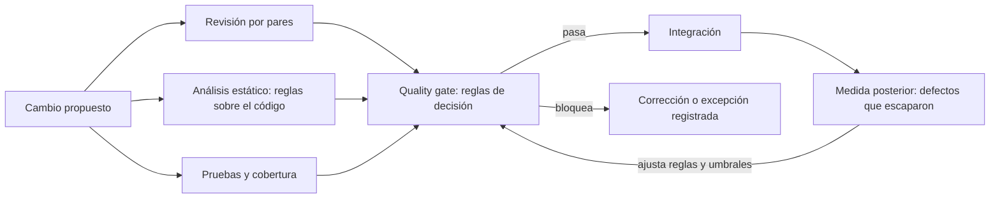

# SE-434 — Revisión, análisis estático y quality gates

[← SE-433 — Modelos de calidad y atributos medibles](../../classes/part-36-calidad-rendimiento-y-resiliencia/se-433-modelos-de-calidad-y-atributos-medibles/README.md) · [↑ Parte 36](../../classes/part-36-calidad-rendimiento-y-resiliencia/README.md) · [📚 Índice completo](../../classes/README.md) · [🌐 Portal](../../site/classes/SE-434.html) · [SE-435 — Carga, estrés, picos y endurance →](../../classes/part-36-calidad-rendimiento-y-resiliencia/se-435-carga-estres-picos-y-endurance/README.md)

## Punto profesional y fundamento pedagógico

**Punto profesional.** La clase existe para que decidas qué comprobaciones automáticas y humanas debe pasar un cambio antes de integrarse, y para que sepas qué puede y qué no puede afirmar cada una. Una revisión por pares, un analizador estático y una compuerta de calidad (quality gate) son instrumentos con una tasa de falsas alarmas, una tasa de defectos que no ven y un costo de espera; la habilidad es combinarlos sin confundir «el pipeline está verde» con «el cambio es correcto».

**Por qué aparece aquí.** Sigue a **Modelos de calidad y atributos medibles**: ya hay escenarios con una medida; ahora hace falta decir cómo se vigila que cada cambio no los empeore. La Parte 35 trató las pruebas; esta clase trata lo que se comprueba sin ejecutar el sistema (lectura, análisis del código) y las reglas que deciden si un cambio entra. El caso conductor es el repositorio de la API de entregas.

**Error conceptual que debe corregir.** Creer que una compuerta con umbrales garantiza calidad: una compuerta solo convierte una medida en una decisión, y si la medida no ve el defecto o el umbral no se aplica al cambio, deja pasar lo que debía parar y bloquea lo que debía pasar.

**Secuencia de aprendizaje.** Antes de leer los resultados, predices cuántos defectos de tres clases encuentra un analizador de reglas sobre 300 funciones generadas y cuántos cambios con pruebas pobres deja pasar una compuerta de cobertura total; después mides precisión, defectos no vistos, el efecto de comparar el cambio y no el total, y la fracción de cambios bloqueados por ruido al encadenar comprobaciones. La secuencia usa predicción, explicación propia, contraste y recuperación. [ICAP](https://icap.education.asu.edu/research) distingue participación de construcción de conocimiento; [How People Learn II](https://nap.nationalacademies.org/catalog/24783/how-people-learn-ii-learners-contexts-and-cultures) respalda diseñar la práctica con contextos reales y retroalimentación.

**Evidencia de aprendizaje.** `gates-log.md` con la predicción, las tres figuras reproducidas, el analizador con sus tres reglas y la lista de lo que no ve, una definición de compuerta con su criterio aplicado al cambio y una nota que separe qué decisión es automática y cuál queda a una persona.

**Límite de la conclusión.** El corpus de 300 funciones se genera desde plantillas del autor y los defectos están sembrados, de modo que precisión y cobertura son propiedades del generador y no de código real; los 500 cambios y sus coberturas son simulados; los porcentajes de falsos fallos son supuestos. No se midió ningún proyecto real, ninguna herramienta comercial y ninguna revisión humana: la parte humana se describe y no se mide.

### Trazabilidad fuente → afirmación

| Fuente primaria u oficial | Afirmación que respalda | Lo que no prueba |
|---|---|---|
| [Python: módulo ast](https://docs.python.org/3/library/ast.html) | Permite recorrer el árbol sintáctico de un programa, base de los analizadores de reglas sobre código Python sin ejecutarlo. | No dice qué reglas son útiles ni su tasa de falsas alarmas. |
| [Sadowski et al., «Lessons from building static analysis tools at Google»](https://doi.org/10.1145/3188720) | Informa de que una herramienta de análisis estático solo es adoptada si sus alertas se ven como accionables y de que las falsas alarmas la desacreditan. | Describe una empresa concreta; no prueba una tasa para otro código. |
| [Bacchelli y Bird, «Expectations, outcomes, and challenges of modern code review»](https://doi.org/10.1109/ICSE.2013.6606617) | Observa que la revisión de código aporta conocimiento compartido y comprensión además de detectar defectos, y que los revisores encuentran menos defectos de lo que se espera. | No cuantifica la efectividad para otros equipos. |
| [Inozemtseva y Holmes, «Coverage is not strongly correlated with test suite effectiveness»](https://doi.org/10.1145/2568225.2568271) | Muestra que la cobertura no se correlaciona de forma fuerte con la capacidad de una suite para detectar defectos una vez controlado el tamaño. | No dice que la cobertura sea inútil como señal de lo que no se ha ejecutado. |

## Antes de empezar

Recupera lo aprendido en `SE-433` sobre escenarios de calidad: una medida solo sirve si se sabe qué decide. La pregunta activa es: **¿qué defectos puede ver una comprobación que no ejecuta el sistema, qué hará con los que no ve y cuánto cuesta equivocarse en cada dirección?**

## Prerrequisitos

- Haber completado `SE-433` o poder escribir un escenario de calidad con su medida.
- Python 3.11 o posterior; los experimentos usan solo la biblioteca estándar (`ast`, `random`).
- Leer un árbol sintáctico y entender qué es una expresión regular.

## Problema auténtico

El equipo de la plataforma añadió al repositorio un analizador de reglas y una compuerta de cobertura mínima del 70 %. Durante tres meses el pipeline estuvo verde y el equipo dejó de mirar el código de los demás con la misma atención: «el análisis ya lo revisa». Un cambio que añadió un recorrido que omitía el primer elemento de una lista de calificaciones pasó la compuerta porque las pruebas ejecutaban esa línea sin comprobar el resultado; otro, correcto, fue bloqueado cuatro veces porque una comprobación de estilo fallaba sola en el servidor compartido, y el equipo aprendió a «reintentar hasta verde». Ninguna de las dos herramientas estaba rota: hacían lo que su regla decía. La clase enseña a mirar cada una como un instrumento con errores medibles.

## Objetivos observables

Al terminar podrás:

1. explicar qué ve y qué no ve una revisión humana, un análisis estático y una compuerta;
2. escribir reglas con `ast`, medir su precisión y sus defectos no vistos en un corpus con verdad conocida y explicar el sesgo de afinar con los mismos casos;
3. diferenciar una compuerta sobre el total de una compuerta sobre el cambio y mostrar con datos cuál deja pasar más cambios pobres;
4. calcular la fracción de cambios bloqueados por ruido al encadenar comprobaciones y qué provoca la política de reintentar;
5. decidir qué compuertas bloquean, cuáles avisan y quién puede saltárselas.

## Mapa conceptual



El mapa muestra tres fuentes de señal que entran en una **regla de decisión**. La salida que más se olvida es la última flecha: sin medir qué defectos escaparon, los umbrales no se ajustan con datos sino con opiniones.

## Temas y por qué importan

| Tema | Por qué cambia una decisión profesional | Evidencia mínima |
|---|---|---|
| Qué aporta la revisión | Detecta lo que no se puede automatizar y comparte conocimiento, pero se agota con el tamaño del cambio. | Predicción, traza causal y contraejemplo de **Qué aporta la revisión** en `gates-log.md` |
| Análisis estático | Ve defectos de patrón sin ejecutar nada; no ve defectos lógicos y produce falsas alarmas. | Predicción, traza causal y contraejemplo de **Análisis estático** en `gates-log.md` |
| Métricas del cambio | Una media del repositorio no mide el cambio que se evalúa. | Predicción, traza causal y contraejemplo de **Métricas del cambio** en `gates-log.md` |
| Compuertas de calidad | Convierten una medida en una decisión y pueden bloquear lo bueno o dejar pasar lo malo. | Predicción, traza causal y contraejemplo de **Compuertas de calidad** en `gates-log.md` |
| Ruido, reintentos y excepciones | Una compuerta que falla sola enseña a ignorarla. | Predicción, traza causal y contraejemplo de **Ruido, reintentos y excepciones** en `gates-log.md` |

## Conceptos y decisiones

### 1. Qué aporta la revisión

La revisión por pares sirve para al menos cuatro cosas: detectar defectos, mantener la coherencia del diseño, repartir conocimiento y hacer que el autor explique sus decisiones. Los estudios observacionales de revisión moderna encuentran que el valor más frecuente es compartir comprensión del código, y que la detección de defectos, aunque real, es menos de lo que el equipo cree. La efectividad de una revisión depende de factores medibles: el tamaño del cambio (un cambio de cuatrocientas líneas se lee peor que uno de cuarenta), si el revisor sabe qué se espera de él (una lista de comprobación evita que todos revisen lo mismo) y cuánto tiempo hay. Lo que la revisión humana hace mejor es juzgar lo que depende de la intención: si el recorrido debería empezar en cero, si la función pertenece a este módulo, si falta una prueba que expresa una regla de negocio. Lo que hace peor es lo repetitivo y lo exhaustivo, como buscar todas las variables sin uso. Dividir el trabajo —máquina para lo mecánico, persona para lo semántico— no es una cuestión de comodidad sino de dónde falla cada una.

### 2. Análisis estático

Un analizador estático lee el código sin ejecutarlo y busca patrones. En Python, el módulo `ast` expone el árbol sintáctico: una regla es una función que recorre los nodos y señala los que cumplen una condición, como un parámetro por defecto cuyo valor es una lista o una cláusula `except` sin tipo. Las reglas se escriben sobre la forma, y la forma no es la intención. Por eso aparecen dos clases de error. La **falsa alarma** señala algo correcto: una lista como parámetro por defecto que se usa a propósito como caché; una variable cuyo valor se usa de forma dinámica con `eval`. El **defecto no visto** es el que no tiene patrón: un recorrido que empieza en uno en lugar de cero es sintácticamente impecable. La precisión de una regla es la fracción de sus alertas que eran defectos reales y su cobertura la fracción de los defectos de su clase que encuentra. Una regla con precisión baja produce alertas que nadie atiende; los equipos que adoptan analizadores aprenden pronto que una alerta ignorada una vez se ignora siempre. Afinar la regla con excepciones razonables es legítimo, pero hay que evaluarla en datos distintos de los que sirvieron para afinarla.

### 3. Métricas del cambio

Las métricas de código (cobertura, complejidad, duplicación) se pueden calcular sobre el repositorio entero o sobre el cambio. La diferencia no es cosmética. La cobertura total de un repositorio de cien mil líneas se mueve menos de una décima de punto con un cambio de cien líneas, de modo que una compuerta sobre el total no distingue el cambio con las pruebas al 100 % del cambio sin ninguna: ambos mantienen el total por encima del umbral. La cobertura del cambio (qué fracción de las líneas añadidas o modificadas ejecutan las pruebas) sí lo distingue, a costa de ser ruidosa en cambios pequeños: un cambio de cinco líneas con tres cubiertas da 60 %. Y toda medida de cobertura mide líneas ejecutadas, no aserciones: una prueba que llama a la función y no comprueba el resultado cubre la línea y no protege nada. Por eso la cobertura sirve para decir qué código no se ha ejecutado nunca, no para decir que el ejecutado está comprobado.

### 4. Compuertas de calidad

Una **quality gate** es una regla de decisión sobre un conjunto de medidas: «el cambio entra si la cobertura de las líneas nuevas es al menos del 80 %, no hay alertas nuevas de severidad alta y la complejidad de las funciones tocadas no empeora». Tres decisiones de diseño importan más que el valor del umbral. La primera es **sobre qué se aplica**: el cambio, no el total, para que el umbral se mueva con lo que se evalúa. La segunda es **qué hace al fallar**: bloquear (el cambio no entra), avisar (entra con un comentario) o pedir una excepción registrada. Bloquear por todo enseña a saltarse la compuerta; avisar por todo la vuelve decoración. La tercera es **quién puede saltársela y cómo se registra**: una excepción con dueño, motivo y caducidad es información; una excepción silenciosa es una deuda invisible. Una compuerta se evalúa como cualquier otro instrumento: cuántos cambios malos deja pasar, cuántos buenos bloquea y cuánto tiempo añade.

### 5. Ruido, reintentos y excepciones

Cada comprobación que puede fallar por razones ajenas al cambio (un servidor lento, un orden no determinista, una red) añade una probabilidad de bloqueo espurio. Si cada una falla sola el 2 % de las veces, encadenar diez bloquea casi uno de cada cinco cambios, y cuarenta, más de la mitad. La respuesta tentadora es reintentar hasta que se ponga en verde, y tiene un efecto secundario poco visible: si una comprobación detecta un defecto real de forma intermitente (por ejemplo, una condición de carrera), reintentar elimina precisamente esa señal. La corrección es separar los dos problemas: hacer determinista la comprobación o clasificarla como inestable, apartarla del bloqueo y medirla aparte, y no tratar toda falla como ruido. Una compuerta con muchos bloqueos espurios pierde autoridad: la gente deja de preguntarse por qué falló.

### Tres reglas de análisis estático y lo que no ven

Se generan 300 funciones desde plantillas con semilla fija y defectos sembrados con probabilidad conocida: argumento por defecto mutable (también como caché intencional), `except` sin tipo (a veces seguido de `raise`), variable local sin uso (a veces usada con `eval` o con prefijo de guion bajo) y un recorrido que omite el primer elemento. Cada función compila. Tres reglas con `ast` buscan los tres primeros defectos; la cuarta no tiene regla.

```python
def reglas(src, afinada):
    tree = ast.parse(src); found = set()
    for node in ast.walk(tree):
        if isinstance(node, ast.FunctionDef):
            if any(isinstance(d, (ast.List, ast.Dict, ast.Set)) for d in node.args.defaults): found.add("mutable")
            ...
        if isinstance(node, ast.ExceptHandler) and node.type is None: found.add("bare")
    return found
```

| Regla | Defectos reales | Hallados | Falsas alarmas (ingenua → afinada) | No vistos |
|---|---:|---:|---|---:|
| Argumento mutable | 44 | 44 | 18 → 18 (caché intencional) | 0 |
| `except` sin tipo | 60 | 60 | 40 → 0 (se exime el `raise`) | 0 |
| Variable sin uso | 37 | 37 | 53 → 26 (se exime el prefijo `_`) | 0 |
| Recorrido que omite el primero | 70 | 0 | 0 | 70 |

Las reglas encuentran todo lo que buscan y su precisión sigue siendo discutible: 71 % para argumentos mutables y 59 % para variables sin uso con la versión afinada. El defecto lógico, 70 de 161 funciones con algún defecto, queda fuera. Las 26 falsas alarmas restantes de variables sin uso vienen del uso dinámico con `eval`, que ninguna regla sintáctica puede ver.


**Cómo leer la figura.** Cada grupo de barras es una clase de defecto; el azul son los defectos reales, el verde los hallados, el rojo las falsas alarmas sin afinar y el dorado las que quedan tras afinar. Mira primero que verde iguala a azul en las tres primeras clases y que en la cuarta no hay verde: la regla halla todo lo que busca y nada de lo que no sabe buscar. **Dónde deja de valer:** las funciones son plantillas y los defectos tienen probabilidades elegidas, de modo que las cifras de precisión son del generador; la afinación se hizo con los mismos casos que evalúan la regla, así que la cifra afinada es optimista. En código real el patrón de uso de `eval` es raro y el de caché con argumento mutable, discutible.

### La compuerta que mira el total

Se parte de un repositorio de 20 000 líneas con 72 % de cobertura y se integran 500 cambios simulados: tamaño lognormal, calidad real de las pruebas entre 0 y 1 (65 % buenos entre 75 y 100, 25 % medios entre 40 y 80, 10 % pobres entre 0 y 40) y cobertura observada como binomial sobre las líneas del cambio. Se comparan tres compuertas: cobertura total mínima del 70 %, que la cobertura total no baje y cobertura del cambio de al menos 80 %.

| Compuerta | Cambios con pruebas pobres que pasan (de 117) | Cambios bien probados que se bloquean (de 193) |
|---|---:|---:|
| Cobertura total ≥ 70 % | 117 | 0 |
| La cobertura total no baja | 0 | 0 |
| Cobertura de las líneas del cambio ≥ 80 % | 0 | 1 |

El repositorio llega a 118 813 líneas y a 73,1 % de cobertura total: ningún cambio mueve el total lo suficiente para cruzar el 70 %, y la compuerta total deja pasar a los 117. La compuerta de «no bajar» es más estricta con el mismo dato, y la del cambio es la que mejor separa. Aun así, ninguna ve la calidad de las aserciones: en este modelo una prueba pobre es una que cubre pocas líneas, que es una simplificación.


**Cómo leer la figura.** Cada grupo de barras es una compuerta y sus dos errores posibles: en rojo los cambios pobres que pasan (de 117) y en dorado los bien probados que se bloquean (de 193). Mira primero que solo la compuerta de cobertura total tiene una barra roja y que las otras dos casi no tienen barras. **Dónde deja de valer:** la separación es nítida porque la calidad se modela con la misma variable que genera la cobertura; en un repositorio real, un cambio pequeño de cinco líneas con tres cubiertas se bloquearía y uno grande con aserciones vacías pasaría. La compuerta del cambio también necesita una regla para cambios muy pequeños.

### Cuando la compuerta falla sola

Se simula una cadena de comprobaciones independientes que fallan solas el 2 % de las veces sobre 20 000 cambios y se mide el bloqueo al primer intento y tras hasta tres intentos. Aparte, una comprobación que detecta un defecto real el 90 % de las veces se ejecuta con hasta tres reintentos.

```python
fails = lambda: any(r.random() < 0.02 for _ in range(k))
b1 += fails();  b3 += all(fails() for _ in range(3))
escapa = any(r.random() > 0.9 for _ in range(3))      # el reintento da verde si una ejecución no detecta
```

| Comprobaciones encadenadas | Bloqueo al primer intento | Bloqueo tras hasta 3 intentos |
|---:|---:|---:|
| 1 | 2,1 % | 0,01 % |
| 10 | 18,4 % | 0,61 % |
| 20 | 33,5 % | 3,52 % |
| 40 | 55,9 % | 17,14 % |
| Defecto detectado el 90 % | Se cuela el 10,0 % | Se cuela el 27,3 % |

Con cuarenta comprobaciones, más de la mitad de los cambios se bloquean al primer intento sin haber hecho nada mal, y con reintentos el ruido baja pero no desaparece (17,14 %). La última fila es la trampa: el reintento convierte un defecto que se detectaba nueve de cada diez veces en uno que se cuela en más de una de cada cuatro.


**Cómo leer la figura.** El eje horizontal es el número de comprobaciones encadenadas y el vertical, en escala logarítmica, el porcentaje de cambios bloqueados por ruido; la línea roja es el primer intento y la discontinua verde, hasta tres intentos. Mira primero cómo ambas suben con el número de comprobaciones y cuánto separa a la verde de la roja. **Dónde deja de valer:** el 2 % y la independencia entre comprobaciones son supuestos; en un pipeline real las fallas se correlacionan (el mismo servidor lento tumba varias) y la cifra agregada es otra. La conclusión que se sostiene es la forma: la probabilidad de bloqueo crece con el número de comprobaciones y el reintento erosiona la señal de las intermitentes.

## Definiciones de trabajo

- **quality gate:** regla de decisión que decide, a partir de medidas del cambio, si este puede integrarse.
- **análisis estático:** examen del código fuente sin ejecutarlo, mediante reglas sobre su estructura.
- **falsa alarma:** alerta sobre algo que no es un defecto; **defecto no visto:** defecto que ninguna regla señala.
- **cobertura del cambio:** fracción de las líneas añadidas o modificadas que ejecutan las pruebas.
- **comprobación inestable:** comprobación cuyo resultado varía sin que cambie el código.

Las definiciones son operativas para el repositorio de la API de entregas. No convierten términos con una historia más amplia en sinónimos y deben contrastarse con la documentación primaria enlazada al final.

## Ejemplo mínimo

El fragmento muestra una falsa alarma de una regla de `ast`. Antes de ejecutarlo, predice si la regla señala la función.

```python
import ast
src = "def f(x, _cache={}):\n    _cache[x] = x\n    return _cache[x]\n"
tree = ast.parse(src)
print(any(isinstance(d, ast.Dict) for n in ast.walk(tree) if isinstance(n, ast.FunctionDef) for d in n.args.defaults))
```

La regla de «argumento mutable» señala la función aunque el diccionario sea una caché deliberada. Registra versión de Python, comando y salida; después decide si eximir el prefijo `_` es legítimo y qué defecto real dejaría pasar.

## Ejemplo profesional

El equipo configura tres comprobaciones en el cambio: un analizador con las tres reglas y la excepción de prefijo, la cobertura de las líneas del cambio con umbral del 80 % y un comentario automático con la complejidad de las funciones tocadas. La regla de decisión dice: bloquea si hay alertas nuevas de las reglas de severidad alta o si la cobertura del cambio baja de 80 % en cambios de más de quince líneas; avisa en el resto. Los cambios de quince líneas o menos solo avisan, porque la cobertura es ruidosa. Las excepciones se piden en el propio cambio con motivo y caducidad. Una vez al mes se cuenta cuántos defectos escaparon y de qué clase, y las reglas se ajustan con esa lista, no con opiniones. Compara con el pipeline de antes: la compuerta total pasaba todo, las comprobaciones fallaban solas y la costumbre de reintentar había desactivado la señal.

## Práctica guiada

1. Escribe las tres reglas con `ast` y pruébalas con las tres funciones de ejemplo que se incluyen en esta clase.
2. Predice cuántos defectos de cada clase y cuántas falsas alarmas producirán sobre 300 funciones generadas y escríbelo antes de medir.
3. Genera el corpus con semilla fija y calcula precisión, defectos no vistos y falsas alarmas para la versión ingenua y la afinada.
4. Parte de un repositorio de 20 000 líneas al 72 % y simula 500 cambios; aplica las tres compuertas y cuenta los dos errores posibles.
5. Simula veinte mil cambios con cadenas de 1, 5, 10, 20 y 40 comprobaciones que fallan solas el 2 % y mide el efecto de reintentar.
6. Redacta la regla de decisión de la plataforma: qué bloquea, qué avisa, quién concede excepciones y cómo caducan.
7. Entrega `gates-log.md` y pide a otra persona que encuentre un cambio que tu compuerta deje pasar y que ella consideraría defectuoso.

## Ejercicios

1. **Regla:** escribe una regla de `ast` que detecte la comparación de un valor con `None` usando `==` y evalúa un caso que debería señalarse y otro que no.
2. **Compuerta:** un cambio añade 40 líneas con 20 cubiertas a un repositorio de 50 000 líneas al 80 %. Calcula la cobertura total antes y después y la del cambio, y decide con las tres compuertas.
3. **Ruido:** calcula cuántas comprobaciones puede encadenar un pipeline con falsos fallos del 1 % por comprobación para que menos del 10 % de los cambios se bloquee sin motivo.
4. **Revisión:** propón una lista de cinco comprobaciones que una persona revisora debería hacer y que ninguna regla automática puede hacer en la API de entregas.

## Reto verificable

Entrega `gates-log.md` con la predicción, las tres tablas de resultados, las tres reglas con su lista de lo que no ven, la regla de decisión y la clasificación de decisiones automáticas y humanas. Se aprueba si otra persona ejecuta el código desde un checkout limpio, obtiene los mismos números con las mismas semillas y puede decir qué defecto dejaría pasar tu compuerta. No se aprueba por añadir herramientas sin medir lo que ven ni por afirmar que el pipeline «garantiza» calidad.

## Caso conductor

El repositorio de la API de entregas es el caso conductor de la Parte 36. Esta clase deja el segundo artefacto: las comprobaciones del cambio con su regla de decisión. `SE-435` pondrá a prueba el escenario de eficiencia con carga, y la compuerta de esta clase decidirá si un cambio que empeora el rendimiento puede entrar. Cambia después un solo dato, el umbral de cobertura, y observa qué cambios cambian de decisión.

## Preguntas frecuentes

### ¿Basta con un buen analizador estático para no hacer revisión?

No. El analizador cubre lo repetitivo y deja sin ver lo que depende de la intención. La revisión humana sigue siendo necesaria para juzgar diseño, nombres, límites y pruebas que faltan; lo que cambia es que se libera de lo mecánico.

### ¿Qué umbral de cobertura es el correcto?

Ninguno en abstracto. La cobertura dice qué no se ejecutó, no qué está comprobado. Un umbral sobre el cambio (por ejemplo 80 %) con una excepción registrada es más útil que uno sobre el total; si ninguno funciona, se complementa con mutación (`SE-431`).

### ¿Está mal reintentar una comprobación que falló?

No siempre. Reintentar una comprobación conocida como inestable y registrada es una decisión. Lo que está mal es reintentar sin mirar por qué falló: se pierde la señal de las intermitentes y se enseña al equipo a ignorar los fallos.

### ¿Deben los analizadores bloquear el cambio o solo avisar?

Depende de su precisión. Una regla con precisión alta y consecuencias graves (un secreto en el código, una inyección clara) puede bloquear; una con precisión baja debe avisar o apartarse. Medir la precisión sobre un corpus es lo que permite decidirlo.

## Fallo controlado y diagnóstico

Reproduce el fallo clásico de la clase: **una compuerta de cobertura total que deja pasar un cambio sin pruebas**. Añade al repositorio simulado un cambio de cien líneas con cobertura del 20 %.

Registra síntoma, entrada mínima, hipótesis, observación que descarta cada hipótesis, causa, corrección y prueba de regresión. **Síntoma:** el cambio pasa la compuerta con un 71,7 % de cobertura total y falla en producción. **Hipótesis rivales:** (a) las pruebas del cambio estaban mal escritas; (b) la compuerta no se ejecutó; (c) la compuerta mide el total y el cambio es demasiado pequeño para moverlo. **Prueba:** calcula la cobertura del cambio y el efecto del cambio en el total; si el total baja menos de una décima, la causa es el denominador. **Conclusión:** el repositorio entero amortigua cualquier cambio. **Regresión:** cambia la compuerta a cobertura del cambio con umbral del 80 %, añade una prueba que simule un cambio al 20 % y exija el bloqueo y otra con uno de cinco líneas que solo avise. No cambies a la vez el umbral y el alcance.

## Errores comunes y cómo corregirlos

| Síntoma | Causa probable | Corrección |
|---|---|---|
| El pipeline está verde y el defecto llegó a producción | La regla no ve esa clase de defecto | Listar lo que no ve cada comprobación y cubrirlo con revisión o pruebas |
| Las alertas del analizador se ignoran | Precisión baja | Medir la precisión, afinar con datos y apartar las reglas ruidosas |
| Un cambio correcto se bloquea cuatro veces | Comprobación inestable en la cadena | Hacerla determinista o apartarla del bloqueo |
| La cobertura sube y los defectos no bajan | Se ejecutan líneas sin comprobar resultados | Revisar aserciones y complementar con mutación |
| Todo el mundo pide excepciones | La compuerta bloquea por todo | Distinguir bloquear, avisar y excepción con caducidad |

## Entorno y archivos clave

```text
work/SE-434/
├── README.md
├── gates/
│   ├── reglas.py
│   ├── corpus.py
│   └── compuertas.py
├── tests/test_gates.py
└── evidence/gates-log.md
```

El `README` declara plataforma, versión de Python, semillas y comandos. Los experimentos usan solo la biblioteca estándar (`ast`, `random`) y se ejecutaron con CPython 3.12.9 en Windows 11 y 3.12.3 en Ubuntu bajo WSL2: las salidas fueron idénticas. Si añades una dependencia, fija procedencia y versión.

## Seguridad, ética y accesibilidad

- un analizador que lee el código también lee secretos: no ejecutes herramientas de terceros sobre código privado sin saber adónde envían sus resultados;
- una compuerta que bloquea a una persona sin explicar por qué es un problema de equidad en el equipo: el mensaje debe decir qué regla, por qué y cómo corregirlo;
- la revisión humana arrastra sesgos (quién es el autor, qué tamaño tiene el cambio): documenta criterios y rota revisores;
- los informes de compuertas deben ser legibles con lector de pantalla, con el resultado en texto y no solo en color;
- respeta las licencias de las reglas y los conjuntos de reglas de terceros y atribuye lo adaptado.

## Puente hacia el trabajo con agentes

Un agente al que se le pide «configura el análisis de calidad del repositorio» activará las reglas por defecto de una herramienta, pondrá un umbral de cobertura total y declarará el pipeline completo. Pídele en cambio que mida primero cuántas alertas son accionables en una muestra, que aplique la compuerta al cambio y no al total, que clasifique cada comprobación como bloquea o avisa, y que liste lo que ninguna comprobación ve. Revisa especialmente si propone reintentar comprobaciones fallidas y si su resumen confunde «el pipeline pasó» con «el cambio es correcto»: son los dos defectos que esta clase mostró sin aviso.

## Transferencia

Traslada el análisis a otro lenguaje o a otro tipo de cambio (por ejemplo, un cambio de infraestructura como código): cambia las reglas y las medidas y conserva el procedimiento de escribir reglas con verdad conocida, medir sus errores, aplicar la compuerta al cambio y contar el ruido de la cadena. La transferencia está lograda cuando puedes decir qué defecto ve cada comprobación y cuál no, no cuando el pipeline tiene las mismas herramientas.

## Evaluación y evidencia

| Criterio | Evidencia para aprobar |
|---|---|
| comprensión | explicación de qué ve y qué no ve una revisión, un análisis y una compuerta |
| corrección | tablas de reglas, compuertas y ruido reproducibles con las mismas semillas |
| diseño | regla de decisión con bloquear, avisar y excepción con caducidad |
| diagnóstico | reproducción del fallo «la compuerta total deja pasar un cambio sin pruebas» con regresión |
| incertidumbre | declaración de que el corpus, los cambios y los porcentajes son sintéticos o del autor |
| reproducibilidad | versiones, comandos, salida y límites declarados |

## Fuentes

- [Python: ast](https://docs.python.org/3/library/ast.html) — árbol sintáctico usado en las reglas; autoridad: documentación de Python.
- [Sadowski et al., «Lessons from building static analysis tools at Google»](https://doi.org/10.1145/3188720) — adopción de análisis estático y falsas alarmas; autoridad: Communications of the ACM, 2018.
- [Bacchelli y Bird, «Expectations, outcomes, and challenges of modern code review»](https://doi.org/10.1109/ICSE.2013.6606617) — qué aporta la revisión; autoridad: ICSE 2013.
- [Inozemtseva y Holmes, «Coverage is not strongly correlated with test suite effectiveness»](https://doi.org/10.1145/2568225.2568271) — límites de la cobertura; autoridad: ICSE 2014.
- [SonarQube: quality gates](https://docs.sonarsource.com/sonarqube/latest/user-guide/quality-gates/) — ejemplo de compuerta sobre código nuevo; autoridad: documentación del producto.

Cada fuente respalda el mecanismo indicado; ninguna demuestra que las 70 funciones, las 117 compuertas o el 17,14 % se observen en un repositorio real. Esa afirmación depende del código, de las reglas y de cómo se mida el cambio.

## Límites y siguiente paso

Se ejecutaron tres experimentos con datos sintéticos en Windows y Ubuntu (WSL2) con resultados idénticos. No se midió ningún proyecto real, ninguna herramienta comercial ni ninguna revisión humana; las funciones, los defectos sembrados, los cambios simulados, la calidad modelada y el 2 % de fallos propios son construcciones del autor, y las reglas se afinaron con los mismos casos que las evalúan. La siguiente clase pone a prueba el escenario de eficiencia con carga, estrés, picos y resistencia.

## Glosario

- **quality gate:** regla de decisión que decide, a partir de medidas del cambio, si este puede integrarse.
- **análisis estático:** examen del código fuente sin ejecutarlo, mediante reglas sobre su estructura.
- **falsa alarma:** alerta sobre algo que no es un defecto; **defecto no visto:** defecto que ninguna regla señala.
- **cobertura del cambio:** fracción de las líneas añadidas o modificadas que ejecutan las pruebas.
- **comprobación inestable:** comprobación cuyo resultado varía sin que cambie el código.

---

[← SE-433 — Modelos de calidad y atributos medibles](../../classes/part-36-calidad-rendimiento-y-resiliencia/se-433-modelos-de-calidad-y-atributos-medibles/README.md) · [↑ Parte 36](../../classes/part-36-calidad-rendimiento-y-resiliencia/README.md) · [📚 Índice completo](../../classes/README.md) · [🌐 Portal](../../site/classes/SE-434.html) · [SE-435 — Carga, estrés, picos y endurance →](../../classes/part-36-calidad-rendimiento-y-resiliencia/se-435-carga-estres-picos-y-endurance/README.md)
