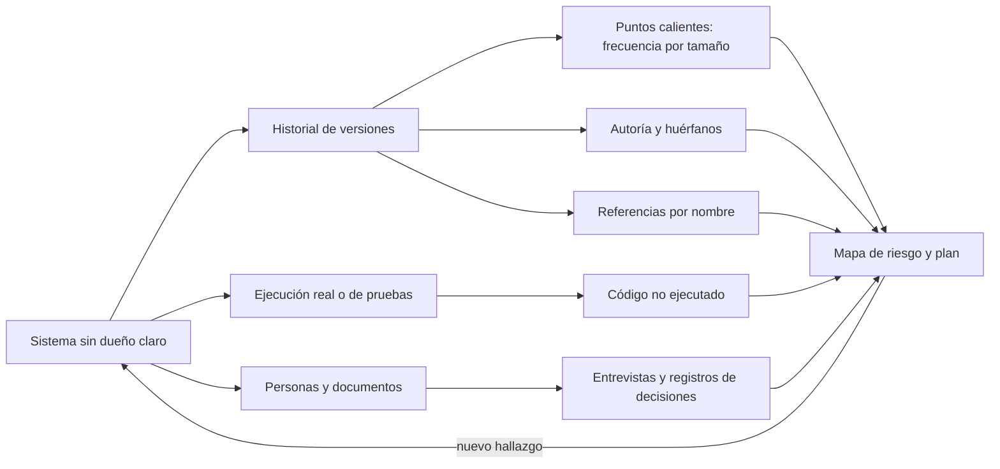
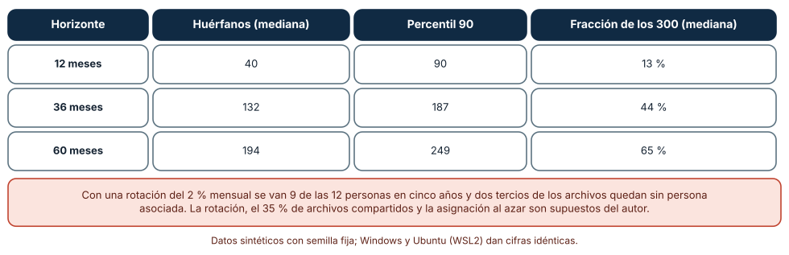

# SE-434 — Arqueología de código y recuperación de conocimiento

[← SE-433 — Mantenimiento correctivo, adaptativo y perfectivo](../../classes/part-36-mantenimiento-y-modernizacion-legacy/se-433-mantenimiento-correctivo-adaptativo-y-perfectivo/README.md) · [↑ Parte 36](../../classes/part-36-mantenimiento-y-modernizacion-legacy/README.md) · [📚 Índice completo](../../classes/README.md) · [🌐 Portal](../../site/classes/SE-434.html) · [SE-435 — Pruebas de caracterización y seams →](../../classes/part-36-mantenimiento-y-modernizacion-legacy/se-435-pruebas-de-caracterizacion-y-seams/README.md)

## Punto profesional y fundamento pedagógico

**Punto profesional.** La clase existe para que puedas entrar a un sistema que nadie entiende por completo y averiguar, con evidencia, dónde se concentra el riesgo, qué conocimiento se perdió y qué partes del código ya no hacen nada. La habilidad profesional no es leer mucho código sino hacerle preguntas al historial y a la ejecución que el código por sí solo no responde: qué cambia más, qué cambia y falla, quién lo conoce todavía, qué se llama de verdad y qué no.

**Por qué aparece aquí.** Sigue a **Mantenimiento correctivo, adaptativo y perfectivo**: la clase anterior repartió la capacidad entre cuatro categorías de trabajo; para saber en qué invertir el trabajo preventivo hace falta saber dónde está el problema. El caso conductor es el **módulo legado de calificaciones** de la plataforma educativa: doce años de historia, rotación de equipos y una base de código cuya estructura nadie dibujó.

**Error conceptual que debe corregir.** Creer que entender un sistema heredado consiste en leer su código de principio a fin. Leer todo es lento, no priorizado y engañoso: el código que más cambia y falla no es el más grande ni el más antiguo, el conocimiento que falta no está en el código, y las herramientas que «encuentran» código muerto lo hacen con errores que dependen de cómo se llama al código.

**Secuencia de aprendizaje.** Antes de mirar los resultados, predices si ordenar los archivos por tamaño, por frecuencia de cambio o por el producto de ambos señala mejor los archivos donde más se corrige; después simulas la salida de autores durante cinco años y cuentas los archivos que quedan sin ninguna persona que los conozca, y mides dos técnicas de detección de código muerto sobre un módulo en el que sabes la respuesta. La secuencia usa predicción, explicación propia, contraste y recuperación. [ICAP](https://icap.education.asu.edu/research) distingue participación de construcción de conocimiento; [How People Learn II](https://nap.nationalacademies.org/catalog/24783/how-people-learn-ii-learners-contexts-and-cultures) respalda diseñar la práctica con contextos reales y retroalimentación.

**Evidencia de aprendizaje.** `arqueologia-log.md` con la predicción, las tres figuras reproducidas, un mapa de puntos calientes de tu repositorio (o del sintético), una lista de archivos huérfanos con la persona a entrevistar, una lista de candidatos a código muerto con la técnica que los propone y una nota que separe qué es observado, qué inferido y qué supuesto.

**Límite de la conclusión.** El historial, la distribución de cambios, la relación entre tamaño y correcciones, la rotación de autores y el módulo con funciones de cuatro tipos son sintéticos, construidos con semilla fija. No se analizó ningún repositorio real, ninguna persona ni ninguna institución. Los porcentajes de la simulación no se pueden extrapolar a un historial real.

### Trazabilidad fuente → afirmación

| Fuente primaria u oficial | Afirmación que respalda | Lo que no prueba |
|---|---|---|
| [Nagappan y Ball, «Use of relative code churn measures to predict system defect density»](https://doi.org/10.1145/1062455.1062514) | Mostró en un estudio de software industrial que medidas relativas de rotación del código (churn) se relacionan con la densidad de defectos. | No garantiza que la relación se mantenga en tu sistema ni que el churn cause defectos. |
| [Avelino et al., «A novel approach for estimating Truck Factors»](https://doi.org/10.1109/ICPC.2016.7503718) | Define el factor de camión (cuántas personas pueden irse antes de que el proyecto pierda conocimiento clave) y propone estimarlo a partir de la autoría de los archivos. | La autoría por commits no equivale a conocimiento: quien escribió algo puede no recordarlo y quien no firmó puede conocerlo. |
| [Git: git log](https://git-scm.com/docs/git-log) y [git blame](https://git-scm.com/docs/git-blame) | Documentan las consultas al historial (frecuencia, autores, cambios por línea) que sirven de base al análisis. | No explican por qué se tomó una decisión; solo dicen quién y cuándo. |
| [Python: ast](https://docs.python.org/3/library/ast.html) | Documenta el árbol sintáctico que permite buscar definiciones y referencias por nombre. | El árbol no resuelve llamadas dinámicas por cadena, registros o reflexión. |
| [Python: sys.settrace](https://docs.python.org/3/library/sys.html#sys.settrace) | Documenta el gancho de traza que registra las funciones que se ejecutan. | Solo ve lo que una ejecución concreta recorre. |

## Antes de empezar

Recupera lo aprendido en `SE-433`: el trabajo preventivo se justifica cuando se sabe qué protege. La pregunta activa es: **¿qué diez archivos de tu repositorio crees que concentran más correcciones y quién de tu equipo podría explicar cada uno hoy?**

## Prerrequisitos

- Haber completado `SE-433` o poder explicar las cuatro categorías de mantenimiento.
- Python 3.11 o posterior; los experimentos usan solo la biblioteca estándar (`random`, `ast`, `sys`, `statistics`).
- Saber consultar un historial de Git (`git log`, `git blame`) a nivel básico.

## Problema auténtico

El equipo heredó el módulo de calificaciones con un archivo de intercambio, una carpeta `utilidades` de 60 funciones y la advertencia «no toques `cierre.py`». Nadie del equipo original seguía en la empresa. El líder propuso empezar por «leer todo el código», estimado en tres semanas. Una persona sugirió en cambio mirar el historial: tres archivos concentraban la mitad de las correcciones de los últimos dos años y dos de ellos solo tenían commits de personas que ya se habían ido. Una limpieza de código muerto, ejecutada con una herramienta que buscaba funciones sin referencias, eliminó una función que se invocaba por nombre desde un archivo de configuración y el cierre de acta falló en producción. La clase enseña a priorizar con el historial, a medir cuánto conocimiento se perdió y a no confiar ciegamente en ninguna técnica de detección de código muerto.

## Objetivos observables

Al terminar podrás:

1. consultar un historial de versiones para obtener frecuencia de cambio, autores y correcciones por archivo;
2. construir un ranking de puntos calientes y comparar tres criterios (tamaño, frecuencia, producto) contra las correcciones reales;
3. estimar cuántos archivos quedan sin persona conocedora tras la salida de autores y qué entrevistas hacer primero;
4. explicar por qué la autoría en el historial es un indicador, no una medida, del conocimiento;
5. detectar candidatos a código muerto con análisis estático y con traza de ejecución y decir qué falsos positivos produce cada técnica.

## Mapa conceptual



El mapa separa tres fuentes de evidencia, el **historial**, la **ejecución** y las **personas**, y muestra que ninguna basta. El historial dice qué cambió pero no por qué; la ejecución dice qué se recorrió pero solo en lo observado; las personas recuerdan por qué pero se van.

## Temas y por qué importan

| Tema | Por qué cambia una decisión profesional | Evidencia mínima |
|---|---|---|
| El historial como fuente de evidencia | Permite priorizar con datos en vez de por intuición o por tamaño. | Consulta reproducible con sus parámetros |
| Puntos calientes | Concentran el riesgo y el trabajo preventivo con mejor retorno. | Ranking por tres criterios comparado con las correcciones |
| Conocimiento tácito y archivos huérfanos | Un archivo sin persona conocedora es un riesgo que no figura en ninguna métrica de código. | Estimación de huérfanos y plan de entrevistas |
| Arqueología de decisiones | Reconstruir el porqué evita deshacer una regla que existía por una razón. | Registros de decisión reconstruidos con su nivel de certeza |
| Código muerto y sus detectores | Borrar lo que no está muerto rompe producción; no borrar lo muerto suma ruido. | Comparación de análisis estático y traza con falsos positivos |

## Conceptos y decisiones

### 1. El historial como fuente de evidencia

Un sistema de control de versiones es un registro, con fecha y autoría, de cada cambio. De ese registro se obtienen cuatro cosas útiles: **frecuencia de cambio** (cuántas veces se modificó un archivo), **autores** (quién lo tocó y cuánto), **acoplamiento temporal** (qué archivos cambian juntos) y **mensajes** (algunas veces dicen por qué). Con `git log` se agregan y con `git blame` se atribuye cada línea a su último cambio. El historial tiene límites claros. Un commit no distingue una corrección de una mejora salvo que el mensaje lo diga; una refactorización mecánica puede inflar la frecuencia; un renombrado puede romper la continuidad si no se sigue; y la autoría de un commit no dice quién entendió el cambio. Todo análisis debe declarar cómo identifica las correcciones (por convención de mensaje, por vínculo con una incidencia o por inferencia) porque ese criterio condiciona el resultado.

### 2. Puntos calientes: frecuencia por tamaño

La mayor parte del cambio y de los defectos suele concentrarse en una minoría de archivos. Esa concentración es la que hace rentable priorizar: dedicar el trabajo preventivo a treinta archivos de trescientos es más barato que repartirlo. Tres criterios compiten. Ordenar por **tamaño** supone que lo grande es lo arriesgado; ordenar por **frecuencia de cambio** supone que lo que cambia más es donde ocurren los problemas; el **producto** de frecuencia por tamaño supone que el riesgo requiere ambas condiciones, algo que cambia mucho y que además es costoso de entender. Nagappan y Ball encontraron en software industrial que las medidas relativas de churn predicen densidad de defectos; eso respalda usar la frecuencia, no que la frecuencia sea suficiente. La razón de fondo es doble: un archivo que se modifica mucho tiene más oportunidades de introducir errores y un archivo complejo hace que cada modificación sea más propensa a error. Un punto caliente no es automáticamente un mal diseño; puede ser el lugar donde el negocio cambia más, como las reglas de calificación, y en ese caso el trabajo preventivo es hacerlo más fácil de cambiar.

### 3. Conocimiento tácito y archivos huérfanos

El conocimiento de un sistema vive en personas, en documentos y en el código. Cuando una persona se va, se lleva la parte que solo vivía en su cabeza: por qué existe una regla, qué pasa si se cambia, qué se probó y falló. El **factor de camión** (bus factor) cuenta cuántas personas pueden irse antes de que un proyecto pierda conocimiento clave; se estima con la autoría de los archivos, y la estimación es un indicador: si el 80 % de los commits de un archivo son de una persona que ya no está, el archivo es **huérfano** en el sentido de que no hay a quién preguntar. Hay dos matices que cambian decisiones. Los archivos con una segunda persona activa (aunque sea con una fracción menor de commits) no son huérfanos; y la autoría puede mentir: alguien que hizo muchas correcciones pequeñas figura como autor principal sin haber entendido la estructura, y alguien que revisó cada cambio sin firmar no figura. Por eso un mapa de huérfanos es una lista de personas a entrevistar y de documentos a crear, no un veredicto.

### 4. Arqueología de decisiones

Recuperar el conocimiento perdido es reconstruir, con la evidencia disponible, el porqué. Las fuentes son los mensajes de commit, las incidencias enlazadas, las pruebas existentes (que describen comportamientos que alguien consideró importantes), los comentarios y las entrevistas. El método es el de cualquier arqueología: cada hallazgo se registra con su **nivel de certeza** (documentado, inferido, supuesto), porque tratar una conjetura como un hecho produce decisiones que eliminan una regla cuya razón se desconocía. Un formato ligero de registro de decisión (contexto, decisión, consecuencias, certeza) permite dejarlo escrito para el siguiente equipo; los registros reconstruidos se marcan como tales. Un principio práctico: antes de eliminar o cambiar algo cuya razón no se conoce, averigua qué depende de ello con el historial, las pruebas y las personas; si no se puede averiguar, protégelo con una prueba de caracterización (`SE-435`) antes de tocarlo.

### 5. Código muerto y la dificultad de detectarlo

El código muerto no se ejecuta nunca, y retirarlo reduce ruido y superficie de ataque. Detectarlo tiene dos enfoques con errores complementarios. El **análisis estático por nombre** recorre el árbol sintáctico y marca las funciones cuyo nombre no aparece referenciado; es exhaustivo en lo que ve y falla con todo lo que se invoca sin nombrar la función: llamadas por cadena (`getattr`, `globals()`), registros que guardan funciones decoradas, configuración que las nombra, reflexión. La **traza de ejecución** registra las funciones que se ejecutan en una ejecución real o de pruebas; ve los usos dinámicos que el análisis estático no resuelve, y falla con todo lo que esa ejecución no recorrió: la rama de fin de año, el caso de error, el cliente que llama una vez al trimestre. Ninguna de las dos técnicas prueba que algo está muerto; proponen candidatos. Retirar un candidato exige además un periodo de observación en producción lo bastante largo para el ciclo de uso (`SE-441` lo mide) y la posibilidad de volver atrás.

### Qué señala mejor los puntos calientes

Se genera un historial sintético de 4 000 commits sobre 300 archivos. La probabilidad de que un archivo cambie sigue una distribución con cola (pocos archivos concentran muchos cambios), el tamaño sigue una lognormal y la probabilidad de que un commit sea una corrección crece con el tamaño del archivo. Se toman los 30 archivos de cada ranking (el 10 % del total) y se compara con los 30 archivos que más correcciones recibieron realmente.

| Criterio de ranking | Commits en los 30 primeros | Correcciones en los 30 primeros | Coincidencia con los 30 más corregidos |
|---|---:|---:|---:|
| Solo tamaño | 10,3 % | 23,5 % | 11 de 30 |
| Solo frecuencia de cambio | 55,9 % | 51,7 % | 19 de 30 |
| Frecuencia × tamaño | 53,3 % | 55,6 % | 22 de 30 |

El 10 % de los archivos concentra más de la mitad de los commits y de las correcciones. Ordenar por tamaño apenas mejora el azar: acierta 11 de 30 y captura el 23,5 % de las correcciones. La frecuencia sola acierta 19 y el producto 22, y captura el 55,6 % de las correcciones con la misma inversión. El producto no es el mejor por magia sino porque la simulación hace que las correcciones dependan de ambos factores.


**Cómo leer la figura.** Cada fila es una forma de elegir los 30 archivos a mirar; las dos últimas columnas miden cuánto del problema real queda dentro. **Dónde deja de valer:** la relación entre tamaño y correcciones (0,04 más 0,00035 por línea) y la cola de la frecuencia son supuestos del autor; si en tu sistema los defectos dependieran de otra cosa, el ranking por producto podría ser peor que la frecuencia sola. Además un commit de formato masivo distorsiona la frecuencia, y el historial solo ve lo que alguien guardó.

### Cuánto conocimiento se va con las personas

Se simulan 12 personas que mantienen 300 archivos durante 60 meses. Cada archivo tiene una persona principal y, en el 35 % de los casos, una segunda. Cada mes cada persona activa se va con probabilidad del 2 %. Un archivo es huérfano si ya no queda ninguna persona asociada. Se repite con 200 semillas.

| Horizonte | Archivos huérfanos (mediana de 300) | Percentil 90 |
|---|---:|---:|
| 12 meses | 40 | 90 |
| 36 meses | 132 | 187 |
| 60 meses | 194 | 249 |

En 60 meses se van 9 de las 12 personas (mediana) y quedan huérfanos 194 de 300 archivos (65 %); en el percentil 90, 249 (83 %). Con una rotación del 2 % mensual, que equivale a perder en torno a una de cada cinco personas al año, el conocimiento se erosiona más rápido de lo que se suele pensar, porque cada salida deja huérfanos a todos los archivos cuyo único responsable era esa persona.



**Cómo leer la figura.** Cada fila es un horizonte; la mediana y el percentil 90 muestran el caso típico y el desfavorable. **Dónde deja de valer:** la rotación, el 35 % de archivos compartidos y la asignación al azar de archivos a personas son supuestos del autor; en equipos reales los archivos se agrupan por área y la rotación depende del contexto. La simulación no distingue entre conocimiento activo y archivos sin importancia.

### Código muerto: análisis por nombre frente a traza

Se construye un módulo con 60 funciones de cuatro tipos conocidos: 20 realmente muertas, 15 llamadas con `globals()['f' + 'N']`, 10 registradas con un decorador y 20 llamadas directamente, de las cuales 5 solo se invocan en una rama poco frecuente. La detección por nombre marca las funciones definidas cuyo nombre no aparece como referencia en el árbol sintáctico. La traza ejecuta el módulo una vez con una entrada típica y marca las funciones que no se ejecutaron.

```python
definidas = {n.name for n in ast.walk(tree) if isinstance(n, ast.FunctionDef)}
usadas = {n.id for n in ast.walk(tree) if isinstance(n, ast.Name)}
sospechosas = definidas - usadas
```

| Técnica | Candidatos | Realmente muertas halladas | Falsas alarmas |
|---|---:|---:|---:|
| Análisis por nombre (`ast`) | 45 | 20 | 25 (15 llamadas por cadena y 10 registradas) |
| Traza de una ejecución | 25 | 20 | 5 (rama poco frecuente) |
| Ambas coinciden | 20 | 20 | 0 |

Las dos técnicas encuentran las 20 funciones muertas, pero el análisis por nombre arrastra 25 falsas alarmas y la traza 5, y cada una por una razón distinta. La coincidencia de ambas deja 20 candidatos sin falsas alarmas en este módulo, y esto no es una garantía: se debe a que en el módulo construido ningún uso dinámico estaba en una rama poco frecuente. Una llamada por cadena dentro de la rama de fin de año habría escapado a las dos.


**Cómo leer la figura.** Cada fila es una técnica; las falsas alarmas son funciones vivas marcadas como muertas, que son las que romperían producción al retirarse. **Dónde deja de valer:** los cuatro tipos de función y sus proporciones son una construcción del autor y se escribieron sabiendo qué ve cada técnica; un módulo real tiene usos que ninguna técnica enumera (configuración externa, otros repositorios, scripts de operación). La coincidencia de dos técnicas reduce el riesgo, no lo elimina.

## Definiciones de trabajo

- **punto caliente:** archivo o módulo que concentra una parte desproporcionada de los cambios o de las correcciones.
- **churn:** cantidad de código añadido, modificado o eliminado en un periodo, medida por archivo.
- **factor de camión:** número mínimo de personas que, al irse, dejan a un proyecto o a un archivo sin conocimiento clave.
- **archivo huérfano:** archivo sin ninguna persona activa asociada por autoría que pueda explicarlo.
- **código muerto:** código que no se ejecuta en ninguna situación de uso real o plausible del sistema.

Las definiciones son operativas para el módulo de calificaciones. No convierten términos con una historia más amplia en sinónimos y deben contrastarse con la documentación primaria enlazada al final.

## Ejemplo mínimo

El fragmento muestra que una función referenciada solo por cadena parece muerta. Antes de ejecutarlo, predice qué funciones marca el análisis.

```python
import ast
codigo = "def a(x): return x\ndef b(x): return x\ng = globals()
print(a(1), g.get('b')(2))"
t = ast.parse(codigo)
definidas = {n.name for n in ast.walk(t) if isinstance(n, ast.FunctionDef)}
usadas = {n.id for n in ast.walk(t) if isinstance(n, ast.Name)}
print(definidas - usadas)
```

Marca `{'b'}`: está en uso, pero su nombre aparece solo dentro de una cadena. Registra versión de Python, comando y salida; después ejecuta el módulo con una traza y comprueba que la función aparece como ejecutada.

## Ejemplo profesional

Escenario hipotético, construido para la clase y sin datos reales. El equipo ejecuta `git log --since=2y --name-only` sobre el módulo y obtiene la frecuencia de cambio por archivo; cruza con el tamaño y con el número de correcciones identificadas por la convención de mensaje `fix:`. Tres archivos concentran el 48 % de las correcciones: el cierre de acta, el cálculo de la nota final y el exportador. De ellos, `cierre.py` solo tiene commits de dos personas que dejaron la empresa. El plan: entrevistar a la persona que cubrió el cierre en un periodo anterior (la única localizable), escribir los registros de decisión reconstruidos con su certeza y proteger los tres archivos con pruebas de caracterización antes de cambiar nada. Para la limpieza, la herramienta por nombre propone 45 funciones; el equipo cruza con la traza de la suite de pruebas y con un mes de traza en producción y retira primero las 20 que coinciden, con un plan para restaurarlas. Compara con la propuesta inicial de leer todo: el mismo tiempo se emplea en el diez por ciento del código que concentra el riesgo.

## Práctica guiada

1. Obtén la frecuencia de cambio por archivo con `git log` sobre un repositorio propio o sobre el historial sintético.
2. Predice cuál de los tres criterios (tamaño, frecuencia, producto) tendrá más coincidencia con los archivos más corregidos y escribe el número antes de medir.
3. Genera el historial con las semillas fijadas en el código y reproduce la tabla; cambia la dependencia de las correcciones respecto al tamaño a cero y observa cómo cambia el mejor criterio.
4. Simula la salida de autores con 200 semillas y anota cuántos archivos quedan huérfanos a 12, 36 y 60 meses.
5. Ejecuta el análisis por nombre y la traza sobre el módulo de 60 funciones y rellena la tabla de falsas alarmas.
6. Escribe tres registros de decisión reconstruidos con nivel de certeza para tres reglas del módulo.
7. Entrega `arqueologia-log.md` y pide a otra persona que proponga un caso de uso dinámico que escape a las dos técnicas.

## Ejercicios

1. **Identificación de correcciones:** propón tres formas de decidir qué commits son correcciones y explica cómo cada una sesga el ranking de puntos calientes.
2. **Frecuencia:** un archivo de configuración cambia 80 veces al año por reglas de negocio y nunca falla. ¿Es un punto caliente? Justifica qué medida cambiarías.
3. **Autoría:** una persona figura como autora principal de 70 archivos por haber aplicado un formateador automático. Explica qué corrección haría falta antes de calcular los huérfanos.
4. **Código muerto:** diseña una función que escape al análisis por nombre y a la traza de una ejecución típica, y propón un tercer método que la encuentre.

## Reto verificable

Entrega `arqueologia-log.md` con la predicción, las tres tablas, un mapa de puntos calientes con el criterio de identificación de correcciones declarado, una lista de huérfanos con persona a entrevistar, una lista de candidatos a código muerto con la técnica que los propone y el periodo de observación previo a retirarlos. Se aprueba si otra persona ejecuta el código desde un checkout limpio, obtiene los mismos números con las mismas semillas y puede decir qué archivo protegería primero y por qué. No se aprueba por borrar funciones sin referencias sin observar su uso ni por afirmar que un archivo está huérfano sin intentar localizar a quien lo conoce.

## Caso conductor

El módulo de calificaciones es el caso conductor de la Parte 36. Esta clase deja el segundo artefacto: el mapa de riesgo (puntos calientes, huérfanos y candidatos a código muerto). `SE-435` preguntará cómo se protegen los comportamientos de esos puntos calientes antes de modificarlos, y `SE-436` cómo se mide el riesgo que acumulan las dependencias. Cambia después un solo dato, la rotación mensual de 2 % a 0,5 %, y observa a partir de qué horizonte los huérfanos dejan de ser un problema.

## Preguntas frecuentes

### ¿Basta con preguntar a quien más commits tiene?

No. Más commits no es más conocimiento; puede ser más correcciones pequeñas o más formateo. Úsalo para elegir a quién preguntar primero y verifica en la conversación si esa persona entiende el porqué.

### ¿Por qué no medir directamente la complejidad ciclomática?

La complejidad dice cuánto cuesta entender un archivo; no dice si ese archivo se modifica. Un archivo complejo que nadie toca tiene poco retorno; uno complejo que se modifica cada semana tiene mucho. Por eso se combina con la frecuencia de cambio.

### ¿Sirve la traza de las pruebas para detectar código muerto?

Sirve como cota inferior de lo vivo: lo que las pruebas ejecutan está vivo para ellas. Lo que no ejecutan puede estar muerto o simplemente sin probar, y en un sistema heredado lo segundo es frecuente. Por eso la traza de producción durante un ciclo completo de uso es más informativa.

### ¿Qué hago si no hay historial porque el repositorio se migró y perdió los commits?

Usa las otras dos fuentes: ejecución (traza, registros de producción) y personas (entrevistas, documentos). La ausencia del historial se registra como un límite del análisis, no se compensa con suposiciones.

## Fallo controlado y diagnóstico

Reproduce el fallo clásico de la clase: **retirar una función «sin referencias» que se invocaba por nombre desde fuera del código**. Ejecuta el análisis por nombre sobre el módulo de 60 funciones y retira todas las que propone.

Registra síntoma, entrada mínima, hipótesis, observación que descarta cada hipótesis, causa, corrección y prueba de regresión. **Síntoma:** tras la limpieza, el programa lanza una excepción al llamar una función por cadena. **Hipótesis rivales:** (a) la herramienta tiene un error; (b) otra persona modificó el módulo a la vez; (c) la función se invocaba por un mecanismo que el análisis por nombre no ve. **Prueba:** ejecuta la traza sobre la versión previa a la limpieza; si la función aparece ejecutada y no figuraba como referencia, la causa es el uso dinámico. **Conclusión:** de las 45 funciones propuestas, 25 estaban vivas. **Regresión:** añade una prueba que ejecute el módulo con la traza y exija que ninguna función propuesta para retiro aparezca como ejecutada, y mantén un periodo de observación antes de eliminar. No cambies a la vez la técnica de detección y la lista de funciones.

## Errores comunes y cómo corregirlos

| Síntoma | Causa probable | Corrección |
|---|---|---|
| Se prioriza el archivo más grande y no mejora nada | El tamaño no predice dónde se corrige | Combinar frecuencia de cambio, correcciones y tamaño |
| El ranking cambia tras un formateo masivo | El commit de formato infla la frecuencia | Excluir commits mecánicos del análisis |
| Se declara huérfano un archivo que alguien conoce | La autoría por commits no es conocimiento | Contrastar con revisiones y entrevistas |
| Producción falla tras retirar código «sin uso» | Uso dinámico no visible para el análisis | Cruzar con traza y observar un ciclo completo |
| El conocimiento reconstruido se trata como hecho | No se registró el nivel de certeza | Marcar cada hallazgo como documentado, inferido o supuesto |

## Entorno y archivos clave

```text
work/SE-434/
├── README.md
├── arqueologia/
│   ├── puntos_calientes.py
│   ├── huerfanos.py
│   └── codigo_muerto.py
├── tests/test_arqueologia.py
└── evidence/arqueologia-log.md
```

El `README` declara plataforma, versión de Python, semillas y comandos. Los experimentos usan solo la biblioteca estándar (`random`, `ast`, `sys`, `statistics`) y se ejecutaron con CPython 3.12.9 en Windows 11 y 3.12.3 en Ubuntu bajo WSL2: las salidas fueron idénticas. Para analizar un repositorio real se necesita Git instalado y acceso de lectura al historial completo.

## Seguridad, ética y accesibilidad

- el historial contiene nombres y correos de personas: un mapa de autoría es información sobre personas y no debe publicarse ni usarse para evaluar el desempeño individual;
- decir que un archivo está «huérfano» no debe traducirse en culpar a quien se fue; el riesgo es de la organización, que no preservó el conocimiento;
- retirar código muerto sin observación puede interrumpir un servicio que alguien usa: la observación previa es parte de la seguridad del cambio;
- las tablas y figuras deben tener texto alternativo; no dependas del color para distinguir criterios;
- la salida de un script de autoría con datos personales no debe incluirse en evidencias públicas sin anonimizar.

## Puente hacia el trabajo con agentes

Un agente al que se le pide «encuentra el código muerto» devolverá una lista de funciones sin referencias y la tratará como lista de borrado. Pídele en cambio que proponga candidatos con la técnica que los respalda, que busque llamadas por cadena, registros y archivos de configuración que nombren cada función, que ejecute la traza de la suite y que indique qué casos no puede ver. Cuando un agente resuma el historial, exige que declare cómo identificó las correcciones y que ponga el nivel de certeza en cada hallazgo; revisa especialmente cualquier conclusión del tipo «nadie usa esto» que no cite un periodo de observación.

## Transferencia

Traslada el análisis a otro dominio (por ejemplo, el software de gestión de un laboratorio clínico, con datos sintéticos): cambia los archivos y los patrones de uso y conserva el procedimiento de combinar frecuencia, correcciones y tamaño, estimar huérfanos y cruzar dos técnicas de detección de código muerto. La transferencia está lograda cuando puedes decir qué técnica fallaría en el nuevo dominio y por qué, no cuando la tabla se parece a la del módulo de calificaciones.

## Evaluación y evidencia

| Criterio | Evidencia para aprobar |
|---|---|
| comprensión | explicación de qué dice y qué no dice el historial y de la diferencia entre autoría y conocimiento |
| corrección | tablas de puntos calientes, de huérfanos y de código muerto reproducibles con las mismas semillas |
| diseño | plan de entrevistas y de protección de los puntos calientes con prioridad justificada |
| diagnóstico | reproducción del fallo «retirar lo que se usaba por cadena» con regresión |
| incertidumbre | declaración de que el historial, la rotación y el módulo son sintéticos |
| reproducibilidad | versiones, comandos, salida y límites declarados |

## Fuentes

- [Nagappan y Ball, «Use of relative code churn measures to predict system defect density»](https://doi.org/10.1145/1062455.1062514) — churn relativo y densidad de defectos; autoridad: ICSE 2005.
- [Avelino et al., «A novel approach for estimating Truck Factors»](https://doi.org/10.1109/ICPC.2016.7503718) — factor de camión estimado desde la autoría; autoridad: ICPC 2016.
- [Git: git log](https://git-scm.com/docs/git-log) y [git blame](https://git-scm.com/docs/git-blame) — consultas al historial; autoridad: documentación de Git.
- [Python: ast](https://docs.python.org/3/library/ast.html) y [sys.settrace](https://docs.python.org/3/library/sys.html#sys.settrace) — árbol sintáctico y traza de ejecución; autoridad: documentación de Python.
- [Registros de decisión de arquitectura (ADR)](https://adr.github.io/) — formato ligero para dejar por escrito contexto, decisión y consecuencias; autoridad: comunidad ADR.

Cada fuente respalda el mecanismo indicado; ninguna demuestra que el 55,6 % de correcciones, los 194 archivos huérfanos o las 25 falsas alarmas se observen en un repositorio real. Esa afirmación depende del historial, de la rotación y del uso dinámico del código.

## Límites y siguiente paso

Se ejecutaron tres experimentos con datos sintéticos en Windows y Ubuntu (WSL2) con resultados idénticos. No se analizó ningún repositorio, persona ni institución reales; el historial de 4 000 commits, la relación entre tamaño y correcciones, la rotación del 2 % mensual, el reparto de archivos entre personas y el módulo de cuatro tipos de función son construcciones del autor, y las dos técnicas de detección se evaluaron sobre un módulo escrito sabiendo qué ve cada una. La siguiente clase pregunta cómo se protege el comportamiento de esos puntos calientes antes de cambiarlos.

## Glosario

- **punto caliente:** archivo o módulo que concentra una parte desproporcionada de los cambios o de las correcciones.
- **churn:** cantidad de código añadido, modificado o eliminado en un periodo, medida por archivo.
- **factor de camión:** número mínimo de personas que, al irse, dejan a un proyecto o a un archivo sin conocimiento clave.
- **archivo huérfano:** archivo sin ninguna persona activa asociada por autoría que pueda explicarlo.
- **código muerto:** código que no se ejecuta en ninguna situación de uso real o plausible del sistema.

---

[← SE-433 — Mantenimiento correctivo, adaptativo y perfectivo](../../classes/part-36-mantenimiento-y-modernizacion-legacy/se-433-mantenimiento-correctivo-adaptativo-y-perfectivo/README.md) · [↑ Parte 36](../../classes/part-36-mantenimiento-y-modernizacion-legacy/README.md) · [📚 Índice completo](../../classes/README.md) · [🌐 Portal](../../site/classes/SE-434.html) · [SE-435 — Pruebas de caracterización y seams →](../../classes/part-36-mantenimiento-y-modernizacion-legacy/se-435-pruebas-de-caracterizacion-y-seams/README.md)
