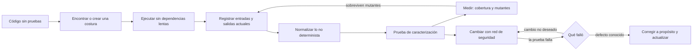
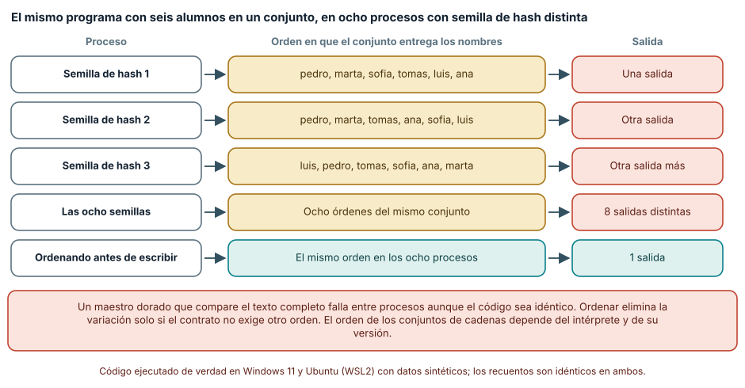
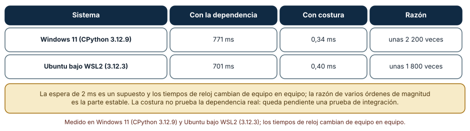

# SE-435 — Pruebas de caracterización y seams

[← SE-434 — Arqueología de código y recuperación de conocimiento](../../classes/part-36-mantenimiento-y-modernizacion-legacy/se-434-arqueologia-de-codigo-y-recuperacion-de-conocimiento/README.md) · [↑ Parte 36](../../classes/part-36-mantenimiento-y-modernizacion-legacy/README.md) · [📚 Índice completo](../../classes/README.md) · [🌐 Portal](../../site/classes/SE-435.html) · [SE-436 — Dependencias obsoletas y riesgo acumulado →](../../classes/part-36-mantenimiento-y-modernizacion-legacy/se-436-dependencias-obsoletas-y-riesgo-acumulado/README.md)

## Punto profesional y fundamento pedagógico

**Punto profesional.** La clase existe para que puedas cambiar código cuyo comportamiento no está especificado sin descubrir en producción qué hacía. La habilidad no es escribir pruebas unitarias sobre un diseño limpio sino fijar, con pruebas de caracterización, lo que el sistema hace hoy (aunque sea incorrecto) y crear costuras (seams) que permitan ejecutarlo sin la base de datos, el reloj ni el sistema de archivos. Es la condición para refactorizar o migrar con alguna garantía.

**Por qué aparece aquí.** Sigue a **Arqueología de código y recuperación de conocimiento**: el mapa de riesgo señaló tres archivos que concentran las correcciones; antes de modificar uno hay que protegerlo. El caso conductor es el **módulo legado de calificaciones**; esta clase trabaja sobre su función `nota_final`, que combina ponderaciones, un bono por asistencia, una política «estricta», topes y un redondeo propio.

**Error conceptual que debe corregir.** Creer que se puede escribir la prueba correcta de un sistema heredado a partir de su especificación. En un sistema heredado la especificación no existe o es falsa; lo que existe es un comportamiento del que dependen otros sistemas y personas. Una prueba de caracterización no afirma que el comportamiento sea correcto, afirma que es el actual, y esa diferencia permite cambiar sin romper por accidente y corregir a propósito.

**Secuencia de aprendizaje.** Antes de mirar los resultados, predices cuántas de doce variaciones del código (mutantes) detectan los cinco ejemplos de la documentación y cuántas detectan mil entradas aleatorias; después generas la prueba de caracterización con entradas de semilla fija, mides la cobertura de líneas y los mutantes detectados, descubres que un registro de salida cambia de un proceso a otro por el orden de un conjunto y mides lo que cuesta no tener una costura. La secuencia usa predicción, explicación propia, contraste y recuperación. [ICAP](https://icap.education.asu.edu/research) distingue participación de construcción de conocimiento; [How People Learn II](https://nap.nationalacademies.org/catalog/24783/how-people-learn-ii-learners-contexts-and-cultures) respalda diseñar la práctica con contextos reales y retroalimentación.

**Evidencia de aprendizaje.** `caracterizacion-log.md` con la predicción, las tres figuras reproducidas, el archivo de entradas y salidas registradas de una función real o sintética, la lista de mutantes que sobrevivieron con los casos que los matarían y una nota que separe qué es observado, qué inferido y qué supuesto.

**Límite de la conclusión.** La función `nota_final`, los doce mutantes, las entradas y la distribución de las partes de nota son sintéticos y escritos por el autor; la cobertura se mide con `sys.settrace` sobre una sola función. No se caracterizó ningún sistema real, y la lectura del reloj de la costura depende del equipo: solo la razón entre las dos cifras es interpretable.

### Trazabilidad fuente → afirmación

| Fuente primaria u oficial | Afirmación que respalda | Lo que no prueba |
|---|---|---|
| [Feathers, «Working Effectively with Legacy Code»](https://www.pearson.com/en-us/subject-catalog/p/working-effectively-with-legacy-code/P200000009466/9780131177055) | Define el código heredado como código sin pruebas, introduce las pruebas de caracterización y la costura (seam) como lugar donde se cambia el comportamiento sin editar en ese lugar. | No garantiza que las pruebas capturen todos los comportamientos relevantes. |
| [Jia y Harman, «An Analysis and Survey of the Development of Mutation Testing»](https://doi.org/10.1109/TSE.2010.62) | Describe las pruebas de mutación: introducir cambios pequeños y comprobar si la suite los detecta, como medida de su capacidad de detección. | No dice cuántos mutantes necesita un sistema concreto ni que mutantes equivalentes sean evitables. |
| [Python: sys.settrace](https://docs.python.org/3/library/sys.html#sys.settrace) | Documenta el gancho de traza con el que se mide qué líneas ejecuta una prueba. | La cobertura de líneas no dice si el resultado de cada línea se verificó. |
| [Python: variable de entorno PYTHONHASHSEED](https://docs.python.org/3/using/cmdline.html#envvar-PYTHONHASHSEED) | Documenta que el orden de iteración de conjuntos de cadenas depende de la semilla de hash, que por defecto cambia entre procesos. | No dice qué partes de tu sistema dependen de ese orden. |
| [Python: unittest.mock](https://docs.python.org/3/library/unittest.mock.html) | Documenta cómo sustituir dependencias en pruebas, una forma de costura de objetos. | No decide si conviene sustituir o rediseñar la dependencia. |

## Antes de empezar

Recupera lo aprendido en `SE-434`: el historial señaló dónde concentrar el riesgo. La pregunta activa es: **¿cuál es el comportamiento actual de la función más corregida de tu sistema, quién depende de él y qué prueba lo fija hoy?**

## Prerrequisitos

- Haber completado `SE-434` o poder explicar qué es un punto caliente y por qué se prioriza.
- Python 3.11 o posterior; los experimentos usan solo la biblioteca estándar (`random`, `sys`, `subprocess`, `time`).
- Haber escrito una prueba unitaria con `unittest` o equivalente.

## Problema auténtico

El equipo debía refactorizar `nota_final` para poder ampliar la política de calificación. No había pruebas. Quien conocía la función sugirió escribirlas «a partir de las reglas»; las reglas estaban en un documento de cinco ejemplos redactado años antes. Con esos cinco ejemplos las pruebas pasaban. Tras la refactorización, producción empezó a calcular un décimo distinto en la nota de algunos alumnos con asistencia exactamente igual al 90 %: una comparación `>` había pasado a `>=`, y los cinco ejemplos no la distinguían. Más tarde, al probar el exportador, el resultado cambiaba entre ejecuciones: el orden de los alumnos del archivo dependía de un conjunto, y cada ejecución tenía un orden distinto. La clase enseña a fijar el comportamiento antes de tocarlo, a medir cuánto detecta esa fijación y a eliminar las fuentes de variación ajenas al código.

## Objetivos observables

Al terminar podrás:

1. escribir una prueba de caracterización que registre salidas actuales de una función y las exija después de un cambio;
2. medir la cobertura de líneas y la capacidad de detección (mutantes) de un conjunto de entradas y explicar por qué no coinciden;
3. identificar fuentes de variación ajenas a la lógica (orden de conjuntos, reloj, azar) y normalizarlas;
4. distinguir las clases de costura (de objeto, de enlace, de preprocesamiento) y crear una que permita ejecutar el código sin su dependencia;
5. decidir cuándo una discrepancia entre prueba y código es un defecto que conservar, uno que corregir y uno que consultar.

## Mapa conceptual



El mapa separa **acceder** al comportamiento (costura), **fijarlo** (registro y normalización) y **verificar la fijación** (mutantes). Una prueba de caracterización sin esa última etapa da una sensación de seguridad que no se ha medido.

## Temas y por qué importan

| Tema | Por qué cambia una decisión profesional | Evidencia mínima |
|---|---|---|
| Código heredado y pruebas de caracterización | Permiten cambiar sin conocer la especificación, que no existe. | Archivo de entradas y salidas registradas |
| Maestro dorado y su sesgo de muestreo | La muestra elegida determina qué cambios se detectan. | Cobertura y mutantes por tamaño de muestra |
| Fuentes de no determinismo | Una salida que varía entre ejecuciones invalida la comparación. | Prueba con semillas de hash distintas |
| Costuras y su costo | Sin costura, cada prueba paga la dependencia más lenta. | Tiempo con y sin sustitución |
| Qué hacer con los defectos fijados | Caracterizar no es bendecir: hay que decidir qué se conserva. | Lista de comportamientos en tres categorías |

## Conceptos y decisiones

### 1. Código heredado y pruebas de caracterización

Una prueba normal expresa lo que el código debería hacer según una especificación. Una **prueba de caracterización** expresa lo que el código hace hoy: se ejecuta el código con una entrada, se observa la salida y se escribe como expectativa. Su valor es que sirve de red de seguridad: si después de un cambio la salida difiere, el cambio alteró un comportamiento, y entonces alguien decide si fue deseado. La técnica invierte el orden habitual (primero se observa, luego se afirma) porque en un sistema heredado la especificación es el propio sistema. El resultado puede incluir comportamientos que hoy parecen errores: se registran igual, porque otros sistemas pueden depender de ellos, y se marcan para decidir aparte. La disciplina es no corregir mientras se caracteriza; mezclar ambas tareas hace que la prueba deje de describir el sistema que existía.

### 2. El maestro dorado y su sesgo de muestreo

Cuando la función tiene muchos caminos, el procedimiento práctico es el **maestro dorado** (golden master): generar muchas entradas, registrar las salidas del código actual y exigir que sigan siendo las mismas. La pregunta es qué entradas. Las que da la documentación son las que alguien consideró representativas, y por eso mismo suelen ser los casos centrales: pasan por los caminos comunes y no por los bordes. Las entradas aleatorias cubren más caminos y tropiezan con los bordes por frecuencia, lo que exige muestras grandes. Los casos de borde elegidos a mano atacan exactamente los lugares donde el código decide (comparaciones, topes, redondeos) y fallan cuando la combinación que importa no se pensó. Cada estrategia deja pasar cosas distintas, y la medida de cuántas es el objetivo de la prueba de mutación.

### 3. Medir lo que la prueba detecta: cobertura frente a mutantes

La **cobertura de líneas** dice qué líneas se ejecutaron; no dice si el resultado se comprobó ni si un cambio en esa línea habría sido detectado. La **prueba de mutación** introduce cambios pequeños (cambiar `>` por `>=`, una constante por otra) y cuenta cuántos hace fallar la suite: un mutante que sobrevive es un cambio de comportamiento que la suite no habría visto. El indicador no es perfecto (hay mutantes equivalentes, que no cambian el comportamiento y no pueden detectarse), pero es el único que mide la capacidad de detección en vez de la actividad. Una suite con 100 % de cobertura puede dejar sobrevivir la mitad de los mutantes: la cobertura es un indicador necesario y casi nunca suficiente.

### 4. Fuentes de no determinismo

Para que una comparación de salidas sea válida, la salida debe depender solo de la entrada. Hay causas comunes que no son la lógica: el **orden de iteración de un conjunto o diccionario** (en Python el de conjuntos de cadenas cambia entre procesos por la semilla de hash), la **hora actual**, los **números aleatorios**, los **identificadores generados**, el **orden de archivos** devueltos por el sistema y la **zona horaria o configuración regional**. El método es siempre el mismo: detectar la variación (repetir la ejecución con condiciones distintas), localizar su fuente y normalizarla en la frontera de la prueba, ordenando, fijando semillas o inyectando el reloj. Normalizar demasiado oculta defectos reales: si la función debería devolver los alumnos en un orden específico por contrato, ordenar en la prueba lo esconde. La decisión de qué normalizar se escribe en la prueba.

### 5. Costuras y su costo

Una **costura** es un lugar donde se puede alterar el comportamiento sin modificar el código en ese lugar. Feathers distingue tres clases. En una **costura de objeto** el comportamiento depende de un objeto o función que se puede sustituir (se pasa como argumento, se hereda, se reemplaza en una prueba); es la más usada. En una **costura de enlace** se cambia lo que se enlaza (otra biblioteca o módulo con el mismo nombre en el entorno de prueba). En una **costura de preprocesamiento** se transforma el texto antes de compilar, y casi no existe en Python. Sin costura, probar una función que lee la asistencia de una base de datos obliga a levantar la base en cada prueba. El costo aparece en el tiempo, en la fragilidad y en lo que se deja de probar porque resulta caro. Crear la costura es el primer cambio del código heredado y debe ser mínimo y mecánico: añadir un parámetro con la dependencia actual como valor por defecto no altera el comportamiento observable.

### 6. Qué hacer con los defectos fijados

Al caracterizar aparecen comportamientos que parecen errores. Hay tres decisiones, y se escriben en la prueba: **conservar** (otros sistemas dependen de ello o corregirlo está fuera de alcance), **corregir a propósito** (se cambia el código y la expectativa en el mismo cambio, con la razón en el mensaje) o **consultar** (no se sabe qué esperaba el negocio). Corregir sin escribirlo es la manera habitual de romper a un consumidor que dependía del comportamiento antiguo, un efecto que se resume en la observación de que, con suficientes usuarios, cualquier comportamiento observable acabará siendo usado por alguien. Una prueba de caracterización que se actualiza sin pensar cuando falla deja de proteger.

### Cobertura que no detecta

Se escribe la función `nota_final` (ponderación 0,3, 0,3 y 0,4 con tres partes, promedio simple en otro caso; bono de 0,3 si la asistencia supera el 90 %; política «estricta» que resta 0,2 por debajo de 4,0; topes en 1,0 y 7,0; redondeo con `int(n * 10 + 0,5) / 10`) y doce mutantes que cambian una constante o un operador. Se registran las salidas de cinco ejemplos de la documentación, de 5, 20, 100 y 1 000 entradas aleatorias con semilla fija (con un 5 % de partes ausentes) y de 14 casos de borde elegidos a mano.

```python
def mata(entradas):
    return sum(any(difiere(cargar(LEGACY.replace(a, b, 1)), e) for e in entradas) for a, b in MUTANTES)
```

| Conjunto de entradas | Líneas cubiertas | Mutantes detectados |
|---|---:|---:|
| 5 ejemplos de la documentación | 16 de 18 (89 %) | 4 de 12 |
| 5 entradas aleatorias | 15 de 18 (83 %) | 6 de 12 |
| 20 entradas aleatorias | 16 de 18 (89 %) | 9 de 12 |
| 100 entradas aleatorias | 16 de 18 (89 %) | 9 de 12 |
| 1 000 entradas aleatorias | 18 de 18 (100 %) | 12 de 12 |
| 14 casos de borde elegidos | 17 de 18 (94 %) | 9 de 12 |

Los cinco ejemplos cubren el 89 % de las líneas y detectan 4 mutantes de 12: entre los que dejan pasar están `>` por `>=` en la asistencia y el cambio del redondeo. Cien entradas aleatorias tienen la misma cobertura que veinte, 89 %, y detectan los mismos 9; los tres que sobreviven son el borde `n < 4,0`, el tope superior en 7,0 y el inferior en 1,0, que ocurren raramente. Con mil entradas se cubren todas las líneas y se detectan los 12. Los 14 casos de borde detectan 9, pero sobreviven otros tres: el intercambio de las ponderaciones (los casos de borde usaban partes iguales, que lo hacen invisible), el tope inferior y la comparación `len(partes) >= 3` (ningún caso tenía cuatro partes). Ninguna estrategia domina: la combinación de mil aleatorias con los 14 de borde detecta los 12.


**Cómo leer la figura.** Cada pareja de barras es un conjunto de entradas: la dorada es el porcentaje de líneas cubiertas y la verde, el de mutantes detectados. Mira primero cómo las barras no suben juntas: los casos de borde cubren el 94 % de las líneas y detectan menos mutantes que mil entradas aleatorias. **Dónde deja de valer:** la función, los doce mutantes y la distribución de las entradas son del autor, y los mutantes se escribieron sabiendo qué cambios hacía falta provocar; una herramienta de mutación real genera cientos de mutantes, incluye equivalentes y da otra proporción. Los 14 casos de borde se eligieron una sola vez y otra persona elegiría otros.

### Un mismo código, ocho procesos, ocho salidas

El exportador del módulo escribe los alumnos de un conjunto de seis nombres. Se ejecuta el mismo programa en ocho procesos con la variable `PYTHONHASHSEED` fija a 1, 2, … 8 para que el experimento sea reproducible.

```python
alumnos = {'ana', 'luis', 'marta', 'pedro', 'sofia', 'tomas'}
print(','.join(a for a in alumnos))
```

| Semilla de hash | Salida |
|---|---|
| 1 | pedro,marta,sofia,tomas,luis,ana |
| 2 | pedro,marta,tomas,ana,sofia,luis |
| 3 | luis,pedro,tomas,sofia,ana,marta |
| Las ocho | 8 salidas distintas |
| Ordenando antes de escribir | 1 salida |

Ocho procesos producen ocho órdenes distintos con el mismo código y los mismos datos. Una prueba de maestro dorado que compara el texto completo falla en el 100 % de las comparaciones entre procesos con semillas distintas y pasa por casualidad si se ejecuta dos veces en el mismo proceso. Ordenar antes de escribir deja una sola salida. Antes de ordenar hay que decidir si el contrato exige ese orden: si el negocio pide el orden de matrícula, ordenar por nombre es otra decisión y el defecto real es la ausencia de un orden definido.



**Cómo leer la figura.** Cada fila es un proceso y las flechas llevan de la semilla de hash al orden que entrega el conjunto y a la salida; coral es una salida distinta de las otras y verde, la salida única. Mira primero que ocho semillas dan ocho salidas y que ordenar antes de escribir las reduce a una. **Dónde deja de valer:** el orden de los conjuntos de cadenas depende de la implementación y de la versión; los diccionarios de Python 3.7 en adelante conservan el orden de inserción y no sufren este efecto. Otras fuentes (reloj, aleatoriedad, orden de archivos) se comportan de otra manera y se detectan igual: repitiendo la ejecución con condiciones distintas.

### Lo que cuesta no tener una costura

La función que calcula la nota lee la asistencia de una dependencia que tarda 2 ms (una espera real que simula una consulta). Se miden 300 pruebas con la dependencia real y con una función sustituta pasada como argumento.

| Sistema | 300 pruebas con la dependencia | 300 pruebas con costura | Razón |
|---|---:|---:|---:|
| Windows 11 (CPython 3.12.9) | 771 ms | 0,34 ms | unas 2 200 veces |
| Ubuntu bajo WSL2 (3.12.3) | 701 ms | 0,40 ms | unas 1 800 veces |

La costura convierte 771 ms en 0,34 ms por 300 pruebas. Con una consulta real de 2 ms por prueba, una suite de 5 000 pruebas pasaría de 10 segundos a unas milésimas de segundo, y la diferencia determina si las pruebas se ejecutan en cada cambio o una vez al día. Las cifras absolutas dependen del equipo y no se reproducen al milisegundo; la razón, de varios órdenes de magnitud, sí es estable. Lo que la costura no hace es probar la dependencia: queda una prueba de integración pendiente para la lectura real de la asistencia.



**Cómo leer la figura.** Cada grupo es un sistema y sus dos barras son el tiempo de las 300 pruebas con la dependencia de 2 ms (coral) y con la costura (verde), en escala logarítmica: cada marca vale diez veces la anterior. Mira primero la distancia de varios órdenes de magnitud entre las dos barras. **Dónde deja de valer:** la espera de 2 ms es una suposición y la dependencia real puede costar 0,2 ms o 200; el reloj es el del equipo y cambia entre ejecuciones. La figura no mide el costo de crear la costura ni el riesgo de que el sustituto no se parezca a la dependencia real.

## Definiciones de trabajo

- **prueba de caracterización:** prueba que fija el comportamiento actual de un código, sea o no el correcto, para detectar cambios no deseados.
- **maestro dorado:** conjunto de entradas con las salidas registradas del código actual, usado como expectativa.
- **mutante:** copia del código con un cambio pequeño introducido a propósito para comprobar si la suite lo detecta.
- **costura (seam):** lugar donde puede alterarse el comportamiento de un programa sin editar el código en ese lugar.
- **no determinismo:** dependencia de la salida de factores distintos de la entrada, como el orden de un conjunto, el reloj o el azar.

Las definiciones son operativas para el módulo de calificaciones. No convierten términos con una historia más amplia en sinónimos y deben contrastarse con la documentación primaria enlazada al final.

## Ejemplo mínimo

El fragmento muestra una expectativa que pasa con ejemplos de la documentación y no distingue un cambio de comparación. Antes de ejecutarlo, predice si el segundo caso detecta el mutante.

```python
def bono(asistencia): return 0.3 if asistencia > 90 else 0.0
def bono_mutado(asistencia): return 0.3 if asistencia >= 90 else 0.0
casos = [80, 95]
print([bono(a) == bono_mutado(a) for a in casos])
```

Imprime `[True, True]`: con 80 y 95 el mutante se comporta igual. Añade el caso 90 y comprueba que lo detecta. Registra versión de Python, comando y salida.

## Ejemplo profesional

Escenario hipotético, construido para la clase y sin datos reales. Antes de refactorizar `nota_final`, el equipo añade un parámetro `leer_asistencia` con la consulta real como valor por defecto (costura de objeto sin cambio de comportamiento), genera 1 000 entradas con semilla fija y 14 casos de borde, guarda las salidas actuales en un archivo y escribe una prueba que las exige. Mide 18 líneas de 18 cubiertas y 12 mutantes de 12 detectados con el conjunto combinado. Al caracterizar descubre que la nota de un alumno con una parte ausente se calcula con peso 0,3 y 0,3 sobre un total de 0,6, un comportamiento que parece un defecto; consulta con el área académica y se decide conservarlo hasta la siguiente revisión del reglamento, con la anotación en la prueba. Un segundo hallazgo, el exportador que depende del orden de un conjunto, se corrige a propósito: se define el orden por número de matrícula y se actualiza la expectativa en el mismo cambio. Compara con el procedimiento inicial de cinco ejemplos: ahora un cambio de comparación en la asistencia hace fallar una prueba antes de llegar a producción.

## Práctica guiada

1. Elige una función con varias decisiones (comparaciones, topes, redondeos) de un proyecto propio o usa la sintética.
2. Predice cuántos de los doce mutantes detectan los ejemplos de la documentación y escribe el número antes de medir.
3. Genera 5, 20, 100 y 1 000 entradas con semilla fija, registra las salidas y mide cobertura y mutantes; completa la tabla.
4. Añade 14 casos de borde elegidos a mano y busca qué mutantes siguen sobreviviendo; añade los casos que los matarían.
5. Ejecuta el programa del exportador con ocho semillas de hash y comprueba cuántas salidas distintas produce; normaliza el orden y repite.
6. Introduce una costura de objeto en la función que lee la asistencia y mide el tiempo de 300 pruebas con y sin ella.
7. Entrega `caracterizacion-log.md` y pide a otra persona que escriba un mutante que tu conjunto no detecte.

## Ejercicios

1. **Mutantes:** escribe tres mutantes de `nota_final` distintos de los doce y di cuáles detectaría el conjunto de 100 entradas aleatorias antes de comprobarlo.
2. **Borde:** explica por qué los 14 casos de borde no detectan el intercambio de las ponderaciones y qué caso mínimo lo detectaría.
3. **No determinismo:** propón dos fuentes de variación distintas del orden de un conjunto en un exportador y cómo detectarlas repitiendo la ejecución.
4. **Decisión:** una prueba de caracterización fija que la nota de una parte ausente cuenta como cero. Redacta la decisión (conservar, corregir o consultar) con quién debe tomarla y qué evidencia pedirías.

## Reto verificable

Entrega `caracterizacion-log.md` con la predicción, las tres tablas, el archivo de entradas y salidas, la lista de mutantes supervivientes con el caso que los mataría y una decisión escrita para cada comportamiento sospechoso. Se aprueba si otra persona ejecuta el código desde un checkout limpio, obtiene los mismos números con las mismas semillas y puede decir qué cambio de código haría fallar la prueba y cuál no. No se aprueba por reportar cobertura sin mutantes ni por normalizar el orden sin comprobar si el contrato lo exigía.

## Caso conductor

El módulo de calificaciones es el caso conductor de la Parte 36. Esta clase deja el tercer artefacto: la prueba de caracterización de `nota_final` con su costura. `SE-436` preguntará qué riesgo acumulan las dependencias que el módulo usa, y `SE-437` cómo se sustituye el módulo por partes apoyándose en estas pruebas. Cambia después un solo dato, el porcentaje de partes ausentes del 5 % a cero, y observa qué mutantes dejan de ser detectables.

## Preguntas frecuentes

### ¿Una prueba de caracterización no consolida los errores?

Los registra, no los aprueba. La diferencia está en la decisión que se escribe junto a cada comportamiento: conservar, corregir o consultar. Sin esa decisión la prueba sí consolida; con ella documenta.

### ¿Cuántas entradas aleatorias hacen falta?

Depende de la rareza de los caminos. Los caminos que ocurren con probabilidad p aparecen en n entradas con probabilidad 1 − (1 − p)^n, de modo que para ver uno que ocurre una de cada mil veces con el 95 % de confianza hacen falta unas 3 000 entradas. Cuando el camino raro es crítico, un caso elegido a mano es más barato.

### ¿La cobertura del 100 % no basta?

No. La cobertura de líneas mide qué se ejecutó, no qué se comprobó ni qué cambios se detectarían. En el experimento mil entradas alcanzan el 100 % y 14 casos de borde el 94 %, pero los segundos dejan sobrevivir tres mutantes que las mil detectan.

### ¿Es lo mismo una costura que un patrón de inyección de dependencias?

La inyección de dependencias es una forma de crear costuras de objeto. Una costura puede crearse también con sustitución de módulos o con herencia; lo importante es que el cambio de comportamiento ocurra fuera del código que se quiere probar.

## Fallo controlado y diagnóstico

Reproduce el fallo clásico de la clase: **una refactorización que pasa los ejemplos de la documentación y cambia el comportamiento en un borde**. Cambia `asistencia > 90` por `asistencia >= 90` en el código y ejecuta los cinco ejemplos de la documentación.

Registra síntoma, entrada mínima, hipótesis, observación que descarta cada hipótesis, causa, corrección y prueba de regresión. **Síntoma:** los ejemplos pasan y producción calcula un décimo más a quienes tienen exactamente 90 % de asistencia. **Hipótesis rivales:** (a) los datos de producción son distintos; (b) otro módulo cambió; (c) los ejemplos no cubren el borde. **Prueba:** ejecuta el maestro dorado de mil entradas más los casos de borde; si falla en las entradas con asistencia 90, la causa es el borde. **Conclusión:** los ejemplos de la documentación detectan 4 mutantes de 12 y este no está entre ellos. **Regresión:** añade el caso de asistencia 90 con la salida registrada y exige que la suite mate el mutante. No cambies a la vez la comparación y el tope superior.

## Errores comunes y cómo corregirlos

| Síntoma | Causa probable | Corrección |
|---|---|---|
| La prueba pasa y producción cambia | Los ejemplos no cubren los bordes de decisión | Añadir casos de borde y medir mutantes |
| La prueba falla de forma intermitente | Orden de un conjunto, reloj o azar | Repetir con condiciones distintas y normalizar la fuente |
| La suite tarda minutos | Cada prueba paga la dependencia lenta | Crear una costura y sustituir la dependencia |
| Se actualizan las expectativas al fallar | No se decidió si el cambio era deseado | Escribir conservar, corregir o consultar para cada diferencia |
| Cobertura alta y confianza baja | Se midió actividad, no detección | Medir mutantes y revisar los que sobreviven |

## Entorno y archivos clave

```text
work/SE-435/
├── README.md
├── legado/nota_final.py
├── caracterizacion/
│   ├── generar_entradas.py
│   ├── maestro_dorado.json
│   └── mutantes.py
├── tests/test_caracterizacion.py
└── evidence/caracterizacion-log.md
```

El `README` declara plataforma, versión de Python, semillas y comandos. Los experimentos usan solo la biblioteca estándar (`random`, `sys`, `subprocess`, `time`) y se ejecutaron con CPython 3.12.9 en Windows 11 y 3.12.3 en Ubuntu bajo WSL2. Las cifras de cobertura, mutantes y órdenes por semilla de hash fueron idénticas en ambos; los tiempos de reloj de la costura difieren porque dependen del equipo.

## Seguridad, ética y accesibilidad

- las entradas y salidas registradas de un sistema real pueden contener datos personales: genera datos sintéticos o anonimiza antes de guardarlos en el repositorio;
- fijar un comportamiento erróneo que perjudica a personas (una nota mal calculada) no puede quedar en una prueba sin una decisión y una fecha de revisión;
- las pruebas de mutación ejecutan código modificado: hazlo en un entorno aislado, no sobre el repositorio de producción;
- las tablas y figuras deben tener texto alternativo y no depender del color;
- los ejemplos del libro de Feathers son material protegido: cita las ideas y no copies su texto ni sus ejemplos.

## Puente hacia el trabajo con agentes

Un agente al que se le pide «escribe pruebas para esta función» las derivará de lo que lee en el código y de los nombres, y a menudo afirmará lo que el código debería hacer, no lo que hace. Pídele en cambio que ejecute la función y registre las salidas como expectativas, que genere entradas con semilla fija y casos de borde, que mida los mutantes con la suite resultante y que liste los que sobreviven con el caso que los mataría. Revisa especialmente las pruebas que el agente «arregló» tras un fallo: si cambió la expectativa sin una decisión escrita, la prueba dejó de proteger.

## Transferencia

Traslada el análisis a otro dominio (por ejemplo, una función que calcula el precio de una reserva con descuentos): cambia la función y las dependencias y conserva el procedimiento de crear una costura, registrar un maestro dorado, medir cobertura y mutantes, normalizar la variación y decidir qué hacer con cada comportamiento sospechoso. La transferencia está lograda cuando puedes decir qué mutantes sobrevivirían a tu conjunto y qué dependencia necesita una costura, no cuando la tabla se parece a la de `nota_final`.

## Evaluación y evidencia

| Criterio | Evidencia para aprobar |
|---|---|
| comprensión | explicación de qué fija una prueba de caracterización y de la diferencia entre cobertura y detección |
| corrección | tablas de cobertura y mutantes, de variación entre procesos y de tiempo reproducibles con las mismas semillas |
| diseño | costura mínima que no altera el comportamiento y decisión escrita para cada comportamiento sospechoso |
| diagnóstico | reproducción del fallo «cambio en un borde que los ejemplos no ven» con regresión |
| incertidumbre | declaración de que la función, los mutantes y las entradas son del autor |
| reproducibilidad | versiones, comandos, salida y límites declarados |

## Fuentes

- [Feathers, «Working Effectively with Legacy Code»](https://www.pearson.com/en-us/subject-catalog/p/working-effectively-with-legacy-code/P200000009466/9780131177055) — pruebas de caracterización y costuras; autoridad: libro de referencia (ISBN 9780131177055).
- [Jia y Harman, «An Analysis and Survey of the Development of Mutation Testing»](https://doi.org/10.1109/TSE.2010.62) — pruebas de mutación; autoridad: IEEE Transactions on Software Engineering, 2011.
- [Python: sys.settrace](https://docs.python.org/3/library/sys.html#sys.settrace) — medición de líneas ejecutadas; autoridad: documentación de Python.
- [Python: PYTHONHASHSEED](https://docs.python.org/3/using/cmdline.html#envvar-PYTHONHASHSEED) — origen del orden variable de los conjuntos; autoridad: documentación de Python.
- [Python: unittest.mock](https://docs.python.org/3/library/unittest.mock.html) — sustitución de dependencias en pruebas; autoridad: documentación de Python.

Cada fuente respalda el mecanismo indicado; ninguna demuestra que los 12 mutantes, el 89 % de cobertura o los 771 ms se observen en tu sistema. Esa afirmación depende del código, de los mutantes y del equipo de medición.

## Límites y siguiente paso

Se ejecutaron tres experimentos en Windows y Ubuntu (WSL2): las cifras de cobertura, mutantes y órdenes fueron idénticas y los tiempos de reloj de la costura difieren por diseño. La función, los doce mutantes y las entradas son construcciones del autor, los mutantes se escribieron sabiendo qué conjuntos los evalúan, la cobertura solo se mide por líneas y no se usó ninguna herramienta de mutación real ni se caracterizó un sistema real. La siguiente clase pregunta qué riesgo acumulan las dependencias externas que el módulo usa.

## Glosario

- **prueba de caracterización:** prueba que fija el comportamiento actual de un código, sea o no el correcto, para detectar cambios no deseados.
- **maestro dorado:** conjunto de entradas con las salidas registradas del código actual, usado como expectativa.
- **mutante:** copia del código con un cambio pequeño introducido a propósito para comprobar si la suite lo detecta.
- **costura (seam):** lugar donde puede alterarse el comportamiento de un programa sin editar el código en ese lugar.
- **no determinismo:** dependencia de la salida de factores distintos de la entrada, como el orden de un conjunto, el reloj o el azar.

---

[← SE-434 — Arqueología de código y recuperación de conocimiento](../../classes/part-36-mantenimiento-y-modernizacion-legacy/se-434-arqueologia-de-codigo-y-recuperacion-de-conocimiento/README.md) · [↑ Parte 36](../../classes/part-36-mantenimiento-y-modernizacion-legacy/README.md) · [📚 Índice completo](../../classes/README.md) · [🌐 Portal](../../site/classes/SE-435.html) · [SE-436 — Dependencias obsoletas y riesgo acumulado →](../../classes/part-36-mantenimiento-y-modernizacion-legacy/se-436-dependencias-obsoletas-y-riesgo-acumulado/README.md)
