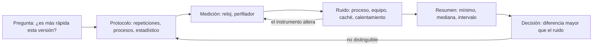

# SE-437 — Perfiles, benchmarks y errores de medición

[← SE-436 — Latencia, throughput, saturación y capacidad](../../classes/part-36-calidad-rendimiento-y-resiliencia/se-436-latencia-throughput-saturacion-y-capacidad/README.md) · [↑ Parte 36](../../classes/part-36-calidad-rendimiento-y-resiliencia/README.md) · [📚 Índice completo](../../classes/README.md) · [🌐 Portal](../../site/classes/SE-437.html) · [SE-438 — Timeouts, retries, backoff y jitter →](../../classes/part-36-calidad-rendimiento-y-resiliencia/se-438-timeouts-retries-backoff-y-jitter/README.md)

## Punto profesional y fundamento pedagógico

**Punto profesional.** La clase existe para que sepas qué hace tu reloj, tu perfilador y tu benchmark cuando miden: qué parte del número es del programa y qué parte es del instrumento, del equipo y de la elección de estadístico. La habilidad profesional no es ejecutar un benchmark sino decidir cuántas repeticiones, qué estadístico y qué diferencia mínima permiten decir «esta versión es más rápida» sin engañarse.

**Por qué aparece aquí.** Sigue a **Latencia, throughput, saturación y capacidad**: allí el tiempo era una magnitud de un modelo; aquí es una lectura de un reloj sobre un equipo real, con ruido. Todo lo anterior (objetivos de percentil, capacidad, pruebas de carga) descansa en que las mediciones de tiempo sean fiables, y esta clase mide cuánto lo son. El caso conductor es la comparación de dos implementaciones de la ordenación de entregas de la API.

**Error conceptual que debe corregir.** Creer que un benchmark devuelve «el tiempo» de una función: devuelve una muestra de una distribución que depende del proceso, del equipo, de lo que ocurra a su lado y de cómo se elija resumirla, y una sola ejecución no basta para distinguir dos versiones.

**Secuencia de aprendizaje.** Antes de leer los resultados, predices cuánto varía la mediana de la misma función entre procesos nuevos y cuántas veces declararía «más lenta» una comparación entre dos copias idénticas; después mides cinco procesos, el efecto del perfilador sobre el reparto del tiempo y de una caché sobre un benchmark, y simulas una comparación entre dos copias idénticas con distintos estadísticos y números de repeticiones. La secuencia usa predicción, explicación propia, contraste y recuperación. [ICAP](https://icap.education.asu.edu/research) distingue participación de construcción de conocimiento; [How People Learn II](https://nap.nationalacademies.org/catalog/24783/how-people-learn-ii-learners-contexts-and-cultures) respalda diseñar la práctica con contextos reales y retroalimentación.

**Evidencia de aprendizaje.** `bench-log.md` con la predicción, las tres figuras reproducidas, el protocolo del benchmark (repeticiones, estadístico, calentamiento, diferencia mínima) y una nota que separe lo que se midió con el reloj del equipo de lo que se simuló.

**Límite de la conclusión.** Los tiempos de las dos primeras figuras son lecturas reales de un equipo con Windows 11 (CPython 3.12.9) y de Ubuntu bajo WSL2 (3.12.3) en esta máquina; **no son reproducibles al milisegundo** y se declaran por eso: lo que se reproduce es la conclusión de que varían. La tercera figura es una simulación con ruido y semilla fijas y sí es reproducible. No se midió ningún servidor, ninguna otra versión de Python ni otro sistema, y la carga de fondo del equipo no se controló.

### Trazabilidad fuente → afirmación

| Fuente primaria u oficial | Afirmación que respalda | Lo que no prueba |
|---|---|---|
| [Mytkowicz et al., «Producing wrong data without doing anything obviously wrong!» (ASPLOS 2009)](https://doi.org/10.1145/1508244.1508275) | Muestra que factores aparentemente irrelevantes (tamaño del entorno, orden de enlazado) cambian el resultado de un benchmark lo bastante para invertir una conclusión. | No cuantifica el efecto en Python ni en este equipo. |
| [Kalibera y Jones, «Rigorous benchmarking in reasonable time» (ISMM 2013)](https://doi.org/10.1145/2464157.2464160) | Propone un método para decidir cuántas repeticiones y a qué nivel (ejecuciones, procesos) hacen falta y cómo informar intervalos. | No es un procedimiento universal para todo lenguaje. |
| [Python: módulo timeit](https://docs.python.org/3/library/timeit.html) | Recomienda usar el mínimo de varias repeticiones como estimación del tiempo sin interferencias y advierte de que los otros valores miden la interferencia del sistema. | No dice que el mínimo sea el mejor estadístico en toda comparación. |
| [Python: los perfiladores](https://docs.python.org/3/library/profile.html) | Distingue el perfilado determinista (cProfile) y señala que añade sobrecarga por evento. | No da el factor de sobrecarga de este programa. |

## Antes de empezar

Recupera lo aprendido en `SE-436`: un percentil se calcula sobre muestras y las muestras tienen forma. La pregunta activa es: **¿cuánto de la diferencia entre dos tiempos es del código y cuánto del ruido de medir, y cuántas repeticiones hacen falta para distinguirlos?**

## Prerrequisitos

- Haber completado `SE-436` o poder explicar qué es un percentil y por qué no se promedia.
- Python 3.11 o posterior; los experimentos usan solo la biblioteca estándar (`time`, `cProfile`, `functools`, `random`, `subprocess`).
- Saber ejecutar un script desde la terminal en Windows y, si se puede, en Ubuntu (WSL2).

## Problema auténtico

El equipo de la plataforma escribió una segunda versión de la ordenación de entregas de un curso y quiso comprobar que era más rápida. Ejecutó cada versión una vez: la nueva tardó 5,5 ms y la vieja 7,1 ms; el cambio se aprobó con la frase «un 22 % más rápida». Un mes después, otra persona repitió la medición en otro proceso y obtuvo 11 ms para la versión nueva. Nadie había cambiado el código. La primera medición había coincidido con un proceso sin interferencias y la segunda con otro que compartía el equipo con una compilación. Cuando el equipo repitió treinta veces en cinco procesos nuevos, las medianas variaron entre 5,5 y 11 ms: más que la mejora que se quería detectar. La clase enseña a medir esa variación primero y a decidir después qué diferencia se puede afirmar.

## Objetivos observables

Al terminar podrás:

1. medir la variación de una misma función entre ejecuciones y entre procesos y expresarla como una razón;
2. explicar por qué la primera ejecución, el mínimo, la mediana y el máximo cuentan historias distintas;
3. mostrar con un experimento que un perfilador determinista altera el reparto del tiempo que mide;
4. detectar cuando un benchmark mide una caché o una construcción previa en lugar del trabajo;
5. diseñar una comparación de dos versiones con un estadístico, un número de repeticiones y una diferencia mínima fijados antes de medir.

## Mapa conceptual



El mapa separa la **pregunta**, el **protocolo** (que se fija antes) y el **ruido** (que se mide). La flecha de retorno importa: si no se puede distinguir, la respuesta correcta es repetir con otro protocolo, no declarar un ganador.

## Temas y por qué importan

| Tema | Por qué cambia una decisión profesional | Evidencia mínima |
|---|---|---|
| Qué mide un reloj | Resolución, monotonía y tiempo de pared frente a tiempo de CPU. | Predicción, traza causal y contraejemplo de **Qué mide un reloj** en `bench-log.md` |
| Ruido y calentamiento | Una sola ejecución no representa al programa. | Predicción, traza causal y contraejemplo de **Ruido y calentamiento** en `bench-log.md` |
| Perfiles | Un perfil dice qué se llama, no necesariamente cuánto cuesta. | Predicción, traza causal y contraejemplo de **Perfiles** en `bench-log.md` |
| Benchmarks mal planteados | Medir una caché, una constante o una entrada irreal. | Predicción, traza causal y contraejemplo de **Benchmarks mal planteados** en `bench-log.md` |
| Comparar con estadística | Una diferencia solo importa si supera el ruido. | Predicción, traza causal y contraejemplo de **Comparar con estadística** en `bench-log.md` |

## Conceptos y decisiones

### 1. Qué mide un reloj

Python ofrece varios relojes y cada uno responde otra pregunta. `time.perf_counter()` es un reloj monótono de alta resolución pensado para medir intervalos, `time.time()` es el reloj de pared y puede saltar si se ajusta la hora, y `time.process_time()` cuenta solo el tiempo de CPU del proceso y excluye las esperas. La resolución nominal del primero fue de 100 ns en Windows y de 1 ns en Ubuntu en este equipo, pero la resolución nominal no es la precisión: entre dos lecturas hay activaciones del planificador, cambios de frecuencia de la CPU y otros procesos. Medir un intervalo de microsegundos con un reloj de nanosegundos no vuelve la medición precisa; solo la hace menos redondeada. Por eso se mide el tiempo de muchas ejecuciones y se resume, en lugar de fiarse de una.

### 2. Ruido y calentamiento

El tiempo de una función se distribuye alrededor de un valor típico con una cola hacia lo lento. Las causas son varias: la memoria caché de la CPU está fría o caliente, el sistema operativo da el procesador a otro proceso, el recolector de basura se activa, la frecuencia del procesador cambia y los datos están o no en memoria. Entre procesos nuevos añade además el orden de las direcciones de memoria y el estado general del equipo, de manera que la variación entre procesos puede superar a la variación dentro de uno. La **primera ejecución** suele ser distinta de las demás por la caché fría y la carga de módulos, aunque en Python, a diferencia de lenguajes con compilación bajo demanda, el efecto es moderado y a veces inexistente. Tres decisiones del protocolo reducen el ruido: repetir dentro de un proceso, repetir en varios procesos y registrar el equipo y su estado.

### 3. Perfiles

Un **perfilador determinista** como `cProfile` registra cada llamada y cada retorno y devuelve contadores y tiempos acumulados por función. Es exacto para contar llamadas y aproximado para el tiempo, porque la propia instrumentación tiene un costo por evento y ese costo se carga a las funciones medidas. Una función muy pequeña llamada muchas veces paga la sobrecarga proporcionalmente más que una grande llamada pocas veces, de manera que el perfil exagera o subestima su peso según cómo se atribuya. Un **perfilador de muestreo** interrumpe el programa a intervalos regulares y anota qué estaba ejecutando; añade menos sobrecarga y distorsiona menos, a costa de resolver menos las funciones muy cortas. La conclusión práctica: usar el perfil para encontrar dónde mirar y verificar el hallazgo con una medición sin perfilador antes de optimizar.

### 4. Benchmarks mal planteados

Un benchmark puede medir lo que no se quería. Si la función usa una caché (`functools.lru_cache`) y se llama una y otra vez con el mismo argumento, el benchmark mide una búsqueda en un diccionario y no el trabajo. Si la entrada es demasiado pequeña, domina el costo fijo de la llamada; si es demasiado regular, el procesador predice los saltos y la caché la favorece más que los datos reales. Si se mide dentro del mismo proceso una función que modifica un estado global, la segunda ejecución ya no parte del mismo estado. La regla es describir qué entrada, qué estado inicial y qué se descarta: un benchmark sin esa descripción es una cifra sin significado. El efecto contrario también existe: medir la construcción de los datos junto con el algoritmo que se quiere comparar.

### 5. Comparar con estadística

Comparar dos versiones es decidir si dos distribuciones difieren. Con pocas repeticiones, la media es muy sensible a las ejecuciones lentas ocasionales (una interferencia de +50 % en una de cinco ejecuciones mueve la media un 10 %); la mediana es robusta a ellas; el mínimo estima el tiempo sin interferencias pero también es un estadístico extremo que cambia con cada muestra. Ninguno es universalmente correcto. Lo que sí hace falta es fijar de antemano el estadístico, el número de repeticiones y la diferencia mínima relevante, y comprobar cuántas veces el protocolo declara una diferencia cuando comparas dos copias idénticas (una prueba A/A). Si el protocolo «descubre» diferencias entre dos copias iguales, no sirve para comparar dos versiones distintas.

### Variación entre procesos

Se mide una ordenación de 20 000 enteros pseudoaleatorios (semilla fija) 30 veces en cada uno de cinco procesos nuevos de Python y se anotan la primera ejecución, el mínimo, la mediana y el máximo.

```python
r = random.Random(3771); datos = [r.randrange(10**6) for _ in range(20000)]
t = []
for _ in range(30):
    a = time.perf_counter_ns(); sorted(datos); t.append((time.perf_counter_ns() - a) / 1e6)
```

| Proceso (Windows 11) | Primera | Mínimo | Mediana | Máximo | Máx / mín |
|---|---:|---:|---:|---:|---:|
| 1 | 7,24 ms | 5,97 ms | 7,10 ms | 18,06 ms | 3,03 |
| 2 | 7,12 ms | 6,00 ms | 7,11 ms | 11,48 ms | 1,91 |
| 3 | 6,27 ms | 5,75 ms | 11,04 ms | 15,37 ms | 2,67 |
| 4 | 5,57 ms | 4,06 ms | 5,73 ms | 7,52 ms | 1,85 |
| 5 | 5,77 ms | 3,85 ms | 5,49 ms | 6,42 ms | 1,66 |
| Ubuntu (WSL2), 5 procesos | — | 3,67 – 3,83 | 3,97 – 5,18 | 5,16 – 7,01 | 1,35 – 1,85 |

Las medianas de Windows van de 5,49 a 11,04 ms, una razón de 2,01 entre procesos; dentro de un proceso, el máximo supera hasta tres veces al mínimo. En Ubuntu las medianas van de 3,97 a 5,18 ms. Una mejora del 22 % cabe entera dentro de la variación entre procesos. La primera ejecución no fue sistemáticamente peor (la razón con la mediana va de 0,57 a 1,05), de modo que en este programa el calentamiento pesa menos que la interferencia.


**Cómo leer la figura.** Cada fila es un proceso nuevo que ejecuta el mismo programa con los mismos datos; el cuadrado es el mínimo, el triángulo la mediana y el rombo el máximo de 30 mediciones. Mira primero que las medianas no están alineadas entre filas: las diferencias entre filas son pura variación del entorno. **Dónde deja de valer:** son lecturas de un equipo, un día y una carga de fondo concretos y no se reproducirán al milisegundo; lo reproducible es que una sola ejecución puede errar en un factor dos. En un servidor dedicado y sin otros procesos la variación sería menor.

### El perfilador y la caché

Se mide una función mínima (`x + 1`) llamada 300 000 veces con y sin `cProfile`, y se compara la fracción del tiempo que el perfil atribuye a la función con la que resulta de medir el mismo bucle con la llamada y sin ella. Aparte, se mide una función cara (suma de 2 000 cuadrados) con y sin `lru_cache`.

```python
t_call = tiempo(con_llamada, N); t_inl = tiempo(en_linea, N)           # el bucle con y sin la llamada
frac_prof = small_tottime / total_tt                                    # lo que dice cProfile
frac_real = (t_call - t_inl) / t_call                                   # lo que cuesta la llamada
```

| Medida | Windows 11 | Ubuntu (WSL2) |
|---|---:|---:|
| 300 000 llamadas mínimas sin perfilador | 43,7 ms | 26,9 ms |
| Con cProfile | 199,9 ms (× 4,6) | 98,7 ms (× 3,7) |
| Parte del tiempo atribuida a la función mínima | 34 % (cProfile) frente a 46 % (real) | 31 % frente a 39 % |
| 300 llamadas a una función cara sin caché | 69,49 ms | 68,64 ms |
| Con caché y misma clave | 0,050 ms (1 395 × menos) | 0,026 ms (2 599 × menos) |
| Con caché y claves distintas | 68,80 ms | 50,93 ms |

El perfilador multiplica el tiempo por cuatro y atribuye a la función mínima un 34 % del tiempo cuando la llamada cuesta un 46 %: sirve para ver qué se llama, no para cuantificar. El benchmark con caché y una sola clave tarda 1 395 veces menos porque mide un acceso a un diccionario; con claves distintas la caché no ayuda y el tiempo vuelve al de la función sin caché. El segundo caso es un error de diseño del benchmark, no una optimización.


**Cómo leer la figura.** Cada fila compara una medida sin y con el cambio, en escala logarítmica: el círculo hueco es el tiempo sin perfilador o sin caché y el relleno, con él; a la derecha va el factor. Mira primero que cProfile alarga el tiempo (segmento rojo) y que la caché con la misma clave lo reduce casi a nada, mientras que con claves distintas apenas se mueve. **Dónde deja de valer:** los factores 4,6 y 3,7 son de este programa y de CPython 3.12 en este equipo; una función más larga pagaría menos sobrecarga proporcional. La caché con claves distintas en Ubuntu (50,93 ms) baja más que en Windows sin que el código cambie: otro ejemplo de que un tiempo no se transfiere entre equipos.

### Dos copias idénticas que «difieren»

Se simula una comparación entre dos versiones idénticas del mismo programa. Cada ejecución tiene un tiempo base de 100 unidades con ruido lognormal de 4 % y un 8 % de interferencias que lo multiplican por entre 1,15 y 1,8. Se compara con tres estadísticos (media, mediana, mínimo) y con 3, 5, 10 y 30 repeticiones por versión, y se declara una diferencia cuando supera el 3 %. En paralelo se mide cuántas veces se detecta una regresión real del 5 %.

```python
x = base * (1 + regresion) * r.lognormvariate(0, 0.04)
if r.random() < 0.08: x *= r.uniform(1.15, 1.8)            # interferencia ocasional
falso = abs(b - a) / a > 0.03                               # a y b son copias idénticas
```

| Repeticiones | Media | Mediana | Mínimo |
|---:|---|---|---|
| 3 | 58,8 % / 64 % | 48,6 % / 67 % | 48,9 % / 66 % |
| 5 | 60,4 % / 64 % | 37,7 % / 72 % | 43,7 % / 69 % |
| 10 | 58,0 % / 64 % | 18,6 % / 79 % | 36,0 % / 71 % |
| 30 | 39,5 % / 72 % | 2,8 % / 92 % | 27,5 % / 77 % |

La primera cifra de cada celda es el porcentaje de comparaciones entre copias idénticas que declaran una diferencia (falsos positivos) y la segunda, el porcentaje de detecciones de una regresión real del 5 %. Con cinco repeticiones y la media, dos programas idénticos «difieren» el 60 % de las veces. La mediana mejora de forma notable con el número de repeticiones y llega al 2,8 % de falsos positivos y al 92 % de detección con 30; la media apenas mejora porque las interferencias siguen arrastrándola.


**Cómo leer la figura.** Cada punto es un estadístico con un número de repeticiones por versión (rotulado en el punto): el eje horizontal son las falsas diferencias entre copias idénticas y el vertical, la detección de una regresión real. Lo bueno es arriba a la izquierda; mira primero cómo la mediana con 30 repeticiones llega allí y cómo la media se queda abajo a la derecha. **Dónde deja de valer:** el ruido de 4 % y las interferencias del 8 % son supuestos del autor; con otro nivel de ruido las cifras cambian, y no se evaluaron pruebas estadísticas formales (como una de rangos) que controlarían el falso positivo de manera directa.

## Definiciones de trabajo

- **benchmark:** medición repetible del tiempo o del consumo de un fragmento con una entrada y un protocolo declarados.
- **perfilador determinista:** herramienta que registra cada llamada y retorno para contar y cronometrar funciones, con sobrecarga por evento.
- **calentamiento:** conjunto de ejecuciones iniciales cuyo tiempo difiere del régimen estable por cachés frías o carga de módulos.
- **prueba A/A:** comparación de dos copias idénticas para estimar la tasa de falsas diferencias de un protocolo.
- **interferencia:** efecto sobre una medición de actividad ajena al programa, como otro proceso o un cambio de frecuencia.

Las definiciones son operativas para la API de entregas. No convierten términos con una historia más amplia en sinónimos y deben contrastarse con la documentación primaria enlazada al final.

## Ejemplo mínimo

El fragmento mide la misma ordenación cinco veces. Antes de ejecutarlo, predice si el mínimo y el máximo de las cinco lecturas difieren menos de un 10 %.

```python
import time, random
r = random.Random(1)
datos = [r.randrange(10**6) for _ in range(20000)]
for _ in range(5):
    a = time.perf_counter_ns(); sorted(datos); print((time.perf_counter_ns() - a) / 1e6)
```

En la mayoría de los equipos las cinco lecturas no coinciden y la razón entre la mayor y la menor supera con frecuencia el 10 %. Registra versión de Python, sistema, comando y salida; después repite en un proceso nuevo y compara las medianas.

## Ejemplo profesional

El equipo quiere decidir si la nueva ordenación de entregas es más rápida. Antes de medir, escribe el protocolo: entrada de 20 000 entregas con la distribución del cierre anterior, 30 repeticiones por versión en 5 procesos nuevos intercalados (A, B, A, B), mediana como estadístico, diferencia mínima relevante del 10 % y criterio de «no distinguible» si el intervalo de las diferencias incluye cero. Ejecuta una prueba A/A para verificar que el protocolo no declara diferencias entre copias iguales y registra el equipo, la carga de fondo y las versiones. Obtiene una diferencia del 4 % con intervalo que incluye cero y concluye «no distinguible»; en lugar de aprobar el cambio por velocidad, lo aprueba por legibilidad. Compara con la medición única de antes: la conclusión ahora se puede defender y repetir.

## Práctica guiada

1. Mide 30 veces la ordenación de 20 000 enteros en cinco procesos nuevos y calcula primera, mínimo, mediana y máximo por proceso.
2. Predice la razón entre la mayor y la menor mediana y escríbela antes de medir.
3. Perfila 300 000 llamadas mínimas con `cProfile` y compara el factor y el reparto con el de la medición sin perfilador.
4. Mide una función cara con `lru_cache` con la misma clave y con claves distintas y explica la diferencia.
5. Simula una prueba A/A con 3, 5, 10 y 30 repeticiones y tres estadísticos y completa la tabla de falsos positivos.
6. Escribe el protocolo de comparación de dos versiones con repeticiones, procesos, estadístico y diferencia mínima.
7. Entrega `bench-log.md` y pide a otra persona que reproduzca tu protocolo en otro equipo y compare las razones.

## Ejercicios

1. **Razón:** calcula la razón entre las medianas más extremas de tus cinco procesos y decide qué mejora mínima podrías detectar con una sola ejecución por versión.
2. **Reloj:** explica cuándo usarías `perf_counter`, `process_time` y `time` para medir una función que espera una respuesta de red.
3. **Caché:** diseña una entrada para medir una función con `lru_cache` que refleje el uso real de la API y justifica la distribución de las claves.
4. **A/A:** modifica la simulación para que el ruido sea de 1 % y observa cómo cambia el número de repeticiones necesarias con la mediana.

## Reto verificable

Entrega `bench-log.md` con la predicción, las tres tablas, el protocolo de comparación y una prueba A/A de tu propio equipo. Se aprueba si otra persona ejecuta el código en su equipo, obtiene razones del mismo orden y puede decir si tu protocolo habría detectado una mejora del 10 %. No se aprueba por reportar un tiempo sin repeticiones ni por afirmar que una versión es más rápida con una sola ejecución.

## Caso conductor

La ordenación de entregas de la API es el caso conductor de la Parte 36. Esta clase deja el quinto artefacto: un protocolo de benchmark con su prueba A/A. `SE-438` tomará los tiempos medidos para decidir timeouts y reintentos, que dependen de la cola de la distribución. Cambia después un solo dato, el número de repeticiones, y observa cómo cambia la tasa de falsas diferencias.

## Preguntas frecuentes

### ¿Es el mínimo el mejor estadístico para un benchmark?

El módulo `timeit` lo recomienda porque estima el tiempo sin interferencias, y para comparar versiones en un equipo tranquilo funciona bien. Pero el mínimo es un extremo: cambia con cada muestra, no refleja el comportamiento bajo interferencia y, en un experimento A/A con 30 repeticiones, declaró diferencias en el 27,5 % de los casos con ruido y un 8 % de interferencias. Conviene acompañarlo de la mediana y de un intervalo.

### ¿Cuántas repeticiones son suficientes?

Las que bajen la tasa de falsas diferencias hasta un valor aceptado y permitan detectar la mejora mínima relevante, lo que se descubre con una prueba A/A y una con regresión sembrada. En el modelo de la clase, 30 repeticiones con la mediana dieron un 2,8 % de falsas diferencias y un 92 % de detección; con otro ruido, el número es otro.

### ¿Puedo fiarme de un perfil?

Para saber qué se llama y con qué frecuencia, sí; para saber cuánto cuesta cada llamada, con reservas, porque el perfilador altera el tiempo. Verifica siempre una hipótesis del perfil con una medición sin perfilador, y prefiere un perfilador de muestreo cuando la sobrecarga importe.

### ¿Por qué las cifras de Windows y de Ubuntu no coinciden?

Porque el tiempo es una propiedad del equipo, del sistema operativo, de la versión del intérprete y de la carga de fondo. Las dos máquinas virtuales comparten hardware en este equipo y aun así miden valores distintos; la razón entre versiones puede transferirse más que el tiempo absoluto, y aun así hay que comprobarlo.

## Fallo controlado y diagnóstico

Reproduce el fallo clásico de la clase: **una mejora «del 22 %» que desaparece al repetir**. Mide cada versión una sola vez en dos procesos distintos.

Registra síntoma, entrada mínima, hipótesis, observación que descarta cada hipótesis, causa, corrección y prueba de regresión. **Síntoma:** la nueva versión tardó 5,5 ms frente a 7,1 ms en la primera medición y 11 ms en la segunda. **Hipótesis rivales:** (a) el código cambió entre las dos mediciones; (b) la segunda medición usó otra entrada; (c) la variación entre procesos es mayor que la mejora. **Prueba:** ejecuta la misma versión en cinco procesos nuevos con 30 repeticiones y compara las medianas; si la razón entre la mayor y la menor es mayor que 1,22, la mejora cabe en el ruido. **Conclusión:** la medición única no puede distinguir una mejora del 22 %. **Regresión:** añade una prueba A/A al protocolo que falle si declara diferencias mayores que el 5 % entre copias idénticas y fija 30 repeticiones con la mediana. No cambies a la vez el código y el protocolo.

## Errores comunes y cómo corregirlos

| Síntoma | Causa probable | Corrección |
|---|---|---|
| Una mejora desaparece al repetir | Ejecución única en un proceso con interferencias | Repetir en varios procesos con un estadístico robusto |
| El perfil acusa a una función que no es el cuello de botella | Sobrecarga del perfilador atribuida a funciones pequeñas | Verificar con una medición sin perfilador |
| Un benchmark da un tiempo imposible | Caché o resultado constante medido en lugar del trabajo | Variar la entrada y reiniciar la caché |
| Dos copias idénticas «difieren» | Pocas repeticiones o media con interferencias | Prueba A/A y mediana con más repeticiones |
| Las cifras de dos equipos no coinciden | Tiempo dependiente del equipo | Comparar razones y registrar el entorno |

## Entorno y archivos clave

```text
work/SE-437/
├── README.md
├── bench/
│   ├── variacion.py
│   ├── perfilador.py
│   └── aa.py
├── tests/test_bench.py
└── evidence/bench-log.md
```

El `README` declara plataforma, versión de Python, semillas, comandos y el estado del equipo (carga de fondo). Los experimentos usan solo la biblioteca estándar (`time`, `cProfile`, `functools`, `random`, `subprocess`) y se ejecutaron con CPython 3.12.9 en Windows 11 y 3.12.3 en Ubuntu bajo WSL2; los tiempos de las dos primeras figuras cambian en cada equipo y la tercera es idéntica. Si añades una dependencia, fija procedencia y versión.

## Seguridad, ética y accesibilidad

- un benchmark que se ejecuta sobre datos reales de estudiantes es un tratamiento de datos personales: usa datos sintéticos;
- publicar una mejora de rendimiento sin intervalo ni protocolo puede inducir a decisiones erróneas en otros equipos: declara el entorno y la variación;
- los perfiladores pueden registrar argumentos y valores: no los dejes activos sobre código que maneja secretos;
- documenta las tablas y las figuras con texto alternativo y en un formato que un lector de pantalla pueda recorrer;
- respeta las licencias de las herramientas de benchmark y atribuye lo adaptado.

## Puente hacia el trabajo con agentes

Un agente al que se le pide «optimiza esta función y demuestra que es más rápida» ejecutará un benchmark corto, reportará la media de unas pocas repeticiones y declarará una mejora porcentual con tres decimales. Pídele en cambio que declare el protocolo antes de medir, que intercale las versiones en varios procesos, que use la mediana con un intervalo, que ejecute una prueba A/A y que diga cuál es la diferencia mínima que puede detectar. Revisa especialmente si compara una sola ejecución y si su benchmark mide una caché o una entrada constante: son los dos defectos que esta clase mostró sin aviso.

## Transferencia

Traslada el análisis a otra medición de tiempo (por ejemplo, el arranque de un servicio o el tiempo de una consulta a la base de datos): cambia el programa y conserva el procedimiento de medir la variación entre procesos, fijar el protocolo antes, comprobar con una prueba A/A y comparar con una diferencia mínima. La transferencia está lograda cuando puedes decir qué mejora no habrías podido detectar, no cuando el número cambia.

## Evaluación y evidencia

| Criterio | Evidencia para aprobar |
|---|---|
| comprensión | explicación de qué mide cada reloj y de por qué una ejecución no basta |
| corrección | tablas de variación, perfilador y prueba A/A, con la advertencia de que las dos primeras no son reproducibles al milisegundo |
| diseño | protocolo con repeticiones, procesos, estadístico y diferencia mínima fijados antes |
| diagnóstico | reproducción del fallo «mejora del 22 % que desaparece» con regresión |
| incertidumbre | declaración del equipo, la carga de fondo y de que los ruidos simulados son supuestos |
| reproducibilidad | versiones, comandos, salida y límites declarados |

## Fuentes

- [Mytkowicz et al., «Producing wrong data without doing anything obviously wrong!»](https://doi.org/10.1145/1508244.1508275) — factores ocultos que invierten conclusiones de benchmarks; autoridad: ASPLOS 2009.
- [Kalibera y Jones, «Rigorous benchmarking in reasonable time»](https://doi.org/10.1145/2464157.2464160) — repeticiones, niveles y reporte de incertidumbre; autoridad: ISMM 2013.
- [Python: timeit](https://docs.python.org/3/library/timeit.html) — uso del mínimo y advertencias de medición; autoridad: documentación de Python.
- [Python: profile y cProfile](https://docs.python.org/3/library/profile.html) — perfilado determinista y su sobrecarga; autoridad: documentación de Python.
- [Python: functools.lru_cache](https://docs.python.org/3/library/functools.html#functools.lru_cache) — caché que puede distorsionar un benchmark; autoridad: documentación de Python.

Cada fuente respalda el mecanismo indicado; ninguna demuestra que la razón de 2,01 entre procesos, el factor 4,6 del perfilador o el 60 % de falsas diferencias se observen en otro equipo. Esa afirmación depende del programa, del equipo y del ruido.

## Límites y siguiente paso

Se ejecutaron tres experimentos en Windows y Ubuntu (WSL2). Los de las dos primeras figuras son lecturas reales de este equipo y no se reproducen al milisegundo; el de la tercera es una simulación con semilla fija y resultados idénticos. No se midió ningún servidor, otra versión de Python ni otro hardware, no se controló la carga de fondo, el ruido lognormal de 4 %, el 8 % de interferencias y la diferencia del 3 % son supuestos del autor y no se aplicó ninguna prueba estadística formal. La siguiente clase usa la forma de las colas de latencia para decidir timeouts, reintentos, espera exponencial y jitter.

## Glosario

- **benchmark:** medición repetible del tiempo o del consumo de un fragmento con una entrada y un protocolo declarados.
- **perfilador determinista:** herramienta que registra cada llamada y retorno para contar y cronometrar funciones, con sobrecarga por evento.
- **calentamiento:** conjunto de ejecuciones iniciales cuyo tiempo difiere del régimen estable por cachés frías o carga de módulos.
- **prueba A/A:** comparación de dos copias idénticas para estimar la tasa de falsas diferencias de un protocolo.
- **interferencia:** efecto sobre una medición de actividad ajena al programa, como otro proceso o un cambio de frecuencia.

---

[← SE-436 — Latencia, throughput, saturación y capacidad](../../classes/part-36-calidad-rendimiento-y-resiliencia/se-436-latencia-throughput-saturacion-y-capacidad/README.md) · [↑ Parte 36](../../classes/part-36-calidad-rendimiento-y-resiliencia/README.md) · [📚 Índice completo](../../classes/README.md) · [🌐 Portal](../../site/classes/SE-437.html) · [SE-438 — Timeouts, retries, backoff y jitter →](../../classes/part-36-calidad-rendimiento-y-resiliencia/se-438-timeouts-retries-backoff-y-jitter/README.md)
