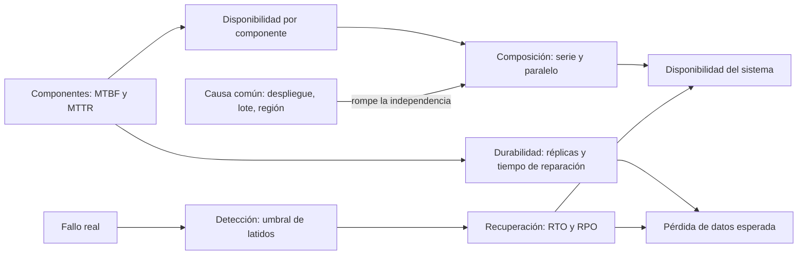

# SE-440 — Disponibilidad, durabilidad y recuperación

[← SE-439 — Circuit breakers, bulkheads y degradación](../../classes/part-36-calidad-rendimiento-y-resiliencia/se-439-circuit-breakers-bulkheads-y-degradacion/README.md) · [↑ Parte 36](../../classes/part-36-calidad-rendimiento-y-resiliencia/README.md) · [📚 Índice completo](../../classes/README.md) · [🌐 Portal](../../site/classes/SE-440.html) · [SE-441 — Compatibilidad, portabilidad e interoperabilidad →](../../classes/part-36-calidad-rendimiento-y-resiliencia/se-441-compatibilidad-portabilidad-e-interoperabilidad/README.md)

## Punto profesional y fundamento pedagógico

**Punto profesional.** La clase existe para que distingas tres promesas que se confunden bajo la palabra «fiable»: que el servicio responda (disponibilidad), que los datos no se pierdan (durabilidad) y que, si algo se rompe, se vuelva a un estado conocido en un tiempo y con una pérdida acotados (recuperación). Cada promesa tiene su aritmética, sus supuestos y su manera de fallar, y la habilidad es hacer la cuenta con los supuestos a la vista y no con los porcentajes de una página comercial.

**Por qué aparece aquí.** Sigue a **Circuit breakers, bulkheads y degradación**: aquellas defensas deciden qué hace un sistema cuando algo falla; esta clase cuantifica qué disponibilidad y qué durabilidad se logran con ellas y con la redundancia, y cuánto cuesta una recuperación. El caso conductor es la plataforma de entregas con su base de datos replicada y su política de copias de la Parte 29.

**Error conceptual que debe corregir.** Creer que duplicar un componente multiplica la fiabilidad del sistema y que los fallos de las réplicas son independientes: la redundancia solo ayuda en la capa donde se aplica, y una causa común (un despliegue, un lote de discos, una región) la anula.

**Secuencia de aprendizaje.** Antes de leer los resultados, predices cuántos minutos de caída al año tiene un sistema de tres capas al 99,9 % cada una y qué mejora duplicar solo una, y cuánto pesa el tiempo de reparación en la pérdida de datos de tres réplicas; después simulas 400 años de operación con y sin causa común, simulas pérdidas con tiempos de reparación distintos y comparas umbrales de detección de fallos. La secuencia usa predicción, explicación propia, contraste y recuperación. [ICAP](https://icap.education.asu.edu/research) distingue participación de construcción de conocimiento; [How People Learn II](https://nap.nationalacademies.org/catalog/24783/how-people-learn-ii-learners-contexts-and-cultures) respalda diseñar la práctica con contextos reales y retroalimentación.

**Evidencia de aprendizaje.** `fiabilidad-log.md` con la predicción, las tres figuras reproducidas, un presupuesto de caída y de pérdida con sus supuestos explícitos, los objetivos RTO y RPO de la plataforma con la forma de medirlos y una nota que separe lo medido de lo supuesto.

**Límite de la conclusión.** Los tiempos de falla y reparación son exponenciales con valores elegidos por el autor (MTBF de 500 h y MTTR de 0,5 h; una tasa anual de fallo de disco del 2 y del 20 %; latidos de 1 s con pérdida del 0,5 %); no se midió ningún sistema real, ningún disco ni ninguna red. La aproximación analítica de la pérdida se contrasta con la simulación solo para tasas altas, porque con tasas reales los eventos son demasiado raros para observarse en un número razonable de ensayos.

### Trazabilidad fuente → afirmación

| Fuente primaria u oficial | Afirmación que respalda | Lo que no prueba |
|---|---|---|
| [Google SRE: Embracing Risk](https://sre.google/sre-book/embracing-risk/) | Presenta la disponibilidad como un objetivo con un costo, la relaciona con el tiempo de caída permitido y propone un presupuesto de error. | No fija el objetivo de disponibilidad de la plataforma. |
| [Ford et al., «Availability in globally distributed storage systems» (OSDI 2010)](https://www.usenix.org/legacy/event/osdi10/tech/full_papers/Ford.pdf) | Analiza fallos en un sistema de almacenamiento a gran escala y muestra que los fallos correlacionados dominan sobre los independientes en la indisponibilidad. | Describe un sistema de Google, no la plataforma de entregas. |
| [Schroeder y Gibson, «Disk failures in the real world» (FAST 2007)](https://www.usenix.org/legacy/events/fast07/tech/schroeder.html) | Compara las tasas de reemplazo de discos en campo con las que anuncian los fabricantes y encuentra tasas mayores y dependientes de la edad. | No da la tasa de ningún disco en particular. |
| [NIST SP 800-34 Rev. 1](https://csrc.nist.gov/pubs/sp/800/34/r1/upd1/final) | Define tiempos objetivo de recuperación y de punto de recuperación como parte de un plan de contingencia. | No dice qué valores corresponden a la plataforma. |
| [Chen, Toueg y Aguilera, «On the quality of service of failure detectors»](https://doi.org/10.1109/12.980014) | Propone medir un detector de fallos por su tiempo de detección y su tasa de falsas sospechas. | No fija el umbral de latidos para ninguna red. |

## Antes de empezar

Recupera lo aprendido en `SE-439` y en la Parte 29 (`SE-357`): un interruptor decide si llamar y una copia que no se ha restaurado es una hipótesis. La pregunta activa es: **¿qué disponibilidad y qué durabilidad promete la plataforma, con qué supuestos, y cuánto tiempo y cuántos datos puede costar la peor recuperación aceptable?**

## Prerrequisitos

- Haber completado `SE-439` o poder explicar qué hace un interruptor de circuito.
- Python 3.11 o posterior; los experimentos usan solo la biblioteca estándar (`random`, `math`, `statistics`).
- Haber visto la Parte 29: copias, restauración y réplicas.

## Problema auténtico

El contrato de la plataforma con un colegio prometía una disponibilidad del 99,9 %. El equipo tenía tres capas (web, aplicación, base de datos) y creyó cumplirlo porque cada una tenía un 99,9 % según su proveedor. La cuenta correcta es 0,999 × 0,999 × 0,999 = 99,70 %: unos 1 575 minutos de caída al año, casi 26 horas y no las 8,8 que implica el 99,9 %. Para mejorar, añadieron una segunda réplica de la aplicación; el sistema subió al 99,80 %, no a «cinco nueves», porque las otras dos capas seguían siendo un punto único. Dos meses después, un despliegue defectuoso tumbó ambas réplicas a la vez durante una hora. En el ámbito de los datos, el equipo creía tener «tres copias» y un día descubrió que las tres estaban en el mismo lote de discos. La clase enseña a hacer estas cuentas con sus supuestos a la vista.

## Objetivos observables

Al terminar podrás:

1. convertir una disponibilidad en minutos de caída y calcular la de un sistema con componentes en serie y en paralelo;
2. mostrar con una simulación cómo una causa común anula el beneficio de una réplica;
3. calcular la probabilidad de perder datos con N réplicas y un tiempo de reparación y decir qué pesa más;
4. definir y distinguir RTO, RPO y durabilidad y explicar cómo se mide cada uno;
5. elegir un umbral de detección de fallos y explicar qué se intercambia con él.

## Mapa conceptual



El mapa conecta tres cuentas que se hacen por separado y se viven juntas. La **causa común** es la flecha que invalida el cálculo simple, y la detección es la parte de la recuperación que depende de un umbral.

## Temas y por qué importan

| Tema | Por qué cambia una decisión profesional | Evidencia mínima |
|---|---|---|
| Disponibilidad y su aritmética | Convierte un porcentaje en minutos y muestra qué capa manda. | Predicción, traza causal y contraejemplo de **Disponibilidad y su aritmética** en `fiabilidad-log.md` |
| Redundancia y causa común | La réplica ayuda solo si los fallos son independientes. | Predicción, traza causal y contraejemplo de **Redundancia y causa común** en `fiabilidad-log.md` |
| Durabilidad | El tiempo de reparación pesa más que el número de copias. | Predicción, traza causal y contraejemplo de **Durabilidad** en `fiabilidad-log.md` |
| RTO y RPO | Dicen cuánto se tarda y cuánto se pierde al recuperar. | Predicción, traza causal y contraejemplo de **RTO y RPO** en `fiabilidad-log.md` |
| Detección de fallos | El umbral intercambia detección tardía por falsas conmutaciones. | Predicción, traza causal y contraejemplo de **Detección de fallos** en `fiabilidad-log.md` |

## Conceptos y decisiones

### 1. Disponibilidad y su aritmética

La **disponibilidad** de un componente es la fracción del tiempo en que funciona: MTBF/(MTBF + MTTR), donde MTBF es el tiempo medio entre fallos y MTTR el tiempo medio de reparación. Con un MTBF de 500 h y un MTTR de 0,5 h resulta 0,999. Para pasar de un porcentaje a minutos: el 99 % deja 5 256 minutos de caída al año, el 99,9 % deja 526, el 99,99 % deja 52,6 y el 99,999 % deja 5,3. La composición importa más que cada cifra. En **serie** (la solicitud necesita web, aplicación y base de datos) las disponibilidades se multiplican: 0,999³ = 0,997, tres veces peor que cada una. En **paralelo** (basta con que una de dos réplicas funcione) fallan solo cuando fallan las dos: 1 − (1 − 0,999)² = 0,999999. Esa fórmula supone que los fallos son independientes, y de ella sale la tentación de creer que «dos réplicas dan seis nueves».

### 2. Redundancia y causa común

La redundancia protege contra fallos independientes y es inútil contra una causa común. Un despliegue defectuoso, un certificado vencido, un cambio de configuración, un fallo de la red de la sala, una región entera: todos afectan a las dos réplicas a la vez. Los estudios de sistemas de almacenamiento a gran escala encuentran que los fallos correlacionados dominan la indisponibilidad observada y que modelar las caídas como independientes subestima el riesgo en órdenes de magnitud. La disponibilidad real de un conjunto redundante es la mínima entre la que da la fórmula de paralelo y la que dan sus causas comunes. Además, la redundancia solo beneficia a la capa donde se aplica: duplicar la aplicación no mejora la disponibilidad de la base de datos. Por eso el cálculo empieza por el eslabón más débil de la serie y por la lista de lo que las réplicas comparten.

### 3. Durabilidad

La **durabilidad** es la probabilidad de no perder un dato en un periodo, y no coincide con la disponibilidad: un sistema puede estar caído una hora y no perder nada, o estar siempre disponible y perder el 0,01 % de los datos al año. Con N réplicas independientes que fallan con una tasa anual λ y se reparan en R horas, se pierde el objeto cuando fallan todas durante la ventana de reparación. La aproximación de primer orden es 8 760 · N · (λ/8 760)ᴺ · Rᴺ⁻¹: crece con el cubo de la tasa para tres réplicas, pero también con el cuadrado del tiempo de reparación. Eso reordena las prioridades: reparar siete veces más deprisa reduce la pérdida de dos réplicas en un factor siete y la de tres en un factor cuarenta y nueve. Y el modelo vuelve a fallar con la causa común: si el 0,1 % de los fallos afecta a las tres réplicas a la vez, la pérdida deja de depender de las réplicas.

### 4. RTO y RPO

Dos objetivos acotan la recuperación. El **RTO** (recovery time objective) es el tiempo máximo aceptable entre el fallo y el servicio restablecido. El **RPO** (recovery point objective) es la cantidad máxima aceptable de datos perdidos, expresada como tiempo: un RPO de cinco minutos significa que se pueden perder los últimos cinco minutos de escrituras. Se miden con ensayos, no con el diseño: el RTO real incluye la detección del fallo, la decisión de conmutar, la restauración o conmutación, la comprobación y el retorno del tráfico; el RPO real depende del intervalo de copia o del retraso de la replicación asíncrona. Una copia nocturna da un RPO de hasta 24 horas, una réplica asíncrona con retraso de segundos da segundos y una síncrona da cero a costa de latencia en cada escritura. Declarar un RTO y un RPO sin haber restaurado nunca es una promesa sin evidencia (`SE-357`).

### 5. Detección de fallos

Para conmutar hay que saber que algo falló, y eso se hace con latidos: cada nodo anuncia que está vivo y se le declara caído si pasa un **umbral** sin noticias. El umbral intercambia dos errores. Uno corto detecta una caída real enseguida y sospecha de nodos sanos cuando se pierde un latido o el emisor se detiene unos segundos (una pausa de la recolección de memoria, una congestión de red); cada sospecha falsa provoca una conmutación innecesaria que tiene su propio costo y puede causar un fallo mayor. Uno largo evita las falsas conmutaciones y alarga cada caída real. Un detector se evalúa por su tiempo de detección y por su tasa de falsas sospechas, y la forma de mejorar ambos a la vez es añadir información (varios observadores, una prueba adicional antes de conmutar), no mover el umbral.

### Disponibilidad con y sin causa común

Se simulan 400 años de operación de cuatro componentes con tiempos entre fallos exponenciales de media 500 h y reparaciones exponenciales de media 0,5 h: web, dos réplicas de aplicación y base de datos. Se calculan la disponibilidad de un componente, de la serie, de la serie con dos réplicas independientes de la aplicación y de la misma con cuatro despliegues malos al año de una hora de media que dejan caídas ambas réplicas.

```python
par_app = interseccion(app1, app2)                       # la app cae solo si caen las dos
sistema = union(web + par_app + db)                      # el sistema cae si cae cualquiera de las capas
app_par_cc = union(interseccion(app1, app2) + cc)        # cc: despliegues malos que tumban ambas
```

| Configuración | Disponibilidad | Minutos de caída al año | Teoría |
|---|---:|---:|---|
| Un componente (MTBF 500 h, MTTR 0,5 h) | 0,99899 | 529 | 0,99900 → 526 |
| Serie: web, aplicación y base de datos | 0,99701 | 1 574 | 0,99700 → 1 575 |
| Dos réplicas independientes de la aplicación | 0,99801 | 1 044 | 0,99800 |
| Dos réplicas y 4 despliegues malos al año de 1 h | 0,99756 | 1 282 | 0,99800 si fueran independientes |

La simulación reproduce la teoría para la serie (0,99701 frente a 0,99700). Duplicar solo la aplicación mejora el 99,70 % al 99,80 %, y no más, porque los otros dos tramos en serie mandan. Con la causa común, la aplicación con dos réplicas pasa de 0,9999996 a 0,99955 de disponibilidad propia, y el sistema baja a 0,99756, con 1 282 minutos de caída frente a los 1 044 que el modelo independiente prometía: 238 minutos al año que la fórmula no veía.


**Cómo leer la figura.** Cada barra es una arquitectura y su longitud, los minutos de caída al año. Mira primero que duplicar la aplicación baja de 1 574 a 1 044 minutos pero no acerca a un solo componente, y que añadir despliegues malos que tumban ambas réplicas la sube a 1 282. **Dónde deja de valer:** el MTBF, el MTTR, la distribución exponencial y los cuatro despliegues malos al año son supuestos del autor y no se midió ningún sistema real; las caídas reales tienen duraciones con cola larga, y un solo incidente de ocho horas pesa más que cien de un minuto.

### Durabilidad frente al tiempo de reparación

Se simulan objetos con N réplicas cuyos discos fallan según un proceso de Poisson y se reparan en R horas; el objeto se pierde si en algún instante todas las réplicas están caídas. Para observar eventos se usa una tasa anual de fallo del 20 % y se compara con la aproximación; con la aproximación se extrapola a una tasa del 2 %.

```python
aprox = 8760 * N * (afr / 8760) ** N * R ** (N - 1)     # primer orden, valido para afr * R / 8760 << 1
```

| Configuración | Simulada (tasa anual 20 %) | Aproximación 20 % | Aproximación 2 % |
|---|---:|---:|---:|
| 2 réplicas, reparación de 1 h | 1,75e-05 (7 eventos) | 9,13e-06 | 9,13e-08 |
| 2 réplicas, reparación de 24 h | 2,35e-04 | 2,19e-04 | 2,19e-06 |
| 2 réplicas, reparación de 168 h | 1,50e-03 | 1,53e-03 | 1,53e-05 |
| 3 réplicas, reparación de 168 h | 1,00e-05 (10 eventos) | 8,83e-06 | 8,83e-09 |
| 3 réplicas, reparación de 336 h | 3,50e-05 | 3,53e-05 | 3,53e-08 |
| 3 réplicas, reparación de 24 h | no observable | 1,80e-07 | 1,80e-10 |

La aproximación coincide con la simulación en las filas con muchos eventos y se aparta en las de 7 o 10 eventos, que están dominadas por el ruido de contar pocos sucesos. Lo que enseña: pasar de 24 a 168 h multiplica por siete la pérdida con dos réplicas y por cuarenta y nueve con tres. Pero la independencia es el supuesto que más pesa: si el 0,1 % de los fallos afecta a las tres réplicas a la vez (un lote, una sala, un error de software), la pérdida anual de tres réplicas con 24 h de reparación sube de 1,8e-10 a 2,0e-05, cinco órdenes de magnitud, y con el 1 % a 2,0e-04.


**Cómo leer la figura.** Cada par de barras es una configuración de réplicas y tiempo de reparación: la roja es la aproximación con tasa anual del 20 % y la verde con 2 %, en escala logarítmica (se dibujan pérdidas por cada 10 000 millones de objetos al año y los rótulos dan la probabilidad). Mira primero cuánto cambian las barras al subir el tiempo de reparación y al pasar de dos a tres réplicas. **Dónde deja de valer:** la tasa del 20 % se usa para ver eventos y no es una tasa de discos; la aproximación vale mientras tasa por reparación sea pequeña; no se modela la reparación que depende de los datos restantes ni la corrupción silenciosa, y la causa común se modeló como un único evento que lo destruye todo.

### Umbral de detección de fallos

Se simulan 30 días de latidos cada segundo con una pérdida del 0,5 % y con pausas del emisor (una cada 5 horas de media, con mediana de 2 s y cola larga). Se declara caído al nodo si pasa el umbral sin noticias. Se calcula, para cada umbral, la detección media de una caída real, las conmutaciones falsas por día y los minutos al año perdidos por detectar tarde (4 caídas) o por conmutar sin motivo (30 s cada una).

```python
if r.random() < 0.00005: pausa_hasta = t + r.lognormvariate(math.log(2.0), 0.8)   # el emisor se detiene
falsos = sum(1 for h in huecos if h > T)                                           # huecos entre latidos mayores que el umbral
```

| Umbral | Detección media | Conmutaciones falsas por día | Min/año por detectar tarde | Min/año por conmutar sin motivo |
|---:|---:|---:|---:|---:|
| 1,5 s | 1,0 s | 435,6 | 0,07 | 79 491 |
| 2 s | 1,5 s | 219,0 | 0,10 | 39 968 |
| 3 s | 2,5 s | 3,8 | 0,17 | 694 |
| 5 s | 4,5 s | 1,07 | 0,30 | 195 |
| 10 s | 9,5 s | 0,23 | 0,63 | 43 |
| 30 s | 29,5 s | 0,00 | 1,97 | 0 |

Con 1,5 y 2 s, la pérdida de un solo latido (0,5 % de los latidos) ya dispara conmutaciones falsas cientos de veces al día; con 3 s hacen falta tres latidos seguidos perdidos o una pausa, y las falsas bajan a 3,8 al día. Con 30 s casi no hay falsas y cada caída real se detecta en media tras 29,5 s. Los minutos de las dos últimas columnas son modelos: la conmutación de 30 s y las cuatro caídas al año son supuestos, y una conmutación falsa puede costar mucho más (o menos) que 30 s.


**Cómo leer la figura.** El eje horizontal es el umbral del detector y el vertical, en escala logarítmica, los minutos al año perdidos; la línea dorada es el costo por detectar tarde y la discontinua roja el de conmutar sin motivo. Mira primero que una sube y la otra baja a medida que crece el umbral: ningún umbral hace mínimas las dos. **Dónde deja de valer:** la pérdida del 0,5 %, la frecuencia y la forma de las pausas, el costo de 30 s por conmutación y las cuatro caídas al año son supuestos; una red con pérdida del 5 % o pausas cada hora desplazaría las dos curvas enteras, y un detector adaptativo o con varios observadores no sufriría este intercambio de la misma manera.

## Definiciones de trabajo

- **disponibilidad:** fracción del tiempo en que un sistema cumple su función, igual a MTBF/(MTBF + MTTR) para un componente.
- **durabilidad:** probabilidad de no perder un dato durante un periodo.
- **RTO:** tiempo máximo aceptable entre un fallo y el servicio restablecido.
- **RPO:** cantidad máxima de datos recientes que se acepta perder, expresada como tiempo.
- **causa común:** evento único que provoca el fallo simultáneo de varios componentes supuestamente independientes.

Las definiciones son operativas para la plataforma de entregas. No convierten términos con una historia más amplia en sinónimos y deben contrastarse con la documentación primaria enlazada al final.

## Ejemplo mínimo

El fragmento calcula la disponibilidad de tres capas en serie. Antes de ejecutarlo, predice si supera el 99,8 %.

```python
a = 0.999
serie = a ** 3
print(serie, (1 - serie) * 525600)
```

La disponibilidad es 0,997003 y los minutos de caída al año son unos 1 575, no los 526 que implica el 99,9 %. Registra versión de Python, comando y salida; después duplica solo la capa de aplicación con `1 - (1 - a) ** 2` y calcula la nueva disponibilidad del sistema.

## Ejemplo profesional

El equipo escribe el presupuesto de fiabilidad de la plataforma. Para disponibilidad prometen el 99,5 % mensual en el horario de entregas (unos 3,6 horas de caída al mes) y lo desglosan: web 99,95 %, aplicación 99,9 %, base de datos 99,9 %, con una causa común declarada de despliegue: cuatro al año, con un procedimiento de reversión en diez minutos como mitigación. Para durabilidad, tres réplicas en dominios de fallo distintos y un tiempo de reparación objetivo de 24 h, con una prueba mensual que restaura una copia en un entorno aparte. Para recuperación, fijan RTO de 30 minutos y RPO de 5 minutos, y los miden en un ensayo trimestral que mide el tiempo de detección (umbral de 5 s con tres observadores), el de conmutación y los datos perdidos. Cada supuesto queda en el documento con su evidencia: lo medido (la restauración) y lo supuesto (la tasa de fallo de los discos del proveedor). Compara con la cuenta original del 99,9 % por capa: ahora la promesa se puede auditar.

## Práctica guiada

1. Calcula la disponibilidad de tres capas en serie al 99,9 % y los minutos de caída al año.
2. Predice la mejora de duplicar solo la capa de aplicación y escríbela antes de medir.
3. Simula 400 años con los tiempos exponenciales y reproduce la teoría de la serie y del paralelo.
4. Añade cuatro despliegues malos al año y calcula cuánto pierde el sistema frente a la fórmula independiente.
5. Simula la pérdida de objetos con 2 y 3 réplicas y tiempos de reparación de 1, 24 y 168 h con una tasa anual del 20 % y compárala con la aproximación.
6. Simula los latidos con seis umbrales y construye la tabla de falsas conmutaciones frente a detección tardía.
7. Entrega `fiabilidad-log.md` y pide a otra persona que identifique la causa común que tu presupuesto no considera.

## Ejercicios

1. **Serie y paralelo:** calcula la disponibilidad de un sistema con una web al 99,95 %, dos réplicas de aplicación al 99,9 % cada una y una base de datos al 99,9 %, suponiendo independencia, y di qué capa limita.
2. **Presupuesto:** un objetivo del 99,95 % mensual deja cuántos minutos de caída al mes y cuántos incidentes de 20 minutos admite.
3. **Reparación:** calcula cuánto se reduce la pérdida de datos de tres réplicas si el tiempo de reparación baja de 72 a 12 h y qué supuesto puede arruinar esa mejora.
4. **RTO y RPO:** para la plataforma con copias cada hora y réplica asíncrona, di qué RPO y qué RTO puedes prometer sin ensayo y cuáles con ensayo.

## Reto verificable

Entrega `fiabilidad-log.md` con la predicción, las tres tablas de resultados, el presupuesto de disponibilidad y de durabilidad con sus supuestos, los objetivos RTO y RPO con su forma de medirlos y la lista de causas comunes. Se aprueba si otra persona ejecuta el código desde un checkout limpio, obtiene los mismos números con las mismas semillas y puede decir qué evento destruiría la redundancia de tu diseño. No se aprueba por copiar porcentajes de un proveedor ni por afirmar «cinco nueves» sin decir cuántas causas comunes se consideraron.

## Caso conductor

La plataforma de entregas es el caso conductor de la Parte 36. Esta clase deja el octavo artefacto: un presupuesto de fiabilidad con sus supuestos y sus objetivos de recuperación. `SE-441` pregunta qué ocurre con la compatibilidad cuando versiones, sistemas y formatos distintos conviven, y `SE-443` someterá el diseño a una presión controlada. Cambia después un solo dato, el tiempo de reparación, y observa qué pesa más: el número de réplicas o el tiempo en reponerlas.

## Preguntas frecuentes

### ¿Son los cinco nueves un objetivo razonable?

Para casi todos los sistemas no, y sobre todo no lo son para un componente que depende de personas (un despliegue, una reversión). Cinco nueves son 5,3 minutos al año, menos de lo que tarda un humano en diagnosticar. Un objetivo debe fijarse con el costo y con el impacto de cada minuto, y conviene un presupuesto de error que se pueda gastar.

### ¿Más réplicas siempre aumentan la disponibilidad?

Solo si los fallos son independientes y el sistema puede usarlas. Más réplicas aumentan también la complejidad y la probabilidad de que algo falle en el mecanismo que las coordina. La mejora se calcula con la causa común incluida, y a menudo la inversión más rentable es acortar la reparación o separar los dominios de fallo.

### ¿Cuál es la diferencia entre RPO y durabilidad?

El RPO habla de cuántos datos recientes se pierden al recuperar tras un fallo de un cierto tipo; la durabilidad habla de la probabilidad de perder un dato de forma permanente. Una réplica asíncrona con RPO de cinco minutos pierde cinco minutos en un fallo del primario y puede, aun así, tener una durabilidad altísima si los datos antiguos están en varias copias.

### ¿Cómo se mide el RTO real?

Con un ensayo: se provoca el fallo (en un entorno de ensayo o en una ventana controlada), se cronometra desde el fallo hasta que el servicio atiende solicitudes correctas y se descompone en detección, decisión, restauración y verificación. Un RTO estimado sobre el papel casi siempre es optimista porque olvida la detección y la verificación.

## Fallo controlado y diagnóstico

Reproduce el fallo clásico de la clase: **una réplica que no mejora la disponibilidad porque comparte la causa del fallo**. Simula los cuatro despliegues malos al año con dos réplicas de la aplicación.

Registra síntoma, entrada mínima, hipótesis, observación que descarta cada hipótesis, causa, corrección y prueba de regresión. **Síntoma:** con dos réplicas de la aplicación, el sistema se cae 1 282 minutos al año en lugar de los 1 044 previstos. **Hipótesis rivales:** (a) una réplica falla más que la otra; (b) la base de datos empeoró; (c) hay un evento que afecta a ambas réplicas. **Prueba:** calcula los intervalos en que ambas réplicas están caídas y compara con la intersección de las caídas independientes; si hay intervalos que no corresponden a ninguna caída individual, hay causa común. **Conclusión:** los despliegues tumban ambas réplicas a la vez. **Regresión:** añade despliegues escalonados (una réplica cada vez) y una prueba que simule un despliegue malo y exija que una réplica siga sirviendo. No cambies a la vez el despliegue y el número de réplicas.

## Errores comunes y cómo corregirlos

| Síntoma | Causa probable | Corrección |
|---|---|---|
| El sistema cae más de lo que da la cuenta | Fallos en serie ignorados o causa común | Calcular con todas las capas y listar lo que comparten las réplicas |
| Duplicar un componente no mejora nada | La limitación está en otra capa | Mejorar el eslabón más débil de la serie |
| Se pierden datos con «tres copias» | Misma sala, lote o error de software | Separar dominios de fallo y verificar |
| El RTO real es el triple del prometido | Falta detección y verificación en la cuenta | Medir con un ensayo todo el recorrido |
| Hay conmutaciones sin que nada falle | Umbral de detección demasiado corto | Subir el umbral o añadir observadores |

## Entorno y archivos clave

```text
work/SE-440/
├── README.md
├── fiabilidad/
│   ├── disponibilidad.py
│   ├── durabilidad.py
│   └── deteccion.py
├── tests/test_fiabilidad.py
└── evidence/fiabilidad-log.md
```

El `README` declara plataforma, versión de Python, semillas y comandos. Los experimentos usan solo la biblioteca estándar (`random`, `math`, `statistics`) y se ejecutaron con CPython 3.12.9 en Windows 11 y 3.12.3 en Ubuntu bajo WSL2: las salidas fueron idénticas. La simulación de 400 años y la de durabilidad tardan alrededor de un minuto; ejecútalas en segundo plano. Si añades una dependencia, fija procedencia y versión.

## Seguridad, ética y accesibilidad

- una promesa de disponibilidad o de durabilidad es un compromiso con personas: una plataforma educativa con una caída durante un examen tiene consecuencias que ningún porcentaje describe;
- las copias contienen datos personales: la durabilidad no debe lograrse copiando datos a lugares sin la protección adecuada (`SE-358`);
- un procedimiento de conmutación manual debe ser accesible a quien esté de guardia, con instrucciones legibles bajo estrés y con lector de pantalla;
- documenta las tablas y las figuras con texto alternativo y en un formato que un lector de pantalla pueda recorrer;
- respeta las licencias de los datos de fallos de discos y atribuye lo adaptado.

## Puente hacia el trabajo con agentes

Un agente al que se le pide «asegura alta disponibilidad» añadirá una segunda instancia detrás de un balanceador y declarará «alta disponibilidad». Pídele en cambio que calcule la disponibilidad de la serie completa con los supuestos a la vista, que liste las causas comunes de las réplicas, que fije RTO y RPO con la forma de medirlos y que ejecute un ensayo de conmutación y de restauración con su resultado. Revisa especialmente si da por independientes las réplicas y si el ensayo mide la detección: son los dos defectos que esta clase mostró sin aviso.

## Transferencia

Traslada el análisis a otro sistema (por ejemplo, un servicio de reservas de salas): cambia los componentes y las réplicas y conserva el procedimiento de componer en serie y en paralelo, listar las causas comunes, calcular la durabilidad con el tiempo de reparación y medir RTO y RPO con un ensayo. La transferencia está lograda cuando puedes decir qué evento anularía tu redundancia, no cuando el porcentaje coincide.

## Evaluación y evidencia

| Criterio | Evidencia para aprobar |
|---|---|
| comprensión | explicación de la composición en serie y en paralelo, de la causa común y de RTO y RPO |
| corrección | tablas de disponibilidad, durabilidad y detección reproducibles con las mismas semillas |
| diseño | presupuesto de fiabilidad con supuestos y objetivos de recuperación medibles |
| diagnóstico | reproducción del fallo «la réplica no ayuda por la causa común» con regresión |
| incertidumbre | declaración de que MTBF, MTTR, tasas y pausas son supuestos del autor |
| reproducibilidad | versiones, comandos, salida y límites declarados |

## Fuentes

- [Google SRE: Embracing Risk](https://sre.google/sre-book/embracing-risk/) — disponibilidad como objetivo con costo y presupuesto de error; autoridad: Google, libro de ingeniería de confiabilidad.
- [Ford et al., «Availability in globally distributed storage systems»](https://www.usenix.org/legacy/event/osdi10/tech/full_papers/Ford.pdf) — fallos correlacionados en almacenamiento; autoridad: OSDI 2010.
- [Schroeder y Gibson, «Disk failures in the real world»](https://www.usenix.org/legacy/events/fast07/tech/schroeder.html) — tasas de fallo de discos en campo; autoridad: FAST 2007.
- [NIST SP 800-34 Rev. 1](https://csrc.nist.gov/pubs/sp/800/34/r1/upd1/final) — planes de contingencia y objetivos de recuperación; autoridad: NIST.
- [Chen, Toueg y Aguilera, «On the quality of service of failure detectors»](https://doi.org/10.1109/12.980014) — métricas de detectores de fallos; autoridad: IEEE Transactions on Computers, 2002.

Cada fuente respalda el mecanismo indicado; ninguna demuestra que los 1 574 minutos, la pérdida de 1,8e-10 o las 3,8 conmutaciones falsas por día se observen en un sistema real. Esa afirmación depende de los componentes, de los discos y de la red.

## Límites y siguiente paso

Se ejecutaron tres experimentos con semillas fijas en Windows y Ubuntu (WSL2) con resultados idénticos. No se midió ningún sistema, disco, red ni ensayo de recuperación real; los tiempos entre fallos y de reparación exponenciales, la tasa anual de fallo del 20 % para observar eventos y del 2 % por extrapolación, la causa común como evento único, los latidos con pérdida del 0,5 % y pausas lognormales y el costo de 30 s por conmutación son supuestos del autor, y los eventos de pérdida con tres réplicas son demasiado raros para observarse con tasas reales. La siguiente clase se ocupa de la compatibilidad, la portabilidad y la interoperabilidad entre versiones, sistemas y formatos.

## Glosario

- **disponibilidad:** fracción del tiempo en que un sistema cumple su función, igual a MTBF/(MTBF + MTTR) para un componente.
- **durabilidad:** probabilidad de no perder un dato durante un periodo.
- **RTO:** tiempo máximo aceptable entre un fallo y el servicio restablecido.
- **RPO:** cantidad máxima de datos recientes que se acepta perder, expresada como tiempo.
- **causa común:** evento único que provoca el fallo simultáneo de varios componentes supuestamente independientes.

---

[← SE-439 — Circuit breakers, bulkheads y degradación](../../classes/part-36-calidad-rendimiento-y-resiliencia/se-439-circuit-breakers-bulkheads-y-degradacion/README.md) · [↑ Parte 36](../../classes/part-36-calidad-rendimiento-y-resiliencia/README.md) · [📚 Índice completo](../../classes/README.md) · [🌐 Portal](../../site/classes/SE-440.html) · [SE-441 — Compatibilidad, portabilidad e interoperabilidad →](../../classes/part-36-calidad-rendimiento-y-resiliencia/se-441-compatibilidad-portabilidad-e-interoperabilidad/README.md)
