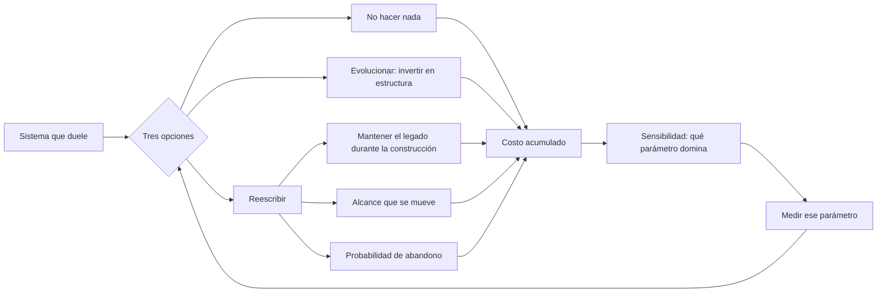

# SE-442 — Economía de reescribir frente a evolucionar

[← SE-441 — Retiro, archivado y disposición de sistemas](../../classes/part-36-mantenimiento-y-modernizacion-legacy/se-441-retiro-archivado-y-disposicion-de-sistemas/README.md) · [↑ Parte 36](../../classes/part-36-mantenimiento-y-modernizacion-legacy/README.md) · [📚 Índice completo](../../classes/README.md) · [🌐 Portal](../../site/classes/SE-442.html) · [SE-443 — Taller: estabilizar antes de modernizar →](../../classes/part-36-mantenimiento-y-modernizacion-legacy/se-443-taller-estabilizar-antes-de-modernizar/README.md)

## Punto profesional y fundamento pedagógico

**Punto profesional.** La clase existe para que la pregunta «¿reescribimos o seguimos con esto?» deje de decidirse por cansancio, por entusiasmo por una tecnología o por quien habla más fuerte, y se decida con un modelo de costos explícito, con incertidumbre y con las condiciones en que la respuesta cambia. La habilidad no es tener una postura sobre las reescrituras sino saber qué parámetros dominan la decisión, medirlos antes de decidir y diseñar la opción elegida para que se pueda abandonar si los parámetros resultan distintos de lo supuesto.

**Por qué aparece aquí.** Sigue a **Retiro, archivado y disposición de sistemas**: retirar un sistema es el final de una estrategia que empezó con una decisión que esta clase examina. El caso conductor es el **módulo legado de calificaciones**: doce años, una estructura difícil de cambiar, un equipo pequeño y una propuesta de reescribirlo desde cero con un lenguaje y un marco modernos. No se analiza ningún sistema real; el modelo es una construcción del autor.

**Error conceptual que debe corregir.** Creer que el sistema nuevo costará lo que cuesta construir el sistema nuevo. El costo de una reescritura incluye mantener el sistema antiguo durante toda la construcción, alcanzar un objetivo que se mueve (el antiguo sigue cambiando), la probabilidad de abandonar a mitad de camino y la deriva de alcance; ninguno de esos términos aparece en el presupuesto de quien propone la reescritura. Tampoco es correcto lo contrario: seguir evolucionando no es gratis, y su costo crece con la degradación del sistema.

**Secuencia de aprendizaje.** Antes de mirar los resultados, predices en qué porcentaje de escenarios inciertos reescribir resulta más barato que evolucionar a diez años; después simulas 20 000 escenarios con tres opciones, haces un análisis de sensibilidad moviendo un parámetro cada vez y buscas el horizonte a partir del cual la reescritura empieza a ganar. La secuencia usa predicción, explicación propia, contraste y recuperación. [ICAP](https://icap.education.asu.edu/research) distingue participación de construcción de conocimiento; [How People Learn II](https://nap.nationalacademies.org/catalog/24783/how-people-learn-ii-learners-contexts-and-cultures) respalda diseñar la práctica con contextos reales y retroalimentación.

**Evidencia de aprendizaje.** `economia-log.md` con la predicción, las tres figuras reproducidas, el modelo de costos con los parámetros de tu sistema y su incertidumbre, el análisis de sensibilidad con el parámetro que domina la decisión, los criterios de abandono de la opción elegida y una nota que separe qué es medido, qué inferido y qué supuesto.

**Límite de la conclusión.** Todo el modelo es una construcción del autor: el crecimiento del costo del legado, el costo y la duración de la reescritura, la deriva del alcance, el costo del sistema nuevo, la probabilidad de abandono y los efectos de la inversión en evolucionar son supuestos con distribuciones elegidas; las unidades son múltiplos del costo anual actual de mantener el legado. Que en la simulación evolucionar gane en la mayoría de escenarios **es una consecuencia de esos supuestos**, no un hallazgo sobre reescrituras reales, y con otros parámetros plausibles el orden cambia.

### Trazabilidad fuente → afirmación

| Fuente primaria u oficial | Afirmación que respalda | Lo que no prueba |
|---|---|---|
| [Spolsky, «Things You Should Never Do, Part I»](https://www.joelonsoftware.com/2000/04/06/things-you-should-never-do-part-i/) | Argumenta, con el caso de una reescritura de un navegador, que el código viejo contiene conocimiento acumulado de correcciones y que reescribir desde cero suele ser un error estratégico. | Es un ensayo de opinión con un caso; no es una medición de la frecuencia con que las reescrituras fallan. |
| [Brooks, «No Silver Bullet: Essence and Accidents of Software Engineering»](https://doi.org/10.1109/MC.1987.1663532) | Distingue la complejidad esencial del problema de la accidental de las herramientas, y sostiene que reescribir en otra tecnología elimina solo la segunda. | No dice cuánto de la complejidad de tu sistema es esencial. |
| [Lehman, «Programs, life cycles, and laws of software evolution»](https://doi.org/10.1109/PROC.1980.11805) | Formula que un sistema en uso debe cambiar continuamente y que su estructura se degrada si no se invierte en lo contrario. | No da el ritmo de degradación de ningún sistema. |
| [Fowler, «TechnicalDebt»](https://martinfowler.com/bliki/TechnicalDebt.html) | Ofrece la metáfora de principal e intereses para decidir cuándo pagar la deuda en vez de seguir pagando intereses. | No define cómo medir el principal ni los intereses. |
| [Python: random](https://docs.python.org/3/library/random.html) y [statistics](https://docs.python.org/3/library/statistics.html) | Documentan el muestreo con semilla y las medianas usados. | No validan las distribuciones elegidas. |

## Antes de empezar

Recupera lo aprendido en `SE-441`: retirar es el final de una secuencia reversible hasta el último paso. La pregunta activa es: **¿qué evidencia tendrías que ver en los seis primeros meses de una reescritura para decidir que debe abandonarse, y quién tendría poder para abandonarla?**

## Prerrequisitos

- Haber completado `SE-441` o poder explicar la secuencia de retiro de un sistema.
- Python 3.11 o posterior; los experimentos usan solo la biblioteca estándar (`random`, `math`, `statistics`).
- Saber leer una mediana, un percentil y una proporción de escenarios.

## Problema auténtico

La dirección de tecnología recibió dos propuestas para el módulo de calificaciones. Una, de dos desarrolladores, pedía reescribirlo con un marco moderno en un año. Otra, de la responsable de producto, proponía una inversión de tres meses en pruebas y estructura y seguir. La discusión duró semanas y se zanjó con argumentos: «el código es un desastre» frente a «el código funciona». Nadie preguntó cuánto crecía el costo anual de mantener el módulo, cuánto tardó la última reescritura de la empresa respecto de lo presupuestado, cuánto cambiaría el módulo antiguo durante el año de construcción ni qué parte de las reglas de redondeo sin documentar habría que redescubrir. La clase enseña a poner esas preguntas en un modelo, a ver qué parámetros dominan el resultado y a diseñar la decisión de modo que sea reversible.

## Objetivos observables

Al terminar podrás:

1. enumerar los términos de costo de reescribir, evolucionar y no hacer nada, incluidos los que no suelen aparecer en el presupuesto;
2. construir un modelo de costos con parámetros inciertos y simularlo con semilla fija;
3. leer un análisis de sensibilidad e identificar qué parámetro domina la decisión;
4. calcular el horizonte a partir del cual cada opción empieza a ser más barata;
5. diseñar criterios de abandono y puntos de revisión para la opción elegida.

## Mapa conceptual



El mapa muestra que las tres opciones comparten una medida (el costo acumulado) pero tienen términos distintos, y que el resultado del análisis no es una respuesta sino un **parámetro que vale la pena medir** antes de decidir: la flecha vuelve a la elección.

## Temas y por qué importan

| Tema | Por qué cambia una decisión profesional | Evidencia mínima |
|---|---|---|
| Los costos que no aparecen en el presupuesto | Omitirlos sesga la decisión hacia reescribir. | Lista de términos de costo por opción |
| Modelar con incertidumbre | Un número único oculta cuánto puede equivocarse la comparación. | Distribuciones y simulación con semilla |
| Sensibilidad | Indica qué medir antes de decidir. | Tabla de efecto por parámetro |
| Horizonte | La opción más barata depende del plazo. | Comparación a distintos horizontes |
| Decisión reversible | Evita comprometerse con una estimación errónea. | Criterios de abandono y fechas de revisión |

## Conceptos y decisiones

### 1. Los costos que no aparecen en el presupuesto

El presupuesto de una reescritura suele contener el costo de construir el sistema nuevo. Hay al menos cuatro términos más. Primero, el **costo de mantener el sistema antiguo durante la construcción**, que no se detiene: sigue habiendo incidencias, adaptaciones con fecha y peticiones. Segundo, la **deriva del alcance**: el sistema antiguo sigue cambiando, y el nuevo tiene que alcanzar un objetivo que se mueve; cuanto más dura la construcción, más cambios hay que replicar. Tercero, el **conocimiento incrustado**: las reglas sin documentar del sistema antiguo (los redondeos, los casos de borde, las correcciones acumuladas) se redescubren con errores en producción. Cuarto, el **riesgo de abandono**: una fracción de las reescrituras se cancela a mitad de camino, y entonces se ha gastado una parte del presupuesto sin obtener un sistema. Por el lado de evolucionar, el término oculto es el opuesto: no es gratis, y si no se invierte en estructura el costo anual del legado sigue creciendo. Comparar las tres opciones exige incluir todos los términos en las tres.

### 2. Modelar con incertidumbre

Los parámetros de un modelo de este tipo se conocen mal: nadie sabe de antemano cuánto costará la reescritura ni cuánto crecerá el costo del legado. Un modelo con un valor por parámetro produce una cifra que parece precisa y no lo es. Un modelo con **distribuciones** (un rango plausible con la forma que tienen los errores de estimación, normalmente asimétrica, con una cola hacia el exceso) y una simulación de muchos escenarios produce una distribución de resultados: la mediana, el rango entre el percentil 10 y el 90, y la proporción de escenarios en que una opción gana. Esa proporción no es una probabilidad objetiva, pero comunica algo que un número único no: que la decisión puede equivocarse y cuánto. Y obliga a escribir los supuestos, que pueden discutirse, en lugar de las conclusiones, que solo pueden aceptarse o rechazarse.

### 3. Sensibilidad: qué parámetro domina

Cuando un modelo tiene siete parámetros inciertos, no todos pesan lo mismo en el resultado. El análisis de sensibilidad más simple mueve un parámetro cada vez entre un valor bajo y uno alto, deja los demás con sus distribuciones y mide cuánto cambia la diferencia entre las opciones. El parámetro con mayor recorrido es el que domina la decisión y el que merece medirse antes de comprometerse. La utilidad es práctica: en lugar de discutir qué opción es mejor, se discute cuánto costará construir, y esa pregunta se puede responder con una estimación mejor, con un prototipo o con el historial de proyectos previos. Si el parámetro dominante no se puede medir hasta empezar, la decisión debe diseñarse para poder abandonarla cuando se mida.

### 4. El horizonte

La comparación depende del plazo considerado. Una reescritura tiene un costo inicial alto y, si sale bien, un costo anual menor; evolucionar tiene un costo inicial menor y un costo anual que crece más despacio que el del legado sin tocar pero no baja. Hay un **horizonte de equilibrio** a partir del cual el menor costo anual de la reescritura compensa la inversión, y puede estar más lejos de lo que el sistema va a vivir. Si el sistema se va a retirar en cinco años por otras razones, la reescritura no recupera su inversión por mucho que el sistema nuevo sea mejor. La pregunta de horizonte es una pregunta de negocio (¿cuánto tiempo más va a existir este sistema?) que se contesta fuera del equipo técnico y que cambia la respuesta.

### 5. Una decisión reversible

La conclusión de un modelo no es «reescribir» ni «evolucionar» sino una **opción con salida**. Si se elige evolucionar, se fijan indicadores (costo por cambio, tiempo de ciclo, incidencias) que revisan la decisión si no mejoran en un plazo. Si se elige reescribir, se hace de forma incremental (`SE-437`) para que cada rebanada entregue valor y pueda detenerse, se fijan criterios de abandono (porcentaje de alcance cubierto, desviación acumulada del presupuesto) y se define quién tiene autoridad para parar sin que parar se considere un fracaso personal. La elección más peligrosa es la irreversible con un parámetro dominante todavía sin medir: es la que combina el máximo compromiso con el mínimo conocimiento.

### Tres opciones, 20 000 escenarios

El modelo mide el costo acumulado a diez años en unidades del costo anual actual de mantener el legado (1 = ese costo). El costo del legado crece a una tasa anual entre el 3 % y el 15 %. **Evolucionar** invierte 1,0 repartido en dos años y reduce después el crecimiento al 30 % de esa tasa. **Reescribir** cuesta una cantidad lognormal de mediana 6,0, dura una mediana de 2,5 años, se incrementa por la deriva del alcance (entre el 5 % y el 25 % por año de duración), mantiene el legado mientras se construye, tiene una probabilidad del 20 % de abandonarse al 70 % del tiempo y, si termina, el sistema nuevo cuesta entre el 40 % y el 90 % del legado y crece un 4 % anual.

| Opción | Costo acumulado a 10 años (mediana) | Percentil 10 | Percentil 90 |
|---|---:|---:|---:|
| No hacer nada | 15,2 | 12,1 | 19,1 |
| Evolucionar | 13,5 | 12,1 | 15,1 |
| Reescribir | 19,1 | 13,7 | 27,6 |

La opción más barata en cada escenario es evolucionar en 16 269 de los 20 000 casos, no hacer nada en 1 867 y reescribir en 1 864. Reescribir gana a evolucionar en el 9,4 % de los escenarios (1 874). La reescritura tiene el rango más ancho: puede costar 13,7 o 27,6, y su mediana supera a la de no hacer nada. Evolucionar tiene el rango más estrecho (de 12,1 a 15,1): es la opción de menor varianza bajo estos supuestos.


**Cómo leer la figura.** Cada fila es una opción; la mediana indica lo típico y el rango entre el percentil 10 y el 90 la incertidumbre. **Dónde deja de valer:** todos los parámetros y las formas de las distribuciones son supuestos del autor; con un legado cuyo costo crece el 15 % anual y una reescritura de costo bajo y sin abandono, el orden cambia. Que evolucionar gane aquí no establece que gane en un sistema real.

### Qué parámetro domina

Se mueve un parámetro cada vez entre un valor bajo y uno alto, con los demás sorteados con la misma semilla, y se mide la mediana de la diferencia entre reescribir y evolucionar (positiva: reescribir cuesta más) y la proporción de escenarios en que reescribir gana. La base, a diez años, es +5,6 y el 9 % de victorias.

| Parámetro (bajo → alto) | Diferencia con el valor bajo (gana) | Diferencia con el valor alto (gana) | Recorrido |
|---|---|---|---:|
| Costo de construir (3,0 → 12,0) | +0,9 (37 %) | +13,4 (0 %) | 12,5 |
| Costo anual del sistema nuevo (0,4 → 0,9) | +3,2 (26 %) | +7,5 (0 %) | 4,3 |
| Duración en años (1,5 → 4,0) | +3,8 (18 %) | +8,0 (1 %) | 4,2 |
| Deriva del alcance por año (0,05 → 0,25) | +4,0 (14 %) | +7,2 (6 %) | 3,2 |
| Probabilidad de abandono (0 → 0,4) | +4,4 (11 %) | +6,9 (7 %) | 2,4 |
| Crecimiento tras evolucionar (0,1 → 0,6) | +6,2 (6 %) | +4,6 (16 %) | 1,6 |
| Crecimiento del costo del legado (3 % → 15 %) | +5,9 (4 %) | +4,9 (16 %) | 1,0 |

El costo de construir domina: con 3,0 la reescritura casi empata (+0,9) y gana en el 37 % de los escenarios; con 12,0 pierde por 13,4 y no gana nunca. La tasa de crecimiento del costo del legado, que suele ser el argumento central de quien propone reescribir, es el parámetro con menor efecto (recorrido de 1,0): aun creciendo al 15 % anual, la reescritura solo gana en el 16 % de los casos. La conclusión práctica es medir el costo de construir con un prototipo o con el historial antes de decidir.


**Cómo leer la figura.** Las filas están ordenadas por recorrido, es decir, por cuánto cambia la diferencia al mover ese parámetro de su valor bajo al alto; la columna «gana» indica en qué fracción de escenarios reescribir resulta más barato. **Dónde deja de valer:** el análisis mueve un parámetro cada vez y no capta interacciones (una reescritura larga y cara a la vez es peor que la suma); los rangos «bajo» y «alto» los elige el autor y cambian el orden de la tabla si se eligen otros.

### El horizonte de equilibrio

Se repite la simulación base cambiando el horizonte, con 6 000 escenarios por fila.

| Horizonte | Reescribir − evolucionar (mediana) | Reescribir gana |
|---:|---:|---:|
| 4 años | +6,7 | 0 % |
| 6 años | +6,3 | 1 % |
| 8 años | +6,0 | 4 % |
| 10 años | +5,7 | 10 % |
| 15 años | +4,5 | 25 % |
| 20 años | +3,4 | 36 % |

La diferencia de la mediana baja de 6,7 a 3,4 al pasar de 4 a 20 años y reescribir sigue sin ganar en la mayoría de escenarios ni siquiera a veinte años (36 %). Si el sistema no va a vivir más de seis años, reescribir gana menos del 1 % de las veces. El horizonte es una variable de negocio: un sistema con fecha de retiro conocida cambia la respuesta más que cualquier detalle técnico.


**Cómo leer la figura.** Cada fila es un plazo de evaluación; la diferencia de mediana baja con el plazo y la fracción de escenarios en que reescribir gana sube, sin cruzar el 50 % en este rango. **Dónde deja de valer:** el modelo supone que el sistema nuevo no se degrada más que el 4 % anual y que el entorno no cambia en veinte años; ninguna de las dos cosas es creíble a ese plazo. La tabla ilustra la forma de la dependencia del horizonte, no un plazo concreto.

## Definiciones de trabajo

- **costo acumulado:** suma, durante un horizonte, de todos los costos de una opción (construcción, mantenimiento e inversiones) en las mismas unidades.
- **deriva del alcance:** crecimiento de lo que el sistema nuevo debe replicar porque el antiguo sigue cambiando durante la construcción.
- **análisis de sensibilidad:** estudio de cuánto cambia el resultado de un modelo al variar uno de sus parámetros.
- **horizonte de equilibrio:** plazo a partir del cual el menor costo anual de una opción compensa su inversión inicial.
- **criterio de abandono:** condición medible, fijada de antemano, que obliga a detener una iniciativa.

Las definiciones son operativas para el módulo de calificaciones. No convierten términos con una historia más amplia en sinónimos y deben contrastarse con la documentación primaria enlazada al final.

## Ejemplo mínimo

El fragmento muestra que la reescritura debe pagar también el alcance que se mueve. Antes de ejecutarlo, predice el costo efectivo.

```python
R, T, k = 6.0, 2.5, 0.15
print(R * (1 + k * T))
```

Imprime `8.25`: con una deriva del 15 % por año y 2,5 años de construcción, el costo efectivo es un 37,5 % mayor que el presupuestado. Registra versión de Python, comando y salida; después cambia `k` a 0,05 y a 0,25.

## Ejemplo profesional

Escenario hipotético, construido para la clase y sin datos reales. El equipo no discute las dos propuestas: las convierte en parámetros. Del historial de la empresa obtiene que la última reescritura costó 1,8 veces su presupuesto y duró 1,5 veces lo previsto; mide el crecimiento del costo del módulo en los últimos tres años (un 9 % anual); revisa cuántas peticiones modificaron el módulo antiguo en el último año para estimar la deriva. Con eso ejecuta la simulación: el análisis de sensibilidad dice que el costo de construir domina, así que decide hacer un prototipo de una rebanada (`SE-437`) para medirlo antes de comprometer el resto. Elige una ruta mixta: una inversión acotada de tres meses en pruebas de caracterización y estructura para el cálculo de notas, y una reescritura incremental del exportador con criterios de abandono (más del 40 % de desviación sobre el presupuesto en dos revisiones consecutivas) y revisión trimestral. Compara con la discusión inicial: ahora el desacuerdo es sobre un número que se puede medir y la decisión puede cambiar cuando se mida.

## Práctica guiada

1. Escribe los términos de costo de tus tres opciones para un sistema propio, incluidos los que no aparecen en el presupuesto.
2. Predice en qué porcentaje de escenarios reescribir resulta más barato a diez años y escribe el número antes de simular.
3. Reproduce la tabla de las tres opciones con las semillas fijadas en el código y calcula la proporción de escenarios por opción.
4. Haz el análisis de sensibilidad con tus propios rangos para los siete parámetros e identifica el dominante.
5. Calcula el horizonte a partir del cual reescribir gana en la mitad de los escenarios, ampliando la tabla.
6. Redacta los criterios de abandono de la opción que elegirías y quién puede aplicarlos.
7. Entrega `economia-log.md` y pide a otra persona que cambie un parámetro y diga si tu decisión sigue en pie.

## Ejercicios

1. **Alcance:** una reescritura de 2 años con deriva del 20 % anual presupuestó 6. ¿Cuánto cuesta realmente? Explica por qué la deriva crece con la duración.
2. **Dominante:** si el costo de construir se pudiera medir con un prototipo de un mes, ¿cómo cambiaría tu decisión? Describe qué resultado del prototipo haría reescribir.
3. **Horizonte:** un sistema se retirará en seis años por un cambio normativo. ¿Qué opción elegirías y por qué el crecimiento del costo del legado importa poco?
4. **Reversible:** diseña los puntos de revisión de una reescritura incremental con tres rebanadas y el criterio de abandono de cada una.

## Reto verificable

Entrega `economia-log.md` con la predicción, las tres tablas, el modelo con los parámetros de tu sistema y su fuente, el análisis de sensibilidad con el parámetro dominante, el horizonte y los criterios de abandono con su responsable. Se aprueba si otra persona ejecuta el código desde un checkout limpio, obtiene los mismos números con las mismas semillas y puede decir qué medirías primero y qué resultado cambiaría la decisión. No se aprueba por presentar un único número de costo ni por elegir una opción sin decir cómo se abandonaría.

## Caso conductor

El módulo de calificaciones es el caso conductor de la Parte 36. Esta clase deja el décimo artefacto: el modelo de costos con su sensibilidad y su decisión reversible. `SE-443` convierte esa decisión en un taller de estabilización previo a cualquier modernización, y `SE-444` ejecuta una migración incremental reversible. Cambia después un solo dato, el costo de construir de 6,0 a 3,0, y observa en qué proporción de escenarios pasa a ganar la reescritura.

## Preguntas frecuentes

### ¿Quiere decir el modelo que nunca hay que reescribir?

No. Dice que, con estos supuestos, la reescritura gana en una minoría de escenarios y que su resultado depende sobre todo de un parámetro medible. Hay casos en que reescribir es lo correcto: una plataforma sin soporte que no admite migración, un sistema cuyo dominio cambió, un costo de construcción bajo y un horizonte largo.

### ¿Y si el equipo no soporta el código actual?

Es un dato legítimo y entra al modelo como un costo: la rotación de personas, el tiempo de incorporación y las incidencias que causa. Lo que no justifica por sí solo es el salto: puede mejorarse con pruebas de caracterización, documentación y reestructuración acotada, que es lo que evolucionar significa.

### ¿Cómo estimo el costo de construir si nunca lo hemos hecho?

Con un prototipo de una rebanada real, con el historial de proyectos parecidos (incluida la desviación habitual) y con una estimación por rango en lugar de por valor. Un rango ancho es una información válida: indica que lo primero que hay que hacer es reducirlo.

### ¿El crecimiento del costo del legado no es el argumento principal?

En el modelo es el parámetro con menor efecto sobre la diferencia entre reescribir y evolucionar, porque la inversión en evolucionar ya frena parte del crecimiento. Importa mucho para decidir entre hacer algo y no hacer nada, no tanto para elegir entre las dos formas de hacer algo.

## Fallo controlado y diagnóstico

Reproduce el fallo clásico de la clase: **una reescritura aprobada con el presupuesto de construcción solamente**. Calcula el costo efectivo con la deriva del alcance y compara con el presupuesto.

Registra síntoma, entrada mínima, hipótesis, observación que descarta cada hipótesis, causa, corrección y prueba de regresión. **Síntoma:** a mitad de la reescritura el costo acumulado supera lo presupuestado y el sistema nuevo no alcanza al antiguo. **Hipótesis rivales:** (a) el equipo es lento; (b) el alcance estaba mal estimado; (c) el sistema antiguo siguió cambiando y no se presupuestó replicarlo. **Prueba:** cuenta los cambios del sistema antiguo durante la construcción y súmalos como fracción del alcance; si son del orden del 15 % por año, el costo efectivo ya es 1,375 veces el presupuesto a 2,5 años. **Conclusión:** la deriva no estaba en el presupuesto. **Regresión:** añade a la plantilla de decisión los términos «mantener el legado», «deriva» y «probabilidad de abandono» como campos obligatorios. No cambies a la vez la deriva y la duración.

## Errores comunes y cómo corregirlos

| Síntoma | Causa probable | Corrección |
|---|---|---|
| Se aprueba una reescritura con un solo número | Falta incertidumbre y términos ocultos | Modelar con distribuciones y todos los términos |
| El costo real duplica el presupuesto | No se presupuestó la deriva ni el legado paralelo | Añadir esos términos y medir la deriva |
| Se discute si el código es feo | El argumento es estético, no económico | Convertir el desacuerdo en parámetros medibles |
| No hay forma de parar la reescritura | Sin criterios de abandono ni dueño | Fijar criterios y quién puede aplicarlos |
| La decisión se toma sin plazo | Se ignora el horizonte | Preguntar al negocio cuánto vivirá el sistema |

## Entorno y archivos clave

```text
work/SE-442/
├── README.md
├── economia/
│   ├── modelo.py
│   ├── sensibilidad.py
│   └── horizonte.py
├── PLANTILLA-DECISION.md
├── tests/test_economia.py
└── evidence/economia-log.md
```

El `README` declara plataforma, versión de Python, semillas y comandos. Los experimentos usan solo la biblioteca estándar (`random`, `math`, `statistics`) y se ejecutaron con CPython 3.12.9 en Windows 11 y 3.12.3 en Ubuntu bajo WSL2: las salidas fueron idénticas. Si añades una dependencia, fija procedencia y versión.

## Seguridad, ética y accesibilidad

- un modelo con números precisos puede dar una falsa sensación de objetividad a una decisión que afecta a personas (puestos, usuarios, plazos): publica los supuestos junto con la conclusión;
- la decisión de reescribir impacta a quienes mantienen el sistema y a quienes dependen de él; incluir su voz en la estimación es parte de la calidad del modelo;
- los costos de seguridad (un legado sin soporte) pueden no entrar en un modelo monetario: añádelos como restricción y no como un término más;
- las tablas y figuras deben tener texto alternativo y no depender del color;
- los ensayos y libros citados son obras protegidas: cita sus ideas y vincula la fuente, no copies sus textos.

## Puente hacia el trabajo con agentes

Un agente al que se le pide «decide si conviene reescribir» producirá una lista de pros y contras y una recomendación con tono seguro. Pídele en cambio que enumere los términos de costo de cada opción, que proponga rangos para los parámetros con su justificación, que ejecute la simulación con semilla y la sensibilidad y que señale qué parámetro mediría primero. Revisa especialmente las conclusiones que no mencionan la deriva del alcance, el legado paralelo o la probabilidad de abandono, y exige que declare qué parte de su resultado se debe a sus propios supuestos.

## Transferencia

Traslada el análisis a otro dominio (por ejemplo, un sistema de inventario de una ferretería que se plantea reemplazar por un producto comercial): cambia las opciones y los parámetros y conserva el procedimiento de enumerar los términos de costo, simular con incertidumbre, buscar el parámetro dominante y diseñar la decisión con salida. La transferencia está lograda cuando puedes decir qué parámetro de ese dominio dominaría y cómo lo medirías en un mes, no cuando la tabla se parece a la del módulo de calificaciones.

## Evaluación y evidencia

| Criterio | Evidencia para aprobar |
|---|---|
| comprensión | explicación de los costos ocultos de reescribir y de por qué el horizonte importa |
| corrección | tablas de opciones, de sensibilidad y de horizonte reproducibles con las mismas semillas |
| diseño | modelo con parámetros justificados y decisión con criterios de abandono |
| diagnóstico | reproducción del fallo «presupuesto sin deriva» con regresión |
| incertidumbre | declaración de que todos los parámetros y distribuciones son supuestos |
| reproducibilidad | versiones, comandos, salida y límites declarados |

## Fuentes

- [Spolsky, «Things You Should Never Do, Part I»](https://www.joelonsoftware.com/2000/04/06/things-you-should-never-do-part-i/) — argumento contra reescribir desde cero; autoridad: ensayo de un autor reconocido, de opinión.
- [Brooks, «No Silver Bullet»](https://doi.org/10.1109/MC.1987.1663532) — complejidad esencial y accidental; autoridad: IEEE Computer, 1987.
- [Lehman, «Programs, life cycles, and laws of software evolution»](https://doi.org/10.1109/PROC.1980.11805) — evolución de sistemas en uso; autoridad: Proceedings of the IEEE, 1980.
- [Fowler, «TechnicalDebt»](https://martinfowler.com/bliki/TechnicalDebt.html) — principal e intereses; autoridad: autor del texto.
- [Python: random](https://docs.python.org/3/library/random.html) y [statistics](https://docs.python.org/3/library/statistics.html) — simulación con semilla y estadísticos; autoridad: documentación de Python.

Cada fuente respalda el mecanismo indicado; ninguna demuestra que el 9,4 % de escenarios, el costo de construir como parámetro dominante o el horizonte de veinte años se observen en un sistema real. Esa afirmación depende de tus parámetros y de tu historial.

## Límites y siguiente paso

Se ejecutaron tres experimentos con simulaciones sintéticas en Windows y Ubuntu (WSL2) con resultados idénticos. Todos los parámetros y distribuciones son construcciones del autor, el modelo ignora interacciones, riesgos de seguridad, costo de oportunidad, moral y rotación del equipo, y trata el sistema nuevo como un destino único y no como un conjunto de rebanadas. No se analizó ninguna reescritura real. La siguiente clase convierte la decisión en un taller: estabilizar antes de modernizar.

## Glosario

- **costo acumulado:** suma, durante un horizonte, de todos los costos de una opción (construcción, mantenimiento e inversiones) en las mismas unidades.
- **deriva del alcance:** crecimiento de lo que el sistema nuevo debe replicar porque el antiguo sigue cambiando durante la construcción.
- **análisis de sensibilidad:** estudio de cuánto cambia el resultado de un modelo al variar uno de sus parámetros.
- **horizonte de equilibrio:** plazo a partir del cual el menor costo anual de una opción compensa su inversión inicial.
- **criterio de abandono:** condición medible, fijada de antemano, que obliga a detener una iniciativa.

---

[← SE-441 — Retiro, archivado y disposición de sistemas](../../classes/part-36-mantenimiento-y-modernizacion-legacy/se-441-retiro-archivado-y-disposicion-de-sistemas/README.md) · [↑ Parte 36](../../classes/part-36-mantenimiento-y-modernizacion-legacy/README.md) · [📚 Índice completo](../../classes/README.md) · [🌐 Portal](../../site/classes/SE-442.html) · [SE-443 — Taller: estabilizar antes de modernizar →](../../classes/part-36-mantenimiento-y-modernizacion-legacy/se-443-taller-estabilizar-antes-de-modernizar/README.md)
