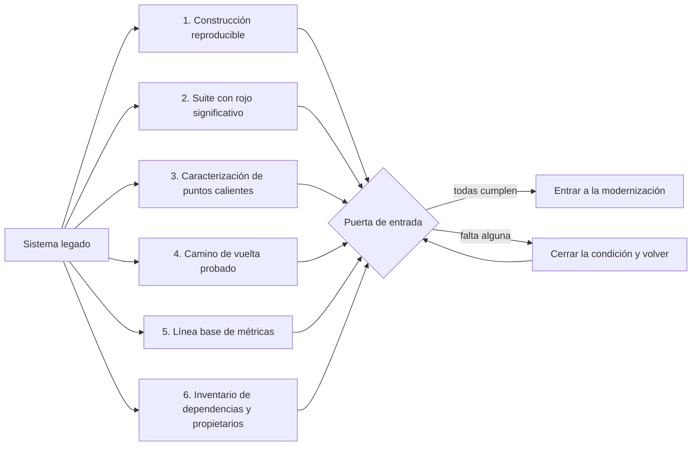

# SE-443 — Taller: estabilizar antes de modernizar

[← SE-442 — Economía de reescribir frente a evolucionar](../../classes/part-36-mantenimiento-y-modernizacion-legacy/se-442-economia-de-reescribir-frente-a-evolucionar/README.md) · [↑ Parte 36](../../classes/part-36-mantenimiento-y-modernizacion-legacy/README.md) · [📚 Índice completo](../../classes/README.md) · [🌐 Portal](../../site/classes/SE-443.html) · [SE-444 — Proyecto: migración incremental reversible →](../../classes/part-36-mantenimiento-y-modernizacion-legacy/se-444-proyecto-migracion-incremental-reversible/README.md)

## Punto profesional y fundamento pedagógico

**Punto profesional.** El taller existe para que no empieces una modernización sobre un terreno que se mueve. Modernizar un sistema inestable mezcla dos fuentes de fallo: las del sistema viejo, que ya existían, y las del cambio, que acabas de introducir; sin una base estable no se puede saber cuál es cuál, y cada resultado rojo abre una discusión sin respuesta. La habilidad es definir y verificar una **puerta de entrada a la modernización**: una construcción reproducible, una suite cuyo rojo signifique algo, una caracterización de los puntos calientes, un camino de vuelta probado y una línea base de métricas con su incertidumbre.

**Por qué aparece aquí.** Es el taller de la **Parte 36** y recoge lo anterior: la cartera clasificada (`SE-433`), el mapa de riesgo (`SE-434`), la caracterización (`SE-435`), la política de dependencias (`SE-436`) y la decisión económica reversible (`SE-442`). Prepara el proyecto final, `SE-444`, que ejecutará una migración incremental sobre la base que este taller deje. El caso conductor es el **módulo legado de calificaciones**.

**Error conceptual que debe corregir.** Creer que estabilizar es una fase de limpieza que retrasa lo importante. La estabilización es lo que convierte la modernización en un experimento interpretable: sin ella, un fallo tras el cambio puede ser un test inestable, una construcción que depende de la hora o una regresión real, y no hay manera de distinguirlas. Tampoco es cierto que estabilizar sea «arreglar todo»: es alcanzar un conjunto pequeño de condiciones verificables.

**Secuencia de aprendizaje.** El taller se hace en seis estaciones. Antes de medir, predices qué fracción de los commits sanos saldría en rojo con veinte pruebas inestables y qué ocurre si se reintentan; después mides cuatro configuraciones de pruebas inestables y reintentos, construyes dos veces el mismo código y comparas las huellas del bytecode y de un archivo comprimido, y calculas cuántos cambios hay que observar para que la línea base de una tasa de fallos sea creíble. La secuencia usa predicción, explicación propia, contraste y recuperación. [ICAP](https://icap.education.asu.edu/research) distingue participación de construcción de conocimiento; [How People Learn II](https://nap.nationalacademies.org/catalog/24783/how-people-learn-ii-learners-contexts-and-cultures) respalda diseñar la práctica con contextos reales y retroalimentación.

**Evidencia de aprendizaje.** `estabilizacion-log.md` con la predicción, las tres figuras reproducidas, la lista de las seis condiciones de la puerta con la evidencia de cada una, la línea base de métricas con su intervalo y una decisión de «entrar» o «no entrar» a la modernización con su fundamento.

**Límite de la conclusión.** Las pruebas inestables, los reintentos y la tasa de fallos son sintéticos y escritos con semilla fija; la construcción reproducible se ejecuta de verdad con archivos creados para la ocasión (treinta módulos de dos líneas) y solo se compara si las huellas coinciden entre dos construcciones del mismo equipo. No se estabilizó ningún sistema real; las seis condiciones de la puerta son una propuesta del autor, no un estándar.

### Trazabilidad fuente → afirmación

| Fuente primaria u oficial | Afirmación que respalda | Lo que no prueba |
|---|---|---|
| [Luo et al., «An empirical analysis of flaky tests»](https://doi.org/10.1145/2635868.2635920) | Analiza, sobre proyectos de código abierto, las causas de las pruebas inestables (espera asíncrona, concurrencia, orden de pruebas) y cómo se corrigen. | No da la proporción de pruebas inestables de tu proyecto. |
| [Reproducible Builds: documentación](https://reproducible-builds.org/docs/) y [archivos](https://reproducible-builds.org/docs/archives/) | Explica por qué una construcción puede no ser repetible (fechas, orden de archivos, rutas) y cómo corregirlo. | No garantiza que tu cadena de construcción pueda hacerse reproducible sin cambios. |
| [PEP 552: pycs deterministas](https://peps.python.org/pep-0552/) y [Python: py_compile](https://docs.python.org/3/library/py_compile.html) | Documentan los modos de invalidación del bytecode, uno basado en la fecha del fuente y otros en su hash. | No dicen qué modo conviene a tu despliegue. |
| [DORA: las cuatro claves](https://dora.dev/guides/dora-metrics-four-keys/) | Define métricas de entrega (frecuencia de despliegue, plazo de entrega, tasa de cambios fallidos y tiempo de recuperación) como línea base de un equipo. | No fija valores objetivo ni demuestra su relación con tu contexto. |
| [Wilson, «Probable Inference, the Law of Succession, and Statistical Inference»](https://doi.org/10.1080/01621459.1927.10502953) | Origen del intervalo de confianza para una proporción usado en el tercer experimento. | No dice cuántos datos son suficientes para tu decisión. |
| [Google SRE: Embracing Risk](https://sre.google/sre-book/embracing-risk/) | Presenta la idea de gestionar el riesgo con un presupuesto de error en vez de buscar fiabilidad perfecta. | No define el nivel de riesgo aceptable de tu sistema. |

## Antes de empezar

Recupera lo aprendido en `SE-442`: la decisión debe ser reversible y tener criterios de abandono. La pregunta activa es: **¿qué evidencia mostrarías hoy de que tu sistema se puede construir dos veces con el mismo resultado, de que sus pruebas rojas significan algo y de que sabes volver atrás?**

## Prerrequisitos

- Haber completado `SE-442` o poder explicar los criterios de una decisión reversible.
- Python 3.11 o posterior; los experimentos usan solo la biblioteca estándar (`random`, `py_compile`, `zipfile`, `hashlib`, `math`).
- Haber ejecutado una suite de pruebas y leído la salida de una construcción.

## Problema auténtico

El equipo del módulo de calificaciones inició la migración del exportador el lunes. El martes la suite salió roja; la reejecutaron y salió verde. El miércoles salió roja en otra prueba; la reejecutaron y salió verde. El jueves un cambio real rompió una prueba y, tras dos reejecuciones, la tercera salió verde y el cambio se integró. El viernes, el artefacto construido desde el mismo commit en dos máquinas tenía huellas distintas, y el equipo no pudo decidir cuál era el que se había probado. Se pasó una semana discutiendo si el error del jueves era del cambio o del entorno. El taller enseña a cerrar esas puertas antes de empezar: a medir cuánto ruido hay, a comprobar que la construcción es repetible y a fijar la línea base con una incertidumbre que sirva para saber más adelante si algo mejoró.

## Objetivos observables

Al terminar podrás:

1. definir una puerta de entrada a la modernización con condiciones verificables;
2. medir cuánto ruido introducen las pruebas inestables y qué hacen los reintentos con los defectos reales;
3. comprobar si dos construcciones del mismo código producen artefactos idénticos y corregir lo que lo impide;
4. calcular la incertidumbre de una tasa de fallos y cuántos cambios hacen falta para distinguir dos tasas;
5. decidir con evidencia entrar o no a la modernización y registrar qué condición faltó.

## Mapa conceptual



El mapa muestra seis condiciones independientes que convergen en una decisión. La puerta no pide un sistema perfecto sino que **cada condición tenga evidencia**; lo que no se pueda cumplir se registra como riesgo aceptado, con dueño y fecha.

## Temas y por qué importan

| Tema | Por qué cambia una decisión profesional | Evidencia mínima |
|---|---|---|
| Qué es estabilizar y cuándo se acaba | Sin criterio de fin, la estabilización no termina o no empieza. | Seis condiciones con evidencia |
| Pruebas inestables y reintentos | Un rojo sin significado entrena a ignorar el rojo. | Falsos rojos y defectos escondidos por configuración |
| Construcción reproducible | Sin ella, no se sabe qué se probó. | Huellas de dos construcciones |
| Línea base con incertidumbre | Sin ella, no se puede decir si algo mejoró. | Intervalo y tamaño de muestra |
| Decisión de entrar | Evita modernizar sobre un terreno que se mueve. | Registro de la decisión y de los riesgos aceptados |

## Conceptos y decisiones

### 1. Qué es estabilizar y cuándo se acaba

Estabilizar es dejar el sistema en un estado donde un cambio produce una señal interpretable. No es refactorizar ni reducir deuda en general: es lograr seis condiciones concretas, cada una con evidencia. **Construcción reproducible**: el mismo código produce el mismo artefacto. **Suite con rojo significativo**: cuando una prueba falla, es por un cambio y no por azar. **Caracterización de los puntos calientes**: el comportamiento de lo que más cambia está fijado (`SE-435`). **Camino de vuelta probado**: se ha desplegado y revertido al menos una vez de forma controlada. **Línea base de métricas**: se conoce el estado actual de la entrega y de las incidencias, con su incertidumbre. **Inventario**: se sabe de qué depende el sistema, quién lo conoce y quién responde por él. Con las seis, la puerta se abre; con cuatro, se abre con riesgos aceptados por escrito.

### 2. Pruebas inestables y el significado del rojo

Una prueba **inestable** (flaky) pasa y falla con el mismo código. Sus causas conocidas son esperas asíncronas, dependencia del orden de ejecución, de la hora, de la red o de datos compartidos. El efecto sobre la suite es multiplicativo: si cada prueba inestable falla con probabilidad q, la suite sana sale roja con probabilidad 1 − (1 − q)^m con m pruebas inestables. Con 20 pruebas que fallan el 5 % de las veces, el 64 % de los commits sanos se ven rojos. El rojo constante enseña a reejecutar sin leer. La respuesta habitual, **reintentar hasta que pase**, reduce los falsos rojos y tiene un costo menos visible: un defecto intermitente real también pasa en alguno de los reintentos, y la suite lo declara sano. Reintentar trata el síntoma, y la solución es **aislar** (poner en cuarentena las inestables con dueño y plazo), **corregir** la causa y reintentar solo lo que está en cuarentena.

### 3. Construcción reproducible

Una construcción es **reproducible** si, dado el mismo código fuente y las mismas herramientas, produce un artefacto idéntico bit a bit. Cuando no lo es, no se puede verificar que lo que se despliega es lo que se probó, ni comparar artefactos de dos construcciones para ver si cambió algo. Las causas habituales son tres. Las **fechas** incrustadas: la fecha de modificación de los archivos fuente o del momento de construcción. El **orden** en que se leen o se empaquetan los archivos, que depende del sistema. Y las **rutas** absolutas del equipo que construye. Para el bytecode de Python, el modo de invalidación por marca de tiempo incrusta la fecha del fuente en el archivo compilado y el modo por hash la sustituye por el hash del fuente; en un archivo comprimido hay que fijar las fechas y el orden. Una construcción reproducible no es un fin en sí misma: es la condición para que una huella signifique algo.

### 4. Línea base con incertidumbre

Para saber si una modernización mejora algo, hay que saber cómo está hoy. Las métricas de entrega más usadas son cuatro: la frecuencia de despliegue, el plazo desde el cambio hasta producción, la tasa de cambios fallidos y el tiempo de recuperación. Cada una es una estimación hecha con los cambios observados, y su incertidumbre depende de cuántos haya. Una tasa de fallos medida sobre 20 cambios tiene un intervalo de confianza del 95 % de unos ±15 puntos; la medida sobre 1 000, de ±2. Decir que la tasa «bajó del 15 % al 10 %» con 20 cambios por periodo no significa nada. La línea base debe declarar el número de observaciones y el intervalo, y el plan de modernización debe decir cuántos cambios hacen falta para ver la mejora esperada.

### 5. La decisión de entrar y los riesgos aceptados

La puerta no es una lista de verificación que se tacha, sino una decisión con registro. Para cada condición se anota la evidencia, quién la revisó y la fecha. Si una condición no se cumple y se decide entrar igualmente, se escribe como **riesgo aceptado**, con quién lo acepta, por qué y qué señal lo haría volver a estabilizar. La decisión de no entrar tiene un costo (el tiempo de estabilizar) y la de entrar sin cumplir una condición otro (interpretabilidad menor), y ambos deben quedar a la vista. Un equipo que se compromete a modernizar sin esa conversación descubrirá más tarde que no sabe interpretar sus resultados, y entonces estabilizará de todos modos, pero con la modernización a medias.

### Cuánto ruido hay y qué esconden los reintentos

Se simulan 5 000 commits sanos por configuración. Cada prueba inestable falla el 5 % de las veces. Aparte, se simulan 5 000 commits con un defecto intermitente que se manifiesta el 30 % de las veces que se ejecuta la suite. Se cuenta cuántos commits sanos salen rojos y cuántos commits con el defecto salen verdes.

| Pruebas inestables · reintentos | Commits sanos que salen rojos | Commits con defecto intermitente que salen verdes |
|---|---:|---:|
| 20 · ninguno | 64,3 % | 24,7 % |
| 20 · dos reintentos | 26,5 % | 58,2 % |
| 5 · ninguno | 23,2 % | 53,8 % |
| 5 · dos reintentos | 1,4 % | 90,3 % |
| 0 · ninguno | 0,0 % | 70,7 % |

Con veinte pruebas inestables y sin reintentos el 64,3 % de los commits sanos se ven rojos y, curiosamente, solo el 24,7 % de los defectuosos pasan, porque el ruido hace fallar a casi todos. Con cinco inestables y dos reintentos se reducen los falsos rojos al 1,4 %, pero el 90,3 % de los commits con el defecto pasan, más que sin ninguna inestable ni reintento (70,7 %). El último dato es el que importa: **reintentar convierte un defecto del 30 % en uno que se esconde en el 90 % de las ocasiones**. La configuración que mejor detecta es la que no tiene inestables, que se logra aislando y corrigiendo, no reintentando.


**Cómo leer la figura.** Cada punto es una configuración: el eje horizontal son los falsos rojos y el vertical, los defectos que salen verdes. Mira primero cómo los reintentos mueven los puntos hacia la izquierda (menos falsos rojos) y hacia arriba (más defectos escondidos). **Dónde deja de valer:** el 5 % de fallo de cada prueba inestable, el 30 % del defecto y la independencia entre pruebas son supuestos del autor; en la práctica las inestables se agrupan (comparten una causa) y los defectos intermitentes dependen de condiciones, no de una moneda. La simulación no modela la cuarentena, que es la salida recomendada.

### ¿Dos construcciones, el mismo artefacto?

Se crean 30 módulos de dos líneas. Se compilan dos veces a bytecode, cambiando entre una y otra la fecha de modificación de los fuentes, con dos modos de invalidación. Después se empaquetan dos veces en un archivo comprimido, cambiando de nuevo las fechas, con tres configuraciones. Se compara la huella SHA-256 de los resultados. Los dos sistemas dieron el mismo veredicto en cada fila; los valores de las huellas difieren entre sistemas (rutas e intérprete distintos) y no se comparan.

| Artefacto | Configuración | Dos construcciones |
|---|---|---|
| Bytecode | Invalidación por marca de tiempo | Distintas |
| Bytecode | Invalidación por hash comprobado | Idénticas |
| Archivo comprimido | Fechas de los archivos, orden del sistema | Distintas |
| Archivo comprimido | Fechas fijas, orden del sistema | Idénticas |
| Archivo comprimido | Fechas fijas, nombres ordenados | Idénticas |

Cambiar solo la fecha de modificación de los fuentes cambia el bytecode y el archivo comprimido. Fijar el modo de invalidación por hash y las fechas del empaquetado hace idénticos los dos artefactos. La fila 4 depende de que el sistema devuelva los nombres en un orden estable: en estas dos máquinas lo hace, y no está garantizado en general; la fila 5, que ordena los nombres, no depende de eso.


**Cómo leer la figura.** Cada fila es una configuración de construcción y las flechas llevan del artefacto y la configuración al resultado, coral si los artefactos son distintos y verde si son idénticos. Mira primero que las fechas fijas y el hash comprobado vuelven verde cada caso. **Dónde deja de valer:** los treinta módulos de dos líneas son trivialmente pequeños, no hay compilación nativa, rutas absolutas ni variables de entorno, y se comparó en dos máquinas distintas pero no entre construcciones hechas en una máquina distinta de la de origen. El experimento muestra el mecanismo y no la reproducibilidad de ninguna cadena real.

### Cuántos cambios hacen falta para creer una tasa

La tasa verdadera de cambios fallidos es del 15 %. Para cada número de cambios observados se simulan 3 000 periodos, se calcula el intervalo de Wilson del 95 % y se mide su ancho mediano y la fracción de veces que el intervalo contiene la tasa verdadera.

| Cambios observados | Semiancho mediano del intervalo (95 %) | El intervalo contiene la tasa real |
|---:|---:|---:|
| 10 | ±19,3 puntos | 95 % |
| 20 | ±15,4 puntos | 98 % |
| 50 | ±9,6 puntos | 96 % |
| 200 | ±4,9 puntos | 95 % |
| 1 000 | ±2,2 puntos | 95 % |

Con 20 cambios, la estimación del 15 % queda entre el 0 % y el 30 %: no distingue un sistema sano de uno malo. Con 200, entre el 10 % y el 20 %. Para distinguir una tasa del 15 % de una del 10 % con una potencia del 80 % y un nivel del 5 % se necesitan unos 686 cambios por periodo (aproximación normal): en un equipo que despliega diez veces por semana, son 69 semanas. La conclusión es práctica: no hay modernización que pueda demostrar una mejora de la tasa de fallos en un trimestre con el volumen de cambios de un equipo pequeño; hay que complementarla con métricas que acumulan más eventos (pruebas, incidencias, tiempos).


**Cómo leer la figura.** El eje horizontal son los cambios observados (escala logarítmica) y el vertical, el semiancho del intervalo del 95 %. Mira primero cómo el intervalo se estrecha despacio: con 20 cambios es de ±15,4 puntos y hacen falta mil para bajar de ±3. **Dónde deja de valer:** los cambios se suponen independientes y con la misma probabilidad de fallar, algo falso cuando hay rachas, y el intervalo de Wilson es una aproximación para proporciones. El cálculo de 686 supone una prueba de dos colas con aproximación normal; con otros criterios el número cambia.

## Definiciones de trabajo

- **puerta de entrada a la modernización:** conjunto de condiciones verificables que debe cumplir un sistema antes de iniciar su modernización.
- **prueba inestable (flaky):** prueba que pasa y falla sobre el mismo código sin que nada cambie.
- **construcción reproducible:** construcción que, con el mismo código y las mismas herramientas, produce artefactos idénticos bit a bit.
- **línea base:** valores de las métricas de un sistema antes de un cambio, con su incertidumbre, contra los que se compara después.
- **riesgo aceptado:** riesgo conocido que se decide asumir, con responsable, motivo y condición de revisión.

Las definiciones son operativas para el módulo de calificaciones. No convierten términos con una historia más amplia en sinónimos y deben contrastarse con la documentación primaria enlazada al final.

## Ejemplo mínimo

El fragmento calcula con qué probabilidad una suite sana sale roja. Antes de ejecutarlo, predice el resultado.

```python
q, m = 0.05, 20
print(round(1 - (1 - q) ** m, 3))
```

Imprime `0.642`: con veinte pruebas que fallan una de cada veinte veces, casi dos de cada tres ejecuciones de una suite sana salen en rojo. Registra versión de Python, comando y salida; después cambia `m` a 5 y a 2.

## Ejemplo profesional

Escenario hipotético, construido para la clase y sin datos reales. El equipo ejecuta el taller en seis estaciones durante dos semanas. Estación 1: construye el artefacto dos veces en máquinas distintas, encuentra que las fechas del empaquetado lo impiden, las fija y vuelve a comparar. Estación 2: ejecuta la suite cien veces sobre un commit sano, identifica 7 pruebas inestables de 412 y las pone en cuarentena con dueño y plazo; desactiva los reintentos automáticos de la integración. Estación 3: carga las pruebas de caracterización de los tres puntos calientes del mapa de riesgo. Estación 4: despliega y revierte una versión en el entorno de ensayo, con cronómetro. Estación 5: calcula la línea base de los últimos 60 cambios (tasa de cambios fallidos con su intervalo) y la declara con la incertidumbre que tiene. Estación 6: cierra el inventario de dependencias (`SE-436`) con propietarios. Decisión: entran a la modernización con un riesgo aceptado (el camino de vuelta tarda 40 minutos, más que lo deseado), con dueño y fecha de revisión. Compara con el lunes de la migración inicial: ahora un rojo significa algo, y el equipo sabe qué haría ante uno.

## Práctica guiada

1. Escribe las seis condiciones de la puerta para un sistema propio con la evidencia que mostrarías de cada una.
2. Predice cuántos commits sanos saldrían rojos con 20 pruebas inestables y escribe el número antes de simular.
3. Reproduce la tabla de ruido con las semillas fijadas en el código; cambia la tasa del defecto intermitente a 5 % y comprueba qué configuración lo esconde más.
4. Construye dos veces tu artefacto cambiando las fechas de los fuentes y compara las huellas; corrige lo que lo impide.
5. Calcula la línea base de tu tasa de cambios fallidos con su intervalo y estima cuántos cambios necesitas para distinguir una mejora del 5 %.
6. Pon en cuarentena una prueba inestable con dueño y plazo y comprueba que la suite sigue ejecutándola sin bloquear.
7. Entrega `estabilizacion-log.md` y pide a otra persona que construya tu artefacto en su máquina y compare la huella.

## Ejercicios

1. **Ruido:** con 10 pruebas inestables del 2 %, ¿cuántos commits sanos saldrían rojos? ¿Cuántos reintentos necesitarías para llevarlos al 1 % y qué defecto intermitente de baja frecuencia esconderías?
2. **Reproducible:** lista tres causas de que dos construcciones difieran en tu cadena y cómo comprobarías cada una.
3. **Intervalo:** con 40 cambios y 6 fallidos, calcula la tasa y su intervalo aproximado. ¿Distingue de una tasa del 10 %?
4. **Puerta:** una condición no se cumple y el plazo te obliga a entrar. Redacta el riesgo aceptado: dueño, motivo, señal de revisión y fecha.

## Reto verificable

Entrega `estabilizacion-log.md` con la predicción, las tres tablas, las seis condiciones con la evidencia de cada una, la línea base con su intervalo y la decisión de entrar o no con los riesgos aceptados. Se aprueba si otra persona ejecuta el código desde un checkout limpio, obtiene los mismos números con las mismas semillas y puede decir qué condición faltaría para abrir la puerta y qué haría falta para cerrarla. No se aprueba por declarar estable un sistema porque la suite pasa dos veces seguidas ni por reportar una tasa de fallos sin su intervalo.

## Caso conductor

El módulo de calificaciones es el caso conductor de la Parte 36. Este taller deja el undécimo artefacto: la puerta de entrada con su evidencia y su decisión. `SE-444` ejecuta sobre esa base una migración incremental reversible de principio a fin. Cambia después un solo dato, la probabilidad de fallo de las pruebas inestables de 5 % a 1 %, y observa cuándo los reintentos dejan de ser la causa principal del defecto escondido.

## Preguntas frecuentes

### ¿Hay que corregir todas las pruebas inestables antes de empezar?

No. Hay que aislarlas en cuarentena con dueño y plazo, de modo que no bloqueen ni se reintenten a ciegas, y corregir primero las que estén en el camino de lo que se va a modernizar. La cuarentena tiene un costo, que es no ver lo que esa prueba debería ver, y debe quedar escrito.

### ¿Reproducible significa que cualquier persona obtiene los mismos bytes?

Con las mismas herramientas y el mismo código, sí. Si cambian las herramientas (versión del compilador, del intérprete), el artefacto puede cambiar legítimamente. Por eso la reproducibilidad se declara junto con las versiones de herramientas.

### ¿Por qué no basta con ejecutar la suite varias veces seguidas para decir que es estable?

Porque una suite con un 5 % de fallos en 20 pruebas pasa dos veces seguidas el 13 % de las veces, y las causas de la inestabilidad (orden, hora, carga) pueden no aparecer en ejecuciones consecutivas del mismo entorno. Hay que variar las condiciones, no solo repetir.

### ¿Qué hago si el volumen de cambios es muy bajo para una línea base?

Declara la incertidumbre y complementa con métricas que acumulen más eventos (ejecuciones de pruebas, incidencias, tiempos de recuperación en simulacros), o amplía el periodo. Lo que no se puede hacer es comunicar una mejora que el volumen de datos no permite ver.

## Fallo controlado y diagnóstico

Reproduce el fallo clásico de la clase: **un defecto real que se esconde detrás de los reintentos**. Configura cinco pruebas inestables con dos reintentos y un defecto que falla el 30 % de las veces.

Registra síntoma, entrada mínima, hipótesis, observación que descarta cada hipótesis, causa, corrección y prueba de regresión. **Síntoma:** un cambio con un error intermitente se integra tras pasar la suite al tercer intento y falla en producción. **Hipótesis rivales:** (a) el error es del entorno de producción; (b) la suite no cubría esa parte; (c) los reintentos automáticos escondieron un fallo real. **Prueba:** ejecuta el commit 100 veces sin reintentos; si falla en unas 30, la causa es un defecto que los reintentos ocultaban. **Conclusión:** con cinco inestables y dos reintentos, el 90,3 % de los commits con ese defecto salen verdes. **Regresión:** desactiva los reintentos globales, pon las inestables en cuarentena y añade una comprobación que ejecute 20 veces las pruebas de los cambios nuevos y falle si alguna falla alguna vez. No cambies a la vez los reintentos y la lista de pruebas en cuarentena.

## Errores comunes y cómo corregirlos

| Síntoma | Causa probable | Corrección |
|---|---|---|
| La suite sale roja y verde sin cambios | Pruebas inestables | Cuarentena con dueño y plazo, y corregir la causa |
| Un defecto intermitente llega a producción | Reintentos globales que lo escondieron | Eliminar los reintentos globales y repetir solo lo nuevo |
| Los artefactos de dos máquinas difieren | Fechas, orden o rutas incrustadas | Fijar fechas, ordenar la entrada y construir en entorno limpio |
| Se afirma una mejora con 20 cambios | Línea base sin incertidumbre | Declarar el intervalo y ampliar la muestra |
| La modernización empieza y nadie sabe volver | Camino de vuelta no probado | Desplegar y revertir en ensayo antes de empezar |

## Entorno y archivos clave

```text
work/SE-443/
├── README.md
├── estabilizacion/
│   ├── ruido.py
│   ├── construccion.py
│   └── linea_base.py
├── PUERTA-DE-ENTRADA.md
├── tests/test_estabilizacion.py
└── evidence/estabilizacion-log.md
```

El `README` declara plataforma, versión de Python, semillas y comandos. Los experimentos usan solo la biblioteca estándar (`random`, `py_compile`, `zipfile`, `hashlib`, `math`) y se ejecutaron con CPython 3.12.9 en Windows 11 y 3.12.3 en Ubuntu bajo WSL2: los veredictos de la construcción y las cifras de ruido y de intervalos fueron idénticos; los valores de las huellas difieren entre sistemas y no se comparan.

## Seguridad, ética y accesibilidad

- una construcción reproducible es también una defensa de la cadena de suministro: permite verificar que el binario desplegado corresponde al código revisado;
- desactivar las pruebas inestables sin dueño ni plazo es ocultar un riesgo: registra qué dejaste de ver;
- las métricas de entrega son del sistema y del equipo, no de las personas: usarlas para evaluar individuos las corrompe y daña la confianza;
- las tablas y figuras deben tener texto alternativo y no depender del color;
- los datos de ejecución de pruebas pueden contener datos personales: anonimízalos antes de compartir la línea base.

## Puente hacia el trabajo con agentes

Un agente al que se le pide «arregla las pruebas que fallan» puede añadir reintentos, aumentar plazos o marcar las pruebas como omitidas, y dirá que la suite está en verde. Pídele en cambio que identifique las pruebas inestables repitiendo cada una con condiciones distintas, que proponga la causa de cada una, que las ponga en cuarentena con un registro y que no cambie los reintentos globales. Revisa especialmente cualquier cambio de configuración que haga más permisiva la suite (reintentos, tiempos de espera, `skip`) y cualquier artefacto «reproducible» del que no se hayan comparado dos construcciones.

## Transferencia

Traslada el taller a otro dominio (por ejemplo, la aplicación móvil de reservas de un taller mecánico): cambia el sistema y las métricas y conserva las seis condiciones, la medición del ruido, la comparación de dos construcciones y la línea base con su intervalo. La transferencia está lograda cuando puedes decir qué condición de la puerta sería la más difícil de cumplir en ese dominio y qué riesgo aceptarías, no cuando el registro se parece al del módulo de calificaciones.

## Evaluación y evidencia

| Criterio | Evidencia para aprobar |
|---|---|
| comprensión | explicación de la puerta de entrada y de por qué reintentar puede esconder defectos |
| corrección | tablas de ruido, de construcción y de línea base reproducibles con las mismas semillas |
| diseño | seis condiciones con evidencia y riesgos aceptados con dueño y fecha |
| diagnóstico | reproducción del fallo «defecto escondido por reintentos» con regresión |
| incertidumbre | declaración de que las tasas, los módulos y los cambios son del autor |
| reproducibilidad | versiones, comandos, salida y límites declarados |

## Fuentes

- [Luo et al., «An empirical analysis of flaky tests»](https://doi.org/10.1145/2635868.2635920) — causas de las pruebas inestables; autoridad: FSE 2014.
- [Reproducible Builds](https://reproducible-builds.org/docs/) y [archivos](https://reproducible-builds.org/docs/archives/) — por qué una construcción no se repite y cómo corregirlo; autoridad: proyecto Reproducible Builds.
- [PEP 552](https://peps.python.org/pep-0552/) y [Python: py_compile](https://docs.python.org/3/library/py_compile.html) — modos de invalidación del bytecode; autoridad: Python Software Foundation.
- [Python: zipfile](https://docs.python.org/3/library/zipfile.html) — fechas y orden de los miembros de un archivo; autoridad: documentación de Python.
- [DORA: las cuatro claves](https://dora.dev/guides/dora-metrics-four-keys/) — métricas de entrega; autoridad: DORA.
- [Wilson (1927)](https://doi.org/10.1080/01621459.1927.10502953) — intervalo para una proporción; autoridad: Journal of the American Statistical Association.
- [Google SRE: Embracing Risk](https://sre.google/sre-book/embracing-risk/) — gestión del riesgo con un presupuesto; autoridad: Google, libro de ingeniería de confiabilidad.

Cada fuente respalda el mecanismo indicado; ninguna demuestra que el 64,3 % de falsos rojos, el 90,3 % de defectos escondidos o los 686 cambios se observen en tu sistema. Esa afirmación depende de tu suite, de tu construcción y de tu volumen de cambios.

## Límites y siguiente paso

Se ejecutaron tres experimentos en Windows y Ubuntu (WSL2): el ruido y los intervalos son sintéticos y con cifras idénticas, la construcción se ejecutó de verdad con treinta módulos creados para la ocasión y los veredictos coincidieron, y las huellas difieren entre sistemas. Las tasas de fallo, el defecto intermitente y la independencia entre pruebas son construcciones del autor; las seis condiciones de la puerta son una propuesta, no un estándar. No se estabilizó ningún sistema real. La siguiente clase es el proyecto final: una migración incremental reversible de principio a fin.

## Glosario

- **puerta de entrada a la modernización:** conjunto de condiciones verificables que debe cumplir un sistema antes de iniciar su modernización.
- **prueba inestable (flaky):** prueba que pasa y falla sobre el mismo código sin que nada cambie.
- **construcción reproducible:** construcción que, con el mismo código y las mismas herramientas, produce artefactos idénticos bit a bit.
- **línea base:** valores de las métricas de un sistema antes de un cambio, con su incertidumbre, contra los que se compara después.
- **riesgo aceptado:** riesgo conocido que se decide asumir, con responsable, motivo y condición de revisión.

---

[← SE-442 — Economía de reescribir frente a evolucionar](../../classes/part-36-mantenimiento-y-modernizacion-legacy/se-442-economia-de-reescribir-frente-a-evolucionar/README.md) · [↑ Parte 36](../../classes/part-36-mantenimiento-y-modernizacion-legacy/README.md) · [📚 Índice completo](../../classes/README.md) · [🌐 Portal](../../site/classes/SE-443.html) · [SE-444 — Proyecto: migración incremental reversible →](../../classes/part-36-mantenimiento-y-modernizacion-legacy/se-444-proyecto-migracion-incremental-reversible/README.md)
