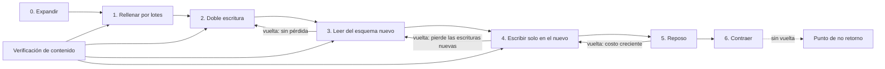
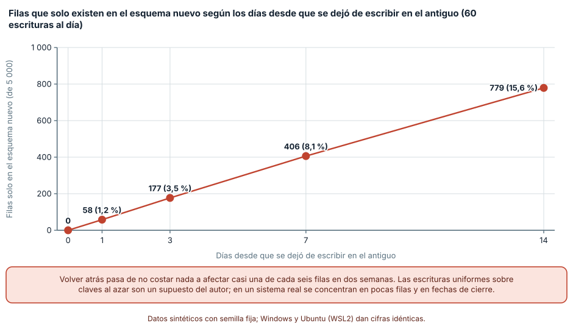
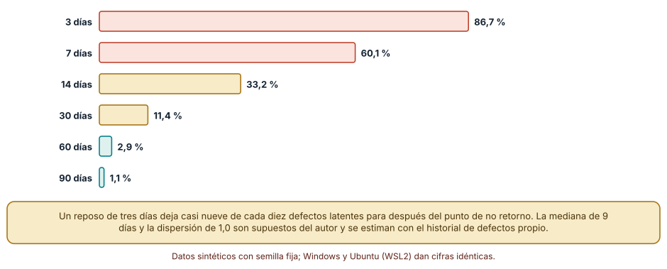

# SE-444 — Proyecto: migración incremental reversible

[← SE-443 — Taller: estabilizar antes de modernizar](../../classes/part-36-mantenimiento-y-modernizacion-legacy/se-443-taller-estabilizar-antes-de-modernizar/README.md) · [↑ Parte 36](../../classes/part-36-mantenimiento-y-modernizacion-legacy/README.md) · [📚 Índice completo](../../classes/README.md) · [🌐 Portal](../../site/classes/SE-444.html) · [SE-445 — Liderazgo técnico sin autoridad formal →](../../classes/part-37-gestion-liderazgo-y-practica-profesional/se-445-liderazgo-tecnico-sin-autoridad-formal/README.md)

## Punto profesional y fundamento pedagógico

**Punto profesional.** El proyecto existe para que ejecutes de principio a fin una migración incremental reversible y entregues un paquete que otra persona pueda comprobar, repetir y desmontar. Las clases anteriores trataron cada pieza (clasificar el trabajo, recuperar conocimiento, caracterizar, actualizar dependencias, estrangular, migrar el runtime, migrar datos, coexistir, retirar, decidir y estabilizar). Aquí se integran en un solo flujo con una pregunta de fondo: **¿en qué momento exacto deja de poderse volver atrás, qué se pierde si se vuelve, y qué evidencia justifica haber llegado hasta ahí?**

**Por qué aparece aquí.** Cierra la **Parte 36** después de **Taller: estabilizar antes de modernizar**: el taller dejó la puerta de entrada; el proyecto cruza esa puerta. El caso conductor es el **módulo legado de calificaciones**: se migra su tabla de notas (texto con coma y estado de una letra) a un esquema con la nota numérica y un estado traducido, con escrituras que siguen llegando durante todo el proceso.

**Error conceptual que debe corregir.** Creer que una migración reversible es la que tiene un script de vuelta atrás. La reversibilidad es una propiedad de cada **fase**, no del conjunto: hasta cierta fase, volver no cuesta nada; después, volver pierde las escrituras hechas solo en el esquema nuevo; y tras contraer, no se puede. Quien no marca esa frontera tiene un botón que parece funcionar y destruye datos.

**Secuencia de aprendizaje.** Antes de ejecutar, predices cuántas filas diferirían entre el esquema antiguo y el nuevo en cada fase y cuántas escrituras se perderían si se volviera atrás después de dejar de escribir en el antiguo; después ejecutas la migración de 5 000 filas en SQLite fase por fase con un fallo del 1 % en la doble escritura y con una reconciliación, mides el costo de volver atrás según los días transcurridos y calculas qué fracción de los defectos aparece después de contraer según el tiempo de reposo. La secuencia usa predicción, explicación propia, contraste y recuperación. [ICAP](https://icap.education.asu.edu/research) distingue participación de construcción de conocimiento; [How People Learn II](https://nap.nationalacademies.org/catalog/24783/how-people-learn-ii-learners-contexts-and-cultures) respalda diseñar la práctica con contextos reales y retroalimentación.

**Evidencia de aprendizaje.** Un paquete `migracion-reversible/` con el plan de fases y sus condiciones de paso, el ejecutor de la migración, la verificación de contenido, el ensayo de vuelta atrás con su costo medido, los criterios de reposo y de contracción, `LIMITES.md` con lo que no se probó y una nota que separe qué es medido, qué inferido y qué supuesto.

**Límite de la conclusión.** La migración usa SQLite en memoria con 5 000 filas sintéticas, escrituras intercaladas de manera determinista y sin concurrencia real; la tasa de fallo del 1 %, las 60 escrituras diarias y el tiempo de descubrimiento de defectos (mediana de 9 días, dispersión 1,0) son supuestos del autor. No se migró ningún sistema real ni se usó otro motor; las cifras muestran la estructura del compromiso entre volver y avanzar, no el tuyo.

### Trazabilidad fuente → afirmación

| Fuente primaria u oficial | Afirmación que respalda | Lo que no prueba |
|---|---|---|
| [Fowler, «ParallelChange»](https://martinfowler.com/bliki/ParallelChange.html) | Descompone un cambio incompatible en expandir, migrar y contraer. | No dice cuánto debe durar cada fase. |
| [Fowler, «StranglerFigApplication»](https://martinfowler.com/bliki/StranglerFigApplication.html) | Presenta el reemplazo incremental detrás de una fachada. | No fija el orden de las rebanadas. |
| [Fowler y Sadalage, «Evolutionary Database Design»](https://martinfowler.com/articles/evodb.html) | Defiende cambios de esquema pequeños, versionados y automatizados. | No sustituye el análisis de bloqueos de tu motor. |
| [Patrón Transactional Outbox](https://microservices.io/patterns/data/transactional-outbox.html) | Describe una forma de mantener dos copias alineadas con eventos confirmados con el dato. | No elimina la necesidad de reconciliar. |
| [DORA: las cuatro claves](https://dora.dev/guides/dora-metrics-four-keys/) | Propone medir la tasa de cambios fallidos y el tiempo de recuperación como indicadores de entrega. | No fija valores objetivo. |
| [Python: sqlite3](https://docs.python.org/3/library/sqlite3.html) | Documenta el módulo usado para ejecutar la migración. | No describe el comportamiento de otros motores. |
| [Python: statistics](https://docs.python.org/3/library/statistics.html) | Documenta la mediana y los cuantiles usados en los resultados. | No valida la distribución de descubrimiento de defectos. |

## Antes de empezar

Recupera lo aprendido en `SE-443`: la modernización empieza sobre una base estable. La pregunta activa es: **¿qué fase de tu migración sería la última en la que podrías volver atrás sin perder datos, y cómo lo has comprobado?**

## Prerrequisitos

- Haber completado `SE-443` o poder explicar las seis condiciones de la puerta de entrada.
- Haber completado o poder resumir `SE-437`, `SE-439`, `SE-440` y `SE-441` (estrangulamiento, relleno, coexistencia y retiro).
- Python 3.11 o posterior con `sqlite3`; los experimentos usan solo la biblioteca estándar.

## Problema auténtico

El equipo había completado el taller y quería migrar la tabla de notas. Su plan tenía cinco pasos y un párrafo final: «si algo falla, se vuelve atrás». En el ensayo, volver atrás tras el tercer paso funcionaba; tras el cuarto, el script restauraba el esquema antiguo con los valores que tenía antes de la migración, y se perdían las 391 notas modificadas desde entonces. Nadie había medido cuántas eran. En paralelo, el equipo quería contraer el esquema antiguo a los tres días «para ahorrar costo de almacenamiento», y un análisis del historial de defectos mostraba que los fallos tardaban una mediana de nueve días en descubrirse. El proyecto obliga a convertir ese párrafo en un plan con fronteras: qué fase permite volver sin pérdida, cuánto cuesta volver en cada una, y cuánto tiempo hay que esperar antes de dar el paso que ya no se puede deshacer.

## Objetivos observables

Al terminar podrás:

1. descomponer una migración de esquema en fases con una condición de paso y una evaluación de reversibilidad por fase;
2. ejecutar la migración con relleno condicional, doble escritura y reconciliación sobre una base real y medir las filas que difieren en cada fase;
3. medir cuántas escrituras se perderían al volver atrás en función del tiempo transcurrido desde el último punto sin pérdida;
4. calcular el reposo antes de contraer a partir de la distribución del tiempo de descubrimiento de defectos;
5. entregar un paquete reproducible con sus límites declarados y una decisión justificada de contraer o no.

## Mapa conceptual



El mapa marca con **líneas continuas** las vueltas posibles y su costo, y con una **línea punteada** el único paso sin retorno. La verificación de contenido actúa sobre todas las fases a partir del relleno: es la que decide si se avanza.

## Temas y por qué importan

| Tema | Por qué cambia una decisión profesional | Evidencia mínima |
|---|---|---|
| Fases y condiciones de paso | Sin condición medible, avanzar es una decisión de calendario. | Plan con una condición por fase |
| Reversibilidad por fase | La vuelta tiene un costo distinto en cada fase. | Filas perdidas al volver desde cada fase |
| Verificación de contenido | Lo que no se compara no se sabe. | Filas que difieren por fase |
| Reposo antes de contraer | Los defectos tardan en aparecer. | Fracción de defectos posteriores según el reposo |
| Paquete con límites | Un paquete sin límites declarados parece más sólido de lo que es. | `LIMITES.md` revisado por otra persona |

## Conceptos y decisiones

### 1. Fases y condiciones de paso

Una migración incremental es una secuencia de estados del sistema en cada uno de los cuales funciona. Las seis fases del proyecto son: **expandir** (se crea la estructura nueva vacía), **rellenar** (se copian los datos históricos por lotes), **doble escritura** (cada escritura nueva va a los dos esquemas), **lectura del nuevo** (las consultas leen el esquema nuevo), **escritura solo en el nuevo** (se deja de escribir en el antiguo) y **contraer** (se retira el antiguo). Para pasar de una fase a la siguiente se exige una **condición medible**: tras rellenar, cero diferencias en la verificación; tras la doble escritura, tres reconciliaciones seguidas sin diferencias; tras leer del nuevo, la tasa de errores y la latencia dentro de objetivo durante un periodo; antes de contraer, un reposo cumplido y una copia restaurada. Pasar sin condición es pasar por fecha.

### 2. Reversibilidad por fase

Volver atrás consiste en dejar el sistema en el estado de una fase anterior. El costo depende de qué datos se escribieron solo en el esquema nuevo. En las fases 1 a 3 (rellenar, doble escritura, lectura del nuevo) el esquema antiguo sigue recibiendo todas las escrituras, así que volver no pierde nada. En la fase 4, el antiguo ya no recibe escrituras: todo lo que se haya modificado desde entonces existe solo en el nuevo, y volver exige **reconstruirlo en el antiguo** (copiando del nuevo al antiguo con la misma conversión inversa) o aceptar perderlo. El costo de volver crece con el tiempo transcurrido, porque cada día añade escrituras. En la fase 6 no hay vuelta: el esquema antiguo ya no existe, y lo único que queda es restaurar una copia, que devuelve el estado del momento de la copia. La frontera entre una vuelta sin pérdida y una con pérdida es el dato más importante del plan y debe medirse, no suponerse.

### 3. Verificación de contenido en cada fase

La verificación compara cada fila del esquema antiguo, convertida con la regla de traducción, con la del nuevo. En la fase 0 el nuevo está vacío y todas las filas difieren. Tras el relleno, difieren las filas modificadas en el antiguo mientras se rellenaba. Con la doble escritura activa y tras una pasada de reconciliación, difieren solo las filas donde la segunda escritura falló. En las fases posteriores, las diferencias cambian de sentido: si el antiguo ya no recibe escrituras, las filas que difieren son las que el nuevo tiene más recientes. La misma cuenta mide cosas distintas en cada fase y por eso la verificación se acompaña de su interpretación: **qué significa una diferencia en esta fase** y **qué se hace con ella**. Una verificación que solo devuelve un número, sin esa interpretación, se vuelve un rito.

### 4. Reposo antes de contraer

Contraer es el paso sin retorno, y el riesgo es que un defecto que se descubre después ya no se pueda corregir volviendo. Los defectos latentes aparecen con una distribución con cola: la mayoría pronto, algunos tras semanas, unos pocos tras meses (un proceso mensual, un cierre de trimestre). Si el tiempo de descubrimiento es lognormal con mediana de nueve días y dispersión 1,0, un reposo de tres días deja el 86,7 % de los defectos para después del punto de no retorno; uno de treinta días, el 11,4 %; uno de noventa, el 1,1 %. El costo del reposo es mantener dos esquemas (almacenamiento, complejidad, escrituras duplicadas). La decisión es un compromiso explícito: **cuánto riesgo residual se acepta a cambio de cuánto costo de mantenimiento**, y qué proceso con ciclo largo (cierre de semestre) obliga a esperar más.

### 5. El paquete y sus límites

El entregable no es el script sino el paquete que permite a otra persona comprobar la migración sin confiar en quien la hizo. Debe contener el **plan de fases** con las condiciones de paso, el **ejecutor** idempotente y reanudable, la **verificación de contenido** con su interpretación por fase, el **ensayo de vuelta atrás** con el número de escrituras perdidas, los **criterios de reposo** con su fundamento, los **datos sintéticos** con semilla y un `LIMITES.md` que diga qué no se probó: no hubo concurrencia real, no se usó el motor de producción, las tasas de fallo son supuestas, no se midió ningún proceso periódico real. Un paquete sin límites declarados proyecta una certeza que la evidencia no respalda.

### Seis fases con fallo en la doble escritura

Se ejecuta la migración de 5 000 filas en SQLite en memoria: cada fase tiene 400 escrituras de la aplicación (en el relleno, 40 por cada lote de 500). Durante la doble escritura la segunda escritura falla el 1 % de las veces y no se reintenta. Antes de la doble escritura se repasa todo el histórico, y se cuentan las filas que difieren entre el esquema antiguo, convertido, y el nuevo.

| Fase | Filas que difieren (1 % de fallos) | Filas que difieren (sin fallos) | Qué significa |
|---|---:|---:|---|
| 0. Expandir | 5 000 | 5 000 | El nuevo está vacío |
| 1. Rellenar | 220 | 220 | Nuevo desactualizado respecto de escrituras durante el relleno |
| 2. Doble escritura | 1 | 0 | Una segunda escritura falló y no se reparó |
| 3. Lectura del nuevo | 5 | 0 | Cinco segundas escrituras fallidas acumuladas |
| 4. Solo escritura nueva | 391 | 387 | El nuevo tiene valores que el antiguo no tiene |

Con un 1 % de fallos de la segunda escritura quedan 1 fila divergente tras la fase 2 y 5 tras la fase 3, cantidades pequeñas que sin verificación no se verían nunca. Sin fallos, la verificación da cero en las fases 2 y 3, como debe. La fase 4 cambia de significado: las 391 (387 sin fallos) filas distintas son escrituras que existen solo en el esquema nuevo, y son lo que se perdería si se volviera atrás sin reconstruir.


**Cómo leer la figura.** Cada fila es una fase; las dos columnas numéricas comparan una ejecución con fallos y otra sin ellos; la última explica qué significa la diferencia en esa fase. **Dónde deja de valer:** las escrituras se intercalan de forma determinista, el fallo es independiente y fijo en el 1 % y SQLite en memoria no reproduce un motor con concurrencia; las 400 escrituras por fase son una elección del autor. Los números son del experimento y no se extrapolan a una tabla real.

### Cuánto cuesta volver atrás

Tras dejar de escribir en el esquema antiguo, la aplicación modifica 60 notas por día. Se calcula cuántas filas distintas existen solo en el nuevo tras 0, 1, 3, 7 y 14 días (con claves repetidas contando una vez), es decir, las filas que habría que reconstruir en el antiguo o que se perderían al volver.

| Días desde que se dejó de escribir en el antiguo | Filas que solo existen en el nuevo |
|---:|---:|
| 0 | 0 |
| 1 | 58 |
| 3 | 177 |
| 7 | 406 |
| 14 | 779 |

La vuelta pasa de no costar nada a afectar 58 filas en un día, 406 en una semana y 779 en dos semanas, el 15,6 % de la tabla. El crecimiento es algo menor que lineal porque algunas escrituras repiten una fila ya modificada, y cuanto más pasa el tiempo, más se parecen a una reescritura completa. Esa es la razón de que el ensayo de vuelta atrás deba hacerse con un reloj: el plan debe decir «hasta el día 3 se vuelve con reconstrucción de 177 filas y después se acepta avanzar».



**Cómo leer la figura.** Cada fila es un momento posible de la vuelta; el número de filas es el trabajo de reconstrucción o la pérdida. **Dónde deja de valer:** las 60 escrituras diarias son uniformes y las claves se eligen al azar, mientras que en un sistema real las escrituras se concentran en pocas filas y en fechas (cierres), lo que cambia el número de filas distintas; el cálculo cuenta filas, no su importancia.

### Cuánto reposo antes de contraer

Se asume que el tiempo hasta descubrir un defecto latente sigue una distribución lognormal con mediana de 9 días y dispersión 1,0, y se calcula con 40 000 defectos simulados la fracción que aparece después de cada reposo.

| Reposo antes de contraer | Defectos que aparecen cuando ya no hay vuelta |
|---:|---:|
| 3 días | 86,7 % |
| 7 días | 60,1 % |
| 14 días | 33,2 % |
| 30 días | 11,4 % |
| 60 días | 2,9 % |
| 90 días | 1,1 % |

El reposo de tres días que quería el equipo deja casi nueve de cada diez defectos latentes para después del punto de no retorno; el de treinta días deja uno de cada nueve; el de noventa, uno de cada cien. La decisión depende del costo de mantener dos esquemas y del costo de un defecto sin vuelta. Y se mueve con el calendario: si el proceso más largo del negocio es un cierre de semestre cada seis meses, ningún reposo de noventa días lo ejercitará.



**Cómo leer la figura.** Cada barra es un reposo; su longitud es la fracción de defectos que se descubriría ya sin posibilidad de volver. **Dónde deja de valer:** la mediana de 9 días y la dispersión de 1,0 son supuestos del autor y se estiman con el historial de defectos del propio sistema; la distribución lognormal es una elección de modelo, y los defectos ligados a procesos periódicos (cierres) no siguen una distribución continua sino fechas fijas.

## Definiciones de trabajo

- **fase reversible:** fase de una migración desde la cual se puede volver a la anterior sin perder datos.
- **punto de no retorno:** paso a partir del cual volver atrás es imposible o destruye datos.
- **ensayo de vuelta atrás:** ejecución controlada de la reversión para medir su duración y lo que se pierde.
- **reposo:** periodo durante el cual ambos esquemas se conservan antes de retirar el antiguo.
- **paquete de migración:** conjunto de artefactos (plan, ejecutor, verificación, ensayo, límites) que permite a otra persona comprobar la migración.

Las definiciones son operativas para el módulo de calificaciones. No convierten términos con una historia más amplia en sinónimos y deben contrastarse con la documentación primaria enlazada al final.

## Ejemplo mínimo

El fragmento cuenta cuántas filas existirían solo en el nuevo tras unos días de escrituras. Antes de ejecutarlo, predice si el resultado supera la mitad de las filas.

```python
import random
r = random.Random(4442)
filas = set()
for dia in range(14):
    for _ in range(60):
        filas.add(r.randrange(5000))
print(len(filas))
```

Imprime `779`: tras 14 días, 779 de 5 000 filas (15,6 %) existen solo en el nuevo. Registra versión de Python, comando y salida; después cambia los días a 3 y a 7 y compara con la tabla.

## Ejemplo profesional

Escenario hipotético, construido para la clase y sin datos reales. El equipo entrega un paquete con seis directorios. `plan/` describe las seis fases con su condición de paso y su reversibilidad (sin pérdida hasta la fase 3; con reconstrucción de unas 177 filas hasta el día 3 de la fase 4; sin vuelta tras contraer). `ejecutor/` contiene el relleno condicional reanudable y la doble escritura con bandeja. `verificacion/` compara contenido por rangos y escribe, por fase, qué significa una diferencia. `ensayo/` incluye el script que cronometra la vuelta atrás y cuenta lo perdido. `reposo/` calcula el reposo con el historial de defectos de los últimos dos años del equipo: mediana de 9 días y un cierre de semestre de seis meses, por lo que decide un reposo de 90 días con una excepción: no contraer antes de que pase un cierre de semestre. `LIMITES.md` declara lo que no se probó. Otra persona del equipo ejecuta el paquete desde un checkout limpio, obtiene las mismas cifras y firma la decisión. Compara con el plan original de cinco pasos y un párrafo: ahora cada fase tiene condición, costo de vuelta y evidencia, y el punto de no retorno está fechado.

## Práctica guiada

1. Escribe las seis fases para una migración propia con la condición de paso y la reversibilidad de cada una.
2. Predice cuántas filas diferirán tras la fase 4 con 400 escrituras y escribe el número antes de ejecutar.
3. Ejecuta la migración con las semillas fijadas en el código, con fallo del 1 % y sin fallos, y reproduce la tabla de fases.
4. Cronometra y cuenta una vuelta atrás desde la fase 4 a los 0, 1, 3, 7 y 14 días.
5. Calcula el reposo con la distribución de descubrimiento de defectos de tu sistema (o con la del autor) y decide.
6. Escribe `LIMITES.md` con al menos cinco cosas que tu paquete no prueba.
7. Entrega el paquete y pide a otra persona que lo ejecute desde un checkout limpio y encuentre una fase donde la vuelta pierda datos que tú declaraste sin pérdida.

## Ejercicios

1. **Fases:** una condición de paso dice «pasó una semana». Reescríbela como una condición medible y explica por qué la original es una fecha.
2. **Vuelta:** con 120 escrituras diarias y 5 000 filas, estima las filas distintas tras 7 días y comprueba con el código. ¿A partir de qué día la vuelta con reconstrucción supera el 20 % de la tabla?
3. **Reposo:** con mediana de 20 días y dispersión 1,0, calcula el reposo que deja menos del 5 % de defectos para después y compáralo con el de la mediana de 9.
4. **Límites:** redacta tres límites que una persona externa agradecería leer antes de confiar en tu paquete.

## Reto verificable

Entrega `migracion-reversible/` con el plan de fases, el ejecutor, la verificación con interpretación, el ensayo de vuelta atrás, los criterios de reposo y `LIMITES.md`. Se aprueba si otra persona ejecuta el paquete desde un checkout limpio, obtiene las mismas cifras con las mismas semillas y puede decir en qué fase la vuelta deja de ser gratuita, cuánto cuesta en el día 3 y qué reposo propones y por qué. No se aprueba por entregar un script de vuelta atrás sin medir lo que pierde, ni por contraer sin una condición de reposo, ni por un paquete sin `LIMITES.md`.

## Caso conductor

El módulo de calificaciones es el caso conductor de la Parte 36. Este proyecto deja el último artefacto: el paquete de migración incremental reversible, que reúne las clasificaciones, el mapa de riesgo, la caracterización, la política de dependencias, el plan de rebanadas, el catálogo de la plataforma, el plan de datos, el contrato de coexistencia, la secuencia de retiro, el modelo económico y la puerta de entrada de las clases anteriores. La Parte 37 lleva la mirada a la gestión, el liderazgo y la práctica profesional. Cambia después un solo dato, las escrituras diarias de 60 a 600, y observa cuánto se acorta la ventana en que volver es barato.

## Preguntas frecuentes

### ¿Siempre hay que hacer las seis fases?

No siempre. Un cambio que añade una columna opcional sin transformar nada puede quedarse en expandir y migrar. Las seis fases son el caso completo, el de un cambio de significado de un dato con consumidores externos; el criterio es qué compatibilidad exige cada cambio.

### ¿Se puede volver atrás tras contraer?

Solo restaurando una copia, que devuelve el estado del momento en que se hizo y descarta lo escrito después. Por eso la copia debe hacerse justo antes y haberse restaurado antes en ensayo, y por eso contraer es el único paso sin vuelta real.

### ¿Quién decide el reposo?

Quien responde por las consecuencias de un defecto que ya no se puede deshacer, con datos del equipo técnico sobre la distribución de defectos y sobre el costo de mantener dos esquemas. La decisión se escribe con su fecha y su condición de revisión.

### ¿Qué hago si la migración falla a la mitad?

Se detiene en la fase en que está (cada fase es un estado válido), se mide qué difiere con la verificación, se corrige el ejecutor y se reanuda desde el último lote verificado. Si el fallo está en la fase 4 y hay escrituras solo en el nuevo, se decide entre reconstruir hacia el antiguo o corregir hacia delante.

## Fallo controlado y diagnóstico

Reproduce el fallo clásico del proyecto: **una vuelta atrás que pierde escrituras**. Ejecuta la fase 4 durante 7 días y restaura el esquema antiguo sin reconstruir.

Registra síntoma, entrada mínima, hipótesis, observación que descarta cada hipótesis, causa, corrección y prueba de regresión. **Síntoma:** tras revertir, las personas ven notas con el valor de hace una semana. **Hipótesis rivales:** (a) la copia de seguridad estaba vieja; (b) el relleno falló; (c) la vuelta restauró el esquema antiguo, que no recibía escrituras desde la fase 4. **Prueba:** cuenta las filas que difieren entre el nuevo y el antiguo antes de revertir; si son unas 406 (el 8 %), la causa es la vuelta sin reconstrucción. **Conclusión:** a los 7 días ya existen 406 filas solo en el nuevo. **Regresión:** añade al ensayo una prueba que cuente las filas perdidas al volver desde la fase 4 a cada día y exija que el plan diga a partir de qué día se acepta perderlas o reconstruirlas. No cambies a la vez la tasa de escritura y la política de reposo.

## Errores comunes y cómo corregirlos

| Síntoma | Causa probable | Corrección |
|---|---|---|
| Se vuelve atrás y se pierden notas | La vuelta no reconstruye lo escrito solo en el nuevo | Medir las filas distintas antes de volver y reconstruir |
| Se contrae y un defecto aparece después | Reposo menor que el tiempo de descubrimiento | Calcular el reposo con la distribución de defectos y el calendario |
| La verificación da cero y los datos son distintos | Solo se compara el recuento | Comparar contenido con interpretación por fase |
| El paquete solo funciona en la máquina de quien lo hizo | Dependencias y rutas implícitas | Ejecutar desde un checkout limpio en otra máquina |
| Nadie sabe qué no se probó | Faltan límites declarados | Escribir `LIMITES.md` y pedir una revisión externa |

## Entorno y archivos clave

```text
migracion-reversible/
├── README.md
├── plan/FASES.md
├── ejecutor/
│   ├── migrar.py
│   └── relleno.py
├── verificacion/comparar.py
├── ensayo/volver_atras.py
├── reposo/calcula_reposo.py
├── LIMITES.md
├── tests/test_migracion.py
└── evidence/migracion-log.md
```

El `README` declara plataforma, versión de Python y de SQLite, semillas y comandos. Los experimentos usan solo la biblioteca estándar (`sqlite3`, `random`, `math`, `statistics`) y se ejecutaron con CPython 3.12.9 en Windows 11 y 3.12.3 en Ubuntu bajo WSL2: las salidas fueron idénticas cifra por cifra. Si añades una dependencia, fija procedencia y versión.

## Seguridad, ética y accesibilidad

- una migración de datos de personas debe protegerse como los datos originales: copias cifradas, acceso mínimo y borrado de las copias intermedias;
- una vuelta atrás que pierde notas afecta a personas concretas: la medición de lo perdido es una obligación hacia ellas, no un detalle técnico;
- los ensayos deben hacerse con datos sintéticos o anonimizados, nunca con los de producción;
- las tablas, figuras y el paquete deben tener texto alternativo y no depender del color; `LIMITES.md` debe ser legible por lectores de pantalla;
- el paquete no debe afirmar revisión o aprobación humana que no ocurrió.

## Puente hacia el trabajo con agentes

Un agente al que se le pide «migra la tabla y deja un plan de rollback» producirá un script de migración y otro de reversión que restaura el esquema antiguo, y dirá que ambos funcionan. Pídele en cambio que escriba las fases con sus condiciones de paso, que mida las filas que difieren en cada una, que cronometre y cuente la pérdida de la vuelta atrás desde la fase 4 a distintos días, que calcule el reposo con el historial de defectos y que redacte `LIMITES.md`. Revisa especialmente cualquier script de reversión que no mencione las escrituras posteriores a la fase 4 y cualquier plan que contraiga por calendario en lugar de por condición.

## Transferencia

Traslada el proyecto a otro dominio (por ejemplo, la migración de una tabla de reservas de un taller con un campo de dirección que se divide en dos): cambia el esquema, la conversión y las tasas y conserva las seis fases, la verificación con interpretación por fase, el ensayo de vuelta atrás cronometrado y el cálculo del reposo. La transferencia está lograda cuando puedes decir en qué fase de ese dominio deja de ser gratuita la vuelta y cuánto cuesta en el día tres, no cuando el paquete se parece al de las notas.

## Evaluación y evidencia

| Criterio | Evidencia para aprobar |
|---|---|
| comprensión | explicación de la reversibilidad por fase y de por qué contraer es el único paso sin vuelta |
| corrección | tablas de fases, de costo de volver y de reposo reproducibles con las mismas semillas |
| diseño | plan con condiciones de paso, ejecutor reanudable, verificación con interpretación y reposo justificado |
| diagnóstico | reproducción del fallo «vuelta atrás que pierde escrituras» con regresión |
| incertidumbre | declaración de que la concurrencia, las tasas y la distribución de defectos son supuestos |
| reproducibilidad | paquete ejecutable por otra persona desde un checkout limpio, con versiones, comandos, salida y `LIMITES.md` |

## Fuentes

- [Fowler, «ParallelChange»](https://martinfowler.com/bliki/ParallelChange.html) — expandir, migrar y contraer; autoridad: autor del texto.
- [Fowler, «StranglerFigApplication»](https://martinfowler.com/bliki/StranglerFigApplication.html) — reemplazo incremental; autoridad: autor del texto.
- [Fowler y Sadalage, «Evolutionary Database Design»](https://martinfowler.com/articles/evodb.html) — cambios de esquema pequeños y automatizados; autoridad: autores del texto.
- [Patrón Transactional Outbox](https://microservices.io/patterns/data/transactional-outbox.html) — dos copias alineadas con eventos; autoridad: catálogo de patrones.
- [DORA: las cuatro claves](https://dora.dev/guides/dora-metrics-four-keys/) — tasa de cambios fallidos y tiempo de recuperación; autoridad: DORA.
- [Python: sqlite3](https://docs.python.org/3/library/sqlite3.html) y [statistics](https://docs.python.org/3/library/statistics.html) — módulos usados en el experimento; autoridad: documentación de Python.

Cada fuente respalda el mecanismo indicado; ninguna demuestra que las 391 filas, los 177 registros del día tres o el 86,7 % de defectos tardíos se observen en tu migración. Esa afirmación depende de tu motor, de tu tasa de escritura y de tu historial de defectos.

## Límites y siguiente paso

Se ejecutó la migración y los dos cálculos con datos sintéticos en Windows y Ubuntu (WSL2) con cifras idénticas. La base es SQLite en memoria con 5 000 filas, las escrituras se intercalan de forma determinista y no hay concurrencia ni red, el 1 % de fallo, las 60 escrituras diarias y la distribución de descubrimiento de defectos son supuestos del autor, y no se migró ningún sistema real ni se midió ningún proceso periódico. Nada de este proyecto ha sido revisado por una persona independiente. La siguiente parte lleva la mirada a la gestión, el liderazgo y la práctica profesional.

## Glosario

- **fase reversible:** fase de una migración desde la cual se puede volver a la anterior sin perder datos.
- **punto de no retorno:** paso a partir del cual volver atrás es imposible o destruye datos.
- **ensayo de vuelta atrás:** ejecución controlada de la reversión para medir su duración y lo que se pierde.
- **reposo:** periodo durante el cual ambos esquemas se conservan antes de retirar el antiguo.
- **paquete de migración:** conjunto de artefactos (plan, ejecutor, verificación, ensayo, límites) que permite a otra persona comprobar la migración.

---

[← SE-443 — Taller: estabilizar antes de modernizar](../../classes/part-36-mantenimiento-y-modernizacion-legacy/se-443-taller-estabilizar-antes-de-modernizar/README.md) · [↑ Parte 36](../../classes/part-36-mantenimiento-y-modernizacion-legacy/README.md) · [📚 Índice completo](../../classes/README.md) · [🌐 Portal](../../site/classes/SE-444.html) · [SE-445 — Liderazgo técnico sin autoridad formal →](../../classes/part-37-gestion-liderazgo-y-practica-profesional/se-445-liderazgo-tecnico-sin-autoridad-formal/README.md)
