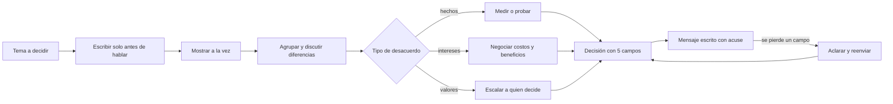
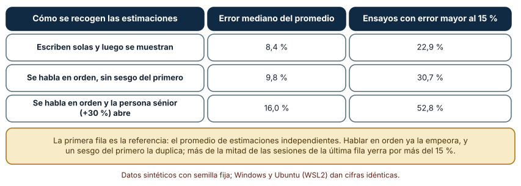
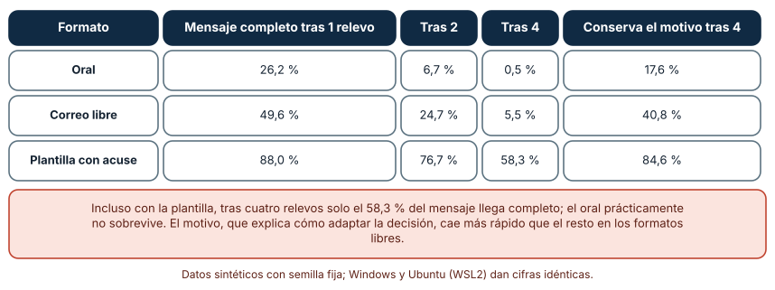
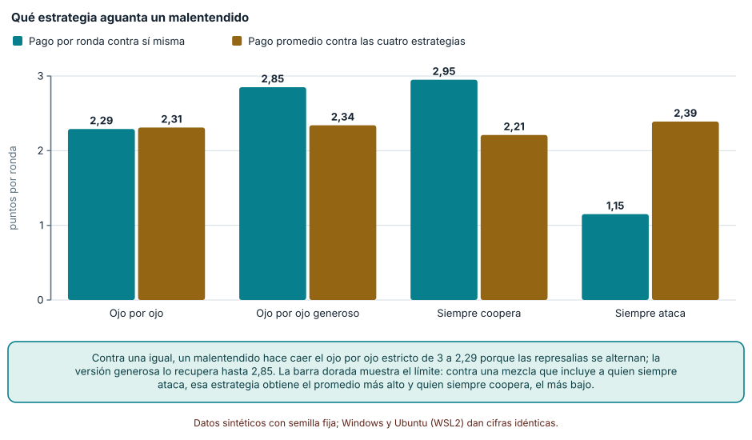

# SE-447 — Comunicación, facilitación y conflicto

[← SE-446 — Diseño de equipos y ownership](../../classes/part-37-gestion-liderazgo-y-practica-profesional/se-446-diseno-de-equipos-y-ownership/README.md) · [↑ Parte 37](../../classes/part-37-gestion-liderazgo-y-practica-profesional/README.md) · [📚 Índice completo](../../classes/README.md) · [🌐 Portal](../../site/classes/SE-447.html) · [SE-448 — Mentoría, feedback y crecimiento →](../../classes/part-37-gestion-liderazgo-y-practica-profesional/se-448-mentoria-feedback-y-crecimiento/README.md)

## Punto profesional y fundamento pedagógico

**Punto profesional.** La clase existe para que conduzcas una conversación técnica de modo que termine en una decisión que se recuerde, y para que trates un desacuerdo como un problema de información, de intereses o de valores según corresponda. La comunicación de un equipo es un sistema con pérdidas: lo que una persona dice no es lo que la siguiente repite. Facilitar es diseñar la conversación para que esas pérdidas no decidan; resolver un conflicto es identificar de qué tipo es antes de elegir cómo tratarlo.

**Por qué aparece aquí.** Sigue a **Diseño de equipos y ownership** (`SE-446`): las fronteras entre equipos y los contratos de interfaz se negocian en conversaciones, y es allí donde los desacuerdos sobre la exportación al ministerio se vuelven personales o se resuelven. El caso conductor es **el equipo de plataforma educativa**: una discusión entre el equipo de calificaciones y el de exportación sobre quién adapta un formato cuando cambia la norma.

**Error conceptual que debe corregir.** Creer que una reunión larga con todas las voces produce una mejor decisión y que un conflicto se resuelve cuando alguien «cede». Una reunión donde habla primero la persona más sénior suele producir la estimación de esa persona (el grupo se ancla); y el conflicto de valores no se resuelve con más datos mientras el de hechos sí. Cada tipo exige una herramienta distinta, y confundirlos genera discusiones que nunca terminan.

**Secuencia de aprendizaje.** Antes de mirar los resultados, predices cuánto error tiene la estimación de un grupo de siete personas cuando escriben solas, cuando hablan en orden y cuando una persona sénior sesgada abre; después simulas cuántos campos de una decisión sobreviven a varios relevos en tres formatos y cómo le va a una estrategia de reciprocidad en un conflicto con malentendidos. La secuencia usa predicción, explicación propia, contraste y recuperación. [ICAP](https://icap.education.asu.edu/research) distingue participación de construcción de conocimiento; [How People Learn II](https://nap.nationalacademies.org/catalog/24783/how-people-learn-ii-learners-contexts-and-cultures) respalda diseñar la práctica con contextos reales y retroalimentación.

**Evidencia de aprendizaje.** `conversacion-log.md` con la predicción, las tres figuras reproducidas, la agenda de una sesión de facilitación con su método de decisión, un mensaje de decisión con los cinco campos, el análisis de un conflicto real o hipotético clasificado como de hechos, de intereses o de valores con la herramienta elegida, y una nota que separe qué es medido, qué inferido y qué supuesto.

**Límite de la conclusión.** Las estimaciones, el sesgo del primero, la tasa de pérdida de campos, el modelo de reciprocidad y el 5 % de malentendidos son sintéticos, escritos por el autor con semilla fija. No se observó ninguna reunión, equipo ni conflicto reales. Las cifras muestran la forma de cada mecanismo, no el valor en tu organización.

### Trazabilidad fuente → afirmación

| Fuente primaria u oficial | Afirmación que respalda | Lo que no prueba |
|---|---|---|
| [Lorenz et al., «How social influence can undermine the wisdom of crowd effect»](https://doi.org/10.1073/pnas.1008636108) | Muestra experimentalmente que la influencia social reduce la diversidad de las estimaciones y la precisión del grupo. | Son tareas de estimación de laboratorio, no discusiones de diseño. |
| [Tversky y Kahneman, «Judgment under Uncertainty»](https://doi.org/10.1126/science.185.4157.1124) | Describe el anclaje: las estimaciones se acercan a un valor inicial aunque sea arbitrario. | No dice cuánto pesa el anclaje en tu reunión. |
| [Axelrod, «The Evolution of Cooperation»](https://doi.org/10.1126/science.7466396) | Presenta la reciprocidad como estrategia eficaz en interacciones repetidas. | Es un juego formal; las personas no puntúan sus interacciones. |
| [Nowak y Sigmund, «Tit for tat in heterogeneous populations»](https://doi.org/10.1038/355250a0) | Estudia estrategias de reciprocidad con errores y muestra el valor de la generosidad. | Los resultados dependen de la tabla de pagos y del nivel de ruido. |
| [Edmondson, «Psychological Safety and Learning Behavior in Work Teams»](https://doi.org/10.2307/2666999) | Relaciona la seguridad psicológica con el aprendizaje en equipos. | Es un estudio de asociación en equipos concretos. |
| [Google SRE, «Postmortem Culture»](https://sre.google/sre-book/postmortem-culture/) | Describe el análisis posterior sin culpa como práctica de aprendizaje. | Es la práctica de una organización, no una garantía de efecto. |
| [Liberating Structures](https://www.liberatingstructures.com/) | Cataloga estructuras de conversación para distribuir la participación. | Es un repertorio de prácticas, no evidencia comparativa. |

## Antes de empezar

Recupera lo aprendido en `SE-446`: una frontera sin contrato se negocia en cada cambio. La pregunta activa es: **¿la última decisión de tu equipo que terminó en un malentendido, qué campo del mensaje (qué se decidió, por qué, quién, para cuándo, hasta dónde) se perdió primero?**

## Prerrequisitos

- Haber completado `SE-446` o poder explicar por qué una frontera necesita un contrato.
- Python 3.11 o posterior; los experimentos usan solo la biblioteca estándar (`random`, `math`, `statistics`).
- Haber participado en una reunión técnica donde hubo un desacuerdo.

## Problema auténtico

El equipo de calificaciones y el de exportación discutieron durante tres reuniones quién adaptaba el formato del archivo al ministerio, que había cambiado. En la primera, la persona más sénior abrió diciendo que «esto son dos días»; las estimaciones posteriores giraron alrededor de ese número y la tarea real tardó nueve. En la segunda, la decisión se tomó de palabra («lo hace exportación») y llegó a la tercera con otro contenido: calificaciones entendió que exportación lo haría y exportación que calificaciones entregaría los datos ya transformados. Los dos equipos se acusaron de incumplir. En la tercera reunión, la discusión se volvió personal porque nadie había separado si el desacuerdo era sobre el trabajo (cuánto cuesta), sobre intereses (quién carga con el costo) o sobre valores (a quién debe servir primero el sistema). La clase enseña a conducir la reunión para evitar el anclaje, a dejar la decisión por escrito con los cinco campos y a clasificar el conflicto antes de tratarlo.

## Objetivos observables

Al terminar podrás:

1. diseñar una sesión de facilitación que separe generar opciones de decidir, y nombrar el método de decisión;
2. escribir un mensaje de decisión con decisión, motivo, responsable, fecha y alcance;
3. predecir cuánto distorsiona el orden de intervención una estimación de grupo;
4. clasificar un conflicto como de hechos, de intereses o de valores y elegir una herramienta para cada uno;
5. usar reciprocidad con margen para malentendidos y explicar sus límites.

## Mapa conceptual



El mapa separa tres etapas: **divergir** (escribir solas y mostrar a la vez), **clasificar** (hechos, intereses o valores) y **cerrar** (decisión por escrito con acuse). La flecha de retorno indica que un campo perdido se corrige reenviando, no discutiendo de memoria.

## Temas y por qué importan

| Tema | Por qué cambia una decisión profesional | Evidencia mínima |
|---|---|---|
| Comunicación como transferencia | Una decisión no entendida no existe. | Mensaje con cinco campos y acuse |
| Facilitación | Distribuye la participación y evita el anclaje. | Agenda con método de decisión |
| Sesgos de grupo | Un grupo puede ser peor que la suma de sus partes. | Estimaciones individuales antes de hablar |
| Tipos de conflicto | La herramienta depende de qué se disputa. | Clasificación con razón |
| Reciprocidad y errores | Los malentendidos no deben escalar a ruptura. | Regla de respuesta con margen |

## Conceptos y decisiones

### 1. Comunicar es transferir una decisión

Una decisión comunicada tiene cinco campos: **qué** se decidió, **por qué**, **quién** es responsable, **para cuándo** y **hasta dónde** llega (alcance). Cada relevo del mensaje pierde algunos, y no los pierde por igual: el motivo y el alcance se pierden antes que la decisión, porque son los menos «accionables». Un mensaje sin motivo se vuelve una orden que nadie sabe adaptar cuando cambia el contexto, y uno sin alcance se aplica más o menos de lo que se quería. Las contramedidas son un formato fijo (plantilla), un canal escrito que persista y un **acuse** en que la receptora repite con sus palabras lo que entendió. El acuse no es burocracia: es la prueba de que el campo llegó, y es barato frente al costo de descubrirlo tres semanas después.

### 2. Facilitar: divergir antes de converger

Facilitar es diseñar la conversación para que su resultado dependa de las ideas y no del orden de intervención. La técnica base es separar dos fases. En la **divergencia**, cada persona escribe su posición o estimación sin ver las de las demás y se muestran a la vez; esto conserva la diversidad. En la **convergencia**, el grupo discute las diferencias y decide. Además, una buena sesión fija desde el inicio el **método de decisión**: quién decide (una persona tras consultar, consenso, votación) y cuándo. Sin eso, la conversación se alarga porque cada persona cree que el método es el suyo. El repertorio de [Liberating Structures](https://www.liberatingstructures.com/) cataloga formas de distribuir la participación (pares, grupos pequeños, rondas), útiles cuando la sesión es grande o hay jerarquías. Facilitar no es moderar el tiempo: es proteger el proceso de decisión.

### 3. Sesgos de grupo: anclaje e influencia social

El **anclaje** ([Tversky y Kahneman](https://doi.org/10.1126/science.185.4157.1124)) es la tendencia a que una estimación se acerque a un valor inicial, aunque sea arbitrario. En una reunión, el valor que se dice primero ancla a los demás, y si lo dice una persona con autoridad, ancla más. [Lorenz et al.](https://doi.org/10.1073/pnas.1008636108) mostraron en experimentos que, cuando las personas conocen las estimaciones de otras, la diversidad del grupo disminuye y la precisión del promedio no mejora o empeora, aunque la confianza aumente. La consecuencia para el diseño es sencilla: recoger las estimaciones antes de la conversación. Las circunstancias que agravan el efecto son jerarquía visible, falta de seguridad psicológica ([Edmondson](https://doi.org/10.2307/2666999): el clima en que una persona puede decir que no sabe o que discrepa sin temor) y presión de tiempo.

### 4. Tres tipos de desacuerdo

No todo desacuerdo es del mismo tipo, y mezclarlos es la causa más frecuente de discusiones interminables. Uno es de **hechos**: «¿cuánto cuesta adaptar el formato?». Se resuelve con medida, prueba o estimación independiente, y quien discrepa puede cambiar de opinión sin perder nada. Otro es de **intereses**: «¿quién carga con el costo?». Se negocia: qué necesita cada parte, qué puede ceder, qué compensa. El tercero es de **valores o prioridades**: «¿a quién debe servir primero el sistema?». No se resuelve con datos porque las partes ponderan distinto; se escala a quien tiene autoridad para fijar la prioridad, y se acepta con compromiso. Una técnica práctica es preguntar «¿qué observación te haría cambiar de opinión?»: si la persona puede nombrarla, el desacuerdo es de hechos; si no, probablemente sea de valores o de intereses.

### 5. Reciprocidad, generosidad y análisis sin culpa

En interacciones repetidas, [Axelrod](https://doi.org/10.1126/science.7466396) mostró que la reciprocidad (cooperar primero y responder en espejo) supera a la hostilidad constante. Pero la reciprocidad estricta tiene un punto débil: cuando una de las partes malinterpreta una acción, la otra responde, y ambos entran en una espiral de represalias. [Nowak y Sigmund](https://doi.org/10.1038/355250a0) estudiaron variantes con errores y mostraron que cierta **generosidad** (perdonar una parte de las defecciones) estabiliza la cooperación. El equivalente profesional es la pregunta de aclaración antes de responder («¿querías decir…?») y los análisis posteriores **sin culpa** ([Google SRE](https://sre.google/sre-book/postmortem-culture/)): se busca qué condiciones hicieron posible el error y no quién lo cometió. La generosidad tiene un límite: frente a quien se aprovecha sistemáticamente, perdonar siempre premia la explotación.

### Cuánto distorsiona hablar en orden

Siete personas estiman una cantidad real de 100 días; cada una acierta con un error multiplicativo de desviación 0,3. En «hablar en orden», cada persona combina su estimación con la media de lo dicho antes (50 % y 50 %). En el último escenario, la primera persona, sénior, dice un valor 30 % mayor que el suyo. Se hacen 5 000 ensayos.

| Cómo se recogen las estimaciones | Error mediano del promedio | Ensayos con error mayor al 15 % |
|---|---:|---:|
| Escriben solas y luego se muestran | 8,4 % | 22,9 % |
| Se habla en orden, sin sesgo del primero | 9,8 % | 30,7 % |
| Se habla en orden y la persona sénior (+30 %) abre | 16,0 % | 52,8 % |



**Cómo leer la figura.** Cada grupo es una forma de recoger las estimaciones; la barra dorada es el error mediano del promedio y la coral, el porcentaje de ensayos con error mayor al 15 %. Mira que la primera categoría es la referencia y que ambas barras crecen cuando se habla en orden y, más aún, cuando abre quien tiene más autoridad. **Dónde deja de valer:** el peso del 50 % hacia la media previa, el sesgo del 30 % y el error individual de 0,3 son supuestos del autor; en una reunión real hay personas que no se dejan influir, otras que lo hacen más, y discuten razones y no solo números. El modelo no incluye el beneficio de la discusión (que a veces corrige errores que las estimaciones independientes no ven).

### Cuántos campos sobreviven a los relevos

Un mensaje de decisión tiene cinco campos (decisión, motivo, dueño, fecha, alcance). En cada relevo, cada campo se pierde con una probabilidad que depende del formato; los campos que se pierden no vuelven. Se simulan 6 000 mensajes por celda. Probabilidades de pérdida por relevo, en el orden de los campos: oral (10, 35, 25, 20 y 25 %); correo libre (5, 20, 15, 10 y 15 %); plantilla con acuse (1, 4, 2, 2 y 4 %).

| Formato | Mensaje completo tras 1 relevo | Tras 2 | Tras 4 | Conserva el motivo tras 4 |
|---|---:|---:|---:|---:|
| Oral | 26,2 % | 6,7 % | 0,5 % | 17,6 % |
| Correo libre | 49,6 % | 24,7 % | 5,5 % | 40,8 % |
| Plantilla con acuse | 88,0 % | 76,7 % | 58,3 % | 84,6 % |



**Cómo leer la figura.** El eje horizontal son los relevos que atraviesa el mensaje y el vertical el porcentaje que llega completo; cada línea es un formato. Mira que las tres bajan, que el oral casi no sobrevive y que incluso la plantilla pierde más de cuatro de cada diez mensajes tras cuatro relevos. **Dónde deja de valer:** las probabilidades de pérdida son supuestos del autor y se aplican de forma independiente por campo y por relevo; una persona que entiende el contexto reconstruye un campo perdido (cosa que el modelo no permite). La lección es la estructura de la pérdida, no los porcentajes.

### Qué estrategia aguanta un malentendido

Dos personas interactúan 200 rondas; en cada una pueden cooperar o atacar, y con probabilidad 0,05 su acción sale cambiada (un malentendido). Cada celda promedia 300 partidas. Pagos por ronda: cooperación mutua 3, traición provechosa 5, ataque mutuo 1, ser traicionada 0. «Ojo por ojo» responde lo que hizo la otra; «ojo por ojo generoso» perdona una defección el 30 % de las veces.

| Estrategia | Pago por ronda contra sí misma | Pago promedio contra las cuatro estrategias |
|---|---:|---:|
| Ojo por ojo | 2,29 | 2,31 |
| Ojo por ojo generoso | 2,85 | 2,34 |
| Siempre coopera | 2,95 | 2,21 |
| Siempre ataca | 1,15 | 2,39 |



**Cómo leer la figura.** Cada grupo es una estrategia; la barra verde azulada es su pago por ronda contra sí misma y la dorada, el pago promedio contra las cuatro. Mira que el orden se invierte entre las dos barras: quien siempre coopera es el mejor contra sí mismo y el peor en la mezcla, y quien siempre ataca, al revés. **Dónde deja de valer:** los pagos, el 5 % de ruido, el 30 % de perdón y la mezcla de estrategias son supuestos del autor; las personas no puntúan sus interacciones ni eligen una estrategia fija. La figura muestra por qué conviene dar margen a un malentendido y por qué ese margen no equivale a ceder siempre.

## Definiciones de trabajo

- **mensaje de decisión:** comunicación con decisión, motivo, responsable, fecha y alcance.
- **acuse:** respuesta en que quien recibe un mensaje repite con sus palabras lo que entendió.
- **facilitación:** diseño de una conversación para que su resultado dependa de las ideas y no del orden o la jerarquía.
- **anclaje:** tendencia de las estimaciones a acercarse a un valor inicial, aunque sea arbitrario.
- **desacuerdo de hechos, de intereses y de valores:** discrepancia sobre lo que ocurre, sobre quién carga con qué o sobre qué debe priorizarse.

Las definiciones son operativas para el equipo de plataforma educativa. No convierten términos con una historia más amplia en sinónimos y deben contrastarse con las fuentes primarias enlazadas al final.

## Ejemplo mínimo

El fragmento valida que un mensaje de decisión tenga los cinco campos. Antes de ejecutarlo, predice qué campos faltan.

```python
CAMPOS = ("decisión", "motivo", "dueño", "fecha", "alcance")
mensaje = {"decisión": "exportación adapta el formato", "dueño": "exportación", "fecha": "2026-12-01"}
print([c for c in CAMPOS if not mensaje.get(c)])
```

Imprime `['motivo', 'alcance']`. Observa que el mensaje parece completo a primera vista —tiene quién, qué y cuándo— y falta lo que permite adaptarlo cuando cambia el contexto: por qué se decidió y hasta dónde llega. Registra versión de Python, comando y salida.

## Ejemplo profesional

Escenario hipotético, construido para la clase y sin datos reales. La facilitadora convoca una sesión de 45 minutos sobre la adaptación del formato. Antes de la reunión pide a cada una de las seis personas que escriba su estimación de esfuerzo y su mayor preocupación en un documento compartido. En la sesión las muestra a la vez: las estimaciones van de dos a ocho días y la mediana es cuatro. Pregunta qué observación cambiaría la opinión de quien estima más alto y descubre que conoce una validación del ministerio que otros ignoran: es un desacuerdo de hechos. Separa un segundo desacuerdo, quién carga con el costo, que clasifica de intereses y negocia: calificaciones entrega los datos y exportación transforma, y a cambio exportación recibe un contrato de formato versionado. Cierra con un mensaje de cinco campos y pide un acuse de cada equipo. El tercer desacuerdo, a quién debe servir primero el sistema cuando hay dos plazos legales, lo escala a la jefatura con dos opciones y el costo de cada una. Compara con tres reuniones de discusión abierta: el resultado difiere porque separó los tipos de desacuerdo y dejó la decisión por escrito.

## Práctica guiada

1. Lee una decisión reciente de tu equipo y marca cuáles de los cinco campos estaban escritos y cuáles solo se dijeron.
2. Predice el error mediano de la estimación de grupo en las tres condiciones y escribe los números antes de simular.
3. Reproduce las tres tablas con las semillas fijadas en `scripts/experiments_part37_a.py`; cambia el sesgo del primero de 30 % a 0 % y observa si el orden sigue empeorando la estimación.
4. Diseña una sesión de 45 minutos con fases de divergencia y convergencia y un método de decisión explícito.
5. Escribe un mensaje de decisión con los cinco campos y un acuse; pide a otra persona que lo reformule con sus palabras.
6. Clasifica tres desacuerdos que hayas vivido como de hechos, de intereses o de valores y elige una herramienta para cada uno.
7. Entrega `conversacion-log.md` y pide a otra persona que encuentre un desacuerdo que tu clasificación trate como de hechos y ella considere de valores.

## Ejercicios

1. **Campos:** reescribe un mensaje de decisión vago («vamos a hacerlo con la cola») en los cinco campos y marca cuál podrías no conocer.
2. **Anclaje:** diseña un procedimiento de estimación de tareas que impida el anclaje y dice qué costo de tiempo añade.
3. **Clasificación:** para la frase «no me parece bien que exportación decida el formato», propone tres preguntas que ayuden a clasificarla y la acción para cada resultado.
4. **Generosidad:** describe una situación en que perdonar una defección es razonable y otra en que no, con la señal que distingue una de otra.

## Reto verificable

Entrega `conversacion-log.md` con la predicción, las tres tablas, la agenda de la sesión con su método de decisión, el mensaje de decisión con acuse y la clasificación de los desacuerdos con su herramienta. Se aprueba si otra persona ejecuta el código desde un checkout limpio, obtiene los mismos números con las mismas semillas y puede decir, a partir de tu mensaje, qué se decidió, por qué, quién responde, para cuándo y hasta dónde. No se aprueba por afirmar que «se llegó a un acuerdo» sin decir qué se acordó ni cómo se comprobó que ambas partes lo entienden igual.

## Caso conductor

El equipo de plataforma educativa es el caso conductor de la Parte 37. Esta clase deja el tercer artefacto: un método de sesión y un mensaje de decisión con acuse. `SE-448` preguntará cómo se transfiere conocimiento y se da retroalimentación entre personas, y `SE-449` cómo se comunican los compromisos con su incertidumbre. Cambia después un solo dato, el sesgo del primero, de 30 % a 60 %, y observa cuánto crece la fracción de ensayos con error mayor al 15 %.

## Preguntas frecuentes

### ¿Escribir antes de hablar no alarga la reunión?

Añade unos minutos al inicio y suele acortar el resto, porque se discuten solo las diferencias reales y no se repiten posiciones. El costo se paga con el tiempo que no se pierde en reuniones de seguimiento por decisiones que se entendieron distinto.

### ¿Cómo evito que la persona sénior ancle sin silenciarla?

Haz que su estimación también sea escrita y simultánea, y pídele que hable en último lugar en la discusión. No se trata de silenciar su experiencia sino de que no ocupe el lugar de las estimaciones independientes. Muchas veces las personas sénior piden ese formato.

### ¿Todos los desacuerdos se pueden clasificar?

No siempre: muchos son mezcla. La clasificación es una guía para separar los hilos, no una etiqueta definitiva. Si al separar los hilos aparece uno de valores, la salida es escalar ese hilo y avanzar con los demás.

### ¿Y si la otra parte no responde con generosidad?

La generosidad tiene un margen y una condición: se mantiene mientras los malentendidos sean ocasionales. Si se repite un patrón en que una parte se aprovecha, deja de ser un malentendido y pasa a ser un asunto para quien tiene autoridad sobre ambas, con ejemplos concretos y sin adjetivos.

## Fallo controlado y diagnóstico

Reproduce el fallo clásico de la clase: **una decisión tomada de palabra que cada equipo recuerda distinta**. Pide a dos personas que escriban por separado, sin consultarse, qué se decidió en una conversación de cinco minutos y compara.

Registra síntoma, entrada mínima, hipótesis, observación que descarta cada hipótesis, causa, corrección y prueba de regresión. **Síntoma:** dos equipos creen que el otro hará la transformación. **Hipótesis rivales:** (a) una de las partes incumple; (b) los equipos entendieron distinto; (c) la decisión nunca existió. **Prueba:** pide a cada equipo que escriba la decisión con los cinco campos y compara; si los campos de responsable o alcance difieren, la causa es la comunicación. **Conclusión:** con comunicación oral, tras un relevo solo el 26,2 % de los mensajes de cinco campos llega completo. **Regresión:** exige un mensaje escrito con los cinco campos y un acuse de cada equipo antes de cerrar la reunión. No cambies a la vez el formato del mensaje y el método de decisión.

## Errores comunes y cómo corregirlos

| Síntoma | Causa probable | Corrección |
|---|---|---|
| La estimación del grupo repite la de quien habló primero | Se habla en orden y hay jerarquía | Recoger estimaciones escritas y simultáneas |
| Dos equipos recuerdan una decisión distinta | Comunicación oral sin acuse | Mensaje con cinco campos y acuse |
| Una discusión no termina | Se mezclan hechos, intereses y valores | Clasificar y tratar cada hilo con su herramienta |
| Un malentendido escala a ruptura | Respuesta inmediata en espejo | Preguntar antes de responder y dar margen |
| El análisis posterior busca culpables | No se separó el error de la persona | Preguntar qué condiciones lo hicieron posible |

## Entorno y archivos clave

```text
work/SE-447/
├── README.md
├── conversacion/
│   ├── anclaje.py
│   ├── mensajes.py
│   └── reciprocidad.py
├── AGENDA-SESION.md
├── MENSAJE-DE-DECISION.md
├── tests/test_conversacion.py
└── evidence/conversacion-log.md
```

El `README` declara plataforma, versión de Python, semillas y comandos. Los experimentos usan solo la biblioteca estándar (`random`, `math`, `statistics`) y se ejecutaron con CPython 3.12.9 en Windows 11 y 3.12.3 en Ubuntu bajo WSL2: las salidas fueron idénticas. Si añades una dependencia, fija procedencia y versión.

## Seguridad, ética y accesibilidad

- las reuniones y mensajes pueden contener datos personales o de seguridad: no pegues datos reales de estudiantes en documentos compartidos y limita el acceso a las actas;
- el análisis sin culpa no exime de responsabilidad: separa el aprendizaje de los procesos de desempeño y no lo uses para identificar culpables;
- una sesión debe ser accesible: ofrece un canal escrito para quien no puede intervenir en vivo y tiempo para quien necesita más;
- las tablas y figuras deben tener texto alternativo y no depender del color;
- las fuentes citadas son textos de sus autores: cita las ideas y vincula la fuente, no copies sus textos ni diagramas.

## Puente hacia el trabajo con agentes

Un agente al que se le pide «resume la reunión y las decisiones» producirá un texto limpio que puede inventar un responsable o una fecha que nadie dijo, y que borra los desacuerdos sin resolver. Pídele en cambio que extraiga solo lo que está literalmente en la transcripción, que marque los campos de decisión que no aparecen (motivo, alcance) y que liste las discrepancias sin resolver con quién dijo qué. Revisa especialmente cualquier atribución de una postura a una persona y cualquier fecha que no esté en el texto fuente. El agente puede preparar el borrador del mensaje; el acuse de las personas sigue siendo la prueba de que la decisión llegó.

## Transferencia

Traslada el análisis a otro dominio (por ejemplo, una comisión de vecinos que decide cómo repartir el costo de un portón): cambia las personas, las decisiones y los desacuerdos y conserva el procedimiento de escribir antes de hablar, clasificar el desacuerdo y cerrar con un mensaje de cinco campos y acuse. La transferencia está lograda cuando puedes decir qué desacuerdo de tu dominio es de hechos y qué observación lo resolvería, no cuando el mensaje se parece al del equipo de plataforma.

## Evaluación y evidencia

| Criterio | Evidencia para aprobar |
|---|---|
| comprensión | explicación de los tres tipos de desacuerdo y de por qué se tratan distinto |
| corrección | tablas de estimación, de campos y de reciprocidad reproducibles con las mismas semillas |
| diseño | agenda con método de decisión y mensaje de decisión con cinco campos y acuse |
| diagnóstico | reproducción del fallo «decisión de palabra» con regresión |
| incertidumbre | declaración de que el sesgo, las pérdidas y los pagos son del autor |
| reproducibilidad | versiones, comandos, salida y límites declarados |

## Fuentes

- [Lorenz et al., «How social influence can undermine the wisdom of crowd effect»](https://doi.org/10.1073/pnas.1008636108) — influencia social y precisión del grupo; autoridad: Proceedings of the National Academy of Sciences.
- [Tversky y Kahneman, «Judgment under Uncertainty: Heuristics and Biases»](https://doi.org/10.1126/science.185.4157.1124) — anclaje; autoridad: Science.
- [Axelrod, «The Evolution of Cooperation»](https://doi.org/10.1126/science.7466396) — reciprocidad en interacciones repetidas; autoridad: Science.
- [Nowak y Sigmund, «Tit for tat in heterogeneous populations»](https://doi.org/10.1038/355250a0) — reciprocidad con errores y generosidad; autoridad: Nature.
- [Edmondson, «Psychological Safety and Learning Behavior in Work Teams»](https://doi.org/10.2307/2666999) — seguridad psicológica; autoridad: Administrative Science Quarterly.
- [Google SRE, «Postmortem Culture: Learning from Failure»](https://sre.google/sre-book/postmortem-culture/) — análisis posterior sin culpa; autoridad: equipo de SRE de Google.
- [Liberating Structures](https://www.liberatingstructures.com/) — estructuras de conversación; autoridad: comunidad de práctica.

Cada fuente respalda el mecanismo indicado; ninguna demuestra que el error del 16,0 % con un primero sesgado, el 58,3 % de mensajes completos con plantilla o el pago de 2,85 del ojo por ojo generoso se observen en tu equipo. Esa afirmación depende de las personas, de la jerarquía y de las reuniones reales.

## Límites y siguiente paso

Se ejecutaron tres experimentos con datos sintéticos en Windows y Ubuntu (WSL2) con resultados idénticos. No se observó ninguna reunión, equipo ni conflicto reales; el peso de la influencia, el sesgo del primero, la pérdida por relevo y los pagos son construcciones del autor, y el modelo supone personas con reglas fijas. La siguiente clase pregunta cómo se transfiere conocimiento y se da retroalimentación para que las personas crezcan.

## Glosario

- **mensaje de decisión:** comunicación con decisión, motivo, responsable, fecha y alcance.
- **acuse:** respuesta en que quien recibe un mensaje repite con sus palabras lo que entendió.
- **facilitación:** diseño de una conversación para que su resultado dependa de las ideas y no del orden o la jerarquía.
- **anclaje:** tendencia de las estimaciones a acercarse a un valor inicial, aunque sea arbitrario.
- **desacuerdo de hechos, de intereses y de valores:** discrepancia sobre lo que ocurre, sobre quién carga con qué o sobre qué debe priorizarse.

---

[← SE-446 — Diseño de equipos y ownership](../../classes/part-37-gestion-liderazgo-y-practica-profesional/se-446-diseno-de-equipos-y-ownership/README.md) · [↑ Parte 37](../../classes/part-37-gestion-liderazgo-y-practica-profesional/README.md) · [📚 Índice completo](../../classes/README.md) · [🌐 Portal](../../site/classes/SE-447.html) · [SE-448 — Mentoría, feedback y crecimiento →](../../classes/part-37-gestion-liderazgo-y-practica-profesional/se-448-mentoria-feedback-y-crecimiento/README.md)
