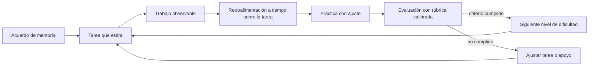

# SE-448 — Mentoría, feedback y crecimiento

[← SE-447 — Comunicación, facilitación y conflicto](../../classes/part-37-gestion-liderazgo-y-practica-profesional/se-447-comunicacion-facilitacion-y-conflicto/README.md) · [↑ Parte 37](../../classes/part-37-gestion-liderazgo-y-practica-profesional/README.md) · [📚 Índice completo](../../classes/README.md) · [🌐 Portal](../../site/classes/SE-448.html) · [SE-449 — Estimación organizacional y compromisos →](../../classes/part-37-gestion-liderazgo-y-practica-profesional/se-449-estimacion-organizacional-y-compromisos/README.md)

## Punto profesional y fundamento pedagógico

**Punto profesional.** La clase existe para que acompañes el crecimiento de otra persona con un método observable y no con consejos sueltos. Un acompañamiento eficaz decide tres cosas: qué tareas se asignan (que estiren sin quebrar), cuándo y cómo se da retroalimentación (a tiempo y sobre el trabajo, no sobre la persona) y con qué criterio se evalúa el avance (de modo que dos evaluadoras llegarían a una conclusión parecida). La habilidad profesional es convertir «mentoría» en prácticas con evidencia: acuerdos, tareas, retroalimentación fechada y una rúbrica.

**Por qué aparece aquí.** Sigue a **Comunicación, facilitación y conflicto** (`SE-447`): ya sabes dejar una decisión por escrito y separar los tipos de desacuerdo; ahora esa comunicación se aplica a la conversación más repetida de un equipo, la que ocurre entre quien sabe más y quien sabe menos. El caso conductor es **el equipo de plataforma educativa**, donde una ingeniera acaba de ingresar y debe asumir, en seis meses, la responsabilidad del módulo de exportación.

**Error conceptual que debe corregir.** Creer que la mentoría consiste en transmitir experiencia y que la retroalimentación mejora siempre el desempeño. El efecto de la retroalimentación depende de a qué se dirige (la tarea, no la persona), de cuándo llega y de cómo se evalúa; en revisiones sistemáticas, una proporción importante de intervenciones de retroalimentación empeoró el desempeño. Y la experiencia compartida sin una tarea que estire a quien aprende no produce crecimiento.

**Secuencia de aprendizaje.** Antes de mirar los resultados, predices cuánto crece una persona en un año si se le asignan tareas fáciles, calibradas, muy difíciles o al azar; después simulas cuántos errores repetidos acumula según cuándo recibe retroalimentación y cuánto se parecen las conclusiones de las evaluadoras con y sin rúbrica. La secuencia usa predicción, explicación propia, contraste y recuperación. [ICAP](https://icap.education.asu.edu/research) distingue participación de construcción de conocimiento; [How People Learn II](https://nap.nationalacademies.org/catalog/24783/how-people-learn-ii-learners-contexts-and-cultures) respalda diseñar la práctica con contextos reales y retroalimentación.

**Evidencia de aprendizaje.** `mentoria-log.md` con la predicción, las tres figuras reproducidas, un acuerdo de mentoría (meta de seis meses, tareas, cadencia y forma de medir), tres retroalimentaciones escritas sobre trabajo observable con su fecha, una rúbrica de cuatro criterios con ejemplos y una nota que separe qué es medido, qué inferido y qué supuesto.

**Límite de la conclusión.** El modelo de crecimiento, la dificultad de las tareas, la probabilidad de error, el momento de la retroalimentación y la indulgencia de las evaluadoras son sintéticos, escritos por el autor con semilla fija. No se acompañó, evaluó ni midió a ninguna persona. Las cifras muestran la forma de cada mecanismo, no el valor para una persona real.

### Trazabilidad fuente → afirmación

| Fuente primaria u oficial | Afirmación que respalda | Lo que no prueba |
|---|---|---|
| [Ericsson, Krampe y Tesch-Römer, «The role of deliberate practice»](https://doi.org/10.1037/0033-295X.100.3.363) | Atribuye la mejora a la práctica deliberada: tareas bien definidas, de dificultad adecuada y con retroalimentación. | Los estudios son de dominios con medidas claras, como música y ajedrez, no de ingeniería de software. |
| [Kluger y DeNisi, «The effects of feedback interventions on performance»](https://doi.org/10.1037/0033-2909.119.2.254) | Muestra, en un metaanálisis, que la retroalimentación mejora el desempeño de media pero lo empeora en una proporción importante de casos, sobre todo cuando se dirige a la persona. | Son tareas de laboratorio y de trabajo, no mentoría técnica. |
| [Software Engineering at Google, cap. 3 «Knowledge Sharing»](https://abseil.io/resources/swe-book/html/ch03.html) | Describe prácticas de transferencia de conocimiento y de crecimiento en una organización de ingeniería. | Es la práctica de una empresa concreta. |
| [Software Engineering at Google, cap. 9 «Code Review»](https://abseil.io/resources/swe-book/html/ch09.html) | Presenta la revisión de código como vehículo de aprendizaje además de control de calidad. | No mide cuánto se aprende. |
| [Kahneman, Sibony y Sunstein, *Noise* (Little, Brown Spark, 2021)](https://openlibrary.org/isbn/9780316451406) | Explica el ruido en los juicios: la variabilidad no deseada entre personas que evalúan lo mismo, y cómo la estructura la reduce. | Es un libro divulgativo con ejemplos de varios dominios. |
| [Progression.fyi](https://progression.fyi/) | Reúne escaleras de carrera públicas de empresas de tecnología como ejemplos de criterios por nivel. | Cada escalera responde a su empresa y no es una norma. |

## Antes de empezar

Recupera lo aprendido en `SE-447`: un mensaje sin acuse no prueba que llegó. La pregunta activa es: **¿cuál fue la última retroalimentación que recibiste que cambió cómo trabajas, y qué tuvo de distinto de las que no cambiaron nada?**

## Prerrequisitos

- Haber completado `SE-447` o poder explicar por qué una decisión se comunica con acuse.
- Python 3.11 o posterior; los experimentos usan solo la biblioteca estándar (`random`, `math`, `statistics`).
- Haber dado o recibido una revisión de código con comentarios.

## Problema auténtico

La ingeniera que ingresó recibió como mentora a una compañera con cuatro años en el equipo. Las primeras cuatro semanas fueron tareas pequeñas («corregir este mensaje de error»), con retroalimentación en la evaluación trimestral; a los dos meses seguía cometiendo el mismo error de manejo de fechas en cada cambio. La mentora lo atribuyó a falta de atención. Cambió el método: asignó una tarea que estiraba (diseñar una prueba de caracterización para la exportación), dio retroalimentación el mismo día en la revisión, escrita y centrada en el código, y acordaron un criterio de cuándo se consideraría que el hábito estaba corregido. En seis semanas los errores bajaron. Otro problema apareció al evaluar el avance: la jefatura y la mentora puntuaron distinto a la misma persona porque no compartían criterios. La clase enseña a calibrar tareas, a dar retroalimentación a tiempo y a evaluar con una rúbrica.

## Objetivos observables

Al terminar podrás:

1. distinguir mentoría, coaching y patrocinio y escribir un acuerdo de mentoría con meta, tareas y evidencia;
2. elegir tareas que estiren a una persona sin quebrarla usando la brecha entre su nivel y la dificultad;
3. dar retroalimentación específica, a tiempo y sobre el trabajo, y explicar por qué la que se dirige a la persona puede empeorar el desempeño;
4. diseñar una rúbrica y calibrarla con ejemplos para reducir el ruido entre evaluadoras;
5. reconocer los límites de la mentoría: capacidad de la mentora, asimetría de poder y confidencialidad.

## Mapa conceptual



El mapa separa cuatro cosas: la **tarea** (qué se asigna), la **retroalimentación** (cuándo y sobre qué), la **evaluación** (con qué criterio) y el **ajuste** (qué se cambia después). La flecha de retorno indica que el acompañamiento es un ciclo: cada evaluación decide la dificultad de la tarea siguiente.

## Temas y por qué importan

| Tema | Por qué cambia una decisión profesional | Evidencia mínima |
|---|---|---|
| Mentoría, coaching y patrocinio | Cada figura presta una ayuda distinta y exige un compromiso distinto. | Acuerdo con meta, cadencia y evidencia |
| Tareas que estiran | El crecimiento depende de la brecha entre nivel y dificultad. | Secuencia de tareas con razón |
| Retroalimentación | Su efecto depende del objeto, el momento y el formato. | Tres retroalimentaciones fechadas y específicas |
| Evaluación y ruido | Dos evaluadoras con distinto criterio producen decisiones distintas. | Rúbrica con ejemplos y acuerdo medido |
| Límites y ética del acompañamiento | La asimetría de poder puede dañar. | Reglas de confidencialidad y salida |

## Conceptos y decisiones

### 1. Mentoría, coaching y patrocinio

La **mentoría** transmite experiencia sobre una trayectoria: la mentora cuenta qué hizo, qué vio y qué evitaría. El **coaching** ayuda a otra persona a descubrir sus propias respuestas con preguntas y no aporta experiencia técnica. El **patrocinio** es el apoyo activo de alguien con influencia que propone a la persona para oportunidades. Son útiles en momentos distintos: mentoría cuando la persona necesita contexto que no tiene, coaching cuando tiene el contexto y no decide, patrocinio cuando está lista y le falta visibilidad. Un acuerdo de mentoría explícito evita expectativas contradictorias: la meta (qué sabrá hacer en seis meses), la cadencia (una hora cada dos semanas), el formato (una tarea y una revisión) y la evidencia (qué cambiará en su trabajo). Sin acuerdo, el vínculo se vuelve conversación agradable sin efecto medible.

### 2. Tareas que estiran

La **práctica deliberada** ([Ericsson et al.](https://doi.org/10.1037/0033-295X.100.3.363)) describe la mejora como resultado de tareas definidas con precisión, de dificultad ligeramente superior al nivel actual, con retroalimentación inmediata y oportunidad de repetir. Las tareas muy fáciles no producen aprendizaje y las muy difíciles producen fracaso sin información útil sobre qué corregir. La mentora decide la brecha: qué tan por encima del nivel actual está la tarea. En ingeniería de software una tarea que estira tiene límites claros (qué se entrega y cómo se sabe que está bien), es verificable por pruebas o por revisión, y deja un artefacto que la persona puede explicar. Asignar siempre tareas fáciles por protección es una forma de abandono; asignar siempre tareas difíciles por confianza es una forma de descuido.

### 3. Retroalimentación: a tiempo, específica y sobre la tarea

El metaanálisis de [Kluger y DeNisi](https://doi.org/10.1037/0033-2909.119.2.254) mostró que la retroalimentación mejora el desempeño de media, pero que en más de un tercio de los casos lo empeora, sobre todo cuando atrae la atención hacia la persona (cómo se ve a sí misma) y no hacia la tarea (qué se hizo y cómo mejorarlo). Tres reglas prácticas se desprenden. **Específica:** describe un comportamiento observable («la función convierte fechas sin zona horaria en las líneas 40 y 62») y no un rasgo («descuidada»). **A tiempo:** cuanto más cerca de la acción, más fácil relacionar causa y efecto; la revisión de código ([Google](https://abseil.io/resources/swe-book/html/ch09.html)) es un canal natural. **Sobre la tarea y con camino:** indica qué se puede hacer distinto y no solo qué estuvo mal. Y debe ser bidireccional: la persona que recibe también dice qué le ayuda.

### 4. Evaluación, rúbricas y ruido

Evaluar el crecimiento obliga a juzgar, y los juicios tienen **ruido**: variabilidad entre personas que evalúan lo mismo ([Kahneman et al.](https://openlibrary.org/isbn/9780316451406)). Dos fuentes distintas lo producen: la indulgencia propia de cada evaluadora (una puntúa siempre más alto que otra) y la variación aleatoria de un día a otro. La estructura lo reduce: criterios separados en vez de una impresión global, escala con descripciones por nivel, ejemplos de trabajo en cada nivel, evaluación independiente antes de discutir y calibración periódica donde las evaluadoras comparan casos. Las escaleras de carrera públicas ([Progression.fyi](https://progression.fyi/)) ilustran cómo se describen criterios por nivel. Una rúbrica no elimina el juicio, lo vuelve discutible: dos personas que discrepan pueden señalar el criterio y el ejemplo en que difieren.

### 5. Límites y ética del acompañamiento

La mentoría ocurre en una relación asimétrica y eso exige reglas. Confidencialidad: lo que la persona cuenta para aprender no se usa en su evaluación sin su acuerdo; si la mentora además evalúa, el rol debe declararse y, de ser posible, separarse. Capacidad: una mentora con demasiadas personas deja de dar retroalimentación a tiempo, y es mejor acompañar a pocas bien que a muchas mal. Autonomía: la persona fija sus metas y puede cambiar de mentora sin penalización. Equidad: quien accede a mentoría tiende a ser quien más se parece a quienes ya tienen poder, y una práctica deliberada incluye ofrecerla a quienes no la piden. Y límites técnicos: la mentora puede estar equivocada o desactualizada; la señal de una buena mentoría es que la persona termina capaz de cuestionarla con argumentos.

### Qué tareas hacen crecer

Se simulan 1 000 personas durante 52 semanas, con nivel inicial 3 de 10. Cada semana se asigna una tarea de dificultad igual al nivel más una brecha; el aprendizaje es mayor cuando la brecha es de aproximadamente 1 y decae hacia ambos extremos; la probabilidad de fracaso de la semana crece con la brecha y reduce el aprendizaje. Brechas comparadas: −2 (fáciles), +1 (calibradas), +4 (muy difíciles) y una brecha al azar entre −3 y +5.

| Tareas asignadas | Nivel final (mediana) | Semanas con fracaso al año |
|---|---:|---:|
| Fáciles (nivel − 2) | 3,07 | 0,3 |
| Calibradas (nivel + 1) | 8,87 | 6,2 |
| Muy difíciles (nivel + 4) | 3,04 | 37,9 |
| Dificultad al azar | 4,80 | 14,0 |


**Cómo leer la figura.** Las tareas fáciles y las muy difíciles dejan casi igual el nivel final, por razones opuestas: una no enseña y la otra fracasa casi todas las semanas. Las calibradas aceptan semanas de fracaso (6 de 52) como costo del aprendizaje. **Dónde deja de valer:** la forma de la curva de aprendizaje (pico en brecha 1), la tasa 0,12 y la función de fracaso son supuestos del autor; en una persona real el nivel no es un número, la dificultad no se conoce con precisión y el aprendizaje depende del apoyo. La figura muestra por qué importa la brecha, no cuánto crecería alguien.

### Cuánto cuesta esperar la retroalimentación

Una persona hace cinco cambios por semana durante 12 semanas con un hábito erróneo (30 % de los cambios con error). Cuando llega la retroalimentación, cada día hay un 70 % de probabilidad de que lo incorpore; una vez corregido, el error baja al 5 %. Se simulan 4 000 personas por escenario.

| Cuándo llega la retroalimentación | Errores repetidos en 12 semanas |
|---|---:|
| En el mismo cambio | 3,4 |
| A los 2 días | 4,3 |
| En la revisión semanal | 4,7 |
| En la evaluación trimestral (60 días) | 14,3 |


**Cómo leer la figura.** Pasar de la retroalimentación inmediata a la semanal añade poco (de 3,4 a 4,7); pasar a la trimestral la cuadruplica. El costo no es lineal en el retraso: se pierde el aprendizaje de varias semanas de trabajo. **Dónde deja de valer:** la tasa de error, el 70 % diario de incorporación y el 5 % residual son supuestos del autor; no se modela que una retroalimentación inmediata pero mal dada (dirigida a la persona) empeore el desempeño, que es el hallazgo de la fuente. La figura mide el costo de la demora, no la calidad del mensaje.

### Cuánto ruido hay en una evaluación

Se simulan 300 grupos de 200 personas con un desempeño verdadero. Cada evaluadora tiene una indulgencia propia (desviación 0,5 sin rúbrica, 0,2 con rúbrica calibrada) y cada puntuación tiene ruido aleatorio (0,8 sin rúbrica, 0,4 con rúbrica); cada persona es puntuada por una o por tres evaluadoras elegidas entre seis. Se mide la correlación con el desempeño verdadero y cuántas de las 40 personas mejores (20 %) serían promovidas si se eligen las 40 con mayor puntuación.

| Esquema de evaluación | Correlación con el desempeño | Del 20 % mejor, promovidas |
|---|---:|---:|
| Una evaluadora, sin rúbrica | 0,73 | 58,7 % |
| Tres evaluadoras, sin rúbrica | 0,89 | 74,1 % |
| Tres evaluadoras con rúbrica calibrada | 0,97 | 85,9 % |


**Cómo leer la figura.** Con una sola evaluadora y sin rúbrica, cuatro de cada diez personas que merecían promoción no la reciben aunque el desempeño exista y se mide con ruido. Añadir evaluadoras ayuda y la rúbrica calibrada ayuda más. **Dónde deja de valer:** los valores de indulgencia y ruido, la normalidad del desempeño y la independencia entre evaluadoras son supuestos del autor; en una organización real hay sesgos sistemáticos (hacia personas parecidas a la evaluadora) que más evaluadoras con el mismo sesgo no corrigen. El experimento mide ruido, no justicia.

## Definiciones de trabajo

- **mentoría:** relación en que una persona con más experiencia aporta contexto y criterio a otra para su desarrollo.
- **práctica deliberada:** práctica con tareas bien definidas, de dificultad ligeramente superior al nivel actual, con retroalimentación inmediata y repetición.
- **retroalimentación específica:** descripción de un comportamiento observable y de su efecto, con un camino de mejora.
- **ruido de evaluación:** variabilidad no deseada entre juicios de personas que evalúan el mismo trabajo.
- **rúbrica calibrada:** escala con criterios separados, descripciones y ejemplos por nivel, acordada entre evaluadoras comparando casos.

Las definiciones son operativas para el equipo de plataforma educativa. No convierten términos con una historia más amplia en sinónimos y deben contrastarse con las fuentes primarias enlazadas al final.

## Ejemplo mínimo

El fragmento mide qué fracción de errores se evita según cuándo llega la retroalimentación en un modelo sencillo de 60 días. Antes de ejecutarlo, predice cuál es mayor.

```python
def errores(dias_hasta_aviso, por_dia=0.3 / 7, tras=0.05 / 7, dias=60):
    return sum(por_dia if d < dias_hasta_aviso else tras for d in range(dias))
print(round(errores(1), 2), round(errores(7), 2), round(errores(60), 2))
```

Imprime `0.46`, `0.68` y `2.57`: con aviso al día siguiente se acumulan 0,46 errores esperados por unidad de trabajo diario, con aviso semanal 0,68 y sin aviso en los 60 días 2,57. Observa que pasar de un día a siete añade poco (0,22) y que esperar los 60 días lo multiplica por más de cinco: el costo está en las semanas de hábito sin corregir, no en un día de más. Registra versión de Python, comando y salida.

## Ejemplo profesional

Escenario hipotético, construido para la clase y sin datos reales. La mentora y la ingeniera nueva firman un acuerdo de seis meses con una meta («asumir la responsabilidad del módulo de exportación con revisión de otra persona»), una reunión cada dos semanas y tres tareas escalonadas: ajustar una regla de formato con pruebas existentes, escribir la prueba de caracterización de la exportación y diseñar el contrato de versiones con el equipo de calificaciones. La mentora revisa cada cambio el mismo día y escribe comentarios sobre el código con la forma «esta línea convierte fechas sin zona horaria; en la exportación de marzo causó dos filas erróneas; prueba `datetime.fromisoformat` con zona explícita». En la reunión quincenal revisan una tarea y deciden la siguiente: si hubo menos de dos correcciones importantes, sube la dificultad. Evalúan el avance con una rúbrica de cuatro criterios (corrección, pruebas, comunicación, criterio de diseño) y tres ejemplos reales de cada nivel; la mentora y otra revisora puntúan por separado y comparan. Registran qué aprendió la mentora. Compara con la retroalimentación solo en la evaluación trimestral: en la simulación la diferencia es de unas cuatro veces en errores repetidos.

## Práctica guiada

1. Escribe un acuerdo de mentoría con meta, cadencia, tareas y evidencia para una persona real o hipotética.
2. Predice el nivel final con tareas fáciles, calibradas, muy difíciles y al azar y escribe los números antes de simular.
3. Reproduce las tres tablas con las semillas fijadas en `scripts/experiments_part37_a.py`; cambia el pico de la curva de aprendizaje de brecha 1 a brecha 2 y observa qué estrategia gana.
4. Escribe tres retroalimentaciones sobre código real: una específica y a tiempo, una dirigida a la persona y una vaga; explica el efecto esperado de cada una.
5. Diseña una rúbrica de cuatro criterios con una descripción y un ejemplo para cada nivel.
6. Puntúa con otra persona tres trabajos de forma independiente y calcula en cuántos coinciden.
7. Entrega `mentoria-log.md` y pide a otra persona que reescriba tu retroalimentación más vaga en una específica.

## Ejercicios

1. **Brecha:** una persona de nivel 4 recibe una tarea que requiere nivel 9. Describe tres formas de reducir la brecha sin cambiar la tarea (por ejemplo, un esqueleto de solución, una sesión en pareja, un caso resuelto).
2. **Retroalimentación:** transforma «tu código es desordenado» en una retroalimentación específica, con efecto y camino de mejora.
3. **Rúbrica:** dado el criterio «comunica sus decisiones», redacta cuatro niveles observables, cada uno con un ejemplo de lo que se vería en una revisión de código.
4. **Capacidad:** una mentora dedica cuatro horas semanales; cada persona acompañada requiere una hora de reunión y dos de revisión por semana. Calcula cuántas personas puede acompañar y qué sacrifica.

## Reto verificable

Entrega `mentoria-log.md` con la predicción, las tres tablas, el acuerdo de mentoría, tres retroalimentaciones fechadas sobre trabajo observable y la rúbrica con ejemplos. Se aprueba si otra persona ejecuta el código desde un checkout limpio, obtiene los mismos números con las mismas semillas y puede decir, a partir del acuerdo, qué hará la persona acompañada en seis meses y qué evidencia lo probaría. No se aprueba por afirmar que «la persona mejoró» sin decir en qué criterio, según qué evaluadora y con qué ejemplo.

## Caso conductor

El equipo de plataforma educativa es el caso conductor de la Parte 37. Esta clase deja el cuarto artefacto: un acuerdo de mentoría con retroalimentación fechada y una rúbrica. `SE-449` preguntará cómo se estima y se compromete trabajo con incertidumbre, y `SE-454` cómo se articulan los niveles y la defensa profesional. Cambia después un solo dato, la indulgencia de las evaluadoras de 0,5 a 1,0, y observa cuánto se deteriora el acuerdo sin rúbrica.

## Preguntas frecuentes

### ¿Y si la persona no quiere mentoría?

Es un derecho. Ofrecer no es imponer, y una mentoría sin interés es una reunión sin efecto. Puedes mantener la oferta disponible, explicar qué ofreces y aceptar que quizá prefiera otras formas de aprender, como revisión de código o trabajo en pareja.

### ¿La retroalimentación positiva sirve?

Sirve si es específica: «la prueba cubre el caso de fecha 29/02» enseña qué repetir; «buen trabajo» no. La retroalimentación positiva específica refuerza el comportamiento que quieres que continúe, y no debe usarse solo como envoltorio de una crítica.

### ¿Una rúbrica no vuelve el desarrollo mecánico?

Puede, si se usa como lista para marcar. Su función es hacer visibles los criterios y permitir discutirlos; la conversación sobre el trabajo sigue siendo el centro. Una rúbrica se revisa cuando las evaluadoras descubren que no distingue casos que consideran distintos.

### ¿Cómo sé que la mentoría funcionó?

Por cambios en el trabajo observable: menos errores del hábito corregido, tareas de mayor dificultad terminadas, decisiones explicadas con criterio. No por la satisfacción con las reuniones, que mide otra cosa. Define la señal en el acuerdo, antes de empezar.

## Fallo controlado y diagnóstico

Reproduce el fallo clásico de la clase: **un hábito erróneo que persiste porque la retroalimentación llega en la evaluación trimestral**. Cuenta los errores repetidos con retroalimentación inmediata y con retroalimentación a los 60 días.

Registra síntoma, entrada mínima, hipótesis, observación que descarta cada hipótesis, causa, corrección y prueba de regresión. **Síntoma:** la misma persona comete el mismo error de fechas en cada cambio durante dos meses. **Hipótesis rivales:** (a) falta de atención; (b) no sabe qué está mal; (c) nadie se lo dijo a tiempo. **Prueba:** da la retroalimentación en el siguiente cambio, con la línea y el efecto, y cuenta los errores de las dos semanas siguientes; si bajan, la causa es el retraso. **Conclusión:** con retroalimentación en el mismo cambio se repite el error 3,4 veces en 12 semanas, y con retroalimentación trimestral, 14,3. **Regresión:** fija una regla de que cada hábito observado se comunica en la revisión del mismo cambio y se anota en el registro. No cambies a la vez el momento y el formato de la retroalimentación.

## Errores comunes y cómo corregirlos

| Síntoma | Causa probable | Corrección |
|---|---|---|
| La persona repite el mismo error | Retroalimentación tardía o vaga | Dar el aviso en el mismo cambio, con línea y efecto |
| No crece pese a muchas horas de mentoría | Tareas sin brecha | Asignar tareas con brecha cercana a uno |
| Se desmotiva ante tareas imposibles | Brecha demasiado grande sin apoyo | Reducir la brecha con esqueleto o pareja |
| Dos evaluadoras puntúan distinto | Criterios sin descripción ni ejemplos | Rúbrica calibrada con casos comparados |
| La retroalimentación se percibe como ataque | Se dirige a la persona | Describir el comportamiento y su efecto |

## Entorno y archivos clave

```text
work/SE-448/
├── README.md
├── mentoria/
│   ├── tareas.py
│   ├── retroalimentacion.py
│   └── evaluacion.py
├── ACUERDO-DE-MENTORIA.md
├── RUBRICA.md
├── tests/test_mentoria.py
└── evidence/mentoria-log.md
```

El `README` declara plataforma, versión de Python, semillas y comandos. Los experimentos usan solo la biblioteca estándar (`random`, `math`, `statistics`) y se ejecutaron con CPython 3.12.9 en Windows 11 y 3.12.3 en Ubuntu bajo WSL2: las salidas fueron idénticas. Si añades una dependencia, fija procedencia y versión.

## Seguridad, ética y accesibilidad

- la información que una persona comparte en una mentoría es sensible: no la uses en evaluaciones ni la compartas sin acuerdo, y declara si la mentora también evalúa;
- la retroalimentación sobre código puede incluir datos reales o secretos: no los pegues en comentarios y usa ejemplos mínimos;
- ofrece la mentoría a quienes no la piden, para que no se concentre en quienes se parecen a quienes ya tienen poder;
- las tablas y figuras deben tener texto alternativo y no depender del color;
- las fuentes citadas son textos de sus autores: cita las ideas y vincula la fuente, no copies sus textos ni diagramas.

## Puente hacia el trabajo con agentes

Un agente al que se le pide «da retroalimentación a este código» producirá comentarios fluidos y a menudo generales, y puede dirigirlos a la persona («deberías ser más cuidadosa») o proponer una refactorización que cambie el comportamiento. Pídele en cambio que cite la línea exacta, que describa el efecto observable y que proponga una prueba que lo demuestre, sin juicios sobre la persona. Revisa especialmente cualquier afirmación sobre el nivel de quien escribió el código y cualquier consejo de carrera. El agente puede ayudar a preparar la retroalimentación; decidir qué tarea sigue y qué nivel tiene la persona es parte del juicio de la mentora.

## Transferencia

Traslada el análisis a otro dominio (por ejemplo, un taller de reparación de bicicletas donde un técnico experto acompaña a una persona nueva): cambia las tareas, la brecha y el medio de retroalimentación y conserva el procedimiento de acordar una meta observable, asignar tareas con brecha cercana a uno, dar aviso en el momento y evaluar con criterios descritos. La transferencia está lograda cuando puedes decir qué tarea de tu dominio estiraría a una persona sin quebrarla, no cuando el acuerdo se parece al del equipo de plataforma.

## Evaluación y evidencia

| Criterio | Evidencia para aprobar |
|---|---|
| comprensión | explicación de la diferencia entre mentoría, coaching y patrocinio y de qué hace efectiva la retroalimentación |
| corrección | tablas de tareas, de retraso y de evaluación reproducibles con las mismas semillas |
| diseño | acuerdo de mentoría, retroalimentaciones fechadas y rúbrica con ejemplos |
| diagnóstico | reproducción del fallo «aviso trimestral» con regresión |
| incertidumbre | declaración de que la curva de aprendizaje, las tasas y la indulgencia son del autor |
| reproducibilidad | versiones, comandos, salida y límites declarados |

## Fuentes

- [Ericsson, Krampe y Tesch-Römer, «The role of deliberate practice in the acquisition of expert performance»](https://doi.org/10.1037/0033-295X.100.3.363) — práctica deliberada; autoridad: Psychological Review.
- [Kluger y DeNisi, «The effects of feedback interventions on performance»](https://doi.org/10.1037/0033-2909.119.2.254) — efectos de la retroalimentación; autoridad: Psychological Bulletin.
- [Software Engineering at Google, cap. 3 «Knowledge Sharing»](https://abseil.io/resources/swe-book/html/ch03.html) — transferencia de conocimiento; autoridad: equipo de ingeniería de Google.
- [Software Engineering at Google, cap. 9 «Code Review»](https://abseil.io/resources/swe-book/html/ch09.html) — revisión de código como aprendizaje; autoridad: equipo de ingeniería de Google.
- [Kahneman, Sibony y Sunstein, *Noise*](https://openlibrary.org/isbn/9780316451406) — ruido en los juicios; autoridad: libro con ISBN 978-0-316-45140-6.
- [Progression.fyi](https://progression.fyi/) — escaleras de carrera públicas; autoridad: recopilación de documentos de empresas.

Cada fuente respalda el mecanismo indicado; ninguna demuestra que el nivel final de 8,87 con tareas calibradas, los 14,3 errores de la retroalimentación trimestral o el 85,9 % de promoción con rúbrica se observen con una persona real. Esa afirmación depende del trabajo, de la mentora y del contexto.

## Límites y siguiente paso

Se ejecutaron tres experimentos con datos sintéticos en Windows y Ubuntu (WSL2) con resultados idénticos. No se acompañó ni evaluó a ninguna persona; la curva de aprendizaje, las tasas de error, el momento del aviso y la indulgencia de las evaluadoras son construcciones del autor, y el modelo supone evaluadoras independientes y un nivel que es un solo número. La siguiente clase pregunta cómo se estiman y se comprometen trabajos con una incertidumbre honesta.

## Glosario

- **mentoría:** relación en que una persona con más experiencia aporta contexto y criterio a otra para su desarrollo.
- **práctica deliberada:** práctica con tareas bien definidas, de dificultad ligeramente superior al nivel actual, con retroalimentación inmediata y repetición.
- **retroalimentación específica:** descripción de un comportamiento observable y de su efecto, con un camino de mejora.
- **ruido de evaluación:** variabilidad no deseada entre juicios de personas que evalúan el mismo trabajo.
- **rúbrica calibrada:** escala con criterios separados, descripciones y ejemplos por nivel, acordada entre evaluadoras comparando casos.

---

[← SE-447 — Comunicación, facilitación y conflicto](../../classes/part-37-gestion-liderazgo-y-practica-profesional/se-447-comunicacion-facilitacion-y-conflicto/README.md) · [↑ Parte 37](../../classes/part-37-gestion-liderazgo-y-practica-profesional/README.md) · [📚 Índice completo](../../classes/README.md) · [🌐 Portal](../../site/classes/SE-448.html) · [SE-449 — Estimación organizacional y compromisos →](../../classes/part-37-gestion-liderazgo-y-practica-profesional/se-449-estimacion-organizacional-y-compromisos/README.md)
