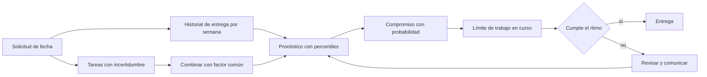
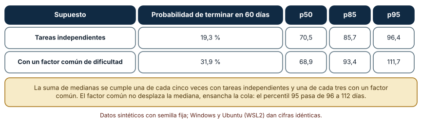
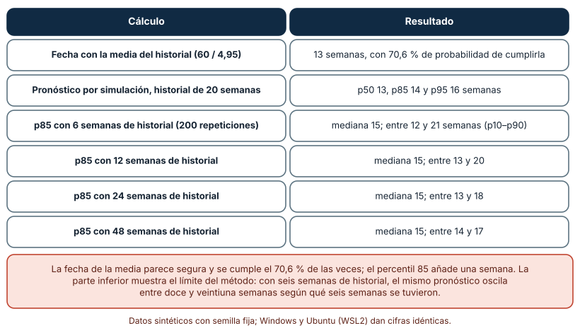
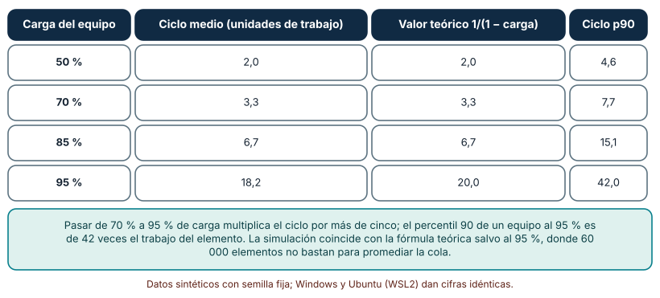

# SE-449 — Estimación organizacional y compromisos

[← SE-448 — Mentoría, feedback y crecimiento](../../classes/part-37-gestion-liderazgo-y-practica-profesional/se-448-mentoria-feedback-y-crecimiento/README.md) · [↑ Parte 37](../../classes/part-37-gestion-liderazgo-y-practica-profesional/README.md) · [📚 Índice completo](../../classes/README.md) · [🌐 Portal](../../site/classes/SE-449.html) · [SE-450 — Gestión de riesgos y decisiones ejecutivas →](../../classes/part-37-gestion-liderazgo-y-practica-profesional/se-450-gestion-de-riesgos-y-decisiones-ejecutivas/README.md)

## Punto profesional y fundamento pedagógico

**Punto profesional.** La clase existe para que conviertas una estimación en un compromiso que se pueda cumplir y defender. Una fecha es una afirmación sobre el futuro con una probabilidad escondida; quien la comunica sin la probabilidad deja a la otra parte decidir con una certeza que no existe. Tres decisiones separan un compromiso honesto de una promesa: cómo se combina la incertidumbre de varias tareas (no se suman medianas), con qué datos se pronostica (el historial de entrega, no la intuición) y cuánta carga se acepta (porque el tiempo de ciclo crece de forma brusca al saturar al equipo).

**Por qué aparece aquí.** Sigue a **Mentoría, feedback y crecimiento** (`SE-448`): acompañar a una persona implica asignarle trabajo, y asignar trabajo implica prometer cuándo estará. El caso conductor es **el equipo de plataforma educativa**, a quien la dirección académica pide una fecha para adaptar la exportación al nuevo formato del ministerio, con doce tareas de tamaño parecido y sesenta elementos pendientes en su tablero.

**Error conceptual que debe corregir.** Creer que sumar las estimaciones «más probables» de las tareas da la estimación del proyecto. La suma de medianas es el valor que se supera más de la mitad de las veces: en la simulación de la clase, una fecha obtenida sumando medianas se cumple una de cada cinco veces. Y creer que un equipo ocupado al 100 % es un equipo productivo: la espera de cada elemento crece sin límite al acercarse a la saturación.

**Secuencia de aprendizaje.** Antes de mirar los resultados, predices con qué probabilidad se cumple una fecha calculada como suma de doce medianas de cinco días; después simulas esa probabilidad con tareas independientes y con un factor común de dificultad, pronosticas la fecha de sesenta elementos con el historial de entrega por semana y mides cuánto tarda cada elemento según la carga del equipo. La secuencia usa predicción, explicación propia, contraste y recuperación. [ICAP](https://icap.education.asu.edu/research) distingue participación de construcción de conocimiento; [How People Learn II](https://nap.nationalacademies.org/catalog/24783/how-people-learn-ii-learners-contexts-and-cultures) respalda diseñar la práctica con contextos reales y retroalimentación.

**Evidencia de aprendizaje.** `compromisos-log.md` con la predicción, las tres figuras reproducidas, un pronóstico de entrega con tres percentiles y sus supuestos, un compromiso redactado con probabilidad y condiciones de revisión, una regla de carga con límite de trabajo en curso y una nota que separe qué es medido, qué inferido y qué supuesto.

**Límite de la conclusión.** Las duraciones de las tareas, el factor común, el historial semanal, la llegada y el servicio de los elementos son sintéticos, escritos por el autor con semilla fija. No se estimó ni se pronosticó ningún proyecto real. Las cifras muestran la forma de cada mecanismo, no la fecha de tu proyecto.

### Trazabilidad fuente → afirmación

| Fuente primaria u oficial | Afirmación que respalda | Lo que no prueba |
|---|---|---|
| [Buehler, Griffin y Ross, «Exploring the planning fallacy»](https://doi.org/10.1037/0022-3514.67.3.366) | Muestra que las personas subestiman sistemáticamente la duración de sus tareas aunque recuerden retrasos pasados. | Son tareas de estudiantes y laboratorio, no de equipos de software. |
| [Little, «A Proof for the Queuing Formula: L = λW»](https://doi.org/10.1287/opre.9.3.383) | Demuestra la relación entre trabajo en curso, ritmo de entrada y tiempo de permanencia en sistemas estables. | No dice si tu sistema es estable ni cuál es tu ritmo. |
| [Kingman, «The single server queue in heavy traffic»](https://doi.org/10.1017/S0305004100036094) | Describe cómo crece la espera de una cola de un servidor al acercarse la utilización a uno. | No describe tus llegadas ni tus tiempos de servicio. |
| [Kanban Guide](https://kanbanguides.org/english/) | Define límites de trabajo en curso, métricas de flujo y la expectativa de nivel de servicio. | Es una guía de práctica; no demuestra que mejore cada sistema. |
| [Python, módulo `statistics`](https://docs.python.org/3/library/statistics.html) | Documenta la mediana y los cuantiles que usan los experimentos. | No justifica el modelo de duraciones. |
| [Python, módulo `random`](https://docs.python.org/3/library/random.html) | Documenta el generador con semilla fija. | No garantiza la misma secuencia entre versiones mayores. |

## Antes de empezar

Recupera lo aprendido en `SE-448`: la retroalimentación a tiempo reduce errores repetidos. La pregunta activa es: **¿la última fecha que prometiste a alguien, con qué probabilidad creías que la cumplirías y se lo dijiste?**

## Prerrequisitos

- Haber completado `SE-448` o poder explicar por qué el momento de una retroalimentación cambia el resultado.
- Python 3.11 o posterior; los experimentos usan solo la biblioteca estándar (`random`, `math`, `statistics`).
- Conocer los conceptos de mediana y percentil.

## Problema auténtico

La dirección académica pidió una fecha para adaptar la exportación. El equipo estimó doce tareas, cada una con una mediana de cinco días, y sumó sesenta. Comunicó «el 15 de febrero». Llegado el 15, iban en el 70 % del trabajo; la fecha real fue seis semanas después. En el análisis posterior se vio que cada tarea había tardado cerca de lo previsto en la mitad de los casos y bastante más en el resto, que varias tareas compartían una dificultad común (el formato era más ambiguo de lo esperado) y que el equipo estaba además al 95 % de su capacidad con trabajo de soporte, por lo que cada elemento esperaba semanas antes de empezar. En el siguiente intento pronosticaron con el historial de entrega por semana, comunicaron «el 85 % de probabilidad de terminar antes del 15 de marzo; el 50 % antes del 22 de febrero», limitaron el trabajo en curso y definieron qué evento los llevaría a revisar el pronóstico. La clase enseña a calcular esas cifras y a negociar con ellas.

## Objetivos observables

Al terminar podrás:

1. explicar por qué la suma de las medianas de varias tareas no es la mediana del proyecto y estimar la probabilidad de cumplirla;
2. pronosticar una fecha con un historial de entrega por semana y reportar percentiles, no un solo día;
3. decidir cuánto historial hace falta para que un percentil sea estable;
4. calcular cómo crece el tiempo de ciclo con la utilización y fijar un límite de carga;
5. redactar un compromiso con probabilidad, supuestos y condición de revisión.

## Mapa conceptual



El mapa separa tres insumos del compromiso: la **incertidumbre de las tareas**, el **ritmo observado** y la **carga aceptada**. La flecha de retorno indica que un compromiso con probabilidad se revisa cuando cambian los datos, y esa revisión es parte del compromiso, no un fallo.

## Temas y por qué importan

| Tema | Por qué cambia una decisión profesional | Evidencia mínima |
|---|---|---|
| Incertidumbre de una tarea | Una estimación sin rango oculta el riesgo. | Mediana y rango por tarea |
| Combinar tareas | Sumar medianas subestima el proyecto. | Simulación o aproximación del total |
| Pronóstico con historial | Sustituye intuición por ritmo observado. | Percentiles y tamaño del historial |
| Carga y tiempo de ciclo | La saturación multiplica la espera. | Curva de ciclo frente a utilización |
| Compromiso probabilístico | Permite negociar con información honesta. | Mensaje con probabilidad y revisión |

## Conceptos y decisiones

### 1. La estimación como distribución

Una tarea de «cinco días» es en realidad una distribución: puede tardar tres o quince. Las duraciones de trabajo creativo tienen una cola larga hacia arriba: hay un mínimo cercano a cero, pero ningún máximo claro. Por eso la mediana (la mitad de las veces se termina antes) es menor que la media, y una persona optimista tiende a comunicar la parte baja. La investigación sobre la **falacia de la planificación** ([Buehler et al.](https://doi.org/10.1037/0022-3514.67.3.366)) muestra que las personas subestiman sus plazos aun sabiendo que planes anteriores se retrasaron, porque se enfocan en el plan y no en el historial. La respuesta práctica no es exigir más precisión sino pedir un rango (por ejemplo, la duración que se supera una de cada diez veces) y, mejor aún, usar datos de tareas pasadas del mismo tipo.

### 2. Combinar tareas: por qué no se suman las medianas

La suma de las medianas de doce tareas es el valor mediano de un proyecto **solo si las duraciones son simétricas**. Con una cola larga hacia arriba, el total tiende a quedar por encima de la suma de medianas, porque los excesos de unas tareas no se compensan con los defectos de otras (el defecto está acotado por cero). Además, las tareas de un mismo proyecto no son independientes: comparten ambigüedad, herramientas y personas, de modo que cuando una tarda más, varias lo hacen. Un factor común hace que el total tenga una dispersión mayor (colas más pesadas) aunque su mediana se acerque a la suma. La consecuencia para el compromiso es que el percentil 85 del proyecto queda entre un 43 % y un 56 % por encima de la suma de medianas en la simulación de esta clase, y que la probabilidad de cumplir esa suma es mucho menor que 50 %.

### 3. Pronosticar con el historial de entrega

En vez de estimar cada tarea, se usa el ritmo con que el equipo realmente termina trabajo: elementos terminados por semana. Un pronóstico por simulación toma, para cada semana futura, un valor al azar del historial (con reemplazo) y suma hasta cubrir los elementos pendientes; repetido miles de veces, da la distribución de semanas necesarias y de ahí los percentiles. Es la lógica de los **pronósticos de Monte Carlo** de las prácticas de flujo y se relaciona con la **expectativa de nivel de servicio** de la [Kanban Guide](https://kanbanguides.org/english/): «el 85 % de los elementos de este tipo se terminan en ocho días o menos». Sus supuestos importan: el futuro se parece al pasado, los elementos tienen tamaños comparables y el historial incluye semanas malas. Si se corta el historial en las semanas buenas, el pronóstico es optimista por construcción.

### 4. Cuánto historial hace falta

Un percentil estimado con pocas semanas es en sí mismo incierto: dos equipos idénticos con historiales de seis semanas distintas obtendrían percentiles distintos. El tamaño del historial controla la dispersión de ese percentil, y con muy pocos datos es preferible comunicar un rango más amplio. La regla práctica no es un número mágico sino repetir el cálculo con subconjuntos del historial y ver cuánto cambia; si cambia mucho, el pronóstico es frágil. También debe actualizarse cuando algo estructural cambia (la composición del equipo, el tipo de trabajo), porque el historial anterior deja de representar el futuro.

### 5. Carga, trabajo en curso y compromiso

[Little](https://doi.org/10.1287/opre.9.3.383) demostró que, en un sistema estable, el trabajo promedio en curso es el ritmo de entrada por el tiempo promedio de permanencia. Quien quiere reducir el tiempo de permanencia sin reducir el ritmo debe reducir el trabajo en curso. Y [Kingman](https://doi.org/10.1017/S0305004100036094) describe cómo la espera de una cola de un servidor crece de forma brusca al aproximarse la utilización a uno: un equipo al 95 % no tiene elementos lentos por pereza sino por saturación. Por eso el compromiso incluye un límite de trabajo en curso y una reserva de capacidad. El compromiso honesto tiene cuatro partes: la afirmación con probabilidad («85 % antes del 15 de marzo»), los supuestos (alcance, historial, equipo estable), las señales que motivarán la revisión y la comunicación de la revisión como un hecho esperado.

### Por qué la suma de medianas no se cumple

Doce tareas con mediana de cinco días y dispersión logarítmica 0,6; suma de medianas: 60 días. Se simulan 20 000 proyectos con tareas independientes y con un factor común de dificultad (correlación aproximada 0,16 entre los logaritmos de duración de dos tareas).

| Supuesto | Probabilidad de terminar en 60 días | p50 | p85 | p95 |
|---|---:|---:|---:|---:|
| Tareas independientes | 19,3 % | 70,5 | 85,7 | 96,4 |
| Con un factor común de dificultad | 31,9 % | 68,9 | 93,4 | 111,7 |



**Cómo leer la figura.** Cada grupo es un supuesto sobre las tareas, con la probabilidad de terminar en 60 días entre paréntesis; las barras son los percentiles 50, 85 y 95 y la línea discontinua marca la suma de medianas. Mira que las tres barras de cada grupo quedan por encima de la línea y que el factor común ensancha la cola sin mover la mediana. **Dónde deja de valer:** la forma lognormal, la dispersión de 0,6 y el factor común son supuestos del autor; con tareas pequeñas y muy conocidas la dispersión es menor y la suma de medianas más fiable, y en tareas con dependencias de secuencia el modelo de suma simple no aplica.

### Cuántas semanas necesita un backlog de 60 elementos

Un historial de 20 semanas con entrega media de 4,95 elementos (la semana sin entrega ocurre el 8 % de las veces) se remuestrea para pronosticar 60 elementos pendientes en 5 000 simulaciones. Después se repite el cálculo del percentil 85 con 200 historiales distintos de 6, 12, 24 y 48 semanas.

| Cálculo | Resultado |
|---|---|
| Fecha con la media del historial (60 / 4,95) | 13 semanas, con 70,6 % de probabilidad de cumplirla |
| Pronóstico por simulación, historial de 20 semanas | p50 13, p85 14 y p95 16 semanas |
| p85 con 6 semanas de historial (200 repeticiones) | mediana 15; entre 12 y 21 semanas (p10–p90) |
| p85 con 12 semanas de historial | mediana 15; entre 13 y 20 |
| p85 con 24 semanas de historial | mediana 15; entre 13 y 18 |
| p85 con 48 semanas de historial | mediana 15; entre 14 y 17 |



**Cómo leer la figura.** Cada fila es una cantidad de semanas de historial y el segmento va del percentil 10 al 90 de 200 repeticiones, con la mediana marcada; la línea discontinua es la fecha de la media, 13 semanas. Mira que el segmento se estrecha con el historial pero la mediana no se mueve de 15: con seis semanas el mismo pronóstico oscila de doce a veintiuna. **Dónde deja de valer:** las entregas semanales siguen una distribución de Poisson con semanas sin entrega aleatorias, supuesto del autor; en un equipo real las semanas no son independientes (una semana mala suele seguir a otra), los elementos no son de tamaño uniforme y el historial puede no representar el trabajo que viene.

### Qué ocurre cuando el equipo está lleno

Una cola de un servidor con tiempos de servicio y de llegada aleatorios (unidad de trabajo igual a un tiempo de servicio medio); se mide el ciclo, es decir, espera más servicio, en 60 000 elementos por escenario.

| Carga del equipo | Ciclo medio (unidades de trabajo) | Valor teórico 1/(1 − carga) | Ciclo p90 |
|---|---:|---:|---:|
| 50 % | 2,0 | 2,0 | 4,6 |
| 70 % | 3,3 | 3,3 | 7,7 |
| 85 % | 6,7 | 6,7 | 15,1 |
| 95 % | 18,2 | 20,0 | 42,0 |



**Cómo leer la figura.** El eje horizontal es la carga del equipo y el vertical el ciclo en unidades de trabajo; la línea verde azulada es el ciclo medio simulado, la gris la fórmula 1/(1 − carga) y la coral, el percentil 90. Mira cómo las tres se disparan a la derecha y que el percentil 90 lo hace antes y más. **Dónde deja de valer:** la fórmula 1/(1 − carga) corresponde a llegadas y servicios exponenciales con un solo servidor; un equipo real tiene varias personas, prioridades, interrupciones y trabajo que no llega al azar. La forma de la curva sí se conserva: el costo de la saturación no es lineal.

## Definiciones de trabajo

- **compromiso probabilístico:** afirmación sobre una fecha o alcance acompañada de su probabilidad y de los supuestos que la sostienen.
- **percentil 85:** valor que se supera el 15 % de las veces en un conjunto de resultados.
- **pronóstico por simulación:** estimación de la distribución de plazos remuestreando un historial de entrega.
- **trabajo en curso:** cantidad de elementos iniciados y no terminados.
- **utilización:** fracción del tiempo disponible que el equipo (o una persona) dedica a trabajo asignado.

Las definiciones son operativas para el equipo de plataforma educativa. No convierten términos con una historia más amplia en sinónimos y deben contrastarse con las fuentes primarias enlazadas al final.

## Ejemplo mínimo

El fragmento simula doce tareas con mediana de cinco días y dispersión logarítmica de 0,59 (1,8 elevado a una variable normal) y mira la mediana y el percentil 85 del total. Antes de ejecutarlo, predice si la mediana es mayor, igual o menor que 60.

```python
import random
r = random.Random(1)
total = sorted(sum(5 * 1.8 ** r.gauss(0, 1) for _ in range(12)) for _ in range(4001))
print(round(total[2000]), round(total[3400]))
```

Imprime `70 85`: la mediana del total es 70 días, no 60, y el percentil 85 es 85. Observa que no hay ninguna tarea mal estimada: cada mediana individual es correcta, y aun así la suma de medianas se queda corta por diez días. Registra versión de Python, comando y salida.

## Ejemplo profesional

Escenario hipotético, construido para la clase y sin datos reales. El equipo toma las últimas 24 semanas de entrega, que incluyen tres semanas con cero elementos terminados por guardia, y pronostica los sesenta elementos pendientes: percentil 50 en 13 semanas y percentil 85 en 14 a 15. Antes de comunicar, repite el cálculo con las últimas 12 semanas y ve que el percentil 85 se mueve entre 13 y 16: lo comunica como rango. Redacta el compromiso: «con 85 % de probabilidad, la exportación adaptada estará entregada antes de 15 semanas; con 50 %, antes de 13. Supuestos: alcance de los 60 elementos, equipo de ocho sin cambios, guardia como en el historial. Revisaremos a la semana 6 con el ritmo medido y avisaremos si el percentil 85 supera las 16 semanas». Fija un límite de seis elementos en curso para un equipo de ocho y reserva una cuarta parte de la capacidad para soporte. La dirección académica pregunta si pueden prometer 12 semanas: responden con el costo (la probabilidad queda por debajo de la mitad, porque 12 semanas es menos que el percentil 50) y ofrecen reducir el alcance a 48 elementos para alcanzar el 85 %. Compara con prometer «el 15 de febrero» sin probabilidad: la diferencia es la información.

## Práctica guiada

1. Toma una lista de doce tareas propias, estima para cada una la mediana y el valor que se superaría una de cada diez veces, y escribe cuánto crees que tardará el conjunto antes de simular.
2. Predice la probabilidad de cumplir la suma de medianas y escribe el número antes de simular.
3. Reproduce las tres tablas con las semillas fijadas en `scripts/experiments_part37_a.py`; cambia la dispersión de 0,6 a 0,3 y observa cómo cambia la probabilidad de cumplir la suma.
4. Pronostica con un historial real o inventado de 12 semanas y repite con las 6 últimas; compara los percentiles 85.
5. Mide el tiempo de ciclo de los últimos 20 elementos de tu equipo y compáralo con la carga que tenías.
6. Redacta un compromiso con probabilidad, supuestos y condición de revisión.
7. Entrega `compromisos-log.md` y pide a otra persona que identifique qué supuesto de tu compromiso la haría pedir una revisión.

## Ejercicios

1. **Suma:** explica con un ejemplo de dos tareas con cola larga por qué el total supera la suma de medianas.
2. **Pronóstico:** un equipo entrega en promedio 5 elementos por semana con desviación 2. ¿Cuántas semanas necesita para 40 elementos con 85 % de confianza? Calcula con una simulación de 1 000 repeticiones.
3. **Carga:** con una carga del 90 %, ¿cuánto vale el ciclo medio según la fórmula? Si se baja a 75 %, ¿cuánto cambia? Explica por qué reducir el trabajo en curso acelera sin trabajar más rápido.
4. **Negociación:** la dirección pide una fecha con 95 % de certeza. Redacta la respuesta con el costo en tiempo y las alternativas de alcance.

## Reto verificable

Entrega `compromisos-log.md` con la predicción, las tres tablas, el pronóstico con tres percentiles y la prueba de estabilidad con subconjuntos del historial, la regla de carga y el compromiso redactado. Se aprueba si otra persona ejecuta el código desde un checkout limpio, obtiene los mismos números con las mismas semillas y puede decir, a partir de tu compromiso, qué probabilidad se promete, con qué supuestos y qué señal motivaría la revisión. No se aprueba por afirmar «terminamos en 12 semanas» sin probabilidad ni supuestos.

## Caso conductor

El equipo de plataforma educativa es el caso conductor de la Parte 37. Esta clase deja el quinto artefacto: un compromiso probabilístico con regla de carga. `SE-450` preguntará cómo se gestionan los riesgos que ese compromiso asume y cómo se presentan decisiones ejecutivas, y `SE-453` cómo se traduce el tiempo en costo. Cambia después un solo dato, la carga del equipo de 85 % a 95 %, y observa cómo cambia el ciclo y con él la fecha prometida.

## Preguntas frecuentes

### ¿Los puntos de historia sirven para pronosticar?

Sirven si el equipo los usa de forma estable y si se observa su relación con el tiempo real; el pronóstico por flujo prescinde de ellos y usa elementos terminados por semana, lo que evita discutir qué es un punto. Cuando los elementos varían mucho en tamaño, conviene separarlos por clases (pequeño, mediano, grande) y pronosticar cada una.

### ¿Y si la dirección exige una única fecha?

Puedes dar una fecha y decir su probabilidad: «15 de marzo, con 85 %». Si exigen certeza, explica que no existe y ofrece las palancas reales: reducir el alcance, aumentar el equipo con las salvedades conocidas o aceptar un riesgo. Una fecha única sin probabilidad obliga a la dirección a decidir con un dato falso.

### ¿Cuánto historial necesito?

Tanto como haga estable el percentil que comunicas: repite el cálculo con subconjuntos y observa cuánto cambia. Con menos de unas diez semanas, comunica un rango amplio y registra que el pronóstico es provisional. Descarta datos anteriores a un cambio estructural, porque ya no representan al equipo.

### ¿Limitar el trabajo en curso no deja personas ociosas?

Puede dejar tiempo libre que se usa mejor ayudando a terminar lo iniciado, revisando o reduciendo deuda. Una persona ocupada que inicia un tercer elemento aumenta el ciclo de todos. La señal de que el límite es demasiado bajo es que los elementos esperan por dependencias externas, no por el equipo.

## Fallo controlado y diagnóstico

Reproduce el fallo clásico de la clase: **una fecha calculada sumando medianas que se incumple**. Simula doce tareas con mediana de cinco días y cuenta en cuántos proyectos el total supera los sesenta días.

Registra síntoma, entrada mínima, hipótesis, observación que descarta cada hipótesis, causa, corrección y prueba de regresión. **Síntoma:** el proyecto llega al 70 % de avance en la fecha prometida. **Hipótesis rivales:** (a) las estimaciones individuales eran malas; (b) el equipo trabajó lento; (c) la suma de medianas era un compromiso del 20 %. **Prueba:** compara el tiempo real de cada tarea con su mediana; si la mitad quedó por debajo y la mitad por encima, las estimaciones eran correctas, y la causa es la agregación. **Conclusión:** con tareas independientes la suma de medianas se cumple el 19,3 % de las veces; con factor común, 31,9 %. **Regresión:** comunica siempre el percentil que se está prometiendo y compáralo cada trimestre con lo ocurrido. No cambies a la vez el método de estimación y el alcance.

## Errores comunes y cómo corregirlos

| Síntoma | Causa probable | Corrección |
|---|---|---|
| Se incumple la fecha pese a estimaciones razonables | Se sumaron medianas | Simular el total y comunicar percentiles |
| El pronóstico cambia mucho de una semana a otra | Historial muy corto | Repetir con subconjuntos y comunicar rango |
| Los elementos tardan cada vez más | Equipo saturado | Limitar el trabajo en curso y reservar capacidad |
| La dirección toma la mediana como promesa | Se comunicó solo un día | Comunicar probabilidad y supuestos |
| El pronóstico ignora las semanas malas | Se filtró el historial | Incluir todas las semanas representativas |

## Entorno y archivos clave

```text
work/SE-449/
├── README.md
├── compromisos/
│   ├── agregar.py
│   ├── pronostico.py
│   └── ciclo.py
├── COMPROMISO.md
├── REGLA-DE-CARGA.md
├── tests/test_compromisos.py
└── evidence/compromisos-log.md
```

El `README` declara plataforma, versión de Python, semillas y comandos. Los experimentos usan solo la biblioteca estándar (`random`, `math`, `statistics`) y se ejecutaron con CPython 3.12.9 en Windows 11 y 3.12.3 en Ubuntu bajo WSL2: las salidas fueron idénticas. Si añades una dependencia, fija procedencia y versión.

## Seguridad, ética y accesibilidad

- un compromiso con fecha afecta a personas que dependen del resultado (docentes, estudiantes): comunica los riesgos conocidos, no solo la mejor estimación;
- la presión para comprometer una fecha irreal traslada riesgo a quien trabaja (horas extras): el compromiso debe incluir qué se recorta antes que el descanso;
- el historial de entrega describe al equipo, no a personas: no lo uses para comparar individuos;
- las tablas y figuras deben tener texto alternativo y no depender del color;
- las fuentes citadas son textos de sus autores: cita las ideas y vincula la fuente, no copies sus textos ni diagramas.

## Puente hacia el trabajo con agentes

Un agente al que se le pide «estima cuánto tomará esto» devolverá un número cómodo, sin historial ni rango, probablemente la suma de medianas implícitas. Pídele en cambio que liste las tareas con un rango, que declare qué supuestos hace sobre dependencias y que genere el código de una simulación con semilla fija usando tu historial real, y compara sus percentiles con los tuyos. Revisa especialmente cualquier fecha sin probabilidad y cualquier historial que haya «completado» por su cuenta. El agente puede ayudar a escribir la simulación; el historial y el compromiso con la dirección son decisiones tuyas.

## Transferencia

Traslada el análisis a otro dominio (por ejemplo, la preparación de una feria de ciencias con doce tareas de una comisión de voluntarias): cambia las tareas, el ritmo y la capacidad y conserva el procedimiento de pedir un rango por tarea, agregar con un factor común, pronosticar con el historial y comunicar con probabilidad. La transferencia está lograda cuando puedes decir qué supuesto de tu dominio rompería el pronóstico, no cuando el compromiso se parece al del equipo de plataforma.

## Evaluación y evidencia

| Criterio | Evidencia para aprobar |
|---|---|
| comprensión | explicación de por qué la suma de medianas no es la mediana del total y de cómo se lee un percentil |
| corrección | tablas de agregación, de pronóstico y de ciclo reproducibles con las mismas semillas |
| diseño | compromiso con probabilidad, supuestos, condición de revisión y regla de carga |
| diagnóstico | reproducción del fallo «suma de medianas» con regresión |
| incertidumbre | declaración de que las duraciones, el historial y las colas son del autor |
| reproducibilidad | versiones, comandos, salida y límites declarados |

## Fuentes

- [Buehler, Griffin y Ross, «Exploring the "planning fallacy"»](https://doi.org/10.1037/0022-3514.67.3.366) — subestimación sistemática de plazos; autoridad: Journal of Personality and Social Psychology.
- [Little, «A Proof for the Queuing Formula: L = λW»](https://doi.org/10.1287/opre.9.3.383) — relación entre trabajo en curso, ritmo y permanencia; autoridad: Operations Research.
- [Kingman, «The single server queue in heavy traffic»](https://doi.org/10.1017/S0305004100036094) — espera con alta utilización; autoridad: Mathematical Proceedings of the Cambridge Philosophical Society.
- [Kanban Guide](https://kanbanguides.org/english/) — límites de trabajo en curso, métricas de flujo y expectativa de servicio; autoridad: Kanban Guides.
- [Python, módulo `statistics`](https://docs.python.org/3/library/statistics.html) — mediana y cuantiles; autoridad: Python Software Foundation.
- [Python, módulo `random`](https://docs.python.org/3/library/random.html) — generador con semilla; autoridad: Python Software Foundation.

Cada fuente respalda el mecanismo indicado; ninguna demuestra que el 19,3 % de cumplimiento de la suma de medianas, la semana adicional del percentil 85 o el ciclo de 18,2 unidades al 95 % de carga se observen en tu equipo. Esa afirmación depende de tus tareas, de tu historial y de tu carga reales.

## Límites y siguiente paso

Se ejecutaron tres experimentos con datos sintéticos en Windows y Ubuntu (WSL2) con resultados idénticos. No se estimó ni se pronosticó ningún proyecto real; las duraciones lognormales, el factor común, el historial de Poisson y la cola de un servidor son construcciones del autor, y el modelo supone semanas independientes y elementos de tamaño parecido. La siguiente clase pregunta cómo se gestionan los riesgos que esos compromisos asumen y cómo se presenta una decisión a quien tiene autoridad para tomarla.

## Glosario

- **compromiso probabilístico:** afirmación sobre una fecha o alcance acompañada de su probabilidad y de los supuestos que la sostienen.
- **percentil 85:** valor que se supera el 15 % de las veces en un conjunto de resultados.
- **pronóstico por simulación:** estimación de la distribución de plazos remuestreando un historial de entrega.
- **trabajo en curso:** cantidad de elementos iniciados y no terminados.
- **utilización:** fracción del tiempo disponible que el equipo (o una persona) dedica a trabajo asignado.

---

[← SE-448 — Mentoría, feedback y crecimiento](../../classes/part-37-gestion-liderazgo-y-practica-profesional/se-448-mentoria-feedback-y-crecimiento/README.md) · [↑ Parte 37](../../classes/part-37-gestion-liderazgo-y-practica-profesional/README.md) · [📚 Índice completo](../../classes/README.md) · [🌐 Portal](../../site/classes/SE-449.html) · [SE-450 — Gestión de riesgos y decisiones ejecutivas →](../../classes/part-37-gestion-liderazgo-y-practica-profesional/se-450-gestion-de-riesgos-y-decisiones-ejecutivas/README.md)
