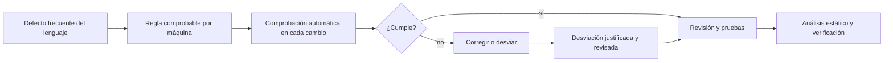
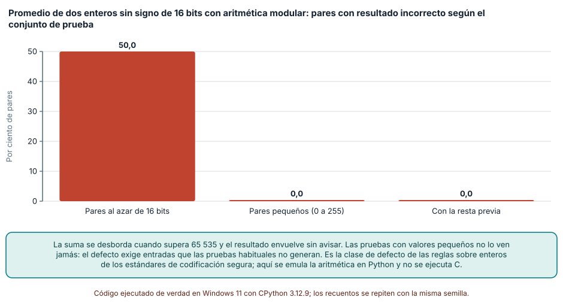
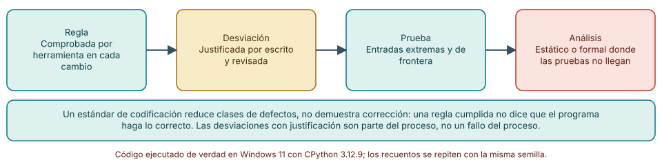

# SE-452 — Codificación segura: MISRA y CERT

[← SE-451 — RTOS y planificación de tiempo real](../../classes/part-37-sistemas-criticos-tiempo-real-y-normas-de-seguridad/se-451-rtos-y-planificacion-de-tiempo-real/README.md) · [↑ Parte 37](../../classes/part-37-sistemas-criticos-tiempo-real-y-normas-de-seguridad/README.md) · [📚 Índice completo](../../classes/README.md) · [🌐 Portal](../../site/classes/SE-452.html) · [SE-453 — Verificación formal y model checking: TLA+, SPARK y Alloy →](../../classes/part-37-sistemas-criticos-tiempo-real-y-normas-de-seguridad/se-453-verificacion-formal-y-model-checking-tla-spark-y-alloy/README.md)

## Punto profesional y fundamento pedagógico

**Punto profesional.** La clase existe para que entiendas qué hace un estándar de codificación segura, por qué sus reglas son restricciones sobre el lenguaje y no consejos de estilo, y cómo se integra una política así en un proyecto sin convertirla en un rito. MISRA C (nacida en la industria automotriz y hoy usada en aviación, medicina y defensa) y SEI CERT C (publicado en una wiki abierta por el Instituto de Ingeniería de Software de Carnegie Mellon) son los dos estándares más conocidos para C; las diez reglas de Gerard Holzmann, del Jet Propulsion Laboratory de la NASA, son una política mínima, breve y verificable por máquina. Comparten una idea: en un sistema crítico, un subconjunto del lenguaje que se pueda analizar vale más que el lenguaje completo.

**Por qué aparece aquí.** Sigue a `SE-451`: ni el análisis de planificación ni las pruebas de plazos detectan un desbordamiento aritmético, una recursión sin cota o un valor de retorno ignorado. Esos defectos se evitan en la escritura, con reglas comprobables, y se verifican más adelante con análisis (`SE-453`) y cobertura (`SE-454`). Retoma de [SE-434 — Revisión, análisis estático y quality gates](../../classes/part-36-calidad-rendimiento-y-resiliencia/se-434-revision-analisis-estatico-y-quality-gates/README.md) la idea de una puerta de calidad automática.

**Error conceptual que debe corregir.** Creer que cumplir un estándar de codificación hace correcto al programa. Las reglas eliminan clases de defectos y facilitan el análisis; no dicen que el programa haga lo que debe. En el laboratorio, un promedio de dos enteros de 16 bits sin signo que suma antes de dividir da un resultado incorrecto en el 50,0 % de 200 000 pares al azar, y en **ningún** par cuando las pruebas usan valores pequeños (0 a 255): el defecto es invisible para las pruebas habituales y evitable con una regla sobre aritmética de enteros.

**Secuencia de aprendizaje.** Antes de ejecutar, predices cuántos avisos produce una política de seis reglas mecánicas sobre una muestra con defectos y cuántos produce su versión corregida, y con qué frecuencia falla un promedio con desbordamiento silencioso. Después implementas seis reglas sobre el árbol sintáctico de Python, las aplicas a las dos versiones de tres funciones, buscas un falso positivo y emulas la aritmética sin signo de 16 bits.

**Evidencia de aprendizaje.** `politica-de-codificacion.md` con las reglas elegidas y su motivo, la forma de comprobarlas por máquina, el procedimiento de desviación (quién puede aprobar una excepción y cómo se registra) y los resultados sobre una muestra real.

**Límite de la conclusión.** Las reglas del laboratorio se inspiran en las diez reglas de Holzmann y se implementan sobre Python con el módulo `ast`; no son MISRA ni CERT, que son para C y cuyo texto (en el caso de MISRA) se distribuye con sus condiciones y no se reproduce. No hay compilador de C en el entorno de medición, de modo que el desbordamiento se emula con aritmética modular en Python y no se ejecuta C. El «50,0 %» describe un modelo de enteros de 16 bits, no un programa real.

### Trazabilidad fuente → afirmación

| Fuente primaria u oficial | Afirmación que respalda | Lo que no prueba |
|---|---|---|
| [Holzmann, «The Power of 10: Rules for Developing Safety-Critical Code», IEEE Computer, 2006](https://spinroot.com/gerard/pdf/P10.pdf) | Propone diez reglas de codificación para código de misión crítica pensadas para verificarse por máquina (control de flujo simple, cotas de bucles, funciones cortas, aserciones, comprobación de retornos y uso de análisis estático). | No dice que cumplirlas demuestre corrección. |
| [SEI CERT C Coding Standard (wiki del SEI)](https://wiki.sei.cmu.edu/confluence/display/c/SEI+CERT+C+Coding+Standard) | Es un estándar público de reglas y recomendaciones para C que incluye reglas sobre el desbordamiento de enteros sin signo. | No es un proceso de conformidad. |
| [MISRA (sitio oficial)](https://misra.org.uk/) | Identifica el origen y la organización que publica las guías MISRA C, que se distribuyen con sus propias condiciones. | No contiene el texto de las reglas. |
| [Informe del vuelo 501 de Ariane 5 (ESA)](https://esamultimedia.esa.int/docs/esa-x-1819eng.pdf) | Documenta una excepción de desbordamiento en una conversión de coma flotante a entero que apagó dos unidades inerciales. | No es un caso de C. |
| [Python: `ast`](https://docs.python.org/3/library/ast.html) | Documenta el árbol sintáctico sobre el que el laboratorio implementa las reglas. | No es un analizador certificado. |

## Antes de empezar

Recupera lo aprendido en `SE-451`: una cota se argumenta, no se observa. La pregunta activa es: **¿qué defecto de tu código «solo aparece con valores grandes» y qué regla, escrita antes, lo habría prohibido?**

## Prerrequisitos

- Haber completado `SE-445` a `SE-451`.
- Haber visto [SE-434 — Revisión, análisis estático y quality gates](../../classes/part-36-calidad-rendimiento-y-resiliencia/se-434-revision-analisis-estatico-y-quality-gates/README.md) y [SE-426 — Mutación, fuzzing y generación de casos](../../classes/part-35-estrategia-y-tecnicas-de-prueba/se-426-mutacion-fuzzing-y-generacion-de-casos/README.md).
- Entender el desbordamiento de enteros de ancho fijo y la aritmética modular.
- Python 3.11 o posterior.

## Problema auténtico

El *Horno de curado* tiene un registro de temperaturas promediadas en un entero sin signo de 16 bits con décimas de grado. El código promedia dos lecturas con `(a + b) / 2`. Las pruebas, que usan temperaturas de laboratorio de 20 a 250 °C (de 200 a 2500 décimas), pasan. En una instalación nueva, un sensor reporta un valor atípico de 40 000 décimas por un error de cableado y la suma envuelve y da un promedio de 3 000: el horno cree que está frío y sigue calentando. Nadie escribió una regla sobre aritmética de enteros y ninguna prueba usó valores cercanos al límite del tipo.

La clase define una política mínima de seis reglas comprobables por máquina, las aplica a una muestra con defectos y a su corrección, mide un falso positivo de la regla de recursión y emula el desbordamiento de 16 bits para ver cuándo aparece y por qué las pruebas no lo ven.

## Objetivos observables

Al terminar podrás:

1. explicar qué es un estándar de codificación segura y en qué se diferencia de una guía de estilo;
2. describir el propósito de las reglas de control de flujo, de cotas de bucles, de tamaño de funciones, de aserciones y de comprobación de retornos;
3. implementar reglas simples como comprobaciones sobre un árbol sintáctico y reconocer su falso positivo;
4. mostrar un defecto de aritmética de enteros que las pruebas habituales no ven y la forma de evitarlo;
5. diseñar un procedimiento de desviaciones justificadas y revisadas.

## Mapa conceptual



La regla sin comprobación automática se olvida; la comprobación sin procedimiento de desviación se vuelve un obstáculo que se esquiva. Las dos piezas son parte de la política.

## Temas y por qué importan

| Tema | Por qué cambia una decisión profesional | Evidencia mínima |
|---|---|---|
| Subconjunto del lenguaje | Reduce lo que hay que analizar. | Lista de reglas con su razón |
| Reglas mecánicas | Se comprueban sin juicio y en cada cambio. | Comprobador en integración continua |
| Control de flujo y cotas | Hacen acotable el tiempo y el análisis. | Bucles con cota |
| Aserciones y retornos | Convierten supuestos y errores en comprobaciones. | Densidad de aserciones |
| Aritmética de enteros | Es una fuente clásica de fallos silenciosos. | Prueba con valores extremos |
| Falsos positivos | Una regla mal ajustada pierde credibilidad. | Registro de avisos descartados |
| Desviaciones | Hacen la política sostenible y auditable. | Procedimiento con dueño |

## Conceptos y decisiones

### 1. Un subconjunto del lenguaje se puede analizar

Los lenguajes de uso general permiten construcciones difíciles de razonar: recursión sin cota, bucles que dependen de datos externos, punteros que se redirigen sin control, comportamientos indefinidos del lenguaje. Un estándar de codificación segura prohíbe o restringe esas construcciones para que el programa que queda sea analizable por herramientas y por personas. La idea de las reglas de Holzmann es notable por su economía: diez reglas que caben en una página, escritas para que una herramienta las compruebe. Entre ellas: flujo de control simple (sin saltos arbitrarios ni recursión), todos los bucles con una cota fija comprobable, funciones que caben en una página, un mínimo de aserciones por función, y comprobar siempre el valor de retorno de las funciones que pueden fallar. No toda regla funciona en todo dominio; lo valioso es el principio de que un programa que se puede analizar se puede verificar.

### 2. Reglas mecánicas: lo que una herramienta puede decidir

Una regla útil es la que una herramienta decide sin discutir: «el programa no contiene recursión», «cada bucle `while` tiene una condición que no es constante verdadera», «ninguna función tiene más de 60 líneas», «toda función con al menos dos estructuras de control contiene una aserción», «no hay una llamada a `write` cuyo resultado se descarte», «no hay un `except` vacío». En el laboratorio, las seis se implementan con el módulo `ast` sobre una muestra de tres funciones con defectos: recursión, un bucle sin cota, una función con lógica y sin aserciones, un valor de retorno ignorado y una excepción vacía; produce 5 avisos (uno por regla, y 0 en la de longitud) y su versión corregida 0. La regla mecánica no reemplaza la revisión: la libera para lo que solo una persona decide.

### 3. El falso positivo y el costo de una regla ciega

Una regla mecánica también se equivoca. La regla de recursión marca una función `altura` que recorre un árbol llamándose a sí misma, aunque su profundidad esté acotada por la del árbol y sea perfectamente analizable. Si el aviso no se puede descartar con una justificación revisada, el equipo aprende a ignorar los avisos y la política deja de proteger. La respuesta no es abandonar la regla sino ajustarla (permitir recursión con una cota declarada y comprobada) o permitir una **desviación**: una excepción por escrito, con su motivo, su alcance y quién la aprobó.

### 4. Aserciones y retornos: hacer visibles los supuestos

Una aserción es una comprobación en ejecución de un supuesto del programador («el índice está en rango»), y su densidad es un indicador de que el código declara sus supuestos. Comprobar el valor de retorno de una función que puede fallar evita que un error de escritura, de lectura o de adquisición de un recurso pase en silencio. En un sistema crítico, la acción ante una aserción fallida está definida (llevar a un estado seguro) y no es un `abort` genérico. El laboratorio detecta ambas deficiencias en la muestra: la función con dos estructuras de control sin aserciones y la llamada a `write` sin comprobar.

### 5. Aritmética de enteros: el fallo silencioso

En lenguajes como C, el desbordamiento de un entero sin signo es un envoltorio definido (módulo 2ⁿ) y el de uno con signo es comportamiento indefinido. En ambos casos el programa sigue ejecutando con un valor erróneo. En el laboratorio, el promedio `((a + b) mod 65536) // 2` de dos valores de 16 bits da un resultado incorrecto en 99 958 de 200 000 pares al azar (50,0 %), porque la suma supera 65 535 aproximadamente la mitad de las veces; con la resta previa (`a + (b − a) // 2`) no falla ninguno. Con valores pequeños (0 a 255) el defecto no aparece nunca: los 65 536 pares dan lo correcto. Una prueba que «recorre el rango habitual» no ve este defecto; una regla que exige comprobar el desbordamiento antes de operar, o una prueba con valores extremos, sí.

### 6. Estándares concretos y su uso

MISRA C define reglas obligatorias, requeridas y aconsejables para C, con una clasificación entre decidibles (una herramienta puede comprobarlas con certeza) y no decidibles (solo con aproximaciones), y un procedimiento de desviación; sus documentos se distribuyen por la organización que los mantiene. SEI CERT C es un estándar público con reglas (cuya violación suele ser un defecto) y recomendaciones, con ejemplos de código incumplidor y cumplidor y una clasificación de riesgo; incluye reglas sobre el envoltorio de enteros sin signo. La elección entre ellos suele venir impuesta por el cliente o la norma sectorial. Lo transferible es el funcionamiento: reglas escritas, comprobadas por herramienta, con desviaciones justificadas.

### 7. Lo que una política no hace

Una política de codificación no sustituye los requisitos, el diseño, las pruebas ni el análisis de peligros. Un programa que cumple todas las reglas puede resolver el problema equivocado. Tampoco evita defectos de lógica, de concurrencia o de especificación. Lo que sí hace es reducir el número de defectos de bajo nivel que desvían la atención de los importantes, y dejar un programa más fácil de analizar con las técnicas de las dos clases siguientes.

## Reglas mecánicas

La primera medida aplica seis reglas a dos versiones de las mismas funciones.


**Cómo leer la figura.** Cada grupo es una regla y las dos barras son la muestra con defectos y su corrección; mira primero que cada regla detecta una cosa distinta y que la versión corregida cumple las seis. **Dónde deja de valer:** son tres funciones escritas para incumplir las reglas; en código real, los avisos se concentran en pocas funciones y la mayoría de los falsos positivos aparece con recursión y con aserciones. Cero avisos no demuestra corrección.

## El desbordamiento que no se ve

La segunda medida emula un promedio de enteros de 16 bits sin signo.



**Cómo leer la figura.** Cada barra es un conjunto de entradas y su altura el porcentaje de resultados incorrectos; mira primero la distancia entre los pares al azar y los pares pequeños: el mismo código, el defecto invisible con entradas pequeñas. **Dónde deja de valer:** la aritmética se emula con máscaras en Python; en C real el comportamiento de los enteros con signo es indefinido y puede ser peor que el envoltorio. Que una fórmula alternativa no falle en el modelo no la hace correcta para todos los tipos.

## Capas de una política

La tercera figura ordena qué comprueba cada capa y qué deja a la siguiente.



**Cómo leer la figura.** Cada caja es una capa y su texto dice qué hace y qué pasa a la siguiente; mira primero que la desviación pasa por una persona y no por la herramienta. **Dónde deja de valer:** es un esquema; en un proyecto, las capas se superponen y una regla puede estar en varias. Lo esencial es que ninguna capa se declare suficiente.

## Definiciones de trabajo

- **Estándar de codificación segura:** conjunto de reglas que restringen el uso del lenguaje para evitar clases de defectos.
- **Regla decidible:** regla que una herramienta puede comprobar con certeza.
- **Desviación:** excepción justificada, revisada y registrada de una regla.
- **Falso positivo:** aviso que la herramienta emite sobre código que no tiene el defecto.
- **Aserción:** comprobación en ejecución de un supuesto del programa.
- **Envoltorio de enteros:** resultado módulo 2ⁿ de una operación que excede el rango del tipo.
- **Cota de bucle:** límite superior comprobable de las iteraciones de un bucle.

## Ejemplo mínimo

Una regla comprobada por máquina y un desbordamiento emulado:

```python
import ast

codigo = "def f(n):\n    return n + f(n - 1)\n"
arbol = ast.parse(codigo)
recursivas = [f.name for f in ast.walk(arbol) if isinstance(f, ast.FunctionDef)
              and any(isinstance(c, ast.Call) and getattr(c.func, "id", None) == f.name for c in ast.walk(f))]
print("recursivas:", recursivas)

a, b = 40000, 30000
print((a + b) & 0xFFFF, "frente a", a + b)    # 4464 frente a 70000
```

La primera salida lista `f`; la segunda muestra el envoltorio de 16 bits: una suma de 70 000 queda en 4 464 y el promedio es 2 232 en lugar de 35 000.

## Ejemplo profesional

*Escenario ilustrativo: las cifras y los resultados que aparecen en este ejemplo son supuestos de la narración, no mediciones.*

Un equipo adopta un estándar de codificación con un comprobador en la integración continua. El primer día aparecen 4 000 avisos en la base de código existente; el equipo, abrumado, decide silenciar la regla más ruidosa. Una persona de calidad propone otra estrategia: congelar la base existente con un archivo de avisos conocidos, exigir cero avisos nuevos y atacar el archivo por riesgo, empezando por las funciones del limitador. En tres meses, el archivo baja de 4 000 a 900 y las desviaciones registradas son 12, cada una con un motivo y una aprobación. El comprobador deja de ser un obstáculo porque tiene una salida: corregir o desviar con justificación. Lo difícil no fue elegir las reglas, fue sostener el procedimiento.

## Práctica guiada

1. Elige cinco reglas de un estándar público (por ejemplo, las diez de Holzmann) y escribe por qué cada una importa en tu dominio.
2. Implementa dos de ellas como comprobaciones automáticas sobre tu código, sin herramientas externas.
3. Ejecuta `python scripts/experiments_part37_b.py 572` y compara los avisos con los que esperabas.
4. Busca en tu base un falso positivo de una de esas reglas y escribe cómo ajustarías la regla o la desviación.
5. Escribe una prueba con valores en los límites del tipo para una operación aritmética de tu código.

## Ejercicios

1. **Básico.** Explica por qué un bucle `while True` con una salida interna no satisface una regla de cota fija de iteraciones.
2. **Intermedio.** Añade al comprobador una regla sobre la longitud de las líneas de cada función y otra sobre el número de parámetros; mide los avisos en una base de código tuya.
3. **Avanzado.** Diseña el procedimiento de desviaciones de una política de codificación: quién aprueba, qué se registra, cuándo caduca y cómo se audita.

## Reto verificable

Entrega `politica-de-codificacion.md` y el código de un comprobador de al menos cuatro reglas sobre el árbol sintáctico de un lenguaje a tu elección, con una muestra con defectos y su corrección. Es válido si otra persona reproduce los avisos de cada regla, el falso positivo documentado y la emulación del envoltorio de enteros con la misma semilla.

## Caso conductor

El código del limitador del *Horno de curado* pasa por una política mínima y por una prueba con valores extremos. `SE-453` da el siguiente paso: cuando las pruebas no bastan, un verificador puede explorar todos los estados de un modelo y demostrar una propiedad o devolver un contraejemplo.

## Preguntas frecuentes

### ¿MISRA y CERT son lo mismo?

No: MISRA es un conjunto de directrices para C y C++ de la industria, con reglas clasificadas y un procedimiento de desviación, que se distribuye por la organización que lo mantiene; SEI CERT C es un estándar público del Instituto de Ingeniería de Software con reglas y recomendaciones. Se superponen en parte y se complementan.

### ¿Por qué no basta con las pruebas?

Porque hay defectos que exigen entradas que las pruebas habituales no generan (valores extremos, combinaciones raras) y porque una regla sobre el código puede prevenirlos sin necesidad de encontrar la entrada. Las pruebas y las reglas cubren cosas distintas.

### ¿Se puede aplicar esto a Python?

Las ideas sí (cotas, comprobación de retornos, aserciones, sin excepciones vacías); las reglas de C sobre punteros o el preprocesador no aplican. El laboratorio usa Python por conveniencia y por eso emula la aritmética de C. Para código de seguridad real se usan lenguajes y subconjuntos con semántica definida.

### ¿Qué pasa con el código heredado?

Se congela el estado conocido, se exigen cero avisos nuevos y se reduce el archivo por riesgo. Reescribir todo de golpe suele introducir más defectos que los que corrige.

## Fallo controlado y diagnóstico

**Fallo.** Un termostato de un lote de hornos apaga el calentador sin motivo cuando un cliente prueba con una lectura simulada de 3 500 °C (35 000 décimas) junto a otra de 3 200 °C (32 000 décimas). En el campo nunca pasa.

**Diagnóstico paso a paso.** (1) Los registros de prueba usan décimas de grado en un entero de 16 bits sin signo, con un máximo de 65 535. (2) El promedio de dos lecturas altas suma por encima de 65 535 y envuelve. (3) Las pruebas del equipo usan solo 200 a 2 500 décimas y no ejercitan el defecto. (4) Ninguna regla de la política cubría la aritmética de enteros.

**Corrección.** Se añade una regla de aritmética con comprobación de rango antes de sumar, se corrige el promedio con la fórmula de la resta previa, se agrega una prueba con valores en los límites del tipo y se añade el sensor de rango a la validación de entradas. La lección es que un defecto de aritmética es invisible a las pruebas «razonables» y que una regla escrita antes cuesta menos que un lote retirado.

## Errores comunes y cómo corregirlos

- **Adoptar un estándar y silenciar las reglas incómodas.** Corrige con desviaciones justificadas, no con silencio.
- **Reglas sin comprobación automática.** Corrige integrándolas en la integración continua.
- **Considerar el cero avisos como corrección.** Corrige con pruebas, análisis y revisión.
- **Ignorar los falsos positivos.** Corrige ajustando la regla o documentando la desviación.
- **Probar solo valores típicos.** Corrige con valores en los límites del tipo y en los extremos.
- **Reescribir todo el código heredado de golpe.** Corrige congelando el estado y bajando el archivo por riesgo.

## Entorno y archivos clave

- `scripts/experiments_part37_b.py`: función `e572` con las seis reglas sobre `ast`, las dos muestras y la emulación del promedio de 16 bits; se ejecuta con `python scripts/experiments_part37_b.py 572`.
- La semilla es 47 para los 200 000 pares; la emulación usa máscaras de 16 bits.
- `scripts/figures_part37_b.py`: las tres figuras de la clase.
- Solo la biblioteca estándar de Python 3.11 o posterior.

## Seguridad, ética y accesibilidad

Un defecto de aritmética que se descubre en el campo suele afectar a quienes no pueden defenderse de él. La política de codificación es una forma de cuidado previo. Las desviaciones se registran con nombre y fecha para que la responsabilidad sea visible. Los estándares citados tienen sus propias condiciones de uso: no se reproducen sus reglas y se remite al texto oficial. Las figuras tienen texto alternativo completo y no dependen solo del color.

## Puente hacia el trabajo con agentes

Un agente de código escribe aritmética de enteros sin pensar en el ancho del tipo, usa excepciones vacías para «hacer pasar» las pruebas y deja retornos sin comprobar. Convierte las reglas de tu política en un comprobador que el agente debe pasar antes de proponer un cambio, y exige que las desviaciones las proponga con su motivo para que una persona las apruebe. Un agente que añade una desviación para que pase la comprobación está haciendo exactamente lo que la política quiere evitar.

## Transferencia

Elige las cinco reglas más rentables para tu dominio y escribe, para cada una, qué defecto previene y cómo se comprueba. Implementa el comprobador y aplícalo a una carpeta de tu proyecto; congela el estado actual y establece cero avisos nuevos. Escribe el procedimiento de desviaciones y prueba un caso. Añade una prueba con valores en los límites del tipo para cada operación aritmética crítica.

## Evaluación y evidencia

| Criterio | Evidencia aceptable | Rechazo |
|---|---|---|
| Reglas | Lista con su razón y su comprobación | «Seguimos buenas prácticas» |
| Automatización | Comprobador en cada cambio | Revisión manual solo |
| Desviaciones | Procedimiento, dueño y registro | Silencio de avisos |
| Aritmética | Prueba con valores en los límites | Solo valores típicos |
| Honestidad | Falso positivo documentado | «No hay falsos positivos» |

## Fuentes

- Holzmann, G. J. [«The Power of 10: Rules for Developing Safety-Critical Code»](https://spinroot.com/gerard/pdf/P10.pdf). IEEE Computer, 39(6), 2006.
- Software Engineering Institute. [SEI CERT C Coding Standard](https://wiki.sei.cmu.edu/confluence/display/c/SEI+CERT+C+Coding+Standard).
- MISRA. [Sitio oficial](https://misra.org.uk/).
- Comisión de investigación. [Informe sobre el fallo del vuelo 501 de Ariane 5](https://esamultimedia.esa.int/docs/esa-x-1819eng.pdf). ESA, 1996.
- Python Software Foundation. [`ast`](https://docs.python.org/3/library/ast.html).

## Límites y siguiente paso

Las reglas son una versión en Python de ideas de Holzmann, no MISRA ni CERT; no se ejecutó C y el desbordamiento se emula; los textos de los estándares no se reproducen y no se afirma conformidad con ninguno. El siguiente paso, `SE-453`, pasa de reglas sobre el código a la verificación de propiedades de un modelo: explorar todos los estados y obtener una prueba o un contraejemplo.

## Glosario

| Término | Definición breve |
|---|---|
| Estándar de codificación segura | Reglas que restringen el lenguaje para evitar defectos |
| Regla decidible | Regla que una herramienta comprueba con certeza |
| Desviación | Excepción justificada, revisada y registrada |
| Falso positivo | Aviso sobre código sin el defecto |
| Aserción | Comprobación en ejecución de un supuesto |
| Cota de bucle | Límite comprobable de iteraciones |
