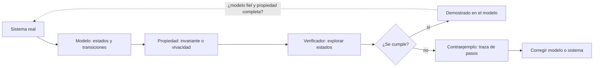
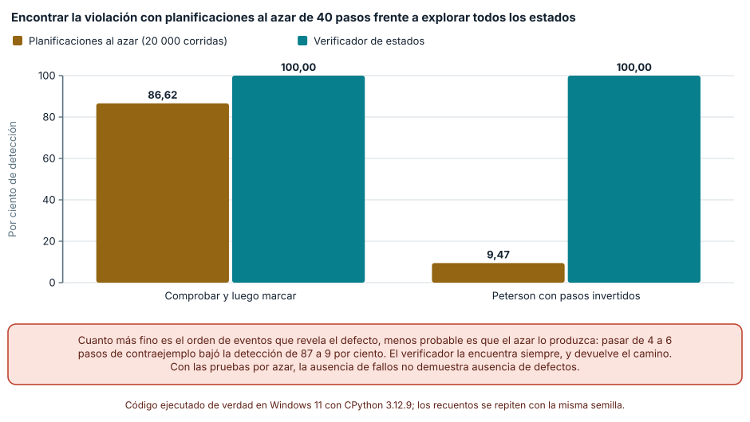
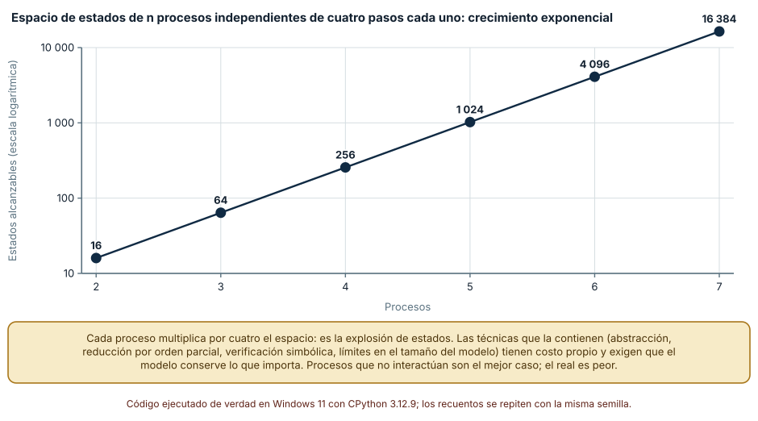

# SE-453 — Verificación formal y model checking: TLA+, SPARK y Alloy

[← SE-452 — Codificación segura: MISRA y CERT](../../classes/part-37-sistemas-criticos-tiempo-real-y-normas-de-seguridad/se-452-codificacion-segura-misra-y-cert/README.md) · [↑ Parte 37](../../classes/part-37-sistemas-criticos-tiempo-real-y-normas-de-seguridad/README.md) · [📚 Índice completo](../../classes/README.md) · [🌐 Portal](../../site/classes/SE-453.html) · [SE-454 — Verificación y cobertura: MC/DC, HIL y SIL →](../../classes/part-37-sistemas-criticos-tiempo-real-y-normas-de-seguridad/se-454-verificacion-y-cobertura-mc-dc-hil-y-sil/README.md)

## Punto profesional y fundamento pedagógico

**Punto profesional.** La clase existe para que entiendas qué demuestra, y qué no, un verificador de modelos o de programas, y cuándo vale la pena usarlo en un sistema crítico. Las pruebas ejecutan algunos caminos; la verificación formal razona sobre **todos** los caminos de un modelo o de un programa respecto de una propiedad escrita con precisión. Tres familias aparecen en el trabajo real: la verificación de modelos de estados (TLA+, con su verificador TLC), la verificación deductiva de programas (SPARK, un subconjunto verificable de Ada) y la búsqueda de contraejemplos en modelos relacionales pequeños (Alloy). Quien las conoce sabe cuándo una condena de carrera, un protocolo o un invariante merecen una hora de modelado antes de meses de pruebas que no los encontrarán.

**Por qué aparece aquí.** Sigue a `SE-452`: las reglas de codificación quitan clases de defectos, pero la corrección de un protocolo concurrente o de una máquina de estados es una propiedad del comportamiento y no de la sintaxis. Retoma de [SE-161 — Máquinas de estado y model checking introductorio](../../classes/part-13-especificaciones-contratos-y-modelos/se-161-maquinas-de-estado-y-model-checking-introductorio/README.md) la idea del espacio de estados y la lleva a sistemas de seguridad. Prepara `SE-454`, donde la verificación dinámica complementa a la formal.

**Error conceptual que debe corregir.** Creer que verificar formalmente es demostrar que el sistema real es correcto. Se demuestra que un **modelo** cumple una **propiedad**; que el modelo represente al sistema y que la propiedad sea la que importa son afirmaciones aparte. En el laboratorio, un verificador de estados explícitos propio demuestra que el protocolo de Peterson cumple la exclusión mutua en sus 34 estados alcanzables y encuentra contraejemplos de 4 y 6 pasos en dos variantes erróneas; y un modelo del *Horno de curado* sin enclavamiento de puerta tiene un contraejemplo de dos pasos. Ninguna de esas demostraciones dice que el firmware del horno sea correcto.

**Secuencia de aprendizaje.** Antes de ejecutar, predices cuántos estados tiene un protocolo de exclusión mutua de dos procesos y con qué frecuencia lo encontraría un recorrido al azar. Después construyes un verificador de estados por búsqueda en anchura, lo aplicas a cuatro protocolos, comparas con 20 000 planificaciones al azar, verificas el modelo del horno con y sin enclavamiento y mides cómo crece el espacio de estados con el número de procesos.

**Evidencia de aprendizaje.** `verificacion-del-protocolo.md` con el modelo (estados, transiciones), las propiedades (invariante y ausencia de bloqueo), el resultado por variante con su contraejemplo, la comparación con las pruebas al azar y el límite de lo que el modelo no cubre.

**Límite de la conclusión.** El verificador es propio, de estados explícitos y para modelos diminutos; **no se ejecutó TLA+, SPARK ni Alloy** en esta clase, y lo que se dice de ellos viene de su documentación pública. Los modelos son del autor; el espacio de estados de los procesos independientes es un caso artificial y optimista. No se afirma la corrección de ningún sistema real.

### Trazabilidad fuente → afirmación

| Fuente primaria u oficial | Afirmación que respalda | Lo que no prueba |
|---|---|---|
| [TLA+ (Leslie Lamport)](https://lamport.azurewebsites.net/tla/tla.html) | Describe el lenguaje de especificación TLA+ y su verificador de modelos TLC para sistemas concurrentes y distribuidos. | No ejecuta ningún modelo del curso. |
| [Lanzamientos de las herramientas de TLA+](https://github.com/tlaplus/tlaplus/releases) | Identifica las versiones publicadas de TLC y del entorno, necesarias para fijar una versión en un laboratorio real. | No se instaló en este laboratorio. |
| [Newcombe et al., «How Amazon Web Services Uses Formal Methods», CACM, 2015](https://doi.org/10.1145/2699417) | Relata el uso de TLA+ en sistemas de producción y los defectos que encontró. | Es un relato de un caso, no un estudio comparativo. |
| [Guía de usuario de SPARK 2014 (AdaCore)](https://docs.adacore.com/spark2014-docs/html/ug/) | Documenta el subconjunto verificable de Ada y la prueba de ausencia de errores en tiempo de ejecución. | No se ejecutó SPARK. |
| [Alloy (alloytools.org)](https://alloytools.org/) | Describe el lenguaje y el analizador de modelos relacionales con búsqueda acotada de contraejemplos. | No se ejecutó Alloy. |
| [Python: `collections.deque`](https://docs.python.org/3/library/collections.html#collections.deque) | Documenta la cola de la búsqueda en anchura del verificador propio. | No valida los modelos. |

## Antes de empezar

Recupera lo aprendido en `SE-452`: una regla comprobable por máquina evita una clase de defectos. La pregunta activa es: **¿qué protocolo o máquina de estados de tu sistema «funciona» porque nunca se vio una intercalación mala y no porque alguien razonó sobre todas?**

## Prerrequisitos

- Haber completado `SE-445` a `SE-452`.
- Haber visto [SE-161 — Máquinas de estado y model checking introductorio](../../classes/part-13-especificaciones-contratos-y-modelos/se-161-maquinas-de-estado-y-model-checking-introductorio/README.md) y [SE-269 — Interrupciones, concurrencia y estado compartido](../../classes/part-22-embedded-iot-y-tiempo-real/se-269-interrupciones-concurrencia-y-estado-compartido/README.md).
- Entender una búsqueda en anchura sobre un grafo.
- Python 3.11 o posterior.

## Problema auténtico

Dos tareas del controlador del *Horno de curado* comparten el estado del calentador: el lazo de control quiere conectarlo y el limitador quiere cortarlo. Un protocolo de exclusión mutua debe impedir que ambas lo modifiquen a la vez. El equipo escribe el protocolo, lo prueba mil veces y todo va bien. Meses después, una intercalación particular, que ocurre una vez cada varios millones de ciclos, deja al calentador en un estado inconsistente. Las pruebas nunca la produjeron.

La clase construye un verificador de estados explícitos, lo aplica a cuatro protocolos de exclusión mutua para dos procesos (uno correcto, dos erróneos y uno que cumple la exclusión pero se bloquea), compara con la búsqueda al azar y verifica una máquina de estados del horno con una propiedad de seguridad (el calentador no está conectado con la puerta abierta ni la temperatura supera el límite).

## Objetivos observables

Al terminar podrás:

1. modelar un sistema concurrente como estados y transiciones y escribir una propiedad como invariante;
2. explicar qué exploran un verificador de estados explícitos y qué devuelve (una demostración dentro del modelo o un contraejemplo);
3. distinguir propiedades de seguridad (nada malo ocurre) y de vivacidad (algo bueno ocurre) y comprobar la ausencia de bloqueo;
4. comparar la búsqueda al azar con la verificación y explicar por qué la primera da falsa confianza;
5. describir qué hacen TLA+, SPARK y Alloy, qué no demuestran y qué costo tienen.

## Mapa conceptual



La flecha punteada es lo que la verificación no resuelve: que el modelo sea fiel y la propiedad sea la que importa.

## Temas y por qué importan

| Tema | Por qué cambia una decisión profesional | Evidencia mínima |
|---|---|---|
| Modelo de estados | Fija qué se razona y qué se omite. | Estados y transiciones |
| Invariante de seguridad | Dice qué nunca debe pasar. | Propiedad escrita |
| Bloqueo y vivacidad | Una protección que se bloquea también falla. | Comprobación de bloqueo |
| Contraejemplo | Es la salida más útil: un escenario concreto. | Traza reproducible |
| Explosión de estados | Limita lo que se verifica. | Estados por tamaño |
| Pruebas al azar | Dan falsa confianza en eventos raros. | Tasa de detección |
| Herramientas | TLA+, SPARK y Alloy cubren niveles distintos. | Qué propiedad y qué nivel |

## Conceptos y decisiones

### 1. Un modelo de estados y una propiedad

Un modelo describe el sistema como un conjunto de estados posibles (valores de las variables y posición de cada proceso) y las transiciones que pueden ocurrir. Una propiedad de seguridad es un invariante: una condición que debe cumplirse en todos los estados alcanzables («no hay dos procesos en la sección crítica»). El verificador parte del estado inicial, explora los sucesores con una búsqueda en anchura y comprueba el invariante en cada estado nuevo; si encuentra uno que lo viola, reconstruye el camino que llega a él. El valor es doble: una demostración dentro del modelo cuando no lo encuentra y un contraejemplo reproducible cuando lo encuentra.

### 2. Cuatro protocolos de exclusión mutua

En el laboratorio, cada proceso pasa por «ocioso», «entrando», «sección crítica» y «saliendo». En el protocolo **comprobar y luego marcar**, cada proceso mira si el otro tiene su bandera levantada y, si no, levanta la suya: entre mirar y levantar, el otro puede hacer lo mismo y ambos entran. El verificador explora 14 estados y encuentra un contraejemplo de 4 pasos. En el protocolo **solo bandera** (levantar primero y esperar a que el otro la baje) la exclusión mutua se cumple, pero si ambos levantan a la vez esperan para siempre: hay un bloqueo alcanzable en 15 estados. En **Peterson con los pasos invertidos** (fijar el turno antes de levantar la bandera) el verificador explora 39 estados y devuelve un contraejemplo de 6 pasos. En **Peterson** completo, con 34 estados, la exclusión mutua se cumple y no hay bloqueo.

### 3. Seguridad y vivacidad: dos propiedades distintas

«Nunca dos procesos en la sección crítica» es de seguridad: una violación se ve en un estado. «Todo proceso que quiere entrar entra alguna vez» es de vivacidad: una violación es una ejecución infinita que no progresa. El protocolo de solo bandera cumple la primera y no la segunda. En el laboratorio se comprueba la forma más simple de pérdida de vivacidad, un **bloqueo** (un estado sin transiciones que no es un estado final). Una función de seguridad que corta la potencia pero puede quedar bloqueada esperando un recurso no sirve, de modo que ambas propiedades importan.

### 4. El contraejemplo vale más que la demostración

Cuando el verificador falla, devuelve una traza concreta: «el proceso 0 mira y ve libre; el 1 mira y ve libre; el 0 levanta y entra; el 1 levanta y entra». Es un escenario que se puede traducir a una prueba del sistema real, que convence a un equipo escéptico y que localiza el defecto. En el modelo del horno sin enclavamiento de puerta, el contraejemplo tiene dos pasos: la puerta se abre y el controlador conecta el calentador. Con el enclavamiento (abrir la puerta corta la potencia por hardware) el invariante se cumple en los 9 estados alcanzables.

### 5. La búsqueda al azar y los eventos raros

Una alternativa barata es ejecutar muchas planificaciones al azar y mirar si alguna viola el invariante. En el laboratorio, 20 000 corridas de 40 pasos al azar encuentran la violación del protocolo «comprobar y luego marcar» en el 86,62 % de los casos, que es fácil porque el contraejemplo tiene 4 pasos; pero encuentran la de «Peterson con pasos invertidos», cuyo contraejemplo tiene 6 pasos, solo en el 9,47 %. Cuanto más fina es la intercalación que revela el defecto, menos probable es que el azar la produzca; y con un contraejemplo de veinte pasos la tasa sería despreciable. La ausencia de fallos en pruebas al azar no demuestra ausencia de defectos. El verificador las encuentra siempre, para el modelo.

### 6. La explosión de estados

El costo de la verificación crece con el espacio de estados, y este crece de forma exponencial con el número de componentes. En el laboratorio, n procesos independientes de cuatro pasos tienen 4ⁿ estados: 16 con 2, 1 024 con 5 y 16 384 con 7. Un sistema real con decenas de componentes y datos no cabe sin técnicas: abstraer lo que no importa, reducir por orden parcial (no explorar intercalaciones equivalentes), usar representaciones simbólicas, acotar el tamaño del modelo y verificar con pocos elementos (la hipótesis de que la mayoría de los defectos aparecen con modelos pequeños, en la que se apoya Alloy). Cada técnica tiene un costo y un riesgo de perder el defecto.

### 7. TLA+, SPARK y Alloy: tres herramientas, tres niveles

TLA+ es un lenguaje de especificación de sistemas concurrentes y distribuidos con un verificador de modelos (TLC) que explora estados y comprueba invariantes y propiedades temporales; un artículo del CACM de 2015 cuenta cómo un equipo de Amazon Web Services lo usó en sistemas de producción y encontró defectos sutiles. SPARK es un subconjunto de Ada con anotaciones (contratos) y un probador que demuestra la ausencia de errores de ejecución (desbordamientos, divisiones por cero, accesos fuera de rango) y, con contratos, propiedades funcionales sobre el código real. Alloy modela estructuras relacionales y busca contraejemplos dentro de un alcance acotado. Ninguna garantiza la corrección del sistema: cada una demuestra una propiedad de un modelo o de un programa bajo supuestos que hay que escribir.

## Estados y contraejemplos

La primera medida cuenta los estados alcanzables de cuatro protocolos.


**Cómo leer la figura.** Cada barra es un protocolo y su longitud el número de estados alcanzables explorados; el resultado de cada uno está en la nota. Mira primero que el tamaño del espacio no dice si el protocolo es correcto: el correcto y uno erróneo tienen tamaños parecidos. **Dónde deja de valer:** son modelos de dos procesos escritos por el autor, con pasos atómicos que simplifican el hardware real (no hay reordenación de escrituras ni cachés). Un protocolo correcto en este modelo puede fallar en una máquina con un modelo de memoria débil.

## Azar frente a verificación

La segunda medida compara la búsqueda al azar con la exploración completa.



**Cómo leer la figura.** Cada grupo es un protocolo erróneo y las barras son el porcentaje de detección por planificaciones al azar y por el verificador; mira primero la caída del azar al pasar de un contraejemplo de 4 pasos a uno de 6. **Dónde deja de valer:** el azar usa corridas de 40 pasos con elección uniforme del siguiente paso; otro planificador cambiaría la tasa. Lo que se traslada es la forma: la detección al azar cae con la longitud del contraejemplo.

## La explosión de estados

La tercera medida cuenta estados para tamaños crecientes de un modelo trivial.



**Cómo leer la figura.** El eje horizontal es el número de procesos y el vertical los estados en escala logarítmica; una recta en este eje es crecimiento exponencial. Mira primero la pendiente: cada proceso multiplica por cuatro. **Dónde deja de valer:** son procesos que no interactúan, el caso más benigno; con datos compartidos y variables de mayor rango el crecimiento es peor, y las técnicas de reducción cambian la pendiente de manera dependiente del problema.

## Definiciones de trabajo

- **Modelo de estados:** descripción de un sistema como estados y transiciones posibles.
- **Invariante:** propiedad que se cumple en todos los estados alcanzables.
- **Propiedad de seguridad:** algo malo nunca ocurre.
- **Propiedad de vivacidad:** algo bueno ocurre alguna vez.
- **Contraejemplo:** traza de pasos desde el estado inicial hasta una violación.
- **Bloqueo:** estado sin transiciones que no es un estado final.
- **Explosión de estados:** crecimiento exponencial del espacio de estados con el tamaño del modelo.

## Ejemplo mínimo

Un verificador de estados explícitos con una búsqueda en anchura, en pocas líneas:

```python
from collections import deque

def verificar(inicial, sucesores, invariante):
    padre = {inicial: None}
    cola = deque([inicial])
    while cola:
        s = cola.popleft()
        if not invariante(s):
            traza = []
            while s is not None:
                traza.append(s)
                s = padre[s]
            return list(reversed(traza))        # contraejemplo
        for n in sucesores(s):
            if n not in padre:
                padre[n] = s
                cola.append(n)
    return None                                  # el invariante se cumple en el modelo

# contador que sube de 0 a 5 y el invariante «nunca llega a 4»
print(verificar(0, lambda s: [s + 1] if s < 5 else [], lambda s: s != 4))   # [0, 1, 2, 3, 4]
```

Devuelve el camino más corto a la violación. El verificador de la clase es esta estructura con estados de dos procesos.

## Ejemplo profesional

*Escenario ilustrativo: las cifras y los resultados que aparecen en este ejemplo son supuestos de la narración, no mediciones.*

Un equipo de un sistema de control ferroviario de laboratorio modela en TLA+ el protocolo de reserva de un tramo entre dos controladores. El modelo tiene tres estados por controlador y un canal que puede perder mensajes. El verificador encuentra, en la primera ejecución, un contraejemplo de once pasos: un mensaje perdido y un reintento hacen que ambos controladores crean tener el tramo. En el sistema real nunca se había observado, y una prueba de integración con pérdida de mensajes lo reproduce al seguir la traza. La corrección es añadir números de secuencia. El equipo registra qué cubre el modelo (un tramo, dos controladores, pérdidas pero no duplicados) y qué no, y decide ampliar el modelo cuando se añada un tercer controlador. El valor estuvo en el contraejemplo, no en la demostración.

## Práctica guiada

1. Elige un protocolo pequeño de tu sistema (una cerradura, un contador compartido, un handshake) y descríbelo como estados y transiciones.
2. Escribe su invariante de seguridad y una comprobación de bloqueo.
3. Ejecuta `python scripts/experiments_part37_b.py 573` y compara con tu modelo mental: ¿cuántos estados y qué contraejemplo?
4. Escribe un contraejemplo como una prueba del sistema real con las intercalaciones forzadas.
5. Anota qué deja fuera tu modelo (reordenación de memoria, fallos, tiempo) y si eso cambia la conclusión.

## Ejercicios

1. **Básico.** Explica por qué «solo bandera» cumple la exclusión mutua pero no es un protocolo aceptable.
2. **Intermedio.** Modifica el modelo del horno para que el limitador pueda tardar un paso en cortar y encuentra el invariante que ahora hay que relajar o reforzar.
3. **Avanzado.** Modela tres procesos con el protocolo de Peterson generalizado y mide cuántos estados tiene; razona qué técnica de reducción aplicarías si fueran diez.

## Reto verificable

Entrega `verificacion-del-protocolo.md` y el código de un verificador de estados explícitos con al menos tres variantes de un protocolo, una de ellas correcta. Es válido si otra persona reproduce el número de estados, los contraejemplos con su longitud y la comparación con la búsqueda al azar con la misma semilla.

## Caso conductor

El enclavamiento de puerta del *Horno de curado* queda verificado en un modelo diminuto de cinco a nueve estados, que no incluye tiempos, ruido ni reordenación de memoria. `SE-454` completa el cuadro con la verificación dinámica: cobertura de condiciones, simulación y banco de pruebas con el hardware.

## Preguntas frecuentes

### ¿Verificar formalmente reemplaza las pruebas?

No: verifica un modelo o un programa respecto de una propiedad y no cubre el entorno, el hardware, la especificación equivocada ni el compilador. Las pruebas ejecutan el sistema real; ambas son complementarias.

### ¿Cuándo vale la pena?

Cuando el defecto sería grave, difícil de reproducir (concurrencia, distribución, protocolos, máquinas de estados de seguridad) y el modelo es pequeño o abstraíble. Para lógica de negocio sencilla, el costo rara vez compensa.

### ¿Qué es mejor, TLA+ o SPARK?

Resuelven problemas distintos: TLA+ modela el diseño de un sistema concurrente antes de escribir código; SPARK verifica código real en un subconjunto de Ada. Se pueden usar juntos: el diseño en TLA+ y la implementación en SPARK.

### ¿Los verificadores se equivocan?

Pueden tener defectos como cualquier herramienta, y por eso aparece en las normas la idea de calificar las herramientas de verificación o de verificar con dos métodos independientes. Una demostración también es tan buena como las suposiciones con las que se hizo.

## Fallo controlado y diagnóstico

**Fallo.** El equipo verifica en un modelo el protocolo de cambio de modo de un controlador y el verificador no encuentra violaciones. En el banco, tras una semana, el sistema entra en un estado con el modo de operación y el modo de seguridad activos a la vez.

**Diagnóstico paso a paso.** (1) El modelo tenía las transiciones de cambio de modo como pasos atómicos; en el código, el cambio es una escritura de dos variables en dos instrucciones. (2) Una interrupción entre las dos instrucciones produce un estado intermedio que el modelo no tenía. (3) El invariante «un solo modo activo» se verificó sobre un modelo más abstracto que el código. (4) Nadie escribió qué simplificación se había hecho al modelar.

**Corrección.** Se refina el modelo para que la escritura sea de dos pasos con la interrupción posible entre ellos, se encuentra el contraejemplo y se corrige el código con una única variable de modo. Se añade al documento de verificación una lista de las abstracciones del modelo y la comprobación de que cada una se cumple en el código. La lección es que una demostración vale para el modelo, y la distancia entre modelo y código es parte del argumento.

## Errores comunes y cómo corregirlos

- **Confundir demostrar el modelo con demostrar el sistema.** Corrige declarando las abstracciones y su justificación.
- **Verificar solo seguridad.** Corrige comprobando también bloqueos y vivacidad.
- **Confiar en pruebas al azar para eventos raros.** Corrige con exploración completa de un modelo.
- **Modelos tan grandes que no terminan.** Corrige abstrayendo, acotando y reduciendo.
- **Ignorar el contraejemplo.** Corrige convirtiéndolo en una prueba reproducible.
- **Citar herramientas sin ejecutarlas.** Corrige diciendo qué se ejecutó y qué no.

## Entorno y archivos clave

- `scripts/experiments_part37_b.py`: función `e573` con el verificador por búsqueda en anchura, los cuatro protocolos, el modelo del horno y el conteo de estados; se ejecuta con `python scripts/experiments_part37_b.py 573`.
- La semilla es 47 para las 20 000 planificaciones al azar; los conteos de estados son deterministas.
- `scripts/figures_part37_b.py`: las tres figuras de la clase.
- Solo la biblioteca estándar de Python 3.11 o posterior; no se instaló TLA+, SPARK ni Alloy.

## Seguridad, ética y accesibilidad

Una demostración presentada sin sus supuestos engaña con la apariencia de la certeza matemática. La ética aquí es declarar el modelo, la propiedad y lo que se dejó fuera, y no vender «verificado formalmente» como «correcto». Los contraejemplos de sistemas con consecuencias para personas se tratan con la misma seriedad que un incidente. Las figuras tienen texto alternativo completo y no dependen solo del color.

## Puente hacia el trabajo con agentes

Un agente puede traducir un diseño a un modelo formal y proponer invariantes; también puede escribir un modelo que «pasa» por ser demasiado débil o demasiado abstracto. Revisa qué estados incluye, qué transiciones omitió y si la propiedad es la que importa, y pide el contraejemplo de una versión deliberadamente rota del sistema para comprobar que el modelo es capaz de fallar. Un agente que dice «lo verifiqué» sin mostrar la salida del verificador no ha verificado nada.

## Transferencia

Elige un protocolo o una máquina de estados de seguridad de tu sistema. Modélala con estados y transiciones, escribe el invariante y la comprobación de bloqueo y ejecútala con un verificador propio o con una herramienta abierta con versión fijada. Introduce a propósito un defecto y comprueba que el verificador lo encuentra. Escribe qué abstracciones hiciste y qué podría invalidar la conclusión.

## Evaluación y evidencia

| Criterio | Evidencia aceptable | Rechazo |
|---|---|---|
| Modelo | Estados y transiciones con sus abstracciones | «Es una máquina de estados» |
| Propiedad | Invariante y bloqueo escritos | «Funciona bien» |
| Contraejemplo | Traza reproducible y su prueba | Resultado sin traza |
| Comparación | Detección al azar frente a exploración completa | Solo pruebas |
| Honestidad | Herramientas no ejecutadas declaradas | «Verificado formalmente» sin más |

## Fuentes

- Lamport, L. [TLA+](https://lamport.azurewebsites.net/tla/tla.html) y [lanzamientos de las herramientas](https://github.com/tlaplus/tlaplus/releases).
- Newcombe, C. et al. [«How Amazon Web Services Uses Formal Methods»](https://doi.org/10.1145/2699417). Communications of the ACM, 58(4), 2015.
- AdaCore. [SPARK 2014 User's Guide](https://docs.adacore.com/spark2014-docs/html/ug/).
- Alloy Tools. [Alloy](https://alloytools.org/).
- Python Software Foundation. [`collections.deque`](https://docs.python.org/3/library/collections.html#collections.deque).

## Límites y siguiente paso

El verificador es propio y de estados explícitos, los modelos son diminutos y del autor, no se ejecutó TLA+, SPARK ni Alloy y el artículo del CACM se cita por su DOI, que responde con bloqueo a clientes automáticos. El siguiente paso, `SE-454`, mide cuánto de un programa ejercitan las pruebas con criterios de cobertura estricta y cómo se combinan la simulación y el banco con hardware.

## Glosario

| Término | Definición breve |
|---|---|
| Modelo de estados | Estados y transiciones posibles de un sistema |
| Invariante | Propiedad que se cumple en todo estado alcanzable |
| Seguridad y vivacidad | Nada malo ocurre; algo bueno ocurre |
| Contraejemplo | Traza que lleva a una violación |
| Bloqueo | Estado sin salida que no es final |
| Explosión de estados | Crecimiento exponencial del espacio de estados |
