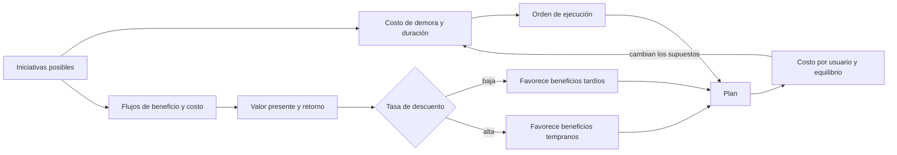

# SE-453 — Economía del software y costo total

[← SE-452 — Propiedad intelectual, contratos y ética](../../classes/part-37-gestion-liderazgo-y-practica-profesional/se-452-propiedad-intelectual-contratos-y-etica/README.md) · [↑ Parte 37](../../classes/part-37-gestion-liderazgo-y-practica-profesional/README.md) · [📚 Índice completo](../../classes/README.md) · [🌐 Portal](../../site/classes/SE-453.html) · [SE-454 — Portafolio, entrevistas y defensa profesional →](../../classes/part-37-gestion-liderazgo-y-practica-profesional/se-454-portafolio-entrevistas-y-defensa-profesional/README.md)

## Punto profesional y fundamento pedagógico

**Punto profesional.** La clase existe para que traduzcas una decisión técnica a dinero y tiempo sin engañarte con una sola cifra. El software tiene un costo a lo largo de su vida, no solo de construcción; los beneficios llegan en momentos distintos y el valor de un peso depende de cuándo llega; el orden en que se ejecutan las iniciativas cambia el costo total por esperar; y un gasto puede ser inversión (CAPEX) o gasto operativo (OPEX) según cómo se contrate y se registre. La habilidad profesional es elegir la medida adecuada a la pregunta (valor presente, recuperación, costo de demora, margen por usuario) y declarar qué supuestos mueven la respuesta.

**Por qué aparece aquí.** Sigue a **Propiedad intelectual, contratos y ética** (`SE-452`): las obligaciones de licencia, contrato y cumplimiento tienen un costo que entra en el cálculo. El caso conductor es **el equipo de plataforma educativa**, que debe ordenar doce iniciativas con una sola capacidad de ejecución, elegir entre tres proyectos con flujos de beneficio distintos, decidir entre servidores propios y nube, y saber con cuántas personas usuarias la plataforma cubre sus costos.

**Error conceptual que debe corregir.** Creer que el proyecto con más retorno total es el mejor o que el que se paga antes es el más rentable. Un proyecto puede tener el mayor beneficio acumulado y el menor valor presente si el beneficio llega tarde y la tasa de descuento es alta; y la recuperación rápida ignora lo que ocurre después. Y creer que ejecutar primero lo que más vale, o lo más corto, minimiza el costo de esperar: la regla correcta combina ambos factores.

**Secuencia de aprendizaje.** Antes de mirar los resultados, predices cuánto más cuesta esperar si se ejecutan doce iniciativas en orden de llegada frente al orden óptimo; después calculas el valor presente neto de tres proyectos con distintas tasas y ves cuándo se invierte el orden, comparas servidores propios con nube y calculas cuántas personas usuarias necesita la plataforma para no perder dinero. La secuencia usa predicción, explicación propia, contraste y recuperación. [ICAP](https://icap.education.asu.edu/research) distingue participación de construcción de conocimiento; [How People Learn II](https://nap.nationalacademies.org/catalog/24783/how-people-learn-ii-learners-contexts-and-cultures) respalda diseñar la práctica con contextos reales y retroalimentación.

**Evidencia de aprendizaje.** `economia-log.md` con la predicción, las tres figuras reproducidas, el orden de ejecución de las iniciativas del caso por costo de demora, una comparación de tres proyectos con valor presente y recuperación a varias tasas, el punto de cruce entre inversión y gasto operativo, el equilibrio por usuario y una nota que separe qué es medido, qué inferido y qué supuesto.

**Límite de la conclusión.** Los costos de demora, las duraciones, los flujos de los proyectos, las tasas de descuento, los costos de servidores y nube y la dinámica de usuarios son sintéticos, escritos por el autor con semilla fija. No se evaluó ninguna inversión real ni se aplicó ninguna norma contable a un caso. Las cifras muestran la forma de cada cálculo, no el valor para tu organización.

### Trazabilidad fuente → afirmación

| Fuente primaria u oficial | Afirmación que respalda | Lo que no prueba |
|---|---|---|
| [Smith, «Various optimizers for single-stage production»](https://doi.org/10.1002/nav.3800030106) | Demuestra que, con una sola máquina, ordenar por la razón entre peso y duración minimiza la suma ponderada de tiempos de terminación. | Supone trabajos independientes y sin interrupción; no cubre dependencias ni capacidad variable. |
| [Reinertsen, *The Principles of Product Development Flow*](https://openlibrary.org/isbn/9781935401001) | Presenta el costo de demora como base económica para priorizar el trabajo de desarrollo. | Es un libro de práctica; los costos de demora los estima cada organización. |
| [SAFe, WSJF](https://scaledagileframework.com/wsjf/) | Describe una priorización por costo de demora dividido por tamaño del trabajo. | Es una guía de un marco; no valida los puntajes que se asignen. |
| [Brealey, Myers y Allen, *Principles of Corporate Finance*](https://openlibrary.org/isbn/9781260013900) | Desarrolla el valor presente neto, la tasa interna de retorno y sus límites como criterios de inversión. | No dice qué tasa de descuento corresponde a tu organización. |
| [FinOps Framework](https://www.finops.org/framework/) | Describe prácticas para gestionar el costo de la nube, incluido el paso de gasto de capital a gasto variable. | Es un marco de práctica, no una norma contable. |
| [AWS Well-Architected, pilar de optimización de costos](https://docs.aws.amazon.com/wellarchitected/latest/cost-optimization-pillar/welcome.html) | Recoge principios para entender y reducir el costo de cargas en la nube. | Es documentación de un proveedor concreto. |
| [IFRS, NIC 38 Activos intangibles](https://www.ifrs.org/issued-standards/list-of-standards/ias-38-intangible-assets/) | Fija condiciones bajo las cuales los costos de desarrollo de software pueden registrarse como activo en vez de gasto. | Su aplicación a un caso la decide una contadora o un contador. |

## Antes de empezar

Recupera lo aprendido en `SE-452`: cada obligación de licencia o de contrato tiene un costo. La pregunta activa es: **¿cuánto cuesta cada semana que tu equipo tarda en terminar su iniciativa más valiosa, y quién lo sabe además de ti?**

## Prerrequisitos

- Haber completado `SE-452` o poder explicar qué distingue una puerta de una preferencia en una compra.
- Python 3.11 o posterior; los experimentos usan solo la biblioteca estándar (`random`, `math`, `statistics`).
- Conocer los conceptos de interés compuesto y de valor presente, aunque sea de forma intuitiva.

## Problema auténtico

El equipo tenía doce iniciativas pendientes y capacidad para una por vez. Las ordenó por llegada. Cuando un directivo preguntó cuánto había costado esperar, nadie pudo responder; al estimar el costo de demora de cada iniciativa (cuánto se pierde por semana de retraso) resultó que una iniciativa pequeña de dos semanas que evitaba una multa semanal esperaba detrás de otra de ocho semanas con beneficio modesto. En paralelo, la dirección pidió elegir entre tres proyectos: uno que se paga en dos años, uno que acumula más al quinto año y una plataforma que paga todo al final. El equipo eligió «el que más dinero deja» sin descontar el tiempo; a una tasa del 20 %, el orden se invertía. Y al decidir entre comprar servidores o contratar nube se comparó solo la cuota mensual. La clase enseña a priorizar por costo de demora, a comparar proyectos por valor presente y a decidir entre inversión y gasto operativo con un punto de cruce.

## Objetivos observables

Al terminar podrás:

1. calcular el costo de demora de una iniciativa y ordenar un conjunto por costo de demora dividido por duración;
2. calcular el valor presente neto, la tasa interna de retorno y el período de recuperación de un proyecto, y explicar por qué pueden ordenar distinto;
3. calcular el punto de cruce entre una inversión inicial y un gasto operativo, con y sin descuento;
4. calcular el punto de equilibrio por usuario y la probabilidad de alcanzarlo con crecimiento incierto;
5. declarar qué supuestos mueven cada conclusión económica.

## Mapa conceptual



El mapa separa dos preguntas distintas: **qué hacer primero** (costo de demora y duración) y **qué hacer en absoluto** (valor presente a una tasa). La flecha de retorno indica que los supuestos económicos se revisan: un cambio de tasa, de demanda o de capacidad reordena el plan.

## Temas y por qué importan

| Tema | Por qué cambia una decisión profesional | Evidencia mínima |
|---|---|---|
| Costo total del software | Construir es una fracción del costo de la vida útil. | Desglose de costos por etapa y horizonte |
| Costo de demora y orden | El orden de ejecución cambia el costo de esperar. | Costo de demora estimado y orden justificado |
| Valor presente y descuento | El dinero tardío vale menos y la tasa decide el orden. | VAN, TIR y recuperación a varias tasas |
| Inversión y gasto operativo | Cambian el flujo de caja y el riesgo. | Punto de cruce con y sin descuento |
| Economía por usuario | Define cuántas personas usuarias sostienen el servicio. | Equilibrio y sensibilidad al crecimiento |

## Conceptos y decisiones

### 1. El costo total del software

El costo de construir es una parte pequeña del costo total de tener software funcionando. Después vienen operación (infraestructura, guardia, soporte), mantenimiento correctivo y adaptativo (`SE-433`), licencias y servicios de terceros, cumplimiento, capacitación y, al final, retiro (`SE-441`). Un cálculo honesto define un horizonte (por ejemplo cinco años) y enumera cada componente con su incertidumbre. El horizonte decide qué opción gana: un componente comprado tiene cuota recurrente y uno construido, costo inicial y mantenimiento. Los costos que cuestan más son los que no se escriben: tiempo de las personas que mantienen, de quienes dan soporte, de quienes sufren la lentitud. Un error habitual es contar el costo de construir y omitir el de oportunidad: lo que no se hizo por estar ocupados.

### 2. Costo de demora y orden de ejecución

El **costo de demora** de una iniciativa es lo que se pierde por cada unidad de tiempo que tarda en entregarse (ingresos que no llegan, multas que se pagan, riesgo que se mantiene). Con una sola capacidad de ejecución, el orden importa: el costo total de esperar es la suma, para cada iniciativa, de su costo de demora por el tiempo hasta terminarla. [Smith](https://doi.org/10.1002/nav.3800030106) demostró en 1956 que se minimiza ejecutando primero las de mayor razón entre costo de demora y duración. Es la lógica de la priorización por **costo de demora dividido por tamaño** que usan marcos como [WSJF](https://scaledagileframework.com/wsjf/) y que [Reinertsen](https://openlibrary.org/isbn/9781935401001) hizo central en el desarrollo de producto. Se deduce que ni «lo más corto primero» ni «lo más valioso primero» es óptimo por separado: una iniciativa corta con poco costo de demora puede esperar a una larga que pierde mucho por semana. El resultado exige estimar los dos números, y las estimaciones son inciertas, pero estimarlas obliga a una conversación que el orden por llegada evita.

### 3. Valor presente neto, retorno y recuperación

Un peso que llega en cinco años vale menos que uno de hoy, porque podría haberse invertido (el costo de oportunidad). La **tasa de descuento** r convierte el flujo futuro F del año t en su valor presente F/(1+r)^t. El **valor presente neto** (VAN) suma los flujos descontados, incluida la inversión inicial negativa; un VAN positivo significa que el proyecto rinde más que la tasa exigida. La **tasa interna de retorno** (TIR) es la tasa que hace nulo el VAN. El **período de recuperación** cuenta cuántos años hacen falta para recuperar la inversión sin descontar. Cada medida responde una pregunta distinta, y ordenan los proyectos de modo diferente porque pesan el tiempo distinto: la recuperación ignora todo lo posterior; la TIR supone que los flujos intermedios se reinvierten a la misma tasa; el VAN depende de la tasa elegida. Los textos de finanzas corporativas ([Brealey et al.](https://openlibrary.org/isbn/9781260013900)) discuten estas diferencias. La práctica es reportar el VAN a varias tasas y mostrar a partir de cuál cambia el orden.

### 4. Inversión y gasto operativo

El **CAPEX** (gasto de capital) es la inversión que se paga al inicio y genera beneficios durante años; el **OPEX** (gasto operativo) se paga a medida que se usa. Comprar servidores es CAPEX con OPEX de mantenimiento; contratar nube es OPEX que crece con el uso. Un punto de cruce dice en qué mes la opción con inversión inicial acumula menos costo que la de cuota mayor, y descontar el flujo lo retrasa porque el pago inicial pesa más. Como el cruce suele estar a varios años, la pregunta es si la necesidad se mantendrá tanto tiempo y si el equipo puede operar lo propio. La contabilidad añade un matiz: bajo normas como la [NIC 38](https://www.ifrs.org/issued-standards/list-of-standards/ias-38-intangible-assets/), ciertos costos de desarrollo de software pueden registrarse como activo si se cumplen condiciones precisas; es una decisión contable que corresponde a quien la lleva, y la ingeniería debe aportar la información de fases y de viabilidad. En la nube, [FinOps](https://www.finops.org/framework/) y el [pilar de optimización de costos](https://docs.aws.amazon.com/wellarchitected/latest/cost-optimization-pillar/welcome.html) describen cómo gestionar el gasto variable.

### 5. Economía por usuario y equilibrio

Un servicio con costo fijo mensual F, costo variable v por persona usuaria y precio p por persona tiene un **punto de equilibrio** en F/(p − v) personas. Por debajo, cada persona adicional reduce la pérdida; por encima, genera margen. El equilibrio es útil como pregunta («¿cuántas personas hacen falta?») y peligroso como promesa, porque el crecimiento es incierto: dos servicios con el mismo equilibrio y distinta base inicial tienen probabilidades muy distintas de alcanzarlo en un año. El costo por usuario también orienta decisiones técnicas: un costo variable alto por persona (una consulta cara) cambia el precio mínimo, y un costo fijo alto empuja a buscar escala. Para un servicio público o educativo que no cobra por persona, el mismo cálculo se interpreta como costo por persona atendida y se compara con alternativas, no con un margen.

### Cuánto cuesta esperar según el orden

Se generan 3 000 carteras de 12 iniciativas, cada una con un costo de demora semanal lognormal (mediana 10, dispersión 0,8) y una duración de 1 a 8 semanas, ejecutadas una tras otra. El costo total es la suma, por iniciativa, de su costo de demora por la semana en que termina. Se compara cada orden con el óptimo.

| Orden de ejecución | Costo medio frente al óptimo | Peor caso (p95) |
|---|---:|---:|
| Orden de llegada | 1,80 | 2,61 |
| Lo más corto primero | 1,30 | 1,66 |
| Mayor costo de demora primero | 1,13 | 1,26 |
| Costo de demora entre duración | 1,00 | 1,00 |


**Cómo leer la figura.** Esperar sin criterio cuesta un 80 % más que el óptimo de media y más del doble en una de cada veinte carteras; ordenar solo por valor o solo por duración recupera buena parte, pero no todo. La última fila es 1,00 por construcción: es el orden que minimiza el costo. **Dónde deja de valer:** el resultado de Smith exige iniciativas independientes, interrumpibles solo al terminar y con costo de demora constante; en la práctica hay dependencias, el costo de demora cambia con el tiempo (un plazo legal lo dispara) y las estimaciones de duración son inciertas. Las distribuciones son supuestos del autor.

### Cuándo un proyecto deja de ser el mejor

Tres proyectos con inversión de 100 en el año 0 y flujos anuales hasta el año 5: «Automatizar el cierre» (50, 50, 30, 20, 10), «Rediseñar el módulo» (10, 20, 40, 60, 80) y «Plataforma interna» (0, 0, 0, 0, 240). Se calcula el VAN a cuatro tasas, la TIR y el año de recuperación.

| Proyecto | Suma sin descontar | VAN 5 % | VAN 10 % | VAN 20 % | VAN 30 % | TIR | Recuperación |
|---|---:|---:|---:|---:|---:|---:|---:|
| Automatizar el cierre | 60 | 43,2 | 29,2 | 7,4 | −8,6 | 24,3 % | año 2 |
| Rediseñar el módulo | 110 | 74,3 | 46,3 | 6,5 | −19,7 | 22,1 % | año 4 |
| Plataforma interna | 140 | 88,0 | 49,0 | −3,5 | −35,4 | 19,1 % | año 5 |


**Cómo leer la figura.** A tasas del 5 % y del 10 %, la plataforma interna es la mejor por VAN; a partir del 20 % pasa a ser la peor y el primero es «Automatizar el cierre». La suma sin descontar y el VAN a tasa baja favorecen lo tardío; la TIR y la recuperación favorecen lo temprano. **Dónde deja de valer:** los flujos son inventados y se conocen con certeza, cosa que nunca ocurre; los beneficios tardíos son más inciertos, lo que a menudo justifica una tasa mayor, y los proyectos se tratan como independientes aunque a veces uno habilita a otro. La figura muestra que la elección depende de la tasa, no cuál es la tasa correcta.

### Propio o nube, y cuántas personas hacen falta

Servidores propios: inversión de 36 000 y 1 200 mensuales; nube: 2 300 mensuales. Se busca el mes de cruce sin descuento y con una tasa mensual de 0,8 %. Para el servicio, el costo fijo es 20 000 al mes, el variable 0,8 y el precio 4 por persona; se calcula el margen y se simula el crecimiento mensual (media 4 %, desviación 5 %) durante doce meses desde tres bases iniciales.

| Pregunta | Resultado |
|---|---|
| Mes en que lo propio acumula menos costo (sin descontar) | 33 |
| Mes con tasa mensual de 0,8 % | 39 |
| Personas usuarias de equilibrio (20 000 / (4 − 0,8)) | 6 250 |
| Margen con 3 000 · 6 250 · 10 000 · 30 000 personas | −86,7 % · 0 % · 30,0 % · 63,3 % |
| Probabilidad de alcanzar el equilibrio en 12 meses desde 2 000 · 4 000 · 6 000 | 0,0 % · 52,5 % · 99,3 % |


**Cómo leer la figura.** Descontar retrasa seis meses el cruce, porque la inversión inicial pesa más que las cuotas futuras. El equilibrio de 6 250 personas separa a un servicio que pierde de uno que gana, pero alcanzarlo en un año es casi imposible desde 2 000 personas y casi seguro desde 6 000. **Dónde deja de valer:** los costos son supuestos del autor y constantes; el modelo no incluye costos de operación de lo propio (personas, energía, fallos), el crecimiento es independiente entre meses y el precio no cambia. Un servicio sin ingreso por persona usuaria se analiza como costo por persona atendida.

## Definiciones de trabajo

- **costo de demora:** pérdida por unidad de tiempo que se retrasa la entrega de una iniciativa.
- **valor presente neto (VAN):** suma de los flujos futuros descontados a una tasa, menos la inversión inicial.
- **tasa interna de retorno (TIR):** tasa de descuento que hace nulo el valor presente neto de un proyecto.
- **CAPEX y OPEX:** gasto de capital que se paga al inicio y gasto operativo que se paga a medida que se usa.
- **punto de equilibrio:** nivel de actividad en que los ingresos igualan a los costos.

Las definiciones son operativas para el equipo de plataforma educativa. No convierten términos con una historia más amplia en sinónimos, no son asesoría contable y deben contrastarse con las fuentes primarias enlazadas al final.

## Ejemplo mínimo

El fragmento calcula el valor presente neto de un proyecto a dos tasas. Antes de ejecutarlo, predice si el signo cambia entre ambas.

```python
flujos = [-100, 10, 20, 40, 60, 80]
vp = lambda tasa: sum(f / (1 + tasa) ** t for t, f in enumerate(flujos))
print(round(vp(0.10), 1), round(vp(0.25), 1))
```

Imprime `46.3` y `-7.9`: a una tasa del 10 % el proyecto vale 46,3; a una del 25 %, vale −7,9. El signo cambia porque los beneficios son tardíos: cuanto más se descuenta, menos pesan. La tasa interna de retorno está entre ambas. Registra versión de Python, comando y salida.

## Ejemplo profesional

Escenario hipotético, construido para la clase y sin datos reales. El equipo estima el costo de demora de sus doce iniciativas con quienes las piden: la que evita una multa semanal vale 40 por semana y dura dos semanas; otra, un rediseño de portal, vale 6 por semana y dura ocho. La razón entre costo y duración (20 y 0,75) coloca la primera al inicio, aunque la dirección había pedido el rediseño primero. Calcula el costo de la espera del orden por llegada frente al propuesto y lo presenta como rango, porque las estimaciones son inciertas. Para los tres proyectos de inversión reporta el VAN a 8, 12 y 20 % y la TIR: obtiene VAN de 63,3 para la plataforma interna, 56,7 para el rediseño y 34,5 para la automatización a 8 %; de 36,2, 36,9 y 24,2 a 12 %, y de −3,5, 6,5 y 7,4 a 20 %. Concluye que a 12 %, la tasa que usa la institución para proyectos de riesgo medio, la plataforma y el rediseño quedan empatados en la práctica, así que decide con el riesgo: los beneficios de la plataforma son los más tardíos y los menos conocidos, y elige el rediseño. En la compra de servidores calcula el cruce en el mes 39 con descuento, observa que el contrato de la sala termina en el mes 30 y decide contratar nube con un tope de gasto y revisión trimestral. Documenta qué parámetros (la tasa, el costo de demora de la multa) cambiarían la decisión. Compara con la regla «lo que más dinero deja»: la diferencia es el tiempo.

## Práctica guiada

1. Lista diez iniciativas de un equipo propio o del caso y estima su costo de demora semanal y su duración con un rango.
2. Predice cuánto más cuesta el orden de llegada que el óptimo y escribe el número antes de simular.
3. Reproduce las tres tablas con las semillas fijadas en `scripts/experiments_part37_b.py`; cambia la dispersión del costo de demora de 0,8 a 0,3 y observa cuánto se acorta la brecha entre órdenes.
4. Calcula el VAN, la TIR y la recuperación de dos proyectos tuyos a tres tasas y reporta a partir de qué tasa cambia el orden.
5. Calcula el punto de cruce entre una inversión y una cuota en tu contexto, con y sin descuento.
6. Calcula el equilibrio de un servicio propio o del caso y la probabilidad de alcanzarlo con una distribución de crecimiento que tú elijas.
7. Entrega `economia-log.md` y pide a otra persona que encuentre el supuesto económico que, si fuera falso, invertiría tu conclusión.

## Ejercicios

1. **Orden:** tres iniciativas: (costo 30, duración 3), (costo 20, duración 1), (costo 5, duración 1). Calcula el costo total de esperar de las seis permutaciones y verifica que la de menor costo ordena por la razón.
2. **VAN:** un proyecto invierte 200 y devuelve 80 al año durante tres años. Calcula el VAN a 10 % y a 20 %; explica por qué el signo cambia o no.
3. **Cruce:** una opción cuesta 12 000 al inicio y 300 al mes; otra 800 al mes. ¿En qué mes se cruzan? Si la necesidad dura 12 meses, ¿cuál conviene?
4. **Equilibrio:** con costo fijo 8 000, variable 1,2 y precio 5, calcula el equilibrio y explica qué pasaría con un costo variable de 2,5.

## Reto verificable

Entrega `economia-log.md` con la predicción, las tres tablas, el orden de las iniciativas con su costo de demora, la comparación de proyectos a varias tasas con el cruce de orden, el punto de cruce entre inversión y gasto operativo y el equilibrio por usuario. Se aprueba si otra persona ejecuta el código desde un checkout limpio, obtiene los mismos números con las mismas semillas y puede decir, a partir de tu cuaderno, qué iniciativa va primera, qué proyecto se elige a qué tasa y qué supuesto cambiaría la respuesta. No se aprueba por afirmar «el proyecto es rentable» sin decir la tasa, el horizonte ni los flujos.

## Caso conductor

El equipo de plataforma educativa es el caso conductor de la Parte 37. Esta clase deja el noveno artefacto: un orden de ejecución por costo de demora, una comparación de proyectos por valor presente y un punto de cruce. `SE-454` preguntará cómo se presenta ese trabajo como carrera profesional, y `SE-456` reunirá estos números en un dossier. Cambia después un solo dato, la tasa de descuento de 10 % a 20 %, y observa qué proyecto pasa a ser primero.

## Preguntas frecuentes

### ¿Cómo estimo el costo de demora si no vendemos nada?

Hazlo en lo que se pierde: multas evitadas, horas de trabajo manual por semana, riesgo que se mantiene, personas sin servicio. Cuando no se puede poner dinero, usa una escala relativa acordada con quien pide el trabajo; el procedimiento sigue funcionando porque ordena por la razón entre costo relativo y duración.

### ¿Qué tasa de descuento uso?

La que la organización usa para proyectos de riesgo similar; si no existe, pregunta a finanzas. Si no puedes obtenerla, reporta el VAN a un rango de tasas y la tasa a partir de la cual cambia la decisión: es más útil que un valor único. Una tasa más alta para beneficios inciertos es una forma de reflejar el riesgo.

### ¿El VAN no ignora los beneficios no monetarios?

Sí, por eso no es el único criterio. Los efectos sobre la seguridad, la equidad o la calidad se registran aparte y se pesan en la decisión. Convertirlos a dinero con supuestos frágiles suele aportar menos que declararlos y discutirlos.

### ¿Cómo trato el mantenimiento en el cálculo de un proyecto?

Como un flujo negativo recurrente durante el horizonte, estimado con un rango y revisado. Omitirlo es la fuente más frecuente de proyectos que parecen rentables y no lo son, porque el beneficio aparece en la presentación y el mantenimiento cae en otro presupuesto.

## Fallo controlado y diagnóstico

Reproduce el fallo clásico de la clase: **elegir el proyecto que más dinero deja sin descontar el tiempo**. Calcula la suma sin descontar y el VAN a 20 % de los tres proyectos y compara los órdenes.

Registra síntoma, entrada mínima, hipótesis, observación que descarta cada hipótesis, causa, corrección y prueba de regresión. **Síntoma:** el proyecto elegido rinde menos de lo exigido por la organización. **Hipótesis rivales:** (a) los beneficios se estimaron mal; (b) los costos subieron; (c) los beneficios llegaban tarde y no se descontaron. **Prueba:** recalcula el VAN a la tasa de la organización; si el proyecto elegido pasa a ser el peor, la causa es el descuento. **Conclusión:** la plataforma interna suma 140, el mayor total, pero a 20 % su VAN es −3,5, el menor. **Regresión:** exige que toda comparación de proyectos reporte VAN a tres tasas y el año de recuperación junto con la suma. No cambies a la vez la tasa y los flujos.

## Errores comunes y cómo corregirlos

| Síntoma | Causa probable | Corrección |
|---|---|---|
| Se ejecutan primero las iniciativas más antiguas | Orden por llegada | Ordenar por costo de demora entre duración |
| Se elige el proyecto de mayor suma | No se descontó el tiempo | Reportar VAN a varias tasas |
| La opción propia resulta más cara de lo previsto | No se incluyó la operación | Sumar personal, energía y fallos al flujo |
| Se promete alcanzar el equilibrio en un año | Se usó un crecimiento medio sin dispersión | Simular el crecimiento y reportar probabilidad |
| El cálculo no convence a finanzas | Supuestos sin declarar | Listar tasa, horizonte y flujos con rangos |

## Entorno y archivos clave

```text
work/SE-453/
├── README.md
├── economia/
│   ├── costo_de_demora.py
│   ├── valor_presente.py
│   └── equilibrio.py
├── ORDEN-DE-INICIATIVAS.md
├── COMPARACION-DE-PROYECTOS.md
├── tests/test_economia.py
└── evidence/economia-log.md
```

El `README` declara plataforma, versión de Python, semillas y comandos. Los experimentos usan solo la biblioteca estándar (`random`, `math`, `statistics`) y se ejecutaron con CPython 3.12.9 en Windows 11 y 3.12.3 en Ubuntu bajo WSL2: las salidas fueron idénticas. Si añades una dependencia, fija procedencia y versión.

## Seguridad, ética y accesibilidad

- un cálculo económico puede ocultar a quién afecta: cuando un recorte de costos recae sobre personas (soporte, accesibilidad), nómbralo y no lo dejes en una fila de la tabla;
- los supuestos favorables a una conclusión deseada son una forma de sesgo: pide que otra persona proponga un supuesto contrario y vea si cambia el resultado;
- los datos de uso y de ingresos por persona usuaria son personales: agrégalos antes de compartirlos;
- las tablas y figuras deben tener texto alternativo y no depender del color;
- las fuentes citadas son textos de sus autores: cita las ideas y vincula la fuente, no copies sus textos ni diagramas.

## Puente hacia el trabajo con agentes

Un agente al que se le pide «calcula el retorno de esta inversión» producirá un número limpio con supuestos implícitos (una tasa, un horizonte, flujos que él mismo ha inventado). Pídele en cambio que muestre los supuestos como entradas explícitas, que calcule el VAN a un rango de tasas que tú le des y que marque cuáles de los flujos no tienen fuente. Revisa especialmente cualquier tasa que no haya sido tuya y cualquier costo que aparezca sin origen. El agente puede hacer la aritmética con exactitud; la elección de los supuestos, que es donde está la decisión, no es suya.

## Transferencia

Traslada el análisis a otro dominio (por ejemplo, una cooperativa agrícola que decide entre comprar maquinaria o arrendarla, y qué proyectos hacer primero): cambia las iniciativas, los flujos y los costos y conserva el procedimiento de estimar el costo de demora, ordenar por su razón con la duración, descontar con varias tasas y calcular puntos de cruce y de equilibrio. La transferencia está lograda cuando puedes decir qué supuesto de tu dominio es el más incierto y cómo cambiaría la decisión, no cuando la tabla se parece a la del equipo de plataforma.

## Evaluación y evidencia

| Criterio | Evidencia para aprobar |
|---|---|
| comprensión | explicación del costo de demora, del valor presente y de por qué las medidas ordenan distinto |
| corrección | tablas de orden, de valor presente y de cruce reproducibles con las mismas semillas |
| diseño | orden de ejecución, comparación a varias tasas y análisis de cruce y equilibrio con supuestos |
| diagnóstico | reproducción del fallo «mayor suma sin descontar» con regresión |
| incertidumbre | declaración de que los costos, las tasas y los flujos son del autor |
| reproducibilidad | versiones, comandos, salida y límites declarados |

## Fuentes

- [Smith, «Various optimizers for single-stage production»](https://doi.org/10.1002/nav.3800030106) — orden óptimo por razón entre peso y duración; autoridad: Naval Research Logistics Quarterly.
- [Reinertsen, *The Principles of Product Development Flow*](https://openlibrary.org/isbn/9781935401001) — costo de demora como base económica; autoridad: libro de referencia.
- [SAFe, WSJF](https://scaledagileframework.com/wsjf/) — priorización por costo de demora entre tamaño; autoridad: Scaled Agile.
- [Brealey, Myers y Allen, *Principles of Corporate Finance*](https://openlibrary.org/isbn/9781260013900) — valor presente neto y retorno; autoridad: libro de texto de referencia.
- [FinOps Framework](https://www.finops.org/framework/) — gestión del costo de la nube; autoridad: FinOps Foundation.
- [AWS Well-Architected, pilar de optimización de costos](https://docs.aws.amazon.com/wellarchitected/latest/cost-optimization-pillar/welcome.html) — principios de costo en la nube; autoridad: documentación de AWS.
- [IFRS, NIC 38 Activos intangibles](https://www.ifrs.org/issued-standards/list-of-standards/ias-38-intangible-assets/) — registro de costos de desarrollo; autoridad: IFRS Foundation.

Cada fuente respalda el mecanismo indicado; ninguna demuestra que el 80 % de sobrecosto del orden por llegada, el cruce en el mes 39 o la inversión de orden entre 10 % y 20 % se observen en tu organización. Esa afirmación depende de tus costos de demora, tus tasas y tus flujos reales.

## Límites y siguiente paso

Se ejecutaron tres experimentos con datos sintéticos en Windows y Ubuntu (WSL2) con resultados idénticos. No se evaluó ninguna inversión ni se aplicó ninguna norma contable a un caso real; los costos de demora, las duraciones, los flujos, las tasas, los costos de infraestructura y el crecimiento son construcciones del autor, y el modelo supone iniciativas independientes y flujos conocidos con certeza. La siguiente clase pregunta cómo se presenta este trabajo como trayectoria profesional: portafolio, niveles, entrevistas y defensa.

## Glosario

- **costo de demora:** pérdida por unidad de tiempo que se retrasa la entrega de una iniciativa.
- **valor presente neto (VAN):** suma de los flujos futuros descontados a una tasa, menos la inversión inicial.
- **tasa interna de retorno (TIR):** tasa de descuento que hace nulo el valor presente neto de un proyecto.
- **CAPEX y OPEX:** gasto de capital que se paga al inicio y gasto operativo que se paga a medida que se usa.
- **punto de equilibrio:** nivel de actividad en que los ingresos igualan a los costos.

---

[← SE-452 — Propiedad intelectual, contratos y ética](../../classes/part-37-gestion-liderazgo-y-practica-profesional/se-452-propiedad-intelectual-contratos-y-etica/README.md) · [↑ Parte 37](../../classes/part-37-gestion-liderazgo-y-practica-profesional/README.md) · [📚 Índice completo](../../classes/README.md) · [🌐 Portal](../../site/classes/SE-453.html) · [SE-454 — Portafolio, entrevistas y defensa profesional →](../../classes/part-37-gestion-liderazgo-y-practica-profesional/se-454-portafolio-entrevistas-y-defensa-profesional/README.md)
