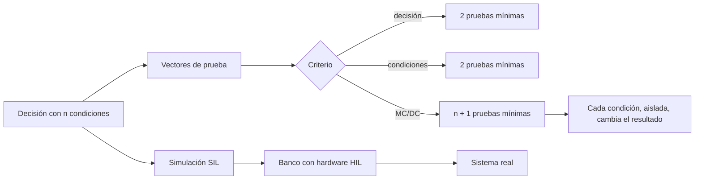
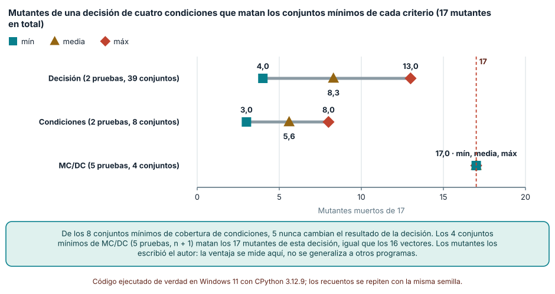
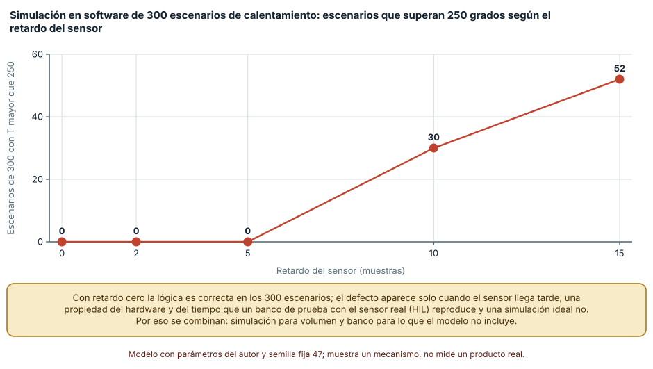
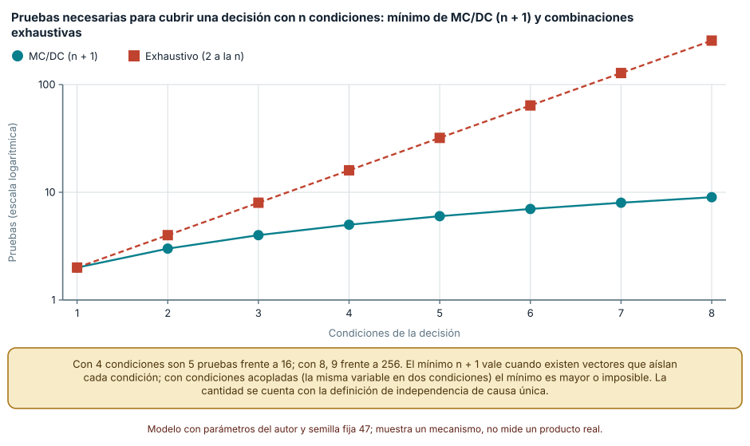

# SE-454 — Verificación y cobertura: MC/DC, HIL y SIL

[← SE-453 — Verificación formal y model checking: TLA+, SPARK y Alloy](../../classes/part-37-sistemas-criticos-tiempo-real-y-normas-de-seguridad/se-453-verificacion-formal-y-model-checking-tla-spark-y-alloy/README.md) · [↑ Parte 37](../../classes/part-37-sistemas-criticos-tiempo-real-y-normas-de-seguridad/README.md) · [📚 Índice completo](../../classes/README.md) · [🌐 Portal](../../site/classes/SE-454.html) · [SE-455 — Taller: analizar un fallo real frente a las normas →](../../classes/part-37-sistemas-criticos-tiempo-real-y-normas-de-seguridad/se-455-taller-analizar-un-fallo-real-frente-a-las-normas/README.md)

## Punto profesional y fundamento pedagógico

**Punto profesional.** La clase existe para que sepas qué mide cada criterio de cobertura, por qué la **cobertura de condición/decisión modificada** (MC/DC) es la que se exige en el nivel más alto de la aviación, y cómo se combinan la simulación en software (SIL), el banco de pruebas con hardware (HIL) y las pruebas en el sistema real para verificar un controlador crítico. Las tres preguntas que se cruzan son distintas: ¿las pruebas ejercitaron la lógica de decisión con suficiente profundidad?, ¿el comportamiento es el correcto con una planta simulada?, ¿lo sigue siendo con el hardware, el tiempo y el ruido reales? Quien confunde las tres entrega un informe de cobertura que no dice nada sobre el segundo o el tercero.

**Por qué aparece aquí.** Sigue a `SE-453`: la verificación formal razona sobre un modelo; la dinámica ejecuta el sistema. Cierra el bloque técnico antes del taller de `SE-455` y el proyecto de `SE-456`, y retoma de [SE-426 — Mutación, fuzzing y generación de casos](../../classes/part-35-estrategia-y-tecnicas-de-prueba/se-426-mutacion-fuzzing-y-generacion-de-casos/README.md) la idea de medir la capacidad de detectar defectos con mutantes, no con un porcentaje.

**Error conceptual que debe corregir.** Creer que cualquier conjunto de pruebas con la cobertura exigida es igual de bueno. Un criterio de cobertura es una condición sobre las pruebas, y hay muchos conjuntos que la cumplen con capacidad muy distinta para encontrar defectos. En el laboratorio, sobre una decisión de cuatro condiciones y 17 mutantes escritos a mano: los conjuntos mínimos de cobertura de decisión (2 pruebas) matan entre 4 y 13 mutantes (media 8,3); los de cobertura de condiciones (2 pruebas) entre 3 y 8, y 5 de sus 8 conjuntos ni siquiera cambian el resultado de la decisión; los cuatro conjuntos mínimos de MC/DC (5 pruebas) matan los 17 en todos los casos.

**Secuencia de aprendizaje.** Antes de ejecutar, predices cuántas pruebas mínimas necesita MC/DC para una decisión de cuatro condiciones y cuántos mutantes distingue cada criterio. Después enumeras los 16 vectores, calculas los pares de independencia de cada condición, buscas los conjuntos mínimos, los comparas con la cobertura de decisión y de condiciones por mutación y simulas 300 escenarios de calentamiento con retardos del sensor para ver qué solo aparece con un sensor lento.

**Evidencia de aprendizaje.** `cobertura-y-simulacion.md` con la decisión analizada, los pares de independencia, el conjunto mínimo elegido, la comparación por mutantes de tres criterios y la tabla de qué se verifica en simulación, en banco con hardware y en el sistema real.

**Límite de la conclusión.** Los 17 mutantes de una sola decisión los escribió el autor y no son una muestra de defectos reales; la ventaja de MC/DC se mide aquí, no se generaliza. La planta del SIL es un modelo de primer orden con parámetros del autor y el retardo del sensor es una muestra entera. No se usó ningún banco con hardware (HIL) real: se explica por qué ve lo que el SIL no ve. La cobertura se calcula con código propio, no con una herramienta calificada, y el texto de las normas de pago no se reproduce.

### Trazabilidad fuente → afirmación

| Fuente primaria u oficial | Afirmación que respalda | Lo que no prueba |
|---|---|---|
| [Hayhurst et al., «A Practical Tutorial on Modified Condition/Decision Coverage» (NASA/TM-2001-210876)](https://shemesh.larc.nasa.gov/fm/papers/Hayhurst-2001-tm210876-MCDC.pdf) | Define MC/DC (cada condición afecta de forma independiente al resultado de la decisión), con ejemplos y el mínimo de n + 1 pruebas. | No trata de las variantes de enmascaramiento con detalle ni de DO-178C. |
| [FAA, Advisory Circular 20-115D](https://www.faa.gov/documentLibrary/media/Advisory_Circular/AC_20-115D.pdf) | Reconoce DO-178C como medio aceptable para el software aerotransportado, donde MC/DC aparece en el nivel más alto. | No reproduce los criterios por nivel. |
| [FAA, página de software y hardware electrónico aerotransportado](https://www.faa.gov/aircraft/air_cert/design_approvals/air_software) | Reúne los documentos públicos de la autoridad sobre verificación de software. | No es una guía de MC/DC. |
| [Python: `itertools`](https://docs.python.org/3/library/itertools.html) | Documenta las combinaciones que enumeran vectores y conjuntos de prueba. | No valida los mutantes. |
| [Python: `random`](https://docs.python.org/3/library/random.html) | Documenta el generador con semilla del SIL. | No valida la planta. |

## Antes de empezar

Recupera lo aprendido en `SE-448`: la cobertura estructural es una pregunta sobre las pruebas, no una prueba del código. La pregunta activa es: **¿qué decisión de tu código tiene varias condiciones y qué pruebas demuestran que cada condición, por sí sola, puede cambiar el resultado?**

## Prerrequisitos

- Haber completado `SE-445` a `SE-453`.
- Haber visto [SE-426 — Mutación, fuzzing y generación de casos](../../classes/part-35-estrategia-y-tecnicas-de-prueba/se-426-mutacion-fuzzing-y-generacion-de-casos/README.md) y [SE-431 — Taller: demostrar que una prueba detecta defectos](../../classes/part-35-estrategia-y-tecnicas-de-prueba/se-431-taller-demostrar-que-una-prueba-detecta-defectos/README.md).
- Saber qué es una condición booleana y una decisión compuesta.
- Python 3.11 o posterior.

## Problema auténtico

La decisión que habilita el calentador del *Horno de curado* es compuesta: (temperatura alta o puerta abierta) y habilitado y no en modo manual (cuatro condiciones: alta, puerta, habil y manual). El código tiene un `if` con esas cuatro condiciones. La prueba de requisitos tiene dos casos, uno que da verdadero y uno que da falso, y la cobertura de decisión es del 100 %. Un revisor pregunta: ¿qué pasa si la condición «puerta» estuviera mal escrita?, ¿alguna prueba lo notaría?

La clase mide qué conjuntos de pruebas, por criterio, distinguen 17 variaciones plausibles de la decisión; calcula el mínimo de pruebas de MC/DC y su costo frente al recorrido exhaustivo; y simula 300 escenarios de calentamiento con retardos del sensor para ver qué falla solo cuando el sensor llega tarde.

## Objetivos observables

Al terminar podrás:

1. explicar cobertura de sentencias, de decisión, de condiciones y de condición/decisión modificada y la pregunta que responde cada una;
2. calcular los pares de independencia de una decisión y construir un conjunto mínimo de n + 1 pruebas;
3. comparar la capacidad de detección de conjuntos que cumplen un mismo criterio con un análisis de mutantes;
4. explicar qué verifica la simulación en software, el banco con hardware y el sistema real, y qué solo se ve en cada nivel;
5. reconocer los límites de una cobertura: condiciones acopladas, enmascaramiento y lo que no mira.

## Mapa conceptual



La rama de arriba mide la profundidad de las pruebas sobre la lógica; la de abajo, el nivel de realismo del entorno donde se ejecutan. Son ejes independientes y los dos importan.

## Temas y por qué importan

| Tema | Por qué cambia una decisión profesional | Evidencia mínima |
|---|---|---|
| Cobertura de decisión | Ejerce los dos resultados de cada decisión. | Dos pruebas por decisión |
| Cobertura de condiciones | Ejerce cada condición con ambos valores. | Valores por condición |
| MC/DC | Muestra la influencia independiente de cada condición. | Pares de independencia |
| Mutantes | Miden capacidad de detectar defectos. | Tasa de mutantes muertos |
| SIL | Da volumen y repetibilidad. | Escenarios con semilla |
| HIL | Aporta tiempo, hardware y ruido reales. | Qué falla solo allí |
| Límites de cobertura | Hay defectos que ningún criterio ve. | Lo que no cubre |

## Conceptos y decisiones

### 1. Una escala de criterios, de más débil a más fuerte

La cobertura de **sentencias** exige que cada sentencia se ejecute; la de **decisión**, que cada decisión (cada `if`) tome ambos resultados; la de **condiciones**, que cada condición simple tome ambos valores; la de **condición/decisión**, las dos juntas; y la de **condición/decisión modificada** (MC/DC) añade que cada condición muestre su influencia independiente en el resultado: existen dos pruebas que difieren solo en esa condición y producen resultados distintos. Los criterios más estrictos se exigen en los niveles de rigor más altos del software aeronáutico, según circulares de la autoridad y tutoriales de la NASA. El tutorial de la NASA lo expresa con el principio del «peso suficiente» de cada condición: sin esa prueba, no se demuestra que la condición importe.

### 2. Los pares de independencia

Para la decisión (alta o puerta) y habil y no manual hay 16 vectores. Una condición muestra su independencia con un par de vectores que difieren solo en ella y dan resultados distintos de la decisión. En el laboratorio, el número de pares por condición es 1 para `alta`, 1 para `puerta`, 3 para `habil` y 3 para `manual`: `alta` solo importa cuando `puerta` es falsa, `habil` es verdadera y `manual` es falsa, un único contexto. Un conjunto de pruebas satisface MC/DC si contiene, para cada condición, uno de sus pares. El mínimo posible es n + 1 vectores (5 para n = 4) porque los pares comparten vectores. El laboratorio encuentra por búsqueda exhaustiva cuatro conjuntos mínimos de 5 vectores.

### 3. Dos pruebas no «cubren» lo que parece

La cobertura de decisión se satisface con 2 pruebas (una que dé verdadero y otra falso) y la de condiciones con 2 pruebas (todas las condiciones verdaderas y todas falsas), pero sus conjuntos mínimos no son iguales en capacidad. En el laboratorio, para la cobertura de condiciones hay 8 conjuntos de 2 pruebas y 5 de ellos nunca cambian el resultado de la decisión (todos dan falso, por ejemplo), de modo que no cumplen ni la cobertura de decisión. Un criterio cumplido por un conjunto degenerado es un criterio cumplido sin valor. Por eso la cobertura se exige junto con pruebas derivadas de requisitos: un conjunto que sale de requisitos tiene un propósito detrás de cada caso.

### 4. Capacidad de detección: los mutantes

Un **mutante** es una copia del código con un cambio pequeño y plausible (una condición fija en verdadero, un `y` cambiado por `o`, una negación omitida). Un conjunto de pruebas «mata» un mutante si alguna prueba da un resultado distinto del original. Con 17 mutantes de la decisión, los 16 vectores matan los 17 (no hay mutantes equivalentes en este conjunto). Los 39 conjuntos mínimos de cobertura de decisión matan entre 4 y 13 (media 8,3), los de condiciones entre 3 y 8 (media 5,6) y los 4 de MC/DC, siempre 17. MC/DC garantiza la detección de las variantes de una sola condición mal escrita, que es el tipo de defecto que suele introducirse; no garantiza la detección de todos los defectos posibles.

### 5. El costo: n + 1 frente a 2ⁿ

El recorrido exhaustivo de n condiciones necesita 2ⁿ vectores; MC/DC, como mínimo, n + 1. Con 4 condiciones son 5 contra 16; con 8, 9 contra 256; con 16, 17 contra 65 536. Esa diferencia es la razón práctica del criterio: da una garantía fuerte sobre la lógica de decisión con un costo lineal. El mínimo n + 1 requiere que existan vectores que aíslen cada condición; con condiciones acopladas (la misma variable en dos condiciones o dependencias como «puerta abierta» implica «no habilitado») algunos pares no existen y el criterio se vuelve imposible o necesita una variante con enmascaramiento. Por eso la herramienta que calcula la cobertura debe tratar los acoplamientos de forma explícita.

### 6. SIL, HIL y sistema real

En la **simulación en software (SIL)** el código del controlador se ejecuta contra un modelo de la planta en un computador: es repetible, barata y permite miles de escenarios, pero el modelo no tiene el retardo, el ruido ni los fallos reales del hardware. En el **banco con hardware (HIL)**, el controlador real (o su procesador) corre conectado a una simulación en tiempo real de la planta por sus entradas y salidas reales: añade tiempo real, convertidores, interrupciones y electricidad. En el **sistema real**, se añade el entorno físico. En el laboratorio, 300 escenarios de calentamiento con el limitador en 245 °C no violan el límite de 250 °C con retardos del sensor de 0, 2 y 5 muestras; con 10 muestras, 30 escenarios lo violan; con 15, 52. El defecto solo aparece con un sensor lento: una propiedad del hardware y del tiempo que un SIL ideal no tiene y un HIL con el sensor real o un modelo de su retardo sí.

### 7. Qué no ve ninguna cobertura

La cobertura no mira los datos (un valor extremo), el tiempo, la concurrencia ni lo que falta: una conducta que nadie escribió no tiene sentencias que cubrir. Un criterio satisfecho tampoco prueba que las pruebas verifiquen el resultado (una prueba que ejecuta sin afirmar nada suma cobertura). Y el criterio exige el modelo de fallos de las pruebas: los 17 mutantes son del autor. Por eso la cobertura es una puerta de suficiencia de pruebas basadas en requisitos (`SE-448`) y se combina con simulación, banco, análisis y verificación formal.

## Mutantes por criterio

La primera medida compara qué fracción de mutantes matan los conjuntos mínimos de cada criterio.



**Cómo leer la figura.** Cada fila es un criterio y el segmento va del peor al mejor conjunto mínimo; el marcador intermedio es la media. Mira primero la fila de MC/DC, que es un punto: todos sus conjuntos mínimos matan los 17. **Dónde deja de valer:** son 17 mutantes de una decisión de cuatro condiciones escritos por el autor; con otra decisión o con defectos más complejos la diferencia se reduce o cambia. La figura enseña a medir, no un porcentaje general.

## Retardo del sensor

La segunda medida corre 300 escenarios de calentamiento con distintos retardos.



**Cómo leer la figura.** El eje horizontal es el retardo del sensor en muestras y el vertical los escenarios (de 300) en los que la temperatura supera 250 °C. Mira primero que hay un umbral: hasta 5 muestras no pasa nada. **Dónde deja de valer:** la planta y los parámetros son del autor, y el modelo supone un retardo constante y entero. Lo que se traslada es que existen propiedades que solo aparecen con el tiempo real del hardware y que la simulación ideal las oculta.

## El costo de cubrir

La tercera medida compara el número de pruebas de MC/DC con el recorrido exhaustivo.



**Cómo leer la figura.** El eje horizontal es el número de condiciones y el vertical las pruebas necesarias en escala logarítmica; la línea de MC/DC crece casi plana y la exhaustiva es una recta de pendiente fija. Mira primero la distancia con 8 condiciones. **Dónde deja de valer:** el mínimo n + 1 vale si existen vectores que aíslen cada condición; con condiciones acopladas el mínimo es mayor o el criterio, imposible. Es un cálculo, no una medición.

## Definiciones de trabajo

- **Cobertura de decisión:** cada decisión toma ambos resultados en alguna prueba.
- **Cobertura de condiciones:** cada condición simple toma ambos valores en alguna prueba.
- **MC/DC:** además, cada condición muestra su influencia independiente en el resultado.
- **Par de independencia:** dos vectores que difieren solo en una condición y dan resultados distintos.
- **Mutante:** copia del código con un cambio pequeño y plausible.
- **SIL:** simulación del controlador contra un modelo de planta en software.
- **HIL:** banco con el controlador real conectado a una simulación de la planta en tiempo real.

## Ejemplo mínimo

Los pares de independencia de una decisión de dos condiciones:

```python
import itertools

def d(a, b):
    return a and b

vectores = list(itertools.product([0, 1], repeat=2))
for i, nombre in enumerate(["a", "b"]):
    pares = [(u, v) for u, v in itertools.combinations(vectores, 2)
             if [k for k in range(2) if u[k] != v[k]] == [i] and d(*u) != d(*v)]
    print(nombre, pares)
# a [((0, 1), (1, 1))]   b [((1, 0), (1, 1))]  ->  3 vectores bastan: (0,1), (1,0), (1,1)
```

Tres pruebas (n + 1) muestran la independencia de las dos condiciones; las cuatro combinaciones no son necesarias. El laboratorio hace lo mismo con cuatro condiciones.

## Ejemplo profesional

*Escenario ilustrativo: las cifras y los resultados que aparecen en este ejemplo son supuestos de la narración, no mediciones.*

Un equipo entrega un informe con MC/DC al 100 % para la lógica de un limitador. El revisor repasa los pares de independencia y descubre que en la condición «puerta abierta», el par presentado usa un vector en el que la temperatura ya está sobre el límite: el resultado es «cortar» con o sin la puerta. El par solo parecía independiente porque la herramienta contó mal una condición acoplada. Se rehace el análisis con el tratamiento de acoplamiento y aparece un par válido que ninguna prueba cubría. El equipo agrega la prueba y descubre un defecto real: con la puerta abierta y la temperatura baja, el código no cortaba. No lo había notado ninguna otra prueba porque ninguna ponía la puerta abierta con temperatura baja. El informe del 100 % era correcto para lo que la herramienta contó.

## Práctica guiada

1. Elige una decisión de tu código con tres o cuatro condiciones y escribe sus 8 o 16 vectores con el resultado.
2. Busca a mano los pares de independencia de cada condición y un conjunto de n + 1 vectores.
3. Ejecuta `python scripts/experiments_part37_b.py 574` y compara tu conjunto con los cuatro mínimos.
4. Escribe cinco mutantes de tu decisión y comprueba cuántos matan tus pruebas actuales.
5. Decide qué escenarios de tu sistema solo se verían con el hardware real y cuáles pueden simularse.

## Ejercicios

1. **Básico.** Explica por qué la condición `alta` tiene un solo par de independencia en la decisión del laboratorio.
2. **Intermedio.** Cambia la decisión a `(a o b) y (a o c)` (condiciones acopladas) y busca qué pares de `a` existen.
3. **Avanzado.** Diseña una campaña de verificación para el limitador que combine MC/DC de la lógica, SIL con barrido del retardo del sensor, HIL con el sensor real y una prueba en el sistema; di qué defecto se encuentra en cada nivel.

## Reto verificable

Entrega `cobertura-y-simulacion.md` y el código que, para una decisión de al menos cuatro condiciones, calcula los pares de independencia, encuentra los conjuntos mínimos de MC/DC y compara su tasa de mutantes muertos con la de decisión y la de condiciones. Es válido si otra persona reproduce los números y la comparación con el retardo del sensor con la semilla indicada.

## Caso conductor

La lógica de habilitación del *Horno de curado* tiene su conjunto de cinco pruebas con MC/DC y su barrido del retardo del sensor, con un umbral claro: hasta 5 muestras no hay problema. `SE-455` aplica todo lo aprendido a un caso real de fallo con las miradas de las normas.

## Preguntas frecuentes

### ¿MC/DC garantiza que no hay defectos en la decisión?

No: garantiza que cada condición, por separado, influye en el resultado en alguna prueba, y detecta las variantes de una condición mal escrita. No cubre otros defectos de la decisión, de los datos, del tiempo ni de lo que falta.

### ¿Por qué en un lenguaje con cortocircuito cambia el análisis?

Porque una condición puede no evaluarse si otra ya decide el resultado, y entonces algunas combinaciones de valores no se ejercitan como se cree. Existen variantes del criterio (con enmascaramiento) que lo tratan; la herramienta y el criterio elegido deben coincidir con el lenguaje.

### ¿Qué ventaja tiene el HIL sobre el SIL?

Ejercita el hardware real: convertidores, tiempos, interrupciones, el ruido eléctrico. El SIL es más barato y repetible. La práctica habitual es descubrir con SIL, confirmar con HIL y validar con el sistema.

### ¿Hay que aplicar MC/DC a todo el código?

No: se aplica donde el nivel de rigor lo pide o donde una decisión es crítica. En el resto, criterios más baratos con buenas pruebas de requisitos. El costo de MC/DC se justifica por la gravedad de lo que decide el código.

## Fallo controlado y diagnóstico

**Fallo.** En el banco con hardware, el limitador de un prototipo deja pasar la temperatura a 262 °C antes de cortar. En la simulación en software, con las mismas entradas, nunca supera 247 °C.

**Diagnóstico paso a paso.** (1) La simulación usaba un sensor ideal sin retardo. (2) El sensor real, un termopar con su electrónica, tiene un retardo de lectura equivalente a unas 8 o 9 muestras. (3) Con un limitador en 245 °C y una rampa de 2 °C por muestra, el corte llega con unos 17 °C de retraso: un modelo con retardo lo reproduce. (4) La lógica era correcta y pasaba MC/DC; el defecto estaba en el supuesto de que el sensor era instantáneo.

**Corrección.** Se baja el umbral del limitador para compensar el retardo, se añade el retardo del sensor como parámetro de la simulación y un barrido que falla si algún retardo plausible deja pasar el límite, y se incorpora el sensor real al banco. La lección es que las coberturas hablan de la lógica y el tiempo es otra dimensión, que se verifica con otros medios.

## Errores comunes y cómo corregirlos

- **Dar por buena una cobertura sin mirar qué pruebas la alcanzan.** Corrige midiendo la capacidad de detección con mutantes.
- **Calcular MC/DC con condiciones acopladas sin tratarlas.** Corrige con la variante adecuada y una revisión de cada par.
- **Simular con un sensor ideal.** Corrige modelando retardo, ruido y saturación.
- **Usar HIL como único medio.** Corrige con SIL para volumen y HIL para tiempo y hardware.
- **Pruebas que ejecutan sin comprobar.** Corrige con aserciones sobre el resultado.
- **Confundir los criterios.** Corrige explicando qué pregunta responde cada uno.

## Entorno y archivos clave

- `scripts/experiments_part37_b.py`: función `e574` con la decisión, los pares de independencia, los 17 mutantes y la simulación del retardo; se ejecuta con `python scripts/experiments_part37_b.py 574`.
- La enumeración de conjuntos mínimos es exhaustiva y determinista; la simulación usa la semilla 47.
- `scripts/figures_part37_b.py`: las tres figuras de la clase.
- Solo la biblioteca estándar de Python 3.11 o posterior; no hay banco con hardware.

## Seguridad, ética y accesibilidad

Una cobertura presentada sin decir qué criterio, qué herramienta y sobre qué código puede dar una tranquilidad que nadie midió. La ética es mostrar la capacidad de detección y no solo el porcentaje, y decir qué entorno (simulado o real) respalda cada afirmación. Las figuras tienen texto alternativo completo y no dependen solo del color.

## Puente hacia el trabajo con agentes

Un agente que escribe pruebas para alcanzar un criterio de cobertura produce, con facilidad, conjuntos degenerados que lo cumplen sin detectar nada. Pídele que genere mutantes de la decisión y que informe cuántos mata cada conjunto, y que construya los pares de independencia explícitos. Un agente que informa «MC/DC completo» sin mostrar los pares ni la herramienta que los calculó está afirmando algo que nadie puede revisar.

## Transferencia

Elige una decisión crítica de tu sistema. Enumera sus vectores, calcula los pares de independencia y encuentra un conjunto mínimo. Escribe cinco mutantes plausibles y mide cuántos matan tus pruebas actuales y el conjunto de MC/DC. Decide qué retardos o ruidos de tu entorno harías variar en una simulación, y cuál de tus supuestos de entorno solo un banco con hardware podría desmentir.

## Evaluación y evidencia

| Criterio | Evidencia aceptable | Rechazo |
|---|---|---|
| Criterio de cobertura | Definición y herramienta declaradas | «Cobertura alta» |
| Pares de independencia | Uno por condición, mostrado | «MC/DC al 100 %» sin pares |
| Capacidad de detección | Mutantes muertos por conjunto | Solo un porcentaje |
| Simulación | Barrido de parámetros con semilla | Un solo escenario ideal |
| Entorno | Qué se verifica en SIL, HIL y sistema | «Probado» sin entorno |

## Fuentes

- Hayhurst, K. J., Veerhusen, D. S., Chilenski, J. J. y Rierson, L. K. [«A Practical Tutorial on Modified Condition/Decision Coverage»](https://shemesh.larc.nasa.gov/fm/papers/Hayhurst-2001-tm210876-MCDC.pdf). NASA/TM-2001-210876.
- FAA. [Advisory Circular 20-115D](https://www.faa.gov/documentLibrary/media/Advisory_Circular/AC_20-115D.pdf) y [página de software y hardware electrónico aerotransportado](https://www.faa.gov/aircraft/air_cert/design_approvals/air_software).
- Python Software Foundation. [`itertools`](https://docs.python.org/3/library/itertools.html) y [`random`](https://docs.python.org/3/library/random.html).

## Límites y siguiente paso

La decisión, los 17 mutantes, la planta y el retardo son del autor; no hay banco con hardware real; la cobertura se calcula con código propio y no con una herramienta calificada; las normas de pago no se reproducen. El siguiente paso, `SE-455`, junta todas las miradas en un taller: analizar un fallo real, el del Therac-25, frente a las ideas de las normas.

## Glosario

| Término | Definición breve |
|---|---|
| MC/DC | Cobertura donde cada condición muestra su influencia independiente |
| Par de independencia | Dos vectores que difieren en una condición y cambian el resultado |
| Mutante | Copia del código con un cambio pequeño y plausible |
| SIL | Simulación del controlador contra un modelo de planta |
| HIL | Banco con el controlador real contra una planta simulada en tiempo real |
| Decisión | Expresión booleana que determina un resultado del programa |
