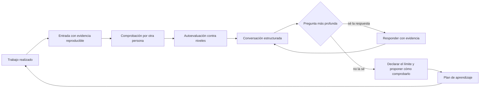
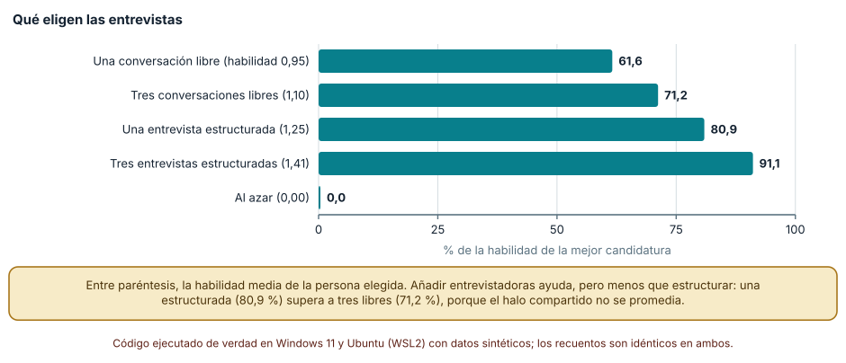
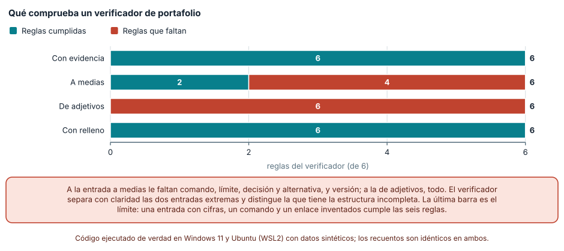
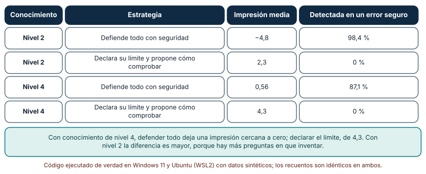

# SE-454 — Portafolio, entrevistas y defensa profesional

[← SE-453 — Economía del software y costo total](../../classes/part-37-gestion-liderazgo-y-practica-profesional/se-453-economia-del-software-y-costo-total/README.md) · [↑ Parte 37](../../classes/part-37-gestion-liderazgo-y-practica-profesional/README.md) · [📚 Índice completo](../../classes/README.md) · [🌐 Portal](../../site/classes/SE-454.html) · [SE-455 — Taller: conducir una revisión de decisión difícil →](../../classes/part-37-gestion-liderazgo-y-practica-profesional/se-455-taller-conducir-una-revision-de-decision-dificil/README.md)

## Punto profesional y fundamento pedagógico

**Punto profesional.** La clase existe para que presentes tu trabajo de modo que otra persona pueda comprobarlo, y para que entiendas cómo se evalúa a una persona ingeniera cuando alguien decide contratarla, ascenderla o confiarle una decisión. Tres piezas se refuerzan: los **niveles** (qué alcance, ambigüedad e impacto se espera en cada etapa), el **portafolio** (evidencia reproducible de lo que hiciste y decidiste) y la **defensa** (la capacidad de explicar, con honestidad, hasta dónde llega lo que sabes). La habilidad profesional es hacer visible el criterio con el que trabajas y no solo el resultado, y declarar tus límites antes de que otra persona los encuentre.

**Por qué aparece aquí.** Sigue a **Economía del software y costo total** (`SE-453`): has producido números, riesgos, compromisos y decisiones sobre el equipo de plataforma educativa; ahora hay que decidir cómo se muestran. El caso conductor es **el equipo de plataforma educativa**, donde una ingeniera de nivel intermedio prepara su portafolio y su postulación al siguiente nivel con un comité que revisará evidencia.

**Error conceptual que debe corregir.** Creer que un portafolio es una galería de proyectos y que una entrevista mide la habilidad de quien se presenta. Una galería de capturas no puede comprobarse; y una conversación libre mide en parte la habilidad y en parte rasgos ajenos a ella (soltura, parecido con quien entrevista). En la simulación de la clase, con diez candidaturas, una conversación libre elige a una persona que alcanza el 62 % de lo que habría logrado la mejor, y tres entrevistas estructuradas el 91 %. Y creer que defender con seguridad es defender bien: la seguridad sin profundidad se descubre con las preguntas siguientes.

**Secuencia de aprendizaje.** Antes de mirar los resultados, predices qué fracción de la mejor habilidad alcanza quien contrata con una conversación libre frente a una entrevista estructurada; después revisas cuatro entradas de portafolio con un verificador de seis criterios, incluida una que lo pasa sin sustancia, y simulas qué impresión deja una persona que defiende todo frente a otra que declara su límite. La secuencia usa predicción, explicación propia, contraste y recuperación. [ICAP](https://icap.education.asu.edu/research) distingue participación de construcción de conocimiento; [How People Learn II](https://nap.nationalacademies.org/catalog/24783/how-people-learn-ii-learners-contexts-and-cultures) respalda diseñar la práctica con contextos reales y retroalimentación.

**Evidencia de aprendizaje.** `portafolio-log.md` con la predicción, las tres figuras reproducidas, una entrada de portafolio sobre un trabajo propio que pase el verificador y que otra persona haya comprobado, una autoevaluación contra una escalera de niveles con evidencia por criterio, tres preguntas de profundidad sobre tu entrada con tus respuestas y tus límites declarados, y una nota que separe qué es medido, qué inferido y qué supuesto.

**Límite de la conclusión.** Los diez candidatos, el halo y el ruido de las entrevistas, las cuatro entradas de portafolio, las reglas del verificador, el modelo de preguntas de profundidad y la puntuación de impresión son sintéticos, escritos por el autor con semilla fija. No se entrevistó ni se evaluó a ninguna persona. Las cifras muestran la forma de cada mecanismo, no el valor en un proceso de selección real.

### Trazabilidad fuente → afirmación

| Fuente primaria u oficial | Afirmación que respalda | Lo que no prueba |
|---|---|---|
| [Schmidt y Hunter, «The validity and utility of selection methods in personnel psychology»](https://doi.org/10.1037/0033-2909.124.2.262) | Resume décadas de estudios sobre la capacidad de distintos métodos de selección para predecir el desempeño. | Sus cifras han sido revisadas y dependen de la medida de desempeño. |
| [Sackett et al., «Revisiting meta-analytic estimates of validity in personnel selection»](https://doi.org/10.1037/apl0000994) | Revisa las estimaciones anteriores y encuentra mayor validez en los procedimientos estructurados, como la entrevista estructurada. | No es un estudio de contratación de personas ingenieras en particular. |
| [Progression.fyi](https://progression.fyi/) | Reúne escaleras de carrera públicas de empresas de tecnología. | Cada escalera responde a su empresa y no es una norma. |
| [GitLab, matriz de carrera de ingeniería](https://handbook.gitlab.com/handbook/engineering/careers/matrix/) | Describe públicamente criterios por nivel para roles de ingeniería. | Es el modelo de una organización concreta. |
| [SFIA](https://sfia-online.org/en) | Define un marco internacional de competencias profesionales con niveles de responsabilidad. | Es un marco general; no sustituye los criterios de una empresa. |
| [Larson, arquetipos de ingeniería de staff](https://staffeng.com/guides/staff-archetypes/) | Describe formas de trayectoria técnica más allá de la gestión de personas. | Es una descripción de práctica, no un estudio sistemático. |
| [ACM, Código de Ética y Conducta Profesional](https://www.acm.org/code-of-ethics) | Fija el deber de honestidad y de reconocer los límites de la propia competencia. | No resuelve por sí solo un caso concreto. |

## Antes de empezar

Recupera lo aprendido en `SE-453`: un número sin sus supuestos no se puede discutir. La pregunta activa es: **¿qué trabajo tuyo podría reproducir otra persona mañana, sin tu ayuda, y cuál solo existe en tu descripción?**

## Prerrequisitos

- Haber completado `SE-453` o poder explicar por qué un resultado se reporta con sus supuestos.
- Python 3.11 o posterior; los experimentos usan solo la biblioteca estándar (`random`, `re`, `statistics`).
- Haber escrito alguna vez un README, un currículum o una descripción de un proyecto propio.

## Problema auténtico

La ingeniera del caso preparó su postulación al nivel siguiente con un portafolio de cuatro proyectos. Para cada uno incluyó capturas y una descripción (« desarrollé una solución robusta y escalable »). El comité pidió dos cosas: reproducir una de las medidas y que ella explicara una decisión. No pudieron reproducir nada porque no había comandos ni versiones, y en la conversación aparecieron preguntas que fueron pasando de lo general al detalle: «¿por qué una cola y no un proceso programado?», «¿qué pasa si el mensaje se entrega dos veces?», «¿cómo lo probaste?». Respondió con seguridad a las primeras y con inventiva a las últimas. Otro candidato dijo en la tercera pregunta «hasta aquí llega lo que probé; lo comprobaría así»: el comité anotó una evaluación más alta de su criterio. En la misma temporada, una entrevista libre favoreció a una persona muy comunicativa que luego mostró menos profundidad que otra que se había puesto nerviosa. La clase enseña a escribir entradas comprobables, a leer una escalera de niveles y a defender declarando los límites.

## Objetivos observables

Al terminar podrás:

1. comparar tu evidencia con una escalera de niveles (alcance, ambigüedad, impacto, influencia) y señalar lo que falta;
2. escribir una entrada de portafolio con comando reproducible, resultado con unidades y versión, decisión y alternativa, enlace a evidencia y límites;
3. explicar por qué una entrevista estructurada predice mejor que una libre y diseñar preguntas y criterios;
4. defender una decisión con profundidad creciente, declarando dónde termina lo que sabes y cómo lo comprobarías;
5. reconocer lo que un verificador automático de portafolio no puede decidir.

## Mapa conceptual



El mapa separa tres etapas: **producir evidencia** (la entrada comprobable), **ubicarse** (niveles) y **defender** (conversación con profundidad creciente). La flecha de retorno indica que un límite declarado no cierra la conversación: se convierte en trabajo.

## Temas y por qué importan

| Tema | Por qué cambia una decisión profesional | Evidencia mínima |
|---|---|---|
| Niveles y rutas profesionales | Aclaran qué se espera y qué evidencia sostiene un nivel. | Autoevaluación con evidencia por criterio |
| Portafolio comprobable | Sustituye la afirmación por el resultado reproducible. | Entradas que pasan el verificador y una revisión humana |
| Validez de las entrevistas | La estructura reduce el ruido y el sesgo. | Preguntas, criterios y puntuación por separado |
| Defensa por profundidad | La profundidad se descubre con preguntas sucesivas. | Respuestas por niveles con límites declarados |
| Honestidad y ética de la presentación | Una exageración se descubre y daña la confianza. | Declaración explícita de qué hizo la persona y qué no |

## Conceptos y decisiones

### 1. Niveles y rutas profesionales

Las escaleras de carrera publicadas ([Progression.fyi](https://progression.fyi/), la [matriz de GitLab](https://handbook.gitlab.com/handbook/engineering/careers/matrix/)) coinciden en que los niveles no se distinguen por saber más tecnologías sino por el **alcance** (de una tarea a un equipo a varias organizaciones), la **ambigüedad** que la persona maneja (de problemas definidos a problemas por definir), el **impacto** que produce y la **influencia** que ejerce sobre otras personas. Hay además rutas: una de **gestión de personas** y otra **técnica** de especialista o de staff ([Larson](https://staffeng.com/guides/staff-archetypes/) describe varias), que no son una jerarquía donde una sea el ascenso de la otra. El marco internacional [SFIA](https://sfia-online.org/en) expresa niveles de responsabilidad en términos de autonomía, influencia, complejidad y conocimiento. Leer una escalera sirve para dos cosas: saber qué evidencia necesitarías para sostener un nivel y distinguir un cambio de nivel de un cambio de tareas. La advertencia es que cada escalera es de una organización y su aplicación depende de comités, calibración y contexto.

### 2. Portafolio como evidencia comprobable

Un portafolio responde a una pregunta: «¿qué puede comprobar una persona que no te conoce?». Una entrada comprobable tiene seis elementos. Un **comando reproducible** (cómo se ejecuta lo que muestras). Un **resultado con cifras y unidades** (no «mejoró el rendimiento» sino «el p95 bajó de 840 ms a 310 ms»). Un **entorno** con versiones. Una **decisión y su alternativa** (qué elegiste y qué descartaste, y por qué). Un **enlace a evidencia** (un informe, un repositorio, un registro de decisión). Y los **límites** (qué no se midió, qué no se probó). Un verificador automático puede comprobar la presencia de estos elementos y ahorra trabajo a quien revisa, pero se puede engañar: una entrada con las palabras clave sin sustancia lo pasa, como mostrará el experimento. Por eso hay una segunda capa que no se automatiza: que otra persona intente reproducir una medida y diga si lo logró. Los trabajos con información confidencial se presentan con datos sintéticos o descritos sin identificar al cliente, y se declara qué se omitió.

### 3. Validez de las entrevistas

Los metaanálisis de selección de personal ([Schmidt y Hunter](https://doi.org/10.1037/0033-2909.124.2.262), revisado por [Sackett et al.](https://doi.org/10.1037/apl0000994)) encuentran que la **entrevista estructurada** —las mismas preguntas para todas las personas, criterios de puntuación previos, puntuación por pregunta y no impresión global— predice el desempeño mejor que la conversación libre. La razón mecánica tiene dos partes. La conversación libre mezcla la habilidad con rasgos que influyen en la impresión (soltura, similitud con quien entrevista, primera impresión), lo que se llama **efecto halo**, y el ruido aleatorio de cada conversación. Y las impresiones de varias entrevistadoras se promedian, pero el halo que comparten no se promedia. Una entrevista técnica útil pide trabajo observable (una revisión de código, una decisión de diseño con datos) y usa una rúbrica. Para quien se postula, esto significa que conviene preparar respuestas con estructura (situación, decisión, alternativa, resultado, límite) y que no se debe confiar en que la soltura compense la falta de evidencia.

### 4. Defensa por profundidad

Una defensa profesional es una secuencia de preguntas cada vez más específicas sobre un mismo trabajo: qué hiciste, por qué esa opción, qué pasa si falla, cómo lo probaste, qué cambiarías. Quien hizo el trabajo conoce los primeros niveles de memoria y, a partir de cierto punto, se encuentra con lo que no probó o no entendió. En ese punto existen dos estrategias. Una es defender con seguridad: se acierta por intuición a veces y, cuando falla, la persona que evalúa lo detecta, y la impresión se daña no solo en esa pregunta sino en las anteriores (¿qué más fue invención?). La otra es **declarar el límite y proponer cómo comprobarlo** («eso no lo probé; lo comprobaría repitiendo la entrega dos veces y mirando los duplicados»). La segunda deja una impresión de criterio, no de ignorancia, porque separa lo que se sabe de lo que se supone. No es una técnica de entrevista sino una consecuencia del [código de ética de la ACM](https://www.acm.org/code-of-ethics): ser honesta sobre la propia competencia y sus límites.

### 5. Presentar sin inflar

La exageración tiene costos asimétricos: sube la impresión inicial y, si se descubre, baja la credibilidad de todo. Hay formas concretas de no inflar. **Atribuir con precisión:** «diseñé la cola y escribí las pruebas; la integración con el ministerio la hizo otro equipo». **Distinguir participación de autoría:** estar en un proyecto no es haberlo decidido. **Declarar el uso de herramientas:** si un componente fue generado con asistencia, decirlo, y poder explicarlo. **No presentar como medida lo que fue estimación.** Y cuidar lo ajeno: no publiques código ni datos de un empleador anterior sin permiso. La presentación honesta también es más fácil de defender, porque cada afirmación tiene evidencia y no hay nada que sostener con inventiva.

### Qué eligen las entrevistas

Se simulan 8 000 procesos de selección con 10 candidaturas. La habilidad es normal estándar; la puntuación de cada conversación es la habilidad más un rasgo ajeno (el halo, con peso 0,8 en la conversación libre y 0,2 en la estructurada) más ruido aleatorio (desviación 1,0 libre y 0,7 estructurada, promediado entre entrevistadoras). Se elige a la persona con mayor puntuación.

| Procedimiento | Habilidad media de la persona elegida | Fracción de lo alcanzable (la mejor de las 10) |
|---|---:|---:|
| Una conversación libre | 0,95 | 61,6 % |
| Tres conversaciones libres | 1,10 | 71,2 % |
| Una entrevista estructurada | 1,25 | 80,9 % |
| Tres entrevistas estructuradas | 1,41 | 91,1 % |
| Al azar | 0,00 | 0 % |



**Cómo leer la figura.** Cada barra es un procedimiento de selección con la habilidad media de la persona elegida entre paréntesis, y su longitud es la fracción de lo que alcanzaría la mejor candidatura. Mira que una entrevista estructurada supera a tres libres: estructurar ayuda más que añadir entrevistadoras. **Dónde deja de valer:** el peso del halo (0,8 y 0,2), el ruido, la normalidad de la habilidad y la independencia entre entrevistadoras son supuestos del autor; los metaanálisis reportan validez, no estos porcentajes. La simulación enseña un mecanismo y no autoriza a decir cuánto mejora una entrevista real.

### Qué comprueba un verificador de portafolio

Cuatro entradas sintéticas pasan por seis reglas implementadas con expresiones regulares: comando reproducible, resultado con cifra y unidad, límite declarado, decisión y alternativa, enlace a evidencia y versión del entorno.

| Entrada | Reglas cumplidas (de 6) | Qué falta |
|---|---:|---|
| Con evidencia | 6 | nada |
| A medias | 2 | comando, límite, decisión y alternativa, versión |
| De adjetivos | 0 | todo |
| Con relleno | 6 | nada, pero sin sustancia |



**Cómo leer la figura.** Cada barra es una entrada de portafolio y se reparte en reglas cumplidas (verde azulado) y que faltan (coral). Mira que la entrada con relleno se ve igual que la que tiene evidencia: el verificador comprueba forma, no sustancia. **Dónde deja de valer:** las reglas son construcciones del autor, sensibles al idioma y al formato, y las entradas son ejemplos escritos a propósito; que una entrada pase no dice que sea verdadera. Su función es filtrar lo evidentemente incompleto antes de que una persona revise lo comprobable.

### Qué impresión deja cada estrategia de defensa

Una persona responde seis preguntas de profundidad creciente. Si su conocimiento llega al nivel d, responde bien hasta d. Más allá, la estrategia «defiende todo» acierta por azar un 20 % y, si no acierta, comete un error seguro que quien evalúa detecta el 80 % de las veces; la estrategia «declara el límite» lo dice una vez, propone cómo comprobarlo y se detiene. Puntuación de la impresión: +1 por respuesta correcta, +0,3 por declarar el límite, −3 por un error seguro detectado (6 000 repeticiones).

| Conocimiento | Estrategia | Impresión media | Detectada en un error seguro |
|---|---|---:|---:|
| Nivel 2 | Defiende todo con seguridad | −4,8 | 98,4 % |
| Nivel 2 | Declara su límite y propone cómo comprobar | 2,3 | 0 % |
| Nivel 4 | Defiende todo con seguridad | 0,56 | 87,1 % |
| Nivel 4 | Declara su límite y propone cómo comprobar | 4,3 | 0 % |



**Cómo leer la figura.** Cada barra es una combinación de conocimiento y estrategia, con la impresión media entre paréntesis, y su longitud es el porcentaje de casos en que se descubre un error dicho con seguridad. Mira que las dos barras de declarar el límite son nulas y que las impresiones entre paréntesis son las más altas. **Dónde deja de valer:** las probabilidades (20 % de acierto por azar, 80 % de detección) y la puntuación (−3, +0,3) son supuestos del autor; un comité real pondera de otra forma y algunas personas declaran límites para evadir preguntas. Declarar un límite sin proponer cómo comprobarlo es una evasiva, no una defensa. La figura muestra que el costo de inventar crece con la profundidad de las preguntas.

## Definiciones de trabajo

- **nivel profesional:** etapa de una escalera definida por alcance, ambigüedad, impacto e influencia que se espera de una persona.
- **entrada de portafolio comprobable:** descripción de un trabajo con comando reproducible, resultado con unidades, entorno, decisión y alternativa, enlace a evidencia y límites.
- **entrevista estructurada:** entrevista con las mismas preguntas para todas las personas, criterios de puntuación previos y puntuación por pregunta.
- **efecto halo:** influencia de un rasgo ajeno a la habilidad (soltura, parecido) sobre la valoración global de una persona.
- **defensa por profundidad:** secuencia de preguntas cada vez más específicas sobre un mismo trabajo para descubrir hasta dónde llega la comprensión.

Las definiciones son operativas para el equipo de plataforma educativa. No convierten términos con una historia más amplia en sinónimos y deben contrastarse con las fuentes primarias enlazadas al final.

## Ejemplo mínimo

El fragmento comprueba tres reglas sobre una entrada de portafolio breve. Antes de ejecutarlo, predice qué reglas cumple.

```python
import re
entrada = "El p95 bajó de 840 ms a 310 ms con Python 3.12.\n\n## Límites\n\nNo se midió con más de 5 000 filas."
reglas = {"cifra con unidad": r"\d+\s?ms", "versión": r"Python\s?\d", "límite": r"(?i)## límites"}
print({nombre: bool(re.search(rx, entrada)) for nombre, rx in reglas.items()})
```

Imprime `{'cifra con unidad': True, 'versión': True, 'límite': True}`. Observa que la entrada cumple las tres reglas y, sin embargo, no dice cómo reproducir la medida ni qué alternativa se descartó: tres reglas no son seis, y seis reglas tampoco son una revisión. Registra versión de Python, comando y salida.

## Ejemplo profesional

Escenario hipotético, construido para la clase y sin datos reales. La ingeniera elige tres trabajos del último año y reescribe cada entrada con las seis partes: para la cola de cierre incluye el comando del banco de pruebas, el p95 antes y después con la versión de Python y el sistema, la decisión por reintentos con la alternativa del proceso programado y por qué la descartó, el enlace al registro de decisión y un apartado de límites («no se midió con más de 5 000 filas ni con fallos del almacenamiento»). Pide a una compañera que reproduzca la medida con un checkout limpio; ella obtiene 330 ms y se anota, porque la cifra no es idéntica pero está dentro de la dispersión declarada. Se autoevalúa contra la escalera de su organización: tiene evidencia clara de alcance de equipo y de impacto medido, y poca de influencia sobre otros equipos (la propuesta de `SE-445` y el contrato de `SE-446` son sus mejores pruebas). Ensaya la defensa con un colega que le hace seis preguntas encadenadas sobre la cola; en la quinta responde «no probé la entrega duplicada con el almacenamiento caído; lo comprobaría repitiendo cada mensaje dos veces y comparando el recuento». Compara con la versión anterior del portafolio: la diferencia es lo que el comité puede comprobar y lo que ella puede defender.

## Práctica guiada

1. Elige un trabajo propio y escribe su entrada con las seis partes; si no tienes datos reales, usa uno sintético y declara que lo es.
2. Predice qué fracción de la mejor habilidad alcanza cada procedimiento de entrevista y escribe los números antes de simular.
3. Reproduce las tres tablas con las semillas fijadas en `scripts/experiments_part37_b.py`; cambia el peso del halo de la conversación libre de 0,8 a 0,2 y observa cuánto se acerca a la estructurada.
4. Pide a otra persona que intente reproducir una medida de tu entrada con un checkout limpio y registra qué le faltó.
5. Autoevalúate contra una escalera pública (Progression.fyi, la matriz de GitLab o SFIA) y señala el criterio con menos evidencia.
6. Escribe tres preguntas de profundidad sobre tu entrada y tus respuestas, marcando dónde termina lo que probaste.
7. Entrega `portafolio-log.md` y pide a otra persona que encuentre una afirmación de tu entrada que no pueda comprobar.

## Ejercicios

1. **Reescritura:** transforma «mejoré el rendimiento del sistema de forma significativa» en una frase con cifra, unidad, versión y límite.
2. **Niveles:** para un criterio de una escalera pública, indica qué evidencia mostrarías de un trabajo tuyo y qué evidencia no podrías mostrar.
3. **Estructura:** diseña cuatro preguntas de entrevista con su rúbrica de puntuación (qué sería una respuesta insuficiente, adecuada y sobresaliente) para evaluar el criterio de una decisión de diseño.
4. **Límite:** redacta la respuesta a «¿qué pasa si el mensaje se entrega dos veces?» cuando no lo probaste, de modo que declare el límite y proponga cómo comprobarlo.

## Reto verificable

Entrega `portafolio-log.md` con la predicción, las tres tablas, tres entradas de portafolio que pasen el verificador y hayan sido reproducidas por otra persona, la autoevaluación con evidencia por criterio y tres preguntas de profundidad con respuestas y límites. Se aprueba si otra persona ejecuta el código desde un checkout limpio, obtiene los mismos números con las mismas semillas y puede decir, a partir de tu entrada, cómo reproducir tu medida, qué alternativa descartaste y qué no probaste. No se aprueba por afirmar «tengo un portafolio sólido» sin decir qué parte pudo reproducir alguien que no eres tú.

## Caso conductor

El equipo de plataforma educativa es el caso conductor de la Parte 37. Esta clase deja el décimo artefacto: entradas de portafolio comprobables, una autoevaluación por niveles y una defensa por profundidad. `SE-455` preguntará cómo se conduce una revisión de una decisión difícil, donde esta defensa se vuelve un ejercicio colectivo, y `SE-456` reunirá todo en un dossier. Cambia después un solo dato, el porcentaje de acierto por azar en las preguntas profundas de 20 % a 50 %, y observa cuánto se acerca la impresión de defender todo a la de declarar el límite.

## Preguntas frecuentes

### ¿Qué hago si mi trabajo es confidencial?

Presenta un caso equivalente con datos sintéticos que reproduzca la estructura del problema y de la decisión, y describe sin identificar al cliente qué parte del trabajo real corresponde. Declara qué omitiste. Un comité entiende que no puedes publicar lo ajeno y valora que puedas mostrar tu criterio igualmente.

### ¿Es mejor ser generalista o especialista?

Las escaleras suelen valorar profundidad en un área junto con amplitud suficiente para trabajar con otras. La pregunta útil es qué evidencia tienes de impacto en cada eje, y qué te interesa hacer más años; no existe una respuesta única y las organizaciones lo valoran distinto.

### ¿Declarar límites no me hace parecer insegura?

Depende de cómo lo digas. «No lo sé» a secas sí; «no lo probé, y lo comprobaría así» muestra que sabes qué falta y cómo averiguarlo. En la simulación de la clase, esa forma deja mejor impresión que defender todo. Lo que no conviene es declarar límites sobre cosas que sí sabes: sería evasión.

### ¿Un verificador automático puede sustituir a la revisión humana?

No. Filtra lo evidentemente incompleto, que es útil, pero puede ser engañado por una entrada con la forma correcta y sin sustancia. La revisión humana es la que intenta reproducir y preguntar. Usa el verificador como un primer filtro y como una lista de comprobación para ti.

## Fallo controlado y diagnóstico

Reproduce el fallo clásico de la clase: **una entrada de portafolio que pasa el verificador y no se puede reproducir**. Ejecuta el verificador sobre la entrada con relleno y luego intenta reproducir su comando.

Registra síntoma, entrada mínima, hipótesis, observación que descarta cada hipótesis, causa, corrección y prueba de regresión. **Síntoma:** la entrada cumple las seis reglas y quien revisa no puede ejecutar nada. **Hipótesis rivales:** (a) el verificador falló; (b) la entrada está incompleta; (c) la entrada tiene la forma pero no la sustancia. **Prueba:** ejecuta el comando de la entrada en un entorno limpio y mide; si no produce el resultado declarado, la causa es la sustancia. **Conclusión:** un verificador de forma acepta 6 de 6 reglas a una entrada vacía de contenido real. **Regresión:** añade a la revisión una comprobación humana de reproducción y registra el resultado en la entrada. No cambies a la vez las reglas y el contenido de la entrada.

## Errores comunes y cómo corregirlos

| Síntoma | Causa probable | Corrección |
|---|---|---|
| Nadie puede reproducir mis resultados | Sin comando, versión ni datos | Incluir comando, entorno y datos sintéticos |
| El comité duda de mi alcance | Se describe participación y no autoría | Atribuir con precisión qué decidiste y hiciste |
| La entrevista favorece a quien habla mejor | Conversación libre con halo | Estructurar preguntas y rúbrica |
| Me descubren una respuesta inventada | Defensa sin declarar límites | Declarar el límite y proponer cómo comprobarlo |
| El portafolio es una lista de tecnologías | No hay decisiones ni resultados | Documentar decisión, alternativa y resultado |

## Entorno y archivos clave

```text
work/SE-454/
├── README.md
├── portafolio/
│   ├── entrevistas.py
│   ├── verificador.py
│   └── defensa.py
├── ENTRADA-1.md
├── AUTOEVALUACION.md
├── tests/test_portafolio.py
└── evidence/portafolio-log.md
```

El `README` declara plataforma, versión de Python, semillas y comandos. Los experimentos usan solo la biblioteca estándar (`random`, `re`, `statistics`) y se ejecutaron con CPython 3.12.9 en Windows 11 y 3.12.3 en Ubuntu bajo WSL2: las salidas fueron idénticas. Si añades una dependencia, fija procedencia y versión.

## Seguridad, ética y accesibilidad

- no publiques en un portafolio código, datos ni documentos de un empleador o cliente sin permiso, ni datos personales de nadie, y revisa el historial de versiones por si contiene secretos;
- los procesos de selección pueden reproducir sesgos (por origen, género, edad, estilo de comunicación): la estructura y la rúbrica reducen el efecto halo, no lo eliminan, y las personas que evalúan deben conocer los sesgos;
- las entrevistas deben ser accesibles: ofrece formatos alternativos, tiempo adicional y preguntas por escrito a quien lo necesite;
- las tablas y figuras deben tener texto alternativo y no depender del color;
- las fuentes citadas son textos de sus autores: cita las ideas y vincula la fuente, no copies sus textos ni diagramas.

## Puente hacia el trabajo con agentes

Un agente al que se le pide «mejora mi portafolio» reescribirá las entradas con un lenguaje seguro y brillante y puede añadir logros que no existen. Pídele en cambio que revise tu entrada contra las seis reglas, que señale las afirmaciones sin evidencia y que proponga preguntas de profundidad para tu ensayo de defensa, sin añadir contenido. Revisa especialmente cualquier cifra, versión o enlace que no estuviera en tu texto original. El agente puede ayudar a preparar y a hacer preguntas difíciles; qué hiciste, qué decidiste y qué no probaste solo lo sabes tú, y declararlo es tu responsabilidad.

## Transferencia

Traslada el análisis a otro dominio (por ejemplo, una persona diseñadora de interiores que presenta proyectos a un colegio profesional): cambia las entradas, las reglas y las preguntas y conserva el procedimiento de documentar con un procedimiento reproducible, un resultado con unidades y límites, someter el trabajo a la comprobación de otra persona y defender declarando hasta dónde llega la evidencia. La transferencia está lograda cuando puedes decir qué parte de tu trabajo en tu dominio no puede comprobar otra persona y cómo lo declararías, no cuando la entrada se parece a las del equipo de plataforma.

## Evaluación y evidencia

| Criterio | Evidencia para aprobar |
|---|---|
| comprensión | explicación de qué distingue un nivel de otro y de por qué la estructura mejora una entrevista |
| corrección | tablas de entrevistas, de verificador y de defensa reproducibles con las mismas semillas |
| diseño | entradas comprobables, autoevaluación con evidencia por criterio y preguntas de profundidad con límites |
| diagnóstico | reproducción del fallo «entrada que pasa el verificador sin sustancia» con regresión |
| incertidumbre | declaración de que el halo, las reglas y las probabilidades son del autor |
| reproducibilidad | versiones, comandos, salida y límites declarados |

## Fuentes

- [Schmidt y Hunter, «The validity and utility of selection methods in personnel psychology»](https://doi.org/10.1037/0033-2909.124.2.262) — validez de métodos de selección; autoridad: Psychological Bulletin.
- [Sackett et al., «Revisiting meta-analytic estimates of validity in personnel selection»](https://doi.org/10.1037/apl0000994) — revisión de esas estimaciones; autoridad: Journal of Applied Psychology.
- [Progression.fyi](https://progression.fyi/) — escaleras de carrera públicas; autoridad: recopilación de documentos de empresas.
- [GitLab, matriz de carrera de ingeniería](https://handbook.gitlab.com/handbook/engineering/careers/matrix/) — criterios por nivel; autoridad: manual público de GitLab.
- [SFIA](https://sfia-online.org/en) — marco de competencias profesionales; autoridad: SFIA Foundation.
- [Larson, arquetipos de ingeniería de staff](https://staffeng.com/guides/staff-archetypes/) — trayectorias técnicas; autoridad: autor del texto.
- [ACM, Código de Ética y Conducta Profesional](https://www.acm.org/code-of-ethics) — honestidad y límites de la competencia; autoridad: Association for Computing Machinery.

Cada fuente respalda el mecanismo indicado; ninguna demuestra que el 91,1 % de tres entrevistas estructuradas, las seis reglas cumplidas por una entrada con relleno o la impresión de 4,3 al declarar un límite se observen en un proceso real. Esa afirmación depende de la organización, del comité y de las personas.

## Límites y siguiente paso

Se ejecutaron tres experimentos con datos sintéticos y un verificador sobre cuatro entradas escritas por el autor, en Windows y Ubuntu (WSL2), con resultados idénticos. No se entrevistó ni se evaluó a ninguna persona ni se revisó ningún portafolio real; el halo, el ruido, las reglas del verificador y las probabilidades de la defensa son construcciones del autor, y el modelo supone entrevistadoras independientes y una habilidad de un solo número. La siguiente clase convierte la defensa en un ejercicio colectivo: cómo conducir una revisión de una decisión difícil.

## Glosario

- **nivel profesional:** etapa de una escalera definida por alcance, ambigüedad, impacto e influencia que se espera de una persona.
- **entrada de portafolio comprobable:** descripción de un trabajo con comando reproducible, resultado con unidades, entorno, decisión y alternativa, enlace a evidencia y límites.
- **entrevista estructurada:** entrevista con las mismas preguntas para todas las personas, criterios de puntuación previos y puntuación por pregunta.
- **efecto halo:** influencia de un rasgo ajeno a la habilidad (soltura, parecido) sobre la valoración global de una persona.
- **defensa por profundidad:** secuencia de preguntas cada vez más específicas sobre un mismo trabajo para descubrir hasta dónde llega la comprensión.

---

[← SE-453 — Economía del software y costo total](../../classes/part-37-gestion-liderazgo-y-practica-profesional/se-453-economia-del-software-y-costo-total/README.md) · [↑ Parte 37](../../classes/part-37-gestion-liderazgo-y-practica-profesional/README.md) · [📚 Índice completo](../../classes/README.md) · [🌐 Portal](../../site/classes/SE-454.html) · [SE-455 — Taller: conducir una revisión de decisión difícil →](../../classes/part-37-gestion-liderazgo-y-practica-profesional/se-455-taller-conducir-una-revision-de-decision-dificil/README.md)
