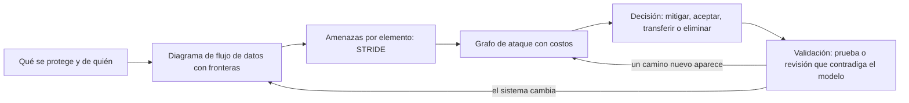
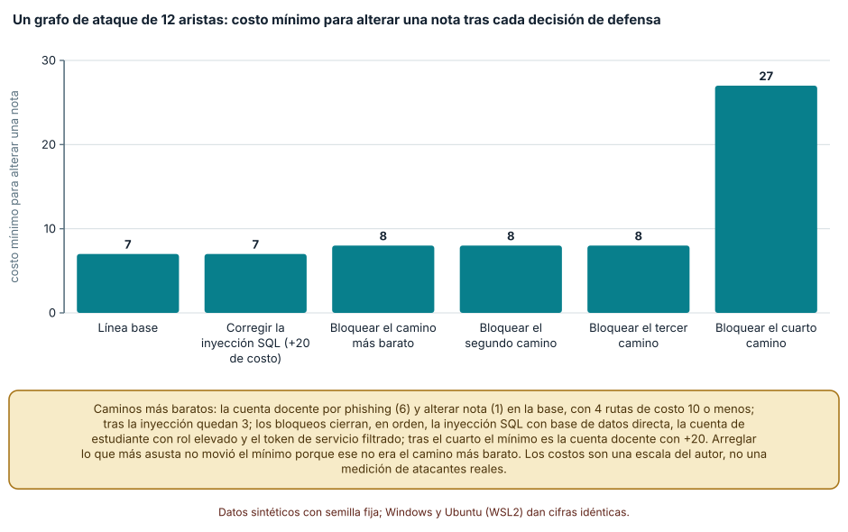
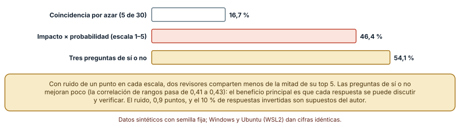
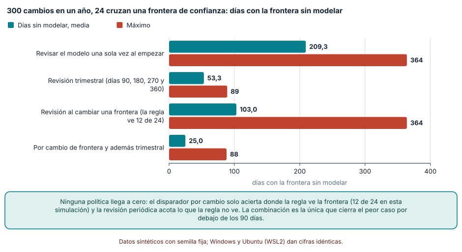

# SE-457 — Principios de seguridad y modelos de amenaza

[← SE-444 — Proyecto: informe reproducible de calidad](../../classes/part-36-calidad-rendimiento-y-resiliencia/se-444-proyecto-informe-reproducible-de-calidad/README.md) · [↑ Parte 38](../../classes/part-38-seguridad-privacidad-y-cumplimiento/README.md) · [📚 Índice completo](../../classes/README.md) · [🌐 Portal](../../site/classes/SE-457.html) · [SE-458 — Identidad, autenticación y sesiones →](../../classes/part-38-seguridad-privacidad-y-cumplimiento/se-458-identidad-autenticacion-y-sesiones/README.md)

## Punto profesional y fundamento pedagógico

**Punto profesional.** La clase existe para que dejes de pensar la seguridad como una lista de controles y empieces a pensarla como una pregunta que se puede responder con evidencia: qué se protege, de quién, por qué camino y a qué costo para quien ataca. La habilidad no es memorizar categorías de amenazas sino producir un modelo pequeño, escrito, que otra persona pueda discutir, que cambie cuando el sistema cambia y que decida qué defensa vale la pena construir primero.

**Por qué aparece aquí.** Abre la **Parte 38** después de **Proyecto: informe reproducible de calidad**: la Parte 36 enseñó a prometer una calidad medible y a desconfiar de la propia medición; ahora la pregunta cambia de «¿cumple su promesa?» a «¿qué pasa cuando alguien quiere que no la cumpla?». El caso conductor es el mismo de la parte anterior, **la plataforma de entregas de tareas**, vista esta vez desde el lado de quien la ataca: alterar una nota, leer entregas ajenas, hacerse pasar por un docente.

**Error conceptual que debe corregir.** Creer que la seguridad consiste en arreglar la vulnerabilidad más grave que se conoce. Un atacante racional no elige el defecto más peligroso sino el camino más barato hasta lo que quiere, y arreglar uno por uno los defectos que asustan puede dejar intacto ese camino.

**Secuencia de aprendizaje.** Antes de mirar el resultado, predices cuál de las doce aristas de un grafo de ataque forma el camino más barato hasta alterar una nota y si corregir la inyección SQL lo cambia; después recorres cuatro decisiones de defensa, mides cuánto coinciden dos revisores que puntúan las mismas treinta amenazas y simulas un año de cambios para ver cuánto tiempo queda una frontera nueva sin modelar. La secuencia usa predicción, contraste y explicación propia. [ICAP](https://icap.education.asu.edu/research) distingue participar de construir conocimiento; [How People Learn II](https://nap.nationalacademies.org/catalog/24783/how-people-learn-ii-learners-contexts-and-cultures) respalda diseñar la práctica con contextos reales y retroalimentación.

**Evidencia de aprendizaje.** `amenazas-log.md` con la predicción, el diagrama de flujo de datos de la plataforma con sus fronteras de confianza, las amenazas enumeradas por elemento, el grafo de ataque con costos y su camino más barato, la política de revisión elegida y una nota que separe qué parte de cada conclusión es observada, cuál es inferida y cuál es supuesta.

**Límite de la conclusión.** El grafo de ataque (doce aristas y sus costos), la simulación de revisores (ruido de 0,9 puntos y 10 % de respuestas invertidas) y la simulación de cambios (300 por año, 9 % cruzan una frontera, una regla que ve el 70 %) son construcciones del autor con semilla fija. No se modeló un atacante real, ningún sistema en producción ni ningún incidente. Los números ilustran un mecanismo; no son una tasa para citar.

### Trazabilidad fuente → afirmación

| Fuente primaria u oficial | Afirmación que respalda | Lo que no prueba |
|---|---|---|
| [Saltzer y Schroeder, «The protection of information in computer systems»](https://doi.org/10.1109/PROC.1975.9939) | Formula ocho principios de diseño de mecanismos de protección, entre ellos mínimo privilegio, mediación completa y valores por defecto seguros. | No dice qué amenazas existen en la plataforma de entregas. |
| [Threat Modeling Manifesto](https://www.threatmodelingmanifesto.org/) | Describe valores y principios: modelar es analizar una representación del sistema para razonar sobre seguridad y privacidad, se hace de forma iterativa y se mide por el valor que produce. | No fija una técnica ni un formato obligatorio. |
| [OWASP Threat Modeling Cheat Sheet](https://cheatsheetseries.owasp.org/cheatsheets/Threat_Modeling_Cheat_Sheet.html) | Resume un proceso práctico: delimitar el alcance, representar el sistema, identificar amenazas, decidir respuestas y validar el modelo. | No demuestra que el modelo producido en la clase sea completo. |
| [Microsoft: categorías de amenaza STRIDE](https://learn.microsoft.com/en-us/azure/security/develop/threat-modeling-tool-threats) | Documenta las seis categorías (suplantación, manipulación, repudio, divulgación de información, denegación de servicio y elevación de privilegios) y su aplicación por elemento de un diagrama. | No convierte una categoría en un riesgo: falta probabilidad, impacto y contexto. |
| [Schneier, «Attack Trees»](https://www.schneier.com/academic/archives/1999/12/attack_trees/) | Presenta los árboles de ataque como una forma de representar caminos hacia un objetivo con costos asignados a los nodos. | No aporta costos para la plataforma de entregas. |
| [NIST SP 800-30 Rev. 1](https://csrc.nist.gov/pubs/sp/800/30/r1/final) | Define una guía para evaluar riesgo con amenaza, vulnerabilidad, probabilidad e impacto. | No dice qué escala numérica usar; la guía admite escalas cualitativas. |

## Antes de empezar

Recupera lo aprendido en la Parte 27 sobre fronteras y decisiones registradas, y en la Parte 36 sobre medir con un plan fijado de antemano. La pregunta activa es: **si alguien quisiera cambiar la nota de una persona en la plataforma, ¿cuál sería el camino más barato, y qué evidencia tienes de que no existe?**

## Prerrequisitos

- Haber completado `SE-444` o poder explicar por qué una conclusión debe separar lo observado de lo supuesto.
- Python 3.11 o posterior; los experimentos usan solo la biblioteca estándar (`random`, `heapq`).
- Saber leer un diagrama de componentes y una tabla de decisiones.

## Problema auténtico

La plataforma de entregas pasó una revisión de seguridad con una lista de verificación de cuarenta ítems, todos «cumple». Meses después, una auditoría encontró que un estudiante podía cambiar su rol a docente enviando un campo extra al registrarse, y con ese rol alterar cualquier nota. Ninguno de los cuarenta ítems miraba ese camino: la lista preguntaba si había cifrado, contraseñas con hash y protección contra inyección, y la respuesta a cada pregunta era sí. El defecto no estaba en un control ausente sino en una frontera que nadie había dibujado: la que separa lo que un cliente declara de lo que el servidor decide. Cuando el equipo dibujó el sistema, marcó dónde cambia la confianza y se preguntó qué podía salir mal en cada cruce, el camino apareció en una hora. La clase enseña a hacer ese dibujo, a convertirlo en preguntas, a ordenar las respuestas por el esfuerzo que exige cada camino y a mantener el modelo vivo.

## Objetivos observables

Al terminar podrás:

1. dibujar un diagrama de flujo de datos de la plataforma con actores, procesos, almacenes, flujos y fronteras de confianza;
2. enumerar amenazas por elemento con una categoría como guía y descartar con una razón las que no aplican;
3. representar un objetivo del atacante como un grafo con costos y calcular su camino más barato;
4. explicar por qué dos revisores que puntúan las mismas amenazas con una escala numérica no coinciden y qué cambia al usar preguntas verificables;
5. elegir una política de actualización del modelo y justificarla con los cambios que deja sin revisar.

## Mapa conceptual



El mapa separa el **activo** (lo que importa), la **representación** (el diagrama), la **enumeración** (las amenazas), la **priorización** (los caminos) y la **validación**. El retorno indica que el modelo no se termina: un cambio de frontera lo reabre.

## Temas y por qué importan

| Tema | Por qué cambia una decisión profesional | Evidencia mínima |
|---|---|---|
| Activos, atacantes y supuestos | Sin saber qué se protege y de quién, cada defensa se justifica por costumbre. | Lista de activos con el atacante que los quiere y el supuesto que se hace |
| Diagrama de flujo de datos y fronteras | Casi todo defecto de seguridad vive donde la confianza cambia y nadie lo dibujó. | Diagrama con al menos tres fronteras marcadas |
| Enumeración con STRIDE | Convierte «qué puede salir mal» en seis preguntas por elemento. | Tabla de amenazas por elemento con descartes razonados |
| Grafos de ataque y priorización | El camino más barato decide el riesgo, no el defecto más grave. | Grafo con costos y camino mínimo antes y después de cada defensa |
| Mantenimiento del modelo | Un modelo que no cambia con el sistema deja de describirlo. | Política de revisión y registro de cambios de frontera |

## Conceptos y decisiones

### 1. Activos, atacantes y supuestos

Un modelo de amenazas empieza por lo que se quiere conservar y no por lo que se teme. En la plataforma los activos son las calificaciones (integridad: que nadie las altere), las entregas de cada estudiante (confidencialidad: que solo las lea quien debe), la disponibilidad el día del cierre y la confianza de las familias. A cada activo le corresponde un atacante que lo quiere por una razón distinta: un estudiante que desea mejorar su nota, un tercero que busca datos de menores para venderlos, un compañero que quiere copiar una entrega, un exalumno con rencor. El atacante no es una abstracción: determina capacidad, paciencia y recursos. Un estudiante conoce la plataforma por dentro y tiene una cuenta válida; un tercero parte de internet sin ninguna. Los **supuestos** son la parte que casi siempre queda implícita y la que más conviene escribir: «el proveedor de nube aísla bien las máquinas virtuales», «los docentes protegen su equipo», «el correo institucional no se compromete». Cada supuesto es un riesgo aceptado sin decirlo; escrito, otra persona puede cuestionarlo, y cuando deje de ser cierto el modelo se corrige en un lugar concreto. Saltzer y Schroeder insistían en que los mecanismos de protección se diseñan con los valores por defecto seguros y mediación completa: eso supone saber qué se protege y quién tiene permiso, no solo que haya un control.

### 2. Diagrama de flujo de datos y fronteras de confianza

El diagrama de flujo de datos es la representación más pequeña que sirve para razonar: actores externos (estudiante, docente, sistema de correo), procesos (la API de entregas, el servicio de calificación), almacenes (la base de datos, el almacenamiento de archivos) y flujos entre ellos. Sobre ese dibujo se trazan las **fronteras de confianza**: líneas que atraviesan los flujos donde cambia quién controla qué. La frontera entre el navegador y la API es la más importante y la más malentendida: todo lo que cruza de izquierda a derecha, incluso un campo oculto, una cabecera o un identificador, lo decide quien está del lado del cliente y por tanto puede ser cualquier cosa. La frontera entre la API y la base de datos separa un proceso que interpreta entradas de un almacén que ejecuta lenguaje (SQL): si se mezclan, la entrada se vuelve código. La frontera hacia el proveedor de correo o de almacenamiento externo cruza hacia un sistema cuyo comportamiento no controlas. Un diagrama con tres fronteras bien marcadas produce más hallazgos que una lista de cuarenta controles, porque cada frontera obliga a preguntar qué se valida, quién autentica a quién y qué ocurre si el otro lado miente.

### 3. Enumerar amenazas con STRIDE

STRIDE es un acrónimo de seis categorías: suplantación (Spoofing), manipulación (Tampering), repudio (Repudiation), divulgación de información (Information disclosure), denegación de servicio (Denial of service) y elevación de privilegios (Elevation of privilege). Sirve como lista de preguntas por elemento del diagrama, no como clasificación definitiva. Un actor externo puede ser suplantado o repudiar una acción; un proceso puede sufrir las seis; un almacén puede ser manipulado, divulgado o inaccesible, y si guarda registros, puede permitir el repudio si alguien altera el registro; un flujo de datos puede ser manipulado, observado o interrumpido. Aplicado a la frontera navegador-API: el cliente puede enviar un identificador de otra persona (suplantación), alterar un campo de rol (elevación), repetir una petición con otro cuerpo (manipulación) o negar haber enviado una entrega que luego perjudica (repudio). Lo valioso no es la etiqueta sino la obligación de **descartar con razón**: «el flujo API-base no se observa porque viaja por una red privada con cifrado en tránsito» es un supuesto escrito y revisable; «no aplica» sin razón es un hueco. El resultado es una tabla con una fila por amenaza, el elemento afectado, la respuesta elegida y el supuesto que la sostiene.

### 4. Grafos de ataque y el camino más barato

Una lista de amenazas no dice cuáles importan. Un **grafo de ataque** conecta estados del atacante (tener internet, tener una cuenta de estudiante, tener un rol de docente, tener lectura directa a la base) con aristas que representan una técnica y llevan un costo de esfuerzo; el objetivo es un nodo (alterar una nota). El camino de menor costo desde el nodo inicial es la estimación del riesgo más relevante porque un atacante racional lo elige. La consecuencia contraintuitiva es que **arreglar el defecto más grave no cambia el mínimo si no está en el camino más barato**. Cerrar una vía no la elimina de la lista de pendientes sino que sube su costo; el siguiente camino pasa a ser el mínimo. Por eso el grafo se recalcula después de cada decisión y se mide el costo mínimo antes y después: una defensa vale lo que sube el mínimo, no lo que impresiona. Schneier presentó los árboles de ataque justo con esta idea: asignar valores a los nodos para razonar sobre cuál es el camino más fácil. Los costos son estimaciones, y la utilidad del grafo no depende de que sean exactos sino de que sean explícitos y comparables entre caminos.

### 5. Mantener el modelo

El modelo pierde validez de dos maneras: cambia el sistema y el modelo no se entera, o se acumulan cambios pequeños cuyo efecto sobre las fronteras nadie suma. La respuesta es una política con dos mecanismos que se complementan: un **disparador por cambio** (una regla que señala cuándo un cambio añade una frontera, un almacén o un flujo hacia un tercero y obliga a actualizar el modelo) y una **revisión periódica** que busca lo que la regla no ve. El Threat Modeling Manifesto resume la idea al valorar el análisis continuo sobre el evento único. El modelo también se valida contra la realidad: una prueba negativa o un ejercicio de ataque que contradiga el modelo corrige el modelo, no la prueba. Un modelo cuyo único resultado es un documento archivado ha fracasado aunque esté completo.

### La defensa que no mueve el mínimo

Se construye un grafo con doce aristas desde `internet` hasta `alterar nota`: robo de credenciales de un estudiante (4), phishing a un docente (6), token de servicio filtrado en un repositorio (7), inyección SQL (5), campo de rol aceptado en el registro (3), identificador de nota adivinable (2) y las aristas que llevan al objetivo. Un algoritmo de Dijkstra calcula el camino mínimo y se aplica una decisión de defensa tras otra (subir en 20 el costo de una arista).

```python
def dijkstra(aristas):
    g = {}
    for a, b, c, _ in aristas: g.setdefault(a, []).append((b, c))
    dist, prev, cola = {"internet": 0}, {}, [(0, "internet")]
    while cola:
        d, u = heapq.heappop(cola)
        for v, c in g.get(u, []):
            if d + c < dist.get(v, 1e9):
                dist[v], prev[v] = d + c, u
                heapq.heappush(cola, (d + c, v))
    return dist["alterar_nota"]
```

| Decisión | Costo mínimo | Camino más barato |
|---|---:|---|
| Línea base | 7 | internet → cuenta docente → alterar nota |
| Corregir la inyección SQL | 7 | igual |
| Bloquear el camino más barato (1.º) | 8 | internet → inyección SQL → base directa → alterar nota |
| 2.º bloqueo | 8 | internet → cuenta de estudiante → rol elevado → alterar nota |
| 3.º bloqueo | 8 | internet → token filtrado → alterar nota |
| 4.º bloqueo | 27 | no queda ruta de costo 10 o menos |

La inyección SQL es la vulnerabilidad que más se cita y no estaba en el camino más barato: corregirla dejó el costo en 7. Hicieron falta cuatro bloqueos, uno por camino, para llegar a 27.



**Cómo leer la figura.** Cada barra es una decisión de defensa tomada en orden y su altura, el costo del camino de ataque más barato que queda. Mira que corregir lo que más asusta no mueve la barra, que cada bloqueo la sube apenas un punto y que el salto a 27 solo llega con el cuarto camino cerrado. **Dónde deja de valer:** los costos son una escala del autor; con otros costos el camino mínimo inicial sería otro y la lección (el mínimo, no la gravedad, decide) se conserva. El grafo modela un único atacante con un único objetivo; no cubre ataques que combinan objetivos ni la detección, que cambia el costo real de un camino ruidoso.

### Dos revisores, treinta amenazas

Se generan 30 amenazas con tres hechos latentes (alcanzable sin autenticar, toca notas o datos personales, no requiere condiciones especiales). Tres revisores puntúan cada una de dos maneras: impacto por probabilidad en escala de 1 a 5 con ruido gaussiano de 0,9 puntos, y tres preguntas de sí o no con un 10 % de respuestas invertidas. Se repite 300 veces y se compara el top cinco de cada par de revisores.

| Método | Coincidencia del top 5 | Correlación de rangos (tau) |
|---|---:|---:|
| Azar (5 de 30) | 16,7 % | 0 |
| Impacto × probabilidad | 46,4 % | 0,41 |
| Tres preguntas de sí o no | 54,1 % | 0,43 |

Dos personas razonables que usan la misma escala numérica comparten menos de la mitad de sus cinco amenazas más graves. Las preguntas de sí o no mejoran poco la concordancia; la ventaja es otra: cada respuesta se puede verificar («¿se llega sin autenticar? Probémoslo») y discutir, mientras que un «4» frente a un «3» solo se defiende con autoridad.



**Cómo leer la figura.** La barra gris es lo que se obtendría sin información; las otras dos miden cuánto se acerca cada método a una priorización compartida. **Dónde deja de valer:** el ruido de 0,9 y el 10 % de respuestas invertidas son supuestos del autor; con revisores entrenados o con datos de explotación real la concordancia sube. Que ninguno llegue cerca del 100 % es la conclusión estable: el puntaje numérico no es una medida, es una opinión con forma de número.

### Un año de cambios, 24 fronteras nuevas

Se simulan 300 cambios en un año (uno cada 1,2 días). El 9 % cruza una frontera de confianza (24 cambios: un endpoint nuevo, un almacén nuevo, un proveedor externo nuevo). Cuatro políticas deciden cuándo se actualiza el modelo; se mide cuántos días queda cada frontera sin modelar.

| Política | Días sin modelar (media) | Máximo |
|---|---:|---:|
| Revisar una vez al empezar | 209,3 | 364 |
| Revisión trimestral | 53,3 | 89 |
| Disparador por cambio (la regla ve 12 de 24) | 103,0 | 364 |
| Disparador por cambio y trimestral | 25,0 | 88 |

El disparador por cambio acierta donde la regla ve la frontera y falla en silencio donde no (12 de 24 en esta simulación, con una probabilidad nominal de 70 %). La revisión trimestral acota el peor caso pero no es inmediata. La combinación es la única que reduce la media por debajo de 30 días y el máximo por debajo de 90.



**Cómo leer la figura.** Cada grupo es una política de revisión; la barra verde azulada es la media de días con la frontera sin modelar y la coral, el máximo. Mira que solo la combinación de disparador y revisión periódica recorta ambas barras: el disparador por sí solo mejora la media y deja el peor caso intacto. **Dónde deja de valer:** el número de cambios, la proporción de fronteras (9 %) y la sensibilidad de la regla son del autor; en un equipo que cambia diez veces más la ventaja del disparador crece. Ninguna política garantiza que lo modelado sea correcto: mide la frescura, no la calidad del análisis.

## Definiciones de trabajo

- **activo:** dato, capacidad o servicio cuyo daño importa a la organización o a las personas, como las calificaciones o la disponibilidad el día del cierre.
- **frontera de confianza:** línea de un diagrama de flujo de datos donde cambia quién controla el dato o el proceso, de modo que lo que cruza debe tratarse como no confiable.
- **STRIDE:** lista de seis categorías de amenaza (suplantación, manipulación, repudio, divulgación de información, denegación de servicio y elevación de privilegios) usada como guía de preguntas por elemento.
- **grafo de ataque:** representación de estados del atacante y técnicas con costo que permite calcular el camino de menor esfuerzo hacia un objetivo.
- **modelo de amenazas:** representación del sistema, amenazas identificadas, decisiones tomadas y validación realizada, mantenida mientras el sistema cambia.

Las definiciones son operativas para la plataforma de entregas. No convierten términos con una historia más amplia en sinónimos y deben contrastarse con la documentación primaria enlazada al final.

## Ejemplo mínimo

El fragmento calcula el camino más barato en un grafo de tres aristas. Antes de ejecutarlo, predice si mejorar el defecto «b» cambia el resultado.

```python
costos = {("internet", "a"): 4, ("a", "nota"): 3, ("internet", "b"): 9, ("b", "nota"): 1}
print(min(4 + 3, 9 + 1))
costos[("internet", "b")] += 20
print(min(4 + 3, 9 + 20 + 1))
```

La respuesta es 7 en ambos casos: «b» era una vía de costo 10 y endurecerla no cambia el mínimo porque el atacante usa «a». Registra versión de Python, comando y salida; después endurece «a» y comprueba que el mínimo pasa a 30.

## Ejemplo profesional

El equipo de la plataforma dibuja el diagrama con cuatro procesos (API, servicio de calificación, trabajador de archivos y notificador), dos almacenes, tres actores y cinco fronteras. En el cruce navegador-API enumera por STRIDE nueve amenazas, descarta tres con razón escrita y deja seis; al ponerles costo descubre que la más barata es la elevación de privilegios por el campo de rol del registro. La decisión: la API ignora el rol del cliente y lo asigna por la invitación del curso; se añade una prueba negativa que intenta registrarse con `rol=docente` y exige que el rol resultante sea estudiante. El modelo se guarda en el repositorio junto al diagrama y registra tres supuestos con dueño y fecha. Cada cambio que añade un endpoint exige una línea en el modelo (una regla de revisión de cambios) y una vez por trimestre alguien ajeno al equipo intenta construir un camino que el modelo no conoce. El resultado se mide por lo que cambia: aparecieron dos supuestos falsos en el primer trimestre.

## Práctica guiada

1. Dibuja el diagrama de flujo de datos de la plataforma con al menos cuatro procesos, dos almacenes y cinco fronteras de confianza.
2. Enumera por STRIDE las amenazas del cruce navegador-API; descarta con una razón escrita las que no apliquen.
3. Escribe tu predicción: ¿cuál es el camino más barato y corregir la inyección lo cambia?
4. Construye el grafo de doce aristas con costos propios y calcula el camino mínimo antes y después de cada defensa.
5. Puntúa las mismas treinta amenazas con otra persona de dos maneras (escala 1 a 5 y tres preguntas de sí o no) y compara el top cinco.
6. Define una regla de disparador por cambio y una frecuencia de revisión, y simula con tu propio historial de commits cuántas fronteras habría dejado sin modelar.
7. Entrega `amenazas-log.md` y pide a otra persona que encuentre un camino que el grafo no contenga.

## Ejercicios

1. **Fronteras:** dibuja el flujo de una entrega de archivo desde el navegador hasta el almacenamiento y marca cuántas fronteras cruza; enumera dos amenazas STRIDE para cada una.
2. **Camino mínimo:** en un grafo de ataque propio de seis aristas, demuestra con números que una defensa de bajo costo en el camino mínimo mueve el riesgo más que una de alto costo fuera de él.
3. **Concordancia:** explica por qué dos revisores no coinciden con una escala de 1 a 5 y propón tres preguntas verificables que reemplacen el puntaje.
4. **Mantenimiento:** diseña un disparador que detecte un endpoint nuevo en un diff y explica qué tipo de frontera no vería.

## Reto verificable

Entrega `amenazas-log.md` con la predicción, el diagrama con sus fronteras, la tabla STRIDE con descartes, el grafo con costos y la tabla de decisiones, la comparación de dos revisores y la política de mantenimiento con su efecto simulado. Se aprueba si otra persona ejecuta el código desde un checkout limpio, obtiene las mismas cifras con las mismas semillas y puede decir cuál sería su camino más barato después de la tercera decisión. No se aprueba por entregar una lista de amenazas sin costos, sin descartes razonados o sin la comparación del camino mínimo antes y después.

## Caso conductor

La plataforma de entregas de tareas es el caso conductor de la Parte 38. Esta clase deja el primer artefacto: el modelo de amenazas con su diagrama, su grafo y su política de revisión. `SE-458` pregunta cómo se prueba quién eres, y `SE-459` qué puedes hacer una vez probado. Cambia después un solo dato, el costo de la arista de elevación de rol, y observa qué decisión de defensa pasa a ser la más rentable.

## Preguntas frecuentes

### ¿Hace falta un diagrama formal para modelar amenazas?

No. Una pizarra con cajas y fronteras basta si se guarda y se actualiza. Lo que importa es que el dibujo permita preguntar qué cruza cada frontera; un diagrama impecable que nadie vuelve a abrir sirve menos que un croquis mantenido.

### ¿STRIDE detecta todas las amenazas?

No. Es una lista de preguntas que ayuda a no olvidar categorías, no un catálogo exhaustivo. Quedan fuera las amenazas de lógica de negocio que no encajan en una categoría (aplicar un cupón dos veces, reservar sin pagar) y las que nacen de la combinación de componentes. Para ellas sirven los casos de abuso de `SE-464`.

### ¿Los números del grafo deben ser exactos?

No. Deben ser explícitos y comparables. Si dos personas discrepan sobre el costo de una arista, la discusión señala un supuesto que conviene escribir. Un grafo con costos aproximados ya ordena los caminos mejor que uno sin costos.

### ¿Cuándo termina el modelo?

No termina. Se declara vigente hasta el siguiente cambio de frontera o hasta la siguiente revisión. Un modelo «completo» y sin fecha es un modelo del sistema que existió.

## Fallo controlado y diagnóstico

Reproduce el fallo clásico de la clase: **corregir la vulnerabilidad más grave y dejar el riesgo igual**. Construye el grafo de la plataforma, corrige la inyección SQL subiendo en 20 el costo de su arista y calcula el camino mínimo.

Registra síntoma, entrada mínima, hipótesis, observación que descarta cada hipótesis, causa, corrección y prueba de regresión. **Síntoma:** el informe de seguridad dice que la vulnerabilidad crítica quedó cerrada y un estudiante sigue pudiendo alterar notas. **Hipótesis rivales:** (a) la corrección fue incompleta; (b) hay otro defecto igual de grave; (c) el camino que usa el atacante no pasaba por la inyección. **Prueba:** recalcula el camino mínimo antes y después; si el costo sigue en 7 y la ruta es la cuenta docente, la causa es que el camino más barato era otro. **Conclusión:** la corrección fue correcta y no estaba donde importaba; el criterio de priorización era la gravedad percibida y no el costo del camino. **Regresión:** guarda el grafo en el repositorio y añade una comprobación que falle si el costo mínimo baja de un umbral acordado tras un cambio de aristas. No cambies a la vez el costo de dos aristas.

## Errores comunes y cómo corregirlos

| Síntoma | Causa probable | Corrección |
|---|---|---|
| Se arregla lo grave y nada mejora | Se prioriza por gravedad, no por camino | Calcular el camino más barato y recalcularlo tras cada decisión |
| El modelo es una lista de 80 amenazas sin dueño | Se enumera sin descartar ni decidir | Una fila por amenaza con elemento, respuesta y supuesto |
| El diagrama no tiene fronteras | Se dibujó la arquitectura, no la confianza | Marcar dónde cambia quién controla el dato |
| Dos revisores puntúan distinto | Escala numérica sin criterio verificable | Sustituir el puntaje por preguntas que se puedan comprobar |
| El modelo no refleja el sistema actual | Sin disparador ni revisión periódica | Una regla por cambio de frontera y una revisión por trimestre |

## Entorno y archivos clave

```text
work/SE-457/
├── README.md
├── amenazas/
│   ├── diagrama.md
│   ├── stride.md
│   └── grafo.py
├── tests/test_grafo.py
└── evidence/amenazas-log.md
```

El `README` declara plataforma, versión de Python, semillas y comandos. Los experimentos usan solo la biblioteca estándar (`random`, `heapq`) y se ejecutaron con CPython 3.12.9 en Windows 11 y 3.12.3 en Ubuntu bajo WSL2: las salidas fueron idénticas. Si añades una dependencia, fija procedencia y versión.

## Seguridad, ética y accesibilidad

- los grafos y los costos son sintéticos: no publiques el modelo de amenazas de un sistema real porque describe sus puntos débiles;
- un modelo es un ejercicio de ataque en papel; no pruebes los caminos contra sistemas ajenos ni sin autorización escrita;
- cuida los datos de las personas: un modelo útil nombra categorías de datos, no registros;
- el diagrama debe tener un texto equivalente (lista de flujos y fronteras) para quien lee con un lector de pantalla;
- sé transparente con el riesgo aceptado: quien lo asume debe saber qué asume.

## Puente hacia el trabajo con agentes

Un agente al que se le pide «haz un modelo de amenazas» producirá una lista larga con las seis letras de STRIDE y frases genéricas. Pídele en cambio que parta de un diagrama que tú le entregas con las fronteras marcadas, que descarte con una razón cada amenaza que no aplique, que construya el grafo con costos explícitos y que recalcule el camino mínimo tras cada decisión mostrando la salida. Revisa especialmente que cada costo tenga una razón y que el modelo cite al menos una prueba que pueda contradecirlo. Un agente tiende a completar la tabla con amenazas plausibles; la validez la da la prueba que intenta refutarlas.

## Transferencia

Traslada el análisis a otro dominio (por ejemplo, un taller que gestiona citas): cambia los activos y los actores y conserva el procedimiento de dibujar fronteras, enumerar por elemento, costear caminos y mantener el modelo. La transferencia está lograda cuando puedes decir qué frontera de ese dominio es la más barata de cruzar y qué evidencia la contradiría, no cuando el diagrama se parece al de la plataforma.

## Evaluación y evidencia

| Criterio | Evidencia para aprobar |
|---|---|
| comprensión | explicación de por qué el camino más barato decide el riesgo y qué es una frontera de confianza |
| corrección | grafo, tabla de decisiones y simulaciones reproducibles con las mismas semillas |
| diseño | diagrama con fronteras, tabla STRIDE con descartes y una política de mantenimiento |
| diagnóstico | reproducción del fallo «arreglar lo grave sin mover el riesgo» con regresión |
| incertidumbre | declaración de que costos, ruido y tasas son supuestos del autor |
| reproducibilidad | versiones, comandos, salida y límites declarados |

## Fuentes

- [Saltzer y Schroeder, 1975](https://doi.org/10.1109/PROC.1975.9939) — principios de diseño de la protección; autoridad: Proceedings of the IEEE.
- [Threat Modeling Manifesto](https://www.threatmodelingmanifesto.org/) — valores y principios del modelado de amenazas; autoridad: comunidad de profesionales de seguridad.
- [OWASP Threat Modeling Cheat Sheet](https://cheatsheetseries.owasp.org/cheatsheets/Threat_Modeling_Cheat_Sheet.html) — proceso práctico de modelado; autoridad: OWASP.
- [Microsoft: amenazas STRIDE](https://learn.microsoft.com/en-us/azure/security/develop/threat-modeling-tool-threats) — categorías por elemento; autoridad: documentación de Microsoft.
- [Schneier, «Attack Trees»](https://www.schneier.com/academic/archives/1999/12/attack_trees/) — árboles de ataque con costos; autoridad: autor del texto.
- [NIST SP 800-30 Rev. 1](https://csrc.nist.gov/pubs/sp/800/30/r1/final) — guía de evaluación de riesgo; autoridad: NIST.
- [Python: heapq](https://docs.python.org/3/library/heapq.html) — cola de prioridad usada en el camino mínimo; autoridad: documentación de Python.

Cada fuente respalda el mecanismo indicado; ninguna demuestra que el costo mínimo 7 del grafo, el 46,4 % de coincidencia o los 25,0 días de la política combinada se observen en un sistema real. Esa afirmación depende de los costos, de los revisores y del ritmo de cambio del equipo.

## Límites y siguiente paso

Se ejecutaron tres experimentos con datos sintéticos en Windows y Ubuntu (WSL2) con resultados idénticos. No se modeló un atacante real, ningún sistema en producción ni ningún incidente; los costos de las aristas, el ruido de los revisores, las tasas de cambio y la sensibilidad de la regla son construcciones del autor, y el análisis de la plataforma de entregas es un ejercicio sobre un diseño ficticio. La siguiente clase pregunta cómo se prueba la identidad de quien llama.

## Glosario

- **activo:** dato, capacidad o servicio cuyo daño importa a la organización o a las personas, como las calificaciones o la disponibilidad el día del cierre.
- **frontera de confianza:** línea de un diagrama de flujo de datos donde cambia quién controla el dato o el proceso, de modo que lo que cruza debe tratarse como no confiable.
- **STRIDE:** lista de seis categorías de amenaza (suplantación, manipulación, repudio, divulgación de información, denegación de servicio y elevación de privilegios) usada como guía de preguntas por elemento.
- **grafo de ataque:** representación de estados del atacante y técnicas con costo que permite calcular el camino de menor esfuerzo hacia un objetivo.
- **modelo de amenazas:** representación del sistema, amenazas identificadas, decisiones tomadas y validación realizada, mantenida mientras el sistema cambia.

---

[← SE-444 — Proyecto: informe reproducible de calidad](../../classes/part-36-calidad-rendimiento-y-resiliencia/se-444-proyecto-informe-reproducible-de-calidad/README.md) · [↑ Parte 38](../../classes/part-38-seguridad-privacidad-y-cumplimiento/README.md) · [📚 Índice completo](../../classes/README.md) · [🌐 Portal](../../site/classes/SE-457.html) · [SE-458 — Identidad, autenticación y sesiones →](../../classes/part-38-seguridad-privacidad-y-cumplimiento/se-458-identidad-autenticacion-y-sesiones/README.md)
