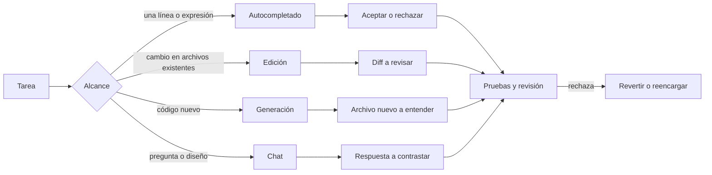
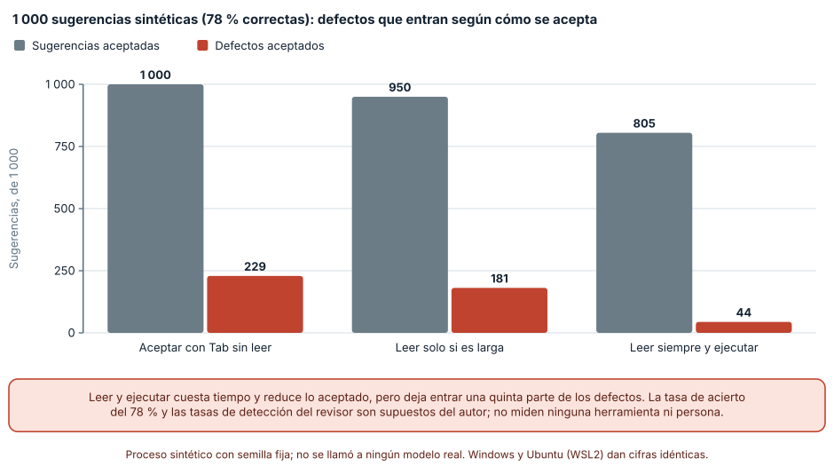
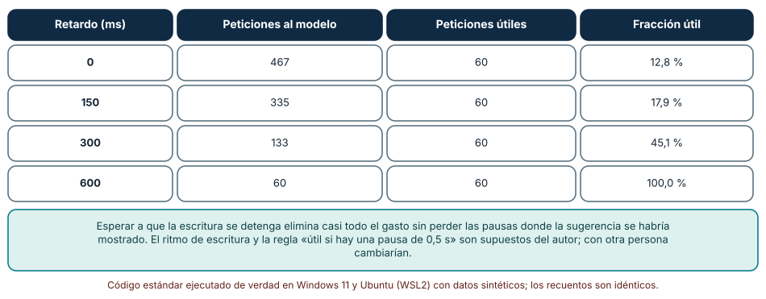

# SE-460 — Autocompletado, chat, edición y generación

[← SE-459 — Contexto, archivos, memoria y recuperación](../../classes/part-38-desarrollo-de-software-asistido-por-ia/se-459-contexto-archivos-memoria-y-recuperacion/README.md) · [↑ Parte 38](../../classes/part-38-desarrollo-de-software-asistido-por-ia/README.md) · [📚 Índice completo](../../classes/README.md) · [🌐 Portal](../../site/classes/SE-460.html) · [SE-461 — Prototipado, scaffolding y exploración de alternativas →](../../classes/part-38-desarrollo-de-software-asistido-por-ia/se-461-prototipado-scaffolding-y-exploracion-de-alternativas/README.md)

## Punto profesional y fundamento pedagógico

**Punto profesional.** La clase existe para que dejes de hablar de «usar IA para programar» como si fuera una sola actividad y distingas cuatro modos de interacción con exigencias distintas: el autocompletado que sugiere mientras escribes, el chat que conversa sobre el código, la edición que propone un cambio sobre archivos existentes y la generación que produce código nuevo. Cada modo cambia cuánto debe revisar quien conduce, qué se puede deshacer y cuánta atención cuesta. La habilidad es elegir el modo según la tarea y fijar una política de aceptación que no dependa de la prisa.

**Por qué aparece aquí.** Sigue a **Contexto, archivos, memoria y recuperación**: `SE-459` estableció qué información llega al modelo; ahora la pregunta es cómo vuelve su salida al código y cuánto control conserva la persona. El caso conductor es el **módulo de calificaciones de la plataforma educativa** con un asistente en el editor. Es un caso sintético; no se usó ninguna herramienta comercial ni se observó a ninguna persona.

**Error conceptual que debe corregir.** Creer que aceptar una sugerencia es una decisión de bajo costo porque «luego se revisa». La aceptación rápida desplaza la lectura crítica al final, cuando ya hay más código encima, y la revisión de un cambio grande y mezclado detecta menos que la de uno pequeño y dirigido; la fricción de aceptar es un control, no un estorbo.

**Secuencia de aprendizaje.** Antes de ver los resultados, predices cuántos defectos entran si aceptas sin leer 1 000 sugerencias de las cuales el 78 % es correcta; después simulas tres políticas de aceptación, comparas una edición dirigida con un archivo regenerado midiendo las líneas de diferencia con `difflib` y cuentas cuántas peticiones al modelo genera una traza de pulsaciones según el retardo antes de pedir. La secuencia usa predicción, explicación propia, contraste y recuperación. [ICAP](https://icap.education.asu.edu/research) distingue participación de construcción de conocimiento; [How People Learn II](https://nap.nationalacademies.org/catalog/24783/how-people-learn-ii-learners-contexts-and-cultures) respalda diseñar la práctica con contextos reales y retroalimentación.

**Evidencia de aprendizaje.** `modos-uso.md` con la predicción, las tres figuras reproducidas, una tabla de diez tareas del módulo asignadas a un modo con la política de aceptación de cada una y una nota que separe qué es medido, inferido y supuesto.

**Límite de la conclusión.** La tasa de sugerencias correctas, la detección del revisor, la curva de detección según el tamaño del diff y el ritmo de escritura son construcciones del autor con semilla fija. Las líneas de diferencia sí se miden con `difflib` sobre un archivo generado. No se observó a ninguna persona ni se evaluó ninguna herramienta: los experimentos demuestran mecanismos, no la magnitud que tendrían en una herramienta o equipo real.

### Trazabilidad fuente → afirmación

| Fuente primaria u oficial | Afirmación que respalda | Lo que no prueba |
|---|---|---|
| [Peng et al., «The Impact of AI on Developer Productivity: Evidence from GitHub Copilot»](https://arxiv.org/abs/2302.06590) | En un experimento controlado con una tarea acotada (un servidor HTTP en JavaScript), el grupo con asistente la completó un 55,8 % más rápido que el de control. | No generaliza a proyectos grandes y conocidos ni mide la calidad del código resultante. |
| [METR, «Measuring the Impact of Early-2025 AI on Experienced Open-Source Developer Productivity»](https://arxiv.org/abs/2507.09089) | En un ensayo aleatorizado con 16 desarrolladores expertos sobre proyectos maduros que conocían, permitir herramientas de IA aumentó el tiempo de finalización en un 19 %, contra la expectativa de los propios participantes. | Es un estudio pequeño, de un periodo y unas herramientas concretas; no implica que ocurra en otros contextos. |
| [Parasuraman y Manzey, «Complacency and Bias in Human Use of Automation»](https://doi.org/10.1177/0018720810376055) | Revisa la complacencia y el sesgo de automatización: tendencia a aceptar la recomendación automatizada y a vigilar menos, que aumenta con la fiabilidad aparente de la ayuda. | No estudia asistentes de programación específicos. |
| [Perry et al., «Do Users Write More Insecure Code with AI Assistants?»](https://arxiv.org/abs/2211.03622) | Los participantes con acceso al asistente escribieron código significativamente menos seguro y creyeron en mayor medida haberlo hecho seguro. | Es un estudio de usuarios con un modelo concreto de su época. |
| [Bacchelli y Bird, «Expectations, outcomes, and challenges of modern code review»](https://doi.org/10.1109/ICSE.2013.6606617) | Analiza la revisión de código moderna: sus objetivos declarados, lo que logra en la práctica y la importancia del contexto para revisar bien. | No mide el efecto del tamaño del cambio con la curva usada en la simulación. |
| [Python: difflib](https://docs.python.org/3/library/difflib.html) | Documenta la comparación de secuencias de líneas usada para contar las líneas de diferencia. | No define qué diferencias son relevantes. |

## Antes de empezar

Recupera lo aprendido en `SE-459`: la salida depende de lo que había en la ventana. La pregunta activa es: **¿cuántas de las últimas sugerencias que aceptaste las leíste hasta el final antes de pulsar la tecla, y cuántas ejecutaste antes de seguir?**

## Prerrequisitos

- Haber completado `SE-459` o poder explicar de qué fuentes llega la información a la ventana.
- Python 3.11 o posterior; los experimentos usan solo la biblioteca estándar (`random`, `difflib`).
- Saber leer un diff unificado y qué significa revisar un cambio.

## Problema auténtico

Un desarrollador del módulo de calificaciones activó el autocompletado y en una hora aceptó más de cien sugerencias. Una de ellas cambió `>=` por `>` en la frontera de aprobación y pasó inadvertida porque la línea «parecía» correcta. Otro pidió al chat que «arreglara la regla de redondeo»; el asistente reescribió el archivo entero, cambió comillas, reordenó importaciones y modificó una condición, y la revisión de un diff de 124 líneas dejó pasar el único cambio real. Un tercero pedía sugerencias a cada pulsación: el servicio contestaba con retraso, la interfaz parpadeaba y el costo de peticiones subió sin que mejorara nada. Los tres incidentes se resuelven con la misma pregunta: qué modo de interacción corresponde a la tarea y qué política de aceptación lo acompaña.

## Objetivos observables

Al terminar podrás:

1. distinguir los cuatro modos (autocompletado, chat, edición, generación) por alcance, reversibilidad y atención que exigen;
2. estimar cuántos defectos entran bajo distintas políticas de aceptación y qué cuesta reducirlos;
3. medir el tamaño de un diff y explicar por qué un cambio dirigido es más revisable que uno regenerado;
4. calcular el efecto de un retardo antes de pedir sugerencias sobre el número de peticiones;
5. redactar una política que asigne un modo y una comprobación a cada tipo de tarea.

## Mapa conceptual



El mapa organiza los modos por el **alcance** de lo que tocan y muestra que todos desembocan en la misma compuerta: pruebas y revisión. Lo que cambia es la cantidad de material que llega a esa compuerta y la facilidad de deshacerlo.

## Temas y por qué importan

| Tema | Por qué cambia una decisión profesional | Evidencia mínima |
|---|---|---|
| Autocompletado | Es el modo de mayor frecuencia y menor fricción: su riesgo es la aceptación sin lectura | tabla de defectos por política de aceptación |
| Chat | Sirve para explorar y explicar; su salida no es un cambio hasta que se aplica | respuestas contrastadas con el código |
| Edición | Cambia código existente: el tamaño del diff condiciona la revisión | líneas de diferencia de una edición dirigida y una regenerada |
| Generación | Introduce código que nadie conocía: exige comprenderlo antes de integrarlo | lectura guiada y pruebas del archivo nuevo |
| Latencia y frecuencia | Un servicio que contesta tarde o demasiado a menudo molesta y cuesta | peticiones frente a retardo |
| Política de aceptación | Convierte la prisa en una decisión explícita | tabla de tareas, modo y comprobación |

## Conceptos y decisiones

### 1. Cuatro modos, cuatro riesgos

El **autocompletado** propone la continuación de lo que escribes, normalmente una línea o un bloque corto, a una frecuencia alta; su riesgo es la aceptación automática, porque cada sugerencia exige una micro-decisión que el cansancio convierte en un reflejo. El **chat** conversa sobre el código; no cambia nada por sí mismo, así que su riesgo es de comprensión: una explicación errónea sobre el sistema, expresada con aplomo (`SE-457`). La **edición** propone modificar archivos existentes, a veces varios a la vez; su riesgo es el alcance, porque el cambio es tan fiable como la lectura que se haga de su diff. La **generación** produce código nuevo; su riesgo es la propiedad, porque aparece código que nadie del equipo escribió ni entiende y que hay que mantener. Que estos modos se vendan juntos en un mismo producto no los vuelve la misma actividad.

### 2. Aceptar es una decisión, no un trámite

Parasuraman y Manzey describen el **sesgo de automatización**: la tendencia a aceptar la recomendación de un sistema automatizado y a reducir la vigilancia, que aumenta cuanto más fiable parece la ayuda. En programación el efecto es especialmente traicionero porque la mayoría de las sugerencias es correcta, de modo que la política «aceptar si parece bien» se refuerza con éxito hasta que falla una que parecía bien. Perry y sus coautores observaron que quienes tenían asistente escribieron código menos seguro y estaban más convencidos de que era seguro. La defensa no es desconfiar de todo, sino hacer proporcional la comprobación al riesgo: aceptar una cadena de texto no es lo mismo que aceptar una condición de frontera, una consulta SQL o una comprobación de permisos. Una política útil dice qué clases de línea no se aceptan sin ejecutar nada.

### 3. El tamaño y la forma del diff condicionan la revisión

Una persona revisa mejor un cambio pequeño y dirigido que uno grande y disperso. Bacchelli y Bird muestran que la revisión de código es una actividad cognitiva en la que el contexto y la comprensión del cambio importan más de lo que la herramienta sugiere, y la experiencia común es que el diff de 400 líneas se hojea. Esto tiene una consecuencia para el modo edición: pedir un cambio de una condición y recibir un archivo regenerado con deriva cosmética (comillas, orden de importaciones, espacios) esconde la línea importante entre cien irrelevantes. Por eso conviene pedir **ediciones dirigidas** (un parche mínimo), restringir qué archivos puede tocar el asistente y rechazar cambios cosméticos mezclados con cambios de comportamiento. Si el formateo debe cambiar, que sea un commit aparte.

### 4. Generar código nuevo es adquirir código

Cuando el asistente genera un módulo nuevo, el equipo adquiere código sin haberlo escrito. Antes de integrarlo hay que poder responder qué hace cada función, qué supone, cómo falla y quién lo mantendrá. Las pruebas son parte de la respuesta, pero si las pruebas también las generó el modelo a partir del código, pueden limitarse a copiar su comportamiento (`SE-462`). Un criterio razonable es que nada se integre sin que una persona lo haya leído entero y pueda explicarlo, y que el código generado cumpla los mismos estándares que el escrito a mano: estilo, pruebas, seguridad y licencia. La velocidad de generar no es la velocidad de integrar. El experimento controlado de Peng muestra aceleración en una tarea acotada y nueva; el ensayo de METR, con desarrolladores expertos en proyectos maduros que conocían, midió lo contrario. Ambos son evidencia de contextos distintos, y ninguno autoriza una cifra para tu equipo.

### 5. Latencia, frecuencia y costo de la interrupción

Una sugerencia útil debe llegar antes de que la persona continúe escribiendo; si llega tarde, estorba o se descarta. Pedir una sugerencia en cada pulsación genera muchas peticiones que se cancelan antes de ser leídas, con costo para el servicio y parpadeo para la persona. La técnica estándar es el **retardo antes de pedir** (*debounce*): esperar a que la escritura se detenga un momento. El retardo óptimo depende del ritmo de la persona y de la latencia del servicio, y no existe un valor universal. Tampoco hay que olvidar el costo de atención: cada sugerencia mostrada obliga a decidir, aun si se rechaza. Un buen diseño muestra menos sugerencias en los momentos en que es más probable que sean útiles, y la persona debe poder ajustarlo.

### Mil sugerencias: la política de aceptación

Se simulan 1 000 sugerencias, el 78 % correctas y el 30 % «largas». Se comparan tres políticas: aceptar con la tecla de tabulación sin leer (no detecta nada), leer solo las largas (detecta el 70 % de los defectos de las largas y el 5 % de las cortas) y leer siempre y ejecutar (detecta el 85 % de los defectos y rechaza por error el 3 % de las correctas).

```python
if buena:
    aceptadas += 1                         # (en la tercera política, el 3 % de las buenas se rechaza)
elif rng.random() < deteccion:              # el defecto se detecta y no entra
    continue
else:
    malas_aceptadas += 1; aceptadas += 1
```

| Política | Sugerencias aceptadas | Defectos aceptados | Por cada 100 aceptadas |
|---|---:|---:|---:|
| Aceptar con Tab sin leer | 1.000 | 229 | 22,9 |
| Leer solo si es larga | 950 | 181 | 19,1 |
| Leer siempre y ejecutar | 805 | 44 | 5,5 |

Aceptar sin leer deja entrar 229 defectos, casi uno de cada cuatro sugerencias aceptadas. Leer solo las largas ahorra poco (181), porque la mayoría de los defectos está en las cortas, que son la mayoría de las sugerencias. Leer y ejecutar reduce los defectos a 44 (5,5 por cada 100 aceptadas), a cambio de aceptar 195 sugerencias menos que la primera política, entre ellas las que se rechazaron sin necesidad. El resultado no dice que haya que leer siempre; dice cuánto compra cada política y cuánto cuesta, para decidirlo según el riesgo.



**Cómo leer la figura.** Cada grupo es una política de aceptación y tiene dos barras: las sugerencias aceptadas (gris) y los defectos que entran (coral). Mira cómo la barra coral baja más que la gris: leer y ejecutar acepta menos sugerencias pero deja entrar muchos menos defectos. **Dónde deja de valer:** el 78 % de acierto, el 30 % de largas y las tasas de detección son supuestos del autor, y suponen que el defecto es detectable por lectura o ejecución, que no siempre lo es. Los números no describen ninguna herramienta ni persona: muestran cómo se combinan la tasa de error y la vigilancia.

### Una condición en un archivo de 182 líneas: edición dirigida o regeneración

Se genera un archivo de 182 líneas con treinta reglas. Se aplica el mismo arreglo (`x > 17` por `x >= 17`) de dos maneras: como edición dirigida de una línea y como archivo regenerado, con deriva cosmética (comillas triples cambiadas, comillas de cadenas, orden de importaciones). Se cuentan con `difflib` las líneas añadidas o eliminadas y se estima la probabilidad de que un revisor encuentre el cambio real con una curva que decae con el tamaño del diff.

```python
cambios = sum(1 for l in difflib.unified_diff(a.splitlines(), b.splitlines(), lineterm="", n=0)
              if l[:1] in "+-" and l[:3] not in ("+++", "---"))
p_detectar = 0.95 / (1 + lineas / 20)     # supuesto del autor
```

| Forma de aplicar el cambio | Líneas distintas | Prob. de encontrar el cambio real |
|---|---:|---:|
| Edición dirigida (una condición) | 2 | 86,4 % |
| Archivo regenerado con deriva cosmética | 124 | 13,2 % |

La edición dirigida cambia 2 líneas (la que se quita y la que se añade) y la regenerada 124, aunque el comportamiento cambiado es el mismo. El número de líneas es una medición real sobre el archivo; la probabilidad de detección es un modelo del autor, y es lo que convierte esa diferencia en riesgo: un cambio escondido entre 124 líneas casi no se encuentra. La práctica que se deduce es pedir parches mínimos, separar los cambios cosméticos y rechazar una edición cuyo diff no corresponde a la petición.


**Cómo leer la figura.** Cada barra es una forma de aplicar el mismo arreglo y su longitud la probabilidad de que la persona encuentre el cambio real al revisar; el número de líneas de diferencia está en la etiqueta. Mira que la edición dirigida, de 2 líneas, se revisa bien y el archivo regenerado, de 124, esconde el cambio. **Dónde deja de valer:** la curva de detección es del autor y no sale de ninguna medición de personas; el archivo es sintético y la deriva cosmética es de cuatro tipos que se eligieron para el ejemplo. Un asistente real puede tocar más o menos líneas, y una herramienta de formateo automático haría ese ruido desaparecer.

### Una traza de 467 pulsaciones: el retardo antes de pedir

Se genera una traza determinista de 467 pulsaciones en 60 «palabras», con pausas de pensamiento entre ellas. Una petición es *útil* si la persona hace una pausa de al menos 0,5 s tras la pulsación, pues solo entonces la sugerencia tiene tiempo de mostrarse. Se cuentan las peticiones que se enviarían con cuatro retardos.

| Retardo (ms) | Peticiones al modelo | Peticiones útiles | Fracción útil |
|---:|---:|---:|---:|
| 0 | 467 | 60 | 12,8 % |
| 150 | 335 | 60 | 17,9 % |
| 300 | 133 | 60 | 45,1 % |
| 600 | 60 | 60 | 100,0 % |

Sin retardo, el 87 % de las peticiones se desperdicia (467 enviadas para 60 útiles). Con 300 ms bajan a 133 sin perder ninguna útil, y con 600 ms coinciden con las útiles. La conclusión depende de una regla («útil si hay pausa de 0,5 s») que el autor fijó. Si la persona escribe más lento, o el servicio es más rápido, el punto cambia; lo que permanece es que enviar a cada pulsación es un gasto sin beneficio.



**Cómo leer la figura.** Cada grupo es un retardo antes de pedir sugerencias y tiene dos barras: las peticiones al modelo (coral) y las útiles (turquesa). Mira cómo la barra coral baja hasta igualar a la turquesa con 600 ms: el retardo elimina casi todo el gasto sin perder las pausas útiles. **Dónde deja de valer:** el ritmo de escritura y las pausas son del autor, la regla de utilidad es una simplificación, y no se modeló que un retardo largo retrasa las sugerencias que sí eran útiles.

## Definiciones de trabajo

- **autocompletado:** sugerencia de continuación mientras se escribe, aceptada o rechazada en el momento.
- **edición asistida:** propuesta de cambio sobre código existente, presentada como diff.
- **generación:** producción de código nuevo a partir de una descripción.
- **sesgo de automatización:** tendencia a aceptar la recomendación automatizada y a vigilar menos.
- **retardo antes de pedir (debounce):** espera tras la última pulsación antes de enviar una petición.

Las definiciones son operativas para el módulo de calificaciones. No convierten términos con una historia más amplia en sinónimos y deben contrastarse con la documentación primaria enlazada al final.

## Ejemplo mínimo

El fragmento mide cuántas líneas cambia una edición frente a una regeneración. Antes de ejecutarlo, predice el número de líneas distintas de cada una.

```python
import difflib
original = "def f(x):\n    if x > 17:\n        return 1\n    return 0\n"
dirigido = original.replace("x > 17", "x >= 17")
regenerado = '''def f(x):
    if x >= 17:
        return 1
    return 0
'''.replace("    return 0", "    return 0  # fin")
def n(a, b):
    return sum(1 for l in difflib.unified_diff(a.splitlines(), b.splitlines(), lineterm="", n=0)
               if l[:1] in "+-" and l[:3] not in ("+++", "---"))
print(n(original, dirigido), n(original, regenerado))
```

La edición dirigida cambia 2 líneas y la regenerada 4, porque añadió un comentario irrelevante. Registra versión de Python, comando y salida; después añade tres cambios cosméticos y observa cómo crece el diff.

## Ejemplo profesional

Escenario hipotético, construido para la clase y sin datos reales. El equipo del módulo de calificaciones asigna modo y política a diez tareas. «Cambiar una condición de frontera» va por edición dirigida con parche mínimo y obligación de correr las pruebas antes de aceptar. «Entender cómo se calcula el redondeo» va por chat, con la función en el contexto y la respuesta contrastada con el código. «Escribir el cuerpo de una función con firma y pruebas dadas» va por autocompletado, con prohibición de aceptar líneas que contengan comparaciones de frontera, consultas o permisos sin ejecutar. «Crear un módulo de exportación nuevo» va por generación, con lectura completa por una segunda persona y las mismas pruebas que el código escrito a mano. El equipo ajusta el retardo de sugerencias a 300 ms tras observar que la mayoría de las pausas útiles supera ese valor. Escribe la política con dueño y revisión trimestral, y registra qué modo usó cada cambio en el mensaje del commit para poder correlacionarlo con defectos posteriores.

## Práctica guiada

1. Predice cuántos defectos entran al aceptar sin leer 1 000 sugerencias del 78 % de acierto y anota el número.
2. Ejecuta la simulación de políticas con la semilla fijada y compara con tu predicción.
3. Cambia la tasa de acierto a 90 % y a 60 % y observa cómo cambia el valor de leer.
4. Aplica el mismo arreglo a un archivo de tu proyecto como edición dirigida y como regeneración y mide el diff con `difflib`.
5. Simula la traza de pulsaciones y elige un retardo; justifica con las peticiones útiles y el desperdicio.
6. Asigna un modo y una comprobación a diez tareas del módulo y escribe qué líneas nunca se aceptan sin ejecutar.
7. Entrega `modos-uso.md` y pide a otra persona que proponga una tarea que tu política asigne mal.

## Ejercicios

1. **Modos:** elige modo para «renombrar una función en doce archivos» y para «explicar un traceback»; justifica por reversibilidad y alcance.
2. **Aceptación:** con una sugerencia correcta el 95 % de las veces, ¿cuántos defectos entran en 1 000 aceptaciones a ciegas? ¿Qué cambia si el 5 % restante son errores de frontera?
3. **Diff:** una edición toca 3 líneas relevantes y 40 cosméticas. Describe cómo pedirías al asistente que lo separe y qué comprobarías en cada parte.
4. **Retardo:** si la persona escribe más lento (pausas de 0,3 s), ¿qué retardo elegirías y qué pierdes con 600 ms?

## Reto verificable

Entrega `modos-uso.md` con la predicción, las tres tablas, la asignación de modo y política a diez tareas del módulo, las líneas que no se aceptan sin ejecutar y una medición del diff de al menos un cambio hecho de las dos maneras. Se aprueba si otra persona ejecuta el código desde un checkout limpio, obtiene los mismos números con las mismas semillas y puede decir qué modo usaría para una tarea nueva y qué comprobaría. No se aprueba por afirmar que «se revisa todo» sin decir cómo, ni por una política que dependa de la voluntad de cada persona.

## Caso conductor

El módulo de calificaciones es el caso conductor. Esta clase deja el cuarto artefacto: la política de modos y aceptación. `SE-461` preguntará cuándo conviene generar alternativas y prototipos en lugar de un cambio definitivo, y `SE-463` cómo se revisa y refactoriza con ayuda del asistente. Cambia después un solo dato, la tasa de sugerencias correctas, y observa a partir de qué valor leer todas deja de compensar.

## Preguntas frecuentes

### ¿El autocompletado es más seguro que el chat porque propone menos código?

No necesariamente. Propone menos código por sugerencia pero muchas más sugerencias, y su fricción es mínima; el chat propone más de una vez pero invita a leer. El riesgo cambia de naturaleza, no desaparece.

### ¿Debo desactivar el autocompletado en código crítico?

Es una decisión legítima. Una alternativa es mantenerlo y exigir que las líneas de frontera, permisos, consultas y criptografía se escriban o se comprueben de forma explícita. Lo importante es que la política exista y se respete.

### ¿Por qué un asistente reformatea cosas que no le pedí?

Porque genera el archivo completo como texto probable y no hace una operación de edición mínima. Pide un parche, restringe los archivos que puede tocar y aplica un formateador automático aparte.

### ¿Los estudios que muestran aceleración contradicen el que muestra lo contrario?

No, miden situaciones distintas: tareas acotadas y nuevas frente a proyectos maduros que el desarrollador conoce a fondo. Ninguno da una cifra para tu equipo; la medición propia (`SE-467`) es la que decide.

## Fallo controlado y diagnóstico

Reproduce el fallo clásico de la clase: **un cambio real escondido en un diff regenerado**. Aplica el arreglo de una condición como regeneración de un archivo de 182 líneas y cuenta las líneas del diff.

Registra síntoma, entrada mínima, hipótesis, observación que descarta cada hipótesis, causa, corrección y prueba de regresión. **Síntoma:** la revisión aprobó un cambio que además alteraba una frontera. **Hipótesis rivales:** (a) la persona revisó con descuido; (b) el asistente cambió más de lo pedido; (c) el diff era tan grande que el cambio de comportamiento se perdió. **Prueba:** mide el diff con `difflib`; si pasa de 2 a 124 líneas para el mismo cambio de comportamiento, la causa es la forma de aplicar el cambio. **Conclusión:** la revisión necesita un diff proporcional al cambio. **Regresión:** añade una comprobación en integración que falle si el número de líneas cambiadas supera un múltiplo declarado de las pedidas, o si hay cambios cosméticos mezclados. No cambies a la vez el asistente y el procedimiento de revisión.

## Errores comunes y cómo corregirlos

| Síntoma | Causa probable | Corrección |
|---|---|---|
| Se acepta una línea de frontera equivocada | Aceptación a ciegas | Lista de líneas que no se aceptan sin ejecutar |
| El diff es enorme para un cambio pequeño | Se pidió el archivo regenerado | Pedir parches mínimos y separar los cambios cosméticos |
| Se integra un módulo generado que nadie entiende | Generación sin lectura | Lectura completa y explicación antes de integrar |
| Mucho gasto y poca ayuda del autocompletado | Petición en cada pulsación | Retardo antes de pedir ajustado al ritmo |
| La política cambia con el cansancio | Depende de la voluntad individual | Reglas escritas, automáticas y revisadas |

## Entorno y archivos clave

```text
work/SE-460/
├── README.md
├── modos/
│   ├── aceptacion.py
│   ├── alcance_diff.py
│   └── retardo.py
├── tests/test_modos.py
└── evidence/modos-uso.md
```

El `README` declara plataforma, versión de Python, semillas y comandos. Los experimentos usan solo la biblioteca estándar (`random`, `difflib`) y se ejecutaron con CPython 3.12.9 en Windows 11 y 3.12.3 en Ubuntu bajo WSL2: las salidas fueron idénticas. Los experimentos están en `scripts/experiments_part38_a.py`. Si añades una dependencia, fija procedencia y versión.

## Seguridad, ética y accesibilidad

- el código aceptado a ciegas puede introducir vulnerabilidades o dependencias no revisadas; las comprobaciones de seguridad no se aplazan porque el código «lo escribió la herramienta»;
- el servicio de sugerencias recibe parte del código como contexto: decide qué archivos nunca se envían (`SE-466` lo desarrolla);
- la presión por aceptar rápido puede discriminar a quien necesita más tiempo para leer; la política de revisión debe permitirlo;
- las sugerencias emergentes deben poder desactivarse y ser compatibles con lectores de pantalla y teclado, sin depender de un gesto del ratón;
- los artículos y estándares citados tienen derechos de autor: cita su estructura y vincula la fuente, no copies su texto.

## Puente hacia el trabajo con agentes

Un agente combina los cuatro modos: lee, conversa, edita varios archivos y genera código, y lo hace en bucle sin que cada paso pase por tus ojos. Eso desplaza la política de aceptación de la sugerencia al cambio completo. Define qué archivos puede tocar, exige que entregue un parche mínimo con las pruebas ejecutadas, limita el número de líneas por cambio y pídele que declare qué partes no pudo comprobar. Revisa el diff final como si lo hubiera escrito alguien que no conoce el sistema, y compara las líneas cambiadas con las pedidas: la diferencia es el margen que has dado sin querer.

## Transferencia

Traslada el análisis a otro dominio (por ejemplo, un asistente que edita plantillas de documentos para un taller mecánico): cambia las tareas y las líneas críticas y conserva el procedimiento de asignar modo, aceptar por riesgo, pedir ediciones mínimas y ajustar el retardo. La transferencia está lograda cuando puedes decir qué cambios de ese dominio nunca se aceptarían sin ejecutar, no cuando la tabla se parece a la del módulo de calificaciones.

## Evaluación y evidencia

| Criterio | Evidencia para aprobar |
|---|---|
| comprensión | explicación de los cuatro modos, del sesgo de automatización y del efecto del tamaño del diff |
| corrección | tablas de aceptación, diff y retardo reproducibles con las mismas semillas |
| diseño | política con modo, comprobación, líneas críticas, dueño y revisión |
| diagnóstico | reproducción del fallo «cambio escondido en un diff grande» con regresión |
| incertidumbre | declaración de que tasas, curva de detección y ritmo son del autor |
| reproducibilidad | versiones, comandos, salida y límites declarados |

## Fuentes

- [Peng et al., «The Impact of AI on Developer Productivity: Evidence from GitHub Copilot»](https://arxiv.org/abs/2302.06590) — experimento controlado con una tarea acotada; autoridad: preprint de investigadores de GitHub y Microsoft.
- [METR, «Measuring the Impact of Early-2025 AI on Experienced Open-Source Developer Productivity»](https://arxiv.org/abs/2507.09089) — ensayo aleatorizado con desarrolladores expertos; autoridad: METR.
- [Parasuraman y Manzey, «Complacency and Bias in Human Use of Automation»](https://doi.org/10.1177/0018720810376055) — complacencia y sesgo de automatización; autoridad: Human Factors.
- [Perry et al., «Do Users Write More Insecure Code with AI Assistants?»](https://arxiv.org/abs/2211.03622) — estudio de usuarios sobre código inseguro con asistente; autoridad: ACM CCS 2023.
- [Bacchelli y Bird](https://doi.org/10.1109/ICSE.2013.6606617) — revisión de código moderna; autoridad: ICSE 2013.
- [Python: difflib](https://docs.python.org/3/library/difflib.html) — comparación de secuencias; autoridad: documentación de Python.
- [Python: random](https://docs.python.org/3/library/random.html) — generador con semilla; autoridad: documentación de Python.

Cada fuente respalda el mecanismo indicado; ninguna demuestra que los 229 defectos de la aceptación a ciegas, el 13,2 % de detección en el diff regenerado o el 87 % de peticiones desperdiciadas se observen en una herramienta o equipo reales. Esa afirmación depende de la herramienta, del equipo y de cómo se mida.

## Límites y siguiente paso

Se ejecutaron tres experimentos en Windows y Ubuntu (WSL2) con resultados idénticos: una simulación de aceptación, una medición real de diff con `difflib` sobre un archivo generado y una traza de pulsaciones determinista. No se observó a ninguna persona ni se evaluó ninguna herramienta; la tasa de acierto, la detección del revisor, la curva de detección según el tamaño del diff, el ritmo de escritura y la regla de utilidad son construcciones del autor. La siguiente clase pregunta cuándo conviene generar alternativas y prototipos en lugar de un cambio definitivo.

## Glosario

- **autocompletado:** sugerencia de continuación mientras se escribe, aceptada o rechazada en el momento.
- **edición asistida:** propuesta de cambio sobre código existente, presentada como diff.
- **generación:** producción de código nuevo a partir de una descripción.
- **sesgo de automatización:** tendencia a aceptar la recomendación automatizada y a vigilar menos.
- **retardo antes de pedir (debounce):** espera tras la última pulsación antes de enviar una petición.

---

[← SE-459 — Contexto, archivos, memoria y recuperación](../../classes/part-38-desarrollo-de-software-asistido-por-ia/se-459-contexto-archivos-memoria-y-recuperacion/README.md) · [↑ Parte 38](../../classes/part-38-desarrollo-de-software-asistido-por-ia/README.md) · [📚 Índice completo](../../classes/README.md) · [🌐 Portal](../../site/classes/SE-460.html) · [SE-461 — Prototipado, scaffolding y exploración de alternativas →](../../classes/part-38-desarrollo-de-software-asistido-por-ia/se-461-prototipado-scaffolding-y-exploracion-de-alternativas/README.md)
