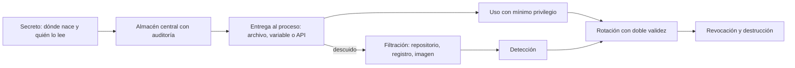
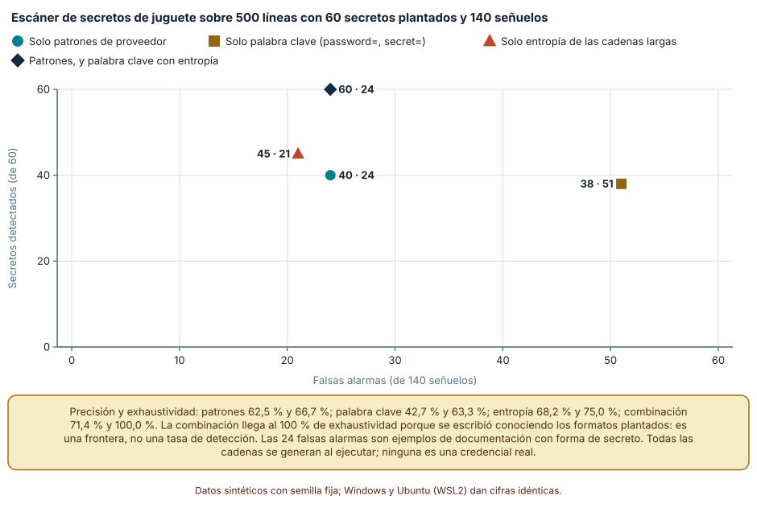
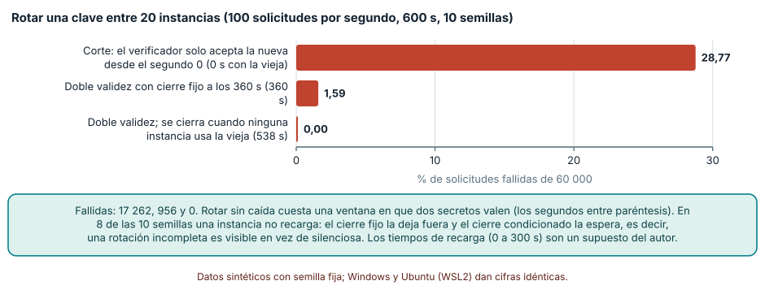
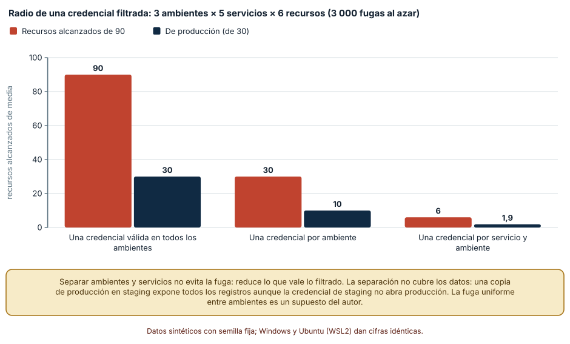

# SE-462 — Secretos, configuración y separación de ambientes

[← SE-461 — Criptografía aplicada y gestión de claves](../../classes/part-38-seguridad-privacidad-y-cumplimiento/se-461-criptografia-aplicada-y-gestion-de-claves/README.md) · [↑ Parte 38](../../classes/part-38-seguridad-privacidad-y-cumplimiento/README.md) · [📚 Índice completo](../../classes/README.md) · [🌐 Portal](../../site/classes/SE-462.html) · [SE-463 — Privacidad por diseño y minimización →](../../classes/part-38-seguridad-privacidad-y-cumplimiento/se-463-privacidad-por-diseno-y-minimizacion/README.md)

## Punto profesional y fundamento pedagógico

**Punto profesional.** La clase existe para que trates un secreto como un dato con ciclo de vida y no como una línea de configuración: dónde nace, quién puede leerlo, cuánto vale lo que protege, cómo se detecta una filtración y cómo se cambia sin que el servicio caiga. La habilidad profesional es diseñar la rotación y el radio de una filtración antes de que ocurra, y medir qué detecta realmente una herramienta de búsqueda de secretos antes de confiar en ella.

**Por qué aparece aquí.** Sigue a **Criptografía aplicada y gestión de claves**: la clase anterior terminó con una clave maestra que no debe vivir en el repositorio; esta responde dónde vive entonces y cómo se cambia. Casi todos los secretos que se filtran lo hacen por descuido de proceso (un archivo de configuración, un registro, un historial de git), no por un ataque ingenioso. El caso conductor es **la plataforma de entregas**: credenciales de base de datos, claves de firma de enlaces, tokens de servicios de correo y almacenamiento, en tres ambientes.

**Error conceptual que debe corregir.** Creer que sacar el secreto del código lo protege. Una variable de entorno sigue estando en los volcados de memoria, en los registros de arranque y en cada proceso hijo; un secreto compartido entre ambientes convierte una filtración en desarrollo en una intrusión en producción; y rotar solo tiene sentido si el sistema acepta dos secretos a la vez durante el cambio.

**Secuencia de aprendizaje.** Antes de mirar los resultados, predices qué fracción de 60 secretos plantados encuentra cada estrategia de búsqueda y cuántas solicitudes fallan al rotar una clave entre veinte instancias; después mides cuántos recursos de producción alcanza una credencial filtrada según cómo se reparten. La secuencia usa predicción, contraste y explicación propia. [ICAP](https://icap.education.asu.edu/research) distingue participar de construir conocimiento; [How People Learn II](https://nap.nationalacademies.org/catalog/24783/how-people-learn-ii-learners-contexts-and-cultures) respalda diseñar la práctica con contextos reales y retroalimentación.

**Evidencia de aprendizaje.** `secretos-log.md` con la predicción, el inventario de secretos de la plataforma con dueño, ambiente y radio, las tres tablas, el procedimiento de rotación sin caída y una nota que separe qué parte es medida, cuál es modelo y cuál es suposición.

**Límite de la conclusión.** El escáner de la clase es de juguete y se escribió conociendo los formatos que planta, por lo que su exhaustividad es una frontera y no una tasa de detección; las cadenas con forma de credencial se generan al ejecutar y no son credenciales reales. La rotación se simula en tiempo virtual (veinte instancias, recarga entre 0 y 300 s) y el radio de la fuga supone una distribución uniforme de fugas entre ambientes. No se usó ninguna herramienta de detección de secretos ni ningún gestor de secretos reales.

### Trazabilidad fuente → afirmación

| Fuente primaria u oficial | Afirmación que respalda | Lo que no prueba |
|---|---|---|
| [OWASP Secrets Management Cheat Sheet](https://cheatsheetseries.owasp.org/cheatsheets/Secrets_Management_Cheat_Sheet.html) | Recomienda centralizar los secretos, automatizar su rotación, aplicar mínimo privilegio, auditar el acceso y no incluirlos en el código ni en imágenes. | No elige un producto. |
| [The Twelve-Factor App: configuración](https://12factor.net/config) | Propone separar la configuración del código y guardarla en el entorno, con una prueba: poder publicar el código sin exponer credenciales. | No considera la exposición de las variables de entorno por el proceso. |
| [CWE-798](https://cwe.mitre.org/data/definitions/798.html) | Define el uso de credenciales incrustadas en el código y sus consecuencias. | No mide su frecuencia. |
| [GitHub: secret scanning](https://docs.github.com/en/code-security/secret-scanning/introduction/about-secret-scanning) | Describe la búsqueda de secretos con patrones de proveedores en repositorios y avisos a los proveedores. | No garantiza que un secreto sin patrón conocido se detecte. |
| [Meli, McNiece y Reaves, «How Bad Can It Git?»](https://www.ndss-symposium.org/ndss-paper/how-bad-can-it-git-characterizing-secret-leakage-in-public-github-repositories/) | Caracteriza empíricamente la filtración de secretos en repositorios públicos de GitHub. | No dice nada de repositorios privados ni de la plataforma. |
| [NIST SP 800-57 Parte 1 Rev. 5](https://csrc.nist.gov/pubs/sp/800/57/pt1/r5/final) | Describe el ciclo de vida de las claves, incluida la rotación y la revocación. | No define el procedimiento de la plataforma. |

## Antes de empezar

Recupera lo aprendido en `SE-461` sobre la jerarquía de claves y en `SE-457` sobre el radio de un compromiso. La pregunta activa es: **si esta noche se filtra la credencial de la base de datos de desarrollo, ¿qué puede hacer quien la tenga en producción, y cuánto tardaría el equipo en cambiarla sin caída?**

## Prerrequisitos

- Haber completado `SE-461` o poder explicar el ciclo de vida de una clave.
- Python 3.11 o posterior; los experimentos usan solo la biblioteca estándar (`re`, `math`, `random`).
- Saber qué es una variable de entorno y un historial de git.

## Problema auténtico

En un escenario ilustrativo, un desarrollador subió a la rama principal un archivo de configuración con la clave de acceso al almacenamiento de archivos, la quitó en el commit siguiente y siguió trabajando. Dos días después apareció actividad extraña en el almacenamiento: el historial conservaba la clave. El equipo la rotó a las seis de la tarde y la rotación tiró el servicio durante veinte minutos, porque el verificador del otro lado aceptaba solo la clave nueva mientras las instancias seguían usando la vieja hasta que reiniciaran. Y se supo que la clave era la misma en desarrollo, staging y producción, de modo que la filtración de un entorno de pruebas era una filtración total. Ninguna de las tres cosas era una sofisticación: faltaba detección, faltaba un procedimiento de cambio con doble validez y faltaba la separación entre ambientes. La clase enseña a medir lo que detecta una búsqueda de secretos, a rotar sin interrumpir y a acotar el radio.

## Objetivos observables

Al terminar podrás:

1. inventariar los secretos de un sistema con su dueño, su ambiente, su radio y su caducidad;
2. medir la precisión y la exhaustividad de distintas estrategias de detección y explicar por qué ninguna basta;
3. diseñar una rotación sin caída con doble validez y un criterio de cierre observable;
4. comparar esquemas de credenciales por el radio que alcanza una filtración;
5. separar ambientes de configuración y de datos y decir qué separación no cubre la otra.

## Mapa conceptual



El mapa muestra el ciclo normal (de izquierda a derecha) y la **filtración** como un desvío que la **detección** devuelve a la rotación. Un sistema sin rotación practicada convierte cada detección en un incidente.

## Temas y por qué importan

| Tema | Por qué cambia una decisión profesional | Evidencia mínima |
|---|---|---|
| Inventario y ciclo de vida | No se puede rotar ni revocar lo que no se conoce. | Tabla de secretos con dueño, ambiente y radio |
| Dónde viven y cómo llegan | Cada canal de entrega tiene exposiciones distintas. | Elección razonada por secreto |
| Detección de secretos | Los patrones y la entropía fallan de maneras diferentes. | Precisión y exhaustividad medidas |
| Rotación sin caída | Cambiar un secreto con un solo valor válido interrumpe el servicio. | Protocolo con doble validez y gancho de cierre |
| Ambientes y radio | Un secreto compartido une la suerte de todos los entornos. | Radio por esquema de credenciales |

## Conceptos y decisiones

### 1. Inventario y ciclo de vida

Un secreto es cualquier valor cuyo conocimiento concede una capacidad: contraseñas, claves de API, claves de firma y de cifrado, tokens de acceso, certificados privados, cadenas de conexión con credenciales. El inventario registra por cada uno quién lo creó, qué sistema lo usa, en qué ambiente vale, qué puede hacer quien lo tenga (radio), cuándo caduca y cómo se rota. Sin inventario, la respuesta a «se filtró esta clave» es una búsqueda manual en el peor momento. El ciclo de vida de NIST SP 800-57 (generar, distribuir, usar, rotar, revocar, destruir) se aplica a todos, no solo a las claves de cifrado. Una regla útil: un secreto sin dueño y sin fecha de caducidad es un incidente esperando.

### 2. Dónde viven y cómo llegan al proceso

El código no debe contener secretos (CWE-798): quien puede leer el código, el historial o una imagen de contenedor los obtiene, y el historial de git conserva lo que se quitó. Se entregan al proceso por un canal que no queda en el repositorio. Las **variables de entorno** son simples y las propone la metodología de doce factores, pero se heredan por los procesos hijos, aparecen en volcados y en algunas herramientas de diagnóstico. Los **archivos montados** con permisos restringidos evitan parte de eso. Una **API de un gestor de secretos** entrega el valor al proceso en el arranque o a demanda, con identidad de la carga de trabajo, registro de acceso y rotación integrada. La elección depende del valor protegido y del equipo; el criterio es que el secreto sea **efímero cuando se pueda** (credenciales con vencimiento corto emitidas a pedido) y que el acceso sea auditable. El código tampoco debe escribir secretos en registros ni en mensajes de error, y las pruebas no deben usar secretos de producción.

### 3. Detectar secretos filtrados

Las herramientas de búsqueda combinan **patrones** (formatos de proveedores conocidos, como el prefijo de una clave de acceso o la cabecera de una clave privada), **palabras clave** de asignación (`password=`, `secret=`) y **entropía** (cadenas largas con aspecto aleatorio). Cada estrategia comete un error distinto: los patrones fallan con formatos nuevos o propios y no ven una contraseña corta; la palabra clave acierta con asignaciones y confunde ejemplos de documentación («password = 'changeme'»); la entropía acierta con claves aleatorias y confunde hashes, identificadores únicos e imágenes en base64. Se combinan y se afinan con casos reales, y cada falsa alarma tiene un costo: cuando el equipo aprende a ignorar la herramienta, la herramienta deja de existir. Dos hábitos complementan la detección: buscar también en el historial, no solo en el último commit, y automatizar una acción ante un hallazgo: **la clave encontrada se considera comprometida y se rota**, no se borra del archivo.

### 4. Rotar sin caída

Rotar es cambiar el valor válido de un secreto. Si el emisor y el verificador cambian en instantes distintos, hay una ventana en la que no coinciden y las solicitudes fallan. La solución es la **doble validez**: el verificador acepta la clave vieja y la nueva durante la transición; los emisores migran a la nueva; cuando ninguno usa la vieja, se retira. El criterio de cierre debe ser **observable** (un contador de usos de la clave vieja en cero durante un periodo), no un temporizador fijo, porque siempre hay una instancia que no recargó. Esa instancia es el caso de borde: un cierre por tiempo la rompe en silencio; un cierre condicionado deja la clave vieja viva más tiempo y lo hace visible. La rotación se ensaya antes de la emergencia. La rotación de emergencia por filtración difiere en que la ventana de doble validez es un riesgo, de modo que se acorta y se compensa con detección del uso de la clave vieja.

### 5. Ambientes y radio de una filtración

La separación de ambientes tiene dos partes que se confunden. La **separación de credenciales** hace que un secreto de desarrollo no abra producción: credenciales distintas por ambiente y, mejor, por servicio dentro del ambiente, para que una filtración abra lo mínimo. La **separación de datos** hace que los ambientes de prueba no contengan datos reales: una copia de producción en staging expone todos los registros aunque la credencial de staging no abra producción, y una persona con acceso a staging se convierte en una persona con acceso a datos de producción (ver `SE-463`). La configuración (qué endpoint, qué límite) puede diferir entre ambientes; el código y la imagen no deberían. La paridad entre ambientes reduce sorpresas, y la separación de credenciales y datos reduce daños: ambas son compatibles.

### Cuatro maneras de buscar 60 secretos

Se generan 500 líneas: 60 secretos plantados (claves con prefijo de proveedor, tokens, asignaciones de contraseña, claves largas aleatorias, cabeceras de clave privada y tokens firmados), 140 señuelos (hashes de commits, identificadores únicos, huellas SHA-256, imágenes en base64, contraseñas de ejemplo y tokens de documentación con relleno) y 300 líneas de texto. Se evalúan cuatro estrategias.

```python
def combinado(linea):
    if any(p.search(linea) for p in PATRONES): return True
    m = PALABRA_CLAVE.search(linea)
    return bool(m) and entropia(m.group(2)) >= 3.0 and m.group(2).lower() not in EJEMPLOS
```

| Estrategia | Detectados de 60 | Falsas alarmas | Precisión | Exhaustividad |
|---|---:|---:|---:|---:|
| Solo patrones de proveedor | 40 | 24 | 62,5 % | 66,7 % |
| Solo palabra clave | 38 | 51 | 42,7 % | 63,3 % |
| Solo entropía de cadenas largas | 45 | 21 | 68,2 % | 75,0 % |
| Patrones, y palabra clave con entropía | 60 | 24 | 71,4 % | 100,0 % |

Ninguna estrategia simple encuentra todo, y la combinación llega al 100 % porque se escribió conociendo los formatos plantados: es una frontera, no una promesa. Las 24 falsas alarmas son, entre otras, un token de documentación con forma de clave real.



**Cómo leer la figura.** El eje horizontal son las falsas alarmas y el vertical los secretos detectados; cada punto es un escáner y lo mejor es arriba a la izquierda. Mira que ninguno llega a la esquina y que la combinación sube a 60 sin bajar las falsas alarmas: sube detectados a costa de ruido. **Dónde deja de valer:** el generador, los formatos y los señuelos son del autor; con formatos que la herramienta no conoce (un token propio, una clave corta) la exhaustividad baja sin avisar. Que el último escáner llegue a 100 % es una consecuencia de cómo se escribió el experimento, no un resultado generalizable.

### Rotar una clave entre veinte instancias

Veinte instancias firman solicitudes con una clave compartida con el verificador, a 100 solicitudes por segundo durante 600 s. En la rotación cada instancia recarga la configuración en un instante uniforme entre 0 y 300 s, y en el 60 % de las semillas una instancia no recarga. Se prueban tres estrategias del lado del verificador y se promedian diez semillas.

| Estrategia | Solicitudes fallidas | Segundos con la clave vieja aceptada |
|---|---:|---:|
| Corte: solo la nueva desde el segundo 0 | 17 262 de 60 000 (28,77 %) | 0 |
| Doble validez con cierre fijo a los 360 s | 956 de 60 000 (1,59 %) | 360 |
| Doble validez; se cierra cuando ninguna instancia usa la vieja | 0 de 60 000 (0 %) | 538 (media) |

El corte tira más de una cuarta parte de las solicitudes. El cierre fijo evita casi todo, pero rompe a la instancia atascada (956 fallos) sin que nadie lo decida. El cierre condicionado no falla ninguna solicitud y mantiene la clave vieja aceptada hasta que la instancia atascada se corrija: la rotación incompleta es visible.



**Cómo leer la figura.** Cada barra es una estrategia de rotación con los segundos que mantiene la clave vieja entre paréntesis, y su longitud, el porcentaje de solicitudes fallidas. Mira que la barra se acorta justo cuando la ventana de doble validez se alarga: sin caída cuesta una ventana en que dos secretos valen. **Dónde deja de valer:** los tiempos de recarga (0 a 300 s), el 60 % de semillas con una instancia atascada y la tasa de solicitudes son supuestos del autor; con una filtración activa, mantener 538 s la clave vieja aceptada es un riesgo que exigiría una detección del uso de la clave vieja y un cierre forzado.

### El radio de una credencial filtrada

Hay tres ambientes, cinco servicios y seis recursos por servicio (90 recursos, 30 de ellos de producción). Se sortean 3 000 fugas, cada una de un ambiente y un servicio al azar, y se calcula cuántos recursos abre la credencial filtrada según el esquema.

| Esquema de credenciales | Recursos alcanzados (de 90) | De producción (de 30) |
|---|---:|---:|
| Una credencial válida en todos los ambientes | 90 | 30 |
| Una credencial por ambiente | 30 | 10 |
| Una credencial por servicio y ambiente | 6 | 1,9 |

La separación por ambiente reduce el radio a un tercio y la separación por servicio y ambiente a una quinceava parte. Ninguna elimina la fuga: reduce lo que vale.



**Cómo leer la figura.** Cada grupo es un esquema de credenciales; la barra coral son los recursos alcanzados de 90 y la azul, los de producción de 30. Mira cómo ambas se acortan al separar ambientes y servicios: no evita la fuga, reduce lo que vale lo filtrado. **Dónde deja de valer:** la fuga uniforme entre ambientes es un supuesto del autor (en la práctica se filtra más en desarrollo); la tabla no cubre los datos: una copia de producción en staging expone todos los registros aunque la credencial de staging no abra producción, y de ahí la separación de datos de `SE-463`.

## Definiciones de trabajo

- **secreto:** valor cuyo conocimiento concede una capacidad, como una contraseña, una clave de API o un token.
- **radio de una filtración:** conjunto de recursos y datos que quien obtiene un secreto puede alcanzar con él.
- **doble validez:** periodo en que el verificador acepta tanto el secreto viejo como el nuevo para permitir una migración sin interrupción.
- **entropía de una cadena:** medida de su imprevisibilidad según la distribución de sus caracteres; una cadena aleatoria larga tiene entropía alta.
- **paridad entre ambientes:** igualdad de código, imagen y estructura entre desarrollo, pruebas y producción, con diferencias solo en configuración y credenciales.

Las definiciones son operativas para la plataforma de entregas. No convierten términos con una historia más amplia en sinónimos y deben contrastarse con la documentación primaria enlazada al final.

## Ejemplo mínimo

El fragmento muestra por qué una clave eliminada del archivo no está eliminada. Antes de ejecutarlo, predice qué imprime.

```python
historial = ["clave=XYZ123", "clave=<quitada>"]
print(historial[-1], any("XYZ123" in version for version in historial))
```

La última versión no contiene la clave, y la búsqueda en el historial devuelve `True`: la clave sigue ahí. Registra versión de Python, comando y salida; después escribe la acción correcta ante el hallazgo (rotar la clave) y por qué borrar el archivo no la sustituye.

## Ejemplo profesional

El equipo inventaría 23 secretos con su dueño y radio y descubre dos sin dueño. Mueve las credenciales a un gestor que las entrega a cada servicio con una identidad propia, emite credenciales de base de datos con vencimiento de una hora para los procesos y deja una sola clave de larga duración (la de firma de enlaces). Separa ambientes: una credencial por servicio y ambiente, y datos sintéticos en staging. Añade un escáner de secretos en la revisión de cambios y en una tarea nocturna sobre el historial, con una regla: un hallazgo cuenta como incidente y la clave se rota, no se oculta. Ensaya una rotación por trimestre con doble validez y cierre condicionado: el verificador publica un contador de usos de la clave vieja y el procedimiento se cierra cuando lleva cuatro horas en cero. El resultado se mide por lo que cambia: en el modelo de la clase, el radio de una fuga de desarrollo pasa de 30 a 0 recursos de producción.

## Práctica guiada

1. Escribe tu predicción de la exhaustividad de cada estrategia de detección y de las solicitudes fallidas del corte.
2. Escribe el inventario de secretos de la plataforma con dueño, ambiente, radio y caducidad.
3. Genera las 500 líneas con semilla fija y evalúa las cuatro estrategias; añade un formato propio que ninguna conozca y mide qué ocurre.
4. Simula la rotación entre veinte instancias con las tres estrategias y diez semillas.
5. Calcula el radio de una fuga para tres esquemas de credenciales y añade la fila de datos copiados.
6. Escribe el protocolo de rotación: pasos, comprobaciones y criterio de cierre.
7. Entrega `secretos-log.md` y pide a otra persona que encuentre un secreto que tu escáner no vea.

## Ejercicios

1. **Detección:** diseña un señuelo que engañe a una estrategia por entropía y un secreto que engañe a una por patrones.
2. **Rotación:** explica por qué un cierre fijo a los 360 s falla en silencio y qué métrica lo haría visible.
3. **Radio:** calcula el radio con una credencial por servicio y ambiente si hay siete servicios y cuatro ambientes.
4. **Ambientes:** propón un conjunto de datos sintéticos para staging que conserve la forma de los datos reales sin contener registros reales.

## Reto verificable

Entrega `secretos-log.md` con la predicción, el inventario, las tres tablas y el protocolo de rotación con su criterio de cierre. Se aprueba si otra persona ejecuta el código desde un checkout limpio, obtiene las mismas cifras con las mismas semillas y puede decir qué haría ante un hallazgo del escáner en el historial. No se aprueba por mostrar un escáner con 100 % de detección sin decir con qué casos se afinó ni por proponer un temporizador fijo como criterio de cierre de la rotación.

## Caso conductor

La plataforma de entregas de tareas continúa como caso conductor. Esta clase deja el sexto artefacto: el inventario de secretos y el protocolo de rotación. `SE-463` preguntará qué datos de personas debe guardar la plataforma y cuáles no. Cambia después un solo dato, el tiempo de recarga de las instancias de 300 a 900 s, y observa qué estrategia de cierre se vuelve inaceptable.

## Preguntas frecuentes

### ¿Es seguro guardar secretos en variables de entorno?

Es más seguro que en el código y menos que un gestor que entregue credenciales efímeras con identidad de carga de trabajo. Las variables de entorno se heredan por los procesos hijos, aparecen en volcados y en algunas herramientas de diagnóstico. Se aceptan con permisos restringidos y rotación, y se vigilan los registros.

### ¿Qué hago si un secreto se subió al repositorio y lo borré?

Considéralo comprometido y rótalo. El historial conserva la clave, las copias del repositorio también y los servicios de búsqueda pueden haberla indexado. Reescribir el historial es una limpieza adicional, no una solución.

### ¿Hace falta rotar si nadie ha filtrado nada?

Sí, con un periodo que dependa del valor protegido: acota el tiempo que vale un secreto robado sin que se note y mantiene el procedimiento practicado. Una rotación que solo se ejecuta en una emergencia nunca ha sido probada.

### ¿Puede un escáner dar por zanjada la gestión de secretos?

No. Detecta una parte de las filtraciones, con falsas alarmas; el diseño (credenciales efímeras, separadas y con mínimo privilegio) es lo que reduce el daño cuando lo que no se detecta se filtra.

## Fallo controlado y diagnóstico

Reproduce el fallo clásico de la clase: **una rotación que tira el servicio**. Cambia la clave del verificador para que acepte solo la nueva mientras 20 instancias siguen firmando con la vieja.

Registra síntoma, entrada mínima, hipótesis, observación que descarta cada hipótesis, causa, corrección y prueba de regresión. **Síntoma:** al rotar, más de una cuarta parte de las solicitudes fallan durante cinco minutos y no hay un despliegue ni un error de red. **Hipótesis rivales:** (a) la clave nueva está mal generada; (b) el verificador tiene un error; (c) hay instancias firmando con la clave anterior. **Prueba:** cuenta las firmas por identificador de clave y por instancia; si las que fallan firman con la clave vieja, la causa es el orden del cambio. **Conclusión:** el verificador cambió antes que los emisores y no admite la clave anterior. **Regresión:** el verificador acepta ambas con doble validez, publica un contador de usos de la clave vieja y el cierre solo ocurre cuando está en cero; añade una prueba que simule una instancia atascada. No cambies a la vez el verificador y el tiempo de recarga.

## Errores comunes y cómo corregirlos

| Síntoma | Causa probable | Corrección |
|---|---|---|
| Un secreto sigue vivo tras borrarlo del archivo | El historial lo conserva | Rotarlo; buscar en el historial |
| La rotación tira el servicio | Un solo valor válido durante el cambio | Doble validez y cierre observable |
| El escáner alerta todo el día | Muchas falsas alarmas y sin ajustes | Combinar estrategias, lista de excepciones revisada y medir precisión |
| Una filtración en pruebas llega a producción | Credencial compartida entre ambientes | Credenciales por ambiente y por servicio |
| Staging expone datos reales | Copia de producción sin enmascarar | Datos sintéticos o enmascarados |

## Entorno y archivos clave

```text
work/SE-462/
├── README.md
├── secretos/
│   ├── escaner.py
│   ├── rotacion.py
│   └── radio.py
├── tests/test_secretos.py
└── evidence/secretos-log.md
```

El `README` declara plataforma, versión de Python, semillas y comandos. Los experimentos usan solo la biblioteca estándar (`re`, `math`, `random`) y se ejecutaron con CPython 3.12.9 en Windows 11 y 3.12.3 en Ubuntu bajo WSL2: las salidas fueron idénticas. Si añades una dependencia, fija procedencia y versión. No incluyas en el repositorio cadenas con forma de credencial real ni siquiera como ejemplos: genéralas al ejecutar.

## Seguridad, ética y accesibilidad

- todas las cadenas son sintéticas y se generan en memoria: no pegues credenciales reales en los experimentos ni en la bitácora;
- una filtración real es un incidente: avisa al dueño, rota y deja registro, sin comentar la clave en canales públicos;
- no ejecutes escáneres contra repositorios ajenos sin permiso;
- los procedimientos de rotación deben poder seguirse de noche y bajo presión: pasos numerados, comprobaciones con salida esperada y lenguaje claro;
- los datos de personas en staging siguen siendo datos personales: la separación de ambientes no los vuelve ficticios.

## Puente hacia el trabajo con agentes

Un agente al que se le pide «mueve los secretos fuera del código» puede crear un archivo `.env` con los valores, añadirlo al repositorio «de ejemplo» y dejar el historial intacto. Pídele en cambio que inventaríe los secretos con su dueño y radio, que use un gestor o una entrega por identidad de la carga de trabajo, que escriba el protocolo de rotación con doble validez y criterio de cierre observable, y que ejecute un escáner sobre el historial mostrando la precisión y la exhaustividad. Revisa que no queden valores en archivos de ejemplo, que ningún registro imprima secretos y que cada secreto tenga una caducidad. El defecto típico es mover el secreto de lugar sin cambiar su ciclo de vida.

## Transferencia

Traslada el análisis a otro dominio (por ejemplo, una aplicación móvil con claves de servicios de mapas): cambia los secretos y los canales de entrega y conserva el procedimiento de inventariar, detectar con precisión medida, rotar con doble validez y acotar el radio. La transferencia está lograda cuando puedes decir qué secreto de ese dominio tiene el mayor radio y cómo se rotaría sin interrupción, no cuando el inventario se parece al de la plataforma.

## Evaluación y evidencia

| Criterio | Evidencia para aprobar |
|---|---|
| comprensión | explicación del ciclo de vida de un secreto y de la doble validez |
| corrección | tablas de detección, rotación y radio reproducibles con las mismas semillas |
| diseño | inventario con dueño y radio, protocolo de rotación con cierre observable |
| diagnóstico | reproducción del fallo «rotación que tira el servicio» con regresión |
| incertidumbre | declaración de que el escáner, los tiempos y la fuga uniforme son del autor |
| reproducibilidad | versiones, comandos, salida y límites declarados |

## Fuentes

- [OWASP Secrets Management Cheat Sheet](https://cheatsheetseries.owasp.org/cheatsheets/Secrets_Management_Cheat_Sheet.html) — gestión, rotación y auditoría de secretos; autoridad: OWASP.
- [The Twelve-Factor App: configuración](https://12factor.net/config) — separar configuración y código; autoridad: metodología publicada por sus autores.
- [CWE-798](https://cwe.mitre.org/data/definitions/798.html) — credenciales incrustadas; autoridad: MITRE.
- [GitHub: secret scanning](https://docs.github.com/en/code-security/secret-scanning/introduction/about-secret-scanning) — detección por patrones de proveedores; autoridad: documentación de GitHub.
- [Meli et al., NDSS 2019](https://www.ndss-symposium.org/ndss-paper/how-bad-can-it-git-characterizing-secret-leakage-in-public-github-repositories/) — filtración de secretos en repositorios públicos; autoridad: Network and Distributed System Security Symposium.
- [NIST SP 800-57 Parte 1 Rev. 5](https://csrc.nist.gov/pubs/sp/800/57/pt1/r5/final) — ciclo de vida y rotación de claves; autoridad: NIST.

Cada fuente respalda el mecanismo indicado; ninguna demuestra que el 100 % de exhaustividad, el 28,77 % de fallos o el 1,9 de recursos de producción se observen en un sistema real. Esa afirmación depende de las herramientas, de la configuración y del tráfico.

## Límites y siguiente paso

Se ejecutaron tres experimentos con datos sintéticos en Windows y Ubuntu (WSL2) con resultados idénticos. El escáner es de juguete y se escribió conociendo los formatos que planta; la rotación se simuló en tiempo virtual con veinte instancias; la fuga uniforme entre ambientes es un supuesto; no se usó ninguna herramienta de detección ni gestor de secretos reales. La siguiente clase pregunta qué datos de personas debe guardar el sistema y cuáles no.

## Glosario

- **secreto:** valor cuyo conocimiento concede una capacidad, como una contraseña, una clave de API o un token.
- **radio de una filtración:** conjunto de recursos y datos que quien obtiene un secreto puede alcanzar con él.
- **doble validez:** periodo en que el verificador acepta tanto el secreto viejo como el nuevo para permitir una migración sin interrupción.
- **entropía de una cadena:** medida de su imprevisibilidad según la distribución de sus caracteres; una cadena aleatoria larga tiene entropía alta.
- **paridad entre ambientes:** igualdad de código, imagen y estructura entre desarrollo, pruebas y producción, con diferencias solo en configuración y credenciales.

---

[← SE-461 — Criptografía aplicada y gestión de claves](../../classes/part-38-seguridad-privacidad-y-cumplimiento/se-461-criptografia-aplicada-y-gestion-de-claves/README.md) · [↑ Parte 38](../../classes/part-38-seguridad-privacidad-y-cumplimiento/README.md) · [📚 Índice completo](../../classes/README.md) · [🌐 Portal](../../site/classes/SE-462.html) · [SE-463 — Privacidad por diseño y minimización →](../../classes/part-38-seguridad-privacidad-y-cumplimiento/se-463-privacidad-por-diseno-y-minimizacion/README.md)
