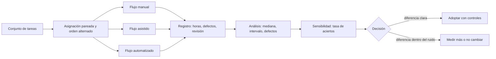
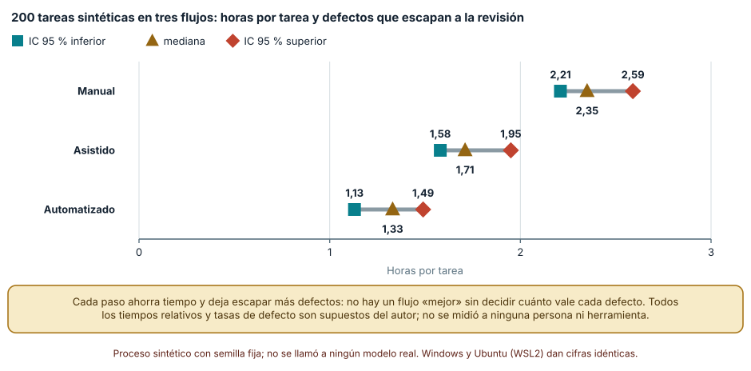
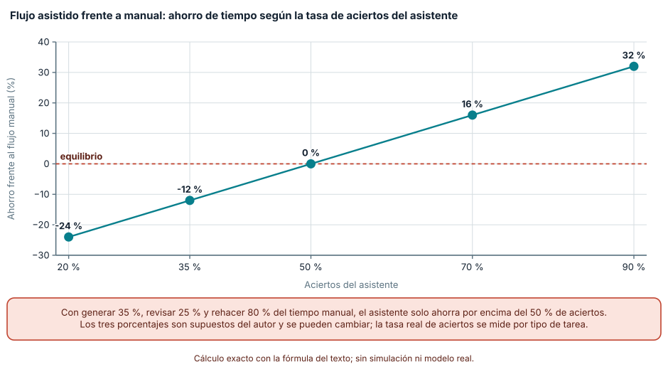
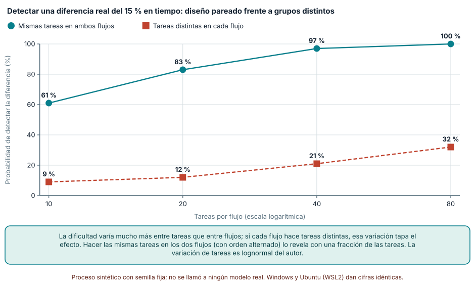

# SE-467 — Taller: comparar flujos manual, asistido y automatizado

[← SE-466 — Privacidad, propiedad intelectual y código inseguro](../../classes/part-38-desarrollo-de-software-asistido-por-ia/se-466-privacidad-propiedad-intelectual-y-codigo-inseguro/README.md) · [↑ Parte 38](../../classes/part-38-desarrollo-de-software-asistido-por-ia/README.md) · [📚 Índice completo](../../classes/README.md) · [🌐 Portal](../../site/classes/SE-467.html) · [SE-468 — Proyecto: cambio real con trazabilidad y revisión humana →](../../classes/part-38-desarrollo-de-software-asistido-por-ia/se-468-proyecto-cambio-real-con-trazabilidad-y-revision-humana/README.md)

## Punto profesional y fundamento pedagógico

**Punto profesional.** El taller existe para que dejes de discutir si «la IA nos hace más rápidos» y aprendas a construir la respuesta con tus propias tareas: tres flujos de trabajo (manual, asistido por un humano que conduce y automatizado con un agente que ejecuta), un protocolo que registre tiempo, defectos y esfuerzo de revisión, un diseño que no confunda la dificultad de las tareas con el efecto de la herramienta y un informe que declare su incertidumbre. La habilidad es medir en vez de opinar, saber que cada ahorro de tiempo tiene un precio en defectos o en revisión, y decir con qué probabilidad la diferencia observada es real.

**Por qué aparece aquí.** Sigue a **Privacidad, propiedad intelectual y código inseguro**: `SE-466` puso un costo a los controles; el taller integra todo lo anterior (modos de uso, contexto, evals, controles) en una comparación de extremo a extremo. Es la práctica que prepara el proyecto de `SE-468`. El caso conductor es el **módulo de calificaciones de la plataforma educativa**: un conjunto de tareas de mantenimiento resueltas por los tres flujos. Es un caso sintético; los flujos son modelos con parámetros del autor y ninguna persona ni herramienta fue medida.

**Error conceptual que debe corregir.** Creer que comparar flujos es cronometrar a una persona que hace una tarea con asistente y a otra que la hace sin él. Las tareas difieren mucho más entre sí que los flujos entre sí, y personas distintas tienen ritmos distintos; si cada flujo se mide con tareas o personas diferentes, esa variación tapa el efecto, y la diferencia que se vea será sobre todo azar o dificultad.

**Secuencia de aprendizaje.** Antes de ver los resultados, predices cuál de los tres flujos termina primero y cuál deja escapar más defectos; después simulas 200 tareas con los tres flujos y calculas la mediana con un intervalo bootstrap, buscas la tasa de aciertos con la que el flujo asistido deja de ahorrar tiempo y mides cuántas tareas necesita un diseño pareado frente a uno con tareas distintas para detectar una diferencia del 15 %. La secuencia usa predicción, explicación propia, contraste y recuperación. [ICAP](https://icap.education.asu.edu/research) distingue participación de construcción de conocimiento; [How People Learn II](https://nap.nationalacademies.org/catalog/24783/how-people-learn-ii-learners-contexts-and-cultures) respalda diseñar la práctica con contextos reales y retroalimentación.

**Evidencia de aprendizaje.** `taller-flujos.md` con la predicción, las tres figuras reproducidas, el protocolo (tareas, asignación, registro, criterios de aceptación), los datos de al menos una comparación pareada real o realista de tu equipo, el análisis con intervalos, la sensibilidad a la tasa de aciertos y una nota que separe qué es medido, inferido y supuesto.

**Límite de la conclusión.** Las horas manuales (lognormales), los tiempos relativos de cada paso, las tasas de acierto, las tasas de defecto y la variabilidad entre tareas son construcciones del autor con semilla fija. Los cálculos estadísticos (bootstrap, ahorro, potencia) son código real, pero se aplican a datos simulados; las cifras no describen a ninguna persona ni herramienta, y que el flujo automatizado «gane» en tiempo en esta simulación es consecuencia de los parámetros elegidos.

### Trazabilidad fuente → afirmación

| Fuente primaria u oficial | Afirmación que respalda | Lo que no prueba |
|---|---|---|
| [Peng et al., «The Impact of AI on Developer Productivity: Evidence from GitHub Copilot»](https://arxiv.org/abs/2302.06590) | Un experimento controlado con una tarea acotada midió un 55,8 % menos de tiempo con asistente. | No generaliza a tareas largas ni a proyectos conocidos. |
| [METR, «Measuring the Impact of Early-2025 AI on Experienced Open-Source Developer Productivity»](https://arxiv.org/abs/2507.09089) | Un ensayo aleatorizado con desarrolladores expertos sobre sus propios proyectos midió un 19 % más de tiempo con herramientas de IA. | Estudio pequeño de un periodo concreto; no es una ley. |
| [Sjøberg et al., «A survey of controlled experiments in software engineering»](https://doi.org/10.1109/TSE.2005.97) | Revisa cómo se han hecho los experimentos controlados en ingeniería de software y sus limitaciones habituales (muestras, tareas, participantes). | No es un protocolo para tu equipo. |
| [Wohlin et al., «Experimentation in Software Engineering»](https://doi.org/10.1007/978-3-642-29044-2) | Tratado sobre diseño, análisis y amenazas a la validez de los experimentos en ingeniería de software, con diseños pareados y por bloques. | No fija qué tamaño necesita tu estudio. |
| [Efron, «Bootstrap Methods: Another Look at the Jackknife»](https://doi.org/10.1214/aos/1176344552) | Introduce el bootstrap para estimar la variabilidad de un estadístico por remuestreo. | No corrige datos no representativos. |
| [DORA Report 2024](https://dora.dev/research/2024/dora-report/) | Informa de una encuesta sobre el uso de IA en equipos de desarrollo y su relación con indicadores de entrega y estabilidad. | Encuesta, no experimento; no establece causalidad. |
| [Parasuraman y Manzey](https://doi.org/10.1177/0018720810376055) | Describe el sesgo de automatización: aceptar la salida automatizada y vigilar menos. | No estudia asistentes de programación. |

## Antes de empezar

Recupera lo aprendido en `SE-466`: los controles tienen un costo y no se saltan por prisa. La pregunta activa es: **¿qué diferencia en tiempo o en defectos te haría cambiar de flujo, y cuántas tareas necesitas para verla?**

## Prerrequisitos

- Haber completado `SE-466` o poder explicar por qué los controles de datos y de código se instalan en el proceso.
- Python 3.11 o posterior; los experimentos usan solo la biblioteca estándar (`random`, `statistics`, `math`).
- Saber leer una mediana, un intervalo de confianza y la diferencia entre tareas pareadas e independientes.

## Problema auténtico

La dirección preguntó si debían adoptar agentes para el mantenimiento del módulo. Una persona resolvió cinco tareas con el asistente, anotó que había tardado la mitad y concluyó que «ahorra el 50 %». Otra, que usaba el asistente desde hacía un mes, tardó lo mismo que antes y concluyó que «no sirve». Ninguna midió defectos posteriores ni el tiempo de revisión, y las tareas de la primera eran más sencillas. Un tercer intento con un agente completó doce tareas sin intervención, y tres semanas después aparecieron cuatro defectos en producción que nadie había revisado a fondo. La pregunta de la dirección era razonable y las tres respuestas, anecdóticas. El taller convierte la pregunta en una medición: mismas tareas en los tres flujos, orden alternado, registro de tiempo y defectos, análisis con intervalos y sensibilidad a los supuestos.

## Objetivos observables

Al terminar podrás:

1. definir tres flujos comparables con la misma entrada, el mismo criterio de aceptación y el mismo registro;
2. diseñar una medición pareada, con orden alternado y tareas representativas, y justificar por qué supera a una con grupos distintos;
3. calcular medianas con intervalos bootstrap y comparar flujos por tiempo y por defectos que escapan;
4. encontrar el punto de equilibrio del flujo asistido en función de su tasa de aciertos;
5. redactar un informe que diga qué se midió, qué se supuso y qué decisión justifica.

## Mapa conceptual



El mapa recorre el protocolo de principio a fin. Las tres ramas parten de las mismas tareas, y la decisión se toma sobre el análisis con su incertidumbre, no sobre un promedio sin intervalo.

## Temas y por qué importan

| Tema | Por qué cambia una decisión profesional | Evidencia mínima |
|---|---|---|
| Definir los flujos | Evita comparar cosas distintas con el mismo nombre | descripción de cada flujo con entrada, salida y criterio |
| Diseño pareado | Elimina la variación entre tareas | tabla de potencia pareado frente a independiente |
| Métricas | Tiempo sin defectos es una medida engañosa | horas, defectos y revisión por flujo |
| Análisis con incertidumbre | Distingue señal de ruido | mediana con intervalo bootstrap |
| Sensibilidad | Muestra de qué supuesto depende la conclusión | punto de equilibrio de la tasa de aciertos |
| Informe | Convierte la medición en decisión defendible | informe con decisión, límites y revisión |

## Conceptos y decisiones

### 1. Tres flujos, tres perfiles de costo

Un flujo **manual** produce el cambio sin asistencia generativa: el tiempo es el de escribir, probar y revisar. El flujo **asistido** mantiene a la persona al volante: el asistente sugiere, edita y explica, y la persona decide qué aceptar. Su tiempo se compone de generar, revisar lo generado y rehacer cuando falla. El flujo **automatizado** delega la ejecución de la tarea a un agente que lee, edita y ejecuta pruebas en bucle; la persona prepara el encargo y revisa el resultado. Su tiempo se reparte entre preparar, revisar el resultado final y rehacer, y su riesgo es que los pasos intermedios no pasan por ojos humanos (`SE-460`). Cada flujo trae una estructura de costos distinta, y el resultado depende de la proporción de tareas que cada uno resuelve a la primera. No tiene sentido compararlos sin declarar qué incluye cada tiempo, en particular si se cuenta la revisión.

### 2. Medir en pareado, con orden alternado

La dificultad de las tareas varía más que el efecto de cualquier flujo: una tarea puede tardar diez minutos y otra diez horas. Si cada flujo se mide con tareas diferentes, esa variación domina y el efecto queda enterrado. El diseño **pareado** hace que cada tarea se resuelva con los tres flujos, de modo que se compara cada tarea consigo misma y la dificultad se cancela. Introduce un problema: la segunda vez que alguien resuelve una tarea la conoce, y aprende. La solución estándar es **alternar el orden** (la mitad de las personas empieza por un flujo y la otra mitad por otro) o usar personas distintas para cada flujo en la misma tarea, y declarar el efecto de aprendizaje que no se pudo eliminar. Wohlin y sus coautores tratan estos diseños y las amenazas a la validez asociadas; Sjøberg y sus coautores muestran cuántos experimentos publicados tienen limitaciones de muestra y de representatividad de las tareas.

### 3. Qué se mide: tiempo, defectos y esfuerzo de revisión

El tiempo hasta que algo «parece terminado» es la medida más fácil y la más engañosa, porque un flujo puede ser más rápido a costa de dejar pasar defectos. Un registro útil tiene al menos cuatro columnas por tarea y flujo: horas de trabajo activo, horas de revisión por una segunda persona, resultado del criterio de aceptación (pasa o no) y defectos detectados después en un periodo declarado. Los defectos que escapan solo se conocen con retraso, de modo que el informe debe esperar o declarar el periodo de observación. Y conviene medir también el esfuerzo de revisión por separado, porque es el que más cambia al introducir un asistente: una solución rápida que requiere una revisión larga no ahorró nada. El DORA Report, por su parte, pone el foco en indicadores de entrega y estabilidad junto a la velocidad, recordando que la rapidez no basta.

### 4. Intervalos para tamaños pequeños: el bootstrap

Con 200 tareas, la mediana de horas tiene una variabilidad que se puede estimar remuestreando: se extraen 200 tareas con reemplazo, se calcula la mediana, y se repite mil veces; los percentiles 2,5 y 97,5 de esas medianas forman un intervalo del 95 %. Efron introdujo el método y su ventaja es que no supone una distribución concreta de los tiempos, que suelen ser asimétricos y de cola larga. Su límite es que supone que la muestra representa a la población: si las tareas elegidas son las fáciles, el intervalo es estrecho y no representa a las difíciles. Cuando los intervalos de dos flujos no se solapan, la diferencia es una señal razonable; cuando se solapan, no hay base para elegir sobre el tiempo, y la decisión debe apoyarse en otras dimensiones (defectos, revisión, riesgo).

### 5. Sensibilidad: de qué supuesto depende la conclusión

Toda comparación se apoya en parámetros que se estimaron con error. Una **sensibilidad** muestra cómo cambia la conclusión cuando se mueven. En el flujo asistido, el parámetro dominante es la tasa de aciertos: la fracción de tareas que el asistente resuelve a la primera. Si generar cuesta una fracción *g* del tiempo manual, revisar una fracción *r* y rehacer una fracción *f* cuando falla, el tiempo relativo es *g* + *r* + (1 − *p*)·*f*, donde *p* es la tasa de aciertos. Es mejor que lo manual cuando ese valor es menor que 1, y el punto de equilibrio está en *p* = 1 − (1 − *g* − *r*)/*f*. Con *g* = 0,35, *r* = 0,25 y *f* = 0,80, el equilibrio es el 50 %. Un resultado que cambia de signo con un parámetro razonable no es una conclusión sino una hipótesis, y el informe debe presentarlo así.

### Doscientas tareas, tres flujos: tiempo y defectos

Se generan 200 tareas con horas manuales lognormales (parámetros 0,9 y 0,5) y un 30 % de tareas difíciles. El flujo manual tarda lo que dice la tarea y deja escapar defectos con probabilidad 0,06. El asistido tiene una tasa de aciertos de 0,85 en tareas fáciles y 0,55 en difíciles; tarda 0,35 (generar) + 0,25 (revisar) del tiempo manual más 0,80 si hay que rehacer, y deja escapar defectos con probabilidad 0,05 si acierta y 0,12 si no. El automatizado acierta 0,75 y 0,40, tarda 0,10 + 0,30 más 1,00 si falla, y deja escapar 0,09 si acierta y 0,25 si no. Se calcula la mediana de horas con un intervalo bootstrap de 1 000 remuestreos.

```python
boots = sorted(statistics.median(rng.choices(horas, k=n)) for _ in range(1000))
ic95 = (boots[25], boots[975])
```

| Flujo | Mediana (h) | IC 95 % (bootstrap) | Horas totales | Defectos que escapan |
|---|---:|---|---:|---:|
| Manual | 2,35 | 2,21 – 2,59 | 540,7 | 10 |
| Asistido | 1,71 | 1,58 – 1,95 | 428,6 | 18 |
| Automatizado | 1,33 | 1,13 – 1,49 | 390,9 | 20 |

La mediana baja de 2,35 a 1,71 y a 1,33 horas, con intervalos que no se solapan entre manual y automatizado, y que casi se tocan entre manual y asistido (2,21 frente a 1,95). Las horas totales bajan de 540,7 a 428,6 (−21 %) y a 390,9 (−28 %). A cambio, los defectos que escapan suben de 10 a 18 y a 20, el doble. Cada paso hacia la automatización ahorra tiempo y deja pasar más defectos; no hay un flujo «mejor» sin decidir cuánto vale evitar un defecto, y esa decisión depende de la gravedad: el asistido ahorra 112 horas y deja escapar 8 defectos más, de modo que si cada defecto cuesta más de unas 14 horas de arreglo y daño el manual sale ganando (unas 15 horas frente al automatizado, que ahorra 150 y deja escapar 10 más).



**Cómo leer la figura.** Cada fila es un flujo; las dos columnas centrales dicen cuánto se tarda y con qué incertidumbre, y la última el precio en defectos. **Dónde deja de valer:** todos los parámetros son supuestos del autor; el número de defectos es un conteo con mucha variabilidad (10 y 20 de 200 son diferencias que un segundo experimento podría invertir) y no se calculó su intervalo; los tres flujos no dependen de personas concretas.

### Cuándo el flujo asistido deja de ahorrar

Con generar al 35 %, revisar al 25 % y rehacer al 80 % del tiempo manual, el tiempo relativo del flujo asistido depende solo de la tasa de aciertos.

| Aciertos del asistente | Horas respecto al manual | Ahorro |
|---:|---:|---:|
| 90 % | 0,68 | 32 % |
| 70 % | 0,84 | 16 % |
| 50 % | 1,00 | 0 % |
| 35 % | 1,12 | −12 % |
| 20 % | 1,24 | −24 % |

Con un 90 % de aciertos el flujo asistido ahorra el 32 % del tiempo; con el 70 %, el 16 %; con el 50 % no ahorra nada, y por debajo cuesta más que hacerlo a mano: con un 20 % de aciertos, el 24 % más. El punto de equilibrio, 50 %, no es una propiedad de los asistentes sino de estos tres porcentajes: si revisar cuesta el 40 % en lugar del 25 %, el equilibrio sube al 69 %. Lo transferible es la fórmula y la pregunta que genera: ¿cuál es la tasa de aciertos en tus tareas, por tipo, y cuánto cuesta realmente revisar y rehacer?



**Cómo leer la figura.** Cada fila es una tasa de aciertos; el ahorro cruza cero en el 50 %. **Dónde deja de valer:** los tres porcentajes son del autor, el modelo supone que el costo de rehacer es el mismo en todas las tareas y que revisar cuesta lo mismo se acierte o no, cuando una solución mala suele detectarse antes. Es un cálculo exacto de una fórmula, sin simulación.

### Pareado frente a independiente: cuántas tareas hacen falta

Se simulan tareas con dificultad lognormal (parámetros 1,0 y 0,8). El flujo asistido reduce el tiempo un 15 % y cada medición añade un ruido multiplicativo lognormal de 0,15. En el diseño pareado cada tarea se resuelve con los dos flujos y se contrasta la diferencia; en el independiente cada flujo recibe tareas distintas y se contrastan las medias. Para cada tamaño se simulan 600 experimentos y se cuenta cuántas veces se detecta la diferencia con una estadística t superior a 1,7.

| Tareas por flujo | Mismas tareas en ambos flujos | Tareas distintas en cada flujo |
|---:|---:|---:|
| 10 | 61 % | 9 % |
| 20 | 83 % | 12 % |
| 40 | 97 % | 21 % |
| 80 | 100 % | 32 % |

Con 20 tareas el diseño pareado detecta la diferencia real del 15 % en el 83 % de los experimentos, y el de tareas distintas en el 12 %. Con 80 tareas el pareado llega al 100 % y el independiente solo al 32 %: haría falta un múltiplo de ese tamaño. La diferencia es enorme porque la dificultad varía mucho más (desviación 0,8) que el efecto (15 %), y el pareado la cancela. Es la razón de que se mida con las mismas tareas en los dos flujos y con orden alternado.



**Cómo leer la figura.** Cada fila es un tamaño de estudio; la columna central es el diseño recomendado y la última, el que mezcla tareas. **Dónde deja de valer:** la variabilidad entre tareas, el tamaño del efecto y el ruido de medición son supuestos del autor; el efecto de aprendizaje (resolver la misma tarea dos veces) no está modelado y en la práctica reduce la ventaja del pareado, que se compensa alternando el orden. El umbral t > 1,7 es una aproximación.

## Definiciones de trabajo

- **flujo manual:** trabajo sin asistencia generativa.
- **flujo asistido:** trabajo en que la persona conduce y el asistente sugiere, edita y explica.
- **flujo automatizado:** trabajo en que un agente ejecuta la tarea en bucle y la persona prepara el encargo y revisa el resultado.
- **diseño pareado:** diseño en que cada tarea se resuelve con todos los flujos, de modo que se compara cada tarea consigo misma.
- **bootstrap:** método que estima la variabilidad de un estadístico remuestreando los datos con reemplazo.

Las definiciones son operativas para el módulo de calificaciones. No convierten términos con una historia más amplia en sinónimos y deben contrastarse con la documentación primaria enlazada al final.

## Ejemplo mínimo

El fragmento calcula el punto de equilibrio del flujo asistido. Antes de ejecutarlo, predice si sube o baja cuando revisar cuesta más.

```python
def equilibrio(g, r, f):
    return 1 - (1 - g - r) / f
print(round(equilibrio(0.35, 0.25, 0.80), 2), round(equilibrio(0.35, 0.40, 0.80), 2))
```

Con revisión del 25 % el equilibrio es 0,50; con 40 % sube a 0,69: cuanto más cuesta revisar, más acierto exige el asistente para compensar. Registra versión de Python, comando y salida; después cambia el costo de rehacer a 0,5 y observa el efecto.

## Ejemplo profesional

Escenario hipotético, construido para la clase y sin datos reales. El equipo del módulo de calificaciones diseña el estudio. Selecciona 24 tareas de mantenimiento del último trimestre, estratificadas por tamaño y tipo, cada una con una prueba ejecutable y un periodo de observación de defectos de cuatro semanas. Seis personas resuelven cada tarea una vez con un flujo asignado por un cuadrado latino (cada persona usa cada flujo en tareas distintas, y cada tarea se resuelve por flujos distintos en rondas alternadas), registran horas activas, horas de revisión por otra persona, resultado de las pruebas y defectos posteriores, y declaran los casos en que ya conocían la tarea. El análisis calcula la mediana de horas con un intervalo bootstrap por flujo y la diferencia pareada por tarea; calcula el punto de equilibrio con las tasas observadas; y presenta los defectos como conteo con su periodo y sus limitaciones. El informe concluye que el flujo asistido ahorra tiempo en las tareas pequeñas con la tasa de aciertos observada y no lo ahorra en las grandes, que el automatizado solo se admite en tareas con pruebas de especificación y revisión de un humano, y que la decisión se revisa al cambiar de modelo o de tipo de tarea. Compara con el estado inicial: antes se decidía con cinco tareas y una impresión.

## Práctica guiada

1. Predice cuál de los tres flujos termina primero y cuál deja escapar más defectos y anota tus dos respuestas.
2. Reproduce la tabla de los tres flujos con la semilla fijada y compara con tu predicción.
3. Cambia la tasa de aciertos del asistente en tareas difíciles de 0,55 a 0,30 y observa cómo se mueven el tiempo y los defectos.
4. Calcula el punto de equilibrio con tus propias estimaciones de generar, revisar y rehacer.
5. Reproduce la tabla pareado frente a independiente y estima cuántas tareas necesitas para tu efecto esperado.
6. Diseña el protocolo: tareas, asignación con orden alternado, registro de horas, revisión, defectos y periodo de observación.
7. Entrega `taller-flujos.md` y pide a otra persona que identifique la amenaza a la validez más importante de tu diseño.

## Ejercicios

1. **Equilibrio:** calcula el punto de equilibrio con generar 0,30, revisar 0,20 y rehacer 1,0. ¿Qué cambia si rehacer cuesta menos?
2. **Diseño:** explica por qué hacer que la misma persona resuelva la tarea dos veces introduce un sesgo y cómo lo mitigas con el orden.
3. **Defectos:** el flujo A deja escapar 10 defectos y el B 18 en 200 tareas. Explica por qué no puedes concluir que B es peor sin un intervalo y cómo lo calcularías.
4. **Decisión:** el flujo automatizado ahorra el 28 % del tiempo y duplica los defectos. Escribe la condición bajo la cual lo adoptarías y qué controles añadirías.

## Reto verificable

Entrega `taller-flujos.md` con la predicción, las tres tablas, el protocolo de un estudio pareado con orden alternado, el análisis con intervalo bootstrap sobre al menos 20 tareas reales o realistas de tu equipo, el punto de equilibrio con tus estimaciones y el informe de decisión con sus límites. Se aprueba si otra persona ejecuta el análisis desde un checkout limpio, obtiene los mismos números con los mismos datos y puede nombrar la decisión, su condición de revisión y la mayor amenaza a la validez. No se aprueba por comparar flujos con tareas distintas, ni por reportar tiempos sin defectos ni intervalo.

## Caso conductor

El módulo de calificaciones es el caso conductor. Este taller deja el undécimo artefacto: el protocolo y el análisis comparativo de los tres flujos con su decisión. `SE-468` aplicará el flujo elegido a un cambio real con trazabilidad y revisión humana. Cambia después un solo dato, el costo de revisión, y observa cómo se mueve el punto de equilibrio y con él la decisión.

## Preguntas frecuentes

### ¿Basta con que cada persona se cronometre unas semanas?

Esa medida mezcla tareas distintas, aprendizaje y expectativas. Un protocolo con las mismas tareas, orden alternado y criterio de aceptación común es mucho más informativo con muchos menos datos.

### ¿Cómo mido la calidad si los defectos tardan en aparecer?

Define un periodo de observación y espera, o usa un sustituto razonable (un conjunto de pruebas ocultas, una revisión ciega) y declara su limitación. Informar solo del tiempo oculta lo que el flujo deja pasar.

### ¿Los resultados de estudios publicados me sirven?

Como fuente de hipótesis y de orden de magnitud, sí; como decisión sobre tu equipo, no: dependen de las tareas, las personas y las herramientas. Los estudios citados dan resultados opuestos porque miden contextos distintos.

### ¿Qué hago si los intervalos se solapan?

No hay base para elegir sobre el tiempo; mira otras dimensiones (defectos, revisión, riesgo, preferencias), mide más tareas o conserva el flujo actual. Una diferencia que no se distingue del ruido no justifica un cambio costoso.

## Fallo controlado y diagnóstico

Reproduce el fallo clásico del taller: **comparar flujos con tareas distintas y concluir un efecto que es dificultad**. Simula el diseño con tareas distintas en cada flujo y cuenta cuántas veces detecta la diferencia.

Registra síntoma, entrada mínima, hipótesis, observación que descarta cada hipótesis, causa, corrección y prueba de regresión. **Síntoma:** dos equipos miden el mismo flujo y obtienen conclusiones opuestas. **Hipótesis rivales:** (a) las personas de un equipo son más rápidas; (b) la herramienta se comporta distinto; (c) las tareas medidas tenían dificultades distintas. **Prueba:** repite la comparación con las mismas tareas en los dos flujos; si la detección sube de 12 % a 83 % con 20 tareas sin cambiar nada más, la causa es la variación entre tareas. **Conclusión:** el diseño con tareas distintas no tiene potencia para el efecto buscado. **Regresión:** añade al protocolo una comprobación que falle si un flujo no tiene las mismas tareas que los demás. No cambies a la vez el diseño y las personas.

## Errores comunes y cómo corregirlos

| Síntoma | Causa probable | Corrección |
|---|---|---|
| «Ahorra el 50 %» a partir de cinco tareas | Muestra pequeña y tareas no comparables | Diseño pareado y tamaño calculado |
| Se informa solo de tiempo | No se midieron defectos ni revisión | Registro con horas activas, revisión y defectos |
| Dos conclusiones opuestas con la misma herramienta | Variación entre tareas o personas | Mismas tareas, orden alternado, intervalos |
| El flujo automatizado «gana» y aparecen defectos en producción | Los pasos intermedios no se revisaron | Revisión humana del resultado y periodo de observación |
| El informe afirma un ahorro sin decir de qué depende | No hay sensibilidad | Punto de equilibrio y variación de los supuestos |

## Entorno y archivos clave

```text
work/SE-467/
├── README.md
├── taller/
│   ├── protocolo.md
│   ├── simulacion.py
│   ├── bootstrap.py
│   └── equilibrio.py
├── data/registro-tareas.csv
├── tests/test_taller.py
└── evidence/taller-flujos.md
```

El `README` declara plataforma, versión de Python, semillas y comandos. Los experimentos usan solo la biblioteca estándar (`random`, `statistics`, `math`) y se ejecutaron con CPython 3.12.9 en Windows 11 y 3.12.3 en Ubuntu bajo WSL2: las salidas fueron idénticas. Los experimentos están en `scripts/experiments_part38_b.py`. Si usas datos de tu equipo, anonimízalos antes de compartirlos. Si añades una dependencia, fija procedencia y versión.

## Seguridad, ética y accesibilidad

- medir a personas exige su consentimiento informado y que los datos no se usen para evaluarlas individualmente; el estudio compara flujos, no personas;
- el flujo automatizado debe ejecutarse con los permisos mínimos y sin acceso a datos de producción (`SE-466`);
- un ahorro de tiempo que traslada defectos a quienes usan el sistema es un traslado de costo; documenta quién lo asume;
- los informes deben presentar intervalos y tablas con texto alternativo y sin depender del color;
- los artículos y estándares citados tienen derechos de autor: cita su estructura y vincula la fuente, no copies su texto.

## Puente hacia el trabajo con agentes

El flujo automatizado de este taller es el de un agente. Para evaluarlo con rigor, registra para cada tarea los pasos que dio, los tokens consumidos y el tiempo de reloj, repite cada tarea varias veces porque el mismo agente puede acertar y fallar, y compara su informe de resultado con la ejecución independiente de las pruebas. Revisa especialmente las tareas que resolvió con muchas iteraciones y las que declaró terminadas sin pruebas, y calcula la tasa de aciertos a la primera por tipo de tarea: es el parámetro del que depende todo el análisis de equilibrio.

## Transferencia

Traslada el análisis a otro dominio (por ejemplo, el desarrollo de plantillas de informes para un taller mecánico): cambia las tareas, los flujos y el costo de un defecto y conserva el procedimiento de diseño pareado, registro de tiempo, defectos y revisión, intervalo bootstrap y punto de equilibrio. La transferencia está lograda cuando puedes decir qué tipo de tarea de ese dominio dejaría de ahorrar tiempo con un asistente y con qué tasa de aciertos, no cuando la tabla se parece a la del módulo de calificaciones.

## Evaluación y evidencia

| Criterio | Evidencia para aprobar |
|---|---|
| comprensión | explicación de por qué el diseño pareado supera al independiente y de qué mide cada flujo |
| corrección | tablas de flujos, equilibrio y potencia reproducibles con las mismas semillas |
| diseño | protocolo con tareas, orden alternado, registro de horas, revisión y defectos |
| diagnóstico | reproducción del fallo «tareas distintas, efecto que es dificultad» con regresión |
| incertidumbre | intervalos y declaración de que los parámetros son supuestos |
| reproducibilidad | versiones, comandos, salida y límites declarados |

## Fuentes

- [Peng et al., «The Impact of AI on Developer Productivity»](https://arxiv.org/abs/2302.06590) — experimento controlado con una tarea acotada; autoridad: preprint de GitHub y Microsoft.
- [METR, «Measuring the Impact of Early-2025 AI on Experienced Open-Source Developer Productivity»](https://arxiv.org/abs/2507.09089) — ensayo aleatorizado con desarrolladores expertos; autoridad: METR.
- [Sjøberg et al.](https://doi.org/10.1109/TSE.2005.97) — experimentos controlados en ingeniería de software; autoridad: IEEE Transactions on Software Engineering.
- [Wohlin et al., «Experimentation in Software Engineering»](https://doi.org/10.1007/978-3-642-29044-2) — diseño y análisis de experimentos; autoridad: Springer.
- [Efron (1979)](https://doi.org/10.1214/aos/1176344552) — el bootstrap; autoridad: The Annals of Statistics.
- [DORA Report 2024](https://dora.dev/research/2024/dora-report/) — encuesta sobre IA en equipos de desarrollo; autoridad: DORA.
- [Parasuraman y Manzey](https://doi.org/10.1177/0018720810376055) — sesgo de automatización; autoridad: Human Factors.

Cada fuente respalda el mecanismo indicado; ninguna demuestra que el ahorro del 28 %, los 20 defectos del flujo automatizado o el 83 % de detección del diseño pareado se observen en un equipo real. Esa afirmación depende del equipo, de las tareas y de cómo se mida.

## Límites y siguiente paso

Se ejecutaron tres experimentos en Windows y Ubuntu (WSL2) con resultados idénticos: una simulación de tres flujos con bootstrap, un cálculo exacto del punto de equilibrio y una simulación de potencia para dos diseños. No se midió a ninguna persona ni se evaluó ninguna herramienta o agente; los tiempos manuales lognormales, los tiempos relativos de cada paso, las tasas de acierto y de defecto, la variación entre tareas y el ruido de medición son construcciones del autor, y que el flujo automatizado resulte más rápido es consecuencia de esos parámetros. La siguiente clase aplica el flujo elegido a un cambio real con trazabilidad y revisión humana.

## Glosario

- **flujo manual:** trabajo sin asistencia generativa.
- **flujo asistido:** trabajo en que la persona conduce y el asistente sugiere, edita y explica.
- **flujo automatizado:** trabajo en que un agente ejecuta la tarea en bucle y la persona prepara el encargo y revisa el resultado.
- **diseño pareado:** diseño en que cada tarea se resuelve con todos los flujos, de modo que se compara cada tarea consigo misma.
- **bootstrap:** método que estima la variabilidad de un estadístico remuestreando los datos con reemplazo.

---

[← SE-466 — Privacidad, propiedad intelectual y código inseguro](../../classes/part-38-desarrollo-de-software-asistido-por-ia/se-466-privacidad-propiedad-intelectual-y-codigo-inseguro/README.md) · [↑ Parte 38](../../classes/part-38-desarrollo-de-software-asistido-por-ia/README.md) · [📚 Índice completo](../../classes/README.md) · [🌐 Portal](../../site/classes/SE-467.html) · [SE-468 — Proyecto: cambio real con trazabilidad y revisión humana →](../../classes/part-38-desarrollo-de-software-asistido-por-ia/se-468-proyecto-cambio-real-con-trazabilidad-y-revision-humana/README.md)
